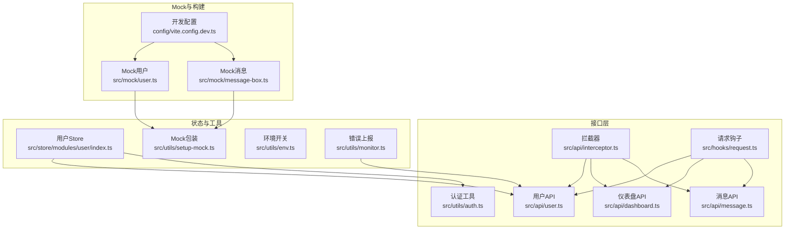
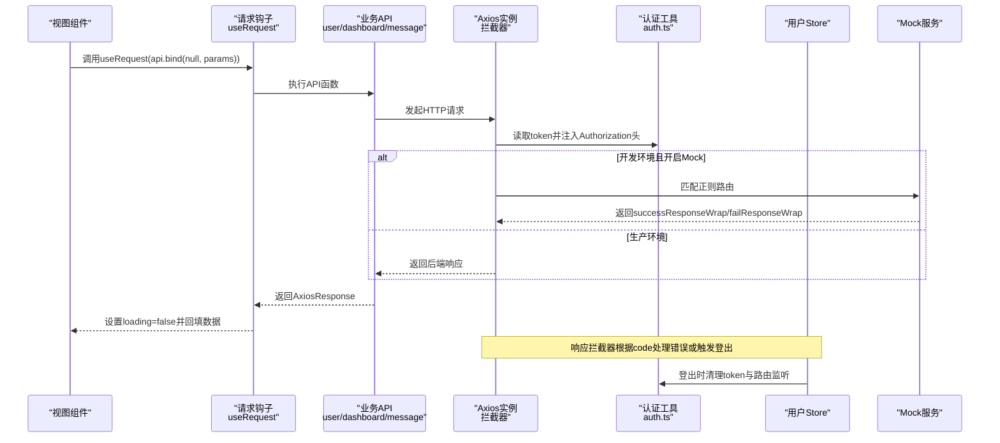
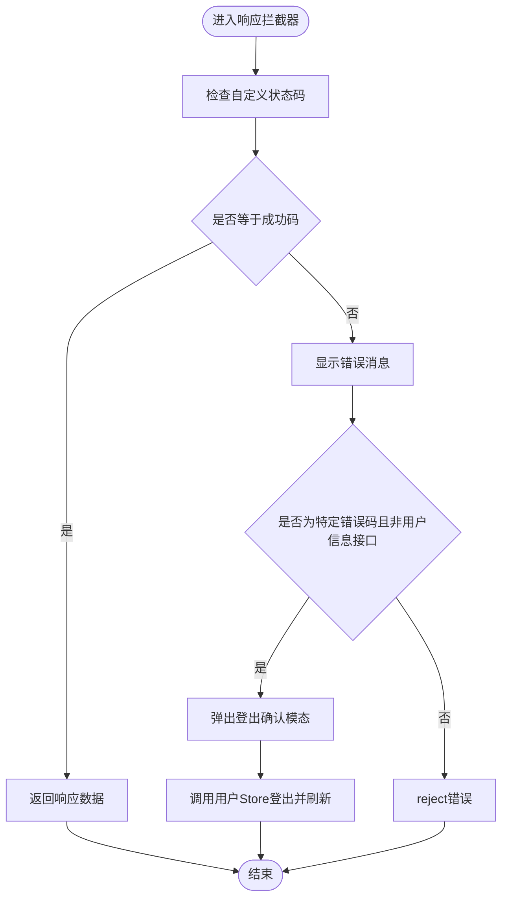
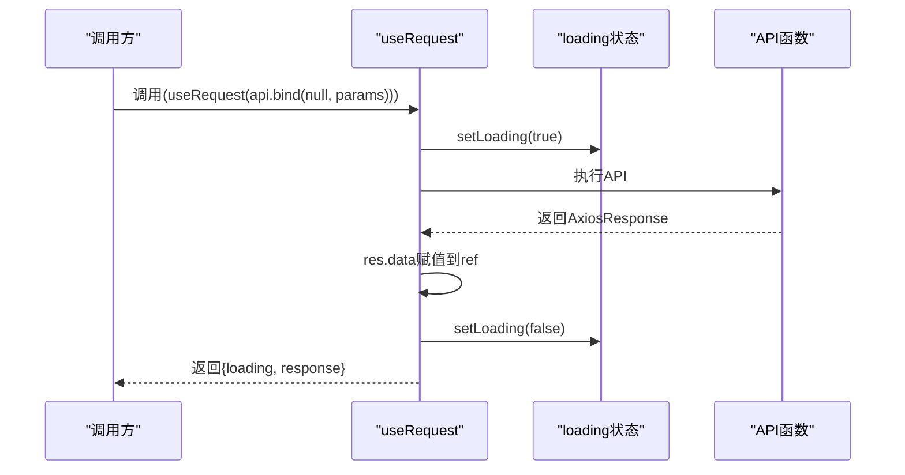
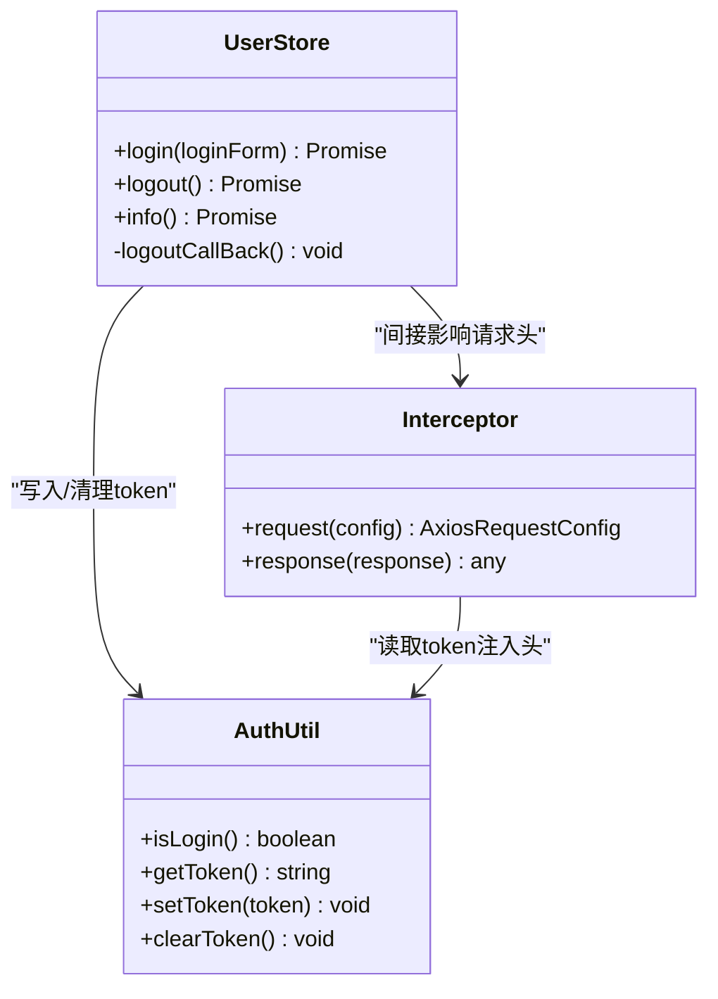
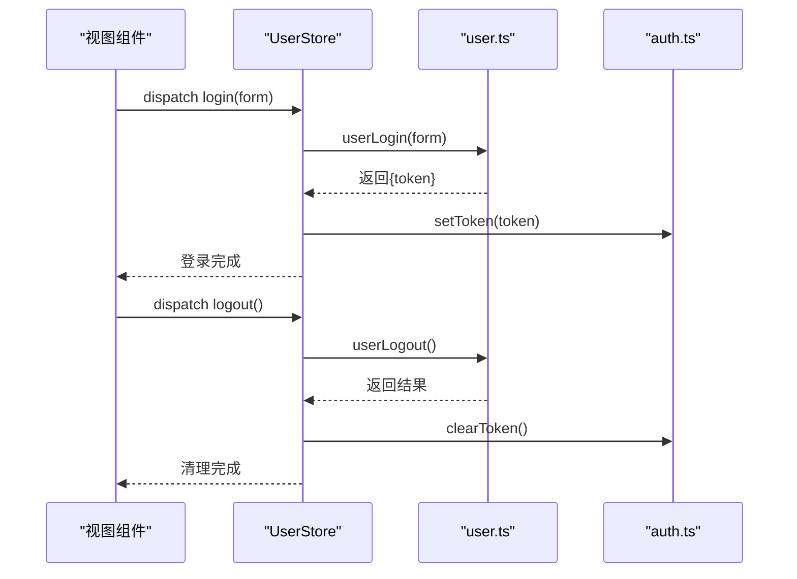
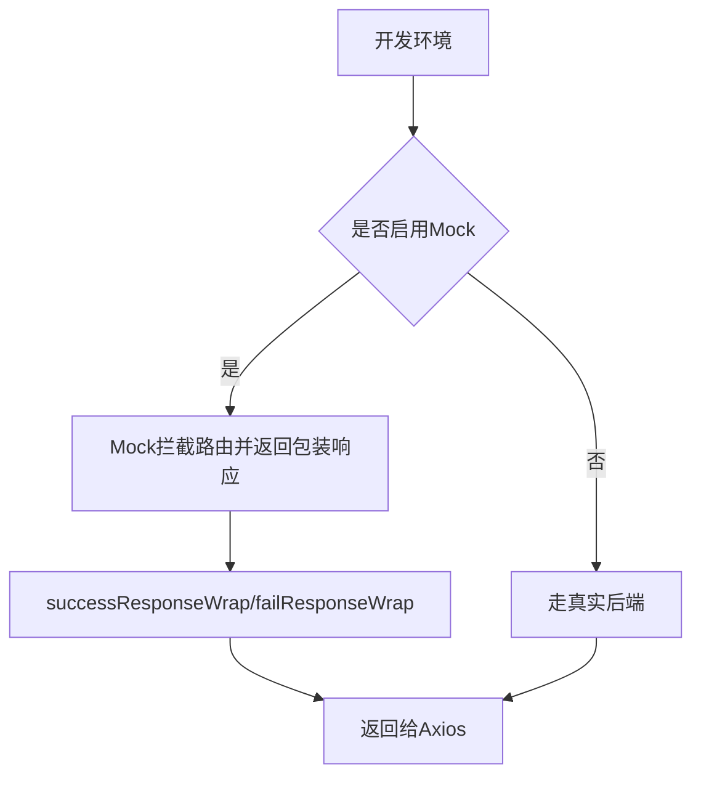
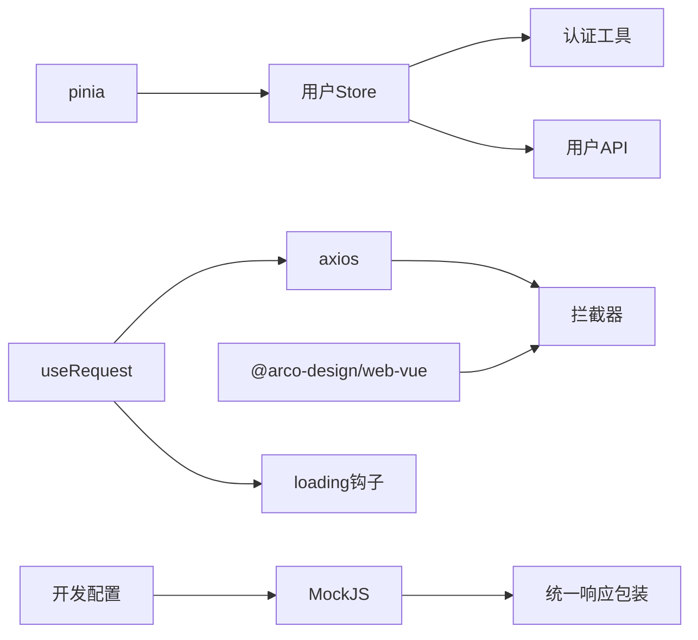

# API接口层

<cite>
**本文引用的文件**
- [src/api/interceptor.ts](file://src/api/interceptor.ts)
- [src/hooks/request.ts](file://src/hooks/request.ts)
- [src/utils/auth.ts](file://src/utils/auth.ts)
- [src/store/modules/user/index.ts](file://src/store/modules/user/index.ts)
- [src/api/user.ts](file://src/api/user.ts)
- [src/api/dashboard.ts](file://src/api/dashboard.ts)
- [src/api/message.ts](file://src/api/message.ts)
- [src/mock/user.ts](file://src/mock/user.ts)
- [src/mock/message-box.ts](file://src/mock/message-box.ts)
- [src/utils/setup-mock.ts](file://src/utils/setup-mock.ts)
- [src/utils/env.ts](file://src/utils/env.ts)
- [src/utils/monitor.ts](file://src/utils/monitor.ts)
- [config/vite.config.dev.ts](file://config/vite.config.dev.ts)
- [package.json](file://package.json)
</cite>

## 目录
1. [简介](#简介)
2. [项目结构](#项目结构)
3. [核心组件](#核心组件)
4. [架构总览](#架构总览)
5. [详细组件分析](#详细组件分析)
6. [依赖分析](#依赖分析)
7. [性能考虑](#性能考虑)
8. [故障排查指南](#故障排查指南)
9. [结论](#结论)
10. [附录](#附录)

## 简介
本文件系统性梳理前端API接口层的设计与实现，覆盖以下主题：
- API设计原则：统一响应格式、请求头注入、错误码约定与提示策略
- 请求拦截器：全局token注入、基础URL配置、请求前校验
- 响应处理机制：统一解包、错误码判定、异常分支处理（登出、重试等）
- 错误处理策略：消息提示、模态确认、错误上报
- 请求重试与超时：当前实现与可扩展点
- 认证token管理：本地存储、读取、清理与失效处理
- 请求头配置与响应数据格式化
- 最佳实践与性能优化建议
- 与后端交互模式与数据流转

## 项目结构
API接口层主要由以下模块构成：
- 拦截器与HTTP客户端：基于 axios 的请求/响应拦截器与默认配置
- 接口定义：按业务域划分的API模块（用户、仪表盘、消息）
- 钩子与工具：请求钩子、加载状态、认证工具、Mock辅助
- 状态管理：用户store负责登录、登出、信息拉取与token写入
- Mock环境：开发调试用的模拟接口与统一响应包装
- 构建配置：开发服务器与环境变量

图表来源
- [src/api/interceptor.ts:1-78](file://src/api/interceptor.ts#L1-L78)
- [src/hooks/request.ts:1-27](file://src/hooks/request.ts#L1-L27)
- [src/utils/auth.ts:1-20](file://src/utils/auth.ts#L1-L20)
- [src/store/modules/user/index.ts:1-92](file://src/store/modules/user/index.ts#L1-L92)
- [src/api/user.ts:1-28](file://src/api/user.ts#L1-L28)
- [src/api/dashboard.ts:1-23](file://src/api/dashboard.ts#L1-L23)
- [src/api/message.ts:1-39](file://src/api/message.ts#L1-L39)
- [src/mock/user.ts:1-106](file://src/mock/user.ts#L1-L106)
- [src/mock/message-box.ts:1-86](file://src/mock/message-box.ts#L1-L86)
- [src/utils/setup-mock.ts:1-24](file://src/utils/setup-mock.ts#L1-L24)
- [src/utils/env.ts:1-4](file://src/utils/env.ts#L1-L4)
- [src/utils/monitor.ts:1-28](file://src/utils/monitor.ts#L1-L28)
- [config/vite.config.dev.ts:1-24](file://config/vite.config.dev.ts#L1-L24)

章节来源
- [src/api/interceptor.ts:1-78](file://src/api/interceptor.ts#L1-L78)
- [src/hooks/request.ts:1-27](file://src/hooks/request.ts#L1-L27)
- [src/utils/auth.ts:1-20](file://src/utils/auth.ts#L1-L20)
- [src/store/modules/user/index.ts:1-92](file://src/store/modules/user/index.ts#L1-L92)
- [src/api/user.ts:1-28](file://src/api/user.ts#L1-L28)
- [src/api/dashboard.ts:1-23](file://src/api/dashboard.ts#L1-L23)
- [src/api/message.ts:1-39](file://src/api/message.ts#L1-L39)
- [src/mock/user.ts:1-106](file://src/mock/user.ts#L1-L106)
- [src/mock/message-box.ts:1-86](file://src/mock/message-box.ts#L1-L86)
- [src/utils/setup-mock.ts:1-24](file://src/utils/setup-mock.ts#L1-L24)
- [src/utils/env.ts:1-4](file://src/utils/env.ts#L1-L4)
- [src/utils/monitor.ts:1-28](file://src/utils/monitor.ts#L1-L28)
- [config/vite.config.dev.ts:1-24](file://config/vite.config.dev.ts#L1-L24)

## 核心组件
- 统一响应模型与拦截器
  - 定义统一响应结构，包含状态码、消息与数据体
  - 在请求阶段注入认证头；在响应阶段根据自定义状态码进行错误提示与登出处理
- 请求钩子
  - 封装列表类请求的加载状态与默认值，简化组件侧调用
- 认证工具
  - 提供token的读取、设置、清理与登录态判断
- 用户API与Store
  - 用户登录、登出、信息拉取与菜单拉取
  - Store中完成token写入与登出后的清理动作
- Mock与环境
  - 开发环境下通过Mock提供统一响应包装
  - 环境开关控制是否启用Mock
- 错误上报
  - 全局错误处理器将前端错误上报至后端

章节来源
- [src/api/interceptor.ts:7-77](file://src/api/interceptor.ts#L7-L77)
- [src/hooks/request.ts:11-26](file://src/hooks/request.ts#L11-L26)
- [src/utils/auth.ts:1-20](file://src/utils/auth.ts#L1-L20)
- [src/store/modules/user/index.ts:56-87](file://src/store/modules/user/index.ts#L56-L87)
- [src/api/user.ts:13-27](file://src/api/user.ts#L13-L27)
- [src/utils/setup-mock.ts:3-23](file://src/utils/setup-mock.ts#L3-L23)
- [src/utils/env.ts:1-4](file://src/utils/env.ts#L1-L4)
- [src/utils/monitor.ts:4-27](file://src/utils/monitor.ts#L4-L27)

## 架构总览
下图展示从前端调用到后端返回的整体流程，以及拦截器、Store与Hook的作用位置。

图表来源
- [src/hooks/request.ts:11-26](file://src/hooks/request.ts#L11-L26)
- [src/api/user.ts:13-27](file://src/api/user.ts#L13-L27)
- [src/api/dashboard.ts:9-22](file://src/api/dashboard.ts#L9-L22)
- [src/api/message.ts:16-38](file://src/api/message.ts#L16-L38)
- [src/api/interceptor.ts:18-77](file://src/api/interceptor.ts#L18-L77)
- [src/utils/auth.ts:7-9](file://src/utils/auth.ts#L7-L9)
- [src/store/modules/user/index.ts:73-87](file://src/store/modules/user/index.ts#L73-L87)
- [src/mock/user.ts:14-103](file://src/mock/user.ts#L14-L103)
- [src/utils/setup-mock.ts:7-23](file://src/utils/setup-mock.ts#L7-L23)

## 详细组件分析

### 组件A：请求拦截器与统一响应模型
- 设计原则
  - 统一响应字段：状态码、消息、数据体
  - 自定义状态码用于业务判定（例如20000为成功，其他为失败）
  - 基础URL可通过环境变量配置，便于多环境切换
- 请求拦截
  - 注入Authorization头（Bearer token），若无token则不添加
  - 可扩展：支持动态请求头、签名、时间戳等
- 响应拦截
  - 成功：透传响应数据
  - 失败：弹出消息提示；对特定错误码触发登出确认模态，并在确认后执行登出与页面刷新
  - 网络错误：统一提示并reject
- 错误码与行为
  - 特定错误码触发登出确认（避免多端登录冲突、令牌失效等）
  - 对用户信息接口做例外放行，避免误触登出

图表来源
- [src/api/interceptor.ts:39-77](file://src/api/interceptor.ts#L39-L77)

章节来源
- [src/api/interceptor.ts:7-16](file://src/api/interceptor.ts#L7-L16)
- [src/api/interceptor.ts:18-37](file://src/api/interceptor.ts#L18-L37)
- [src/api/interceptor.ts:39-77](file://src/api/interceptor.ts#L39-L77)

### 组件B：请求钩子 useRequest
- 作用
  - 将API调用封装为带加载态的响应式数据
  - 支持绑定参数（bind）以复用API函数
- 行为
  - 初始化loading状态
  - 执行API请求，将响应数据赋给ref
  - finally中关闭loading
- 使用建议
  - 列表类请求优先使用该钩子
  - 避免在异步函数中直接使用，遵循注释说明

图表来源
- [src/hooks/request.ts:11-26](file://src/hooks/request.ts#L11-L26)
- [src/hooks/loading.ts:3-16](file://src/hooks/loading.ts#L3-L16)

章节来源
- [src/hooks/request.ts:11-26](file://src/hooks/request.ts#L11-L26)
- [src/hooks/loading.ts:3-16](file://src/hooks/loading.ts#L3-L16)

### 组件C：认证token管理
- 存储与读取
  - 使用本地存储保存token键值
  - 提供读取、设置、清理与登录态判断
- 与Store协作
  - 登录成功写入token
  - 登出时清理token与路由监听、清空菜单
- 与拦截器协作
  - 请求拦截器从本地存储读取token并注入Authorization头

图表来源
- [src/utils/auth.ts:1-20](file://src/utils/auth.ts#L1-L20)
- [src/store/modules/user/index.ts:64-87](file://src/store/modules/user/index.ts#L64-L87)
- [src/api/interceptor.ts:18-31](file://src/api/interceptor.ts#L18-L31)

章节来源
- [src/utils/auth.ts:1-20](file://src/utils/auth.ts#L1-L20)
- [src/store/modules/user/index.ts:64-87](file://src/store/modules/user/index.ts#L64-L87)
- [src/api/interceptor.ts:18-31](file://src/api/interceptor.ts#L18-L31)

### 组件D：用户API与Store交互
- API层
  - 登录、登出、用户信息、菜单列表
- Store层
  - 登录：调用API，成功写入token
  - 登出：先调用后端登出，再清理本地状态
  - 信息：拉取用户信息并更新store
- 数据流
  - API返回的数据结构与Store状态保持一致，便于直接patch

图表来源
- [src/api/user.ts:13-27](file://src/api/user.ts#L13-L27)
- [src/store/modules/user/index.ts:64-87](file://src/store/modules/user/index.ts#L64-L87)
- [src/utils/auth.ts:11-17](file://src/utils/auth.ts#L11-L17)

章节来源
- [src/api/user.ts:13-27](file://src/api/user.ts#L13-L27)
- [src/store/modules/user/index.ts:56-87](file://src/store/modules/user/index.ts#L56-L87)
- [src/utils/auth.ts:11-17](file://src/utils/auth.ts#L11-L17)

### 组件E：Mock与统一响应包装
- 开发环境
  - 通过正则匹配路由，返回统一包装的成功/失败响应
  - 成功响应包含数据、状态、消息与状态码
- 测试与联调
  - 与真实后端保持相同响应结构，便于替换
- 环境开关
  - 仅在开发模式下启用

图表来源
- [src/mock/user.ts:14-103](file://src/mock/user.ts#L14-L103)
- [src/mock/message-box.ts:73-84](file://src/mock/message-box.ts#L73-L84)
- [src/utils/setup-mock.ts:3-23](file://src/utils/setup-mock.ts#L3-L23)
- [src/utils/env.ts:1-4](file://src/utils/env.ts#L1-L4)

章节来源
- [src/mock/user.ts:14-103](file://src/mock/user.ts#L14-L103)
- [src/mock/message-box.ts:73-84](file://src/mock/message-box.ts#L73-L84)
- [src/utils/setup-mock.ts:3-23](file://src/utils/setup-mock.ts#L3-L23)
- [src/utils/env.ts:1-4](file://src/utils/env.ts#L1-L4)

### 组件F：错误上报与监控
- 全局错误处理器
  - 将前端运行时错误上报至后端指定接口
  - 可扩展字段（注释中给出示例）用于采集上下文信息
- 适用场景
  - 与API层配合，形成“请求错误 + 运行时错误”的双通道监控

章节来源
- [src/utils/monitor.ts:4-27](file://src/utils/monitor.ts#L4-L27)

## 依赖分析
- 外部依赖
  - axios：HTTP客户端与拦截器
  - @arco-design/web-vue：消息与模态组件（用于错误提示与确认）
  - pinia：状态管理（用户Store）
- 内部依赖
  - 拦截器依赖认证工具读取token
  - Store依赖API与认证工具
  - 钩子依赖loading工具与axios响应类型
  - Mock依赖统一响应包装

图表来源
- [package.json:32-47](file://package.json#L32-L47)
- [src/api/interceptor.ts:1-6](file://src/api/interceptor.ts#L1-L6)
- [src/store/modules/user/index.ts:1-12](file://src/store/modules/user/index.ts#L1-L12)
- [src/hooks/request.ts:1-5](file://src/hooks/request.ts#L1-L5)
- [src/hooks/loading.ts:1-17](file://src/hooks/loading.ts#L1-L17)
- [src/mock/user.ts:1-6](file://src/mock/user.ts#L1-L6)
- [src/utils/setup-mock.ts:1-5](file://src/utils/setup-mock.ts#L1-L5)
- [config/vite.config.dev.ts:1-24](file://config/vite.config.dev.ts#L1-L24)

章节来源
- [package.json:32-47](file://package.json#L32-L47)
- [src/api/interceptor.ts:1-6](file://src/api/interceptor.ts#L1-L6)
- [src/store/modules/user/index.ts:1-12](file://src/store/modules/user/index.ts#L1-L12)
- [src/hooks/request.ts:1-5](file://src/hooks/request.ts#L1-L5)
- [src/hooks/loading.ts:1-17](file://src/hooks/loading.ts#L1-L17)
- [src/mock/user.ts:1-6](file://src/mock/user.ts#L1-L6)
- [src/utils/setup-mock.ts:1-5](file://src/utils/setup-mock.ts#L1-L5)
- [config/vite.config.dev.ts:1-24](file://config/vite.config.dev.ts#L1-L24)

## 性能考虑
- 请求合并与缓存
  - 对高频查询（如用户信息、菜单）采用缓存策略，减少重复请求
- 并发控制
  - 合理限制并发数，避免风暴效应
- 分页与懒加载
  - 列表类接口采用分页与懒加载，降低首屏压力
- 响应压缩与传输优化
  - 后端启用gzip/br压缩，前端合理设置请求头
- 加载态与骨架屏
  - 结合useRequest与loading钩子，提升感知性能
- 重试与退避
  - 当前未实现自动重试；可在拦截器或Axios适配器层扩展指数退避策略
- 超时控制
  - 当前未显式设置超时；可在Axios默认配置或具体请求中增加timeout字段

## 故障排查指南
- 登录后立即被登出
  - 检查拦截器中的特定错误码分支与用户信息接口例外逻辑
  - 确认token是否正确写入与注入
- 请求无响应或长时间卡顿
  - 检查是否缺少超时配置
  - 查看网络面板与后端日志
- Mock未生效
  - 确认开发环境开关与setupMock条件
- 错误提示过多
  - 检查响应拦截器的消息弹窗逻辑，必要时在业务层过滤
- 错误上报
  - 确认全局错误处理器已注册并指向有效上报地址

章节来源
- [src/api/interceptor.ts:48-66](file://src/api/interceptor.ts#L48-L66)
- [src/utils/monitor.ts:4-27](file://src/utils/monitor.ts#L4-L27)
- [src/utils/setup-mock.ts:3-5](file://src/utils/setup-mock.ts#L3-L5)
- [src/utils/env.ts:1-4](file://src/utils/env.ts#L1-L4)

## 结论
本API接口层通过统一响应模型、拦截器与认证工具实现了清晰的请求/响应处理链路；结合用户Store与请求钩子，提供了良好的开发体验与可维护性。建议后续在重试、超时、缓存与监控方面进一步增强，以提升稳定性与性能表现。

## 附录
- 最佳实践清单
  - 统一使用拦截器注入token，避免分散处理
  - 列表类请求一律使用useRequest，确保加载态一致
  - 错误码与消息提示保持前后端一致
  - 登录/登出流程严格分离，Store负责状态清理
  - 开发环境使用Mock，生产环境走真实后端
  - 对关键接口增加超时与重试策略
  - 使用全局错误上报收集前端异常