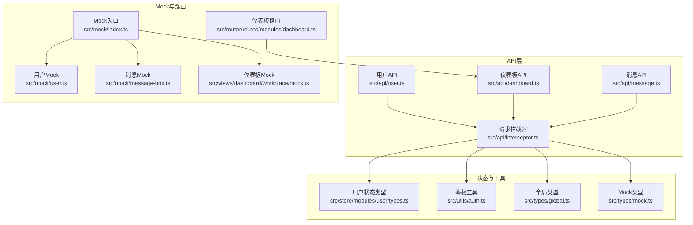
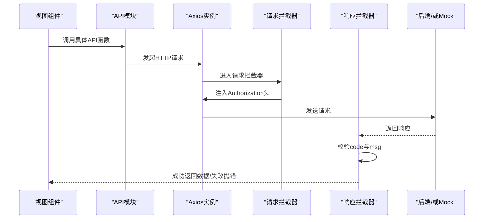
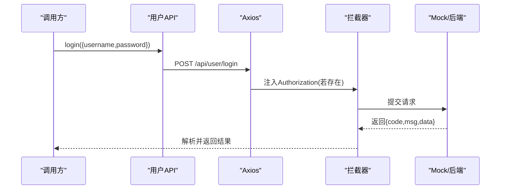
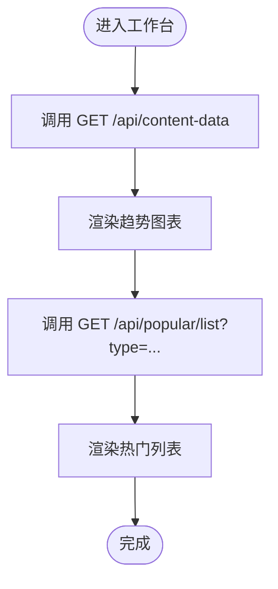
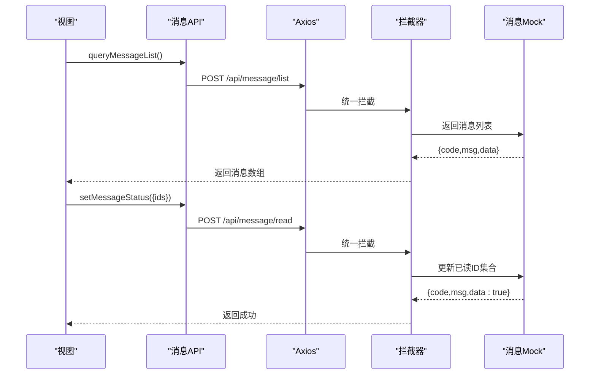
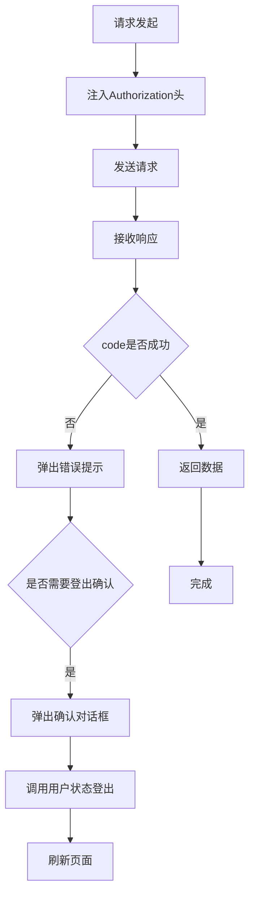
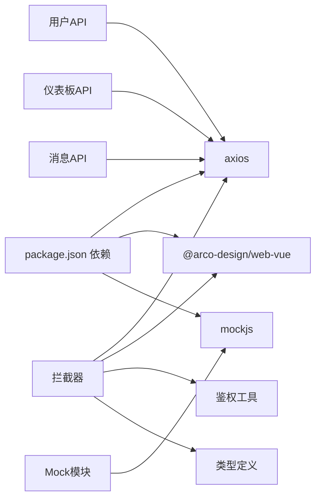

# API模块

<cite>
**本文引用的文件**
- [src/api/user.ts](file://src/api/user.ts)
- [src/api/dashboard.ts](file://src/api/dashboard.ts)
- [src/api/message.ts](file://src/api/message.ts)
- [src/api/interceptor.ts](file://src/api/interceptor.ts)
- [src/store/modules/user/types.ts](file://src/store/modules/user/types.ts)
- [src/utils/auth.ts](file://src/utils/auth.ts)
- [src/mock/index.ts](file://src/mock/index.ts)
- [src/mock/user.ts](file://src/mock/user.ts)
- [src/mock/message-box.ts](file://src/mock/message-box.ts)
- [src/views/dashboard/workplace/mock.ts](file://src/views/dashboard/workplace/mock.ts)
- [src/utils/setup-mock.ts](file://src/utils/setup-mock.ts)
- [src/types/global.ts](file://src/types/global.ts)
- [src/types/mock.ts](file://src/types/mock.ts)
- [src/router/routes/modules/dashboard.ts](file://src/router/routes/modules/dashboard.ts)
- [package.json](file://package.json)
</cite>

## 目录
1. [简介](#简介)
2. [项目结构](#项目结构)
3. [核心组件](#核心组件)
4. [架构总览](#架构总览)
5. [详细组件分析](#详细组件分析)
6. [依赖分析](#依赖分析)
7. [性能考虑](#性能考虑)
8. [故障排查指南](#故障排查指南)
9. [结论](#结论)
10. [附录](#附录)

## 简介
本文件系统化梳理前端API模块的设计与实现，覆盖用户管理API、仪表板API与消息管理API三大模块。文档从接口定义、参数规范、返回数据格式入手，结合拦截器与Mock机制说明错误处理、鉴权流程与数据验证策略；并给出最佳实践、扩展方法与自定义接口开发指南，帮助开发者快速理解与高效迭代。

## 项目结构
API模块位于 src/api 目录下，分别提供用户、仪表板、消息三个子模块；配合全局拦截器统一处理请求与响应；通过Mock机制在本地开发时模拟服务端行为，保证前后端解耦与联调效率。

图表来源
- [src/api/user.ts:1-28](file://src/api/user.ts#L1-L28)
- [src/api/dashboard.ts:1-23](file://src/api/dashboard.ts#L1-L23)
- [src/api/message.ts:1-39](file://src/api/message.ts#L1-L39)
- [src/api/interceptor.ts:1-78](file://src/api/interceptor.ts#L1-L78)
- [src/store/modules/user/types.ts:1-20](file://src/store/modules/user/types.ts#L1-L20)
- [src/utils/auth.ts:1-20](file://src/utils/auth.ts#L1-L20)
- [src/mock/index.ts:1-11](file://src/mock/index.ts#L1-L11)
- [src/mock/user.ts:1-106](file://src/mock/user.ts#L1-L106)
- [src/mock/message-box.ts:1-86](file://src/mock/message-box.ts#L1-L86)
- [src/views/dashboard/workplace/mock.ts:1-130](file://src/views/dashboard/workplace/mock.ts#L1-L130)
- [src/router/routes/modules/dashboard.ts:1-29](file://src/router/routes/modules/dashboard.ts#L1-L29)

章节来源
- [src/api/user.ts:1-28](file://src/api/user.ts#L1-L28)
- [src/api/dashboard.ts:1-23](file://src/api/dashboard.ts#L1-L23)
- [src/api/message.ts:1-39](file://src/api/message.ts#L1-L39)
- [src/api/interceptor.ts:1-78](file://src/api/interceptor.ts#L1-L78)
- [src/mock/index.ts:1-11](file://src/mock/index.ts#L1-L11)

## 核心组件
- 用户管理API：提供登录、登出、获取用户信息、获取菜单列表四个接口，统一返回标准结构，支持鉴权令牌注入与错误提示。
- 仪表板API：提供内容趋势数据与热门内容列表查询，参数为类型字符串，返回结构化数据用于图表与表格渲染。
- 消息管理API：提供消息列表查询、批量设置消息已读状态、聊天记录查询，支持状态字段与可选头像字段。
- 请求拦截器：统一设置基础URL、注入Authorization头、统一对响应码进行判定与错误提示，必要时触发登出流程。
- Mock机制：通过MockJS在本地环境模拟用户、消息与仪表板数据，便于开发调试与联调。

章节来源
- [src/api/user.ts:5-27](file://src/api/user.ts#L5-L27)
- [src/api/dashboard.ts:4-22](file://src/api/dashboard.ts#L4-L22)
- [src/api/message.ts:3-38](file://src/api/message.ts#L3-L38)
- [src/api/interceptor.ts:7-77](file://src/api/interceptor.ts#L7-L77)
- [src/mock/user.ts:10-105](file://src/mock/user.ts#L10-L105)
- [src/mock/message-box.ts:73-85](file://src/mock/message-box.ts#L73-L85)
- [src/views/dashboard/workplace/mock.ts:103-129](file://src/views/dashboard/workplace/mock.ts#L103-L129)

## 架构总览
API模块采用“模块化接口 + 全局拦截器 + Mock模拟”的架构设计。模块化接口负责定义具体业务API；全局拦截器负责统一鉴权、错误处理与响应包装；Mock机制在开发阶段提供稳定的数据源，降低对后端的依赖。

图表来源
- [src/api/interceptor.ts:18-77](file://src/api/interceptor.ts#L18-L77)
- [src/api/user.ts:13-23](file://src/api/user.ts#L13-L23)
- [src/api/dashboard.ts:9-22](file://src/api/dashboard.ts#L9-L22)
- [src/api/message.ts:16-38](file://src/api/message.ts#L16-L38)

## 详细组件分析

### 用户管理API
- 接口概览
  - 登录：POST /api/user/login，输入用户名与密码，返回token。
  - 登出：POST /api/user/logout，无输入，返回空数据。
  - 获取用户信息：POST /api/user/info，返回用户状态对象。
  - 获取菜单列表：POST /api/user/menu，返回路由规范化数组。
- 参数与返回
  - 登录输入：用户名、密码（字符串）。
  - 登录输出：token（字符串）。
  - 用户信息输出：遵循用户状态类型，包含姓名、头像、邮箱、角色等字段。
  - 菜单输出：符合路由记录类型的数组，包含路径、元信息与子项。
- 错误处理
  - 响应码非约定值时，统一弹出错误提示；特定错误码触发登出确认对话框。
- 鉴权流程
  - 请求拦截器自动从本地存储读取token并注入到请求头中。

图表来源
- [src/api/user.ts:13-19](file://src/api/user.ts#L13-L19)
- [src/api/interceptor.ts:18-37](file://src/api/interceptor.ts#L18-L37)
- [src/mock/user.ts:42-63](file://src/mock/user.ts#L42-L63)

章节来源
- [src/api/user.ts:5-27](file://src/api/user.ts#L5-L27)
- [src/store/modules/user/types.ts:2-19](file://src/store/modules/user/types.ts#L2-L19)
- [src/api/interceptor.ts:14-30](file://src/api/interceptor.ts#L14-L30)
- [src/mock/user.ts:14-63](file://src/mock/user.ts#L14-L63)

### 仪表板API
- 接口概览
  - 内容趋势数据：GET /api/content-data，返回时间序列数组。
  - 热门内容列表：GET /api/popular/list，带type参数（文本/图片/视频），返回表格数据。
- 数据模型
  - 内容趋势记录：包含日期与数值字段。
  - 热门记录：包含键值、点击量、标题与增涨率等字段。
- 使用场景
  - 仪表板工作台页面通过这两个接口获取图表与列表数据。

图表来源
- [src/api/dashboard.ts:9-22](file://src/api/dashboard.ts#L9-L22)
- [src/views/dashboard/workplace/mock.ts:103-129](file://src/views/dashboard/workplace/mock.ts#L103-L129)

章节来源
- [src/api/dashboard.ts:4-22](file://src/api/dashboard.ts#L4-L22)
- [src/views/dashboard/workplace/mock.ts:7-129](file://src/views/dashboard/workplace/mock.ts#L7-L129)

### 消息管理API
- 接口概览
  - 消息列表：POST /api/message/list，返回消息记录数组。
  - 设置消息状态：POST /api/message/read，输入待更新的消息ID数组，返回布尔结果。
  - 聊天记录：POST /api/chat/list，返回聊天记录数组。
- 数据模型
  - 消息记录：包含标识、类型、标题、副标题、头像、内容、时间、状态与消息类型等字段。
  - 聊天记录：包含标识、用户名、内容、时间与收藏标记等字段。
- 状态管理
  - 消息状态字段为二值枚举，配合“已读/未读”交互。

图表来源
- [src/api/message.ts:16-26](file://src/api/message.ts#L16-L26)
- [src/mock/message-box.ts:73-85](file://src/mock/message-box.ts#L73-L85)

章节来源
- [src/api/message.ts:3-38](file://src/api/message.ts#L3-L38)
- [src/mock/message-box.ts:4-85](file://src/mock/message-box.ts#L4-L85)

### 请求拦截器与错误处理
- 请求拦截
  - 自动注入Authorization头，值来自本地存储的token。
  - 支持通过环境变量配置基础URL。
- 响应拦截
  - 对响应体中的状态码进行校验，非成功码统一弹出错误提示。
  - 特定错误码触发登出确认对话框，避免令牌异常导致的无效操作。
- 统一响应包装
  - Mock侧通过统一的响应包装函数返回标准结构，便于拦截器一致处理。

图表来源
- [src/api/interceptor.ts:18-77](file://src/api/interceptor.ts#L18-L77)
- [src/utils/setup-mock.ts:7-23](file://src/utils/setup-mock.ts#L7-L23)

章节来源
- [src/api/interceptor.ts:7-77](file://src/api/interceptor.ts#L7-L77)
- [src/utils/setup-mock.ts:1-24](file://src/utils/setup-mock.ts#L1-L24)

## 依赖分析
- 模块内聚与耦合
  - 各API模块彼此独立，仅通过Axios与拦截器间接耦合。
  - 拦截器集中处理鉴权与错误，降低各模块重复逻辑。
- 外部依赖
  - axios：HTTP客户端。
  - @arco-design/web-vue：UI组件库，用于消息与模态框提示。
  - mockjs：本地Mock数据。
- 类型与工具
  - 用户状态类型、全局类型与Mock类型确保接口契约清晰。
  - 鉴权工具提供token的读写封装。

图表来源
- [package.json:32-47](file://package.json#L32-L47)
- [src/api/user.ts:1](file://src/api/user.ts#L1)
- [src/api/dashboard.ts:1](file://src/api/dashboard.ts#L1)
- [src/api/message.ts:1](file://src/api/message.ts#L1)
- [src/api/interceptor.ts:1-78](file://src/api/interceptor.ts#L1-L78)
- [src/utils/auth.ts:1-20](file://src/utils/auth.ts#L1-L20)
- [src/mock/index.ts:1-11](file://src/mock/index.ts#L1-L11)

章节来源
- [package.json:32-47](file://package.json#L32-L47)
- [src/api/user.ts:1](file://src/api/user.ts#L1)
- [src/api/dashboard.ts:1](file://src/api/dashboard.ts#L1)
- [src/api/message.ts:1](file://src/api/message.ts#L1)
- [src/api/interceptor.ts:1-78](file://src/api/interceptor.ts#L1-L78)

## 性能考虑
- 请求合并与缓存
  - 对频繁访问的静态数据（如热门列表）建议在组件层做缓存，减少重复请求。
- 分页与懒加载
  - 列表类接口建议引入分页参数，避免一次性传输大量数据。
- 图表数据优化
  - 趋势数据按需请求与裁剪，避免不必要的重绘。
- Mock延迟控制
  - 通过Mock设定合理延迟，模拟真实网络状况，避免过度乐观的性能表现。

## 故障排查指南
- 常见问题
  - 未登录或令牌失效：拦截器检测到特定错误码会弹出登出确认，确认后刷新页面。
  - 请求失败：统一弹出错误提示，检查后端返回的错误码与消息。
  - 基础URL未配置：通过环境变量设置基础URL，确保请求指向正确服务端。
- 定位步骤
  - 打开浏览器开发者工具，查看Network面板中的请求与响应。
  - 关注拦截器日志与错误提示，核对响应体中的状态码与消息。
  - 在Mock环境下，确认Mock数据是否与预期一致。

章节来源
- [src/api/interceptor.ts:39-77](file://src/api/interceptor.ts#L39-L77)
- [src/mock/user.ts:14-39](file://src/mock/user.ts#L14-L39)

## 结论
API模块以清晰的职责划分与统一的拦截器机制，实现了用户、仪表板与消息三大业务域的标准化接口。配合Mock与类型体系，既保障了开发效率，也提升了系统的可维护性。建议在后续迭代中进一步完善参数校验、错误码规范与接口文档，持续提升可测试性与可扩展性。

## 附录

### 接口定义与参数规范

- 用户管理API
  - 登录
    - 方法与路径：POST /api/user/login
    - 输入参数：用户名、密码（字符串）
    - 返回数据：token（字符串）
  - 登出
    - 方法与路径：POST /api/user/logout
    - 输入参数：无
    - 返回数据：空
  - 获取用户信息
    - 方法与路径：POST /api/user/info
    - 输入参数：无
    - 返回数据：用户状态对象（包含姓名、头像、邮箱、角色等）
  - 获取菜单列表
    - 方法与路径：POST /api/user/menu
    - 输入参数：无
    - 返回数据：路由规范化数组

- 仪表板API
  - 内容趋势数据
    - 方法与路径：GET /api/content-data
    - 输入参数：无
    - 返回数据：时间序列数组（日期、数值）
  - 热门内容列表
    - 方法与路径：GET /api/popular/list
    - 输入参数：type（字符串，可选值：文本/图片/视频）
    - 返回数据：表格数据数组（键值、点击量、标题、增涨率等）

- 消息管理API
  - 消息列表
    - 方法与路径：POST /api/message/list
    - 输入参数：无
    - 返回数据：消息记录数组（标识、类型、标题、内容、时间、状态等）
  - 设置消息状态
    - 方法与路径：POST /api/message/read
    - 输入参数：ids（数字数组）
    - 返回数据：布尔值（true/false）
  - 聊天记录
    - 方法与路径：POST /api/chat/list
    - 输入参数：无
    - 返回数据：聊天记录数组（标识、用户名、内容、时间、收藏标记等）

章节来源
- [src/api/user.ts:13-27](file://src/api/user.ts#L13-L27)
- [src/api/dashboard.ts:9-22](file://src/api/dashboard.ts#L9-L22)
- [src/api/message.ts:16-38](file://src/api/message.ts#L16-L38)

### 最佳实践
- 参数校验
  - 在调用前对必填参数进行校验，避免空值导致的后端错误。
- 错误处理
  - 统一捕获拦截器抛出的错误，结合业务场景进行降级处理。
- 鉴权与刷新
  - 登录成功后持久化token，登出时清除；在令牌异常时引导用户重新登录。
- Mock与联调
  - 本地开发优先使用Mock，联调时切换至真实服务端，确保接口一致性。

### 扩展与自定义接口开发指南
- 新增接口步骤
  - 在对应模块新增函数，明确输入参数与返回类型。
  - 在拦截器中确认基础URL与鉴权头是否满足需求。
  - 如需Mock，新增Mock规则并返回统一响应包装。
- 类型定义
  - 为新接口的输入输出补充类型定义，保持契约清晰。
- 路由与视图
  - 若接口服务于新页面，完善路由配置与视图组件的调用逻辑。

章节来源
- [src/api/interceptor.ts:14-30](file://src/api/interceptor.ts#L14-L30)
- [src/utils/setup-mock.ts:7-23](file://src/utils/setup-mock.ts#L7-L23)
- [src/mock/index.ts:1-11](file://src/mock/index.ts#L1-L11)