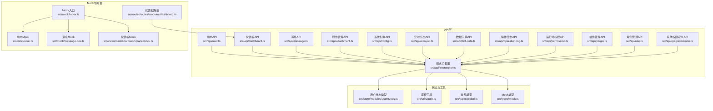
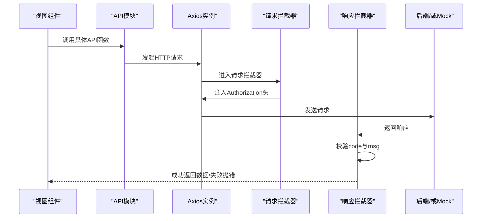
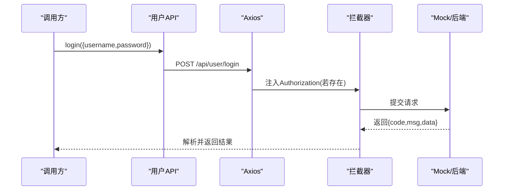
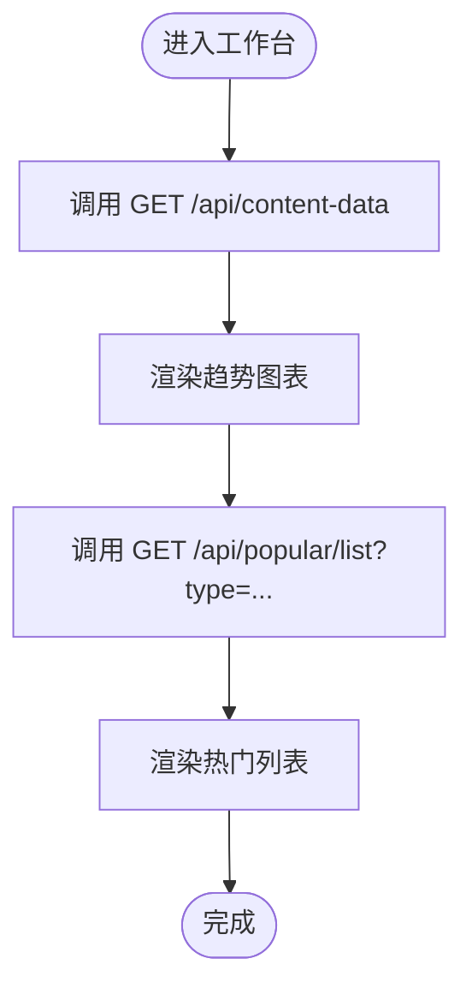
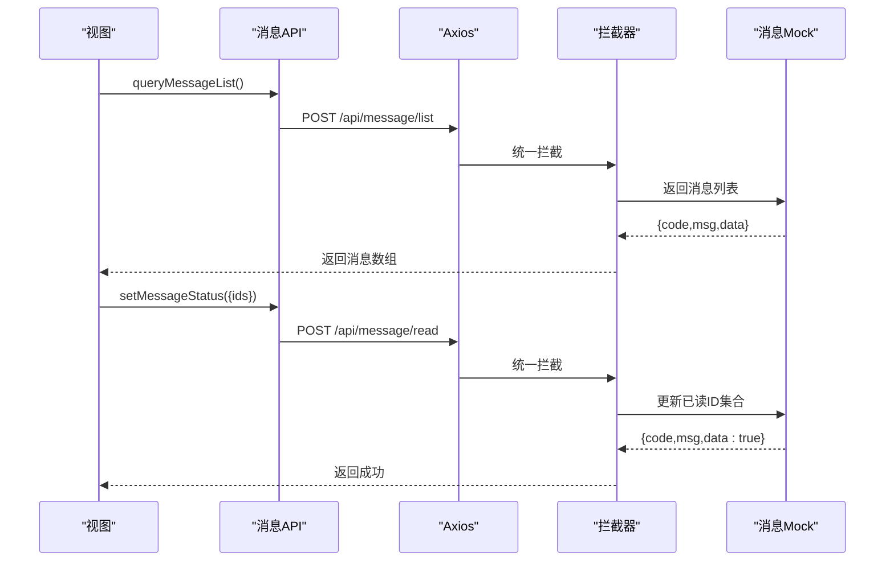
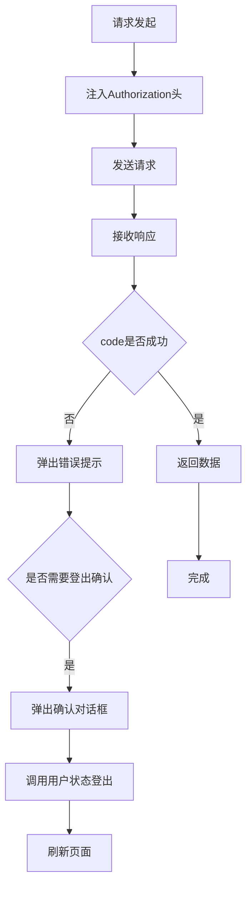
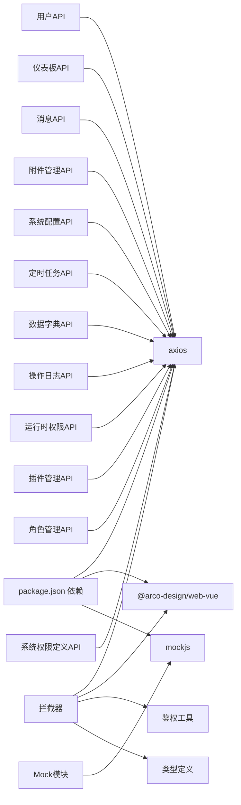

# API模块

<cite>
**本文引用的文件**
- [src/api/user.ts](file://src/api/user.ts)
- [src/api/dashboard.ts](file://src/api/dashboard.ts)
- [src/api/message.ts](file://src/api/message.ts)
- [src/api/attachment.ts](file://src/api/attachment.ts)
- [src/api/config.ts](file://src/api/config.ts)
- [src/api/cron-job.ts](file://src/api/cron-job.ts)
- [src/api/dict-data.ts](file://src/api/dict-data.ts)
- [src/api/operation-log.ts](file://src/api/operation-log.ts)
- [src/api/permission.ts](file://src/api/permission.ts)
- [src/api/plugin.ts](file://src/api/plugin.ts)
- [src/api/role.ts](file://src/api/role.ts)
- [src/api/sys-permission.ts](file://src/api/sys-permission.ts)
- [src/api/interceptor.ts](file://src/api/interceptor.ts)
- [src/store/modules/user/types.ts](file://src/store/modules/user/types.ts)
- [src/utils/auth.ts](file://src/utils/auth.ts)
- [src/mock/index.ts](file://src/mock/index.ts)
- [src/mock/user.ts](file://src/mock/user.ts)
- [src/mock/message-box.ts](file://src/mock/message-box.ts)
- [src/views/dashboard/workplace/mock.ts](file://src/views/dashboard/workplace/mock.ts)
- [src/utils/setup-mock.ts](file://src/utils/setup-mock.ts)
- [src/types/global.ts](file://src/types/global.ts)
- [src/types/mock.ts](file://src/types/mock.ts)
- [src/router/routes/modules/dashboard.ts](file://src/router/routes/modules/dashboard.ts)
- [package.json](file://package.json)
</cite>

## 目录
1. [简介](#简介)
2. [项目结构](#项目结构)
3. [核心组件](#核心组件)
4. [架构总览](#架构总览)
5. [详细组件分析](#详细组件分析)
6. [依赖分析](#依赖分析)
7. [性能考虑](#性能考虑)
8. [故障排查指南](#故障排查指南)
9. [结论](#结论)
10. [附录](#附录)

## 简介
本文件系统化梳理前端API模块的设计与实现，覆盖用户管理API、仪表板API、消息管理API、附件管理API、系统配置API、定时任务API、数据字典API、操作日志API、运行时权限API、插件管理API、角色管理API与系统权限定义API共十二大模块。文档从接口定义、参数规范、返回数据格式入手，结合拦截器与Mock机制说明错误处理、鉴权流程与数据验证策略；并给出最佳实践、扩展方法与自定义接口开发指南，帮助开发者快速理解与高效迭代。

## 项目结构
API模块位于 src/api 目录下，分别提供用户、仪表板、消息、附件、配置、定时任务、字典、操作日志、权限、插件、角色与系统权限十二个子模块；配合全局拦截器统一处理请求与响应；通过Mock机制在本地开发时模拟服务端行为，保证前后端解耦与联调效率。

图表来源
- [src/api/user.ts:1-28](file://src/api/user.ts#L1-L28)
- [src/api/dashboard.ts:1-23](file://src/api/dashboard.ts#L1-L23)
- [src/api/message.ts:1-39](file://src/api/message.ts#L1-L39)
- [src/api/attachment.ts:1-186](file://src/api/attachment.ts#L1-L186)
- [src/api/config.ts:1-68](file://src/api/config.ts#L1-L68)
- [src/api/cron-job.ts:1-90](file://src/api/cron-job.ts#L1-L90)
- [src/api/dict-data.ts:1-53](file://src/api/dict-data.ts#L1-L53)
- [src/api/operation-log.ts:1-23](file://src/api/operation-log.ts#L1-L23)
- [src/api/permission.ts:1-97](file://src/api/permission.ts#L1-L97)
- [src/api/plugin.ts:1-54](file://src/api/plugin.ts#L1-L54)
- [src/api/role.ts:1-116](file://src/api/role.ts#L1-L116)
- [src/api/sys-permission.ts:1-60](file://src/api/sys-permission.ts#L1-L60)
- [src/api/interceptor.ts:1-78](file://src/api/interceptor.ts#L1-L78)
- [src/store/modules/user/types.ts:1-20](file://src/store/modules/user/types.ts#L1-L20)
- [src/utils/auth.ts:1-20](file://src/utils/auth.ts#L1-L20)
- [src/mock/index.ts:1-11](file://src/mock/index.ts#L1-L11)
- [src/mock/user.ts:1-106](file://src/mock/user.ts#L1-L106)
- [src/mock/message-box.ts:1-86](file://src/mock/message-box.ts#L1-L86)
- [src/views/dashboard/workplace/mock.ts:1-130](file://src/views/dashboard/workplace/mock.ts#L1-L130)
- [src/router/routes/modules/dashboard.ts:1-29](file://src/router/routes/modules/dashboard.ts#L1-L29)

章节来源
- [src/api/user.ts:1-28](file://src/api/user.ts#L1-L28)
- [src/api/dashboard.ts:1-23](file://src/api/dashboard.ts#L1-L23)
- [src/api/message.ts:1-39](file://src/api/message.ts#L1-L39)
- [src/api/attachment.ts:1-186](file://src/api/attachment.ts#L1-L186)
- [src/api/config.ts:1-68](file://src/api/config.ts#L1-L68)
- [src/api/cron-job.ts:1-90](file://src/api/cron-job.ts#L1-L90)
- [src/api/dict-data.ts:1-53](file://src/api/dict-data.ts#L1-L53)
- [src/api/operation-log.ts:1-23](file://src/api/operation-log.ts#L1-L23)
- [src/api/permission.ts:1-97](file://src/api/permission.ts#L1-L97)
- [src/api/plugin.ts:1-54](file://src/api/plugin.ts#L1-L54)
- [src/api/role.ts:1-116](file://src/api/role.ts#L1-L116)
- [src/api/sys-permission.ts:1-60](file://src/api/sys-permission.ts#L1-L60)
- [src/api/interceptor.ts:1-78](file://src/api/interceptor.ts#L1-L78)
- [src/mock/index.ts:1-11](file://src/mock/index.ts#L1-L11)

## 核心组件
- 用户管理API：提供登录、登出、获取用户信息、获取菜单列表四个接口，统一返回标准结构，支持鉴权令牌注入与错误提示。
- 仪表板API：提供内容趋势数据与热门内容列表查询，参数为类型字符串，返回结构化数据用于图表与表格渲染。
- 消息管理API：提供消息列表查询、批量设置消息已读状态、聊天记录查询，支持状态字段与可选头像字段。
- 附件管理API：提供附件上传（含分片上传）、下载、预览、CRUD操作及附件分组管理，支持上传进度回调与批量操作。
- 系统配置API：提供系统动态配置的CRUD操作，支持按键获取、按分组获取及分组选项查询。
- 定时任务API：提供定时任务的CRUD操作，支持启用/禁用、立即执行、日志查看与日志尾部读取。
- 数据字典API：提供字典数据的CRUD操作，支持按类型查询字典条目。
- 操作日志API：提供操作日志的列表查询与详情查看，为只读接口。
- 运行时权限API：提供Casbin策略的CRUD管理，支持用户权限、菜单权限、按钮权限与API权限的查询。
- 插件管理API：提供插件的列表查询、详情查看、安装、启用、停用与卸载操作。
- 角色管理API：提供角色的CRUD操作，支持启用/禁用、角色-权限分配与覆盖式保存。
- 系统权限定义API：提供系统权限定义的CRUD操作，支持树形结构查询。
- 请求拦截器：统一设置基础URL、注入Authorization头、统一对响应码进行判定与错误提示，必要时触发登出流程。
- Mock机制：通过MockJS在本地环境模拟用户、消息与仪表板数据，便于开发调试与联调。

章节来源
- [src/api/user.ts:5-27](file://src/api/user.ts#L5-L27)
- [src/api/dashboard.ts:4-22](file://src/api/dashboard.ts#L4-L22)
- [src/api/message.ts:3-38](file://src/api/message.ts#L3-L38)
- [src/api/attachment.ts:16-185](file://src/api/attachment.ts#L16-L185)
- [src/api/config.ts:13-67](file://src/api/config.ts#L13-L67)
- [src/api/cron-job.ts:13-89](file://src/api/cron-job.ts#L13-L89)
- [src/api/dict-data.ts:12-52](file://src/api/dict-data.ts#L12-L52)
- [src/api/operation-log.ts:10-22](file://src/api/operation-log.ts#L10-L22)
- [src/api/permission.ts:13-96](file://src/api/permission.ts#L13-L96)
- [src/api/plugin.ts:13-53](file://src/api/plugin.ts#L13-L53)
- [src/api/role.ts:16-115](file://src/api/role.ts#L16-L115)
- [src/api/sys-permission.ts:13-59](file://src/api/sys-permission.ts#L13-L59)
- [src/api/interceptor.ts:7-77](file://src/api/interceptor.ts#L7-L77)
- [src/mock/user.ts:10-105](file://src/mock/user.ts#L10-L105)
- [src/mock/message-box.ts:73-85](file://src/mock/message-box.ts#L73-L85)
- [src/views/dashboard/workplace/mock.ts:103-129](file://src/views/dashboard/workplace/mock.ts#L103-L129)

## 架构总览
API模块采用“模块化接口 + 全局拦截器 + Mock模拟”的架构设计。模块化接口负责定义具体业务API；全局拦截器负责统一鉴权、错误处理与响应包装；Mock机制在开发阶段提供稳定的数据源，降低对后端的依赖。

图表来源
- [src/api/interceptor.ts:18-77](file://src/api/interceptor.ts#L18-L77)
- [src/api/user.ts:13-23](file://src/api/user.ts#L13-L23)
- [src/api/dashboard.ts:9-22](file://src/api/dashboard.ts#L9-L22)
- [src/api/message.ts:16-38](file://src/api/message.ts#L16-L38)
- [src/api/attachment.ts:16-185](file://src/api/attachment.ts#L16-L185)
- [src/api/config.ts:13-67](file://src/api/config.ts#L13-L67)
- [src/api/cron-job.ts:13-89](file://src/api/cron-job.ts#L13-L89)
- [src/api/dict-data.ts:12-52](file://src/api/dict-data.ts#L12-L52)
- [src/api/operation-log.ts:10-22](file://src/api/operation-log.ts#L10-L22)
- [src/api/permission.ts:13-96](file://src/api/permission.ts#L13-L96)
- [src/api/plugin.ts:13-53](file://src/api/plugin.ts#L13-L53)
- [src/api/role.ts:16-115](file://src/api/role.ts#L16-L115)
- [src/api/sys-permission.ts:13-59](file://src/api/sys-permission.ts#L13-L59)

## 详细组件分析

### 用户管理API
- 接口概览
  - 登录：POST /api/user/login，输入用户名与密码，返回token。
  - 登出：POST /api/user/logout，无输入，返回空数据。
  - 获取用户信息：POST /api/user/info，返回用户状态对象。
  - 获取菜单列表：POST /api/user/menu，返回路由规范化数组。
- 参数与返回
  - 登录输入：用户名、密码（字符串）。
  - 登录输出：token（字符串）。
  - 用户信息输出：遵循用户状态类型，包含姓名、头像、邮箱、角色等字段。
  - 菜单输出：符合路由记录类型的数组，包含路径、元信息与子项。
- 错误处理
  - 响应码非约定值时，统一弹出错误提示；特定错误码触发登出确认对话框。
- 鉴权流程
  - 请求拦截器自动从本地存储读取token并注入到请求头中。

图表来源
- [src/api/user.ts:13-19](file://src/api/user.ts#L13-L19)
- [src/api/interceptor.ts:18-37](file://src/api/interceptor.ts#L18-L37)
- [src/mock/user.ts:42-63](file://src/mock/user.ts#L42-L63)

章节来源
- [src/api/user.ts:5-27](file://src/api/user.ts#L5-L27)
- [src/store/modules/user/types.ts:2-19](file://src/store/modules/user/types.ts#L2-L19)
- [src/api/interceptor.ts:14-30](file://src/api/interceptor.ts#L14-L30)
- [src/mock/user.ts:14-63](file://src/mock/user.ts#L14-L63)

### 仪表板API
- 接口概览
  - 内容趋势数据：GET /api/content-data，返回时间序列数组。
  - 热门内容列表：GET /api/popular/list，带type参数（文本/图片/视频），返回表格数据。
- 数据模型
  - 内容趋势记录：包含日期与数值字段。
  - 热门记录：包含键值、点击量、标题与增长率等字段。
- 使用场景
  - 仪表板工作台页面通过这两个接口获取图表与列表数据。

图表来源
- [src/api/dashboard.ts:9-22](file://src/api/dashboard.ts#L9-L22)
- [src/views/dashboard/workplace/mock.ts:103-129](file://src/views/dashboard/workplace/mock.ts#L103-L129)

章节来源
- [src/api/dashboard.ts:4-22](file://src/api/dashboard.ts#L4-L22)
- [src/views/dashboard/workplace/mock.ts:7-129](file://src/views/dashboard/workplace/mock.ts#L7-L129)

### 消息管理API
- 接口概览
  - 消息列表：POST /api/message/list，返回消息记录数组。
  - 设置消息状态：POST /api/message/read，输入待更新的消息ID数组，返回布尔结果。
  - 聊天记录：POST /api/chat/list，返回聊天记录数组。
- 数据模型
  - 消息记录：包含标识、类型、标题、副标题、头像、内容、时间、状态与消息类型等字段。
  - 聊天记录：包含标识、用户名、内容、时间与收藏标记等字段。
- 状态管理
  - 消息状态字段为二值枚举，配合“已读/未读”交互。

图表来源
- [src/api/message.ts:16-26](file://src/api/message.ts#L16-L26)
- [src/mock/message-box.ts:73-85](file://src/mock/message-box.ts#L73-L85)

章节来源
- [src/api/message.ts:3-38](file://src/api/message.ts#L3-L38)
- [src/mock/message-box.ts:4-85](file://src/mock/message-box.ts#L4-L85)

### 请求拦截器与错误处理
- 请求拦截
  - 自动注入Authorization头，值来自本地存储的token。
  - 支持通过环境变量配置基础URL。
- 响应拦截
  - 对响应体中的状态码进行校验，非成功码统一弹出错误提示。
  - 特定错误码触发登出确认对话框，避免令牌异常导致的无效操作。
- 统一响应包装
  - Mock侧通过统一的响应包装函数返回标准结构，便于拦截器一致处理。

图表来源
- [src/api/interceptor.ts:18-77](file://src/api/interceptor.ts#L18-L77)
- [src/utils/setup-mock.ts:7-23](file://src/utils/setup-mock.ts#L7-L23)

章节来源
- [src/api/interceptor.ts:7-77](file://src/api/interceptor.ts#L7-L77)
- [src/utils/setup-mock.ts:1-24](file://src/utils/setup-mock.ts#L1-L24)

### 附件管理API
- 接口概览
  - 获取附件列表：GET /api/v1/admin/auth/attachments，支持分页与查询参数。
  - 上传附件：POST /api/v1/admin/auth/attachments/upload，支持文件与分组ID。
  - 分片上传：POST /api/v1/admin/auth/attachments/upload，携带分片索引、上传ID、总分片数等参数，支持上传进度回调。
  - 查询分片状态：GET /api/v1/admin/auth/attachments/chunk/status/:uploadId。
  - 取消分片上传：DELETE /api/v1/admin/auth/attachments/chunk/:uploadId。
  - 获取附件详情：GET /api/v1/admin/auth/attachments/:id。
  - 删除附件：DELETE /api/v1/admin/auth/attachments/:id。
  - 批量删除附件：DELETE /api/v1/admin/auth/attachments/batch，携带ID数组。
  - 移动附件到分组：PUT /api/v1/admin/auth/attachments/:id/move。
  - 预览/下载附件：GET /api/v1/admin/auth/attachments/:id/preview，支持Blob下载与进度回调。
  - 获取附件分组列表：GET /api/v1/admin/auth/attachment-groups，支持分页。
  - 创建附件分组：POST /api/v1/admin/auth/attachment-groups。
  - 获取附件分组详情：GET /api/v1/admin/auth/attachment-groups/:id。
  - 更新附件分组：PUT /api/v1/admin/auth/attachment-groups/:id。
  - 删除附件分组：DELETE /api/v1/admin/auth/attachment-groups/:id。
- 数据模型
  - 附件记录：包含标识、文件名、路径、大小、MIME类型、分组ID等字段。
  - 附件分组：包含标识、名称、描述等字段。
- 使用场景
  - 文件管理页面通过此模块完成附件上传、分组管理、预览与下载操作。
  - 分片上传适用于大文件上传场景，支持断点续传。

图表来源
- [src/api/attachment.ts:16-185](file://src/api/attachment.ts#L16-L185)

章节来源
- [src/api/attachment.ts:16-185](file://src/api/attachment.ts#L16-L185)

### 系统配置API
- 接口概览
  - 获取配置列表：GET /api/v1/admin/auth/configs，支持分页与查询参数。
  - 创建配置：POST /api/v1/admin/auth/configs。
  - 按键获取配置：GET /api/v1/admin/auth/configs/by-key/:key。
  - 按分组获取配置：GET /api/v1/admin/auth/configs/group/:group，返回配置数组。
  - 获取配置详情：GET /api/v1/admin/auth/configs/:id。
  - 更新配置：PUT /api/v1/admin/auth/configs/:id。
  - 删除配置：DELETE /api/v1/admin/auth/configs/:id。
  - 获取配置分组选项：GET /api/v1/admin/auth/configs/groups，返回分组枚举列表。
- 数据模型
  - 配置记录：包含标识、键名、键值、分组、描述等字段。
- 使用场景
  - 系统设置页面通过此模块管理动态配置项，支持按键或按分组快速查询。

图表来源
- [src/api/config.ts:13-67](file://src/api/config.ts#L13-L67)

章节来源
- [src/api/config.ts:13-67](file://src/api/config.ts#L13-L67)

### 定时任务API
- 接口概览
  - 获取任务列表：GET /api/v1/admin/auth/cron-jobs，支持分页与查询参数。
  - 创建定时任务：POST /api/v1/admin/auth/cron-jobs。
  - 获取任务详情：GET /api/v1/admin/auth/cron-jobs/:id。
  - 更新定时任务：PUT /api/v1/admin/auth/cron-jobs/:id。
  - 删除定时任务：DELETE /api/v1/admin/auth/cron-jobs/:id。
  - 启用定时任务：POST /api/v1/admin/auth/cron-jobs/:id/enable。
  - 禁用定时任务：POST /api/v1/admin/auth/cron-jobs/:id/disable。
  - 立即执行定时任务：POST /api/v1/admin/auth/cron-jobs/:id/run。
  - 获取任务日志列表：GET /api/v1/admin/auth/cron-jobs/:id/logs。
  - 获取日志文件内容：GET /api/v1/admin/auth/cron-jobs/:id/logs/:filename。
  - 读取日志尾部：GET /api/v1/admin/auth/cron-jobs/:id/logs/tail，支持行数参数。
- 数据模型
  - 定时任务记录：包含标识、名称、Cron表达式、状态、上次执行时间、下次执行时间等字段。
  - 日志文件信息：包含文件名、大小、修改时间等字段。
- 使用场景
  - 定时任务管理页面通过此模块完成任务的增删改查、启停控制与日志监控。

图表来源
- [src/api/cron-job.ts:13-89](file://src/api/cron-job.ts#L13-L89)

章节来源
- [src/api/cron-job.ts:13-89](file://src/api/cron-job.ts#L13-L89)

### 数据字典API
- 接口概览
  - 获取字典列表：GET /api/v1/admin/auth/dict-data，支持分页与查询参数。
  - 创建字典数据：POST /api/v1/admin/auth/dict-data。
  - 获取字典详情：GET /api/v1/admin/auth/dict-data/:id。
  - 更新字典数据：PUT /api/v1/admin/auth/dict-data/:id。
  - 删除字典数据：DELETE /api/v1/admin/auth/dict-data/:id。
  - 按类型获取字典数据：GET /api/v1/admin/auth/dict-data/type/:type，返回字典数组。
- 数据模型
  - 字典数据记录：包含标识、类型标签、键名、键值、排序、状态等字段。
- 使用场景
  - 字典管理页面通过此模块管理系统中的枚举数据，支持按类型分组查询。

图表来源
- [src/api/dict-data.ts:12-52](file://src/api/dict-data.ts#L12-L52)

章节来源
- [src/api/dict-data.ts:12-52](file://src/api/dict-data.ts#L12-L52)

### 操作日志API
- 接口概览
  - 获取日志列表：GET /api/v1/admin/auth/operation-logs，支持分页与查询参数。
  - 获取日志详情：GET /api/v1/admin/auth/operation-logs/:id。
- 数据模型
  - 操作日志记录：包含标识、操作人、操作类型、操作内容、IP地址、请求路径、请求方法、状态、操作时间等字段。
- 使用场景
  - 该模块为只读接口，用于审计与安全追踪，记录用户的关键操作行为。

图表来源
- [src/api/operation-log.ts:10-22](file://src/api/operation-log.ts#L10-L22)

章节来源
- [src/api/operation-log.ts:10-22](file://src/api/operation-log.ts#L10-L22)

### 运行时权限API
- 接口概览
  - 获取权限列表：GET /api/v1/admin/auth/permissions，支持分页与查询参数。
  - 获取所有权限：GET /api/v1/admin/auth/permissions/all，不带分页，支持筛选。
  - 创建权限：POST /api/v1/admin/auth/permissions。
  - 更新权限：PUT /api/v1/admin/auth/permissions。
  - 删除权限：DELETE /api/v1/admin/auth/permissions，通过查询参数指定角色、域、对象与动作。
  - 获取权限详情：GET /api/v1/admin/auth/permissions/detail，通过查询参数指定角色、域、对象与动作。
  - 获取用户所有权限：GET /api/v1/admin/auth/user/permissions，支持域参数。
  - 获取用户菜单权限：GET /api/v1/admin/auth/user/menu-permissions，支持域参数。
  - 获取用户按钮权限：GET /api/v1/admin/auth/user/button-permissions，支持域参数。
  - 获取用户API权限：GET /api/v1/admin/auth/user/api-permissions，支持域参数。
- 数据模型
  - 权限记录：包含角色名、域、对象、动作等Casbin策略字段。
- 使用场景
  - 该模块基于Casbin策略引擎，提供运行时权限的查询与管理能力。
  - 用户权限查询用于前端动态控制菜单、按钮与API的可见性与可用性。

图表来源
- [src/api/permission.ts:13-96](file://src/api/permission.ts#L13-L96)

章节来源
- [src/api/permission.ts:13-96](file://src/api/permission.ts#L13-L96)

### 插件管理API
- 接口概览
  - 获取插件列表：GET /api/v1/admin/auth/plugins，支持分页与其他查询参数。
  - 获取插件详情：GET /api/v1/admin/auth/plugins/:pluginId，路径参数经过URL编码。
  - 安装插件：POST /api/v1/admin/auth/plugins/install。
  - 启用插件：POST /api/v1/admin/auth/plugins/:pluginId/enable。
  - 停用插件：POST /api/v1/admin/auth/plugins/:pluginId/disable。
  - 卸载插件：DELETE /api/v1/admin/auth/plugins/:pluginId。
- 数据模型
  - 插件记录：包含插件ID、名称、版本、状态、描述、作者等字段。
- 使用场景
  - 插件管理页面通过此模块完成插件的安装、启停与卸载生命周期管理。

图表来源
- [src/api/plugin.ts:13-53](file://src/api/plugin.ts#L13-L53)

章节来源
- [src/api/plugin.ts:13-53](file://src/api/plugin.ts#L13-L53)

### 角色管理API
- 接口概览
  - 获取角色列表：GET /api/v1/admin/auth/roles，支持分页与查询参数。
  - 创建角色：POST /api/v1/admin/auth/roles。
  - 获取角色详情：GET /api/v1/admin/auth/roles/:id。
  - 更新角色：PUT /api/v1/admin/auth/roles/:id。
  - 删除角色：DELETE /api/v1/admin/auth/roles/:id。
  - 启用角色：PUT /api/v1/admin/auth/roles/:id/enable。
  - 禁用角色：PUT /api/v1/admin/auth/roles/:id/disable。
  - 获取角色权限列表：GET /api/v1/admin/auth/roles/permissions，通过查询参数指定角色名与域。
  - 为角色分配权限：POST /api/v1/admin/auth/roles/permissions/assign。
  - 从角色移除权限：POST /api/v1/admin/auth/roles/permissions/remove。
  - 根据角色ID获取已分配权限：GET /api/v1/admin/auth/roles/:id/permissions，用于编辑时回显。
  - 覆盖式保存角色权限：POST /api/v1/admin/auth/roles/:id/permissions，基于Casbin策略。
  - 获取所有角色：GET /api/v1/admin/auth/roles/all，不带分页，支持关键词与状态筛选。
- 数据模型
  - 角色记录：包含标识、名称、编码、状态、描述、创建时间等字段。
  - 权限分配：包含角色名、域、对象、动作等Casbin策略字段。
- 使用场景
  - 角色管理页面通过此模块完成角色的增删改查、启停控制与精细化的权限分配。

图表来源
- [src/api/role.ts:16-115](file://src/api/role.ts#L16-L115)

章节来源
- [src/api/role.ts:16-115](file://src/api/role.ts#L16-L115)

### 系统权限定义API
- 接口概览
  - 获取权限定义列表：GET /api/v1/admin/auth/system-permissions，支持分页与查询参数。
  - 获取权限树：GET /api/v1/admin/auth/system-permissions/tree，返回树形结构，支持域参数。
  - 获取权限定义详情：GET /api/v1/admin/auth/system-permissions/:id。
  - 创建权限定义：POST /api/v1/admin/auth/system-permissions。
  - 更新权限定义：PUT /api/v1/admin/auth/system-permissions/:id。
  - 删除权限定义：DELETE /api/v1/admin/auth/system-permissions/:id。
- 数据模型
  - 系统权限定义：包含标识、权限名称、权限编码、父级ID、类型、排序、域等字段。
  - 权限树节点：包含子节点列表，支持无限级层级结构。
- 使用场景
  - 系统权限定义页面通过此模块管理权限的元数据定义，树形结构便于可视化展示权限层级。

图表来源
- [src/api/sys-permission.ts:13-59](file://src/api/sys-permission.ts#L13-L59)

章节来源
- [src/api/sys-permission.ts:13-59](file://src/api/sys-permission.ts#L13-L59)

## 依赖分析
- 模块内聚与耦合
  - 各API模块彼此独立，仅通过Axios与拦截器间接耦合。
  - 拦截器集中处理鉴权与错误，降低各模块重复逻辑。
- 外部依赖
  - axios：HTTP客户端。
  - @arco-design/web-vue：UI组件库，用于消息与模态框提示。
  - mockjs：本地Mock数据。
- 类型与工具
  - 用户状态类型、全局类型与Mock类型确保接口契约清晰。
  - 鉴权工具提供token的读写封装。

图表来源
- [package.json:32-47](file://package.json#L32-L47)
- [src/api/user.ts:1](file://src/api/user.ts#L1)
- [src/api/dashboard.ts:1](file://src/api/dashboard.ts#L1)
- [src/api/message.ts:1](file://src/api/message.ts#L1)
- [src/api/attachment.ts:1](file://src/api/attachment.ts#L1)
- [src/api/config.ts:1](file://src/api/config.ts#L1)
- [src/api/cron-job.ts:1](file://src/api/cron-job.ts#L1)
- [src/api/dict-data.ts:1](file://src/api/dict-data.ts#L1)
- [src/api/operation-log.ts:1](file://src/api/operation-log.ts#L1)
- [src/api/permission.ts:1](file://src/api/permission.ts#L1)
- [src/api/plugin.ts:1](file://src/api/plugin.ts#L1)
- [src/api/role.ts:1](file://src/api/role.ts#L1)
- [src/api/sys-permission.ts:1](file://src/api/sys-permission.ts#L1)
- [src/api/interceptor.ts:1-78](file://src/api/interceptor.ts#L1-L78)
- [src/utils/auth.ts:1-20](file://src/utils/auth.ts#L1-L20)
- [src/mock/index.ts:1-11](file://src/mock/index.ts#L1-L11)

章节来源
- [package.json:32-47](file://package.json#L32-L47)
- [src/api/user.ts:1](file://src/api/user.ts#L1)
- [src/api/dashboard.ts:1](file://src/api/dashboard.ts#L1)
- [src/api/message.ts:1](file://src/api/message.ts#L1)
- [src/api/attachment.ts:1](file://src/api/attachment.ts#L1)
- [src/api/config.ts:1](file://src/api/config.ts#L1)
- [src/api/cron-job.ts:1](file://src/api/cron-job.ts#L1)
- [src/api/dict-data.ts:1](file://src/api/dict-data.ts#L1)
- [src/api/operation-log.ts:1](file://src/api/operation-log.ts#L1)
- [src/api/permission.ts:1](file://src/api/permission.ts#L1)
- [src/api/plugin.ts:1](file://src/api/plugin.ts#L1)
- [src/api/role.ts:1](file://src/api/role.ts#L1)
- [src/api/sys-permission.ts:1](file://src/api/sys-permission.ts#L1)
- [src/api/interceptor.ts:1-78](file://src/api/interceptor.ts#L1-L78)

## 性能考虑
- 请求合并与缓存
  - 对频繁访问的静态数据（如热门列表）建议在组件层做缓存，减少重复请求。
- 分页与懒加载
  - 列表类接口建议引入分页参数，避免一次性传输大量数据。
- 图表数据优化
  - 趋势数据按需请求与裁剪，避免不必要的重绘。
- Mock延迟控制
  - 通过Mock设定合理延迟，模拟真实网络状况，避免过度乐观的性能表现。

## 故障排查指南
- 常见问题
  - 未登录或令牌失效：拦截器检测到特定错误码会弹出登出确认，确认后刷新页面。
  - 请求失败：统一弹出错误提示，检查后端返回的错误码与消息。
  - 基础URL未配置：通过环境变量设置基础URL，确保请求指向正确服务端。
- 定位步骤
  - 打开浏览器开发者工具，查看Network面板中的请求与响应。
  - 关注拦截器日志与错误提示，核对响应体中的状态码与消息。
  - 在Mock环境下，确认Mock数据是否与预期一致。

章节来源
- [src/api/interceptor.ts:39-77](file://src/api/interceptor.ts#L39-L77)
- [src/mock/user.ts:14-39](file://src/mock/user.ts#L14-L39)

## 结论
API模块以清晰的职责划分与统一的拦截器机制，实现了用户、仪表板、消息、附件、配置、定时任务、字典、操作日志、权限、插件、角色与系统权限十二大业务域的标准化接口。配合Mock与类型体系，既保障了开发效率，也提升了系统的可维护性。建议在后续迭代中进一步完善参数校验、错误码规范与接口文档，持续提升可测试性与可扩展性。

## 附录

### 接口定义与参数规范

- 用户管理API
  - 登录
    - 方法与路径：POST /api/user/login
    - 输入参数：用户名、密码（字符串）
    - 返回数据：token（字符串）
  - 登出
    - 方法与路径：POST /api/user/logout
    - 输入参数：无
    - 返回数据：空
  - 获取用户信息
    - 方法与路径：POST /api/user/info
    - 输入参数：无
    - 返回数据：用户状态对象（包含姓名、头像、邮箱、角色等）
  - 获取菜单列表
    - 方法与路径：POST /api/user/menu
    - 输入参数：无
    - 返回数据：路由规范化数组

- 仪表板API
  - 内容趋势数据
    - 方法与路径：GET /api/content-data
    - 输入参数：无
    - 返回数据：时间序列数组（日期、数值）
  - 热门内容列表
    - 方法与路径：GET /api/popular/list
    - 输入参数：type（字符串，可选值：文本/图片/视频）
    - 返回数据：表格数据数组（键值、点击量、标题、增长率等）

- 消息管理API
  - 消息列表
    - 方法与路径：POST /api/message/list
    - 输入参数：无
    - 返回数据：消息记录数组（标识、类型、标题、内容、时间、状态等）
  - 设置消息状态
    - 方法与路径：POST /api/message/read
    - 输入参数：ids（数字数组）
    - 返回数据：布尔值（true/false）
  - 聊天记录
    - 方法与路径：POST /api/chat/list
    - 输入参数：无
    - 返回数据：聊天记录数组（标识、用户名、内容、时间、收藏标记等）

- 附件管理API
  - 获取附件列表
    - 方法与路径：GET /api/v1/admin/auth/attachments
    - 输入参数：分页与查询参数（可选）
    - 返回数据：分页附件记录数组
  - 上传附件
    - 方法与路径：POST /api/v1/admin/auth/attachments/upload
    - 输入参数：文件（FormData），分组ID（可选）
    - 返回数据：上传响应对象
  - 分片上传
    - 方法与路径：POST /api/v1/admin/auth/attachments/upload
    - 输入参数：文件分片（Blob）、uploadId、chunkIndex、totalChunks、filename、fileSize、chunkSize等
    - 返回数据：上传响应对象
  - 查询分片状态
    - 方法与路径：GET /api/v1/admin/auth/attachments/chunk/status/:uploadId
    - 输入参数：uploadId（路径参数）
    - 返回数据：分片状态对象
  - 取消分片上传
    - 方法与路径：DELETE /api/v1/admin/auth/attachments/chunk/:uploadId
    - 输入参数：uploadId（路径参数）
    - 返回数据：空
  - 获取附件详情
    - 方法与路径：GET /api/v1/admin/auth/attachments/:id
    - 输入参数：id（路径参数）
    - 返回数据：附件记录对象
  - 删除附件
    - 方法与路径：DELETE /api/v1/admin/auth/attachments/:id
    - 输入参数：id（路径参数）
    - 返回数据：空
  - 批量删除附件
    - 方法与路径：DELETE /api/v1/admin/auth/attachments/batch
    - 输入参数：ids（数字数组）
    - 返回数据：空
  - 移动附件到分组
    - 方法与路径：PUT /api/v1/admin/auth/attachments/:id/move
    - 输入参数：id（路径参数），groupId（可选）
    - 返回数据：空
  - 预览/下载附件
    - 方法与路径：GET /api/v1/admin/auth/attachments/:id/preview
    - 输入参数：id（路径参数），responseType为blob
    - 返回数据：文件Blob
  - 获取附件分组列表
    - 方法与路径：GET /api/v1/admin/auth/attachment-groups
    - 输入参数：分页参数（可选）
    - 返回数据：分页分组记录数组
  - 创建附件分组
    - 方法与路径：POST /api/v1/admin/auth/attachment-groups
    - 输入参数：分组名称、描述等
    - 返回数据：分组记录对象
  - 获取附件分组详情
    - 方法与路径：GET /api/v1/admin/auth/attachment-groups/:id
    - 输入参数：id（路径参数）
    - 返回数据：分组记录对象
  - 更新附件分组
    - 方法与路径：PUT /api/v1/admin/auth/attachment-groups/:id
    - 输入参数：id（路径参数），分组名称、描述等
    - 返回数据：分组记录对象
  - 删除附件分组
    - 方法与路径：DELETE /api/v1/admin/auth/attachment-groups/:id
    - 输入参数：id（路径参数）
    - 返回数据：空

- 系统配置API
  - 获取配置列表
    - 方法与路径：GET /api/v1/admin/auth/configs
    - 输入参数：分页与查询参数（可选）
    - 返回数据：分页配置记录数组
  - 创建配置
    - 方法与路径：POST /api/v1/admin/auth/configs
    - 输入参数：键名、键值、分组、描述等
    - 返回数据：配置记录对象
  - 按键获取配置
    - 方法与路径：GET /api/v1/admin/auth/configs/by-key/:key
    - 输入参数：key（路径参数）
    - 返回数据：配置记录对象
  - 按分组获取配置
    - 方法与路径：GET /api/v1/admin/auth/configs/group/:group
    - 输入参数：group（路径参数）
    - 返回数据：配置记录数组
  - 获取配置详情
    - 方法与路径：GET /api/v1/admin/auth/configs/:id
    - 输入参数：id（路径参数）
    - 返回数据：配置记录对象
  - 更新配置
    - 方法与路径：PUT /api/v1/admin/auth/configs/:id
    - 输入参数：id（路径参数），键值、分组、描述等
    - 返回数据：配置记录对象
  - 删除配置
    - 方法与路径：DELETE /api/v1/admin/auth/configs/:id
    - 输入参数：id（路径参数）
    - 返回数据：空
  - 获取配置分组选项
    - 方法与路径：GET /api/v1/admin/auth/configs/groups
    - 输入参数：无
    - 返回数据：分组枚举数组

- 定时任务API
  - 获取任务列表
    - 方法与路径：GET /api/v1/admin/auth/cron-jobs
    - 输入参数：分页与查询参数（可选）
    - 返回数据：分页任务记录数组
  - 创建定时任务
    - 方法与路径：POST /api/v1/admin/auth/cron-jobs
    - 输入参数：任务名称、Cron表达式、命令等
    - 返回数据：任务记录对象
  - 获取任务详情
    - 方法与路径：GET /api/v1/admin/auth/cron-jobs/:id
    - 输入参数：id（路径参数）
    - 返回数据：任务记录对象
  - 更新定时任务
    - 方法与路径：PUT /api/v1/admin/auth/cron-jobs/:id
    - 输入参数：id（路径参数），任务名称、Cron表达式等
    - 返回数据：任务记录对象
  - 删除定时任务
    - 方法与路径：DELETE /api/v1/admin/auth/cron-jobs/:id
    - 输入参数：id（路径参数）
    - 返回数据：空
  - 启用定时任务
    - 方法与路径：POST /api/v1/admin/auth/cron-jobs/:id/enable
    - 输入参数：id（路径参数）
    - 返回数据：空
  - 禁用定时任务
    - 方法与路径：POST /api/v1/admin/auth/cron-jobs/:id/disable
    - 输入参数：id（路径参数）
    - 返回数据：空
  - 立即执行定时任务
    - 方法与路径：POST /api/v1/admin/auth/cron-jobs/:id/run
    - 输入参数：id（路径参数）
    - 返回数据：空
  - 获取任务日志列表
    - 方法与路径：GET /api/v1/admin/auth/cron-jobs/:id/logs
    - 输入参数：id（路径参数）
    - 返回数据：日志文件信息数组
  - 获取日志文件内容
    - 方法与路径：GET /api/v1/admin/auth/cron-jobs/:id/logs/:filename
    - 输入参数：id、filename（路径参数）
    - 返回数据：日志文本内容
  - 读取日志尾部
    - 方法与路径：GET /api/v1/admin/auth/cron-jobs/:id/logs/tail
    - 输入参数：id（路径参数），lines（可选，指定行数）
    - 返回数据：日志尾部文本内容

- 数据字典API
  - 获取字典列表
    - 方法与路径：GET /api/v1/admin/auth/dict-data
    - 输入参数：分页与查询参数（可选）
    - 返回数据：分页字典记录数组
  - 创建字典数据
    - 方法与路径：POST /api/v1/admin/auth/dict-data
    - 输入参数：类型标签、键名、键值、排序等
    - 返回数据：字典记录对象
  - 获取字典详情
    - 方法与路径：GET /api/v1/admin/auth/dict-data/:id
    - 输入参数：id（路径参数）
    - 返回数据：字典记录对象
  - 更新字典数据
    - 方法与路径：PUT /api/v1/admin/auth/dict-data/:id
    - 输入参数：id（路径参数），类型标签、键名、键值等
    - 返回数据：字典记录对象
  - 删除字典数据
    - 方法与路径：DELETE /api/v1/admin/auth/dict-data/:id
    - 输入参数：id（路径参数）
    - 返回数据：空
  - 按类型获取字典数据
    - 方法与路径：GET /api/v1/admin/auth/dict-data/type/:type
    - 输入参数：type（路径参数）
    - 返回数据：字典记录数组

- 操作日志API
  - 获取日志列表
    - 方法与路径：GET /api/v1/admin/auth/operation-logs
    - 输入参数：分页与查询参数（可选）
    - 返回数据：分页日志记录数组
  - 获取日志详情
    - 方法与路径：GET /api/v1/admin/auth/operation-logs/:id
    - 输入参数：id（路径参数）
    - 返回数据：日志记录对象

- 运行时权限API
  - 获取权限列表
    - 方法与路径：GET /api/v1/admin/auth/permissions
    - 输入参数：分页与查询参数（可选）
    - 返回数据：分页权限记录数组
  - 获取所有权限
    - 方法与路径：GET /api/v1/admin/auth/permissions/all
    - 输入参数：筛选参数（可选）
    - 返回数据：权限记录数组
  - 创建权限
    - 方法与路径：POST /api/v1/admin/auth/permissions
    - 输入参数：角色名、域、对象、动作等
    - 返回数据：权限记录对象
  - 更新权限
    - 方法与路径：PUT /api/v1/admin/auth/permissions
    - 输入参数：角色名、域、对象、动作等
    - 返回数据：字符串
  - 删除权限
    - 方法与路径：DELETE /api/v1/admin/auth/permissions
    - 输入参数：role_name、domain、object、action（查询参数）
    - 返回数据：字符串
  - 获取权限详情
    - 方法与路径：GET /api/v1/admin/auth/permissions/detail
    - 输入参数：role_name、domain、object、action（查询参数）
    - 返回数据：权限记录对象
  - 获取用户所有权限
    - 方法与路径：GET /api/v1/admin/auth/user/permissions
    - 输入参数：domain（可选）
    - 返回数据：权限记录数组
  - 获取用户菜单权限
    - 方法与路径：GET /api/v1/admin/auth/user/menu-permissions
    - 输入参数：domain（可选）
    - 返回数据：权限记录数组
  - 获取用户按钮权限
    - 方法与路径：GET /api/v1/admin/auth/user/button-permissions
    - 输入参数：domain（可选）
    - 返回数据：权限记录数组
  - 获取用户API权限
    - 方法与路径：GET /api/v1/admin/auth/user/api-permissions
    - 输入参数：domain（可选）
    - 返回数据：权限记录数组

- 插件管理API
  - 获取插件列表
    - 方法与路径：GET /api/v1/admin/auth/plugins
    - 输入参数：分页与查询参数（可选）
    - 返回数据：分页插件记录数组
  - 获取插件详情
    - 方法与路径：GET /api/v1/admin/auth/plugins/:pluginId
    - 输入参数：pluginId（路径参数，URL编码）
    - 返回数据：插件记录对象
  - 安装插件
    - 方法与路径：POST /api/v1/admin/auth/plugins/install
    - 输入参数：插件标识、来源等
    - 返回数据：插件记录对象
  - 启用插件
    - 方法与路径：POST /api/v1/admin/auth/plugins/:pluginId/enable
    - 输入参数：pluginId（路径参数，URL编码）
    - 返回数据：空
  - 停用插件
    - 方法与路径：POST /api/v1/admin/auth/plugins/:pluginId/disable
    - 输入参数：pluginId（路径参数，URL编码）
    - 返回数据：空
  - 卸载插件
    - 方法与路径：DELETE /api/v1/admin/auth/plugins/:pluginId
    - 输入参数：pluginId（路径参数，URL编码）
    - 返回数据：空

- 角色管理API
  - 获取角色列表
    - 方法与路径：GET /api/v1/admin/auth/roles
    - 输入参数：分页与查询参数（可选）
    - 返回数据：分页角色记录数组
  - 创建角色
    - 方法与路径：POST /api/v1/admin/auth/roles
    - 输入参数：角色名称、编码、状态、描述等
    - 返回数据：角色记录对象
  - 获取角色详情
    - 方法与路径：GET /api/v1/admin/auth/roles/:id
    - 输入参数：id（路径参数）
    - 返回数据：角色记录对象
  - 更新角色
    - 方法与路径：PUT /api/v1/admin/auth/roles/:id
    - 输入参数：id（路径参数），角色名称、状态等
    - 返回数据：角色记录对象
  - 删除角色
    - 方法与路径：DELETE /api/v1/admin/auth/roles/:id
    - 输入参数：id（路径参数）
    - 返回数据：空
  - 启用角色
    - 方法与路径：PUT /api/v1/admin/auth/roles/:id/enable
    - 输入参数：id（路径参数）
    - 返回数据：空
  - 禁用角色
    - 方法与路径：PUT /api/v1/admin/auth/roles/:id/disable
    - 输入参数：id（路径参数）
    - 返回数据：空
  - 获取角色权限列表
    - 方法与路径：GET /api/v1/admin/auth/roles/permissions
    - 输入参数：role_name、domain（查询参数）
    - 返回数据：权限记录数组
  - 为角色分配权限
    - 方法与路径：POST /api/v1/admin/auth/roles/permissions/assign
    - 输入参数：角色名、域、权限列表等
    - 返回数据：空
  - 从角色移除权限
    - 方法与路径：POST /api/v1/admin/auth/roles/permissions/remove
    - 输入参数：角色名、域、权限列表等
    - 返回数据：空
  - 根据角色ID获取已分配权限
    - 方法与路径：GET /api/v1/admin/auth/roles/:id/permissions
    - 输入参数：id（路径参数），domain（可选）
    - 返回数据：权限分配数组（对象、动作、域）
  - 覆盖式保存角色权限
    - 方法与路径：POST /api/v1/admin/auth/roles/:id/permissions
    - 输入参数：id（路径参数），权限列表
    - 返回数据：空
  - 获取所有角色
    - 方法与路径：GET /api/v1/admin/auth/roles/all
    - 输入参数：keyword、status（可选查询参数）
    - 返回数据：角色记录数组

- 系统权限定义API
  - 获取权限定义列表
    - 方法与路径：GET /api/v1/admin/auth/system-permissions
    - 输入参数：分页与查询参数（可选）
    - 返回数据：分页权限定义记录数组
  - 获取权限树
    - 方法与路径：GET /api/v1/admin/auth/system-permissions/tree
    - 输入参数：domain（可选）
    - 返回数据：权限树节点数组（含子节点）
  - 获取权限定义详情
    - 方法与路径：GET /api/v1/admin/auth/system-permissions/:id
    - 输入参数：id（路径参数）
    - 返回数据：权限定义记录对象
  - 创建权限定义
    - 方法与路径：POST /api/v1/admin/auth/system-permissions
    - 输入参数：权限名称、编码、父级ID、类型、排序等
    - 返回数据：权限定义记录对象
  - 更新权限定义
    - 方法与路径：PUT /api/v1/admin/auth/system-permissions/:id
    - 输入参数：id（路径参数），权限名称、编码等
    - 返回数据：权限定义记录对象
  - 删除权限定义
    - 方法与路径：DELETE /api/v1/admin/auth/system-permissions/:id
    - 输入参数：id（路径参数）
    - 返回数据：空

章节来源
- [src/api/user.ts:13-27](file://src/api/user.ts#L13-L27)
- [src/api/dashboard.ts:9-22](file://src/api/dashboard.ts#L9-L22)
- [src/api/message.ts:16-38](file://src/api/message.ts#L16-L38)
- [src/api/attachment.ts:16-185](file://src/api/attachment.ts#L16-L185)
- [src/api/config.ts:13-67](file://src/api/config.ts#L13-L67)
- [src/api/cron-job.ts:13-89](file://src/api/cron-job.ts#L13-L89)
- [src/api/dict-data.ts:12-52](file://src/api/dict-data.ts#L12-L52)
- [src/api/operation-log.ts:10-22](file://src/api/operation-log.ts#L10-L22)
- [src/api/permission.ts:13-96](file://src/api/permission.ts#L13-L96)
- [src/api/plugin.ts:13-53](file://src/api/plugin.ts#L13-L53)
- [src/api/role.ts:16-115](file://src/api/role.ts#L16-L115)
- [src/api/sys-permission.ts:13-59](file://src/api/sys-permission.ts#L13-L59)

### 最佳实践
- 参数校验
  - 在调用前对必填参数进行校验，避免空值导致的后端错误。
- 错误处理
  - 统一捕获拦截器抛出的错误，结合业务场景进行降级处理。
- 鉴权与刷新
  - 登录成功后持久化token，登出时清除；在令牌异常时引导用户重新登录。
- Mock与联调
  - 本地开发优先使用Mock，联调时切换至真实服务端，确保接口一致性。

### 扩展与自定义接口开发指南
- 新增接口步骤
  - 在对应模块新增函数，明确输入参数与返回类型。
  - 在拦截器中确认基础URL与鉴权头是否满足需求。
  - 如需Mock，新增Mock规则并返回统一响应包装。
- 类型定义
  - 为新接口的输入输出补充类型定义，保持契约清晰。
- 路由与视图
  - 若接口服务于新页面，完善路由配置与视图组件的调用逻辑。

章节来源
- [src/api/interceptor.ts:14-30](file://src/api/interceptor.ts#L14-L30)
- [src/utils/setup-mock.ts:7-23](file://src/utils/setup-mock.ts#L7-L23)
- [src/mock/index.ts:1-11](file://src/mock/index.ts#L1-L11)