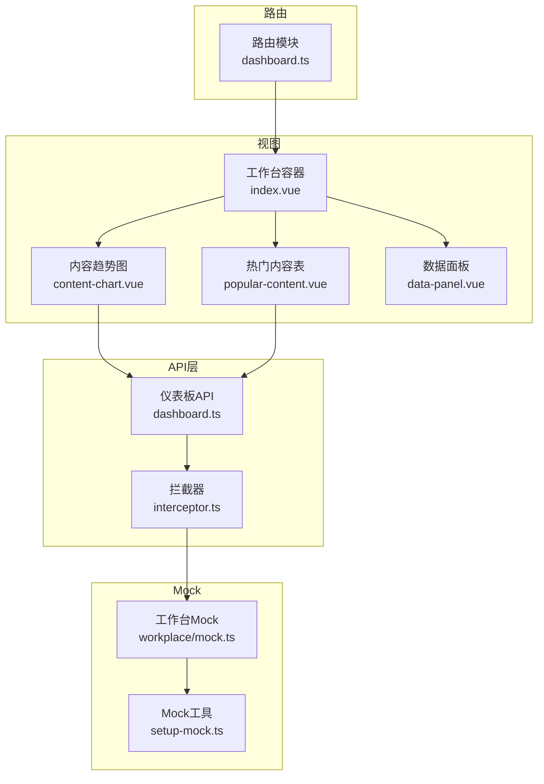
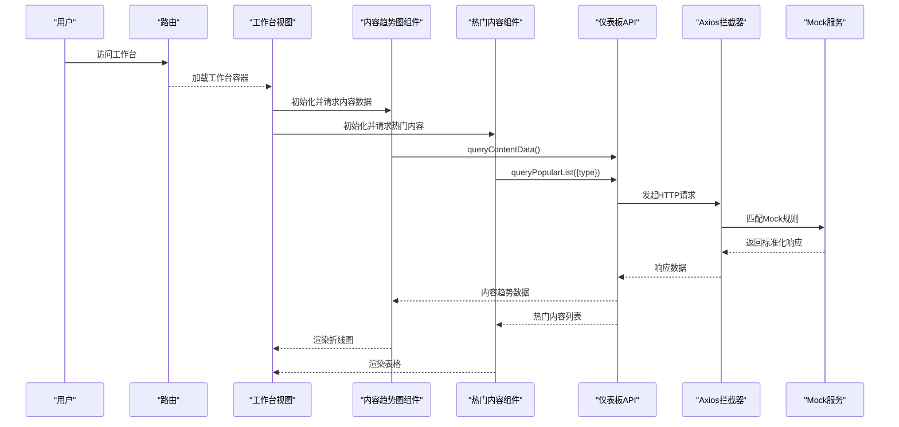
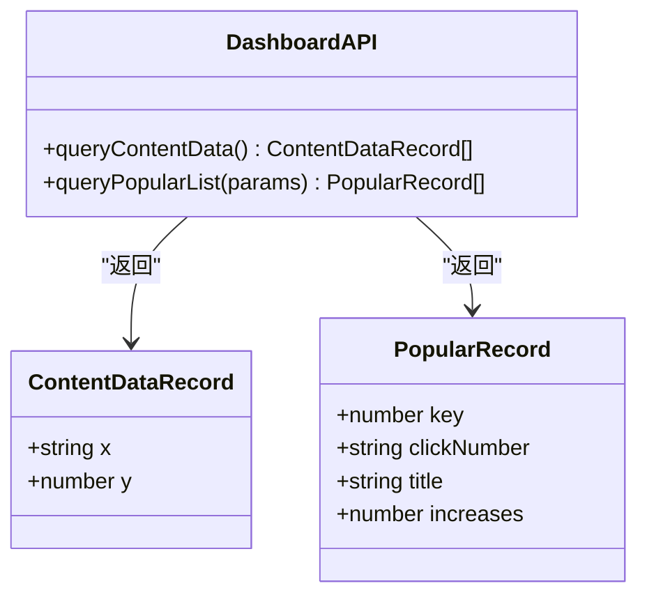
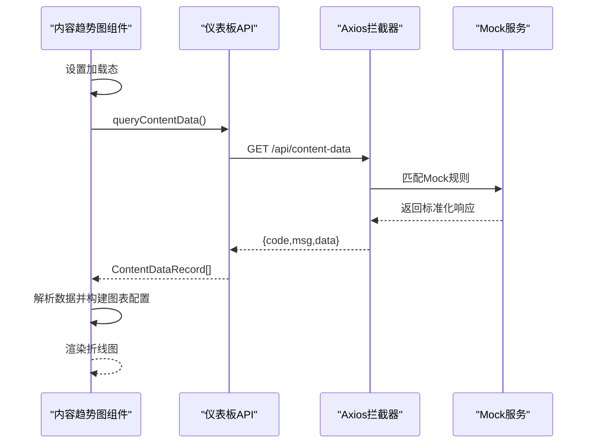
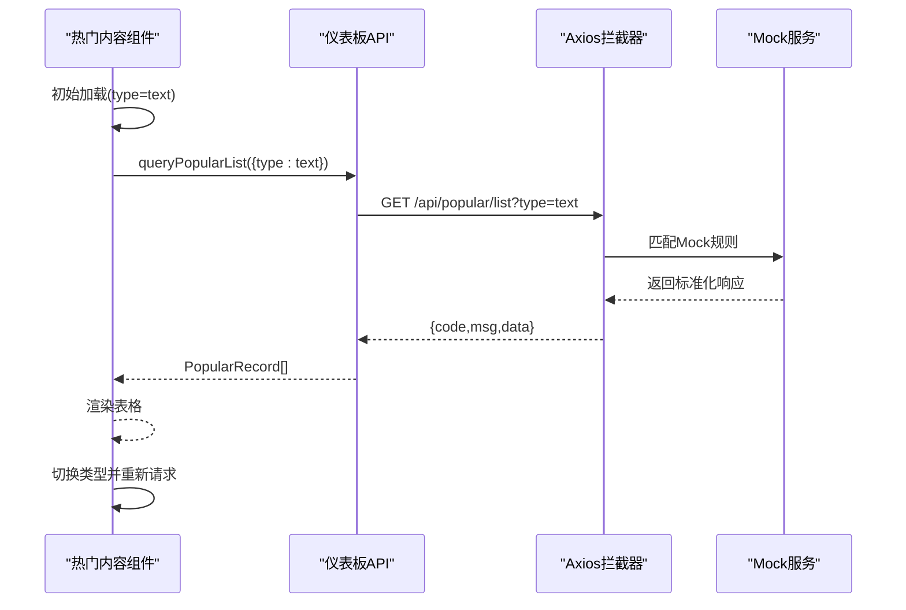
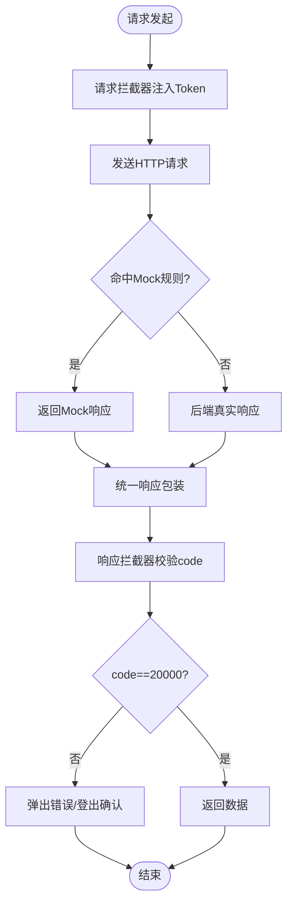
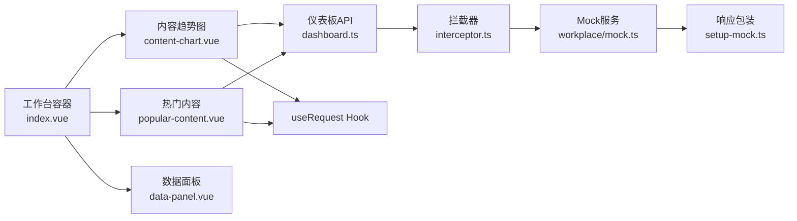

# 仪表板API

<cite>
**本文引用的文件**
- [src/api/dashboard.ts](file://src/api/dashboard.ts)
- [src/views/dashboard/workplace/index.vue](file://src/views/dashboard/workplace/index.vue)
- [src/views/dashboard/workplace/components/content-chart.vue](file://src/views/dashboard/workplace/components/content-chart.vue)
- [src/views/dashboard/workplace/components/popular-content.vue](file://src/views/dashboard/workplace/components/popular-content.vue)
- [src/views/dashboard/workplace/components/data-panel.vue](file://src/views/dashboard/workplace/components/data-panel.vue)
- [src/views/dashboard/workplace/mock.ts](file://src/views/dashboard/workplace/mock.ts)
- [src/router/routes/modules/dashboard.ts](file://src/router/routes/modules/dashboard.ts)
- [src/api/interceptor.ts](file://src/api/interceptor.ts)
- [src/utils/setup-mock.ts](file://src/utils/setup-mock.ts)
- [src/hooks/request.ts](file://src/hooks/request.ts)
- [src/tabs.ts](file://src/tabs.ts)
- [src/types/global.ts](file://src/types/global.ts)
- [src/locale/zh-CN.ts](file://src/locale/zh-CN.ts)
- [src/locale/en-US.ts](file://src/locale/en-US.ts)
</cite>

## 目录
1. [简介](#简介)
2. [项目结构](#项目结构)
3. [核心组件](#核心组件)
4. [架构总览](#架构总览)
5. [详细组件分析](#详细组件分析)
6. [依赖关系分析](#依赖关系分析)
7. [性能考虑](#性能考虑)
8. [故障排查指南](#故障排查指南)
9. [结论](#结论)
10. [附录](#附录)

## 简介
本文件面向仪表板API与工作台数据接口，系统化梳理前端API定义、数据结构、业务逻辑与渲染流程，并结合Mock机制说明接口行为与数据格式。重点覆盖以下方面：
- 接口定义与数据格式（内容趋势数据、热门内容列表）
- 图表数据、统计数据与业务指标的获取与处理机制
- 组件级调用时序与数据流
- 缓存策略与性能优化建议
- 实时性与更新机制说明

## 项目结构
工作台页面由多个功能模块组成，通过路由进入工作台视图，再由各子组件分别发起API请求并渲染图表与表格。

**图表来源**
- [src/router/routes/modules/dashboard.ts:1-29](file://src/router/routes/modules/dashboard.ts#L1-L29)
- [src/views/dashboard/workplace/index.vue:1-149](file://src/views/dashboard/workplace/index.vue#L1-L149)
- [src/views/dashboard/workplace/components/content-chart.vue:1-201](file://src/views/dashboard/workplace/components/content-chart.vue#L1-L201)
- [src/views/dashboard/workplace/components/popular-content.vue:1-119](file://src/views/dashboard/workplace/components/popular-content.vue#L1-L119)
- [src/views/dashboard/workplace/components/data-panel.vue:1-132](file://src/views/dashboard/workplace/components/data-panel.vue#L1-L132)
- [src/api/dashboard.ts:1-23](file://src/api/dashboard.ts#L1-L23)
- [src/api/interceptor.ts:1-78](file://src/api/interceptor.ts#L1-L78)
- [src/views/dashboard/workplace/mock.ts:1-130](file://src/views/dashboard/workplace/mock.ts#L1-L130)
- [src/utils/setup-mock.ts:1-24](file://src/utils/setup-mock.ts#L1-L24)

**章节来源**
- [src/router/routes/modules/dashboard.ts:1-29](file://src/router/routes/modules/dashboard.ts#L1-L29)
- [src/views/dashboard/workplace/index.vue:1-149](file://src/views/dashboard/workplace/index.vue#L1-L149)

## 核心组件
- 内容趋势图组件：负责拉取内容数据并渲染折线图，使用 ECharts 配置生成图表选项。
- 热门内容组件：根据类型参数切换内容类别，渲染表格并支持排序。
- 数据面板组件：展示关键业务指标（如在线内容、投稿数、新增内容、同比变化）。
- 仪表板API：封装两个接口：内容趋势数据查询、热门内容列表查询。
- Mock与拦截器：统一响应结构、本地开发模拟数据与鉴权头注入。

**章节来源**
- [src/views/dashboard/workplace/components/content-chart.vue:1-201](file://src/views/dashboard/workplace/components/content-chart.vue#L1-L201)
- [src/views/dashboard/workplace/components/popular-content.vue:1-119](file://src/views/dashboard/workplace/components/popular-content.vue#L1-L119)
- [src/views/dashboard/workplace/components/data-panel.vue:1-132](file://src/views/dashboard/workplace/components/data-panel.vue#L1-L132)
- [src/api/dashboard.ts:1-23](file://src/api/dashboard.ts#L1-L23)
- [src/api/interceptor.ts:1-78](file://src/api/interceptor.ts#L1-L78)
- [src/views/dashboard/workplace/mock.ts:1-130](file://src/views/dashboard/workplace/mock.ts#L1-L130)

## 架构总览
下图展示了从路由到组件、再到API与Mock的整体调用链路与数据流向。

**图表来源**
- [src/router/routes/modules/dashboard.ts:1-29](file://src/router/routes/modules/dashboard.ts#L1-L29)
- [src/views/dashboard/workplace/index.vue:1-149](file://src/views/dashboard/workplace/index.vue#L1-L149)
- [src/views/dashboard/workplace/components/content-chart.vue:1-201](file://src/views/dashboard/workplace/components/content-chart.vue#L1-L201)
- [src/views/dashboard/workplace/components/popular-content.vue:1-119](file://src/views/dashboard/workplace/components/popular-content.vue#L1-L119)
- [src/api/dashboard.ts:1-23](file://src/api/dashboard.ts#L1-L23)
- [src/api/interceptor.ts:1-78](file://src/api/interceptor.ts#L1-L78)
- [src/views/dashboard/workplace/mock.ts:1-130](file://src/views/dashboard/workplace/mock.ts#L1-L130)

## 详细组件分析

### 接口定义与数据结构
- 内容趋势数据接口
  - 方法：GET
  - 路径：/api/content-data
  - 返回：数组，元素包含日期与数值
  - 类型：ContentDataRecord[]
- 热门内容列表接口
  - 方法：GET
  - 路径：/api/popular/list
  - 查询参数：type（text/image/video）
  - 返回：表格数据，字段包括 key、clickNumber、title、increases

**图表来源**
- [src/api/dashboard.ts:4-22](file://src/api/dashboard.ts#L4-L22)

**章节来源**
- [src/api/dashboard.ts:1-23](file://src/api/dashboard.ts#L1-L23)
- [src/types/global.ts:14-24](file://src/types/global.ts#L14-L24)

### 内容趋势图组件（折线图）
职责与流程：
- 初始化加载状态
- 调用 queryContentData 获取数据
- 构造 ECharts 配置，设置坐标轴、提示框、渐变填充与图形元素
- 将数据映射到 x/y 轴并渲染

**图表来源**
- [src/views/dashboard/workplace/components/content-chart.vue:177-197](file://src/views/dashboard/workplace/components/content-chart.vue#L177-L197)
- [src/api/dashboard.ts:9-11](file://src/api/dashboard.ts#L9-L11)
- [src/api/interceptor.ts:39-68](file://src/api/interceptor.ts#L39-L68)
- [src/views/dashboard/workplace/mock.ts:103-117](file://src/views/dashboard/workplace/mock.ts#L103-L117)

**章节来源**
- [src/views/dashboard/workplace/components/content-chart.vue:1-201](file://src/views/dashboard/workplace/components/content-chart.vue#L1-L201)
- [src/api/dashboard.ts:1-23](file://src/api/dashboard.ts#L1-L23)
- [src/api/interceptor.ts:1-78](file://src/api/interceptor.ts#L1-L78)
- [src/views/dashboard/workplace/mock.ts:1-130](file://src/views/dashboard/workplace/mock.ts#L1-L130)

### 热门内容组件（表格）
职责与流程：
- 提供类型切换按钮（文本/图片/视频）
- 按类型调用 queryPopularList 获取列表
- 渲染表格列（排名、标题、点击量、日涨幅）

**图表来源**
- [src/views/dashboard/workplace/components/popular-content.vue:84-98](file://src/views/dashboard/workplace/components/popular-content.vue#L84-L98)
- [src/api/dashboard.ts:20-22](file://src/api/dashboard.ts#L20-L22)
- [src/views/dashboard/workplace/mock.ts:118-127](file://src/views/dashboard/workplace/mock.ts#L118-L127)

**章节来源**
- [src/views/dashboard/workplace/components/popular-content.vue:1-119](file://src/views/dashboard/workplace/components/popular-content.vue#L1-L119)
- [src/api/dashboard.ts:1-23](file://src/api/dashboard.ts#L1-L23)
- [src/views/dashboard/workplace/mock.ts:1-130](file://src/views/dashboard/workplace/mock.ts#L1-L130)

### 数据面板组件（统计指标）
职责与流程：
- 展示四个关键指标卡片（在线内容、投稿数、新增内容、同比变化）
- 使用统计组件进行动画展示与单位显示

该组件为静态展示，不直接发起API请求。

**章节来源**
- [src/views/dashboard/workplace/components/data-panel.vue:1-132](file://src/views/dashboard/workplace/components/data-panel.vue#L1-L132)

### Mock与拦截器
- Mock规则
  - /api/content-data：返回预设的折线图数据
  - /api/popular/list：根据type返回不同类别的热门内容列表
- 响应包装
  - successResponseWrap：统一返回结构 { data, status, msg, code }
- 请求拦截
  - 自动注入Authorization头（基于本地Token）
- 响应拦截
  - 校验自定义code，错误时弹出消息或触发登出确认

**图表来源**
- [src/api/interceptor.ts:18-77](file://src/api/interceptor.ts#L18-L77)
- [src/utils/setup-mock.ts:7-23](file://src/utils/setup-mock.ts#L7-L23)
- [src/views/dashboard/workplace/mock.ts:103-127](file://src/views/dashboard/workplace/mock.ts#L103-L127)

**章节来源**
- [src/api/interceptor.ts:1-78](file://src/api/interceptor.ts#L1-L78)
- [src/utils/setup-mock.ts:1-24](file://src/utils/setup-mock.ts#L1-L24)
- [src/views/dashboard/workplace/mock.ts:1-130](file://src/views/dashboard/workplace/mock.ts#L1-L130)

## 依赖关系分析
- 组件依赖
  - 工作台容器聚合多个子组件
  - 子组件依赖API模块与通用Hook（加载态、图表配置）
- API依赖
  - 通过Axios与拦截器通信
  - 在开发环境通过Mock提供数据
- 类型依赖
  - 全局类型定义用于参数与响应结构约束

**图表来源**
- [src/views/dashboard/workplace/index.vue:1-149](file://src/views/dashboard/workplace/index.vue#L1-L149)
- [src/views/dashboard/workplace/components/content-chart.vue:1-201](file://src/views/dashboard/workplace/components/content-chart.vue#L1-L201)
- [src/views/dashboard/workplace/components/popular-content.vue:1-119](file://src/views/dashboard/workplace/components/popular-content.vue#L1-L119)
- [src/views/dashboard/workplace/components/data-panel.vue:1-132](file://src/views/dashboard/workplace/components/data-panel.vue#L1-L132)
- [src/api/dashboard.ts:1-23](file://src/api/dashboard.ts#L1-L23)
- [src/api/interceptor.ts:1-78](file://src/api/interceptor.ts#L1-L78)
- [src/views/dashboard/workplace/mock.ts:1-130](file://src/views/dashboard/workplace/mock.ts#L1-L130)
- [src/utils/setup-mock.ts:1-24](file://src/utils/setup-mock.ts#L1-L24)
- [src/hooks/request.ts:1-27](file://src/hooks/request.ts#L1-L27)

**章节来源**
- [src/hooks/request.ts:1-27](file://src/hooks/request.ts#L1-L27)
- [src/types/global.ts:1-38](file://src/types/global.ts#L1-L38)

## 性能考虑
- 请求合并与去重
  - 对相同参数的请求可引入缓存或防抖，避免重复请求
- 分页与懒加载
  - 热门内容列表建议分页加载，减少一次性渲染压力
- 图表渲染优化
  - 折线图数据量较大时启用大数据优化（如采样、虚拟滚动）
- 缓存策略
  - 本地缓存短期有效数据，结合失效时间与用户操作刷新
- 网络优化
  - 合理设置超时与重试；对离线场景提供兜底数据
- 组件粒度
  - 将图表与表格拆分为独立组件，按需渲染，降低首屏压力

## 故障排查指南
- 常见错误与定位
  - 响应code非20000：检查后端返回与拦截器逻辑
  - 请求无响应：检查Mock是否开启、拦截器是否注入Token
  - 数据格式不符：核对接口返回结构与组件解析逻辑
- 日志与调试
  - 打开浏览器网络面板，观察请求路径与响应体
  - 在拦截器中打印关键信息辅助定位
- 本地Mock验证
  - 确认Mock规则匹配路径与参数
  - 使用统一响应包装确保结构一致

**章节来源**
- [src/api/interceptor.ts:39-68](file://src/api/interceptor.ts#L39-L68)
- [src/views/dashboard/workplace/mock.ts:103-127](file://src/views/dashboard/workplace/mock.ts#L103-L127)

## 结论
本项目通过清晰的组件划分与Mock机制，实现了工作台数据接口的快速迭代与稳定联调。内容趋势图与热门内容表分别覆盖了图表与表格两类典型数据消费场景，配合拦截器与统一响应包装，保证了前后端交互的一致性与可维护性。建议在生产环境中进一步完善缓存与性能优化策略，并明确实时性与更新机制以满足业务需求。

## 附录

### API定义与调用示例
- 内容趋势数据
  - 方法：GET
  - 路径：/api/content-data
  - 返回：数组，元素包含日期与数值
  - 示例路径：[src/api/dashboard.ts:9-11](file://src/api/dashboard.ts#L9-L11)
- 热门内容列表
  - 方法：GET
  - 路径：/api/popular/list
  - 查询参数：type（text/image/video）
  - 示例路径：[src/api/dashboard.ts:20-22](file://src/api/dashboard.ts#L20-L22)

### 数据格式说明
- ContentDataRecord
  - 字段：x（日期字符串）、y（数值）
  - 示例路径：[src/api/dashboard.ts:4-7](file://src/api/dashboard.ts#L4-L7)
- PopularRecord
  - 字段：key、clickNumber、title、increases
  - 示例路径：[src/api/dashboard.ts:13-18](file://src/api/dashboard.ts#L13-L18)

### 实时性与更新机制
- 当前实现为静态Mock与一次性请求，未内置WebSocket或轮询机制
- 建议在生产环境采用定时轮询或服务端推送，结合缓存策略控制更新频率与一致性

### 国际化与本地化
- 菜单与文案通过国际化文件管理，工作台相关文案位于工作台本地化文件
- 示例路径：
  - [src/locale/zh-CN.ts:1-29](file://src/locale/zh-CN.ts#L1-L29)
  - [src/locale/en-US.ts:1-29](file://src/locale/en-US.ts#L1-L29)