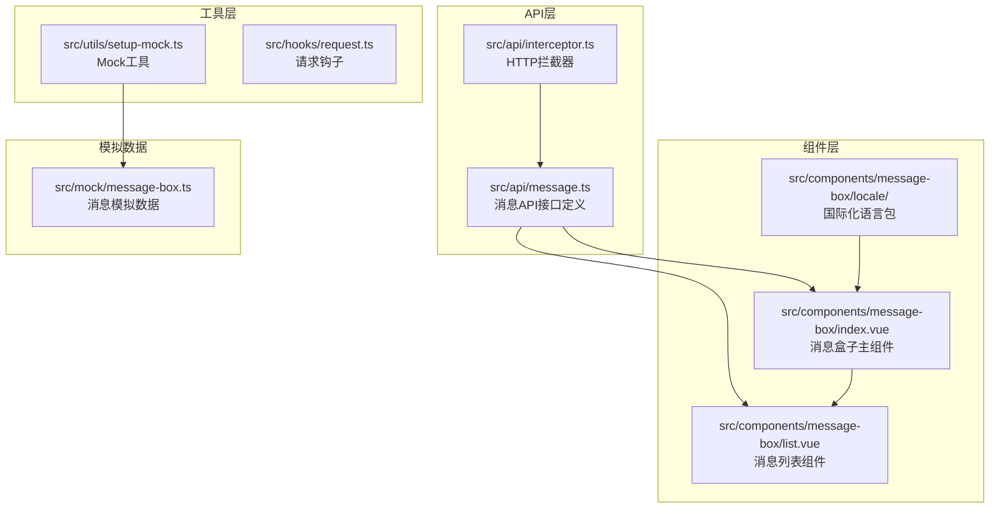
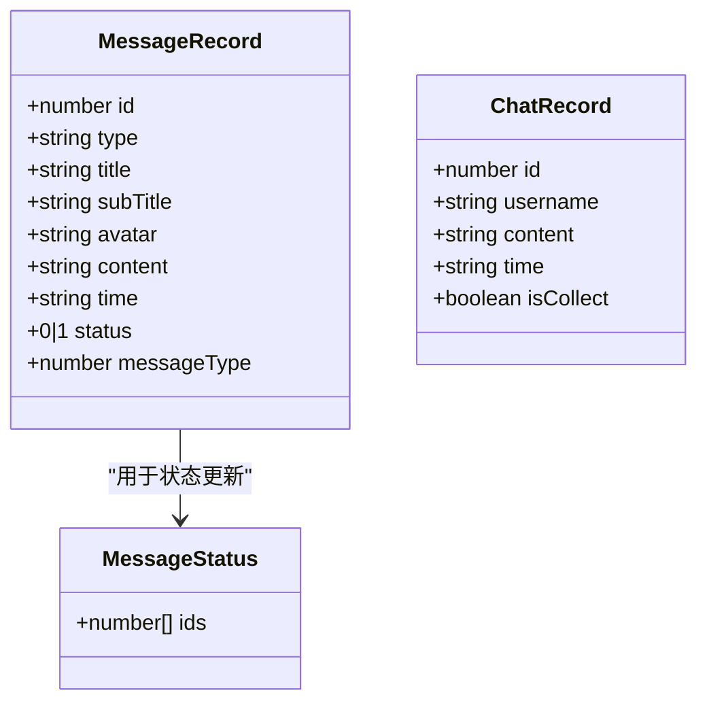
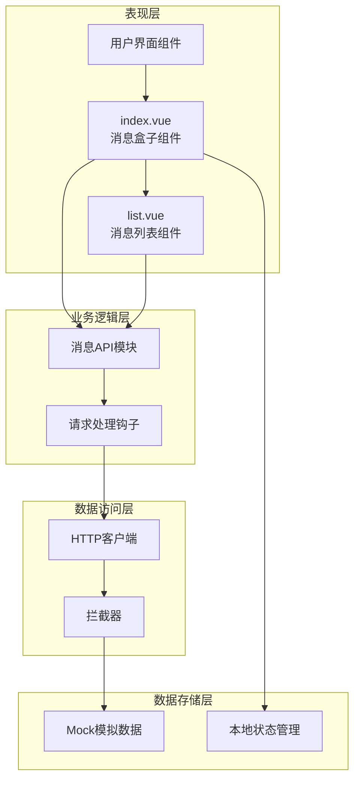
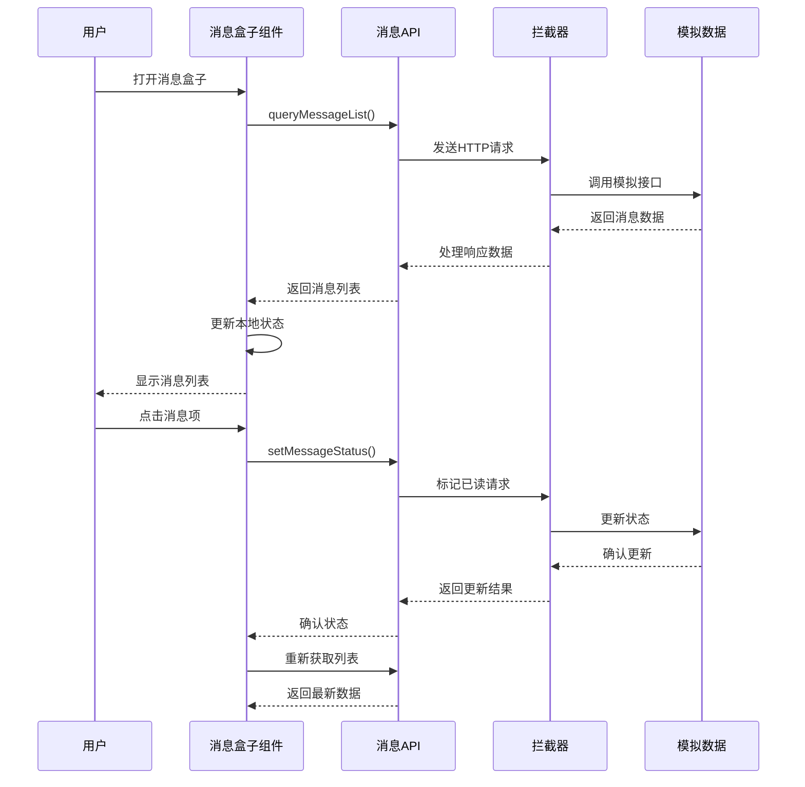
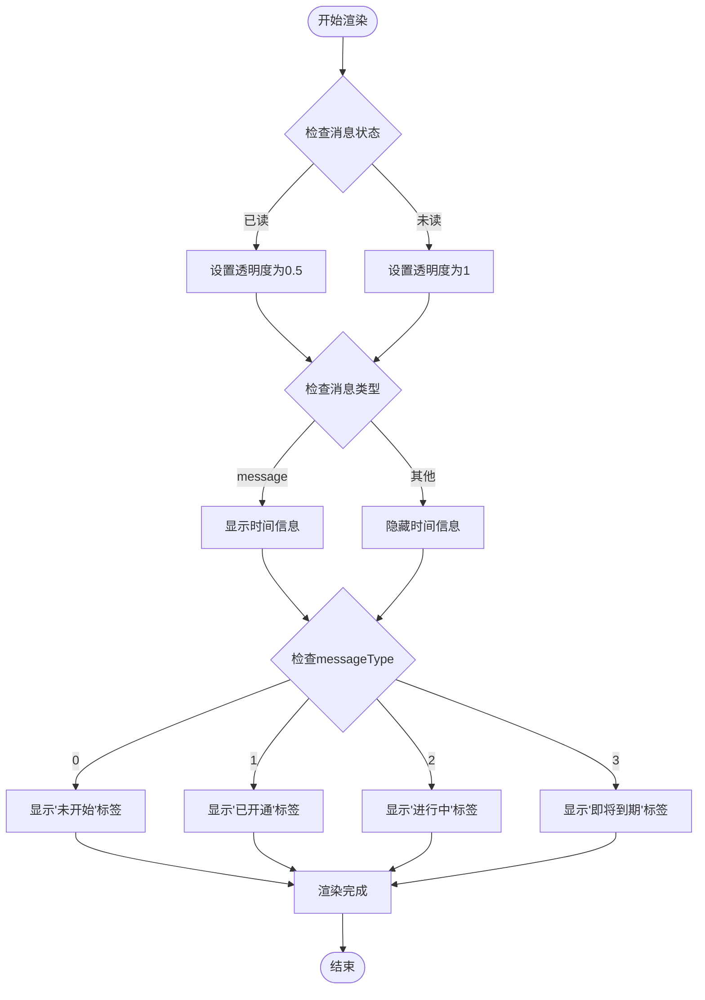
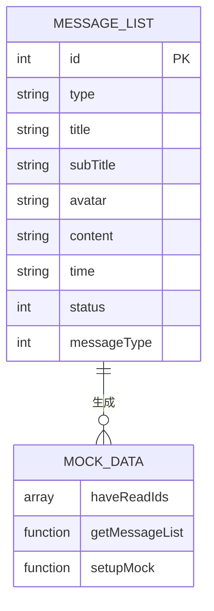

# 消息管理API

<cite>
**本文档引用的文件**
- [message.ts](file://src/api/message.ts)
- [index.vue](file://src/components/message-box/index.vue)
- [list.vue](file://src/components/message-box/list.vue)
- [message-box.ts](file://src/mock/message-box.ts)
- [interceptor.ts](file://src/api/interceptor.ts)
- [setup-mock.ts](file://src/utils/setup-mock.ts)
- [en-US.ts](file://src/components/message-box/locale/en-US.ts)
- [zh-CN.ts](file://src/components/message-box/locale/zh-CN.ts)
- [en-US.ts](file://src/locale/en-US.ts)
- [request.ts](file://src/hooks/request.ts)
- [types.ts](file://src/store/modules/user/types.ts)
</cite>

## 目录
1. [简介](#简介)
2. [项目结构](#项目结构)
3. [核心组件](#核心组件)
4. [架构概览](#架构概览)
5. [详细组件分析](#详细组件分析)
6. [依赖关系分析](#依赖关系分析)
7. [性能考虑](#性能考虑)
8. [故障排除指南](#故障排除指南)
9. [结论](#结论)

## 简介

消息管理API是本项目中的一个核心功能模块，负责管理系统消息、通知和待办事项的展示与交互。该模块采用Vue 3 Composition API构建，结合Arco Design组件库，提供了完整的消息盒子功能。

消息管理API主要包含以下核心功能：
- 消息列表获取与展示
- 消息状态更新（标记已读）
- 多类型消息分类管理（消息、通知、待办）
- 实时状态同步与更新
- 国际化支持
- 模拟数据与真实API集成

## 项目结构

消息管理API相关的文件组织结构如下：



**图表来源**
- [message.ts:1-39](file://src/api/message.ts#L1-L39)
- [index.vue:1-130](file://src/components/message-box/index.vue#L1-L130)
- [message-box.ts:1-86](file://src/mock/message-box.ts#L1-L86)

**章节来源**
- [message.ts:1-39](file://src/api/message.ts#L1-L39)
- [index.vue:1-130](file://src/components/message-box/index.vue#L1-L130)
- [message-box.ts:1-86](file://src/mock/message-box.ts#L1-L86)

## 核心组件

### 消息记录数据模型

消息系统的核心数据结构定义如下：



**图表来源**
- [message.ts:3-14](file://src/api/message.ts#L3-L14)
- [message.ts:20-22](file://src/api/message.ts#L20-L22)
- [message.ts:28-34](file://src/api/message.ts#L28-L34)

### API接口定义

消息管理API提供了以下核心接口：

| 接口名称 | 方法 | URL路径 | 功能描述 |
|---------|------|---------|----------|
| 查询消息列表 | POST | `/api/message/list` | 获取所有消息记录 |
| 设置消息状态 | POST | `/api/message/read` | 更新消息为已读状态 |
| 查询聊天列表 | POST | `/api/chat/list` | 获取聊天记录列表 |

**章节来源**
- [message.ts:16-38](file://src/api/message.ts#L16-L38)

## 架构概览

消息管理API采用分层架构设计，各层职责明确：



**图表来源**
- [index.vue:26-36](file://src/components/message-box/index.vue#L26-L36)
- [message.ts:1-39](file://src/api/message.ts#L1-L39)
- [interceptor.ts:1-78](file://src/api/interceptor.ts#L1-L78)

## 详细组件分析

### 消息盒子主组件

消息盒子主组件是整个消息管理API的核心入口，负责协调各个子组件的工作。

#### 组件功能特性

1. **多标签页管理**：支持消息、通知、待办三种类型的分类显示
2. **实时状态更新**：自动跟踪未读消息数量
3. **国际化支持**：动态加载不同语言的消息标签
4. **响应式设计**：适配不同屏幕尺寸的显示效果

#### 关键实现逻辑



**图表来源**
- [index.vue:68-83](file://src/components/message-box/index.vue#L68-L83)
- [message.ts:16-26](file://src/api/message.ts#L16-L26)

#### 状态管理机制

组件内部维护了完整的消息状态管理：

| 状态属性 | 类型 | 描述 | 计算方式 |
|---------|------|------|----------|
| messageType | string | 当前选中的标签类型 | 'message' \| 'notice' \| 'todo' |
| messageList | MessageRecord[] | 完整的消息列表 | 从API获取 |
| renderList | MessageRecord[] | 当前标签下的消息列表 | 过滤当前类型 |
| unreadCount | number | 未读消息总数 | 统计status为0的项目 |

**章节来源**
- [index.vue:44-108](file://src/components/message-box/index.vue#L44-L108)

### 消息列表组件

消息列表组件负责具体的消息项展示和交互处理。

#### 列表项显示逻辑



**图表来源**
- [list.vue:1-71](file://src/components/message-box/list.vue#L1-L71)

#### 交互事件处理

组件通过事件总线实现父子组件通信：

| 事件名称 | 触发条件 | 参数类型 | 处理逻辑 |
|---------|----------|----------|----------|
| itemClick | 用户点击消息项或"全部已读"按钮 | MessageListType | 触发状态更新流程 |
| allRead | 点击"全部已读"链接 | - | 触发批量状态更新 |

**章节来源**
- [list.vue:73-98](file://src/components/message-box/list.vue#L73-L98)

### 模拟数据服务

消息管理API提供了完整的模拟数据服务，便于开发和测试环境使用。

#### 模拟数据结构



**图表来源**
- [message-box.ts:4-71](file://src/mock/message-box.ts#L4-L71)

#### 数据更新机制

模拟服务实现了完整的状态跟踪机制：

| 功能 | 实现方式 | 效果 |
|------|----------|------|
| 未读标识 | 使用haveReadIds数组跟踪 | 自动更新消息状态 |
| 类型分类 | 基于type字段区分 | 支持消息、通知、待办分类 |
| 状态持久化 | 内存中保存haveReadIds | 页面刷新后重置 |
| 响应格式 | 使用successResponseWrap统一格式 | 保持API一致性 |

**章节来源**
- [message-box.ts:73-85](file://src/mock/message-box.ts#L73-L85)

### 国际化支持

消息管理API提供了完整的国际化支持，包括界面文本和数据格式。

#### 语言包结构

| 语言 | 文件位置 | 支持的键值 |
|------|----------|------------|
| 中文 | zh-CN.ts | messageBox.tab.title.*, messageBox.allRead等 |
| 英文 | en-US.ts | messageBox.tab.title.*. messageBox.allRead等 |
| 全局整合 | en-US.ts | 将消息盒子语言包合并到全局语言包 |

#### 动态语言切换

组件通过vue-i18n实现语言的动态切换，无需刷新页面即可更新所有文本内容。

**章节来源**
- [zh-CN.ts:1-14](file://src/components/message-box/locale/zh-CN.ts#L1-L14)
- [en-US.ts:1-14](file://src/components/message-box/locale/en-US.ts#L1-L14)
- [en-US.ts:1-29](file://src/locale/en-US.ts#L1-L29)

## 依赖关系分析

消息管理API的依赖关系清晰明确，遵循单一职责原则：

```mermaid
graph LR
subgraph "外部依赖"
AX[axios HTTP客户端]
ARCO[@arco-design/web-vue UI库]
VUE[Vue 3框架]
I18N[vue-i18n国际化]
end
subgraph "内部模块"
MSG[src/api/message.ts]
MBX[src/components/message-box]
INT[src/api/interceptor.ts]
MOCK[src/mock/message-box.ts]
SETUP[src/utils/setup-mock.ts]
end
MSG --> AX
MBX --> VUE
MBX --> ARCO
MBX --> I18N
INT --> AX
INT --> ARCO
MOCK --> SETUP
MBX --> MSG
MBX --> INT
```

**图表来源**
- [message.ts](file://src/api/message.ts#L1)
- [index.vue:27-36](file://src/components/message-box/index.vue#L27-L36)
- [interceptor.ts:1-78](file://src/api/interceptor.ts#L1-L78)

### 核心依赖说明

1. **HTTP客户端依赖**：使用axios进行网络请求，支持拦截器机制
2. **UI组件依赖**：基于Arco Design组件库构建用户界面
3. **状态管理依赖**：使用Vue 3响应式系统管理组件状态
4. **国际化依赖**：通过vue-i18n实现多语言支持
5. **模拟数据依赖**：使用MockJS进行数据模拟和测试

**章节来源**
- [package.json:32-47](file://package.json#L32-L47)

## 性能考虑

消息管理API在设计时充分考虑了性能优化：

### 渲染性能优化

1. **计算属性缓存**：使用computed属性避免重复计算
2. **条件渲染**：根据状态动态显示/隐藏元素
3. **虚拟滚动**：对于大量消息时可考虑实现虚拟滚动
4. **懒加载**：消息列表按需加载，减少初始渲染压力

### 网络性能优化

1. **请求合并**：批量更新消息状态，减少HTTP请求次数
2. **缓存策略**：合理利用浏览器缓存机制
3. **错误重试**：实现网络异常时的自动重试机制

### 内存管理

1. **组件卸载清理**：确保组件销毁时清理定时器和事件监听器
2. **大数据处理**：对于大量消息时实施分页加载策略

## 故障排除指南

### 常见问题及解决方案

#### 消息无法显示

**问题现象**：消息盒子空白或显示"暂无内容"

**可能原因**：
1. API接口返回数据格式不正确
2. 网络请求失败
3. 权限验证失败

**解决步骤**：
1. 检查浏览器开发者工具的Network面板
2. 验证API响应格式是否符合预期
3. 确认用户权限状态

#### 消息状态无法更新

**问题现象**：点击消息后状态没有变化

**可能原因**：
1. 消息状态更新接口调用失败
2. 服务器端状态更新逻辑异常
3. 前端状态同步问题

**解决步骤**：
1. 查看控制台是否有JavaScript错误
2. 检查setMessageStatus函数的调用情况
3. 验证后端状态更新逻辑

#### 国际化文本显示异常

**问题现象**：消息盒子中的文本显示为键名而非实际内容

**可能原因**：
1. 语言包文件加载失败
2. 文本键名拼写错误
3. vue-i18n配置问题

**解决步骤**：
1. 检查语言包文件是否存在
2. 验证文本键名是否正确
3. 确认vue-i18n初始化配置

**章节来源**
- [interceptor.ts:39-77](file://src/api/interceptor.ts#L39-L77)
- [message-box.ts:73-85](file://src/mock/message-box.ts#L73-L85)

## 结论

消息管理API是一个设计良好、功能完整的前端消息处理系统。其主要特点包括：

### 技术优势

1. **模块化设计**：清晰的分层架构，职责分离明确
2. **响应式编程**：充分利用Vue 3的Composition API特性
3. **国际化支持**：完整的多语言解决方案
4. **模拟数据**：完善的开发和测试支持
5. **错误处理**：健壮的异常处理和用户反馈机制

### 功能完整性

- 支持多种消息类型（消息、通知、待办）
- 提供完整的CRUD操作能力
- 实现实时状态同步
- 支持批量操作和单个操作
- 提供友好的用户交互体验

### 扩展性考虑

该消息管理API具有良好的扩展性，可以轻松添加新的消息类型、自定义消息模板、实现消息推送等功能。同时，其模块化的架构设计也为后续的功能增强提供了便利。

通过本文档的详细分析，开发者可以快速理解和使用消息管理API，并在此基础上进行二次开发和功能扩展。