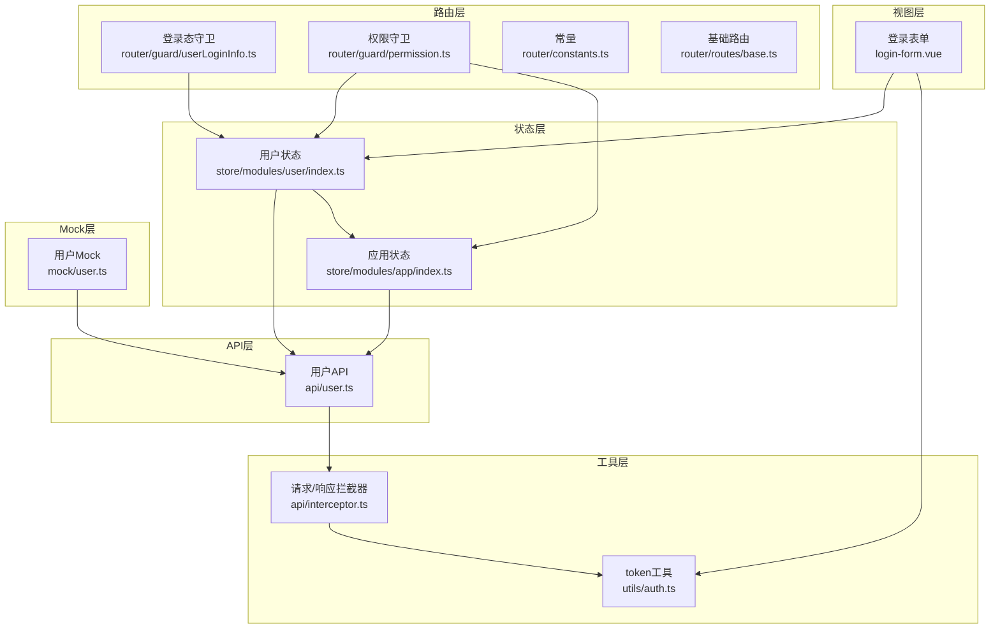
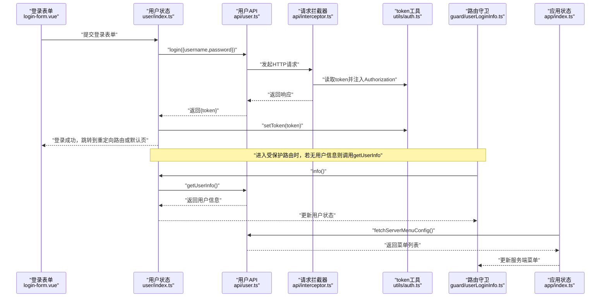
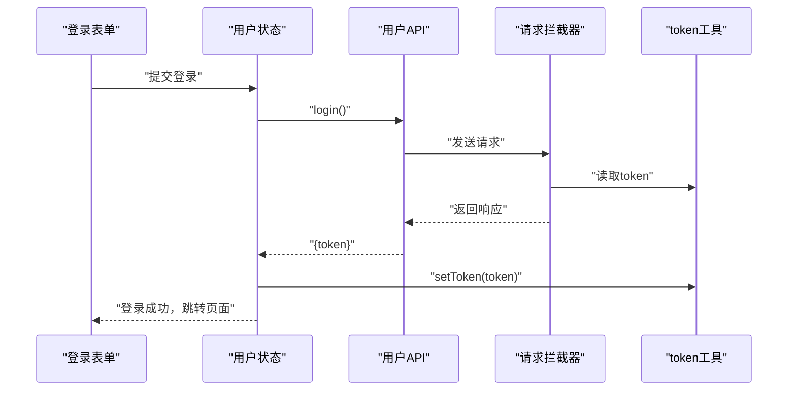
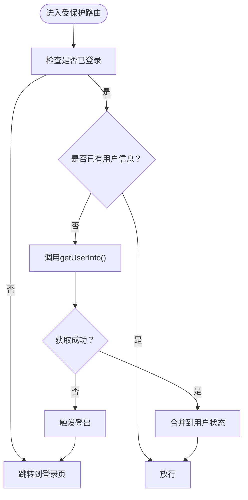
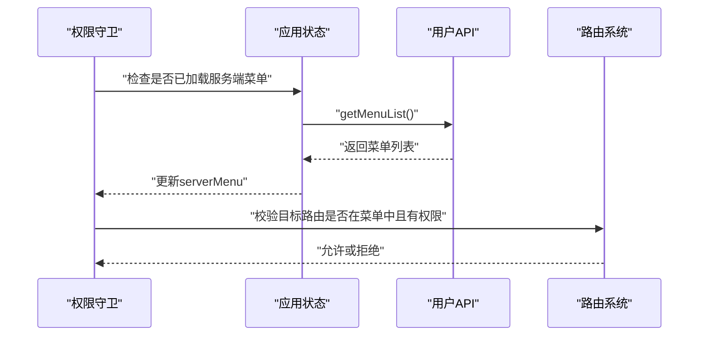
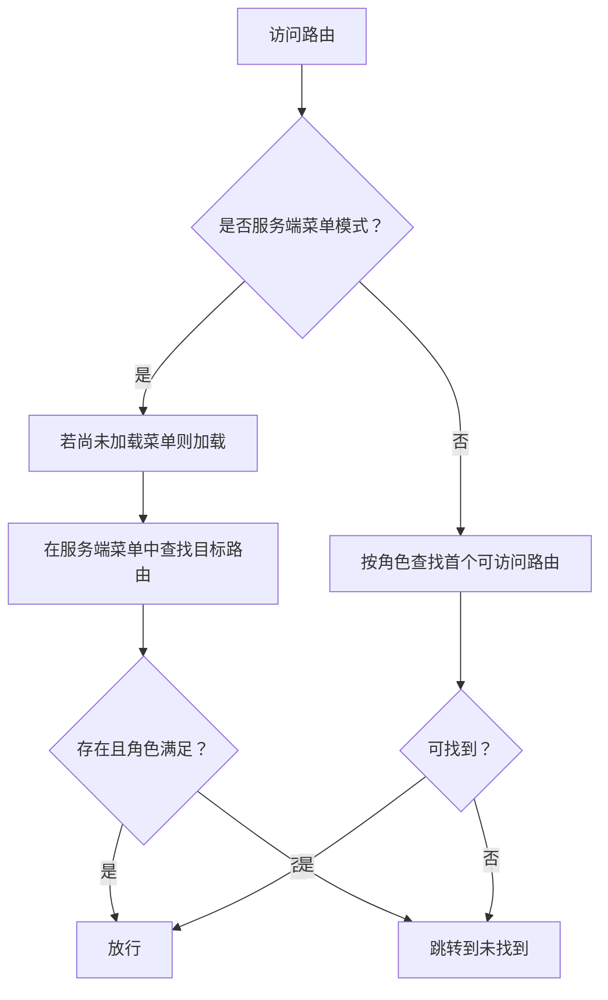
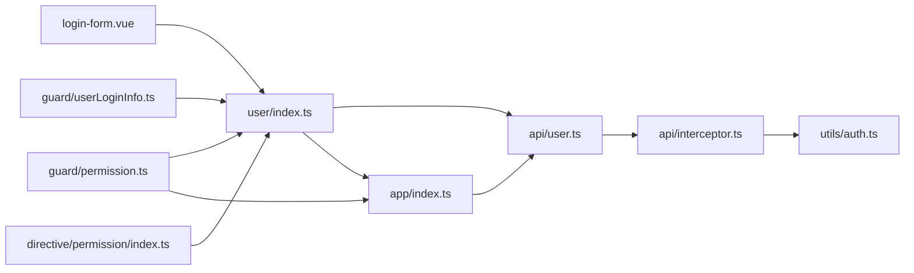

# 用户管理API

<cite>
**本文引用的文件**
- [src/api/user.ts](file://src/api/user.ts)
- [src/store/modules/user/index.ts](file://src/store/modules/user/index.ts)
- [src/store/modules/user/types.ts](file://src/store/modules/user/types.ts)
- [src/utils/auth.ts](file://src/utils/auth.ts)
- [src/router/guard/userLoginInfo.ts](file://src/router/guard/userLoginInfo.ts)
- [src/router/guard/permission.ts](file://src/router/guard/permission.ts)
- [src/views/login/components/login-form.vue](file://src/views/login/components/login-form.vue)
- [src/directive/permission/index.ts](file://src/directive/permission/index.ts)
- [src/api/interceptor.ts](file://src/api/interceptor.ts)
- [src/store/modules/app/index.ts](file://src/store/modules/app/index.ts)
- [src/store/modules/app/types.ts](file://src/store/modules/app/types.ts)
- [src/mock/user.ts](file://src/mock/user.ts)
- [src/hooks/request.ts](file://src/hooks/request.ts)
- [src/router/constants.ts](file://src/router/constants.ts)
- [src/router/routes/base.ts](file://src/router/routes/base.ts)
</cite>

## 目录
1. [简介](#简介)
2. [项目结构](#项目结构)
3. [核心组件](#核心组件)
4. [架构总览](#架构总览)
5. [详细组件分析](#详细组件分析)
6. [依赖分析](#依赖分析)
7. [性能考虑](#性能考虑)
8. [故障排查指南](#故障排查指南)
9. [结论](#结论)
10. [附录](#附录)

## 简介
本文件面向前端用户管理API的实现与使用，重点覆盖以下能力：
- 用户认证：登录、登出
- 用户信息管理：获取当前用户信息
- 菜单权限获取：从服务端拉取动态菜单
- token管理与请求拦截
- 权限校验与路由守卫
- 数据模型与类型约束
- 最佳实践与常见问题排查

## 项目结构
围绕用户管理API的相关模块分布如下：
- API层：封装登录、登出、获取用户信息、获取菜单等HTTP接口
- 状态层（Pinia）：用户状态、应用状态（含服务端菜单）
- 工具层：token本地存储、请求/响应拦截器
- 路由层：登录态守卫、权限守卫、白名单与默认路由
- 视图层：登录表单与权限指令
- Mock层：模拟后端接口，便于开发调试

图表来源
- [src/views/login/components/login-form.vue:1-166](file://src/views/login/components/login-form.vue#L1-L166)
- [src/store/modules/user/index.ts:1-92](file://src/store/modules/user/index.ts#L1-L92)
- [src/store/modules/app/index.ts:1-78](file://src/store/modules/app/index.ts#L1-L78)
- [src/api/user.ts:1-28](file://src/api/user.ts#L1-L28)
- [src/utils/auth.ts:1-20](file://src/utils/auth.ts#L1-L20)
- [src/api/interceptor.ts:1-78](file://src/api/interceptor.ts#L1-L78)
- [src/router/guard/userLoginInfo.ts:1-44](file://src/router/guard/userLoginInfo.ts#L1-L44)
- [src/router/guard/permission.ts:1-56](file://src/router/guard/permission.ts#L1-L56)
- [src/router/constants.ts:1-19](file://src/router/constants.ts#L1-L19)
- [src/router/routes/base.ts:1-32](file://src/router/routes/base.ts#L1-L32)
- [src/mock/user.ts:1-106](file://src/mock/user.ts#L1-L106)

章节来源
- [src/api/user.ts:1-28](file://src/api/user.ts#L1-L28)
- [src/store/modules/user/index.ts:1-92](file://src/store/modules/user/index.ts#L1-L92)
- [src/store/modules/app/index.ts:1-78](file://src/store/modules/app/index.ts#L1-L78)
- [src/utils/auth.ts:1-20](file://src/utils/auth.ts#L1-L20)
- [src/api/interceptor.ts:1-78](file://src/api/interceptor.ts#L1-L78)
- [src/router/guard/userLoginInfo.ts:1-44](file://src/router/guard/userLoginInfo.ts#L1-L44)
- [src/router/guard/permission.ts:1-56](file://src/router/guard/permission.ts#L1-L56)
- [src/views/login/components/login-form.vue:1-166](file://src/views/login/components/login-form.vue#L1-L166)
- [src/mock/user.ts:1-106](file://src/mock/user.ts#L1-L106)

## 核心组件
- 用户API接口
  - 登录：POST /api/user/login，入参为用户名与密码，返回token
  - 登出：POST /api/user/logout，无入参
  - 获取用户信息：POST /api/user/info，返回用户信息对象
  - 获取菜单列表：POST /api/user/menu，返回路由记录数组
- 用户状态（Pinia）
  - 管理用户资料、角色、以及登录态相关操作
- 应用状态（Pinia）
  - 管理服务端动态菜单、主题、布局等全局设置
- 认证工具
  - 基于localStorage的token存取与登录态判断
- 请求/响应拦截器
  - 自动注入Authorization头；统一错误提示与异常分支处理
- 路由守卫
  - 登录态守卫：确保访问受保护路由前已登录且可获取用户信息
  - 权限守卫：基于角色与服务端菜单配置控制路由访问
- 登录视图与权限指令
  - 登录表单负责触发登录流程
  - v-permission指令用于DOM级权限控制

章节来源
- [src/api/user.ts:1-28](file://src/api/user.ts#L1-L28)
- [src/store/modules/user/index.ts:1-92](file://src/store/modules/user/index.ts#L1-L92)
- [src/store/modules/app/index.ts:1-78](file://src/store/modules/app/index.ts#L1-L78)
- [src/utils/auth.ts:1-20](file://src/utils/auth.ts#L1-L20)
- [src/api/interceptor.ts:1-78](file://src/api/interceptor.ts#L1-L78)
- [src/router/guard/userLoginInfo.ts:1-44](file://src/router/guard/userLoginInfo.ts#L1-L44)
- [src/router/guard/permission.ts:1-56](file://src/router/guard/permission.ts#L1-L56)
- [src/views/login/components/login-form.vue:1-166](file://src/views/login/components/login-form.vue#L1-L166)
- [src/directive/permission/index.ts:1-31](file://src/directive/permission/index.ts#L1-L31)

## 架构总览
用户管理API在前端的整体调用链路如下：

图表来源
- [src/views/login/components/login-form.vue:93-125](file://src/views/login/components/login-form.vue#L93-L125)
- [src/store/modules/user/index.ts:64-87](file://src/store/modules/user/index.ts#L64-L87)
- [src/api/user.ts:13-27](file://src/api/user.ts#L13-L27)
- [src/api/interceptor.ts:18-37](file://src/api/interceptor.ts#L18-L37)
- [src/utils/auth.ts:11-17](file://src/utils/auth.ts#L11-L17)
- [src/router/guard/userLoginInfo.ts:10-28](file://src/router/guard/userLoginInfo.ts#L10-L28)
- [src/store/modules/app/index.ts:47-70](file://src/store/modules/app/index.ts#L47-L70)

## 详细组件分析

### 用户认证与登录流程
- 接口定义
  - 登录：POST /api/user/login，入参包含用户名与密码；返回包含token的对象
  - 登出：POST /api/user/logout，无入参；返回成功响应
- 前端实现要点
  - 登录成功后将token写入localStorage，并在后续请求中通过拦截器自动附加Authorization头
  - 登录失败时清除token并抛出错误，交由上层处理
  - 登出时调用后端登出接口，随后清理用户信息、token与路由监听，刷新菜单缓存
- 错误处理
  - 登录接口可能返回“用户名/密码为空”、“账号或密码错误”等业务错误码
  - 登录态失效时，响应拦截器会弹窗提示并触发退出流程

图表来源
- [src/views/login/components/login-form.vue:93-125](file://src/views/login/components/login-form.vue#L93-L125)
- [src/store/modules/user/index.ts:64-72](file://src/store/modules/user/index.ts#L64-L72)
- [src/api/user.ts:13-19](file://src/api/user.ts#L13-L19)
- [src/api/interceptor.ts:18-37](file://src/api/interceptor.ts#L18-L37)
- [src/utils/auth.ts:11-17](file://src/utils/auth.ts#L11-L17)

章节来源
- [src/api/user.ts:13-19](file://src/api/user.ts#L13-L19)
- [src/store/modules/user/index.ts:64-87](file://src/store/modules/user/index.ts#L64-L87)
- [src/utils/auth.ts:1-20](file://src/utils/auth.ts#L1-L20)
- [src/api/interceptor.ts:18-37](file://src/api/interceptor.ts#L18-L37)
- [src/views/login/components/login-form.vue:93-125](file://src/views/login/components/login-form.vue#L93-L125)

### 用户信息管理
- 接口定义
  - 获取用户信息：POST /api/user/info，返回用户资料对象
- 前端实现要点
  - 在路由守卫中检测登录态，若无用户信息则调用该接口拉取
  - 成功后将用户信息合并到用户状态中，供其他模块使用
- 数据模型与类型约束
  - 用户状态包含姓名、头像、职位、组织、地区、邮箱、个人网站、电话、注册时间、账户ID、认证状态、角色等字段
  - 角色类型支持空字符串、通配符、管理员与普通用户

图表来源
- [src/router/guard/userLoginInfo.ts:10-28](file://src/router/guard/userLoginInfo.ts#L10-L28)
- [src/store/modules/user/index.ts:57-61](file://src/store/modules/user/index.ts#L57-L61)
- [src/store/modules/user/types.ts:1-20](file://src/store/modules/user/types.ts#L1-L20)

章节来源
- [src/api/user.ts:21-23](file://src/api/user.ts#L21-L23)
- [src/store/modules/user/index.ts:57-61](file://src/store/modules/user/index.ts#L57-L61)
- [src/store/modules/user/types.ts:1-20](file://src/store/modules/user/types.ts#L1-L20)
- [src/router/guard/userLoginInfo.ts:10-28](file://src/router/guard/userLoginInfo.ts#L10-L28)

### 菜单权限获取
- 接口定义
  - 获取菜单列表：POST /api/user/menu，返回路由记录数组
- 前端实现要点
  - 应用状态在需要时调用该接口拉取服务端菜单，并缓存至状态中
  - 权限守卫根据服务端菜单与用户角色决定是否允许访问目标路由
- 与路由的关系
  - 若开启“服务端菜单”，则在首次访问受保护路由时拉取菜单并构建可访问路由集合
  - 白名单路由不受菜单限制

图表来源
- [src/store/modules/app/index.ts:47-70](file://src/store/modules/app/index.ts#L47-L70)
- [src/api/user.ts:25-27](file://src/api/user.ts#L25-L27)
- [src/router/guard/permission.ts:15-42](file://src/router/guard/permission.ts#L15-L42)
- [src/router/constants.ts:1-19](file://src/router/constants.ts#L1-L19)

章节来源
- [src/api/user.ts:25-27](file://src/api/user.ts#L25-L27)
- [src/store/modules/app/index.ts:47-70](file://src/store/modules/app/index.ts#L47-L70)
- [src/router/guard/permission.ts:15-42](file://src/router/guard/permission.ts#L15-L42)
- [src/router/constants.ts:1-19](file://src/router/constants.ts#L1-L19)

### 权限验证与DOM控制
- 路由级权限
  - 基于角色与服务端菜单配置进行访问控制
  - 未匹配到可访问路由时跳转到“未找到”
- 组件级权限
  - 使用v-permission指令，仅当元素绑定的角色值包含当前用户角色时才渲染
- 登录态与默认路由
  - 登录成功后根据重定向参数或默认路由跳转
  - 未登录访问受保护路由将被重定向到登录页

图表来源
- [src/router/guard/permission.ts:15-52](file://src/router/guard/permission.ts#L15-L52)
- [src/directive/permission/index.ts:4-21](file://src/directive/permission/index.ts#L4-L21)
- [src/router/constants.ts:1-19](file://src/router/constants.ts#L1-L19)
- [src/router/routes/base.ts:27-31](file://src/router/routes/base.ts#L27-L31)

章节来源
- [src/router/guard/permission.ts:15-52](file://src/router/guard/permission.ts#L15-L52)
- [src/directive/permission/index.ts:4-21](file://src/directive/permission/index.ts#L4-L21)
- [src/router/constants.ts:1-19](file://src/router/constants.ts#L1-L19)
- [src/router/routes/base.ts:27-31](file://src/router/routes/base.ts#L27-L31)

### 数据模型与类型约束
- 用户状态（UserState）
  - 字段：姓名、头像、职位、组织、地区、邮箱、个人简介、个人网站、电话、注册时间、账户ID、认证状态、角色
  - 角色类型：空字符串、通配符、管理员、普通用户
- 应用状态（AppState）
  - 字段：主题、弱视模式、导航栏、菜单、顶部菜单、隐藏菜单、菜单折叠、页脚、主题色、菜单宽度、全局设置、设备、标签页、是否启用服务端菜单、服务端菜单列表等
- 返回数据包装（HttpResponse）
  - 字段：状态码、消息、业务码、数据体

章节来源
- [src/store/modules/user/types.ts:1-20](file://src/store/modules/user/types.ts#L1-L20)
- [src/store/modules/app/types.ts:1-21](file://src/store/modules/app/types.ts#L1-L21)
- [src/api/interceptor.ts:7-12](file://src/api/interceptor.ts#L7-L12)

## 依赖分析
- 组件耦合
  - 登录表单依赖用户状态；用户状态依赖用户API；用户API依赖请求拦截器与token工具
  - 权限守卫依赖用户状态与应用状态；应用状态依赖用户API
  - v-permission指令依赖用户状态
- 外部依赖
  - axios作为HTTP客户端
  - pinia作为状态管理
  - vue-router作为路由管理
  - @arco-design/web-vue用于UI与消息提示
- 循环依赖
  - 当前模块间无明显循环依赖；各方向依赖清晰

图表来源
- [src/views/login/components/login-form.vue:73-104](file://src/views/login/components/login-form.vue#L73-L104)
- [src/store/modules/user/index.ts:1-92](file://src/store/modules/user/index.ts#L1-L92)
- [src/api/user.ts:1-28](file://src/api/user.ts#L1-L28)
- [src/api/interceptor.ts:1-78](file://src/api/interceptor.ts#L1-L78)
- [src/utils/auth.ts:1-20](file://src/utils/auth.ts#L1-L20)
- [src/store/modules/app/index.ts:1-78](file://src/store/modules/app/index.ts#L1-L78)
- [src/router/guard/permission.ts:1-56](file://src/router/guard/permission.ts#L1-L56)
- [src/router/guard/userLoginInfo.ts:1-44](file://src/router/guard/userLoginInfo.ts#L1-L44)
- [src/directive/permission/index.ts:1-31](file://src/directive/permission/index.ts#L1-L31)

章节来源
- [src/views/login/components/login-form.vue:73-104](file://src/views/login/components/login-form.vue#L73-L104)
- [src/store/modules/user/index.ts:1-92](file://src/store/modules/user/index.ts#L1-L92)
- [src/api/user.ts:1-28](file://src/api/user.ts#L1-L28)
- [src/api/interceptor.ts:1-78](file://src/api/interceptor.ts#L1-L78)
- [src/utils/auth.ts:1-20](file://src/utils/auth.ts#L1-L20)
- [src/store/modules/app/index.ts:1-78](file://src/store/modules/app/index.ts#L1-L78)
- [src/router/guard/permission.ts:1-56](file://src/router/guard/permission.ts#L1-L56)
- [src/router/guard/userLoginInfo.ts:1-44](file://src/router/guard/userLoginInfo.ts#L1-L44)
- [src/directive/permission/index.ts:1-31](file://src/directive/permission/index.ts#L1-L31)

## 性能考虑
- 减少重复请求
  - 登录成功后优先复用已有的用户信息，避免重复拉取
  - 服务端菜单仅在首次访问受保护路由时拉取，后续复用
- 本地化优化
  - token与用户信息存储在localStorage，减少网络往返
  - 登录表单支持记住密码，但生产环境建议加密存储
- 路由与菜单
  - 服务端菜单采用扁平化搜索策略，建议在菜单量较大时引入索引结构以提升查找效率

## 故障排查指南
- 登录失败
  - 检查用户名/密码是否为空；确认账号密码是否正确
  - 查看响应拦截器中的业务码与消息提示
- 登录态异常
  - 确认token是否正确写入localStorage并在请求头中携带
  - 若出现非法token、其他客户端登录或token过期，拦截器会弹窗并触发登出
- 无法访问受保护路由
  - 确认是否已登录且已拉取用户信息
  - 若启用服务端菜单，确认菜单列表中是否存在目标路由
- 菜单不显示
  - 检查应用状态中的服务端菜单是否已加载
  - 确认权限守卫是否正确匹配角色与菜单项

章节来源
- [src/api/interceptor.ts:48-67](file://src/api/interceptor.ts#L48-L67)
- [src/router/guard/userLoginInfo.ts:15-28](file://src/router/guard/userLoginInfo.ts#L15-L28)
- [src/router/guard/permission.ts:15-42](file://src/router/guard/permission.ts#L15-L42)
- [src/store/modules/app/index.ts:47-70](file://src/store/modules/app/index.ts#L47-L70)

## 结论
本用户管理API通过清晰的分层设计实现了认证、信息管理与菜单权限控制的完整闭环。结合Pinia状态管理、axios拦截器与路由守卫，前端能够稳定地处理登录态、权限与菜单动态加载等场景。建议在生产环境中强化token安全存储与错误处理策略，并对菜单数据结构进行性能优化。

## 附录

### API参数与返回规范
- 登录
  - 方法与路径：POST /api/user/login
  - 入参：用户名、密码
  - 返回：包含token的对象
- 登出
  - 方法与路径：POST /api/user/logout
  - 入参：无
  - 返回：成功响应
- 获取用户信息
  - 方法与路径：POST /api/user/info
  - 入参：无
  - 返回：用户资料对象（包含姓名、头像、职位、组织、地区、邮箱、个人网站、电话、注册时间、账户ID、认证状态、角色等）
- 获取菜单列表
  - 方法与路径：POST /api/user/menu
  - 入参：无
  - 返回：路由记录数组（包含path、name、meta、children等）

章节来源
- [src/api/user.ts:13-27](file://src/api/user.ts#L13-L27)

### token管理最佳实践
- 存储位置：localStorage
- 注入方式：请求拦截器自动在Authorization头中附加Bearer token
- 清理时机：登出、登录失败、token失效时均需清理

章节来源
- [src/utils/auth.ts:1-20](file://src/utils/auth.ts#L1-L20)
- [src/api/interceptor.ts:18-37](file://src/api/interceptor.ts#L18-L37)
- [src/store/modules/user/index.ts:73-87](file://src/store/modules/user/index.ts#L73-L87)

### 权限验证实现细节
- 路由守卫
  - 登录态守卫：确保已登录且可获取用户信息
  - 权限守卫：基于角色与服务端菜单配置进行访问控制
- DOM权限
  - v-permission指令：仅渲染满足角色条件的DOM节点

章节来源
- [src/router/guard/userLoginInfo.ts:10-28](file://src/router/guard/userLoginInfo.ts#L10-L28)
- [src/router/guard/permission.ts:15-52](file://src/router/guard/permission.ts#L15-L52)
- [src/directive/permission/index.ts:4-21](file://src/directive/permission/index.ts#L4-L21)

### 与其他模块的集成关系
- 登录表单与用户状态：登录成功后更新用户状态并跳转
- 应用状态与菜单：拉取服务端菜单并缓存，供权限守卫使用
- 请求拦截器与token：统一注入Authorization头，处理异常与登出
- 路由常量与默认路由：定义白名单、未找到路由与默认路由

章节来源
- [src/views/login/components/login-form.vue:93-125](file://src/views/login/components/login-form.vue#L93-L125)
- [src/store/modules/app/index.ts:47-70](file://src/store/modules/app/index.ts#L47-L70)
- [src/api/interceptor.ts:18-37](file://src/api/interceptor.ts#L18-L37)
- [src/router/constants.ts:1-19](file://src/router/constants.ts#L1-L19)
- [src/router/routes/base.ts:27-31](file://src/router/routes/base.ts#L27-L31)