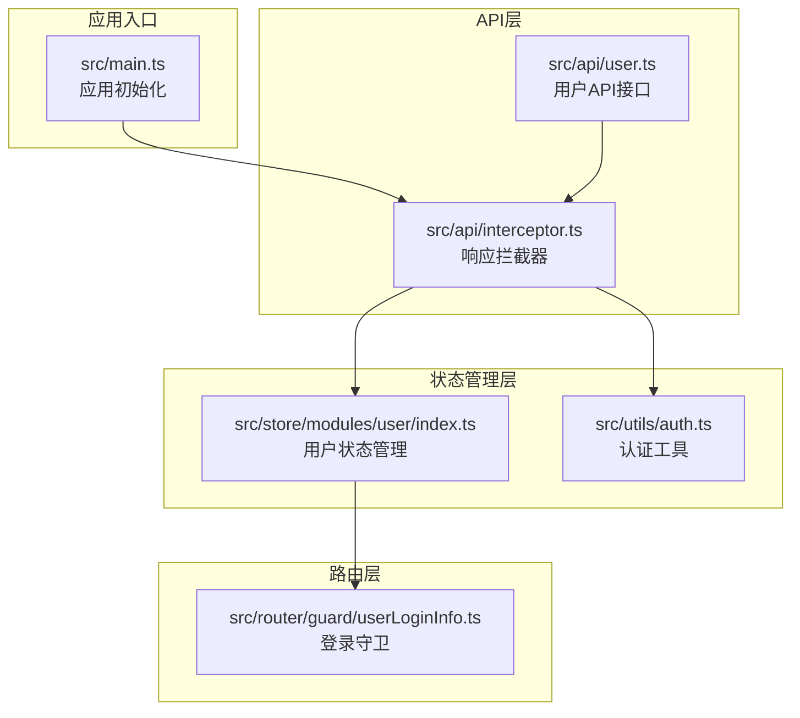
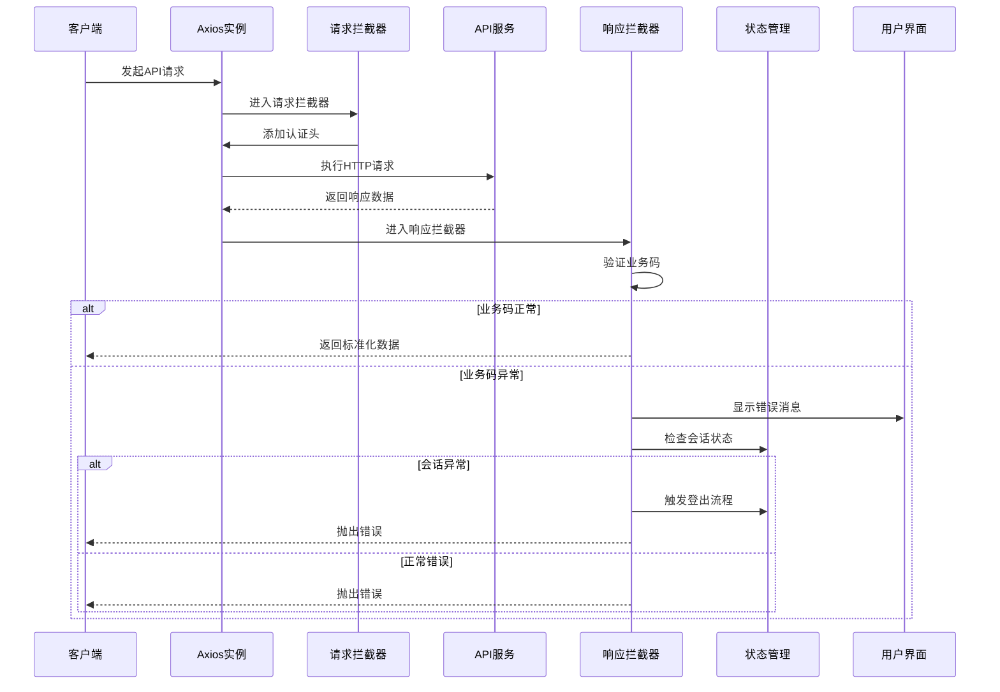
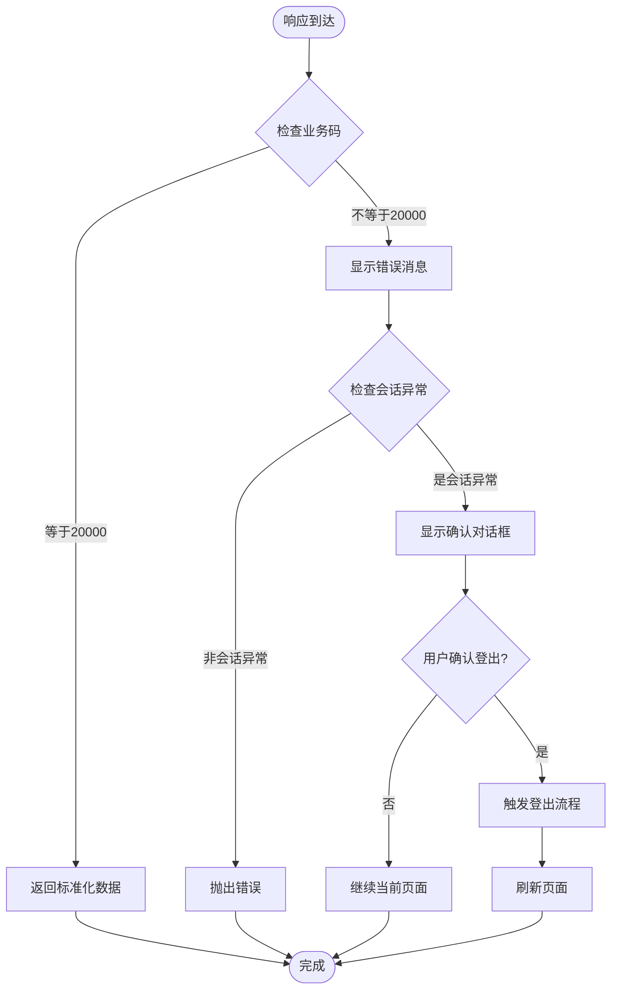
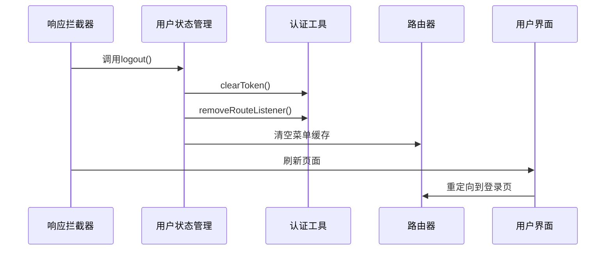
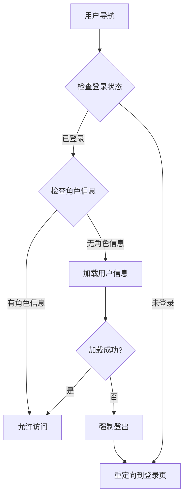
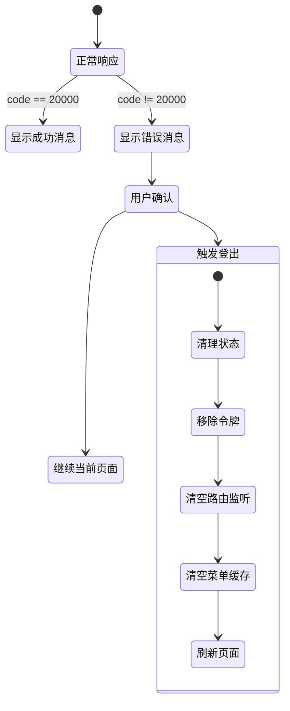
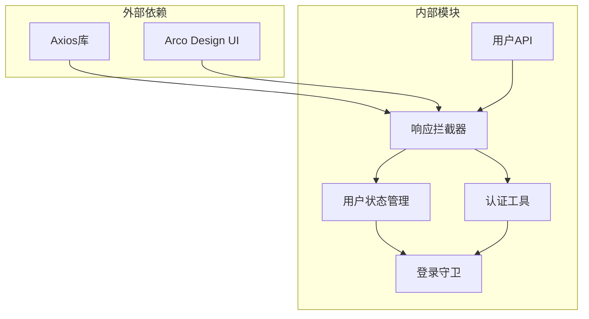

# 响应拦截器

<cite>
**本文档引用的文件**
- [src/api/interceptor.ts](file://src/api/interceptor.ts)
- [src/store/modules/user/index.ts](file://src/store/modules/user/index.ts)
- [src/utils/auth.ts](file://src/utils/auth.ts)
- [src/hooks/user.ts](file://src/hooks/user.ts)
- [src/router/guard/userLoginInfo.ts](file://src/router/guard/userLoginInfo.ts)
- [src/api/user.ts](file://src/api/user.ts)
- [src/main.ts](file://src/main.ts)
- [src/mock/user.ts](file://src/mock/user.ts)
- [src/utils/setup-mock.ts](file://src/utils/setup-mock.ts)
</cite>

## 目录
1. [简介](#简介)
2. [项目结构](#项目结构)
3. [核心组件](#核心组件)
4. [架构概览](#架构概览)
5. [详细组件分析](#详细组件分析)
6. [依赖关系分析](#依赖关系分析)
7. [性能考虑](#性能考虑)
8. [故障排除指南](#故障排除指南)
9. [结论](#结论)

## 简介

响应拦截器是本项目中用于统一处理HTTP响应的核心组件。它负责对所有API响应进行标准化处理，包括响应数据格式化、状态码处理、错误响应管理和用户会话状态维护。该拦截器实现了完整的业务错误码处理机制，能够自动识别令牌失效、重复登录等会话异常情况，并触发相应的用户登出逻辑。

## 项目结构

本项目的响应拦截器位于API层，通过Axios拦截器机制实现全局响应处理。主要涉及以下关键文件：



**图表来源**
- [src/api/interceptor.ts:1-78](file://src/api/interceptor.ts#L1-L78)
- [src/store/modules/user/index.ts:1-92](file://src/store/modules/user/index.ts#L1-L92)
- [src/utils/auth.ts:1-20](file://src/utils/auth.ts#L1-L20)
- [src/router/guard/userLoginInfo.ts:1-44](file://src/router/guard/userLoginInfo.ts#L1-L44)
- [src/main.ts:1-29](file://src/main.ts#L1-L29)

**章节来源**
- [src/api/interceptor.ts:1-78](file://src/api/interceptor.ts#L1-L78)
- [src/main.ts:15](file://src/main.ts#L15)

## 核心组件

### 响应数据格式化

响应拦截器定义了标准的响应数据结构，确保所有API响应具有一致的格式：

```typescript
interface HttpResponse<T = unknown> {
  status: number;
  msg: string;
  code: number;
  data: T;
}
```

该结构包含：
- **status**: 响应状态码（数字）
- **msg**: 错误或成功消息
- **code**: 业务逻辑码（20000表示成功）
- **data**: 实际业务数据

### 错误响应管理

拦截器实现了多层次的错误处理机制：

1. **业务错误码处理**: 自定义业务逻辑码（如20000表示成功）
2. **系统级错误处理**: 处理网络异常、超时等
3. **会话异常处理**: 识别令牌失效、重复登录等情况

**章节来源**
- [src/api/interceptor.ts:7-12](file://src/api/interceptor.ts#L7-L12)
- [src/api/interceptor.ts:39-77](file://src/api/interceptor.ts#L39-L77)

## 架构概览

响应拦截器采用分层架构设计，通过Axios拦截器机制实现全局响应处理：



**图表来源**
- [src/api/interceptor.ts:18-37](file://src/api/interceptor.ts#L18-L37)
- [src/api/interceptor.ts:39-77](file://src/api/interceptor.ts#L39-L77)
- [src/store/modules/user/index.ts:80-87](file://src/store/modules/user/index.ts#L80-L87)

## 详细组件分析

### 响应拦截器实现

响应拦截器的核心功能包括：

#### 1. 响应数据验证

拦截器首先检查响应数据中的业务码字段：



**图表来源**
- [src/api/interceptor.ts:40-67](file://src/api/interceptor.ts#L40-L67)
- [src/api/interceptor.ts:48-65](file://src/api/interceptor.ts#L48-L65)

#### 2. 会话异常检测

拦截器专门处理以下三种会话异常情况：

| 错误码 | 含义 | 处理方式 |
|--------|------|----------|
| 50008 | 非法令牌 | 弹出确认对话框，用户选择重新登录 |
| 50012 | 其他客户端登录 | 弹出确认对话框，强制登出 |
| 50014 | 令牌过期 | 弹出确认对话框，用户选择重新登录 |

#### 3. 用户登出逻辑

当检测到会话异常时，拦截器会触发完整的登出流程：



**图表来源**
- [src/api/interceptor.ts:58-62](file://src/api/interceptor.ts#L58-L62)
- [src/store/modules/user/index.ts:80-87](file://src/store/modules/user/index.ts#L80-L87)
- [src/utils/auth.ts:15](file://src/utils/auth.ts#L15)

**章节来源**
- [src/api/interceptor.ts:39-77](file://src/api/interceptor.ts#L39-L77)

### 用户状态管理集成

用户状态管理与响应拦截器紧密协作，确保会话状态的一致性：

#### 1. 登出回调机制

用户登出时执行清理操作：

```typescript
logoutCallBack() {
  const appStore = useAppStore();
  this.resetInfo();
  clearToken();
  removeRouteListener();
  appStore.clearServerMenu();
}
```

#### 2. 登录状态验证

路由守卫在每次导航时验证用户登录状态：



**图表来源**
- [src/router/guard/userLoginInfo.ts:8-42](file://src/router/guard/userLoginInfo.ts#L8-L42)
- [src/store/modules/user/index.ts:57-61](file://src/store/modules/user/index.ts#L57-L61)

**章节来源**
- [src/store/modules/user/index.ts:73-87](file://src/store/modules/user/index.ts#L73-L87)
- [src/router/guard/userLoginInfo.ts:1-44](file://src/router/guard/userLoginInfo.ts#L1-L44)

### 错误分类与处理策略

响应拦截器实现了详细的错误分类机制：

#### 1. 业务错误分类

| 错误类型 | 错误码范围 | 处理策略 |
|----------|------------|----------|
| 成功响应 | 20000 | 直接返回数据 |
| 参数错误 | 50000-50009 | 显示具体错误消息 |
| 权限错误 | 50010-50019 | 显示权限不足消息 |
| 会话异常 | 50008, 50012, 50014 | 弹出确认对话框 |
| 系统错误 | 其他 | 显示通用错误消息 |

#### 2. 用户交互流程



**图表来源**
- [src/api/interceptor.ts:44-67](file://src/api/interceptor.ts#L44-L67)
- [src/store/modules/user/index.ts:73-87](file://src/store/modules/user/index.ts#L73-L87)

**章节来源**
- [src/api/interceptor.ts:40-67](file://src/api/interceptor.ts#L40-L67)

## 依赖关系分析

响应拦截器与其他组件的依赖关系如下：



**图表来源**
- [src/api/interceptor.ts:1-5](file://src/api/interceptor.ts#L1-L5)
- [src/store/modules/user/index.ts:1-11](file://src/store/modules/user/index.ts#L1-L11)
- [src/utils/auth.ts:1-19](file://src/utils/auth.ts#L1-L19)

**章节来源**
- [src/api/interceptor.ts:1-7](file://src/api/interceptor.ts#L1-L7)
- [src/store/modules/user/index.ts:1-11](file://src/store/modules/user/index.ts#L1-L11)

## 性能考虑

响应拦截器在设计时考虑了以下性能因素：

1. **异步处理**: 使用Promise处理异步操作，避免阻塞主线程
2. **条件判断**: 只在必要时触发会话检查，减少不必要的计算
3. **内存管理**: 正确清理事件监听器和状态数据
4. **错误缓存**: 对重复的错误消息进行去重处理

## 故障排除指南

### 常见问题及解决方案

#### 1. 令牌过期但未触发登出

**症状**: 用户看到过期的页面内容但无法进行任何操作

**排查步骤**:
1. 检查响应拦截器是否正确识别50014错误码
2. 验证用户状态管理的logout方法是否被调用
3. 确认路由守卫是否正确处理会话异常

**解决方案**:
- 确保响应拦截器中的会话异常检测逻辑正常工作
- 检查用户状态管理的clearToken函数调用
- 验证路由守卫的重定向逻辑

#### 2. 重复登录导致的会话冲突

**症状**: 用户在多个设备上同时登录，出现会话冲突

**排查步骤**:
1. 检查50012错误码的处理逻辑
2. 验证Modal对话框的显示和用户确认流程
3. 确认登出后的页面刷新机制

**解决方案**:
- 确保Modal对话框正确显示并处理用户选择
- 验证登出流程的完整性（状态清理、令牌清除、路由重定向）

#### 3. 错误消息显示异常

**症状**: 错误消息没有正确显示或显示格式不正确

**排查步骤**:
1. 检查Message组件的配置参数
2. 验证错误消息的优先级处理逻辑
3. 确认错误码与消息的映射关系

**解决方案**:
- 确保Message组件的content属性正确设置
- 验证错误消息的默认值处理
- 检查错误码与消息的对应关系

**章节来源**
- [src/api/interceptor.ts:44-76](file://src/api/interceptor.ts#L44-L76)
- [src/store/modules/user/index.ts:73-87](file://src/store/modules/user/index.ts#L73-L87)

## 结论

响应拦截器作为本项目的核心组件，实现了完整的API响应处理机制。它不仅提供了标准化的响应数据格式，更重要的是建立了完善的会话状态管理和错误处理体系。

通过将业务错误码处理、用户登出逻辑和会话过期处理集成在一个统一的拦截器中，项目实现了以下优势：

1. **一致性**: 所有API响应都经过统一处理，确保用户体验的一致性
2. **可维护性**: 将错误处理逻辑集中管理，便于维护和扩展
3. **可靠性**: 提供了完整的会话异常检测和处理机制
4. **用户体验**: 通过友好的用户交互界面提升用户体验

该实现为类似的企业级管理系统提供了良好的参考模板，展示了如何在Vue 3 + TypeScript + Pinia的现代前端技术栈中构建健壮的响应处理机制。