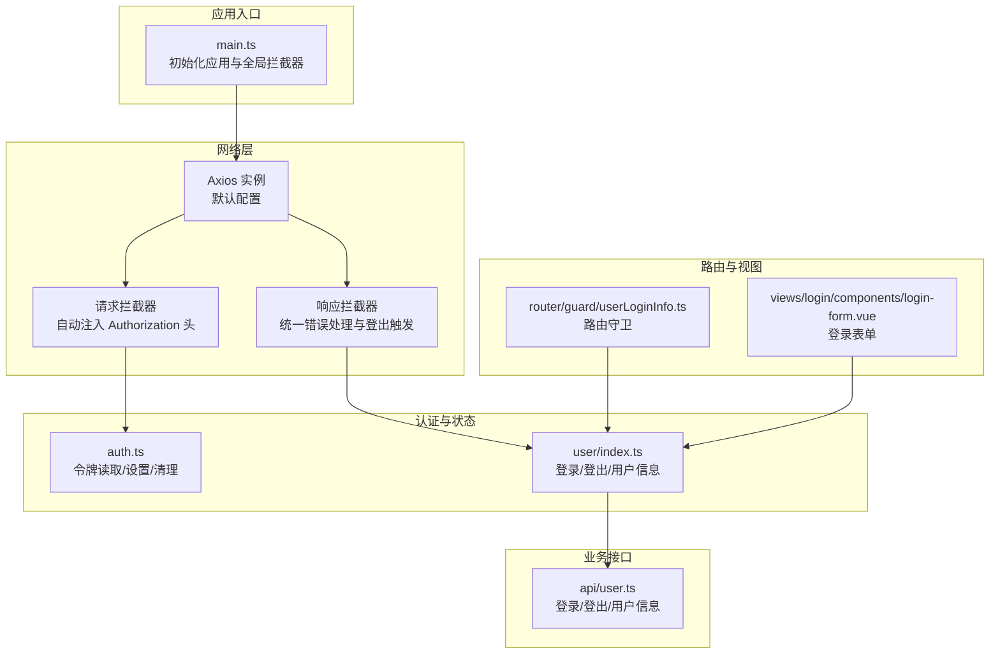
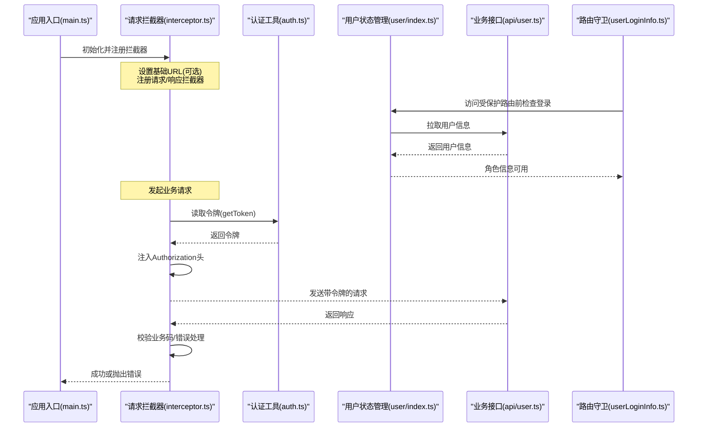
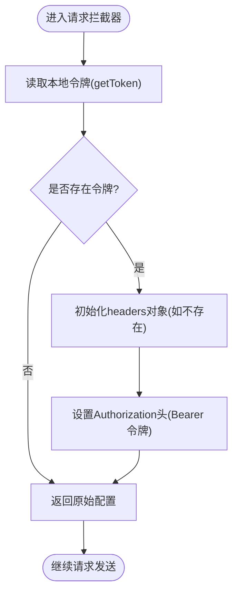
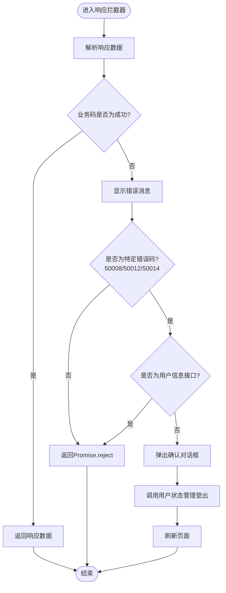
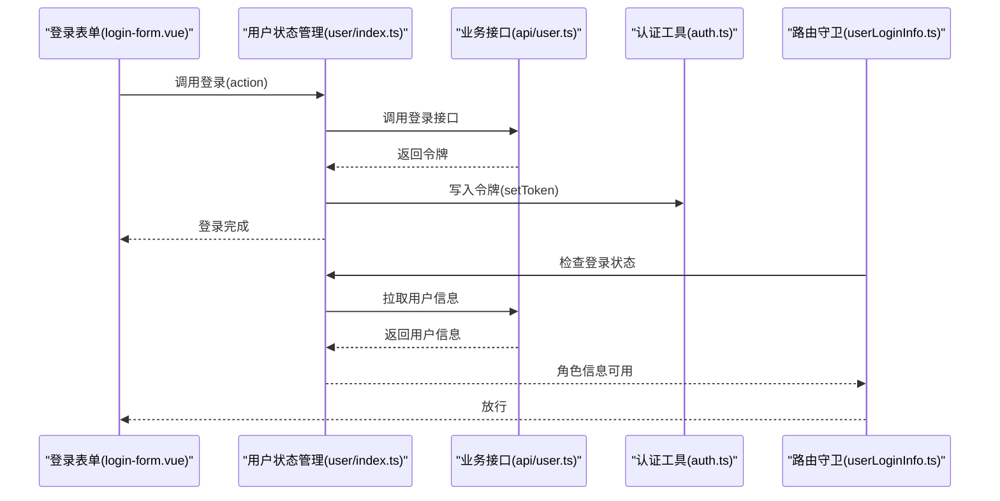
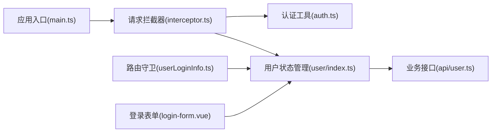

# 请求拦截器

<cite>
**本文引用的文件**
- [src/api/interceptor.ts](file://src/api/interceptor.ts)
- [src/utils/auth.ts](file://src/utils/auth.ts)
- [src/store/modules/user/index.ts](file://src/store/modules/user/index.ts)
- [src/api/user.ts](file://src/api/user.ts)
- [src/main.ts](file://src/main.ts)
- [src/router/guard/userLoginInfo.ts](file://src/router/guard/userLoginInfo.ts)
- [src/hooks/request.ts](file://src/hooks/request.ts)
- [src/views/login/components/login-form.vue](file://src/views/login/components/login-form.vue)
</cite>

## 目录
1. [简介](#简介)
2. [项目结构](#项目结构)
3. [核心组件](#核心组件)
4. [架构总览](#架构总览)
5. [详细组件分析](#详细组件分析)
6. [依赖关系分析](#依赖关系分析)
7. [性能考虑](#性能考虑)
8. [故障排除指南](#故障排除指南)
9. [结论](#结论)
10. [附录](#附录)

## 简介
本文件系统性阐述本项目中基于 Axios 的请求拦截器实现，重点覆盖以下方面：
- JWT 令牌自动注入机制与请求头配置
- 请求前数据处理、令牌获取逻辑与请求配置优化
- 请求拦截器生命周期、错误处理与异常捕获
- 配置选项与可扩展点（如基础 URL、自定义头部）
- 与用户状态管理的集成及登出触发策略
- 当前实现未包含的令牌刷新策略说明与建议

## 项目结构
请求拦截器相关代码主要分布在如下模块：
- 全局拦截器：负责请求/响应拦截、统一错误提示与登出触发
- 认证工具：负责本地令牌读取、设置与清理
- 用户状态管理：负责登录、登出、用户信息拉取与令牌持久化
- 路由守卫：在路由访问前校验登录状态并拉取用户信息
- API 层：封装具体业务接口（登录、登出、用户信息等）

图表来源
- [src/main.ts:15](file://src/main.ts#L15)
- [src/api/interceptor.ts:18-37](file://src/api/interceptor.ts#L18-L37)
- [src/api/interceptor.ts:39-77](file://src/api/interceptor.ts#L39-L77)
- [src/utils/auth.ts:7-9](file://src/utils/auth.ts#L7-L9)
- [src/store/modules/user/index.ts:64-72](file://src/store/modules/user/index.ts#L64-L72)
- [src/api/user.ts:13-23](file://src/api/user.ts#L13-L23)
- [src/router/guard/userLoginInfo.ts:8-42](file://src/router/guard/userLoginInfo.ts#L8-L42)
- [src/views/login/components/login-form.vue:93-125](file://src/views/login/components/login-form.vue#L93-L125)

章节来源
- [src/main.ts:15](file://src/main.ts#L15)
- [src/api/interceptor.ts:14-16](file://src/api/interceptor.ts#L14-L16)

## 核心组件
- 全局请求拦截器：在每个请求发送前自动从本地存储读取令牌，并将其注入到请求头的 Authorization 字段；同时支持通过环境变量配置基础 URL。
- 全局响应拦截器：统一解析后端返回结构，当业务码非成功时弹出错误提示，并针对特定错误码触发登出流程；对网络异常也进行统一提示。
- 认证工具：提供令牌的读取、设置与清理能力，使用 localStorage 存储令牌键名。
- 用户状态管理：封装登录、登出、用户信息拉取等动作，登录成功后写入令牌，登出时清理令牌并移除路由监听。
- 路由守卫：在路由访问前检查登录状态，若无角色信息则尝试拉取用户信息，失败则强制登出并跳转登录页。
- 登录表单：提交登录信息，调用用户状态管理执行登录，成功后跳转目标页面并提示成功。

章节来源
- [src/api/interceptor.ts:18-37](file://src/api/interceptor.ts#L18-L37)
- [src/api/interceptor.ts:39-77](file://src/api/interceptor.ts#L39-L77)
- [src/utils/auth.ts:7-9](file://src/utils/auth.ts#L7-L9)
- [src/store/modules/user/index.ts:64-87](file://src/store/modules/user/index.ts#L64-L87)
- [src/router/guard/userLoginInfo.ts:8-42](file://src/router/guard/userLoginInfo.ts#L8-L42)
- [src/views/login/components/login-form.vue:93-125](file://src/views/login/components/login-form.vue#L93-L125)

## 架构总览
下图展示从应用启动到请求拦截器生效的整体流程，以及与用户状态管理、路由守卫的交互。

图表来源
- [src/main.ts:15](file://src/main.ts#L15)
- [src/api/interceptor.ts:14-16](file://src/api/interceptor.ts#L14-L16)
- [src/api/interceptor.ts:18-37](file://src/api/interceptor.ts#L18-L37)
- [src/api/interceptor.ts:39-77](file://src/api/interceptor.ts#L39-L77)
- [src/utils/auth.ts:7-9](file://src/utils/auth.ts#L7-L9)
- [src/store/modules/user/index.ts:57-61](file://src/store/modules/user/index.ts#L57-L61)
- [src/api/user.ts:21-23](file://src/api/user.ts#L21-L23)
- [src/router/guard/userLoginInfo.ts:8-42](file://src/router/guard/userLoginInfo.ts#L8-L42)

## 详细组件分析

### 请求拦截器实现原理
- 自动注入 JWT 令牌
  - 在请求拦截器中读取本地存储中的令牌，若存在则将其注入到请求头的 Authorization 字段，格式为 Bearer 令牌。
  - 若请求头对象不存在，会先初始化空对象再设置 Authorization。
- 基础 URL 配置
  - 可通过环境变量 VITE_API_BASE_URL 动态设置 axios 默认基础 URL，便于开发/生产环境切换。
- 生命周期与控制流
  - 请求拦截器在每次请求发送前执行，返回修改后的配置或直接拒绝错误。
  - 响应拦截器在收到响应后执行，解析业务码并根据结果决定是否抛错或触发登出流程。

图表来源
- [src/api/interceptor.ts:18-37](file://src/api/interceptor.ts#L18-L37)
- [src/utils/auth.ts:7-9](file://src/utils/auth.ts#L7-L9)

章节来源
- [src/api/interceptor.ts:18-37](file://src/api/interceptor.ts#L18-L37)
- [src/api/interceptor.ts:14-16](file://src/api/interceptor.ts#L14-L16)

### 响应拦截器与错误处理
- 统一响应结构
  - 定义了通用响应接口，包含状态码、消息、业务码与数据体。
- 错误码判定与提示
  - 当业务码不等于约定的成功值时，弹出错误消息并返回 Promise.reject。
- 特定错误码触发登出
  - 对于非法令牌、其他客户端登录、令牌过期等特定错误码，且请求地址不是用户信息接口时，弹出确认对话框，点击确定后调用用户状态管理执行登出并刷新页面。
- 网络异常处理
  - 对于网络异常或请求错误，统一弹出错误提示并返回拒绝。

图表来源
- [src/api/interceptor.ts:39-77](file://src/api/interceptor.ts#L39-L77)
- [src/store/modules/user/index.ts:81-87](file://src/store/modules/user/index.ts#L81-L87)

章节来源
- [src/api/interceptor.ts:39-77](file://src/api/interceptor.ts#L39-L77)

### 认证工具与用户状态管理集成
- 令牌存储与读取
  - 使用 localStorage 保存令牌键名，提供读取、设置与清理方法。
- 登录流程
  - 登录成功后将服务端返回的令牌写入本地存储，随后路由守卫会尝试拉取用户信息。
- 登出流程
  - 登出接口调用后，无论成功与否都会执行清理回调：重置用户信息、清除令牌、移除路由监听、清空服务端菜单。
- 路由守卫联动
  - 在访问受保护路由前检查登录状态，若无角色信息则尝试拉取用户信息；失败则强制登出并跳转登录页。

图表来源
- [src/views/login/components/login-form.vue:93-125](file://src/views/login/components/login-form.vue#L93-L125)
- [src/store/modules/user/index.ts:64-72](file://src/store/modules/user/index.ts#L64-L72)
- [src/api/user.ts:13-23](file://src/api/user.ts#L13-L23)
- [src/utils/auth.ts:11-13](file://src/utils/auth.ts#L11-L13)
- [src/router/guard/userLoginInfo.ts:8-42](file://src/router/guard/userLoginInfo.ts#L8-L42)

章节来源
- [src/utils/auth.ts:7-17](file://src/utils/auth.ts#L7-L17)
- [src/store/modules/user/index.ts:64-87](file://src/store/modules/user/index.ts#L64-L87)
- [src/router/guard/userLoginInfo.ts:8-42](file://src/router/guard/userLoginInfo.ts#L8-L42)

### 请求前数据处理与配置优化
- 请求头配置
  - 自动注入 Authorization: Bearer 令牌，避免重复手写。
  - 若请求头对象不存在，拦截器会先初始化空对象再设置头字段。
- 基础 URL 优化
  - 通过环境变量动态设置 axios 默认基础 URL，便于多环境部署。
- 请求配置优化建议
  - 可在请求拦截器中增加超时、重试次数、并发限制等配置项（当前实现未包含）。
  - 可按需添加 Content-Type、Accept-Language 等默认头字段。

章节来源
- [src/api/interceptor.ts:18-37](file://src/api/interceptor.ts#L18-L37)
- [src/api/interceptor.ts:14-16](file://src/api/interceptor.ts#L14-L16)

### 配置选项与自定义扩展
- 基础 URL
  - 通过环境变量 VITE_API_BASE_URL 设置，默认为空则使用相对路径。
- 自定义头部
  - 可在请求拦截器中扩展更多自定义头字段，例如 X-Client-Version、X-Trace-ID 等。
- 错误码映射
  - 响应拦截器中的错误码列表可根据实际后端约定调整。
- 扩展点建议
  - 请求拦截器：增加请求去重、幂等标识、请求时间戳等。
  - 响应拦截器：增加日志上报、埋点统计、缓存策略等。

章节来源
- [src/api/interceptor.ts:14-16](file://src/api/interceptor.ts#L14-L16)
- [src/api/interceptor.ts:39-77](file://src/api/interceptor.ts#L39-L77)

### 令牌刷新策略说明
- 当前实现
  - 请求拦截器仅在请求前注入令牌，未实现令牌刷新逻辑。
  - 响应拦截器在检测到特定错误码时触发登出，但未实现刷新令牌后再重试请求。
- 建议方案
  - 引入刷新令牌接口与刷新队列：当检测到令牌即将过期或过期时，优先刷新令牌，成功后再重试原请求。
  - 使用内存队列暂存因令牌过期而被拒绝的请求，在刷新完成后统一重放。
  - 结合路由守卫与用户状态管理，确保刷新期间的用户体验与一致性。

章节来源
- [src/api/interceptor.ts:18-37](file://src/api/interceptor.ts#L18-L37)
- [src/api/interceptor.ts:39-77](file://src/api/interceptor.ts#L39-L77)

## 依赖关系分析
- 模块耦合
  - 请求拦截器依赖认证工具读取令牌，依赖用户状态管理在特定错误码下触发登出。
  - 用户状态管理依赖业务接口与认证工具，用于登录、登出与用户信息拉取。
  - 路由守卫依赖用户状态管理与认证工具，用于登录状态检查与用户信息拉取。
- 外部依赖
  - Axios：请求拦截器的核心载体。
  - Arco Design：用于消息提示与模态框。
  - Pinia：用于状态管理。
  - Vue Router：用于路由守卫与导航。

图表来源
- [src/api/interceptor.ts:1-5](file://src/api/interceptor.ts#L1-L5)
- [src/utils/auth.ts:1-19](file://src/utils/auth.ts#L1-L19)
- [src/store/modules/user/index.ts:1-11](file://src/store/modules/user/index.ts#L1-L11)
- [src/api/user.ts:1-3](file://src/api/user.ts#L1-L3)
- [src/router/guard/userLoginInfo.ts:1-5](file://src/router/guard/userLoginInfo.ts#L1-L5)
- [src/views/login/components/login-form.vue:73-81](file://src/views/login/components/login-form.vue#L73-L81)
- [src/main.ts:15](file://src/main.ts#L15)

章节来源
- [src/api/interceptor.ts:1-5](file://src/api/interceptor.ts#L1-L5)
- [src/utils/auth.ts:1-19](file://src/utils/auth.ts#L1-L19)
- [src/store/modules/user/index.ts:1-11](file://src/store/modules/user/index.ts#L1-L11)
- [src/api/user.ts:1-3](file://src/api/user.ts#L1-L3)
- [src/router/guard/userLoginInfo.ts:1-5](file://src/router/guard/userLoginInfo.ts#L1-L5)
- [src/views/login/components/login-form.vue:73-81](file://src/views/login/components/login-form.vue#L73-L81)
- [src/main.ts:15](file://src/main.ts#L15)

## 性能考虑
- 令牌读取开销
  - 每次请求均会读取本地存储中的令牌，建议在高频请求场景下考虑缓存策略（如内存缓存），避免频繁访问存储。
- 响应拦截器处理
  - 错误提示与模态框弹窗可能影响首屏渲染，建议在批量请求时合并错误提示或延迟展示。
- 基础 URL 切换
  - 通过环境变量设置基础 URL，建议在构建阶段固化，减少运行时判断成本。

## 故障排除指南
- 无法注入 Authorization 头
  - 检查请求拦截器是否正确注册，确认本地存储中存在令牌。
- 登录后仍提示未登录
  - 检查登录成功后是否正确写入令牌，确认路由守卫是否正常拉取用户信息。
- 特定错误码未触发登出
  - 确认响应拦截器中的错误码列表与后端一致，且请求地址不是用户信息接口。
- 网络异常未提示
  - 检查响应拦截器的网络错误分支是否被正确触发。

章节来源
- [src/api/interceptor.ts:18-37](file://src/api/interceptor.ts#L18-L37)
- [src/api/interceptor.ts:39-77](file://src/api/interceptor.ts#L39-L77)
- [src/store/modules/user/index.ts:64-87](file://src/store/modules/user/index.ts#L64-L87)
- [src/router/guard/userLoginInfo.ts:8-42](file://src/router/guard/userLoginInfo.ts#L8-L42)

## 结论
本项目通过全局请求拦截器实现了 JWT 令牌的自动注入与统一错误处理，结合用户状态管理与路由守卫，形成了较为完善的认证与授权闭环。当前实现简洁可靠，满足基础需求；对于高并发与复杂场景，建议引入令牌刷新与请求重试机制，进一步提升稳定性与用户体验。

## 附录
- 关键实现位置参考
  - 请求拦截器注册与配置：[src/api/interceptor.ts:18-37](file://src/api/interceptor.ts#L18-L37)
  - 响应拦截器与错误处理：[src/api/interceptor.ts:39-77](file://src/api/interceptor.ts#L39-L77)
  - 令牌读取与设置：[src/utils/auth.ts:7-17](file://src/utils/auth.ts#L7-L17)
  - 用户状态管理登录/登出：[src/store/modules/user/index.ts:64-87](file://src/store/modules/user/index.ts#L64-L87)
  - 路由守卫登录状态检查：[src/router/guard/userLoginInfo.ts:8-42](file://src/router/guard/userLoginInfo.ts#L8-L42)
  - 应用入口加载拦截器：[src/main.ts:15](file://src/main.ts#L15)
  - 登录表单触发登录流程：[src/views/login/components/login-form.vue:93-125](file://src/views/login/components/login-form.vue#L93-L125)