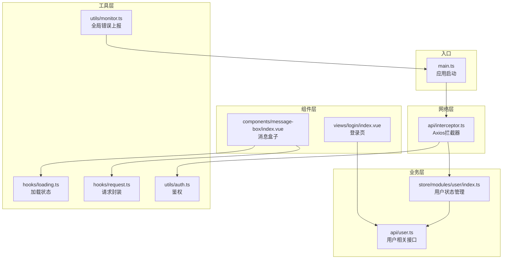
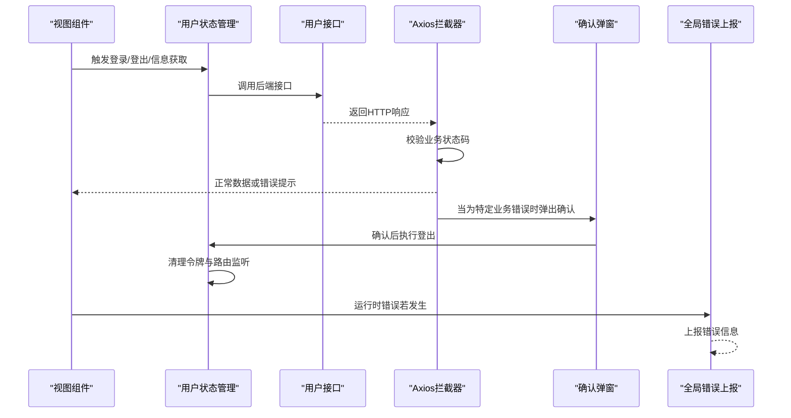
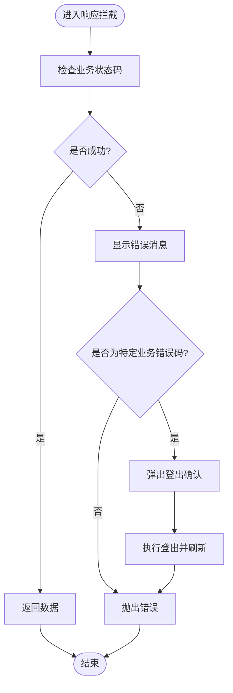
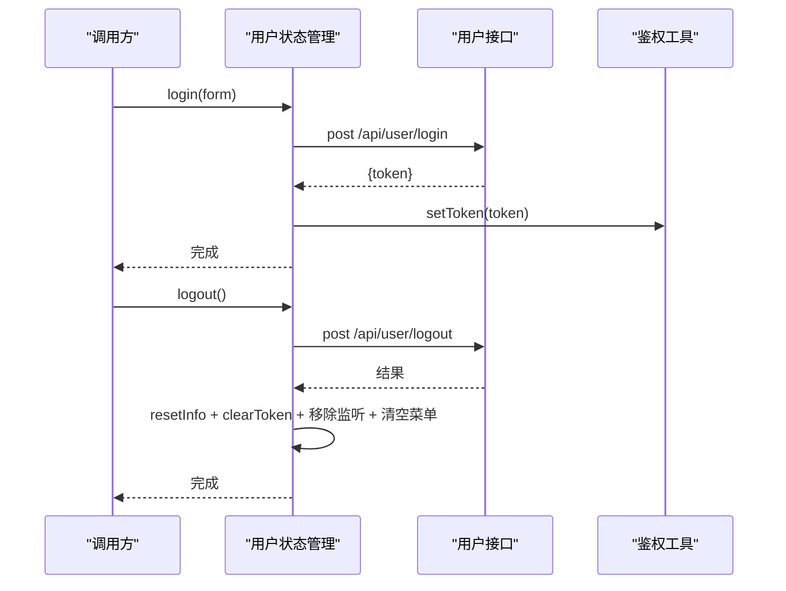
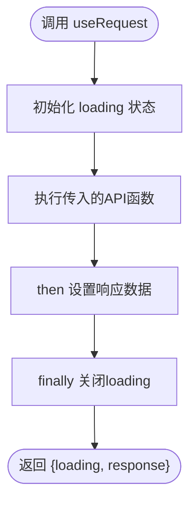
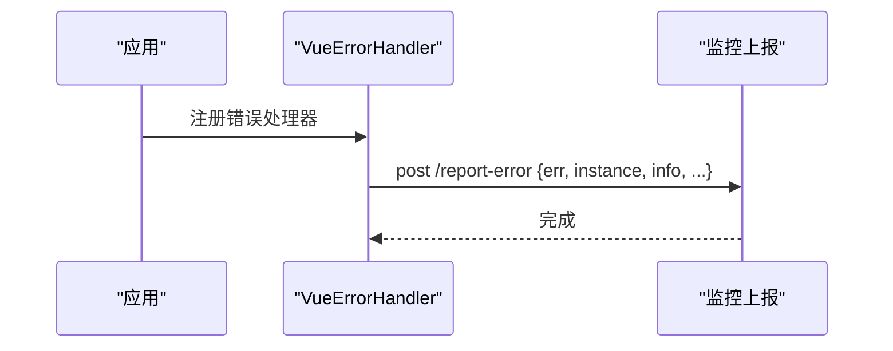
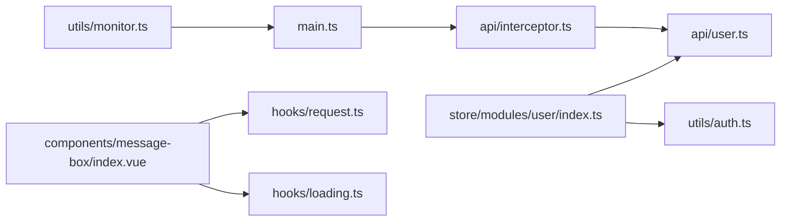

# 错误处理机制

<cite>
**本文档引用的文件**
- [src/api/interceptor.ts](file://src/api/interceptor.ts)
- [src/utils/monitor.ts](file://src/utils/monitor.ts)
- [src/hooks/request.ts](file://src/hooks/request.ts)
- [src/hooks/loading.ts](file://src/hooks/loading.ts)
- [src/store/modules/user/index.ts](file://src/store/modules/user/index.ts)
- [src/utils/auth.ts](file://src/utils/auth.ts)
- [src/api/user.ts](file://src/api/user.ts)
- [src/main.ts](file://src/main.ts)
- [src/components/message-box/index.vue](file://src/components/message-box/index.vue)
- [src/views/login/index.vue](file://src/views/login/index.vue)
- [src/utils/setup-mock.ts](file://src/utils/setup-mock.ts)
</cite>

## 目录
1. [引言](#引言)
2. [项目结构](#项目结构)
3. [核心组件](#核心组件)
4. [架构总览](#架构总览)
5. [详细组件分析](#详细组件分析)
6. [依赖关系分析](#依赖关系分析)
7. [性能考虑](#性能考虑)
8. [故障排查指南](#故障排查指南)
9. [结论](#结论)
10. [附录](#附录)

## 引言
本文件系统性梳理前端错误处理机制，聚焦API层的错误分类、处理策略与异常恢复流程。文档覆盖网络错误、业务错误与系统错误的差异化处理，阐述错误日志上报、监控告警与用户体验优化策略，并给出重试、降级与故障转移的实践建议。

## 项目结构
本项目采用分层架构：入口初始化加载拦截器；API层通过Axios拦截器统一处理响应；业务层（Pinia Store）负责登录态与用户信息维护；组件层在交互中展示错误提示并触发恢复动作；监控工具负责全局Vue错误上报。

**图表来源**
- [src/main.ts:1-29](file://src/main.ts#L1-L29)
- [src/api/interceptor.ts:1-78](file://src/api/interceptor.ts#L1-L78)
- [src/store/modules/user/index.ts:1-92](file://src/store/modules/user/index.ts#L1-L92)
- [src/api/user.ts:1-28](file://src/api/user.ts#L1-L28)
- [src/components/message-box/index.vue:1-130](file://src/components/message-box/index.vue#L1-L130)
- [src/hooks/loading.ts:1-17](file://src/hooks/loading.ts#L1-L17)
- [src/hooks/request.ts:1-27](file://src/hooks/request.ts#L1-L27)
- [src/utils/monitor.ts:1-29](file://src/utils/monitor.ts#L1-L29)
- [src/utils/auth.ts:1-20](file://src/utils/auth.ts#L1-L20)

**章节来源**
- [src/main.ts:1-29](file://src/main.ts#L1-L29)
- [src/api/interceptor.ts:1-78](file://src/api/interceptor.ts#L1-L78)

## 核心组件
- Axios拦截器：统一处理HTTP响应码与错误提示，识别特定业务错误触发登出确认弹窗，并对网络异常进行统一提示。
- 用户状态管理：封装登录、登出流程，处理令牌清理与路由监听移除，确保登出后状态一致性。
- 请求Hook：提供通用列表请求封装，自动管理加载状态并在完成后关闭。
- 全局错误上报：注册Vue错误处理器，向服务端上报前端运行时错误，便于监控与定位。
- 鉴权工具：提供本地令牌存取与清理，保障请求头携带与登出清理。

**章节来源**
- [src/api/interceptor.ts:7-78](file://src/api/interceptor.ts#L7-L78)
- [src/store/modules/user/index.ts:56-87](file://src/store/modules/user/index.ts#L56-L87)
- [src/hooks/request.ts:11-26](file://src/hooks/request.ts#L11-L26)
- [src/utils/monitor.ts:4-28](file://src/utils/monitor.ts#L4-L28)
- [src/utils/auth.ts:1-20](file://src/utils/auth.ts#L1-L20)

## 架构总览
下图展示从用户操作到错误处理与恢复的关键路径，包括请求拦截、响应拦截、业务错误处理、登出确认与全局错误上报。

**图表来源**
- [src/api/interceptor.ts:39-76](file://src/api/interceptor.ts#L39-L76)
- [src/store/modules/user/index.ts:81-87](file://src/store/modules/user/index.ts#L81-L87)
- [src/api/user.ts:13-27](file://src/api/user.ts#L13-L27)
- [src/utils/monitor.ts:8-27](file://src/utils/monitor.ts#L8-L27)

## 详细组件分析

### API拦截器与错误分类
- 响应拦截：当业务状态码非约定的成功值时，统一显示错误消息；对特定业务错误码触发登出确认弹窗；最终reject错误以便上层捕获。
- 登出确认：针对非法令牌、其他客户端登录、令牌过期等场景，在非用户信息接口时弹出确认框，确认后调用用户状态管理执行登出并刷新页面。
- 网络异常：对Axios错误统一提示，避免静默失败。

**图表来源**
- [src/api/interceptor.ts:39-76](file://src/api/interceptor.ts#L39-L76)

**章节来源**
- [src/api/interceptor.ts:39-76](file://src/api/interceptor.ts#L39-L76)

### 用户状态管理与异常恢复
- 登录：调用登录接口并写入令牌；失败时清理令牌并向上抛出，交由调用方处理。
- 登出：先尝试调用后端登出接口，无论成功与否均执行本地清理（重置用户信息、清除令牌、移除路由监听、清空菜单），保证状态一致性。
- 用户信息：拉取用户信息并更新到状态中，供界面渲染使用。

**图表来源**
- [src/store/modules/user/index.ts:64-87](file://src/store/modules/user/index.ts#L64-L87)
- [src/api/user.ts:13-23](file://src/api/user.ts#L13-L23)
- [src/utils/auth.ts:11-17](file://src/utils/auth.ts#L11-L17)

**章节来源**
- [src/store/modules/user/index.ts:64-87](file://src/store/modules/user/index.ts#L64-L87)
- [src/api/user.ts:13-23](file://src/api/user.ts#L13-L23)
- [src/utils/auth.ts:11-17](file://src/utils/auth.ts#L11-L17)

### 请求Hook与加载状态
- useRequest：接收API函数，自动调用并设置响应数据，完成后关闭加载状态；适合列表类请求的统一处理。
- useLoading：提供基础加载状态管理，支持外部传入初始值与开关切换。

**图表来源**
- [src/hooks/request.ts:11-26](file://src/hooks/request.ts#L11-L26)
- [src/hooks/loading.ts:3-16](file://src/hooks/loading.ts#L3-L16)

**章节来源**
- [src/hooks/request.ts:11-26](file://src/hooks/request.ts#L11-L26)
- [src/hooks/loading.ts:3-16](file://src/hooks/loading.ts#L3-L16)

### 全局错误上报与监控
- handleError：在应用配置阶段注册Vue错误处理器，将错误对象、组件实例与信息发送至服务端上报接口，便于集中监控与追踪。
- 建议：上报字段可扩展浏览器信息、用户信息、DOM信息、URL等，以提升定位效率。

**图表来源**
- [src/utils/monitor.ts:4-28](file://src/utils/monitor.ts#L4-L28)

**章节来源**
- [src/utils/monitor.ts:4-28](file://src/utils/monitor.ts#L4-L28)

### 组件层错误处理示例：消息盒子
- 列表加载：在组件挂载时发起请求，开启加载状态；catch中预留上报位置但不阻断流程；finally统一关闭加载。
- 用户体验：无内容时展示结果组件，减少空白与闪烁。

**章节来源**
- [src/components/message-box/index.vue:68-78](file://src/components/message-box/index.vue#L68-L78)

## 依赖关系分析
- main.ts引入拦截器，确保所有HTTP请求经过统一处理。
- 用户状态管理依赖用户接口与鉴权工具，完成登录态维护。
- 组件层通过Hook与接口层解耦，降低重复逻辑。
- 全局错误上报独立于业务逻辑，便于扩展与替换。

**图表来源**
- [src/main.ts:15](file://src/main.ts#L15)
- [src/api/interceptor.ts:14-16](file://src/api/interceptor.ts#L14-L16)
- [src/store/modules/user/index.ts:1-12](file://src/store/modules/user/index.ts#L1-L12)
- [src/api/user.ts:1-7](file://src/api/user.ts#L1-L7)
- [src/utils/auth.ts:1-8](file://src/utils/auth.ts#L1-L8)
- [src/components/message-box/index.vue:34-43](file://src/components/message-box/index.vue#L34-L43)
- [src/hooks/request.ts:1-4](file://src/hooks/request.ts#L1-L4)
- [src/hooks/loading.ts:1-2](file://src/hooks/loading.ts#L1-L2)
- [src/utils/monitor.ts:1-2](file://src/utils/monitor.ts#L1-L2)

**章节来源**
- [src/main.ts:15](file://src/main.ts#L15)
- [src/api/interceptor.ts:14-16](file://src/api/interceptor.ts#L14-L16)
- [src/store/modules/user/index.ts:1-12](file://src/store/modules/user/index.ts#L1-L12)
- [src/api/user.ts:1-7](file://src/api/user.ts#L1-L7)
- [src/utils/auth.ts:1-8](file://src/utils/auth.ts#L1-L8)
- [src/components/message-box/index.vue:34-43](file://src/components/message-box/index.vue#L34-L43)
- [src/hooks/request.ts:1-4](file://src/hooks/request.ts#L1-L4)
- [src/hooks/loading.ts:1-2](file://src/hooks/loading.ts#L1-L2)
- [src/utils/monitor.ts:1-2](file://src/utils/monitor.ts#L1-L2)

## 性能考虑
- 减少不必要的全局错误上报：仅在必要时上报，避免高频错误导致带宽浪费。
- 合理使用加载状态：批量请求合并或节流，避免频繁UI闪烁。
- 拦截器内尽量轻量处理：复杂逻辑下沉到业务层，保持拦截器职责单一。
- 登出确认弹窗仅在必要场景触发，避免影响用户操作流畅度。

## 故障排查指南
- 登录后立即被踢出：检查业务错误码映射与拦截器中的特定错误分支，确认是否命中非法令牌/其他客户端登录/令牌过期场景。
- 错误提示不显示：确认拦截器中消息提示逻辑与Arco Design的消息组件可用性。
- 登出无效：检查用户状态管理的logout流程与鉴权工具的令牌清理，确保finally分支被执行。
- 前端运行时错误未上报：确认监控上报的URL配置与Vue错误处理器注册顺序。
- 列表加载卡顿：检查useRequest与useLoading的使用，确保finally正确关闭加载状态。

**章节来源**
- [src/api/interceptor.ts:44-66](file://src/api/interceptor.ts#L44-L66)
- [src/store/modules/user/index.ts:81-87](file://src/store/modules/user/index.ts#L81-L87)
- [src/utils/monitor.ts:8-27](file://src/utils/monitor.ts#L8-L27)
- [src/hooks/request.ts:18-24](file://src/hooks/request.ts#L18-L24)

## 结论
本项目通过Axios拦截器实现了统一的业务错误处理与用户体验优化，结合用户状态管理的登出恢复机制与全局错误上报，形成了从前端到后端的闭环。建议在现有基础上完善监控上报字段、增强重试与降级策略，并在关键路径增加更细粒度的错误分类与恢复指引。

## 附录

### 错误分类与处理策略
- 网络错误：统一提示并允许用户重试；对超时/连接失败可考虑指数退避重试。
- 业务错误：根据状态码区分严重程度，对可恢复错误提示并引导用户操作，对不可恢复错误提供明确指引。
- 系统错误：捕获并上报，避免影响其他功能；在组件层做好容错与降级展示。

### 最佳实践
- 在拦截器中保留原始错误上下文，便于后续排查。
- 对敏感操作（如登出）增加二次确认，避免误操作。
- 将错误处理逻辑抽象为可复用Hook，减少重复代码。
- 为常见错误提供FAQ或帮助链接，提升用户自助能力。

### 调试技巧
- 使用浏览器开发者工具Network面板观察请求与响应状态码。
- 在控制台打印拦截器中的错误对象，辅助定位问题。
- 通过全局错误上报接口验证上报链路是否正常。

### 重试机制、降级策略与故障转移
- 重试：对幂等GET请求与临时性网络错误进行有限次数重试，配合退避算法降低雪崩风险。
- 降级：在接口失败时返回兜底数据或简化UI，保证核心功能可用。
- 故障转移：对多域名/多节点的API进行健康检查与切换，提升可用性。