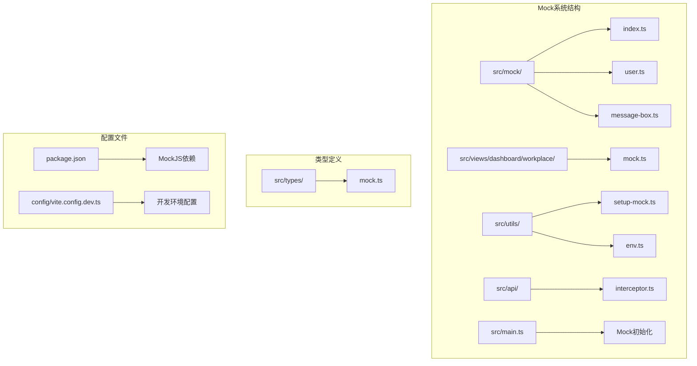
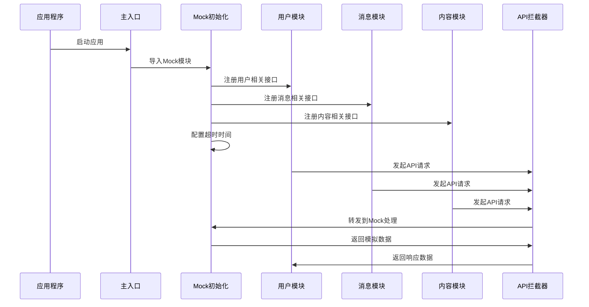
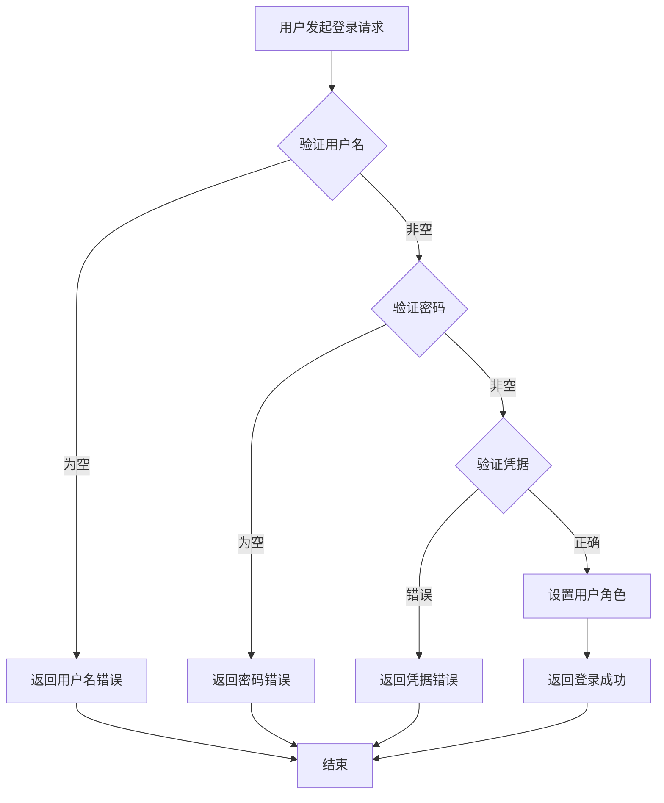
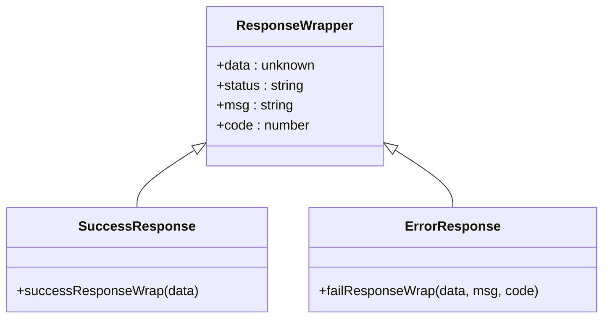
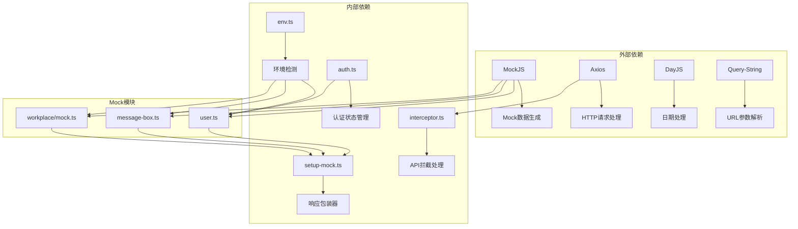

# Mock数据系统

<cite>
**本文档引用的文件**
- [src/mock/index.ts](file://src/mock/index.ts)
- [src/mock/user.ts](file://src/mock/user.ts)
- [src/mock/message-box.ts](file://src/mock/message-box.ts)
- [src/views/dashboard/workplace/mock.ts](file://src/views/dashboard/workplace/mock.ts)
- [src/utils/setup-mock.ts](file://src/utils/setup-mock.ts)
- [src/utils/env.ts](file://src/utils/env.ts)
- [src/api/interceptor.ts](file://src/api/interceptor.ts)
- [src/utils/auth.ts](file://src/utils/auth.ts)
- [src/main.ts](file://src/main.ts)
- [src/types/mock.ts](file://src/types/mock.ts)
- [package.json](file://package.json)
- [config/vite.config.dev.ts](file://config/vite.config.dev.ts)
</cite>

## 目录
1. [简介](#简介)
2. [项目结构](#项目结构)
3. [核心组件](#核心组件)
4. [架构概览](#架构概览)
5. [详细组件分析](#详细组件分析)
6. [依赖关系分析](#依赖关系分析)
7. [性能考虑](#性能考虑)
8. [故障排除指南](#故障排除指南)
9. [最佳实践](#最佳实践)
10. [结论](#结论)

## 简介

Mock数据系统是本项目中用于模拟API响应的重要组件，它允许开发者在没有真实后端服务的情况下进行前端开发和测试。该系统基于MockJS库构建，提供了完整的数据模拟功能，包括用户认证、消息管理、内容数据等多个业务模块的模拟接口。

系统采用模块化设计，每个业务模块都有独立的Mock文件，通过统一的初始化机制进行注册和管理。Mock数据系统与Axios拦截器配合，实现了无缝的开发体验，开发者可以在开发环境中自动启用Mock功能，在生产环境中自动禁用。

## 项目结构

Mock数据系统在项目中的组织结构如下：

**图表来源**
- [src/mock/index.ts:1-11](file://src/mock/index.ts#L1-L11)
- [src/main.ts:9-9](file://src/main.ts#L9-L9)

**章节来源**
- [src/mock/index.ts:1-11](file://src/mock/index.ts#L1-L11)
- [src/main.ts:9-9](file://src/main.ts#L9-L9)

## 核心组件

### Mock初始化系统

Mock系统的初始化采用集中管理模式，通过一个中央入口文件统一管理所有Mock模块的注册。

### 响应包装器

系统提供了统一的响应格式包装器，确保所有Mock接口返回一致的数据结构：

- 成功响应格式：包含状态码、消息、数据体
- 失败响应格式：包含状态码、错误消息、错误代码

### 环境检测机制

Mock系统通过环境变量检测决定是否启用Mock功能，开发环境下自动启用，生产环境下自动禁用。

**章节来源**
- [src/utils/setup-mock.ts:1-24](file://src/utils/setup-mock.ts#L1-L24)
- [src/utils/env.ts:1-4](file://src/utils/env.ts#L1-L4)

## 架构概览

Mock数据系统的整体架构采用分层设计，从底层的数据生成到上层的接口暴露形成完整的数据模拟链路：

**图表来源**
- [src/main.ts:9-9](file://src/main.ts#L9-L9)
- [src/mock/index.ts:3-10](file://src/mock/index.ts#L3-L10)

## 详细组件分析

### 用户认证模块

用户认证模块是Mock系统的核心组件之一，负责模拟用户登录、登出和用户信息获取等功能。

#### 数据结构设计

用户信息数据结构包含以下关键字段：
- 基本信息：姓名、头像、邮箱、手机号
- 职业信息：职位、部门、工作地点
- 账户信息：账户ID、认证状态、角色权限
- 其他信息：个人网站、注册时间、简介

#### 认证流程

**图表来源**
- [src/mock/user.ts:42-63](file://src/mock/user.ts#L42-L63)

#### 权限管理

系统支持多种用户角色，通过本地存储管理用户权限状态，确保不同角色具有相应的访问权限。

**章节来源**
- [src/mock/user.ts:1-106](file://src/mock/user.ts#L1-L106)
- [src/utils/auth.ts:1-20](file://src/utils/auth.ts#L1-L20)

### 消息管理系统

消息管理模块模拟了消息列表和消息标记功能，为应用提供了完整的消息处理模拟环境。

#### 消息类型定义

系统支持三种不同类型的消息：
- 普通消息（message）：用户间的私信或回复
- 通知消息（notice）：系统通知和提醒
- 待办消息（todo）：需要处理的任务提醒

#### 数据生成策略

消息数据采用预定义模板生成，包含固定的消息列表和动态的状态更新逻辑。消息状态通过全局数组跟踪，实现已读/未读状态的管理。

**章节来源**
- [src/mock/message-box.ts:1-86](file://src/mock/message-box.ts#L1-L86)

### 内容数据模块

内容数据模块主要服务于仪表板工作台，提供文章、图片、视频等内容的点击量统计数据。

#### 数据模型

系统维护三类内容数据：
- 文章内容：包含标题、点击量、增长趋势
- 图片内容：包含标题、点击量、增长趋势  
- 视频内容：包含标题、点击量、增长趋势

#### 动态数据生成

内容数据采用动态生成策略，结合日期计算和预设数据生成图表所需的折线图数据。

**章节来源**
- [src/views/dashboard/workplace/mock.ts:1-130](file://src/views/dashboard/workplace/mock.ts#L1-L130)

### 响应格式标准化

Mock系统实现了统一的响应格式标准，确保所有接口返回一致的数据结构：

**图表来源**
- [src/utils/setup-mock.ts:7-23](file://src/utils/setup-mock.ts#L7-L23)

**章节来源**
- [src/utils/setup-mock.ts:1-24](file://src/utils/setup-mock.ts#L1-L24)

## 依赖关系分析

Mock数据系统与其他项目组件的依赖关系如下：

**图表来源**
- [package.json:74-74](file://package.json#L74-L74)
- [package.json:35-47](file://package.json#L35-L47)

**章节来源**
- [package.json:1-103](file://package.json#L1-L103)

## 性能考虑

Mock数据系统在性能方面的优化策略：

### 延迟模拟
系统通过随机延迟模拟网络响应时间，提高开发体验的真实性。延迟范围设置为600-1000毫秒，避免过于快速的响应影响用户体验。

### 内存管理
- 使用静态数据结构减少内存分配
- 全局状态变量集中管理
- 及时清理不需要的数据引用

### 缓存策略
- 预生成的静态数据无需重复计算
- 用户状态通过本地存储持久化
- 避免重复的DOM查询操作

## 故障排除指南

### 常见问题及解决方案

#### Mock功能未生效
1. 检查开发环境配置
2. 确认Mock模块导入路径正确
3. 验证响应包装器函数可用性

#### 接口响应异常
1. 检查正则表达式匹配模式
2. 验证请求参数解析逻辑
3. 确认响应数据结构完整性

#### 认证状态异常
1. 检查本地存储中的token状态
2. 验证用户角色设置逻辑
3. 确认登录状态检查函数

**章节来源**
- [src/mock/index.ts:8-10](file://src/mock/index.ts#L8-L10)
- [src/utils/env.ts:1-4](file://src/utils/env.ts#L1-L4)

## 最佳实践

### Mock数据设计原则

1. **一致性原则**：所有接口返回统一的数据格式
2. **可预测性**：相同输入始终产生相同输出
3. **完整性**：覆盖所有可能的业务场景
4. **可扩展性**：便于添加新的Mock接口

### 开发环境配置

- 开发环境下自动启用Mock功能
- 生产环境下自动禁用Mock功能
- 支持手动控制Mock开关
- 提供详细的日志输出

### 数据模拟策略

1. **渐进式开发**：从简单数据开始，逐步增加复杂度
2. **边界条件**：充分测试各种边界情况
3. **错误场景**：模拟各种错误和异常情况
4. **性能测试**：验证大量数据的处理能力

### 版本控制建议

- 将Mock数据与业务逻辑分离
- 使用版本化的数据结构
- 保持Mock接口的向后兼容性
- 定期清理过期的Mock数据

### 与真实API对接策略

1. **接口对齐**：确保Mock接口与真实API结构一致
2. **数据迁移**：提供从Mock到真实API的平滑过渡
3. **测试验证**：建立完整的测试验证机制
4. **监控告警**：实时监控Mock数据的质量

## 结论

Mock数据系统为本项目提供了完整的前端开发支撑，通过模块化的架构设计和标准化的响应格式，实现了高效、可靠的API模拟功能。系统不仅满足了开发阶段的需求，还为后续的功能扩展和维护奠定了良好的基础。

通过合理的数据生成策略和完善的错误处理机制，Mock系统能够有效提升开发效率，减少前后端耦合，为团队协作提供便利。同时，系统的设计充分考虑了性能和可维护性，为项目的长期发展提供了有力保障。

在未来的发展中，可以进一步完善Mock数据的自动化生成机制，增强数据的真实性和多样性，为更复杂的业务场景提供更好的支持。