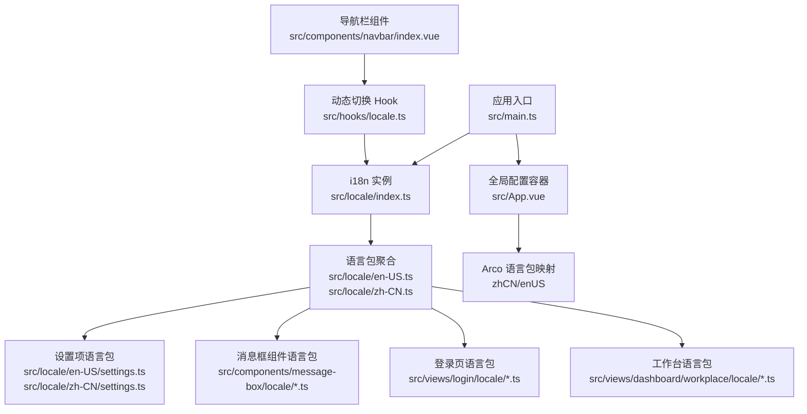
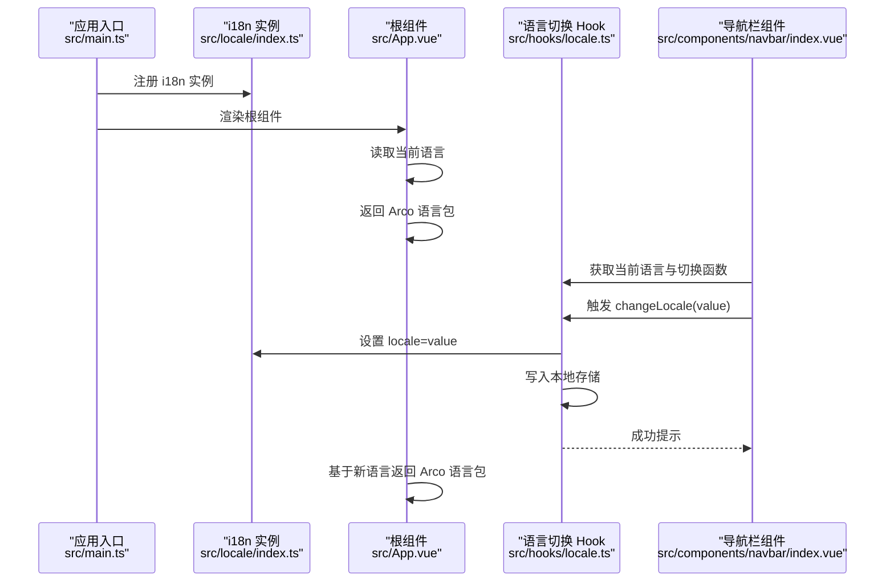
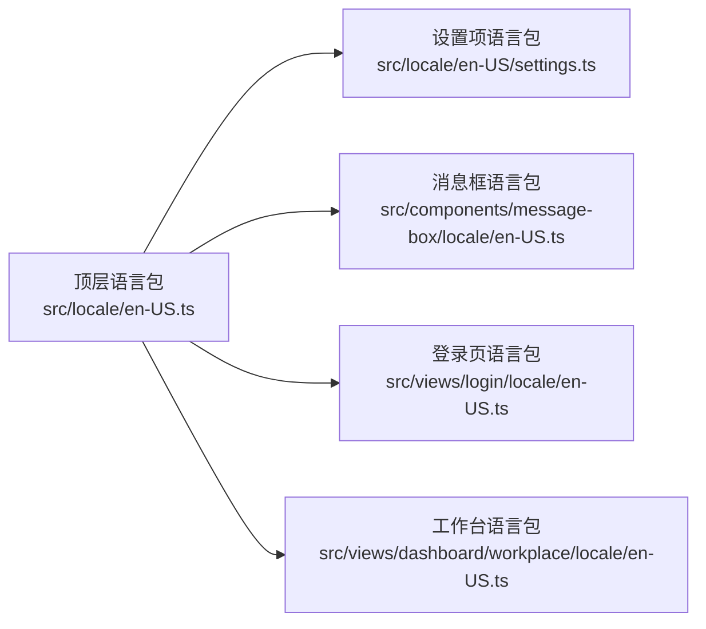
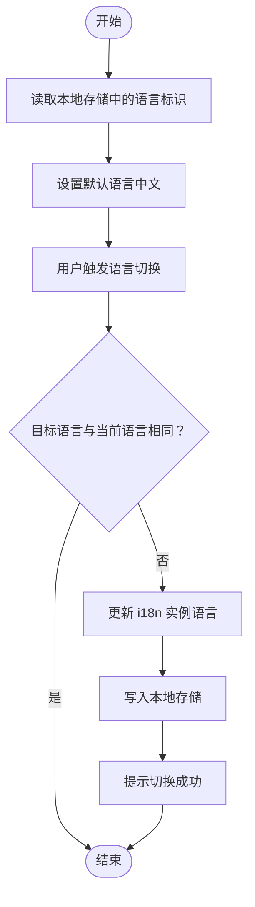
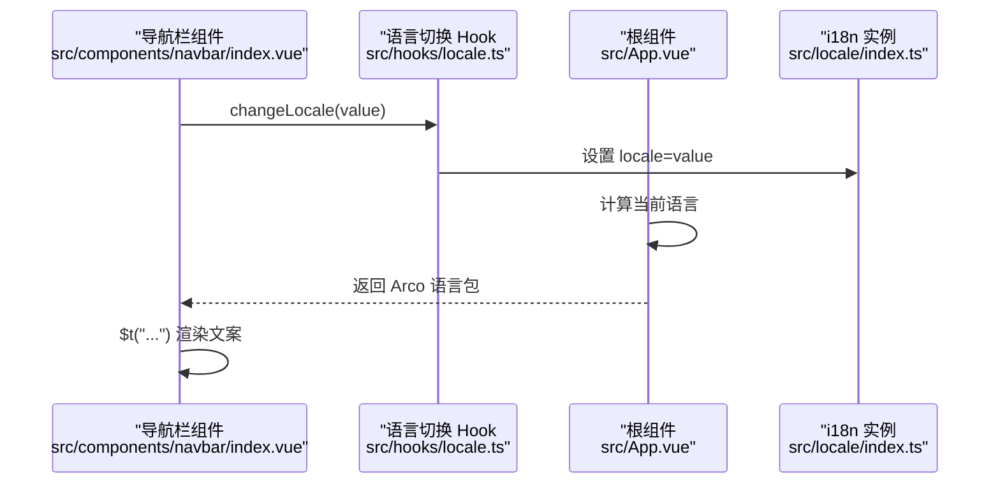
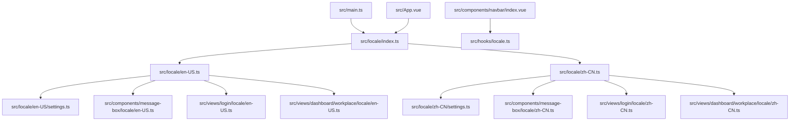

# 国际化系统

<cite>
**本文引用的文件**
- [src/main.ts](file://src/main.ts)
- [src/App.vue](file://src/App.vue)
- [src/locale/index.ts](file://src/locale/index.ts)
- [src/locale/en-US.ts](file://src/locale/en-US.ts)
- [src/locale/zh-CN.ts](file://src/locale/zh-CN.ts)
- [src/locale/en-US/settings.ts](file://src/locale/en-US/settings.ts)
- [src/locale/zh-CN/settings.ts](file://src/locale/zh-CN/settings.ts)
- [src/hooks/locale.ts](file://src/hooks/locale.ts)
- [src/components/navbar/index.vue](file://src/components/navbar/index.vue)
- [src/components/message-box/locale/en-US.ts](file://src/components/message-box/locale/en-US.ts)
- [src/components/message-box/locale/zh-CN.ts](file://src/components/message-box/locale/zh-CN.ts)
- [src/views/login/locale/en-US.ts](file://src/views/login/locale/en-US.ts)
- [src/views/login/locale/zh-CN.ts](file://src/views/login/locale/zh-CN.ts)
- [src/views/dashboard/workplace/locale/en-US.ts](file://src/views/dashboard/workplace/locale/en-US.ts)
- [src/views/dashboard/workplace/locale/zh-CN.ts](file://src/views/dashboard/workplace/locale/zh-CN.ts)
</cite>

## 目录
1. [简介](#简介)
2. [项目结构](#项目结构)
3. [核心组件](#核心组件)
4. [架构总览](#架构总览)
5. [详细组件分析](#详细组件分析)
6. [依赖关系分析](#依赖关系分析)
7. [性能考量](#性能考量)
8. [故障排查指南](#故障排查指南)
9. [结论](#结论)
10. [附录](#附录)

## 简介
本文件系统性阐述该前端项目的国际化（i18n）体系，涵盖多语言架构设计、语言资源组织与合并策略、动态语言切换机制、组件本地化实现、与第三方组件（Arco Design）的本地化集成方式，并给出最佳实践与维护策略。读者无需深入技术背景亦可理解整体实现思路。

## 项目结构
国际化相关代码主要分布在以下模块：
- 应用入口与全局配置：应用在入口处挂载 i18n 实例，并通过全局配置提供第三方组件的本地化语言包。
- 语言包聚合：在统一的 locale 入口集中导入各语言资源，形成按语言分组的消息字典。
- 动态切换：通过自定义 Hook 提供当前语言与切换逻辑，并持久化到本地存储。
- 组件级本地化：各功能模块（如登录页、工作台等）提供独立的语言包，由顶层语言包聚合导入。
- 第三方组件本地化：通过全局配置 Provider 将 Arco Design 的语言包注入到组件树。

图表来源
- [src/main.ts:1-29](file://src/main.ts#L1-L29)
- [src/App.vue:1-27](file://src/App.vue#L1-L27)
- [src/locale/index.ts:1-23](file://src/locale/index.ts#L1-L23)
- [src/locale/en-US.ts:1-29](file://src/locale/en-US.ts#L1-L29)
- [src/locale/zh-CN.ts:1-29](file://src/locale/zh-CN.ts#L1-L29)
- [src/locale/en-US/settings.ts:1-30](file://src/locale/en-US/settings.ts#L1-L30)
- [src/locale/zh-CN/settings.ts:1-30](file://src/locale/zh-CN/settings.ts#L1-L30)
- [src/hooks/locale.ts:1-23](file://src/hooks/locale.ts#L1-L23)
- [src/components/navbar/index.vue:1-324](file://src/components/navbar/index.vue#L1-L324)

章节来源
- [src/main.ts:1-29](file://src/main.ts#L1-L29)
- [src/App.vue:1-27](file://src/App.vue#L1-L27)
- [src/locale/index.ts:1-23](file://src/locale/index.ts#L1-L23)

## 核心组件
- i18n 实例与默认语言
  - 在 locale 入口中创建 i18n 实例，设定默认语言为本地存储中的语言标识，回退语言为英文，启用组合式 API 与现代模式。
  - 语言包通过 ES Module 导入并在实例中以键值对形式注册。
- 动态语言切换
  - 自定义 Hook 提供当前语言与切换函数；切换时更新 i18n 实例的语言，并将新语言写入本地存储；同时提示切换成功信息。
- 全局第三方组件本地化
  - 在根组件中通过配置容器将 Arco Design 的语言包注入，依据当前语言返回对应语言包对象，确保表格、弹窗、按钮等文案随语言变化。

章节来源
- [src/locale/index.ts:1-23](file://src/locale/index.ts#L1-L23)
- [src/hooks/locale.ts:1-23](file://src/hooks/locale.ts#L1-L23)
- [src/App.vue:1-27](file://src/App.vue#L1-L27)

## 架构总览
下图展示从应用启动到语言切换的完整流程，包括语言包加载、第三方组件本地化注入以及动态切换的调用链路。

图表来源
- [src/main.ts:1-29](file://src/main.ts#L1-L29)
- [src/locale/index.ts:1-23](file://src/locale/index.ts#L1-L23)
- [src/App.vue:1-27](file://src/App.vue#L1-L27)
- [src/hooks/locale.ts:1-23](file://src/hooks/locale.ts#L1-L23)
- [src/components/navbar/index.vue:1-324](file://src/components/navbar/index.vue#L1-L324)

## 详细组件分析

### 语言包组织与命名空间管理
- 语言包分层
  - 顶层语言包：聚合各模块语言包，统一导出。
  - 模块语言包：按功能模块划分（如登录页、工作台），便于维护与扩展。
  - 设置项语言包：独立存放界面设置相关的文案。
- 命名空间设计
  - 使用点号分隔的层级键名，例如 menu.dashboard、settings.language、messageBox.tab.title.message，清晰表达所属模块与用途。
- 语言包合并
  - 顶层语言包通过展开运算符将各模块语言包合并，避免重复与遗漏。

图表来源
- [src/locale/en-US.ts:1-29](file://src/locale/en-US.ts#L1-L29)
- [src/locale/en-US/settings.ts:1-30](file://src/locale/en-US/settings.ts#L1-L30)
- [src/components/message-box/locale/en-US.ts:1-14](file://src/components/message-box/locale/en-US.ts#L1-L14)
- [src/views/login/locale/en-US.ts:1-22](file://src/views/login/locale/en-US.ts#L1-L22)
- [src/views/dashboard/workplace/locale/en-US.ts:1-39](file://src/views/dashboard/workplace/locale/en-US.ts#L1-L39)

章节来源
- [src/locale/en-US.ts:1-29](file://src/locale/en-US.ts#L1-L29)
- [src/locale/zh-CN.ts:1-29](file://src/locale/zh-CN.ts#L1-L29)
- [src/locale/en-US/settings.ts:1-30](file://src/locale/en-US/settings.ts#L1-L30)
- [src/locale/zh-CN/settings.ts:1-30](file://src/locale/zh-CN/settings.ts#L1-L30)
- [src/components/message-box/locale/en-US.ts:1-14](file://src/components/message-box/locale/en-US.ts#L1-L14)
- [src/components/message-box/locale/zh-CN.ts:1-14](file://src/components/message-box/locale/zh-CN.ts#L1-L14)
- [src/views/login/locale/en-US.ts:1-22](file://src/views/login/locale/en-US.ts#L1-L22)
- [src/views/login/locale/zh-CN.ts:1-20](file://src/views/login/locale/zh-CN.ts#L1-L20)
- [src/views/dashboard/workplace/locale/en-US.ts:1-39](file://src/views/dashboard/workplace/locale/en-US.ts#L1-L39)
- [src/views/dashboard/workplace/locale/zh-CN.ts:1-38](file://src/views/dashboard/workplace/locale/zh-CN.ts#L1-L38)

### 动态语言切换机制
- 切换流程
  - 导航栏触发切换事件，调用 Hook 的 changeLocale。
  - 若目标语言与当前语言一致则直接返回。
  - 否则更新 i18n 实例语言，写入本地存储，并提示切换成功。
- 默认语言选择
  - 应用启动时优先读取本地存储中的语言标识，若不存在则默认中文。

图表来源
- [src/locale/index.ts:9](file://src/locale/index.ts#L9)
- [src/hooks/locale.ts:10-17](file://src/hooks/locale.ts#L10-L17)

章节来源
- [src/hooks/locale.ts:1-23](file://src/hooks/locale.ts#L1-L23)
- [src/locale/index.ts:1-23](file://src/locale/index.ts#L1-L23)

### 组件本地化实现
- 根组件注入第三方组件语言包
  - 根组件根据当前语言返回 Arco Design 对应语言包，通过配置容器注入到整个组件树。
- 组件内使用翻译键
  - 导航栏等组件通过 $t 函数使用翻译键，实现文案的动态渲染。
- 语言切换联动
  - 语言切换后，根组件重新计算并返回新的语言包，组件内的 $t 调用随之生效。

图表来源
- [src/components/navbar/index.vue:1-324](file://src/components/navbar/index.vue#L1-L324)
- [src/hooks/locale.ts:1-23](file://src/hooks/locale.ts#L1-L23)
- [src/App.vue:1-27](file://src/App.vue#L1-L27)
- [src/locale/index.ts:1-23](file://src/locale/index.ts#L1-L23)

章节来源
- [src/components/navbar/index.vue:1-324](file://src/components/navbar/index.vue#L1-L324)
- [src/App.vue:1-27](file://src/App.vue#L1-L27)

### 日期时间与数字格式化
- 当前实现
  - 项目未引入专门的日期或数字格式化库，组件内文案采用静态翻译键，未见针对不同语言的日期/数字格式化处理。
- 建议
  - 如需支持多语言日期/数字格式，可在 i18n 初始化时结合相应格式化库（如 dayjs 的多语言插件或 Intl 相关能力），在根组件或工具层封装统一的格式化函数，供各组件调用。

[本节为通用建议，不直接分析具体文件，故无“章节来源”]

## 依赖关系分析
- 入口依赖
  - 应用入口依赖 i18n 实例进行全局注册。
- 根组件依赖
  - 根组件依赖当前语言状态与第三方语言包映射。
- 组件依赖
  - 导航栏组件依赖语言切换 Hook 与顶层语言选项。
- 语言包依赖
  - 顶层语言包依赖各模块语言包与设置项语言包。

图表来源
- [src/main.ts:1-29](file://src/main.ts#L1-L29)
- [src/App.vue:1-27](file://src/App.vue#L1-L27)
- [src/locale/index.ts:1-23](file://src/locale/index.ts#L1-L23)
- [src/locale/en-US.ts:1-29](file://src/locale/en-US.ts#L1-L29)
- [src/locale/zh-CN.ts:1-29](file://src/locale/zh-CN.ts#L1-L29)
- [src/locale/en-US/settings.ts:1-30](file://src/locale/en-US/settings.ts#L1-L30)
- [src/locale/zh-CN/settings.ts:1-30](file://src/locale/zh-CN/settings.ts#L1-L30)
- [src/components/message-box/locale/en-US.ts:1-14](file://src/components/message-box/locale/en-US.ts#L1-L14)
- [src/components/message-box/locale/zh-CN.ts:1-14](file://src/components/message-box/locale/zh-CN.ts#L1-L14)
- [src/views/login/locale/en-US.ts:1-22](file://src/views/login/locale/en-US.ts#L1-L22)
- [src/views/login/locale/zh-CN.ts:1-20](file://src/views/login/locale/zh-CN.ts#L1-L20)
- [src/views/dashboard/workplace/locale/en-US.ts:1-39](file://src/views/dashboard/workplace/locale/en-US.ts#L1-L39)
- [src/views/dashboard/workplace/locale/zh-CN.ts:1-38](file://src/views/dashboard/workplace/locale/zh-CN.ts#L1-L38)

章节来源
- [src/main.ts:1-29](file://src/main.ts#L1-L29)
- [src/App.vue:1-27](file://src/App.vue#L1-L27)
- [src/locale/index.ts:1-23](file://src/locale/index.ts#L1-L23)

## 性能考量
- 语言包体积控制
  - 将语言包按模块拆分，避免一次性加载过多文案；顶层聚合时注意键名唯一性，减少重复与冗余。
- 切换成本
  - 语言切换为纯前端内存操作，成本极低；建议在切换后仅触发必要组件的重新渲染。
- 第三方组件本地化
  - Arco Design 语言包为静态对象，切换时仅改变引用，不会产生额外网络请求。

[本节提供通用指导，不直接分析具体文件，故无“章节来源”]

## 故障排查指南
- 语言未生效
  - 检查本地存储中是否保存了语言标识；确认 i18n 实例 locale 已更新且根组件返回了正确的 Arco 语言包。
- 文案缺失或显示键名
  - 检查顶层语言包是否正确导入并合并各模块语言包；核对翻译键是否存在拼写错误。
- 切换无效
  - 确认 changeLocale 接收的目标语言与当前语言不同；检查本地存储写入是否成功。

章节来源
- [src/hooks/locale.ts:1-23](file://src/hooks/locale.ts#L1-L23)
- [src/locale/index.ts:1-23](file://src/locale/index.ts#L1-L23)
- [src/App.vue:1-27](file://src/App.vue#L1-L27)

## 结论
该国际化系统采用“顶层聚合 + 模块拆分”的组织方式，结合 Vue I18n 与 Arco Design 的本地化能力，实现了简洁高效的动态语言切换。通过明确的命名空间与合并策略，保证了可维护性与扩展性。建议后续在日期/数字格式化方面引入统一的格式化层，进一步完善国际化体验。

## 附录
- 最佳实践
  - 键名设计：使用语义化、层级化的命名空间，避免冲突。
  - 维护策略：按功能模块独立维护语言包，定期清理无用键；建立翻译校对流程。
  - 扩展性：预留第三方组件语言包的统一注入点，便于接入更多 UI 组件库。
- 与第三方组件的集成
  - 通过根组件的配置容器注入 Arco Design 语言包，确保全局组件文案随语言切换而更新。

[本节为通用建议，不直接分析具体文件，故无“章节来源”]