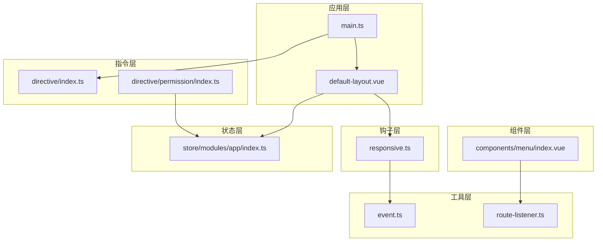
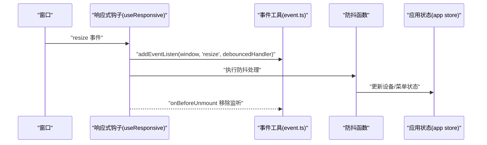
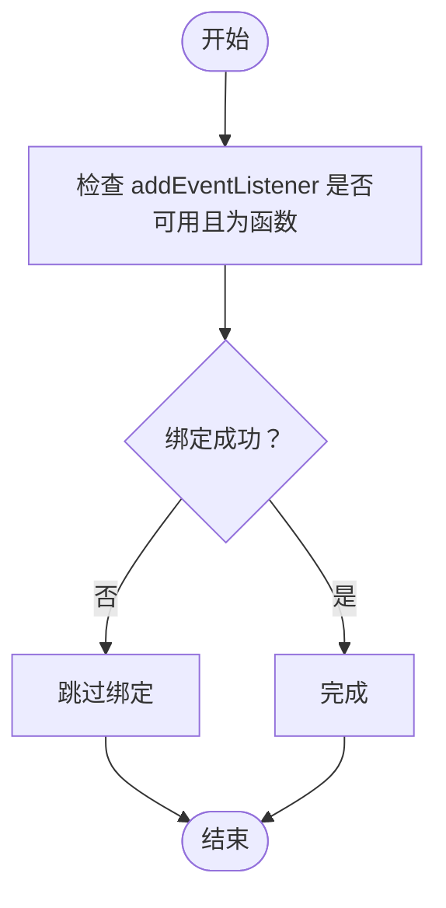
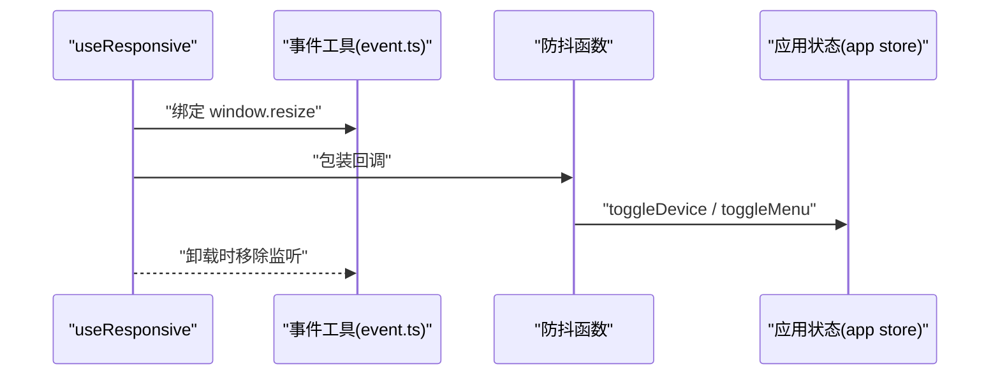
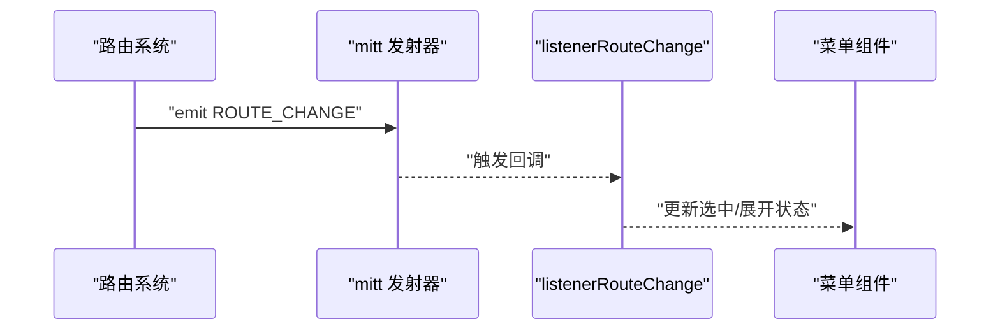
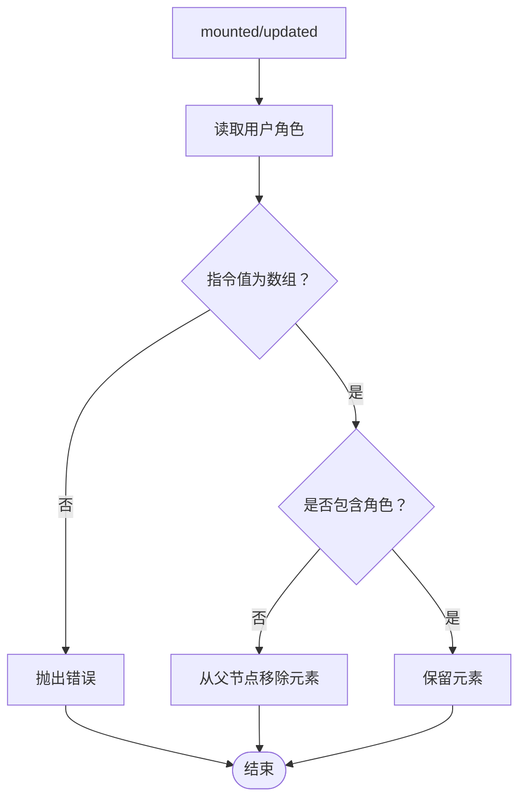
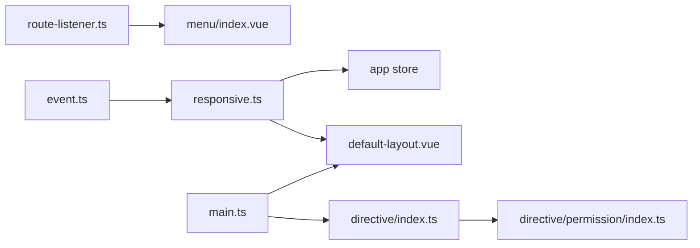

# 事件处理工具

<cite>
**本文引用的文件**
- [event.ts](file://src/utils/event.ts)
- [responsive.ts](file://src/hooks/responsive.ts)
- [route-listener.ts](file://src/utils/route-listener.ts)
- [index.vue（菜单组件）](file://src/components/menu/index.vue)
- [default-layout.vue](file://src/layout/default-layout.vue)
- [index.ts（权限指令）](file://src/directive/permission/index.ts)
- [index.ts（指令入口）](file://src/directive/index.ts)
- [index.ts（全局组件入口）](file://src/components/index.ts)
- [main.ts](file://src/main.ts)
- [index.ts（应用状态存储）](file://src/store/modules/app/index.ts)
</cite>

## 目录
1. [引言](#引言)
2. [项目结构](#项目结构)
3. [核心组件](#核心组件)
4. [架构总览](#架构总览)
5. [详细组件分析](#详细组件分析)
6. [依赖关系分析](#依赖关系分析)
7. [性能考量](#性能考量)
8. [故障排查指南](#故障排查指南)
9. [结论](#结论)
10. [附录](#附录)

## 引言
本文件系统性梳理项目中的事件处理工具与实践，覆盖以下主题：
- DOM 事件监听与移除的统一封装
- 自定义事件与跨组件通信（发布订阅）
- 响应式布局与窗口尺寸变化的事件处理
- 路由变更的事件分发与订阅
- 事件防抖、节流与事件委托的实用技巧
- 复杂交互场景（拖拽、滚动、触摸）的事件处理思路
- 事件内存泄漏的预防与清理策略

## 项目结构
围绕事件处理的关键文件分布如下：
- 工具层：统一的 DOM 事件添加/移除封装
- 钩子层：响应式布局钩子，结合防抖处理窗口 resize
- 通信层：基于 mitt 的路由事件发布订阅
- 组件层：菜单组件对路由变更的订阅与联动
- 指令层：权限指令在挂载/更新时对元素可见性的控制
- 应用层：主程序注册指令、组件与状态存储

图表来源
- [main.ts:1-29](file://src/main.ts#L1-L29)
- [default-layout.vue:1-179](file://src/layout/default-layout.vue#L1-L179)
- [responsive.ts:1-33](file://src/hooks/responsive.ts#L1-L33)
- [event.ts:1-28](file://src/utils/event.ts#L1-L28)
- [route-listener.ts:1-32](file://src/utils/route-listener.ts#L1-L32)
- [index.vue（菜单组件）:1-161](file://src/components/menu/index.vue#L1-L161)
- [index.ts（权限指令）:1-31](file://src/directive/permission/index.ts#L1-L31)
- [index.ts（指令入口）:1-9](file://src/directive/index.ts#L1-L9)
- [index.ts（应用状态存储）:1-78](file://src/store/modules/app/index.ts#L1-L78)

章节来源
- [main.ts:1-29](file://src/main.ts#L1-L29)
- [default-layout.vue:1-179](file://src/layout/default-layout.vue#L1-L179)
- [responsive.ts:1-33](file://src/hooks/responsive.ts#L1-L33)
- [event.ts:1-28](file://src/utils/event.ts#L1-L28)
- [route-listener.ts:1-32](file://src/utils/route-listener.ts#L1-L32)
- [index.vue（菜单组件）:1-161](file://src/components/menu/index.vue#L1-L161)
- [index.ts（权限指令）:1-31](file://src/directive/permission/index.ts#L1-L31)
- [index.ts（指令入口）:1-9](file://src/directive/index.ts#L1-L9)
- [index.ts（应用状态存储）:1-78](file://src/store/modules/app/index.ts#L1-L78)

## 核心组件
- 事件工具函数：提供 addEventListen 与 removeEventListen，统一封装 addEventListener/removeEventListener 的调用与类型判断，确保在不同宿主环境下的兼容性与安全性。
- 响应式钩子：useResponsive 在挂载阶段绑定窗口 resize 事件，并通过防抖函数降低高频事件的处理成本；在卸载阶段移除监听，避免内存泄漏。
- 路由事件发布订阅：基于 mitt 的轻量发布订阅模型，集中管理路由变更事件，支持立即回放最新路由的能力，减少不必要的渲染开销。

章节来源
- [event.ts:1-28](file://src/utils/event.ts#L1-L28)
- [responsive.ts:1-33](file://src/hooks/responsive.ts#L1-L33)
- [route-listener.ts:1-32](file://src/utils/route-listener.ts#L1-L32)

## 架构总览
事件处理在本项目中形成“工具-钩子-组件-指令-状态”的分层协作：
- 工具层负责底层事件 API 的安全封装
- 钩子层负责生命周期内的事件绑定与解绑
- 组件层通过订阅路由事件实现 UI 状态联动
- 指令层在模板层面根据权限动态控制元素可见性
- 状态层提供设备、菜单等全局状态，驱动事件行为

图表来源
- [responsive.ts:13-32](file://src/hooks/responsive.ts#L13-L32)
- [event.ts:1-28](file://src/utils/event.ts#L1-L28)
- [index.ts（应用状态存储）:41-46](file://src/store/modules/app/index.ts#L41-L46)

## 详细组件分析

### 事件工具：DOM 事件监听与移除
- 设计要点
  - 对 addEventListener/removeEventListener 进行存在性与类型检查，避免在非标准宿主或错误目标上调用导致异常
  - 支持捕获阶段参数，便于更细粒度的事件处理策略
- 使用建议
  - 所有外部事件绑定均通过该工具函数进行，保证一致性和可维护性
  - 与生命周期钩子配合，在组件卸载时务必移除监听

图表来源
- [event.ts:1-13](file://src/utils/event.ts#L1-L13)

章节来源
- [event.ts:1-28](file://src/utils/event.ts#L1-L28)

### 响应式钩子：窗口尺寸变化与防抖
- 设计要点
  - 在挂载阶段绑定 resize 事件，卸载阶段移除，防止内存泄漏
  - 使用防抖函数降低频繁 resize 的处理频率，提升性能
  - 结合应用状态切换设备类型与菜单折叠状态
- 实践建议
  - 在需要即时生效的场景传入 immediate 参数以触发一次初始计算
  - 将业务逻辑集中在回调内部，避免在多次触发间产生副作用

图表来源
- [responsive.ts:13-32](file://src/hooks/responsive.ts#L13-L32)
- [event.ts:1-28](file://src/utils/event.ts#L1-L28)
- [index.ts（应用状态存储）:41-46](file://src/store/modules/app/index.ts#L41-L46)

章节来源
- [responsive.ts:1-33](file://src/hooks/responsive.ts#L1-L33)
- [index.ts（应用状态存储）:1-78](file://src/store/modules/app/index.ts#L1-L78)

### 路由事件发布订阅：跨组件通信
- 设计要点
  - 使用 mitt 创建事件发射器，以 Symbol 作为键名，避免冲突
  - 提供 setRouteEmitter 发布路由变更，listenerRouteChange 订阅路由变更，removeRouteListener 清理订阅
  - 支持立即回放最新路由，保证订阅者首次接入即获得最新状态
- 实践建议
  - 在路由守卫或导航完成后调用 setRouteEmitter
  - 在需要联动的组件中订阅路由事件，避免直接监听路由对象本身带来的渲染压力

图表来源
- [route-listener.ts:14-27](file://src/utils/route-listener.ts#L14-L27)
- [index.vue（菜单组件）:72-86](file://src/components/menu/index.vue#L72-L86)

章节来源
- [route-listener.ts:1-32](file://src/utils/route-listener.ts#L1-L32)
- [index.vue（菜单组件）:1-161](file://src/components/menu/index.vue#L1-L161)

### 权限指令：基于事件的元素可见性控制
- 设计要点
  - 在 mounted 与 updated 生命周期中检查元素权限，若无权限则从父节点移除该元素
  - 通过读取用户角色与指令值进行权限比对，确保 UI 与数据一致
- 实践建议
  - 指令值需为数组格式，否则抛出明确错误提示
  - 与状态存储配合，当角色变更时自动重新评估元素可见性

图表来源
- [index.ts（权限指令）:4-30](file://src/directive/permission/index.ts#L4-L30)

章节来源
- [index.ts（权限指令）:1-31](file://src/directive/permission/index.ts#L1-L31)
- [index.ts（指令入口）:1-9](file://src/directive/index.ts#L1-L9)
- [main.ts:1-29](file://src/main.ts#L1-L29)

### 主程序集成：指令与组件注册
- 设计要点
  - 在应用启动时统一注册指令、组件、路由、状态与国际化模块
  - 指令通过入口文件集中导出，便于按需扩展
- 实践建议
  - 新增指令时遵循统一安装规范，确保在所有页面生效

章节来源
- [main.ts:1-29](file://src/main.ts#L1-L29)
- [index.ts（指令入口）:1-9](file://src/directive/index.ts#L1-L9)
- [index.ts（全局组件入口）:1-20](file://src/components/index.ts#L1-L20)

## 依赖关系分析
- 低耦合高内聚
  - 事件工具仅负责事件绑定/移除，不关心业务逻辑
  - 响应式钩子专注于窗口事件与状态联动，职责单一
  - 路由事件发布订阅独立于组件，通过接口解耦
- 关键依赖链
  - default-layout.vue 依赖 useResponsive，后者依赖事件工具与应用状态
  - 菜单组件依赖路由事件发布订阅，实现选中/展开状态联动
  - 权限指令依赖应用状态与指令入口，实现元素级权限控制

图表来源
- [event.ts:1-28](file://src/utils/event.ts#L1-L28)
- [responsive.ts:1-33](file://src/hooks/responsive.ts#L1-L33)
- [default-layout.vue:1-179](file://src/layout/default-layout.vue#L1-L179)
- [route-listener.ts:1-32](file://src/utils/route-listener.ts#L1-L32)
- [index.vue（菜单组件）:1-161](file://src/components/menu/index.vue#L1-L161)
- [index.ts（权限指令）:1-31](file://src/directive/permission/index.ts#L1-L31)
- [index.ts（指令入口）:1-9](file://src/directive/index.ts#L1-L9)
- [main.ts:1-29](file://src/main.ts#L1-L29)

章节来源
- [responsive.ts:1-33](file://src/hooks/responsive.ts#L1-L33)
- [route-listener.ts:1-32](file://src/utils/route-listener.ts#L1-L32)
- [index.vue（菜单组件）:1-161](file://src/components/menu/index.vue#L1-L161)
- [index.ts（权限指令）:1-31](file://src/directive/permission/index.ts#L1-L31)
- [index.ts（指令入口）:1-9](file://src/directive/index.ts#L1-L9)
- [main.ts:1-29](file://src/main.ts#L1-L29)

## 性能考量
- 防抖与节流
  - 在高频事件（如 resize、scroll）上使用防抖/节流，降低回调执行频率
  - 参考响应式钩子中对 resize 的防抖处理方式
- 事件委托
  - 将多个子元素的事件委托到其父容器，减少监听器数量，提升性能
  - 在列表/表格等场景优先采用事件委托
- 虚拟化与懒加载
  - 对长列表与大图区域采用虚拟滚动与懒加载，减少事件绑定范围
- 渲染优化
  - 路由事件采用发布订阅模型，避免直接监听路由对象导致的全局重渲染

## 故障排查指南
- 症状：页面卸载后仍出现内存占用或异常
  - 排查点：确认是否在组件卸载阶段调用了移除监听
  - 参考：响应式钩子在卸载阶段移除 resize 监听
- 症状：窗口尺寸变化未触发预期行为
  - 排查点：确认是否正确传入 immediate 参数；检查防抖阈值是否合理
  - 参考：响应式钩子的挂载与卸载流程
- 症状：菜单未随路由变化联动
  - 排查点：确认路由变更时是否调用了发布函数；订阅方是否正确接收最新路由
  - 参考：路由事件发布订阅与菜单组件订阅逻辑
- 症状：权限指令报错或元素未被移除
  - 排查点：确认指令值为数组格式；检查角色值是否匹配
  - 参考：权限指令的校验与移除逻辑

章节来源
- [responsive.ts:29-31](file://src/hooks/responsive.ts#L29-L31)
- [route-listener.ts:14-27](file://src/utils/route-listener.ts#L14-L27)
- [index.vue（菜单组件）:72-86](file://src/components/menu/index.vue#L72-L86)
- [index.ts（权限指令）:9-20](file://src/directive/permission/index.ts#L9-L20)

## 结论
本项目通过“事件工具 + 响应式钩子 + 发布订阅 + 指令控制”的组合，构建了清晰、可维护、高性能的事件处理体系。建议在后续开发中：
- 统一使用事件工具进行事件绑定/移除
- 在高频事件上坚持使用防抖/节流
- 优先采用发布订阅模型进行跨组件通信
- 在组件卸载时严格清理事件监听，避免内存泄漏

## 附录
- 事件防抖与节流最佳实践
  - 防抖：适用于输入框搜索、窗口尺寸调整等，确保最后一次触发生效
  - 节流：适用于滚动、鼠标移动等，按固定时间间隔触发
- 事件委托示例思路
  - 将多个按钮点击事件委托给父容器，通过事件冒泡识别目标元素
- 复杂交互场景建议
  - 拖拽：使用 mousedown/mousemove/mouseup 组合，注意边界与坐标换算
  - 滚动：结合 throttle 与 IntersectionObserver，优化长列表性能
  - 触摸：区分 touchstart/touchmove/touchend，处理多指触控与惯性滚动