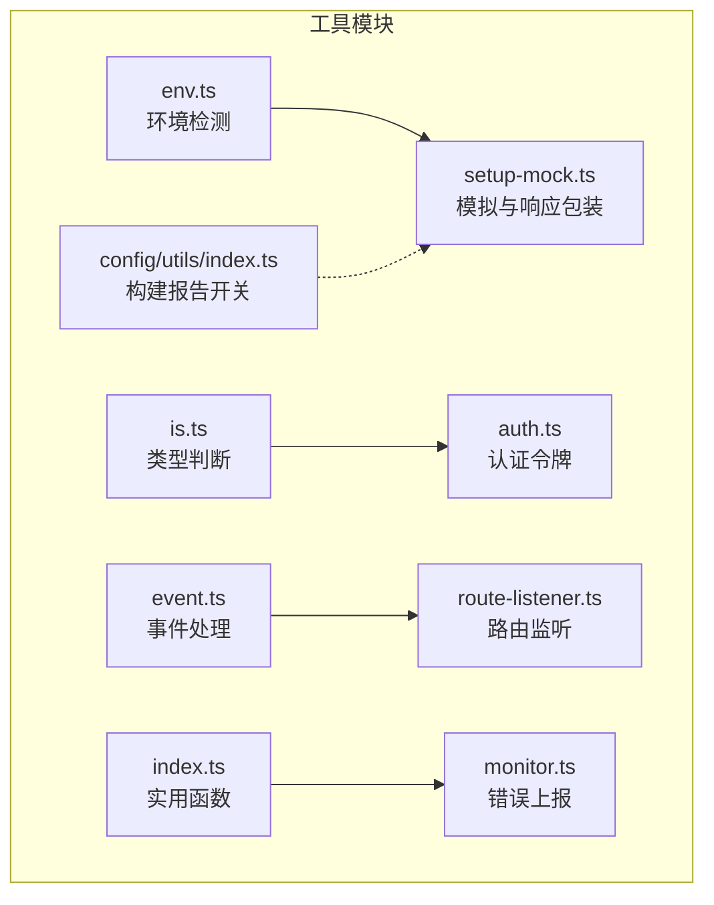
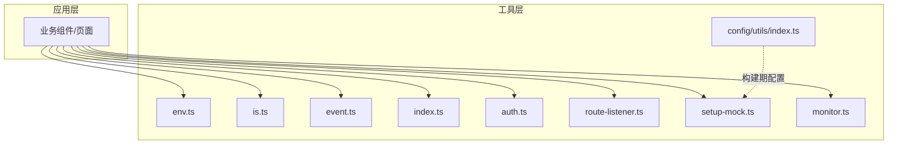
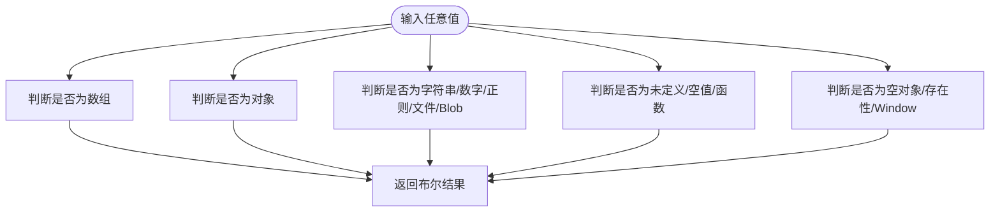
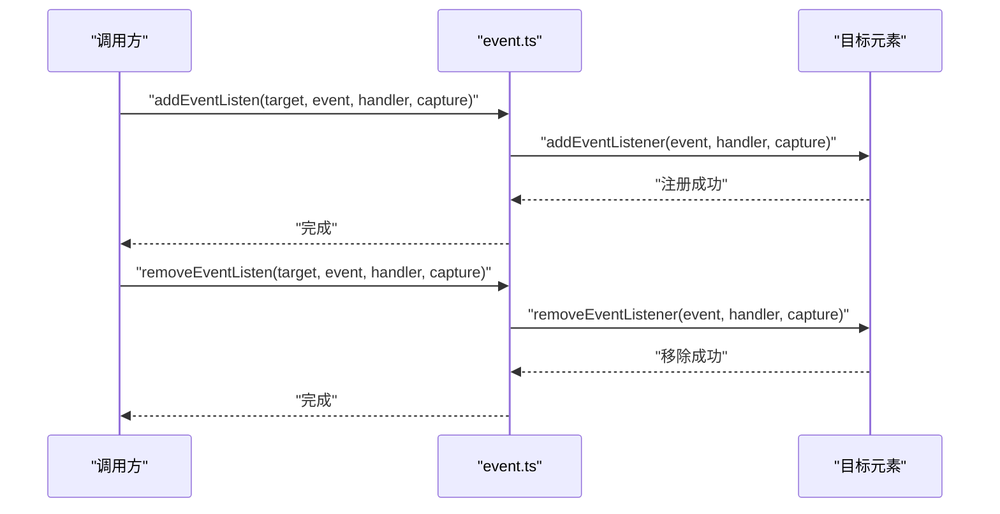
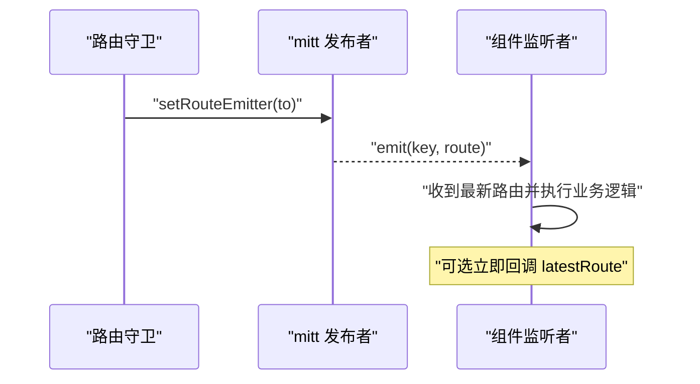
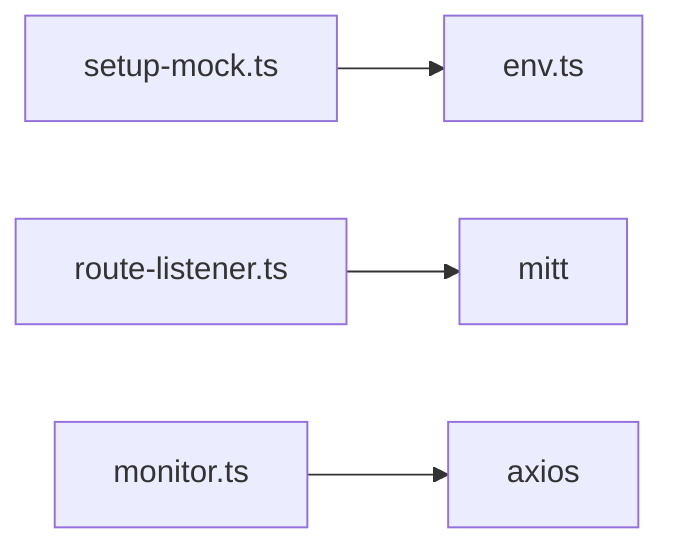

# 工具函数库

<cite>
**本文引用的文件**
- [src/utils/index.ts](file://src/utils/index.ts)
- [src/utils/env.ts](file://src/utils/env.ts)
- [src/utils/is.ts](file://src/utils/is.ts)
- [src/utils/event.ts](file://src/utils/event.ts)
- [src/utils/auth.ts](file://src/utils/auth.ts)
- [src/utils/monitor.ts](file://src/utils/monitor.ts)
- [src/utils/route-listener.ts](file://src/utils/route-listener.ts)
- [src/utils/setup-mock.ts](file://src/utils/setup-mock.ts)
- [config/utils/index.ts](file://config/utils/index.ts)
</cite>

## 目录
1. [简介](#简介)
2. [项目结构](#项目结构)
3. [核心组件](#核心组件)
4. [架构总览](#架构总览)
5. [详细组件分析](#详细组件分析)
6. [依赖分析](#依赖分析)
7. [性能考虑](#性能考虑)
8. [故障排查指南](#故障排查指南)
9. [结论](#结论)
10. [附录](#附录)

## 简介
本文件系统性梳理并说明本项目的工具函数库，涵盖以下方面：
- 设计原则与命名规范
- 环境检测工具与类型判断工具
- 事件处理工具、数据转换与实用工具
- 分类组织与使用示例路径
- 扩展方法与自定义工具开发指南
- 在项目中的应用场景与最佳实践

## 项目结构
工具函数主要位于 src/utils 下，按功能域划分：
- 环境与构建：env.ts、config/utils/index.ts（构建期报告开关）
- 类型判断：is.ts
- 事件处理：event.ts
- 认证与令牌：auth.ts
- 路由监听（发布订阅）：route-listener.ts
- 错误监控：monitor.ts
- 模拟数据与响应包装：setup-mock.ts
- 实用函数：index.ts（窗口打开、URL 正则）

**图表来源**
- [src/utils/env.ts:1-4](file://src/utils/env.ts#L1-L4)
- [src/utils/setup-mock.ts:1-24](file://src/utils/setup-mock.ts#L1-L24)
- [src/utils/is.ts:1-54](file://src/utils/is.ts#L1-L54)
- [src/utils/auth.ts:1-20](file://src/utils/auth.ts#L1-L20)
- [src/utils/event.ts:1-28](file://src/utils/event.ts#L1-L28)
- [src/utils/route-listener.ts:1-32](file://src/utils/route-listener.ts#L1-L32)
- [src/utils/index.ts:1-26](file://src/utils/index.ts#L1-L26)
- [src/utils/monitor.ts:1-29](file://src/utils/monitor.ts#L1-L29)
- [config/utils/index.ts:1-10](file://config/utils/index.ts#L1-L10)

**章节来源**
- [src/utils/index.ts:1-26](file://src/utils/index.ts#L1-L26)
- [src/utils/env.ts:1-4](file://src/utils/env.ts#L1-L4)
- [src/utils/is.ts:1-54](file://src/utils/is.ts#L1-L54)
- [src/utils/event.ts:1-28](file://src/utils/event.ts#L1-L28)
- [src/utils/auth.ts:1-20](file://src/utils/auth.ts#L1-L20)
- [src/utils/monitor.ts:1-29](file://src/utils/monitor.ts#L1-L29)
- [src/utils/route-listener.ts:1-32](file://src/utils/route-listener.ts#L1-L32)
- [src/utils/setup-mock.ts:1-24](file://src/utils/setup-mock.ts#L1-L24)
- [config/utils/index.ts:1-10](file://config/utils/index.ts#L1-L10)

## 核心组件
- 环境检测工具
  - env.ts 提供运行时环境判断（非生产即调试态），用于控制日志、Mock 启用等行为。
- 类型判断工具
  - is.ts 提供数组、对象、字符串、数字、正则、文件、Blob、未定义、空值、函数、空对象、存在性、Window 等类型判断，支持 TypeScript 精准收窄。
- 事件处理工具
  - event.ts 封装 addEventListen/removeEventListen，统一处理浏览器兼容性与捕获阶段。
- 数据转换与实用工具
  - index.ts 提供 openWindow（安全打开新窗口）、regexUrl（URL 正则）。
  - setup-mock.ts 提供 Mock 启用门控与统一响应包装（成功/失败）。
  - route-listener.ts 基于 mitt 的路由变更发布订阅，避免逐处监听导致的性能浪费。
  - monitor.ts 提供 Vue errorHandler 集成错误上报（可扩展字段）。
  - auth.ts 提供本地存储令牌的读取、设置与清理。

**章节来源**
- [src/utils/env.ts:1-4](file://src/utils/env.ts#L1-L4)
- [src/utils/is.ts:1-54](file://src/utils/is.ts#L1-L54)
- [src/utils/event.ts:1-28](file://src/utils/event.ts#L1-L28)
- [src/utils/index.ts:1-26](file://src/utils/index.ts#L1-L26)
- [src/utils/setup-mock.ts:1-24](file://src/utils/setup-mock.ts#L1-L24)
- [src/utils/route-listener.ts:1-32](file://src/utils/route-listener.ts#L1-L32)
- [src/utils/monitor.ts:1-29](file://src/utils/monitor.ts#L1-L29)
- [src/utils/auth.ts:1-20](file://src/utils/auth.ts#L1-L20)

## 架构总览
工具函数库采用“按职责分层”的模块化设计，通过单一职责与最小耦合实现高复用性。下图展示关键模块间的交互关系：

**图表来源**
- [src/utils/env.ts:1-4](file://src/utils/env.ts#L1-L4)
- [src/utils/is.ts:1-54](file://src/utils/is.ts#L1-L54)
- [src/utils/event.ts:1-28](file://src/utils/event.ts#L1-L28)
- [src/utils/index.ts:1-26](file://src/utils/index.ts#L1-L26)
- [src/utils/auth.ts:1-20](file://src/utils/auth.ts#L1-L20)
- [src/utils/route-listener.ts:1-32](file://src/utils/route-listener.ts#L1-L32)
- [src/utils/setup-mock.ts:1-24](file://src/utils/setup-mock.ts#L1-L24)
- [src/utils/monitor.ts:1-29](file://src/utils/monitor.ts#L1-L29)
- [config/utils/index.ts:1-10](file://config/utils/index.ts#L1-L10)

## 详细组件分析

### 环境检测工具（env.ts）
- 功能要点
  - 基于 Vite 的 import.meta.env.MODE 判断是否为生产环境，返回布尔值，便于在开发/测试阶段启用调试能力。
- 使用场景
  - 控制 Mock 启动、日志输出、错误上报策略等。
- 最佳实践
  - 将环境判断封装为常量或函数，避免散落的环境变量判断逻辑。

**章节来源**
- [src/utils/env.ts:1-4](file://src/utils/env.ts#L1-L4)

### 类型判断工具（is.ts）
- 功能要点
  - 提供全面的类型判断函数，覆盖基础类型、DOM 对象、浏览器原生对象等，并支持 TypeScript 类型守卫，便于在分支中精准收窄类型。
- 设计原则
  - 使用 Object.prototype.toString 统一判断，避免 typeof 的局限；对 NaN 进行特殊处理以确保数字判断正确。
- 复杂度
  - 每个判断函数时间复杂度 O(1)，空间复杂度 O(1)。
- 使用示例路径
  - [类型判断函数集合:1-54](file://src/utils/is.ts#L1-L54)

**图表来源**
- [src/utils/is.ts:1-54](file://src/utils/is.ts#L1-L54)

**章节来源**
- [src/utils/is.ts:1-54](file://src/utils/is.ts#L1-L54)

### 事件处理工具（event.ts）
- 功能要点
  - addEventListen/removeEventListen 封装 addEventListener/removeEventListener，自动检查方法可用性，支持捕获阶段参数。
- 复杂度
  - 时间复杂度 O(1)，空间复杂度 O(1)。
- 使用示例路径
  - [事件监听器封装:1-28](file://src/utils/event.ts#L1-L28)

**图表来源**
- [src/utils/event.ts:1-28](file://src/utils/event.ts#L1-L28)

**章节来源**
- [src/utils/event.ts:1-28](file://src/utils/event.ts#L1-L28)

### 数据转换与实用工具（index.ts）
- openWindow
  - 作用：安全打开新窗口，支持传入窗口特性参数（如宽高、滚动条等），默认在新标签页打开。
  - 参数：url、opts（target 及其他窗口特性键值对）。
  - 使用示例路径：[打开新窗口:3-18](file://src/utils/index.ts#L3-L18)
- regexUrl
  - 作用：预置 URL 正则，支持 http/https/ftp，含本地回环与端口校验。
  - 使用示例路径：[URL 正则:20-23](file://src/utils/index.ts#L20-L23)

**章节来源**
- [src/utils/index.ts:1-26](file://src/utils/index.ts#L1-L26)

### 认证与令牌工具（auth.ts）
- 功能要点
  - 提供 isLogin/getToken/setToken/clearToken，围绕本地存储的 token_key 进行读写删操作。
- 使用场景
  - 登录状态判断、请求头携带 token、登出清理。
- 最佳实践
  - 统一封装 token 存取，避免直接操作 localStorage，便于替换存储介质或增加加密。

**章节来源**
- [src/utils/auth.ts:1-20](file://src/utils/auth.ts#L1-L20)

### 路由监听（发布订阅）工具（route-listener.ts）
- 功能要点
  - 基于 mitt 的发布订阅模型，集中管理路由变更事件，避免多处监听导致的重复渲染与性能问题。
  - 支持立即回调最新路由、添加/移除监听。
- 使用场景
  - 页面级联动、面包屑更新、权限校验后置逻辑等。
- 最佳实践
  - 在路由守卫中触发 setRouteEmitter，在需要的组件中使用 listenerRouteChange 注册回调。

**图表来源**
- [src/utils/route-listener.ts:1-32](file://src/utils/route-listener.ts#L1-L32)

**章节来源**
- [src/utils/route-listener.ts:1-32](file://src/utils/route-listener.ts#L1-L32)

### 错误监控工具（monitor.ts）
- 功能要点
  - 注入 Vue errorHandler，统一收集错误信息并通过 HTTP 上报（可扩展字段）。
- 使用场景
  - 生产环境错误采集与定位。
- 最佳实践
  - 在应用入口初始化，结合服务端错误收集平台，补充浏览器信息、用户信息、DOM 信息、URL 信息等上下文。

**章节来源**
- [src/utils/monitor.ts:1-29](file://src/utils/monitor.ts#L1-L29)

### 模拟数据与响应包装（setup-mock.ts）
- 功能要点
  - 条件启动 Mock（受环境与参数控制），提供统一的成功/失败响应包装。
- 使用场景
  - 开发阶段快速联调、接口占位与测试数据构造。
- 最佳实践
  - 将 Mock 启动逻辑集中在入口或插件中，避免在业务代码中分散判断。

**章节来源**
- [src/utils/setup-mock.ts:1-24](file://src/utils/setup-mock.ts#L1-L24)

### 构建期报告开关（config/utils/index.ts）
- 功能要点
  - 提供 isReportMode 判断是否生成打包报告，配合环境变量控制。
- 使用场景
  - CI/CD 中按需生成可视化包体分析报告。

**章节来源**
- [config/utils/index.ts:1-10](file://config/utils/index.ts#L1-L10)

## 依赖分析
- 内部依赖
  - setup-mock.ts 依赖 env.ts 的调试态判断。
  - route-listener.ts 依赖 mitt（第三方）。
  - monitor.ts 依赖 axios（第三方）。
- 外部依赖
  - mitt：轻量发布订阅库。
  - axios：HTTP 客户端。
- 耦合与内聚
  - 工具函数保持低耦合，仅在必要处引入第三方库；模块内聚高，职责单一。

**图表来源**
- [src/utils/setup-mock.ts:1-24](file://src/utils/setup-mock.ts#L1-L24)
- [src/utils/route-listener.ts:1-32](file://src/utils/route-listener.ts#L1-L32)
- [src/utils/monitor.ts:1-29](file://src/utils/monitor.ts#L1-L29)

**章节来源**
- [src/utils/setup-mock.ts:1-24](file://src/utils/setup-mock.ts#L1-L24)
- [src/utils/route-listener.ts:1-32](file://src/utils/route-listener.ts#L1-L32)
- [src/utils/monitor.ts:1-29](file://src/utils/monitor.ts#L1-L29)

## 性能考虑
- 事件监听
  - 使用统一封装减少重复绑定与内存泄漏风险；必要时在组件销毁时调用移除监听。
- 路由监听
  - 采用发布订阅替代多处监听，降低渲染压力；注意及时移除监听避免内存泄漏。
- Mock 启动
  - 仅在开发/调试态启用，避免生产环境额外开销。
- 错误上报
  - 异步上报，避免阻塞主线程；可加入节流/去重策略。

## 故障排查指南
- 事件未触发
  - 检查 addEventListen/removeEventListen 的目标对象是否为 Window 或 HTMLElement，以及捕获阶段参数是否正确。
- 路由监听无效
  - 确认在路由守卫中调用了 setRouteEmitter，并在目标组件中使用 listenerRouteChange 注册回调；若需要立即回调，确认 immediate 参数与 latestRoute 是否满足预期。
- Mock 未生效
  - 检查环境变量与 setup-mock.ts 的条件判断；确认在应用入口正确调用。
- 错误未上报
  - 确认 monitor.ts 已在应用入口初始化，且服务端地址有效；检查网络请求与跨域配置。
- 类型判断异常
  - 注意 isNumber 对 NaN 的处理；对于特殊对象（如 Window）使用 isWindow 进行精确判断。

**章节来源**
- [src/utils/event.ts:1-28](file://src/utils/event.ts#L1-L28)
- [src/utils/route-listener.ts:1-32](file://src/utils/route-listener.ts#L1-L32)
- [src/utils/setup-mock.ts:1-24](file://src/utils/setup-mock.ts#L1-L24)
- [src/utils/monitor.ts:1-29](file://src/utils/monitor.ts#L1-L29)
- [src/utils/is.ts:1-54](file://src/utils/is.ts#L1-L54)

## 结论
本工具函数库以“单一职责、低耦合、高内聚”为核心设计原则，覆盖环境检测、类型判断、事件处理、认证令牌、路由监听、错误监控与模拟数据等关键领域。通过标准化的封装与清晰的职责边界，显著提升了代码复用率与可维护性。建议在实际项目中遵循命名规范与最佳实践，持续扩展与完善工具集。

## 附录

### 工具函数分类与命名规范
- 分类
  - 环境与构建：env.ts、config/utils/index.ts
  - 类型判断：is.ts
  - 事件处理：event.ts
  - 数据转换与实用：index.ts、setup-mock.ts
  - 认证与令牌：auth.ts
  - 路由监听：route-listener.ts
  - 错误监控：monitor.ts
- 命名规范
  - 函数名语义明确，动词开头（如 add/remove、set/get、is/has/isEmpty）。
  - 类型判断函数以 is/has/isEmpty 前缀，返回布尔值。
  - 工具函数尽量无副作用，必要时提供可选参数与默认值。

### 使用示例路径索引
- 环境检测
  - [环境检测:1-4](file://src/utils/env.ts#L1-L4)
- 类型判断
  - [类型判断函数集合:1-54](file://src/utils/is.ts#L1-L54)
- 事件处理
  - [事件监听器封装:1-28](file://src/utils/event.ts#L1-L28)
- 数据转换与实用
  - [打开新窗口:3-18](file://src/utils/index.ts#L3-L18)
  - [URL 正则:20-23](file://src/utils/index.ts#L20-L23)
  - [Mock 启动与响应包装:1-24](file://src/utils/setup-mock.ts#L1-L24)
- 认证与令牌
  - [令牌读写清理:1-20](file://src/utils/auth.ts#L1-L20)
- 路由监听
  - [路由发布订阅:1-32](file://src/utils/route-listener.ts#L1-L32)
- 错误监控
  - [错误上报:1-29](file://src/utils/monitor.ts#L1-L29)
- 构建期报告
  - [报告开关:1-10](file://config/utils/index.ts#L1-L10)