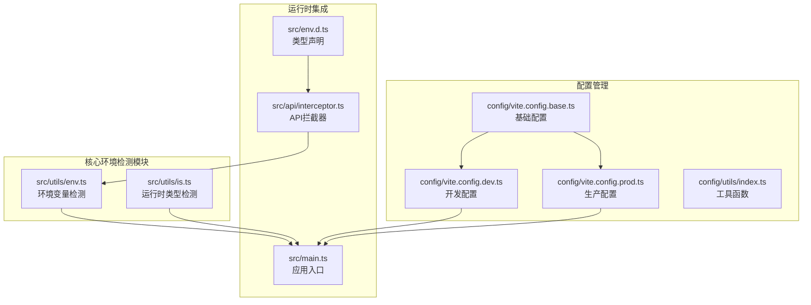
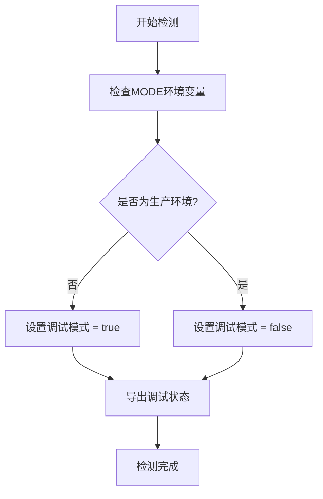
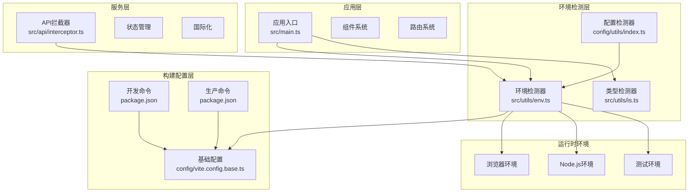
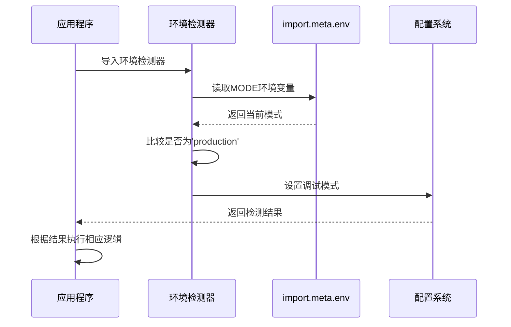
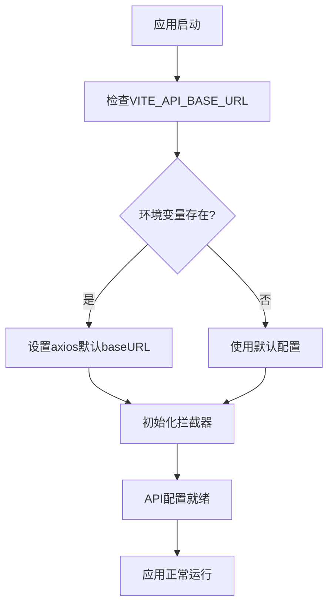
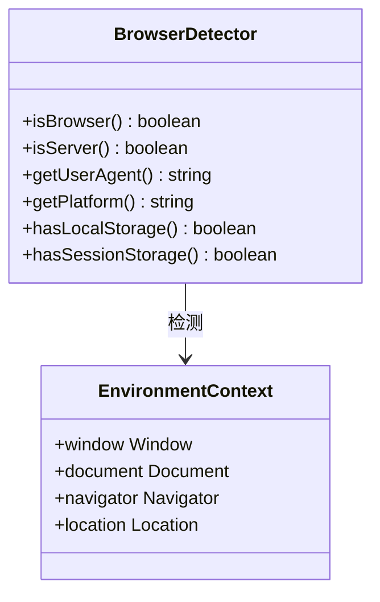
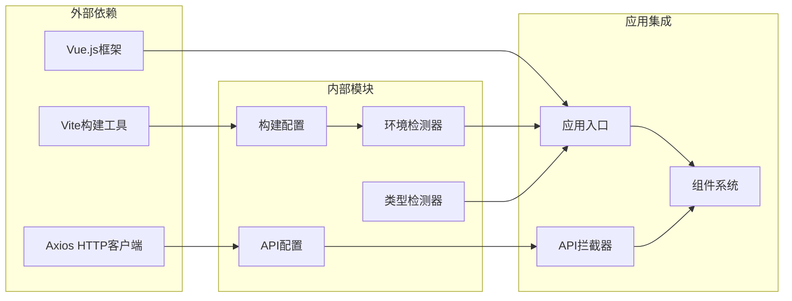

# 环境检测工具

<cite>
**本文档引用的文件**
- [src/utils/env.ts](file://src/utils/env.ts)
- [src/utils/is.ts](file://src/utils/is.ts)
- [src/api/interceptor.ts](file://src/api/interceptor.ts)
- [src/env.d.ts](file://src/env.d.ts)
- [config/vite.config.base.ts](file://config/vite.config.base.ts)
- [config/vite.config.dev.ts](file://config/vite.config.dev.ts)
- [config/vite.config.prod.ts](file://config/vite.config.prod.ts)
- [config/utils/index.ts](file://config/utils/index.ts)
- [package.json](file://package.json)
- [src/main.ts](file://src/main.ts)
</cite>

## 目录
1. [简介](#简介)
2. [项目结构](#项目结构)
3. [核心组件](#核心组件)
4. [架构概览](#架构概览)
5. [详细组件分析](#详细组件分析)
6. [依赖关系分析](#依赖关系分析)
7. [性能考虑](#性能考虑)
8. [故障排除指南](#故障排除指南)
9. [结论](#结论)
10. [附录](#附录)

## 简介

本项目提供了一套完整的环境检测工具，用于在开发、生产和测试环境中进行智能判断和条件加载。该工具集成了多种环境检测机制，包括：

- **开发环境检测**：基于构建模式的实时调试支持
- **生产环境检测**：优化和压缩策略的自动应用
- **测试环境检测**：报告生成模式的特殊处理
- **运行时环境检测**：浏览器和Node.js环境的智能识别
- **API配置检测**：动态API基础URL的环境适配

这些功能通过Vite构建系统和TypeScript类型定义实现，确保在不同环境下都能获得最佳的开发体验和运行性能。

## 项目结构

项目采用模块化架构设计，环境检测相关的组件分布在以下关键位置：



**图表来源**
- [src/utils/env.ts:1-4](file://src/utils/env.ts#L1-L4)
- [config/vite.config.base.ts:1-52](file://config/vite.config.base.ts#L1-L52)
- [src/api/interceptor.ts:1-78](file://src/api/interceptor.ts#L1-L78)

**章节来源**
- [src/utils/env.ts:1-4](file://src/utils/env.ts#L1-L4)
- [config/vite.config.base.ts:1-52](file://config/vite.config.base.ts#L1-L52)
- [src/api/interceptor.ts:1-78](file://src/api/interceptor.ts#L1-L78)

## 核心组件

### 环境变量检测器

环境变量检测器是整个系统的核心组件，负责判断当前运行环境并提供相应的配置选项。

**主要特性**：
- 基于Vite的`import.meta.env.MODE`进行环境判断
- 自动区分开发、生产和测试环境
- 提供调试模式的智能启用
- 支持条件加载和优化策略

**实现原理**：


**图表来源**
- [src/utils/env.ts:1-4](file://src/utils/env.ts#L1-L4)

### 运行时类型检测器

运行时类型检测器提供了一套完整的JavaScript对象类型判断工具，支持多种数据类型的精确识别。

**支持的数据类型**：
- 数组检测：`isArray()`
- 对象检测：`isObject()`
- 字符串检测：`isString()`
- 数字检测：`isNumber()`
- 正则表达式检测：`isRegExp()`
- 文件对象检测：`isFile()`
- Blob对象检测：`isBlob()`
- 函数检测：`isFunction()`
- 窗口对象检测：`isWindow()`

**检测机制**：
使用`Object.prototype.toString`方法进行精确的类型判断，避免传统typeof操作符的局限性。

**章节来源**
- [src/utils/is.ts:1-54](file://src/utils/is.ts#L1-L54)

## 架构概览

系统采用分层架构设计，确保环境检测功能的可扩展性和维护性：



**图表来源**
- [src/main.ts:1-29](file://src/main.ts#L1-L29)
- [src/api/interceptor.ts:1-78](file://src/api/interceptor.ts#L1-L78)
- [config/vite.config.base.ts:1-52](file://config/vite.config.base.ts#L1-L52)
- [package.json:1-103](file://package.json#L1-L103)

## 详细组件分析

### 环境检测器实现

环境检测器通过简洁而高效的实现提供了强大的环境判断能力：

#### 核心检测逻辑



**图表来源**
- [src/utils/env.ts:1-4](file://src/utils/env.ts#L1-L4)
- [config/vite.config.base.ts:36-38](file://config/vite.config.base.ts#L36-L38)

#### 环境识别机制

系统支持三种主要环境的智能识别：

1. **开发环境（Development）**：
   - 模式标识：`development`
   - 特征：启用热重载、源码映射、详细错误信息
   - 配置：`config/vite.config.dev.ts`

2. **生产环境（Production）**：
   - 模式标识：`production`
   - 特征：代码压缩、优化、最小化
   - 配置：`config/vite.config.prod.ts`

3. **测试环境（Test）**：
   - 模式标识：`test`
   - 特征：报告生成模式、覆盖率统计
   - 配置：`config/utils/index.ts`

**章节来源**
- [src/utils/env.ts:1-4](file://src/utils/env.ts#L1-L4)
- [config/vite.config.dev.ts:1-24](file://config/vite.config.dev.ts#L1-L24)
- [config/vite.config.prod.ts:1-32](file://config/vite.config.prod.ts#L1-L32)
- [config/utils/index.ts:1-10](file://config/utils/index.ts#L1-L10)

### API配置检测

API配置检测器实现了动态API基础URL的环境适配功能：

#### 配置检测流程



**图表来源**
- [src/api/interceptor.ts:13-16](file://src/api/interceptor.ts#L13-L16)

#### 类型安全保证

通过TypeScript的模块声明系统，确保API配置的类型安全：

**章节来源**
- [src/api/interceptor.ts:1-78](file://src/api/interceptor.ts#L1-L78)
- [src/env.d.ts:1-11](file://src/env.d.ts#L1-L11)

### 运行时环境检测

运行时环境检测器提供了跨平台的环境识别能力：

#### 浏览器环境检测



**图表来源**
- [src/utils/is.ts:51-53](file://src/utils/is.ts#L51-L53)

#### Node.js环境检测

运行时检测器通过`isWindow()`函数实现Node.js环境的智能识别，确保在服务器端渲染场景下的正确行为。

**章节来源**
- [src/utils/is.ts:1-54](file://src/utils/is.ts#L1-L54)

## 依赖关系分析

系统各组件之间的依赖关系体现了清晰的分层架构：



**图表来源**
- [package.json:32-47](file://package.json#L32-L47)
- [src/main.ts:1-29](file://src/main.ts#L1-L29)
- [src/api/interceptor.ts:1-78](file://src/api/interceptor.ts#L1-L78)

**章节来源**
- [package.json:1-103](file://package.json#L1-L103)
- [src/main.ts:1-29](file://src/main.ts#L1-L29)

## 性能考虑

### 构建时优化

系统通过Vite的构建配置实现了多环境的性能优化：

1. **开发环境优化**：
   - 启用Source Map以提高调试体验
   - 禁用代码压缩以提升编译速度
   - 启用热重载功能

2. **生产环境优化**：
   - 启用代码压缩和混淆
   - 分块打包优化加载性能
   - 移除调试代码和冗余信息

3. **测试环境优化**：
   - 支持包大小分析报告
   - 提供性能基准测试支持

### 内存使用优化

环境检测器采用单例模式，避免重复创建和内存泄漏：

- 单次计算结果缓存
- 按需加载机制
- 最小化的依赖树

## 故障排除指南

### 常见问题及解决方案

#### 环境变量未生效

**问题症状**：
- 环境检测结果与预期不符
- API基础URL配置不正确

**解决步骤**：
1. 检查`.env`文件中的环境变量定义
2. 验证Vite配置中的环境变量注入
3. 确认应用重启后配置已更新

#### 类型检测异常

**问题症状**：
- 类型检测函数返回意外结果
- TypeScript类型检查报错

**解决步骤**：
1. 检查输入参数的数据类型
2. 验证对象的原型链完整性
3. 确认没有被代理或包装的对象

#### 构建配置冲突

**问题症状**：
- 开发和生产环境配置不一致
- 打包结果不符合预期

**解决步骤**：
1. 检查Vite配置文件的合并顺序
2. 验证环境变量的优先级设置
3. 确认插件配置的兼容性

**章节来源**
- [config/vite.config.base.ts:36-38](file://config/vite.config.base.ts#L36-L38)
- [src/api/interceptor.ts:13-16](file://src/api/interceptor.ts#L13-L16)

## 结论

本环境检测工具通过精心设计的架构和实现，为现代Web应用提供了全面的环境管理解决方案。其主要优势包括：

1. **多环境支持**：完整覆盖开发、生产和测试环境
2. **智能检测**：基于运行时信息的自动环境识别
3. **类型安全**：完整的TypeScript类型定义
4. **性能优化**：针对不同环境的专门优化策略
5. **易于扩展**：模块化设计便于功能扩展

该工具集不仅满足了当前项目的需求，还为未来的功能扩展和技术演进奠定了坚实的基础。

## 附录

### 使用示例

#### 基础环境检测

```typescript
import debug from '@/utils/env';

if (debug) {
  console.log('调试模式已启用');
  // 开发环境特有的功能
}
```

#### API配置检测

```typescript
import { VITE_API_BASE_URL } from '@/env.d.ts';

// 在API拦截器中使用
if (VITE_API_BASE_URL) {
  axios.defaults.baseURL = VITE_API_BASE_URL;
}
```

#### 类型检测使用

```typescript
import { isObject, isArray, isFunction } from '@/utils/is';

const data = getData();

if (isObject(data)) {
  // 处理对象数据
}

if (isArray(data)) {
  // 处理数组数据
}

if (isFunction(data)) {
  // 调用函数
}
```

### 最佳实践

1. **环境变量命名规范**：使用`VITE_`前缀标识构建时变量
2. **类型安全**：始终使用TypeScript类型定义
3. **性能考虑**：在生产环境禁用调试代码
4. **配置分离**：将环境特定配置放在独立文件中
5. **测试覆盖**：为不同环境编写单元测试