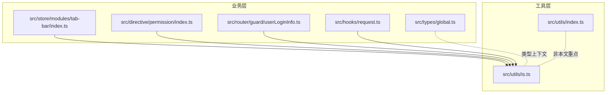
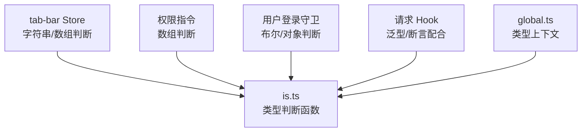
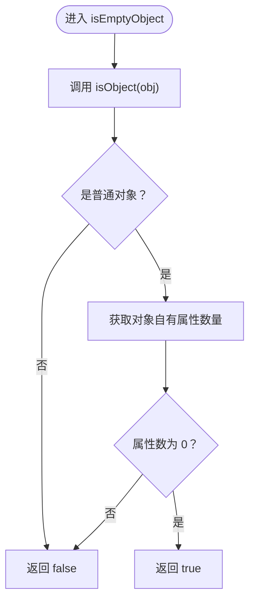
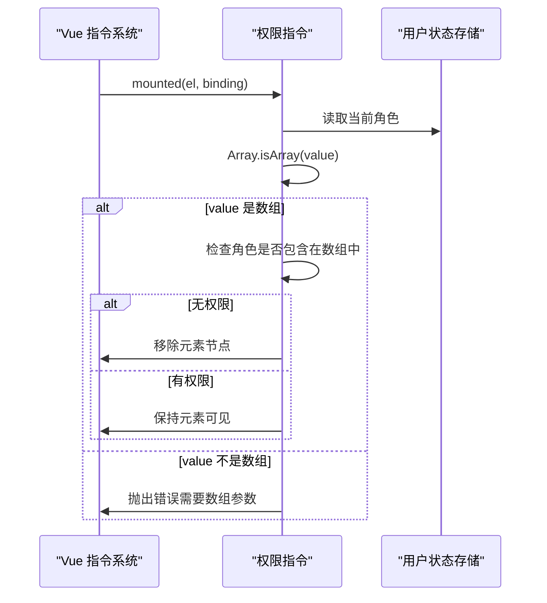
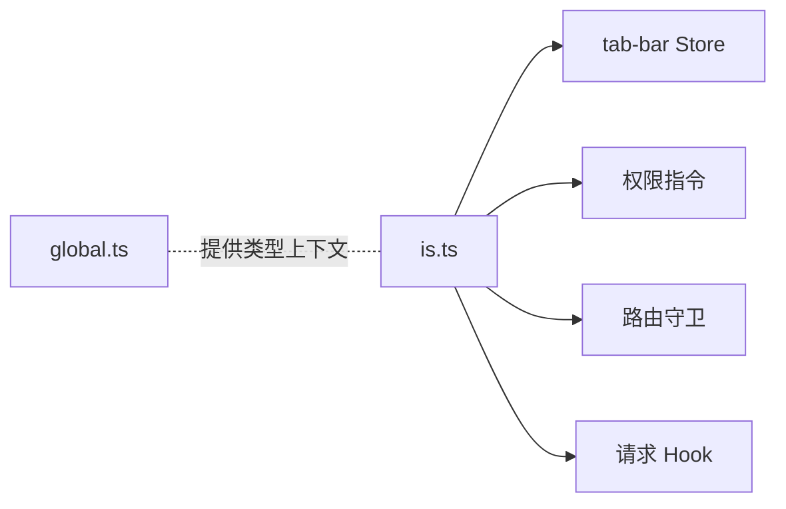

# 类型判断工具

<cite>
**本文引用的文件**
- [src/utils/is.ts](file://src/utils/is.ts)
- [src/utils/index.ts](file://src/utils/index.ts)
- [src/store/modules/tab-bar/index.ts](file://src/store/modules/tab-bar/index.ts)
- [src/directive/permission/index.ts](file://src/directive/permission/index.ts)
- [src/router/guard/userLoginInfo.ts](file://src/router/guard/userLoginInfo.ts)
- [src/hooks/request.ts](file://src/hooks/request.ts)
- [src/types/global.ts](file://src/types/global.ts)
</cite>

## 目录
1. [简介](#简介)
2. [项目结构](#项目结构)
3. [核心组件](#核心组件)
4. [架构总览](#架构总览)
5. [详细组件分析](#详细组件分析)
6. [依赖分析](#依赖分析)
7. [性能考虑](#性能考虑)
8. [故障排查指南](#故障排查指南)
9. [结论](#结论)
10. [附录](#附录)

## 简介
本文件系统化梳理项目中的类型判断工具，重点解析基础类型、对象类型、数组类型与特殊类型的检测机制，并结合实际业务场景（数据验证、API 响应处理、组件参数校验）说明其应用方式与最佳实践。工具集中于 src/utils/is.ts，提供类型守卫与辅助判断函数，确保在运行时对输入进行可靠约束。

## 项目结构
类型判断工具位于 utils 子目录，主要文件如下：
- src/utils/is.ts：类型判断函数集合（数组、对象、字符串、数字、正则、File/Blob、空值、函数、窗口等）
- src/utils/index.ts：通用工具（非本文重点，但与类型判断工具同属 utils 模块）
- src/store/modules/tab-bar/index.ts：在标签页缓存逻辑中使用字符串类型判断
- src/directive/permission/index.ts：在权限指令中使用数组类型判断
- src/router/guard/userLoginInfo.ts：在路由守卫中使用布尔与对象判断
- src/hooks/request.ts：在请求 Hook 中使用泛型与类型断言配合类型判断思路
- src/types/global.ts：全局类型定义，为类型判断提供上下文

图表来源
- [src/utils/is.ts:1-54](file://src/utils/is.ts#L1-L54)
- [src/store/modules/tab-bar/index.ts:1-75](file://src/store/modules/tab-bar/index.ts#L1-L75)
- [src/directive/permission/index.ts:1-31](file://src/directive/permission/index.ts#L1-L31)
- [src/router/guard/userLoginInfo.ts:1-44](file://src/router/guard/userLoginInfo.ts#L1-L44)
- [src/hooks/request.ts:1-27](file://src/hooks/request.ts#L1-L27)
- [src/utils/index.ts:1-26](file://src/utils/index.ts#L1-L26)
- [src/types/global.ts:1-38](file://src/types/global.ts#L1-L38)

章节来源
- [src/utils/is.ts:1-54](file://src/utils/is.ts#L1-L54)
- [src/utils/index.ts:1-26](file://src/utils/index.ts#L1-L26)

## 核心组件
本节聚焦 src/utils/is.ts 中的核心类型判断函数及其工作机制，涵盖：
- 数组判断：isArray
- 对象判断：isObject
- 字符串判断：isString
- 数字判断：isNumber（含 NaN 排除）
- 正则判断：isRegExp
- 文件与二进制对象：isFile、isBlob
- 空值判断：isNull、isUndefined
- 函数判断：isFunction
- 空对象判断：isEmptyObject
- 存在性判断：isExist
- 窗口对象判断：isWindow

实现原理概览
- 使用 Object.prototype.toString 的统一对象分类策略，避免被重写或伪装
- 使用 typeof 进行原始类型快速判定
- 使用严格相等与组合条件保证边界情况（如 NaN、空对象、存在性）的正确性

章节来源
- [src/utils/is.ts:1-54](file://src/utils/is.ts#L1-L54)

## 架构总览
类型判断工具在项目中的调用关系如下：

图表来源
- [src/utils/is.ts:1-54](file://src/utils/is.ts#L1-L54)
- [src/store/modules/tab-bar/index.ts:1-75](file://src/store/modules/tab-bar/index.ts#L1-L75)
- [src/directive/permission/index.ts:1-31](file://src/directive/permission/index.ts#L1-L31)
- [src/router/guard/userLoginInfo.ts:1-44](file://src/router/guard/userLoginInfo.ts#L1-L44)
- [src/hooks/request.ts:1-27](file://src/hooks/request.ts#L1-L27)
- [src/types/global.ts:1-38](file://src/types/global.ts#L1-L38)

## 详细组件分析

### isPlainObject、isArray、isFunction 等常用函数工作机制
- isPlainObject（本仓库未直接导出同名函数，但可由 isObject 与额外条件组合实现）
  - 原理：通过 isObject 判断是否为普通对象；若需进一步限定为“纯对象”，可在上层逻辑中结合原型链检查或键数量等条件
  - 典型用途：API 响应体校验、表单数据清洗、配置项合并前的类型约束
- isArray
  - 原理：基于 Object.prototype.toString 统一识别数组类型
  - 典型用途：权限指令中角色数组校验、列表渲染前的数据形态确认
- isFunction
  - 原理：使用 typeof 'function' 快速判断
  - 典型用途：高阶组件参数校验、回调函数注入点的类型保障

章节来源
- [src/utils/is.ts:3-41](file://src/utils/is.ts#L3-L41)

### isObject 与 isEmptyObject 的协作
- isObject：用于区分普通对象与其他对象（如 DOM 节点、Date、RegExp 等）
- isEmptyObject：在 isObject 成立的前提下，进一步判断对象是否无自有属性
- 应用场景：配置对象为空时的默认分支、API 返回空对象的兼容处理

章节来源
- [src/utils/is.ts:7-45](file://src/utils/is.ts#L7-L45)

### isString 在标签页缓存中的应用
- 场景：向缓存集合添加名称时，先以 isString 确认名称为字符串且非空
- 价值：避免将非字符串或空字符串误加入缓存集合，降低运行时异常风险

章节来源
- [src/store/modules/tab-bar/index.ts:51-53](file://src/store/modules/tab-bar/index.ts#L51-L53)

### Array.isArray 在权限指令中的应用
- 场景：v-permission 指令绑定值必须为数组，否则抛出明确错误
- 价值：强制约束指令参数类型，提升开发体验与可维护性

章节来源
- [src/directive/permission/index.ts:9-20](file://src/directive/permission/index.ts#L9-L20)

### isExist 与 isWindow 的边界处理
- isExist：综合 truthy 与数值零的判断，避免将 0 视作“不存在”
- isWindow：严格比较对象是否为全局 window，用于浏览器环境判断

章节来源
- [src/utils/is.ts:47-53](file://src/utils/is.ts#L47-L53)

### 类型判断在项目中的典型应用场景
- 数据验证
  - 表单提交前对字段进行 isString、isNumber、isExist 等判断，确保后端接口入参格式正确
- API 响应处理
  - 对响应体使用 isObject/isEmptyObject 判定，决定是否走默认值或错误提示
- 组件参数校验
  - 高阶组件或渲染函数参数使用 isFunction、isArray 等进行类型约束，减少运行时错误
- 权限控制
  - 指令绑定值使用 Array.isArray 强制数组形态，避免误传字符串导致权限判断失效

章节来源
- [src/store/modules/tab-bar/index.ts:51-53](file://src/store/modules/tab-bar/index.ts#L51-L53)
- [src/directive/permission/index.ts:9-20](file://src/directive/permission/index.ts#L9-L20)
- [src/router/guard/userLoginInfo.ts:10-18](file://src/router/guard/userLoginInfo.ts#L10-L18)

### 关键流程图：isEmptyObject 的判定流程

图表来源
- [src/utils/is.ts:43-45](file://src/utils/is.ts#L43-L45)

### 关键序列图：权限指令中的数组类型校验

图表来源
- [src/directive/permission/index.ts:4-21](file://src/directive/permission/index.ts#L4-L21)

## 依赖分析
- 内部依赖
  - tab-bar Store 依赖 isString 实现缓存名称的类型约束
  - 权限指令依赖 Array.isArray 与 isString 的组合判断
  - 路由守卫依赖布尔与对象判断，间接体现类型判断在路由层的应用
- 外部依赖
  - 本工具不引入第三方库，仅依赖原生 JavaScript 运行时能力
- 潜在耦合点
  - 若上层业务过度依赖 isObject 的宽松语义，可能引入非期望对象类型；建议在上层补充 isPlainObject 的等价约束

图表来源
- [src/utils/is.ts:1-54](file://src/utils/is.ts#L1-L54)
- [src/store/modules/tab-bar/index.ts:1-75](file://src/store/modules/tab-bar/index.ts#L1-L75)
- [src/directive/permission/index.ts:1-31](file://src/directive/permission/index.ts#L1-L31)
- [src/router/guard/userLoginInfo.ts:1-44](file://src/router/guard/userLoginInfo.ts#L1-L44)
- [src/hooks/request.ts:1-27](file://src/hooks/request.ts#L1-L27)
- [src/types/global.ts:1-38](file://src/types/global.ts#L1-L38)

章节来源
- [src/store/modules/tab-bar/index.ts:8-8](file://src/store/modules/tab-bar/index.ts#L8-L8)
- [src/directive/permission/index.ts:9-9](file://src/directive/permission/index.ts#L9-L9)

## 性能考虑
- 类型判断函数均为 O(1)，开销极低
- 优先使用 typeof 进行原始类型快速判断（如 isFunction），再使用 Object.prototype.toString 进行对象族细分
- 避免在热路径中重复构造正则或进行昂贵的深层遍历，必要时可缓存中间结果
- 对高频调用的判断逻辑，建议在上层做“早返回”策略（如先判空，再判类型）

## 故障排查指南
- 常见问题
  - 将 0 视作“不存在”：使用 isExist 替代简单布尔判断
  - 将 NaN 视作有效数字：isNumber 已内置 NaN 排除逻辑
  - 将 NodeList 或其他类数组误判为数组：使用 Array.isArray 或 isObject 区分
  - 将 DOM 节点误判为普通对象：使用 isObject 并结合原型链或属性数量进一步约束
- 定位手段
  - 在关键调用点打印 typeof 与 Object.prototype.toString 的结果，核对预期类型
  - 对 isObject 的上层逻辑增加 isPlainObject 等价判断，缩小对象范围
- 修复建议
  - 在业务入口处统一使用 isString/isNumber/isArray 等进行参数校验
  - 对外部数据源（API、本地存储、URL 参数）一律进行类型判断后再使用

章节来源
- [src/utils/is.ts:15-17](file://src/utils/is.ts#L15-L17)
- [src/utils/is.ts:47-49](file://src/utils/is.ts#L47-L49)

## 结论
本项目的类型判断工具以 is.ts 为核心，采用“typeof 快速通道 + Object.prototype.toString 精准归类”的策略，覆盖基础类型、对象族、文件与二进制对象、空值与存在性、函数与窗口对象等关键场景。通过在标签页缓存、权限指令、路由守卫与请求 Hook 中的实际应用，体现了类型判断在工程化开发中的重要价值。建议在上层业务中补充 isPlainObject 等价约束，并在热路径中坚持“先判空、再判类型”的原则，持续提升系统的健壮性与可维护性。

## 附录
- 相关类型定义参考：global.ts 中的 AnyObject、Options 等，为类型判断提供上下文与约束
- 工具模块补充：utils/index.ts 提供通用工具（非本文重点），与类型判断工具同属 utils 模块

章节来源
- [src/types/global.ts:1-38](file://src/types/global.ts#L1-L38)
- [src/utils/index.ts:1-26](file://src/utils/index.ts#L1-L26)