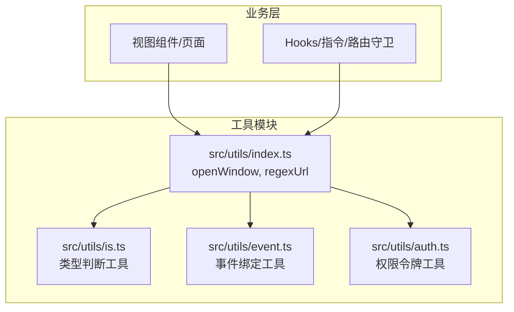
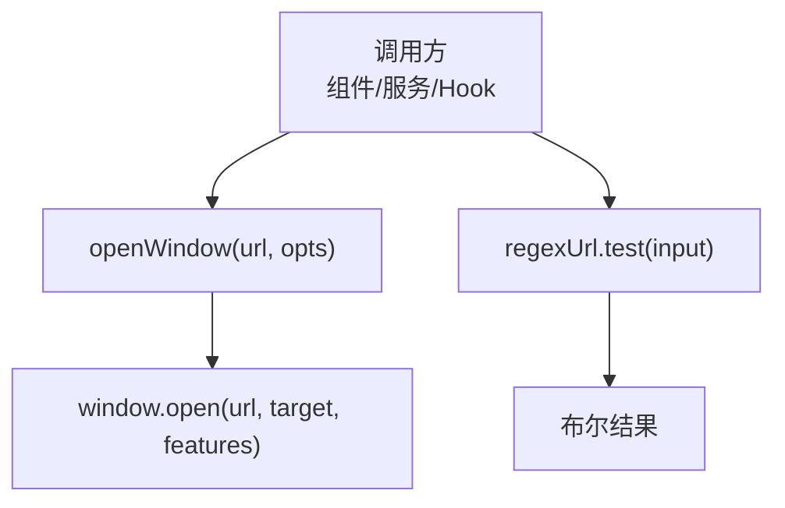
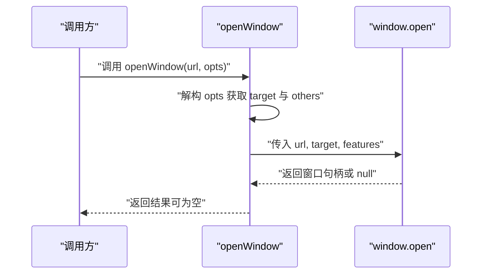
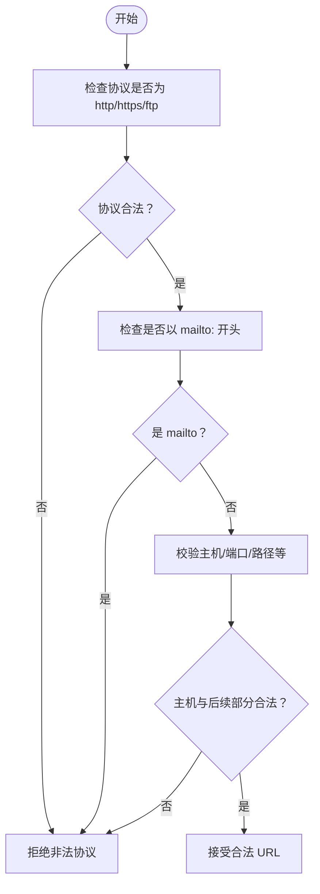
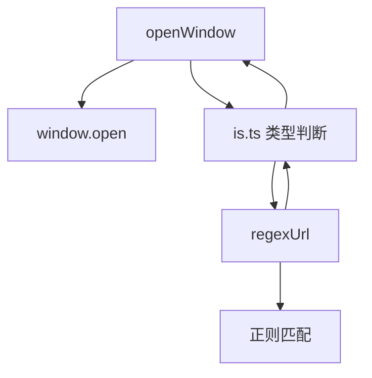

# 通用工具函数

<cite>
**本文引用的文件**
- [src/utils/index.ts](file://src/utils/index.ts)
- [src/utils/is.ts](file://src/utils/is.ts)
- [src/utils/event.ts](file://src/utils/event.ts)
- [src/utils/auth.ts](file://src/utils/auth.ts)
</cite>

## 目录
1. [简介](#简介)
2. [项目结构](#项目结构)
3. [核心组件](#核心组件)
4. [架构总览](#架构总览)
5. [详细组件分析](#详细组件分析)
6. [依赖分析](#依赖分析)
7. [性能考虑](#性能考虑)
8. [故障排查指南](#故障排查指南)
9. [结论](#结论)
10. [附录](#附录)

## 简介
本文件聚焦于项目中的通用工具函数，重点解析以下两个能力：
- openWindow：封装浏览器 window.open 的统一入口，支持目标上下文与扩展特性参数的灵活配置。
- regexUrl：用于校验 URL 格式（支持 http、https、ftp），并排除 mailto 链接。

同时，本文还提供使用方法、参数说明、返回值与异常处理建议、扩展方法与自定义工具开发指南，帮助开发者在不直接操作 DOM 或浏览器 API 的情况下，安全、一致地完成窗口打开与 URL 校验任务。

## 项目结构
通用工具函数集中位于 src/utils 目录下，采用按功能分层的方式组织：
- 工具函数入口：src/utils/index.ts
- 类型判断工具：src/utils/is.ts
- 事件绑定工具：src/utils/event.ts
- 权限令牌工具：src/utils/auth.ts

图表来源
- [src/utils/index.ts:1-26](file://src/utils/index.ts#L1-L26)
- [src/utils/is.ts:1-54](file://src/utils/is.ts#L1-L54)
- [src/utils/event.ts:1-28](file://src/utils/event.ts#L1-L28)
- [src/utils/auth.ts:1-20](file://src/utils/auth.ts#L1-L20)

章节来源
- [src/utils/index.ts:1-26](file://src/utils/index.ts#L1-L26)
- [src/utils/is.ts:1-54](file://src/utils/is.ts#L1-L54)
- [src/utils/event.ts:1-28](file://src/utils/event.ts#L1-L28)
- [src/utils/auth.ts:1-20](file://src/utils/auth.ts#L1-L20)

## 核心组件
- openWindow：统一的窗口打开入口，支持目标上下文与扩展参数透传。
- regexUrl：URL 格式校验正则，支持 http/https/ftp 协议，排除 mailto。

章节来源
- [src/utils/index.ts:3-18](file://src/utils/index.ts#L3-L18)
- [src/utils/index.ts:20-23](file://src/utils/index.ts#L20-L23)

## 架构总览
openWindow 作为对外暴露的工具函数，内部通过 window.open 打开新窗口；regexUrl 作为纯函数式校验器，供上层逻辑调用以保证输入合法性。二者均无副作用，便于测试与复用。

图表来源
- [src/utils/index.ts:3-18](file://src/utils/index.ts#L3-L18)
- [src/utils/index.ts:20-23](file://src/utils/index.ts#L20-L23)

## 详细组件分析

### openWindow 组件分析
openWindow 封装了 window.open 的调用，提供统一的参数结构与默认行为，便于在不同页面或组件中一致地打开外部链接或新窗口。

- 函数签名与参数
  - url: string，必填，要打开的地址。
  - opts?: { target?: TargetContext; [key: string]: any }，可选，包含：
    - target: 目标上下文，默认为 "_blank"（新窗口）。
    - 其他键值对将被转换为 window.open 的 features 字符串。

- 默认行为
  - 若未指定 target，则默认在新窗口打开。
  - 其余键值对将被拼接为逗号分隔的特性字符串传递给 window.open。

- 使用场景
  - 在按钮点击时打开外部链接。
  - 在弹窗或侧边栏中打开帮助文档。
  - 在列表项点击时打开详情页（根据 target 控制是否新开窗口）。

- 异常与边界处理
  - 浏览器弹窗拦截：若被拦截，window.open 可能返回 null。调用方应进行空值判断与降级提示。
  - URL 合法性：建议在调用前使用 regexUrl 进行预校验，避免无效 URL 导致的错误体验。
  - 特性参数：features 字符串由键值对拼接而成，需确保键名与值符合浏览器规范，否则可能导致部分特性不生效。

- 调用序列示意

图表来源
- [src/utils/index.ts:3-18](file://src/utils/index.ts#L3-L18)

章节来源
- [src/utils/index.ts:3-18](file://src/utils/index.ts#L3-L18)

### regexUrl 组件分析
regexUrl 是一个预编译的正则表达式，用于校验 URL 的基本格式合法性，支持 http、https、ftp 协议，并排除 mailto 链接。

- 匹配规则概览
  - 协议：必须以 http://、https:// 或 ftp:// 开头。
  - 用户名与密码：可选的 user:pass@。
  - 主机：支持 IPv4 地址段与域名（含国际化字符与连字符），或 localhost。
  - 端口：可选 :port（2-5 位数字）。
  - 路径/查询/片段：可选 /path、?query、#fragment。
  - 排除：禁止 mailto: 开头的邮箱链接。

- 应用场景
  - 表单输入校验：在提交前快速过滤明显非法的 URL。
  - 安全防护：避免注入恶意链接（如 javascript:）。
  - 业务逻辑前置：在打开窗口前先做格式校验，减少无效调用。

- 复杂度与性能
  - 正则为预编译对象，每次调用仅执行一次匹配，时间复杂度 O(n)，n 为输入长度。
  - 建议在高频校验场景中缓存结果或结合防抖策略。

- 匹配流程示意

图表来源
- [src/utils/index.ts:20-23](file://src/utils/index.ts#L20-L23)

章节来源
- [src/utils/index.ts:20-23](file://src/utils/index.ts#L20-L23)

### 相关工具函数与类型
- 类型判断工具（is.ts）
  - 提供数组、对象、字符串、数字、正则、文件、Blob、undefined、null、函数、空对象、存在性、Window 等类型判断辅助函数，可用于在调用 openWindow 前进行更细粒度的参数校验与分支处理。
- 事件绑定工具（event.ts）
  - 提供 addEventListen 与 removeEventListen，便于在组件生命周期内安全地添加/移除事件监听，避免内存泄漏。
- 权限令牌工具（auth.ts）
  - 提供登录状态、令牌获取/设置/清理等基础能力，可与 openWindow 结合用于控制外部资源访问权限。

章节来源
- [src/utils/is.ts:1-54](file://src/utils/is.ts#L1-L54)
- [src/utils/event.ts:1-28](file://src/utils/event.ts#L1-L28)
- [src/utils/auth.ts:1-20](file://src/utils/auth.ts#L1-L20)

## 依赖分析
- openWindow 依赖浏览器原生 window.open，其行为受浏览器弹窗策略影响。
- regexUrl 为纯函数式校验器，无外部依赖，但建议与 is.ts 的类型判断配合使用，提升健壮性。
- 事件绑定工具与权限工具为独立模块，可按需组合到业务逻辑中。

图表来源
- [src/utils/index.ts:3-18](file://src/utils/index.ts#L3-L18)
- [src/utils/index.ts:20-23](file://src/utils/index.ts#L20-L23)
- [src/utils/is.ts:1-54](file://src/utils/is.ts#L1-L54)

章节来源
- [src/utils/index.ts:3-18](file://src/utils/index.ts#L3-L18)
- [src/utils/index.ts:20-23](file://src/utils/index.ts#L20-L23)
- [src/utils/is.ts:1-54](file://src/utils/is.ts#L1-L54)

## 性能考虑
- 正则匹配：regexUrl 为预编译对象，重复使用不会产生额外编译成本；在高频校验场景中可结合缓存策略或防抖。
- window.open：频繁调用可能触发浏览器弹窗拦截机制，建议在用户明确交互后触发，或在调用前进行二次确认。
- 参数拼接：openWindow 对 opts 中的键值对进行字符串拼接，建议避免传入过多冗余特性，保持 features 精简。

## 故障排查指南
- 打不开新窗口
  - 检查浏览器弹窗拦截设置，必要时引导用户允许弹窗。
  - 确认 url 是否为有效字符串，避免传入空值或非字符串。
  - 使用 regexUrl.test 对输入进行预校验。
- URL 校验失败
  - 确认协议是否为 http/https/ftp，且不含 mailto。
  - 检查主机名、端口与路径是否符合规范。
- 事件监听无效
  - 使用 event.ts 的 addEventListen/removeEventListen 确保监听器正确注册与移除。
- 权限相关问题
  - 使用 auth.ts 的 isLogin/getToken/clearToken 等方法管理登录态与令牌，避免无权限访问外部资源。

章节来源
- [src/utils/index.ts:3-18](file://src/utils/index.ts#L3-L18)
- [src/utils/index.ts:20-23](file://src/utils/index.ts#L20-L23)
- [src/utils/event.ts:1-28](file://src/utils/event.ts#L1-L28)
- [src/utils/auth.ts:1-20](file://src/utils/auth.ts#L1-L20)

## 结论
openWindow 与 regexUrl 为项目提供了统一、简洁且可复用的窗口打开与 URL 校验能力。通过合理的参数设计与配套的类型判断、事件绑定、权限管理工具，可以在保证用户体验的同时提升安全性与可维护性。

## 附录
- 扩展方法与自定义工具开发建议
  - 基于 openWindow：可封装“带宽限制的下载窗口”“带回跳地址的登录窗口”等场景化函数。
  - 基于 regexUrl：可扩展为“多协议白名单校验器”，或结合 URL 解析库进行更精细的字段提取与校验。
  - 新增工具函数时，遵循单一职责原则，尽量保持纯函数风格，便于测试与复用。
  - 在组件中优先通过工具函数抽象底层 API，避免直接操作 window/document 等全局对象。