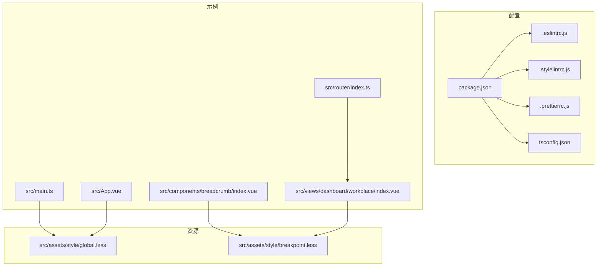
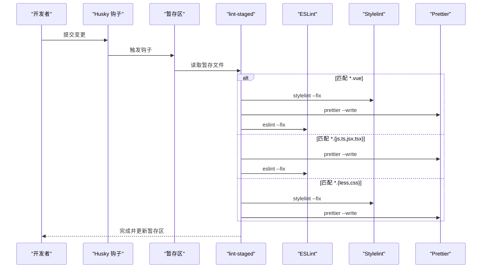
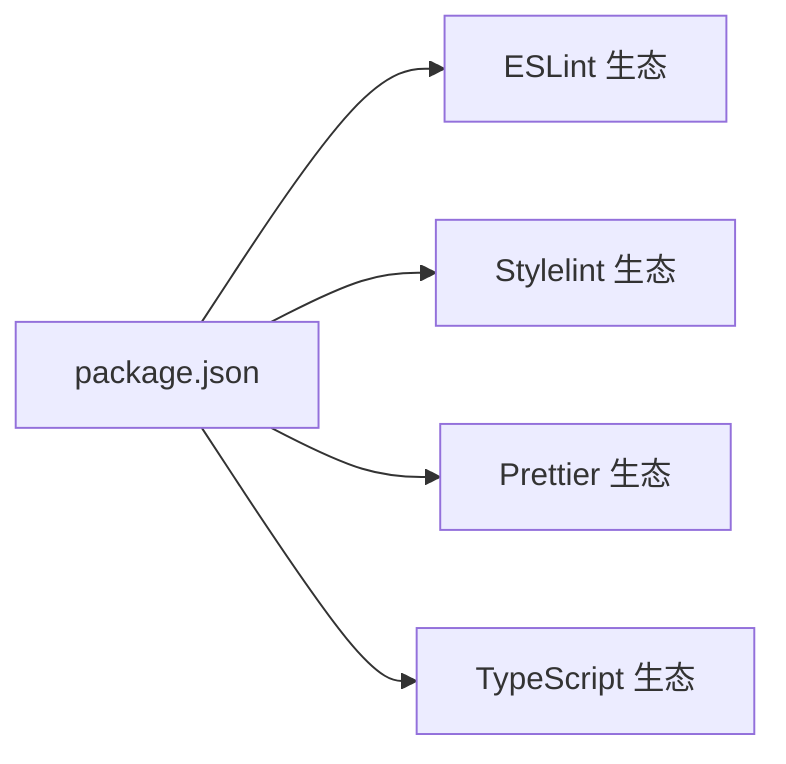

# 代码检查规则

<cite>
**本文引用的文件**
- [.eslintrc.js](file://.eslintrc.js)
- [.stylelintrc.js](file://.stylelintrc.js)
- [.prettierrc.js](file://.prettierrc.js)
- [tsconfig.json](file://tsconfig.json)
- [package.json](file://package.json)
- [src/main.ts](file://src/main.ts)
- [src/App.vue](file://src/App.vue)
- [src/router/index.ts](file://src/router/index.ts)
- [src/assets/style/global.less](file://src/assets/style/global.less)
- [src/assets/style/breakpoint.less](file://src/assets/style/breakpoint.less)
- [src/components/breadcrumb/index.vue](file://src/components/breadcrumb/index.vue)
- [src/views/dashboard/workplace/index.vue](file://src/views/dashboard/workplace/index.vue)
</cite>

## 目录
1. [简介](#简介)
2. [项目结构](#项目结构)
3. [核心组件](#核心组件)
4. [架构总览](#架构总览)
5. [详细组件分析](#详细组件分析)
6. [依赖分析](#依赖分析)
7. [性能考虑](#性能考虑)
8. [故障排查指南](#故障排查指南)
9. [结论](#结论)
10. [附录](#附录)

## 简介
本文件系统化梳理本项目的代码检查与风格规范，覆盖以下方面：
- Stylelint 样式检查配置与 CSS/Less 规范
- Vue 模板检查规则与最佳实践
- TypeScript 类型检查与导入路径检查
- 禁止使用的代码模式与推荐结构
- 常见违规示例与修复建议
- 如何添加自定义检查规则

本项目采用统一的代码格式化工具 Prettier，并通过 ESLint、Stylelint 在提交前进行静态检查，确保团队协作的一致性与可维护性。

## 项目结构
围绕“代码检查”主题，项目中与之直接相关的配置与示例文件如下：
- 配置层：ESLint、Stylelint、Prettier、TypeScript 编译器配置
- 资源层：全局 Less 样式与断点变量
- 示例层：Vue 单文件组件（含模板、脚本、样式）与入口文件

图表来源
- [.eslintrc.js](file://.eslintrc.js)
- [.stylelintrc.js](file://.stylelintrc.js)
- [.prettierrc.js](file://.prettierrc.js)
- [tsconfig.json](file://tsconfig.json)
- [package.json](file://package.json)
- [src/main.ts](file://src/main.ts)
- [src/App.vue](file://src/App.vue)
- [src/router/index.ts](file://src/router/index.ts)
- [src/assets/style/global.less](file://src/assets/style/global.less)
- [src/assets/style/breakpoint.less](file://src/assets/style/breakpoint.less)
- [src/components/breadcrumb/index.vue](file://src/components/breadcrumb/index.vue)
- [src/views/dashboard/workplace/index.vue](file://src/views/dashboard/workplace/index.vue)

章节来源
- [.eslintrc.js](file://.eslintrc.js)
- [.stylelintrc.js](file://.stylelintrc.js)
- [.prettierrc.js](file://.prettierrc.js)
- [tsconfig.json](file://tsconfig.json)
- [package.json](file://package.json)

## 核心组件
- ESLint 配置：基于 Airbnb 风格、TypeScript 推荐规则、导入插件、Vue 3 推荐规则以及 Prettier 集成，结合项目 tsconfig 的导入解析，形成统一的 JS/TS/Vue 检查体系。
- Stylelint 配置：基于 Standard、Rational Order、Prettier 与 Vue 推荐配置，强调属性顺序、空行规范与伪类忽略策略。
- Prettier 配置：统一缩进宽度、分号、单引号、HTML 空白敏感度与 Vue 脚本/样式缩进。
- TypeScript 编译配置：启用严格模式、模块解析、路径别名等，保证类型检查与导入路径一致性。

章节来源
- [.eslintrc.js](file://.eslintrc.js)
- [.stylelintrc.js](file://.stylelintrc.js)
- [.prettierrc.js](file://.prettierrc.js)
- [tsconfig.json](file://tsconfig.json)

## 架构总览
下图展示“提交前检查流水线”的整体流程，包括对 JS/TS、Vue 文件与 CSS/Less 的处理：

图表来源
- [package.json](file://package.json)

章节来源
- [package.json](file://package.json)

## 详细组件分析

### ESLint 规则与最佳实践
- 解析器与环境
  - 使用 vue-eslint-parser 作为顶层解析器，内部使用 @typescript-eslint/parser 处理 <script> 内容；启用浏览器、Node 与 Vue 编译宏环境。
- 扩展规则集
  - Airbnb 基础风格、TypeScript 推荐规则、导入插件推荐与 TypeScript 支持、Vue 3 推荐规则、Prettier 集成。
- 导入路径检查
  - 通过 eslint-import-resolver-typescript 读取 tsconfig.json 的路径映射，实现基于 baseUrl 与 paths 的导入解析。
- 关键规则说明
  - Vue 模板相关：关闭默认 prop 校验、单行元素换行、每行最大属性数；新增自定义事件命名驼峰、禁用 v-text、块间空行、强制直接导出等。
  - TypeScript 相关：允许 @ts-ignore 注释；未使用变量、空函数、显式 any 等规则按需开启；禁用 debugger。
  - 导入扩展名：统一要求不带扩展名（ignorePackages）。
- 与 Prettier 的协同
  - 启用 prettier/prettier 规则，避免格式冲突。

常见违规与修复建议
- 违规：在 Vue 组件中使用 v-text
  - 修复：改用插值表达式或合理的内容渲染方式
  - 参考路径：[src/components/breadcrumb/index.vue](file://src/components/breadcrumb/index.vue)
- 违规：未使用变量或空函数
  - 修复：删除未使用变量或实现逻辑
  - 参考路径：[.eslintrc.js](file://.eslintrc.js)
- 违规：导入时包含扩展名
  - 修复：移除 .ts/.js 扩展名，保持与 tsconfig 的解析一致
  - 参考路径：[tsconfig.json](file://tsconfig.json)

章节来源
- [.eslintrc.js](file://.eslintrc.js)
- [tsconfig.json](file://tsconfig.json)

### Stylelint 规则与 CSS/Less 规范
- 扩展规则集
  - Standard、Rational Order、Prettier、Vue 推荐配置。
- 默认严重级别
  - 默认 warning，便于在 CI 中提示但不阻断流程。
- 关键规则说明
  - at-rule-no-unknown：忽略特定 At-Rule（如插件指令），避免误报。
  - rule-empty-line-before：控制规则前空行，排除单行注释与首个嵌套规则。
  - selector-pseudo-class-no-unknown：忽略 deep 伪类，适配 Vue 深度作用选择器。
- 与 Prettier 的协同
  - 通过 stylelint-config-prettier 关闭与 Prettier 冲突的规则。

常见违规与修复建议
- 违规：使用未知 At-Rule 或未遵循属性顺序
  - 修复：遵循 Standard 与 Rational Order 规则，必要时在注释中说明
  - 参考路径：[.stylelintrc.js](file://.stylelintrc.js)
- 违规：未在规则前添加空行
  - 修复：根据 rule-empty-line-before 规则添加空行
  - 参考路径：[.stylelintrc.js](file://.stylelintrc.js)

章节来源
- [.stylelintrc.js](file://.stylelintrc.js)

### Prettier 规则与统一格式
- 缩进与排版
  - tabWidth=2、semi=true、printWidth=80、singleQuote=true、quoteProps='consistent'
- HTML 与 Vue
  - htmlWhitespaceSensitivity='strict'、vueIndentScriptAndStyle=true
- 与 ESLint/Stylelint 的集成
  - 通过插件关闭冲突规则，确保三者协同工作

常见违规与修复建议
- 违规：超出 printWidth 或未使用单引号
  - 修复：运行 prettier --write 自动修复
  - 参考路径：[.prettierrc.js](file://.prettierrc.js)

章节来源
- [.prettierrc.js](file://.prettierrc.js)

### TypeScript 类型检查与导入路径
- 严格模式与模块解析
  - strict=true、moduleResolution=node、baseUrl=.
- 路径别名
  - @/* 映射到 src/*，提升导入可读性与稳定性
- 类型检查命令
  - 通过 vue-tsc 进行类型检查，配合 skipLibCheck 与 noEmit

常见违规与修复建议
- 违规：使用相对路径而非别名
  - 修复：改为 @/ 前缀，保持与 tsconfig 一致
  - 参考路径：[tsconfig.json](file://tsconfig.json)
- 违规：未声明类型导致 any
  - 修复：补充类型定义或使用更精确的类型
  - 参考路径：[.eslintrc.js](file://.eslintrc.js)

章节来源
- [tsconfig.json](file://tsconfig.json)
- [.eslintrc.js](file://.eslintrc.js)

### Vue 模板检查规则与示例
- 模板规则
  - 自定义事件命名驼峰、禁用 v-text、块间空行、强制直接导出等
- 示例参考
  - 全局样式引入与组件使用：[src/main.ts](file://src/main.ts)
  - 路由与视图：[src/router/index.ts](file://src/router/index.ts)
  - 组件模板与样式：[src/components/breadcrumb/index.vue](file://src/components/breadcrumb/index.vue)
  - 复杂布局与响应式样式：[src/views/dashboard/workplace/index.vue](file://src/views/dashboard/workplace/index.vue)

常见违规与修复建议
- 违规：模板中使用 v-text
  - 修复：改用插值表达式
  - 参考路径：[src/components/breadcrumb/index.vue](file://src/components/breadcrumb/index.vue)
- 违规：自定义事件未使用驼峰命名
  - 修复：统一为 camelCase
  - 参考路径：[.eslintrc.js](file://.eslintrc.js)

章节来源
- [.eslintrc.js](file://.eslintrc.js)
- [src/main.ts](file://src/main.ts)
- [src/router/index.ts](file://src/router/index.ts)
- [src/components/breadcrumb/index.vue](file://src/components/breadcrumb/index.vue)
- [src/views/dashboard/workplace/index.vue](file://src/views/dashboard/workplace/index.vue)

### 样式文件组织与 Less 规范
- 全局样式
  - reset 与通用变量、卡片、表格等通用类
  - 参考路径：[src/assets/style/global.less](file://src/assets/style/global.less)
- 断点变量
  - 定义常用断点，供响应式布局使用
  - 参考路径：[src/assets/style/breakpoint.less](file://src/assets/style/breakpoint.less)
- 组件级样式
  - 使用 scoped 与 :deep 选择器，避免样式泄漏
  - 参考路径：[src/components/breadcrumb/index.vue](file://src/components/breadcrumb/index.vue)
- 响应式组织
  - 将移动端样式置于独立块内，便于维护
  - 参考路径：[src/views/dashboard/workplace/index.vue](file://src/views/dashboard/workplace/index.vue)

常见违规与修复建议
- 违规：未使用 :deep 或作用域不当
  - 修复：明确使用 :deep 以穿透组件样式
  - 参考路径：[src/views/dashboard/workplace/index.vue](file://src/views/dashboard/workplace/index.vue)
- 违规：断点常量未集中管理
  - 修复：统一从 breakpoint.less 引入
  - 参考路径：[src/assets/style/breakpoint.less](file://src/assets/style/breakpoint.less)

章节来源
- [src/assets/style/global.less](file://src/assets/style/global.less)
- [src/assets/style/breakpoint.less](file://src/assets/style/breakpoint.less)
- [src/components/breadcrumb/index.vue](file://src/components/breadcrumb/index.vue)
- [src/views/dashboard/workplace/index.vue](file://src/views/dashboard/workplace/index.vue)

## 依赖分析
- 工具链依赖
  - ESLint 生态：eslint、eslint-config-airbnb-base、eslint-plugin-import、eslint-plugin-vue、@typescript-eslint/eslint-plugin、@typescript-eslint/parser
  - Stylelint 生态：stylelint、stylelint-config-standard、stylelint-config-rational-order、stylelint-config-prettier、stylelint-config-recommended-vue、stylelint-order
  - Prettier 生态：prettier
  - TypeScript：typescript、vue-tsc
- 项目脚本与提交流程
  - lint-staged 配置按文件类型分别执行 stylelint、prettier、eslint
  - husky 安装钩子，确保提交前自动检查

图表来源
- [package.json](file://package.json)

章节来源
- [package.json](file://package.json)

## 性能考虑
- 提交前检查的性能优化建议
  - 使用 lint-staged 仅检查暂存文件，减少全量扫描开销
  - 合理配置 ignorePatterns，避免不必要的文件参与检查
  - 在 CI 中缓存依赖与构建产物，缩短重复检查时间
- 样式检查
  - 将全局样式与组件样式分离，避免 Stylelint 对大体积样式文件的过度扫描

## 故障排查指南
- 提交被阻断
  - 检查 lint-staged 输出，确认具体文件与规则名称
  - 参考路径：[package.json](file://package.json)
- ESLint 报错与 TypeScript 不一致
  - 确认 tsconfig.json 的 baseUrl 与 paths 设置是否正确
  - 参考路径：[tsconfig.json](file://tsconfig.json)
- Stylelint 与 Prettier 冲突
  - 确保已启用 stylelint-config-prettier
  - 参考路径：[.stylelintrc.js](file://.stylelintrc.js)
- Vue 模板规则误报
  - 检查自定义规则配置（如自定义事件命名、v-text 禁用）
  - 参考路径：[.eslintrc.js](file://.eslintrc.js)

章节来源
- [package.json](file://package.json)
- [tsconfig.json](file://tsconfig.json)
- [.stylelintrc.js](file://.stylelintrc.js)
- [.eslintrc.js](file://.eslintrc.js)

## 结论
本项目通过 ESLint、Stylelint 与 Prettier 的组合，实现了对 JS/TS、Vue 与 CSS/Less 的统一检查与格式化。配合 tsconfig 的路径别名与 lint-staged 的提交前拦截，有效提升了代码质量与团队协作效率。建议在新增功能时同步完善类型定义与样式组织，保持与现有规则一致。

## 附录

### 如何添加自定义检查规则
- ESLint
  - 在 .eslintrc.js 的 rules 字段中添加新规则
  - 若需要新的解析器或插件，请在 devDependencies 中安装并在 plugins 与 extends 中启用
  - 参考路径：[.eslintrc.js](file://.eslintrc.js)
- Stylelint
  - 在 .stylelintrc.js 的 rules 字段中添加新规则
  - 若需要新插件，请在 devDependencies 中安装并在 plugins 中启用
  - 参考路径：[.stylelintrc.js](file://.stylelintrc.js)
- Prettier
  - 在 .prettierrc.js 中调整格式化参数
  - 参考路径：[.prettierrc.js](file://.prettierrc.js)