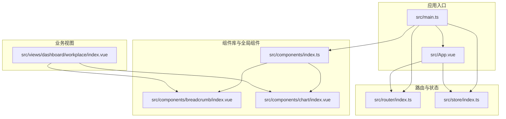
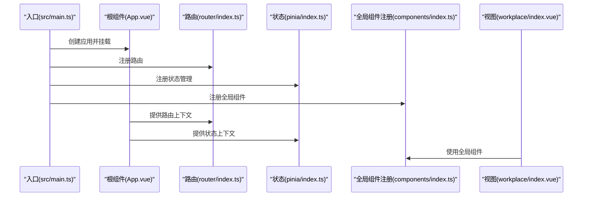
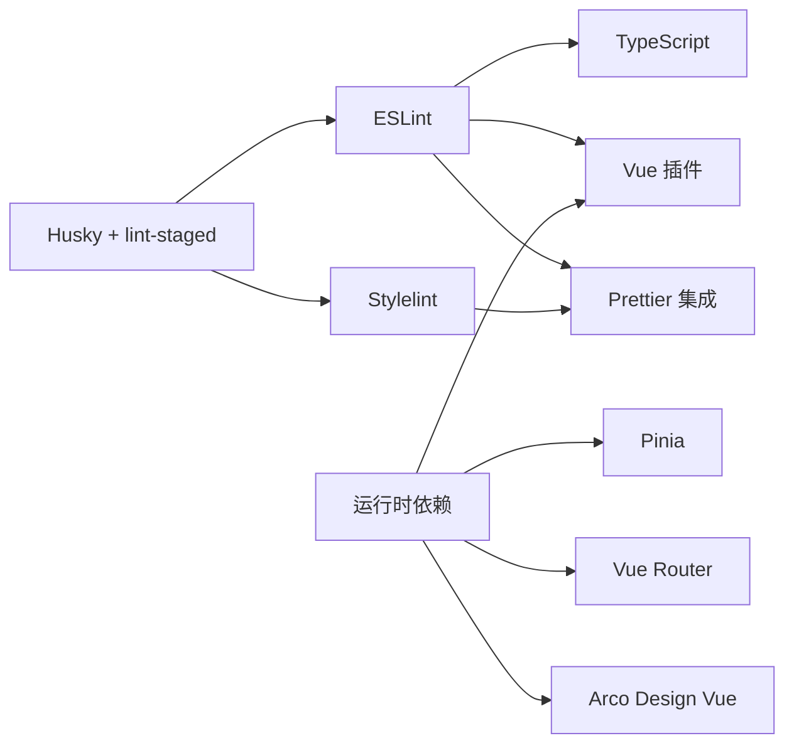

# 代码风格规范

<cite>
**本文引用的文件**
- [.eslintrc.js](file://.eslintrc.js)
- [.prettierrc.js](file://.prettierrc.js)
- [.stylelintrc.js](file://.stylelintrc.js)
- [tsconfig.json](file://tsconfig.json)
- [package.json](file://package.json)
- [src/main.ts](file://src/main.ts)
- [src/App.vue](file://src/App.vue)
- [src/components/index.ts](file://src/components/index.ts)
- [src/utils/index.ts](file://src/utils/index.ts)
- [src/hooks/user.ts](file://src/hooks/user.ts)
- [src/components/breadcrumb/index.vue](file://src/components/breadcrumb/index.vue)
- [src/components/chart/index.vue](file://src/components/chart/index.vue)
- [src/views/dashboard/workplace/index.vue](file://src/views/dashboard/workplace/index.vue)
- [src/router/index.ts](file://src/router/index.ts)
- [src/store/index.ts](file://src/store/index.ts)
</cite>

## 目录
1. [引言](#引言)
2. [项目结构](#项目结构)
3. [核心组件](#核心组件)
4. [架构总览](#架构总览)
5. [详细组件分析](#详细组件分析)
6. [依赖分析](#依赖分析)
7. [性能考虑](#性能考虑)
8. [故障排查指南](#故障排查指南)
9. [结论](#结论)
10. [附录](#附录)

## 引言
本指南面向本项目的前端工程团队，系统化阐述代码风格规范，覆盖以下方面：
- ESLint 配置与规则：基于 Airbnb JavaScript 风格指南、TypeScript 推荐规则、Vue 3 推荐规则以及 Prettier 集成。
- TypeScript 编码规范：类型约束、模块路径别名、严格模式与编译选项。
- Vue 组件开发规范：单文件组件结构、setup 语法、props 定义、样式作用域与响应式数据处理。
- 导入导出与模块组织：统一的导入扩展名策略、全局组件注册、工具函数与 Hook 的组织方式。
- 变量命名约定、函数定义规范、组件结构要求与导入导出规则。
- 规则适用场景与例外情况说明，并结合仓库中真实文件进行“正确/错误”对比。

## 项目结构
本项目采用基于功能域的分层组织，TypeScript 与 Vue 单文件组件混合开发，配合 Vite 构建与 Pinia/Pinia 状态管理。整体风格强调：
- 类型安全优先（严格模式）
- 统一的代码格式（Prettier）
- 良好的可维护性（模块化、清晰的组件边界）

图表来源
- [src/main.ts:1-29](file://src/main.ts#L1-L29)
- [src/App.vue:1-27](file://src/App.vue#L1-L27)
- [src/router/index.ts:1-38](file://src/router/index.ts#L1-L38)
- [src/store/index.ts:1-10](file://src/store/index.ts#L1-L10)
- [src/components/index.ts:1-36](file://src/components/index.ts#L1-L36)
- [src/components/breadcrumb/index.vue:1-36](file://src/components/breadcrumb/index.vue#L1-L36)
- [src/components/chart/index.vue:1-48](file://src/components/chart/index.vue#L1-L48)
- [src/views/dashboard/workplace/index.vue:1-149](file://src/views/dashboard/workplace/index.vue#L1-L149)

章节来源
- [src/main.ts:1-29](file://src/main.ts#L1-L29)
- [src/App.vue:1-27](file://src/App.vue#L1-L27)
- [src/router/index.ts:1-38](file://src/router/index.ts#L1-L38)
- [src/store/index.ts:1-10](file://src/store/index.ts#L1-L10)
- [src/components/index.ts:1-36](file://src/components/index.ts#L1-L36)

## 核心组件
- ESLint 配置：启用 airbnb-base、@typescript-eslint/recommended、import、vue3-recommended 与 prettier/recommended；设置 TypeScript 解析器与解析器路径；在生产环境禁用 debugger；允许 @ts-ignore 注释；对未使用变量、空函数等进行告警或报错控制。
- Prettier 配置：统一缩进宽度、分号、行宽、单引号、属性引号策略与 Vue 脚本/样式缩进。
- Stylelint 配置：基于标准、顺序与 Vue 推荐配置，支持 Prettier 集成，忽略特定伪类与 at-rule。
- TypeScript 编译配置：严格模式、ES2020 目标、模块解析、路径别名、JSX 保留、库声明等。

章节来源
- [.eslintrc.js:1-71](file://.eslintrc.js#L1-L71)
- [.prettierrc.js:1-10](file://.prettierrc.js#L1-L10)
- [.stylelintrc.js:1-31](file://.stylelintrc.js#L1-L31)
- [tsconfig.json:1-21](file://tsconfig.json#L1-L21)

## 架构总览
下图展示了从入口到组件与工具函数的整体调用关系，体现“入口注册—全局组件—视图组件—子组件”的层次化结构。

图表来源
- [src/main.ts:1-29](file://src/main.ts#L1-L29)
- [src/App.vue:1-27](file://src/App.vue#L1-L27)
- [src/router/index.ts:1-38](file://src/router/index.ts#L1-L38)
- [src/store/index.ts:1-10](file://src/store/index.ts#L1-L10)
- [src/components/index.ts:1-36](file://src/components/index.ts#L1-L36)
- [src/views/dashboard/workplace/index.vue:1-149](file://src/views/dashboard/workplace/index.vue#L1-L149)

## 详细组件分析

### ESLint 配置与规则详解
- 解析器与环境
  - 使用 vue-eslint-parser 作为顶层解析器，内部 @typescript-eslint/parser 处理 <script> 区块；启用浏览器、Node 与 Vue 编译器宏环境。
- 扩展规则集
  - Airbnb JavaScript 风格指南（airbnb-base）
  - TypeScript 推荐规则（@typescript-eslint/recommended）
  - 导入规则（import/recommended、import/typescript）
  - Vue 3 推荐规则（plugin:vue/vue3-recommended）
  - Prettier 集成（plugin:prettier/recommended）
- 设置与解析器
  - import/resolver/typescript 指向 tsconfig.json，确保路径别名与模块解析一致。
- 关键规则
  - Vue 相关：关闭默认 prop 要求、单行元素换行、每行最大属性数；开启自定义事件命名驼峰、禁止 v-text、块间空行、强制直接导出、多词组件名关闭。
  - TypeScript 相关：允许 @ts-ignore；对未使用变量、空函数进行告警；any 使用默认放行；严格控制导入扩展名（js/jsx/ts/tsx 不允许后缀）。
  - 其他：生产环境禁用 debugger；参数重赋值、正则字面量相关规则按需放宽；外部依赖引入放宽。
- 适用场景与例外
  - 在生产构建中禁用 debugger，避免调试语句进入产物。
  - 允许 @ts-ignore 用于临时绕过类型检查，但应配合注释说明原因并在短期内修复。
  - 导入扩展名统一由规则控制，减少不一致导致的解析问题。

章节来源
- [.eslintrc.js:1-71](file://.eslintrc.js#L1-L71)

### Prettier 配置与格式化
- 缩进与排版：固定 2 空格缩进、分号存在、行宽 80、单引号、属性引号策略一致。
- Vue 支持：脚本与样式区域跟随缩进，提升可读性。
- 与 ESLint 集成：通过 eslint-plugin-prettier 与 eslint-config-prettier，避免冲突并统一格式。

章节来源
- [.prettierrc.js:1-10](file://.prettierrc.js#L1-L10)
- [.eslintrc.js:29](file://.eslintrc.js#L29)

### Stylelint 配置与样式规范
- 基础与顺序：基于 stylelint-config-standard 与 rational-order，保证属性书写顺序与可读性。
- Vue 支持：集成 stylelint-config-recommended-vue，适配 Vue 单文件组件样式。
- Prettier 集成：使用 stylelint-config-prettier 避免格式化冲突。
- 特殊规则：忽略 deep 伪类与特定 at-rule，满足框架与工具链兼容性。

章节来源
- [.stylelintrc.js:1-31](file://.stylelintrc.js#L1-L31)

### TypeScript 编码规范
- 严格模式与目标：严格模式开启，目标 ES2020，模块 ES2020，模块解析 node。
- 路径别名：通过 baseUrl 与 paths 将 @/ 映射到 src/，便于跨层级引用。
- JSX 与库：保留 JSX，声明 DOM 与 ES2020 库，跳过第三方库检查以提升构建速度。
- 适用场景
  - 在大型项目中，严格模式与明确的目标版本有助于静态分析与打包优化。
  - 路径别名统一了相对路径的复杂度，降低维护成本。

章节来源
- [tsconfig.json:1-21](file://tsconfig.json#L1-L21)

### Vue 组件开发规范
- 单文件组件结构
  - 模板区：语义化标签与可访问性属性优先；条件渲染与循环遵循最小必要原则。
  - 脚本区：优先使用 <script lang="ts" setup> 进行组合式 API；必要时保留普通 <script> 用于组件元信息（如 name）。
  - 样式区：scoped 作用域隔离；合理使用 :deep 以支持第三方组件样式穿透。
- Props 定义
  - 使用 defineProps 并显式声明类型与默认值；数组/对象默认值使用工厂函数返回新实例。
- 响应式与生命周期
  - 使用 ref/nextTick 控制渲染时机；computed/computed 组合式 API 管理派生状态。
- 组件命名与导出
  - 组件名称建议使用多词驼峰，保持一致性；导出使用直接导出（require-direct-export）。
- 适用场景与例外
  - 在需要 keep-alive 生效时，必须为组件提供 name 字段。
  - 自定义事件命名采用驼峰，避免连字符导致的解析歧义。

章节来源
- [src/components/breadcrumb/index.vue:1-36](file://src/components/breadcrumb/index.vue#L1-L36)
- [src/components/chart/index.vue:1-48](file://src/components/chart/index.vue#L1-L48)
- [src/views/dashboard/workplace/index.vue:44-61](file://src/views/dashboard/workplace/index.vue#L44-L61)

### 导入导出与模块组织
- 入口与全局注册
  - 入口文件集中注册路由、状态、指令与全局组件，保证运行时上下文完整。
  - 全局组件通过统一安装器批量注册，减少重复导入。
- 工具函数与 Hook
  - 工具函数以命名导出为主，便于按需引入；默认导出用于聚合导出。
  - Hook 将业务逻辑封装为可复用单元，减少模板重复。
- 导入扩展名
  - 通过 ESLint 的 import/extensions 规则统一扩展名策略，避免混用导致解析失败。

章节来源
- [src/main.ts:1-29](file://src/main.ts#L1-L29)
- [src/components/index.ts:1-36](file://src/components/index.ts#L1-L36)
- [src/utils/index.ts:1-26](file://src/utils/index.ts#L1-L26)
- [src/hooks/user.ts:1-25](file://src/hooks/user.ts#L1-L25)
- [.eslintrc.js:55-64](file://.eslintrc.js#L55-L64)

### 变量命名约定
- 变量与常量：使用小驼峰命名；布尔值以 is/has/can 前缀增强可读性。
- 函数与方法：动词短语命名，表达意图；纯函数与副作用函数区分明显。
- 组件与模块：多词驼峰；模块文件夹与 index.vue 对齐，保持目录与组件名一致。
- 类型与接口：使用大驼峰；泛型参数使用单字母或简短语义化名称。
- 适用场景
  - 在大型团队协作中，统一的命名约定显著降低理解成本。
  - 与 ESLint 的命名规则配合，自动检测并提示不合规命名。

章节来源
- [.eslintrc.js:45](file://.eslintrc.js#L45)
- [src/hooks/user.ts:6-24](file://src/hooks/user.ts#L6-L24)

### 函数定义规范
- 组合式 API：优先使用 <script setup> 与 defineProps/defineEmits；复杂逻辑拆分为多个函数，保持单一职责。
- 异步函数：明确返回 Promise；错误处理使用 try/catch 或 .catch；避免在无错误处理的情况下使用 await。
- 参数与返回值：尽量使用类型约束；默认参数使用工厂函数；避免修改传入对象。
- 适用场景
  - 在视图组件中，将交互逻辑抽离为独立函数，提升可测试性与可维护性。

章节来源
- [src/components/chart/index.vue:10-45](file://src/components/chart/index.vue#L10-L45)
- [src/utils/index.ts:3-18](file://src/utils/index.ts#L3-L18)

### 组件结构要求
- 结构三段式：模板、脚本、样式清晰分离；脚本内仅包含逻辑与声明，避免模板污染。
- 作用域与样式：优先使用 scoped；必要时使用 :deep 选择器；避免全局样式污染。
- 可访问性：为交互元素提供语义化标签与 aria 属性；图片与图标提供替代文本。
- 适用场景
  - 在工作台视图中，通过网格布局与响应式断点实现自适应；样式分层与作用域隔离确保稳定性。

章节来源
- [src/views/dashboard/workplace/index.vue:1-149](file://src/views/dashboard/workplace/index.vue#L1-L149)
- [src/components/breadcrumb/index.vue:25-35](file://src/components/breadcrumb/index.vue#L25-L35)

### 导入导出规则
- 路径别名：统一使用 @/ 前缀，映射至 src/；避免深层相对路径。
- 扩展名：遵循 ESLint 的 import/extensions 规则，不添加 .ts/.js 后缀。
- 默认导出与命名导出：模块聚合使用默认导出；具体能力使用命名导出，便于 tree-shaking。
- 适用场景
  - 在入口文件中集中注册全局组件，减少分散导入带来的维护成本。

章节来源
- [tsconfig.json:12-14](file://tsconfig.json#L12-L14)
- [.eslintrc.js:55-64](file://.eslintrc.js#L55-L64)
- [src/main.ts:4](file://src/main.ts#L4)
- [src/components/index.ts:30-35](file://src/components/index.ts#L30-L35)

### 规则适用场景与例外
- 生产环境禁用 debugger：避免调试代码进入构建产物，影响性能与安全性。
- 允许 @ts-ignore：在短期无法修复的类型问题上临时放宽，但需配合注释说明与计划修复时间。
- 多词组件名关闭：若团队已有统一命名习惯，可按需调整；否则建议保持开启以提升一致性。
- 导入扩展名统一：避免混用 .ts/.js 导致解析失败，提升 IDE 与构建工具的可靠性。

章节来源
- [.eslintrc.js:49](file://.eslintrc.js#L49)
- [.eslintrc.js:50](file://.eslintrc.js#L50)
- [.eslintrc.js:65](file://.eslintrc.js#L65)
- [.eslintrc.js:55-64](file://.eslintrc.js#L55-L64)

## 依赖分析
- 开发工具链
  - ESLint + TypeScript + Vue 插件：提供静态检查与类型安全。
  - Prettier：统一格式化，减少分歧。
  - Stylelint：保障样式一致性与可维护性。
  - Husky + lint-staged：在提交前自动格式化与修复，保证主干质量。
- 运行时依赖
  - Vue 3、Pinia、Vue Router、Arco Design Vue 等：构成前端核心生态。
- 适用场景
  - 在 CI/CD 中集成 lint-staged，确保每次提交均符合规范。

图表来源
- [package.json:8-31](file://package.json#L8-L31)
- [package.json:49-92](file://package.json#L49-L92)

章节来源
- [package.json:8-31](file://package.json#L8-L31)
- [package.json:49-92](file://package.json#L49-L92)

## 性能考虑
- 构建阶段
  - 使用 vue-tsc 进行类型检查，避免运行时类型错误；生产构建禁用 debugger，减少冗余代码。
- 运行时
  - 合理使用 nextTick 控制渲染时机，避免不必要的重绘；组件样式作用域隔离，减少样式冲突。
- 依赖管理
  - 通过路径别名与模块解析优化，减少包体积与解析开销；按需引入第三方模块，降低首屏加载时间。

## 故障排查指南
- ESLint 报错
  - 导入扩展名错误：检查 import/extensions 规则与实际文件扩展名是否一致。
  - 未使用变量/空函数：根据规则级别进行删除或实现；如确需保留，评估是否属于临时占位。
  - Vue 组件命名：若使用 keep-alive，确保组件提供 name 字段。
- Prettier 冲突
  - 确保已安装 eslint-config-prettier 与 eslint-plugin-prettier，并在 ESLint 扩展中启用 prettier/recommended。
- Stylelint 报错
  - 检查是否误用了未支持的伪类或 at-rule；必要时在规则中添加忽略项。
- 路径解析失败
  - 确认 tsconfig.json 中 baseUrl 与 paths 配置正确；统一使用 @/ 前缀。

章节来源
- [.eslintrc.js:55-64](file://.eslintrc.js#L55-L64)
- [.prettierrc.js:1-10](file://.prettierrc.js#L1-L10)
- [.stylelintrc.js:10-29](file://.stylelintrc.js#L10-L29)
- [tsconfig.json:12-14](file://tsconfig.json#L12-L14)

## 结论
本项目的代码风格规范以 Airbnb、TypeScript 推荐与 Vue 3 推荐规则为基础，结合 Prettier 与 Stylelint 实现端到端的格式与样式统一。通过严格的 tsconfig 配置、统一的导入导出策略与组件结构约定，提升了代码的一致性与可维护性。建议团队在日常开发中：
- 严格遵守 ESLint/Stylelint 规则，提交前执行 lint-staged。
- 在组件开发中坚持组合式 API 与作用域样式，保持结构清晰。
- 使用路径别名与统一扩展名策略，减少解析与维护成本。
- 对于例外规则，务必记录原因与修复计划，避免长期放宽。

## 附录
- 规则对照表（节选）
  - Vue 自定义事件命名：驼峰
  - 禁止 v-text：警告
  - 块间空行：警告
  - 强制直接导出：警告
  - 多词组件名：关闭
  - 允许 @ts-ignore：关闭
  - 未使用变量：警告
  - 空函数：警告
  - any 使用：默认放行
  - 导入扩展名：严格控制
  - 生产环境禁用 debugger：启用

章节来源
- [.eslintrc.js:38-69](file://.eslintrc.js#L38-L69)