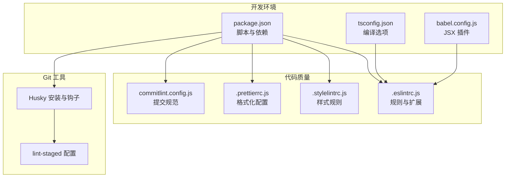
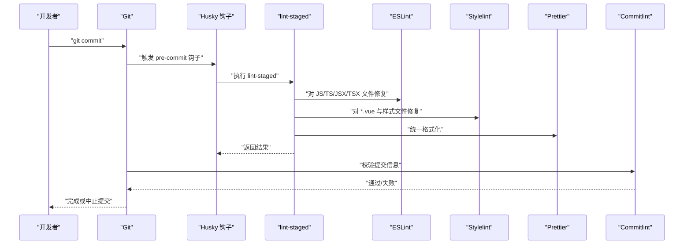
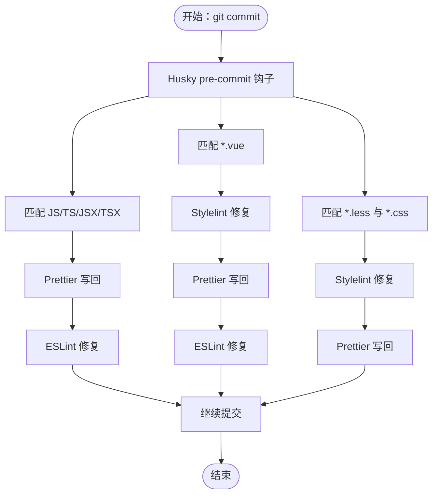
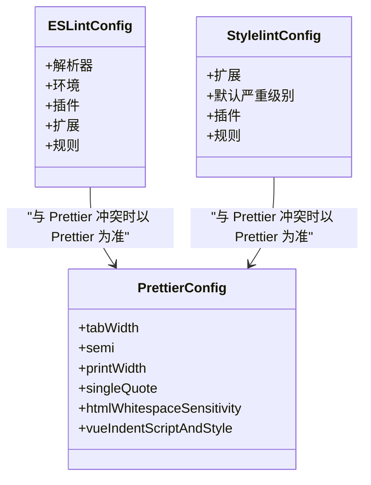
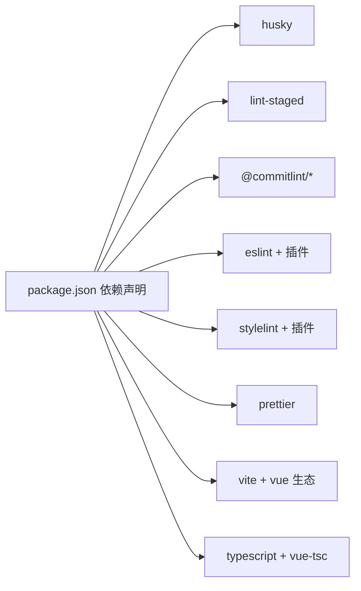

# 开发工作流程

<cite>
**本文引用的文件**
- [package.json](file://package.json)
- [commitlint.config.js](file://commitlint.config.js)
- [.eslintrc.js](file://.eslintrc.js)
- [.prettierrc.js](file://.prettierrc.js)
- [.stylelintrc.js](file://.stylelintrc.js)
- [.husky/.gitignore](file://.husky/.gitignore)
- [.gitignore](file://.gitignore)
- [.eslintignore](file://.eslintignore)
- [.prettierignore](file://.prettierignore)
- [tsconfig.json](file://tsconfig.json)
- [babel.config.js](file://babel.config.js)
</cite>

## 目录
1. [简介](#简介)
2. [项目结构](#项目结构)
3. [核心组件](#核心组件)
4. [架构总览](#架构总览)
5. [详细组件分析](#详细组件分析)
6. [依赖分析](#依赖分析)
7. [性能考虑](#性能考虑)
8. [故障排查指南](#故障排查指南)
9. [结论](#结论)
10. [附录](#附录)

## 简介
本指南面向前端开发团队，围绕本项目的开发工作流程展开，重点覆盖以下方面：
- Git 钩子与提交前检查：基于 Husky 和 lint-staged 的本地钩子配置与执行机制
- 提交规范与代码审查：基于 Commitlint 的 Conventional Commits 规范与代码风格统一（ESLint、Stylelint、Prettier）
- 分支管理与合并流程：推荐的分支模型与 MR/PR 流程
- 版本发布流程：版本号管理与发布节奏
- IDE 配置与调试：编辑器与工具链的协同配置
- 性能优化与最佳实践：构建与运行时优化建议
- 团队协作与质量保障：代码评审、冲突解决与质量门禁

## 项目结构
本项目采用 Vite + Vue 3 + TypeScript 技术栈，结合 ESLint、Stylelint、Prettier、Commitlint 与 Husky 实现端到端的质量控制与提交规范。

图表来源
- [package.json:1-103](file://package.json#L1-L103)
- [.eslintrc.js:1-71](file://.eslintrc.js#L1-L71)
- [.stylelintrc.js:1-31](file://.stylelintrc.js#L1-L31)
- [.prettierrc.js:1-10](file://.prettierrc.js#L1-L10)
- [commitlint.config.js:1-4](file://commitlint.config.js#L1-L4)
- [tsconfig.json:1-21](file://tsconfig.json#L1-L21)
- [babel.config.js:1-4](file://babel.config.js#L1-L4)

章节来源
- [package.json:1-103](file://package.json#L1-L103)
- [tsconfig.json:1-21](file://tsconfig.json#L1-L21)
- [babel.config.js:1-4](file://babel.config.js#L1-L4)

## 核心组件
- 脚本与安装
  - 通过脚本定义开发、构建、预览、类型检查与准备命令；准备脚本用于初始化 Husky。
  - lint-staged 作为 Husky 钩子的执行器，按文件类型分组处理。
- 提交规范
  - Commitlint 基于 conventional 规范，确保提交信息可读且可自动生成变更日志。
- 代码风格
  - ESLint + airbnb-base + TypeScript + Vue 3 推荐规则，配合 Prettier 与 import 规则。
  - Stylelint + 标准配置 + rational-order + prettier + recommended-vue，统一样式书写。
- 格式化
  - Prettier 配置统一缩进、分号、单引号等风格。
- 忽略规则
  - .gitignore、.eslintignore、.prettierignore 控制版本控制与质量工具忽略范围。

章节来源
- [package.json:8-16](file://package.json#L8-L16)
- [package.json:17-31](file://package.json#L17-L31)
- [commitlint.config.js:1-4](file://commitlint.config.js#L1-L4)
- [.eslintrc.js:1-71](file://.eslintrc.js#L1-L71)
- [.stylelintrc.js:1-31](file://.stylelintrc.js#L1-L31)
- [.prettierrc.js:1-10](file://.prettierrc.js#L1-L10)
- [.gitignore:1-6](file://.gitignore#L1-L6)
- [.eslintignore:1-3](file://.eslintignore#L1-L3)
- [.prettierignore:1-7](file://.prettierignore#L1-L7)

## 架构总览
下图展示从开发者提交到质量门禁的整体流程，包括 Husky 钩子、lint-staged 执行顺序以及各工具的作用域。

图表来源
- [package.json:14-16](file://package.json#L14-L16)
- [package.json:17-31](file://package.json#L17-L31)
- [commitlint.config.js:1-4](file://commitlint.config.js#L1-L4)
- [.eslintrc.js:1-71](file://.eslintrc.js#L1-L71)
- [.stylelintrc.js:1-31](file://.stylelintrc.js#L1-L31)
- [.prettierrc.js:1-10](file://.prettierrc.js#L1-L10)

## 详细组件分析

### Git 钩子与提交前检查（Husky + lint-staged）
- 安装与初始化
  - 准备脚本负责安装 Husky，确保 .husky 目录与钩子生效。
- 执行流程
  - pre-commit 钩子由 lint-staged 触发，按文件类型分组执行对应任务：
    - JS/TS/JSX/TSX：Prettier 写回 + ESLint 修复
    - *.vue：Stylelint 修复 + Prettier 写回 + ESLint 修复
    - *.less 与 *.css：Stylelint 修复 + Prettier 写回
- 忽略策略
  - .gitignore 控制版本控制范围；.eslintignore 与 .prettierignore 控制质量工具忽略范围。

图表来源
- [package.json:14-16](file://package.json#L14-L16)
- [package.json:17-31](file://package.json#L17-L31)
- [.gitignore:1-6](file://.gitignore#L1-L6)
- [.eslintignore:1-3](file://.eslintignore#L1-L3)
- [.prettierignore:1-7](file://.prettierignore#L1-L7)

章节来源
- [package.json:14-16](file://package.json#L14-L16)
- [package.json:17-31](file://package.json#L17-L31)
- [.gitignore:1-6](file://.gitignore#L1-L6)
- [.eslintignore:1-3](file://.eslintignore#L1-L3)
- [.prettierignore:1-7](file://.prettierignore#L1-L7)

### 提交规范（Conventional Commits + Commitlint）
- 规范来源
  - 使用 @commitlint/config-conventional，遵循 type(scope): subject 的标准格式。
- 建议模板
  - feat：新功能
  - fix：修补
  - docs：文档更新
  - style：不影响代码逻辑的格式调整
  - refactor：重构
  - perf：性能优化
  - test：新增或修改测试
  - chore：构建过程或辅助工具变动
- 作用
  - 自动生成变更日志、语义化版本与自动化发布。

章节来源
- [commitlint.config.js:1-4](file://commitlint.config.js#L1-L4)

### 代码风格与格式化（ESLint + Stylelint + Prettier）
- ESLint
  - 解析器与环境：vue-eslint-parser、TypeScript 解析器、浏览器/Node/Vue 宏环境
  - 扩展：airbnb-base、@typescript-eslint、import、vue3-recommended、prettier
  - 关键规则：模块导入后缀、未使用变量、禁止 debugger、Vue 组件命名与事件命名等
- Stylelint
  - 扩展：standard、rational-order、prettier、recommended-vue
  - 关键规则：未知 at-rule、空行策略、伪类忽略 deep 等
- Prettier
  - 缩进宽度、分号、行长、单引号、HTML 敏感度、Vue 脚本与样式缩进

图表来源
- [.eslintrc.js:1-71](file://.eslintrc.js#L1-L71)
- [.stylelintrc.js:1-31](file://.stylelintrc.js#L1-L31)
- [.prettierrc.js:1-10](file://.prettierrc.js#L1-L10)

章节来源
- [.eslintrc.js:1-71](file://.eslintrc.js#L1-L71)
- [.stylelintrc.js:1-31](file://.stylelintrc.js#L1-L31)
- [.prettierrc.js:1-10](file://.prettierrc.js#L1-L10)

### 分支管理策略
- 主干分支
  - main/master：稳定版本，仅允许通过 MR/PR 合并
- 功能分支
  - feature/<name>：新功能开发，完成后合并至 develop 或 main
- 预发/热修复分支
  - release/<version>：准备发布的预发版本
  - hotfix/<issue>：紧急修复
- 合并要求
  - 必须通过本地 lint-staged 与 Commitlint 校验
  - MR/PR 需要至少一名同行评审通过
  - 自动化检查（构建、类型检查）全部通过

### 合并请求流程
- 创建 MR/PR
  - 选择合适的基线分支，填写标题与描述，关联 Issue
- 代码审查
  - 按照 ESLint、Stylelint、Prettier 规则逐项修正
  - 关注可读性、性能与安全性
- 合并前检查
  - 本地执行 lint-staged 与 Commitlint
  - CI 通过构建、类型检查与测试
- 合并与清理
  - 合并后删除功能分支，保持仓库整洁

### 版本发布流程
- 版本号
  - 遵循语义化版本（主.次.修订），由提交信息驱动变更日志生成
- 发布步骤
  - 在 release/<version> 分支上进行最终验证
  - 合并至 main/master 并打标签
  - 推送标签触发 CI 进行打包与发布

## 依赖分析
- 工具链依赖
  - husky、lint-staged：Git 钩子与提交前检查
  - @commitlint/*：提交信息规范
  - eslint、eslint-plugin-*、@typescript-eslint/*：JavaScript/TypeScript 规则
  - stylelint、stylelint-*：样式规则
  - prettier：统一格式化
- 构建与运行
  - vite、vue、@vueuse、axios、pinia、vue-router 等
- 类型与编译
  - typescript、vue-tsc、tsconfig.json、babel.config.js

图表来源
- [package.json:49-93](file://package.json#L49-L93)

章节来源
- [package.json:49-93](file://package.json#L49-L93)

## 性能考虑
- 构建性能
  - 使用 Vite 的快速冷启动与热更新；生产构建开启压缩与可视化分析插件
  - 合理拆分包与懒加载，避免一次性引入大模块
- 运行时性能
  - 严格模式与类型检查减少运行时错误
  - 避免在渲染路径中做重计算，使用 computed 与缓存
- 质量门禁
  - 本地先通过 lint-staged 与 Commitlint，降低 CI 失败率与迭代成本

## 故障排查指南
- Husky 未生效
  - 确认已执行准备脚本安装 .husky，并在受支持的 Node 版本下运行
- lint-staged 不执行
  - 检查文件是否被 .gitignore 或 .eslintignore/.prettierignore 忽略
  - 确认文件类型匹配规则（JS/TS/JSX/TSX、*.vue、*.less/*.css）
- ESLint/Stylelint 报错
  - 优先使用自动修复；若仍报错，检查规则与项目配置一致性
- Commitlint 校验失败
  - 按 Conventional Commits 规范修改提交信息
- 类型检查失败
  - 使用类型检查脚本定位问题；必要时放宽临时规则但需尽快修复

章节来源
- [package.json:14-16](file://package.json#L14-L16)
- [package.json:17-31](file://package.json#L17-L31)
- [.gitignore:1-6](file://.gitignore#L1-L6)
- [.eslintignore:1-3](file://.eslintignore#L1-L3)
- [.prettierignore:1-7](file://.prettierignore#L1-L7)
- [commitlint.config.js:1-4](file://commitlint.config.js#L1-L4)
- [.eslintrc.js:1-71](file://.eslintrc.js#L1-L71)
- [.stylelintrc.js:1-31](file://.stylelintrc.js#L1-L31)

## 结论
本项目通过 Husky + lint-staged 将质量门禁前置到本地，结合 Commitlint、ESLint、Stylelint 与 Prettier，形成从提交到构建的一体化质量体系。配合清晰的分支与 MR/PR 流程，能够有效提升交付效率与代码可维护性。建议团队持续完善规则与文档，确保新成员快速上手并长期坚持。

## 附录
- IDE 配置建议
  - VSCode：安装 ESLint、Prettier、Stylelint 扩展，启用保存时格式化
  - WebStorm/IntelliJ IDEA：启用 ESLint、Stylelint、Prettier 集成
- 调试技巧
  - 利用 Vite 的热更新与源码映射快速定位问题
  - 在开发环境中开启严格模式与类型检查，尽早暴露潜在问题
- 性能优化方法
  - 合理拆分路由与组件，使用动态导入
  - 使用 Pinia 等轻量状态管理，避免不必要的响应式开销
  - 构建阶段启用压缩与可视化分析，识别体积热点