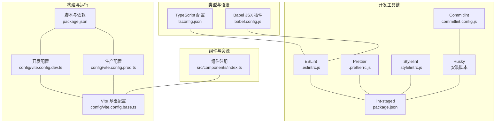
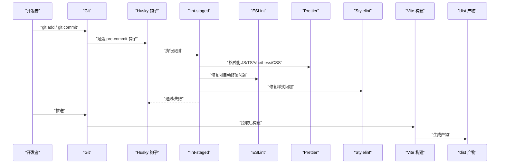
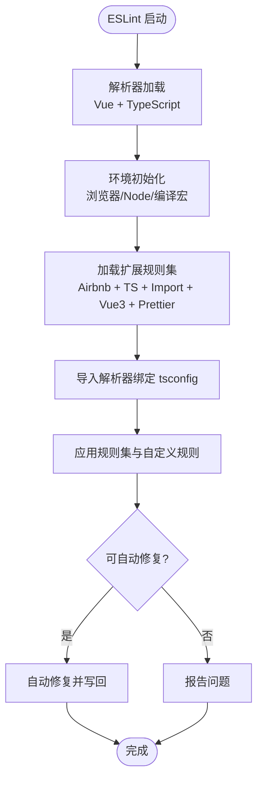
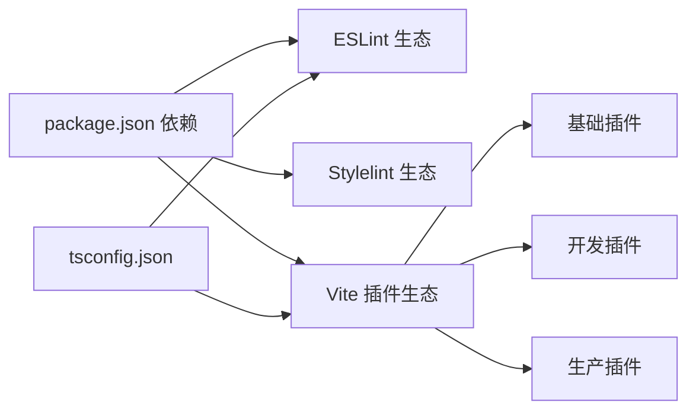

# 开发规范

<cite>
**本文引用的文件**
- [.eslintrc.js](file://.eslintrc.js)
- [.eslintignore](file://.eslintignore)
- [.prettierrc.js](file://.prettierrc.js)
- [.prettierignore](file://.prettierignore)
- [.stylelintrc.js](file://.stylelintrc.js)
- [commitlint.config.js](file://commitlint.config.js)
- [package.json](file://package.json)
- [tsconfig.json](file://tsconfig.json)
- [babel.config.js](file://babel.config.js)
- [config/vite.config.base.ts](file://config/vite.config.base.ts)
- [config/vite.config.dev.ts](file://config/vite.config.dev.ts)
- [config/vite.config.prod.ts](file://config/vite.config.prod.ts)
- [src/components/index.ts](file://src/components/index.ts)
</cite>

## 目录
1. 引言
2. 项目结构
3. 核心组件
4. 架构总览
5. 详细组件分析
6. 依赖分析
7. 性能考虑
8. 故障排查指南
9. 结论
10. 附录

## 引言
本开发规范旨在统一团队在代码风格、组件开发、命名约定、质量保障与协作流程上的标准，覆盖 ESLint、Prettier、Stylelint 的配置与使用，以及 Husky + lint-staged 的提交前检查、Commit 规范与版本控制最佳实践。同时提供 IDE 配置建议、调试技巧与团队协作规范，确保项目长期可维护性与高质量交付。

## 项目结构
本项目采用 Vite + Vue3 + TypeScript 技术栈，结合 Arco Design 组件库与 Pinia 状态管理，构建中后台管理系统。开发规范围绕以下关键点展开：
- 质量工具链：ESLint（含 TypeScript）、Prettier、Stylelint、lint-staged、Husky、Commitlint
- 构建与别名：Vite 基础配置、开发/生产环境差异化插件
- 类型系统：tsconfig 路径映射与严格模式
- 组件注册：全局组件按需引入策略
- 提交与版本控制：husky 安装脚本、lint-staged 规则、Conventional Commits

图表来源
- [config/vite.config.base.ts:1-52](file://config/vite.config.base.ts#L1-L52)
- [config/vite.config.dev.ts:1-24](file://config/vite.config.dev.ts#L1-L24)
- [config/vite.config.prod.ts:1-32](file://config/vite.config.prod.ts#L1-L32)
- [.eslintrc.js:1-71](file://.eslintrc.js#L1-L71)
- [.prettierrc.js:1-10](file://.prettierrc.js#L1-L10)
- [.stylelintrc.js:1-31](file://.stylelintrc.js#L1-L31)
- [package.json:1-103](file://package.json#L1-L103)
- [tsconfig.json:1-21](file://tsconfig.json#L1-L21)
- [babel.config.js:1-4](file://babel.config.js#L1-L4)
- [src/components/index.ts:1-36](file://src/components/index.ts#L1-L36)

章节来源
- [config/vite.config.base.ts:1-52](file://config/vite.config.base.ts#L1-L52)
- [config/vite.config.dev.ts:1-24](file://config/vite.config.dev.ts#L1-L24)
- [config/vite.config.prod.ts:1-32](file://config/vite.config.prod.ts#L1-L32)
- [package.json:1-103](file://package.json#L1-L103)

## 核心组件
本节聚焦开发规范中的“核心组件”：质量工具链与构建配置，它们共同构成代码质量与交付稳定性的基础。

- ESLint（JavaScript/TypeScript/Vue）
  - 解析器与环境：Vue 模板解析、TypeScript 解析、浏览器/Node 环境、Vue 编译宏支持
  - 扩展规则集：Airbnb 基础风格、TypeScript 推荐、导入顺序、Vue3 推荐、Prettier 接入
  - 关键规则：Vue 自定义事件命名驼峰、模板块间空行、导出形式要求；允许 @ts-ignore 注释；禁用 debugger；导入扩展名策略等
  - 忽略文件：根目录 JSON/JS 与 dist 目录
  - 参考路径：[.eslintrc.js:1-71](file://.eslintrc.js#L1-L71)，[.eslintignore:1-3](file://.eslintignore#L1-L3)

- Prettier（统一格式）
  - 缩进宽度、分号、行长、单引号、属性引号策略、HTML 空白敏感度、Vue 脚本与样式缩进
  - 忽略：dist、node_modules、本地输出、SVG、Shell 脚本
  - 参考路径：[.prettierrc.js:1-10](file://.prettierrc.js#L1-L10)，[.prettierignore:1-7](file://.prettierignore#L1-L7)

- Stylelint（CSS/Less/Vue 单文件样式）
  - 扩展：Standard、Rational Order、Prettier、Vue 推荐
  - 默认严重级别：warning；插件：order
  - 关键规则：未知 at-rule、空行策略、深度选择器兼容
  - 参考路径：[.stylelintrc.js:1-31](file://.stylelintrc.js#L1-L31)

- Commitlint（提交信息规范化）
  - 使用 Conventional Commits 规范
  - 参考路径：[commitlint.config.js:1-4](file://commitlint.config.js#L1-L4)

- lint-staged + Husky（提交前检查）
  - JS/TS/JSX/TSX：Prettier 写回 + ESLint 修复
  - *.vue：Stylelint 修复 + Prettier + ESLint
  - Less/CSS：Stylelint 修复 + Prettier
  - 安装脚本：prepare -> husky install
  - 参考路径：[package.json:17-31](file://package.json#L17-L31)，[package.json:14-16](file://package.json#L14-L16)

- Vite 构建配置
  - 基础：插件（Vue、JSX、SVG Loader、Arco 样式导入）、路径别名、CSS 预处理变量注入
  - 开发：启用 ESLint 插件实时检查
  - 生产：压缩、可视化、Arco 解析器、图片压缩、手动分包
  - 参考路径：[config/vite.config.base.ts:1-52](file://config/vite.config.base.ts#L1-L52)，[config/vite.config.dev.ts:1-24](file://config/vite.config.dev.ts#L1-L24)，[config/vite.config.prod.ts:1-32](file://config/vite.config.prod.ts#L1-L32)

- TypeScript 与 Babel
  - tsconfig：严格模式、路径映射 @/* -> src/*、JSX 保留、SVGO 配置
  - Babel：启用 @vue/babel-plugin-jsx 支持
  - 参考路径：[tsconfig.json:1-21](file://tsconfig.json#L1-L21)，[babel.config.js:1-4](file://babel.config.js#L1-L4)

- 全局组件注册（按需引入）
  - ECharts 按模块引入，减少打包体积
  - 注册通用组件（如 Chart、Breadcrumb）
  - 参考路径：[src/components/index.ts:1-36](file://src/components/index.ts#L1-L36)

章节来源
- [.eslintrc.js:1-71](file://.eslintrc.js#L1-L71)
- [.eslintignore:1-3](file://.eslintignore#L1-L3)
- [.prettierrc.js:1-10](file://.prettierrc.js#L1-L10)
- [.prettierignore:1-7](file://.prettierignore#L1-L7)
- [.stylelintrc.js:1-31](file://.stylelintrc.js#L1-L31)
- [commitlint.config.js:1-4](file://commitlint.config.js#L1-L4)
- [package.json:17-31](file://package.json#L17-L31)
- [package.json:14-16](file://package.json#L14-L16)
- [config/vite.config.base.ts:1-52](file://config/vite.config.base.ts#L1-L52)
- [config/vite.config.dev.ts:1-24](file://config/vite.config.dev.ts#L1-L24)
- [config/vite.config.prod.ts:1-32](file://config/vite.config.prod.ts#L1-L32)
- [tsconfig.json:1-21](file://tsconfig.json#L1-L21)
- [babel.config.js:1-4](file://babel.config.js#L1-L4)
- [src/components/index.ts:1-36](file://src/components/index.ts#L1-L36)

## 架构总览
下图展示从开发者提交到构建产物的关键流程，以及各质量工具的协同位置。

图表来源
- [package.json:17-31](file://package.json#L17-L31)
- [.prettierrc.js:1-10](file://.prettierrc.js#L1-L10)
- [.eslintrc.js:1-71](file://.eslintrc.js#L1-L71)
- [.stylelintrc.js:1-31](file://.stylelintrc.js#L1-L31)
- [config/vite.config.dev.ts:14-20](file://config/vite.config.dev.ts#L14-L20)
- [config/vite.config.prod.ts:11-16](file://config/vite.config.prod.ts#L11-L16)

## 详细组件分析

### ESLint 配置与规则
- 解析器与环境
  - Vue 模板解析器与 TypeScript 解析器组合，启用浏览器/Node/编译宏环境
  - 参考路径：[.eslintrc.js:6-20](file://.eslintrc.js#L6-L20)
- 扩展规则集
  - Airbnb 基础、TypeScript 推荐、导入顺序、Vue3 推荐、Prettier 接入
  - 参考路径：[.eslintrc.js:22-30](file://.eslintrc.js#L22-L30)
- 导入解析器
  - TypeScript 解析器指向 tsconfig.json，确保路径映射与别名正确解析
  - 参考路径：[.eslintrc.js:31-37](file://.eslintrc.js#L31-L37)
- 关键规则
  - Vue：自定义事件命名驼峰、模板块间空行、强制直接导出、关闭多单词组件名强制
  - TS：允许 @ts-ignore、未使用变量、空函数、any 使用（可按需收紧）
  - 导入：忽略扩展名策略（js/jsx/ts/tsx）
  - 运行时：生产环境禁止 debugger
  - 参考路径：[.eslintrc.js:38-69](file://.eslintrc.js#L38-L69)
- 忽略文件
  - 根目录 JSON/JS 与 dist 目录
  - 参考路径：[.eslintignore:1-3](file://.eslintignore#L1-L3)

图表来源
- [.eslintrc.js:6-37](file://.eslintrc.js#L6-L37)
- [.eslintrc.js:38-69](file://.eslintrc.js#L38-L69)

章节来源
- [.eslintrc.js:1-71](file://.eslintrc.js#L1-L71)
- [.eslintignore:1-3](file://.eslintignore#L1-L3)

### Prettier 配置与使用
- 格式化策略
  - 缩进宽度、分号、行长、单引号、属性引号一致性、HTML 空白敏感度、Vue 脚本/样式缩进
  - 参考路径：[.prettierrc.js:1-10](file://.prettierrc.js#L1-L10)
- 忽略范围
  - dist、node_modules、本地输出、SVG、Shell 脚本
  - 参考路径：[.prettierignore:1-7](file://.prettierignore#L1-L7)
- 与 lint-staged 协作
  - 在 JS/TS/Vue/Less/CSS 文件上统一执行写回与修复
  - 参考路径：[package.json:17-31](file://package.json#L17-L31)

章节来源
- [.prettierrc.js:1-10](file://.prettierrc.js#L1-L10)
- [.prettierignore:1-7](file://.prettierignore#L1-L7)
- [package.json:17-31](file://package.json#L17-L31)

### Stylelint 配置与使用
- 扩展与插件
  - Standard、Rational Order、Prettier、Vue 推荐；order 插件
  - 参考路径：[.stylelintrc.js:2-9](file://.stylelintrc.js#L2-L9)
- 关键规则
  - 未知 at-rule、空行策略、深度选择器兼容
  - 参考路径：[.stylelintrc.js:10-29](file://.stylelintrc.js#L10-L29)
- 与 lint-staged 协作
  - *.vue 与 Less/CSS 文件统一修复
  - 参考路径：[package.json:17-31](file://package.json#L17-L31)

章节来源
- [.stylelintrc.js:1-31](file://.stylelintrc.js#L1-L31)
- [package.json:17-31](file://package.json#L17-L31)

### 提交规范与版本控制最佳实践
- Commitlint
  - 使用 Conventional Commits，确保语义化提交
  - 参考路径：[commitlint.config.js:1-4](file://commitlint.config.js#L1-L4)
- Husky + lint-staged
  - 安装钩子：npm 脚本 prepare -> husky install
  - 规则：按文件类型分别执行 Prettier、ESLint、Stylelint
  - 参考路径：[package.json:14-16](file://package.json#L14-L16)，[package.json:17-31](file://package.json#L17-L31)
- 版本控制建议
  - 分支策略：主干保护、PR 审查、CI 校验
  - 提交信息：遵循 Conventional Commits，避免大而全提交
  - 大文件与缓存：.gitignore 已屏蔽 node_modules、dist、本地文件
  - 参考路径：[.gitignore:1-6](file://.gitignore#L1-L6)

章节来源
- [commitlint.config.js:1-4](file://commitlint.config.js#L1-L4)
- [package.json:14-16](file://package.json#L14-L16)
- [package.json:17-31](file://package.json#L17-L31)
- [.gitignore:1-6](file://.gitignore#L1-L6)

### 组件开发规范与命名约定
- Vue 单文件组件
  - 命名：PascalCase（如 Workbench.vue），目录与组件同名
  - 导出：默认导出组件对象或 setup 函数
  - 属性：使用 TypeScript 接口约束 props，避免 any
  - 事件：自定义事件使用驼峰命名，遵循 ESLint 规则
  - 参考路径：[.eslintrc.js:45-49](file://.eslintrc.js#L45-L49)
- 目录结构
  - 组件按功能聚合，公共组件集中于 src/components，页面组件位于 src/views
  - 参考路径：[src/components/index.ts:1-36](file://src/components/index.ts#L1-L36)
- 全局组件注册
  - 按需引入第三方库模块（如 ECharts），减少打包体积
  - 注册通用组件，便于复用
  - 参考路径：[src/components/index.ts:15-35](file://src/components/index.ts#L15-L35)

章节来源
- [.eslintrc.js:45-49](file://.eslintrc.js#L45-L49)
- [src/components/index.ts:1-36](file://src/components/index.ts#L1-L36)

### 开发工具配置与 IDE 设置
- VS Code 推荐设置
  - 扩展：ESLint、Prettier、Vue Language Features、Stylelint
  - 设置：保存时自动格式化、ESLint 自动修复、Stylelint 与 Prettier 协同
- 脚本与命令
  - dev/build/preview/type:check/report：参考 package.json scripts
  - 参考路径：[package.json:8-13](file://package.json#L8-L13)
- 路径别名与类型提示
  - tsconfig 路径映射 @/* -> src/*，提升导入体验
  - 参考路径：[tsconfig.json:12-14](file://tsconfig.json#L12-L14)
- Babel JSX 支持
  - 启用 @vue/babel-plugin-jsx，提升 JSX/TSX 渲染性能
  - 参考路径：[babel.config.js:1-4](file://babel.config.js#L1-L4)

章节来源
- [package.json:8-13](file://package.json#L8-L13)
- [tsconfig.json:12-14](file://tsconfig.json#L12-L14)
- [babel.config.js:1-4](file://babel.config.js#L1-L4)

### 调试技巧与问题定位
- 开发环境
  - Vite 开启 ESLint 插件，实时反馈问题
  - 参考路径：[config/vite.config.dev.ts:14-20](file://config/vite.config.dev.ts#L14-L20)
- 构建与分包
  - 生产环境手动分包，降低首屏体积
  - 参考路径：[config/vite.config.prod.ts:20-24](file://config/vite.config.prod.ts#L20-L24)
- 类型检查
  - 使用 vue-tsc 进行类型检查，避免运行时错误
  - 参考路径：[package.json:13](file://package.json#L13)

章节来源
- [config/vite.config.dev.ts:14-20](file://config/vite.config.dev.ts#L14-L20)
- [config/vite.config.prod.ts:20-24](file://config/vite.config.prod.ts#L20-L24)
- [package.json:13](file://package.json#L13)

## 依赖分析
- 质量工具依赖
  - ESLint 生态：parser、plugin、resolver、extends、prettier 接入
  - Stylelint 生态：standard、rational-order、prettier、vue 推荐、order 插件
  - 参考路径：[package.json:49-92](file://package.json#L49-L92)
- 构建与插件
  - Vite 基础插件：Vue、JSX、SVG Loader、Arco 样式导入
  - 生产插件：压缩、可视化、Arco 解析器、图片压缩
  - 参考路径：[config/vite.config.base.ts:8-14](file://config/vite.config.base.ts#L8-L14)，[config/vite.config.prod.ts:3-16](file://config/vite.config.prod.ts#L3-L16)
- 类型与路径
  - TypeScript 严格模式、路径映射、JSX 保留
  - 参考路径：[tsconfig.json:2-16](file://tsconfig.json#L2-L16)

图表来源
- [package.json:49-92](file://package.json#L49-L92)
- [config/vite.config.base.ts:8-14](file://config/vite.config.base.ts#L8-L14)
- [config/vite.config.prod.ts:3-16](file://config/vite.config.prod.ts#L3-L16)
- [tsconfig.json:2-16](file://tsconfig.json#L2-L16)

章节来源
- [package.json:49-92](file://package.json#L49-L92)
- [config/vite.config.base.ts:8-14](file://config/vite.config.base.ts#L8-L14)
- [config/vite.config.prod.ts:3-16](file://config/vite.config.prod.ts#L3-L16)
- [tsconfig.json:2-16](file://tsconfig.json#L2-L16)

## 性能考虑
- 代码层面
  - ESLint 规则限制 debugger 与空函数，减少冗余开销
  - 参考路径：[.eslintrc.js:50-54](file://.eslintrc.js#L50-L54)，[.eslintrc.js:65](file://.eslintrc.js#L65)
- 构建层面
  - 生产环境手动分包，拆分 Arco、图表、Vue 生态，优化缓存命中
  - 参考路径：[config/vite.config.prod.ts:20-24](file://config/vite.config.prod.ts#L20-L24)
- 样式层面
  - Stylelint 与 Prettier 协同，减少无效样式与嵌套层级
  - 参考路径：[.stylelintrc.js:10-29](file://.stylelintrc.js#L10-L29)，[.prettierrc.js:1-10](file://.prettierrc.js#L1-L10)

## 故障排查指南
- 提交被拒绝
  - 检查 lint-staged 是否正确安装与执行：npm run prepare
  - 查看具体文件的 ESLint/Stylelint 报错，优先修复自动修复项
  - 参考路径：[package.json:14-16](file://package.json#L14-L16)，[package.json:17-31](file://package.json#L17-L31)
- 格式化不生效
  - 确认编辑器已启用 Prettier 插件与保存时格式化
  - 检查 .prettierrc.js 与 .prettierignore 配置是否覆盖目标文件
  - 参考路径：[.prettierrc.js:1-10](file://.prettierrc.js#L1-L10)，[.prettierignore:1-7](file://.prettierignore#L1-L7)
- ESLint 无法识别路径别名
  - 确保 TypeScript 解析器指向 tsconfig.json，并在 ESLint 中启用 resolver
  - 参考路径：[.eslintrc.js:31-37](file://.eslintrc.js#L31-L37)，[tsconfig.json:12-14](file://tsconfig.json#L12-L14)
- 样式报错
  - 检查 at-rule 与伪类使用是否符合配置，必要时添加忽略项
  - 参考路径：[.stylelintrc.js:10-29](file://.stylelintrc.js#L10-L29)
- 构建体积过大
  - 检查手动分包策略与第三方库按需引入情况
  - 参考路径：[config/vite.config.prod.ts:20-24](file://config/vite.config.prod.ts#L20-L24)，[src/components/index.ts:15-28](file://src/components/index.ts#L15-L28)

章节来源
- [package.json:14-16](file://package.json#L14-L16)
- [package.json:17-31](file://package.json#L17-L31)
- [.prettierrc.js:1-10](file://.prettierrc.js#L1-L10)
- [.prettierignore:1-7](file://.prettierignore#L1-L7)
- [.eslintrc.js:31-37](file://.eslintrc.js#L31-L37)
- [tsconfig.json:12-14](file://tsconfig.json#L12-L14)
- [.stylelintrc.js:10-29](file://.stylelintrc.js#L10-L29)
- [config/vite.config.prod.ts:20-24](file://config/vite.config.prod.ts#L20-L24)
- [src/components/index.ts:15-28](file://src/components/index.ts#L15-L28)

## 结论
本规范以工具链为核心，结合 Vite 构建、TypeScript 类型系统与组件化架构，形成从编码到构建的一体化质量保障体系。通过 Husky + lint-staged 的提交前拦截、Conventional Commits 的版本控制规范，以及按需引入与手动分包的性能优化策略，确保团队协作高效、代码质量稳定、交付产物可控。

## 附录
- 常用脚本
  - 开发：npm run dev
  - 构建：npm run build
  - 预览：npm run preview
  - 类型检查：npm run type:check
  - 安装 husky：npm run prepare
  - 参考路径：[package.json:8-16](file://package.json#L8-L16)
- 忽略文件
  - Git：.gitignore
  - ESLint：.eslintignore
  - Prettier：.prettierignore
  - 参考路径：[.gitignore:1-6](file://.gitignore#L1-L6)，[.eslintignore:1-3](file://.eslintignore#L1-L3)，[.prettierignore:1-7](file://.prettierignore#L1-L7)