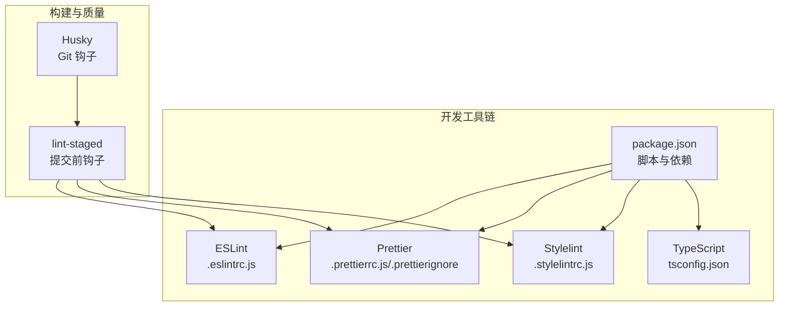
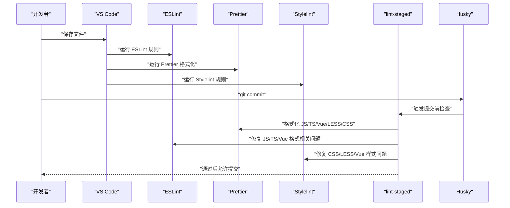
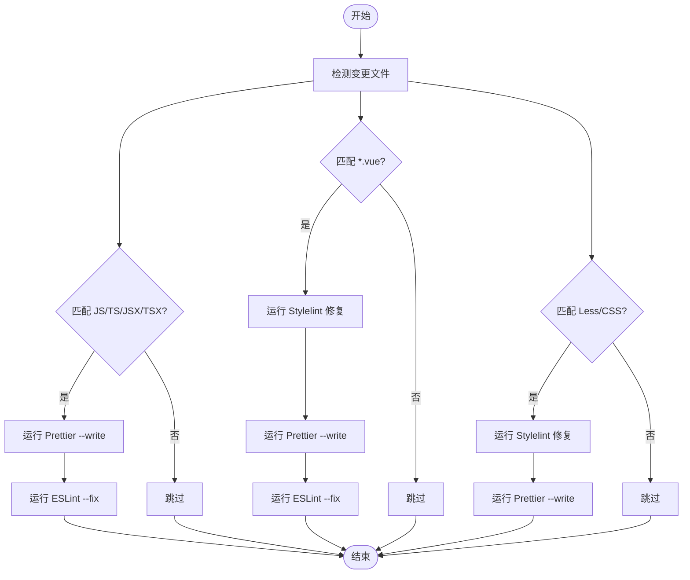
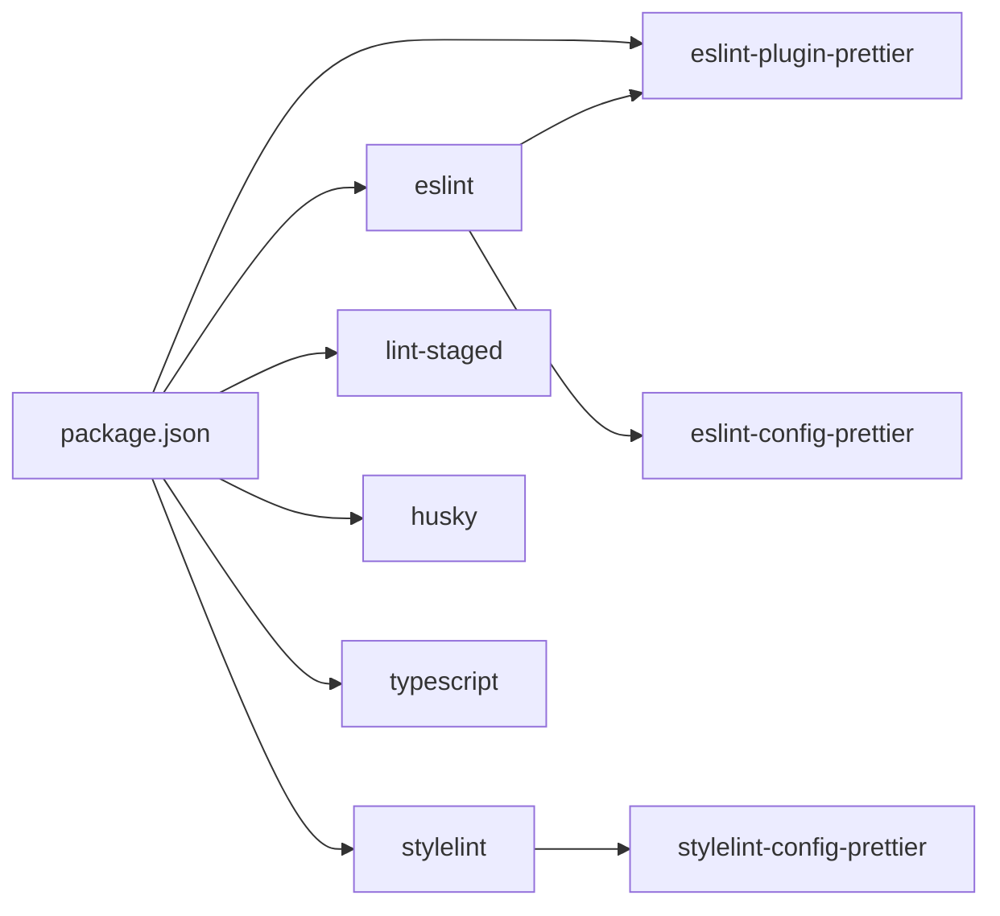

# 格式化工具配置

<cite>
**本文引用的文件**
- [.prettierrc.js](file://.prettierrc.js)
- [.prettierignore](file://.prettierignore)
- [.eslintrc.js](file://.eslintrc.js)
- [.eslintignore](file://.eslintignore)
- [.stylelintrc.js](file://.stylelintrc.js)
- [package.json](file://package.json)
- [tsconfig.json](file://tsconfig.json)
</cite>

## 目录
1. [简介](#简介)
2. [项目结构](#项目结构)
3. [核心组件](#核心组件)
4. [架构总览](#架构总览)
5. [详细组件分析](#详细组件分析)
6. [依赖关系分析](#依赖关系分析)
7. [性能考虑](#性能考虑)
8. [故障排查指南](#故障排查指南)
9. [结论](#结论)
10. [附录](#附录)

## 简介
本指南围绕本项目的格式化工具配置展开，重点覆盖以下方面：
- Prettier 配置项详解：缩进、分号、行长、引号策略、HTML 空白敏感性、Vue 脚本与样式缩进等
- 代码自动格式化规则与执行流程：ESLint 与 Prettier 协同、Stylelint 与 Prettier 协同
- VS Code 集成建议：扩展、设置与快捷键
- 团队统一格式化标准：通过脚手架、lint-staged、Husky 与 CI 等手段落地
- 不同编辑器的配置示例与最佳实践

## 项目结构
本项目采用“前端工程 + 多工具协同”的结构：
- 使用 Vite 构建，TypeScript 编译与类型检查由 vue-tsc/tsconfig 配合完成
- ESLint 负责 JS/TS/Vue 的语法与风格规则，并通过插件与 Prettier 对齐
- Prettier 负责统一格式化输出，确保团队一致的排版风格
- Stylelint 负责 CSS/LESS/Vue SFC 的样式规范，并与 Prettier 协同
- lint-staged 与 Husky 在提交前自动格式化与修复，降低冲突概率

**图表来源**
- [package.json:17-31](file://package.json#L17-L31)
- [.eslintrc.js:1-71](file://.eslintrc.js#L1-L71)
- [.prettierrc.js:1-10](file://.prettierrc.js#L1-L10)
- [.stylelintrc.js:1-31](file://.stylelintrc.js#L1-L31)
- [tsconfig.json:1-21](file://tsconfig.json#L1-L21)

**章节来源**
- [package.json:8-31](file://package.json#L8-L31)
- [.eslintrc.js:1-71](file://.eslintrc.js#L1-L71)
- [.prettierrc.js:1-10](file://.prettierrc.js#L1-L10)
- [.stylelintrc.js:1-31](file://.stylelintrc.js#L1-L31)
- [tsconfig.json:1-21](file://tsconfig.json#L1-L21)

## 核心组件
- Prettier：统一缩进、分号、引号、行长、HTML 空白处理与 Vue 脚本/样式缩进
- ESLint：JS/TS/Vue 规则集，启用 prettier/prettier 规则以消除格式冲突
- Stylelint：CSS/LESS/Vue SFC 规则集，配合 Prettier 与 stylelint-config-prettier
- lint-staged：按文件类型分别调用 Prettier、ESLint、Stylelint 进行修复
- Husky：安装 Git 钩子，触发 lint-staged
- TypeScript：类型检查与编译配置，与 ESLint/TSParser 协作

**章节来源**
- [.prettierrc.js:1-10](file://.prettierrc.js#L1-L10)
- [.eslintrc.js:21-30](file://.eslintrc.js#L21-L30)
- [.stylelintrc.js:1-31](file://.stylelintrc.js#L1-L31)
- [package.json:17-31](file://package.json#L17-L31)

## 架构总览
下图展示了从编辑器保存到提交前自动格式化的端到端流程。

**图表来源**
- [package.json:17-31](file://package.json#L17-L31)
- [.eslintrc.js:38-39](file://.eslintrc.js#L38-L39)
- [.stylelintrc.js:1-31](file://.stylelintrc.js#L1-L31)

## 详细组件分析

### Prettier 配置详解
- 缩进与空格
  - tabWidth：控制缩进宽度
  - vueIndentScriptAndStyle：开启后对 Vue 文件内的 script/style 块进行缩进对齐
- 分号与语句终止
  - semi：是否在语句末尾添加分号
- 行长与换行
  - printWidth：单行最大字符数
- 引号与属性
  - singleQuote：优先使用单引号
  - quoteProps：对象属性名引号策略（保持一致性）
- HTML 空白敏感性
  - htmlWhitespaceSensitivity：严格处理 HTML 内空白，避免渲染差异
- 忽略文件
  - .prettierignore：忽略打包产物、node_modules、特定文件类型等

这些配置共同确保团队在 JS/TS/Vue/HTML/JSON 等文件上保持一致的排版风格。

**章节来源**
- [.prettierrc.js:1-10](file://.prettierrc.js#L1-L10)
- [.prettierignore:1-7](file://.prettierignore#L1-L7)

### ESLint 与 Prettier 协同
- 规则集
  - 启用了 airbnb-base、@typescript-eslint/recommended、import 规则、vue3-recommended 以及 plugin:prettier/recommended
- 关键规则
  - prettier/prettier：将 Prettier 的格式化结果作为 ESLint 规则执行，避免格式冲突
- 其他规则
  - Vue 特定规则：事件命名、文本处理、导出要求、组件命名等
  - TS 规则：变量未使用、空函数、显式 any 等
  - 导入扩展名：允许省略 js/jsx/ts/tsx 扩展名
  - 环境开关：生产环境禁用 debugger
- 忽略文件
  - .eslintignore：忽略 JSON/JS 根级文件与 dist 目录

该配置确保 ESLint 在“逻辑/语义”层面约束代码质量，同时将“格式”交由 Prettier 统一处理，二者互不冲突。

**章节来源**
- [.eslintrc.js:21-30](file://.eslintrc.js#L21-L30)
- [.eslintrc.js:38-69](file://.eslintrc.js#L38-L69)
- [.eslintignore:1-3](file://.eslintignore#L1-L3)

### Stylelint 与 Prettier 协同
- 规则集
  - stylelint-config-standard、stylelint-config-rational-order、stylelint-config-prettier、stylelint-config-recommended-vue
- 插件
  - stylelint-order：保证属性顺序
- 自定义规则
  - at-rule-no-unknown：忽略特定 at-rule
  - rule-empty-line-before：注释与规则间空行策略
  - selector-pseudo-class-no-unknown：忽略深度选择器伪类
- 与 Prettier 的关系
  - 通过 stylelint-config-prettier 关闭与 Prettier 冲突的规则，避免重复格式化

**章节来源**
- [.stylelintrc.js:1-31](file://.stylelintrc.js#L1-L31)

### 提交前自动化（lint-staged + Husky）
- lint-staged 配置
  - JS/TS/JSX/TSX：先 Prettier 写回，再 ESLint 修复
  - *.vue：先 Stylelint 修复，再 Prettier 写回，最后 ESLint 修复
  - Less/CSS：先 Stylelint 修复，再 Prettier 写回
- Husky
  - 通过 prepare 脚本安装 Git 钩子，确保每次提交前自动执行 lint-staged

**图表来源**
- [package.json:17-31](file://package.json#L17-L31)

**章节来源**
- [package.json:17-31](file://package.json#L17-L31)

### VS Code 集成建议
- 推荐扩展
  - ESLint、Prettier、Stylelint（或使用官方扩展统一管理）
- 设置要点
  - editor.formatOnSave：启用保存时格式化
  - editor.defaultFormatter：指定默认格式化器为 Prettier
  - [optional] editor.codeActionsOnSave：启用 ESLint 自动修复
- 快捷键（示例）
  - Windows/Linux：Ctrl+Shift+P -> “格式化文档”
  - macOS：Cmd+Shift+P -> “格式化文档”
- 与项目配置联动
  - VS Code 将遵循 .prettierrc.js、.eslintrc.js、.stylelintrc.js 的规则
  - 若本地与团队规则不一致，优先以项目配置为准

[本节为通用集成建议，不直接分析具体源码文件]

### 不同编辑器的配置示例与快捷键
- WebStorm/IntelliJ IDEA
  - Settings -> Tools -> Actions on Save：勾选 “Reformat code”、“Optimize imports”
  - 使用 Prettier 插件或外部工具集成
- Sublime Text
  - 安装 EditorConfig、Prettier、SublimeLinter-eslint、SublimeLinter-stylelint
  - 在项目根目录放置 .editorconfig 与 linter 配置文件
- Vim/Neovim
  - 使用 coc.nvim 或 ALE 集成 ESLint、Prettier、Stylelint
  - 在 .vimrc 中绑定保存时格式化命令
- Atom
  - 安装 atom-beautify、linter-eslint、linter-stylelint
  - 配置 beautify 的 Prettier 选项

[本节为通用配置示例，不直接分析具体源码文件]

## 依赖关系分析
- 工具依赖
  - Prettier、ESLint、Stylelint、lint-staged、Husky、TypeScript
- 关系图

**图表来源**
- [package.json:49-92](file://package.json#L49-L92)

**章节来源**
- [package.json:49-92](file://package.json#L49-L92)

## 性能考虑
- 仅对变更文件执行 lint-staged，减少全量扫描开销
- Prettier 与 ESLint 的规则冲突最小化，避免二次格式化
- Stylelint 与 Prettier 协同关闭冲突规则，降低重复处理成本
- 使用 .prettierignore 与 .eslintignore 排除大体积产物与第三方库，提升速度

[本节提供一般性指导，不直接分析具体源码文件]

## 故障排查指南
- 现象：保存后格式不生效
  - 检查 VS Code 是否启用了 editor.formatOnSave 与 editor.defaultFormatter
  - 确认已安装 ESLint、Prettier、Stylelint 扩展
- 现象：ESLint 报告格式错误
  - 确认已启用 plugin:prettier/recommended 并配置 prettier/prettier 规则
  - 在编辑器中执行“ESLint 自动修复”或保存时自动修复
- 现象：Stylelint 与 Prettier 冲突
  - 确认已启用 stylelint-config-prettier
  - 检查自定义规则是否与 Prettier 行为冲突
- 现象：提交被拒绝
  - 查看 lint-staged 输出，确认 Prettier/ESLint/Stylelint 是否报错
  - 修正后重新提交

**章节来源**
- [.eslintrc.js:29-39](file://.eslintrc.js#L29-L39)
- [.stylelintrc.js:5-5](file://.stylelintrc.js#L5-L5)
- [package.json:17-31](file://package.json#L17-L31)

## 结论
本项目通过“ESLint + Prettier + Stylelint + lint-staged + Husky”的组合，实现了从开发体验到提交质量的全流程格式化治理。团队只需遵循项目提供的配置与脚本，即可在不同编辑器与平台间保持一致的代码风格，显著降低格式冲突与评审成本。

[本节为总结性内容，不直接分析具体源码文件]

## 附录

### Prettier 常用配置项速览
- 缩进与空格：tabWidth、vueIndentScriptAndStyle
- 分号与语句终止：semi
- 行长与换行：printWidth
- 引号与属性：singleQuote、quoteProps
- HTML 空白敏感性：htmlWhitespaceSensitivity
- 忽略文件：.prettierignore

**章节来源**
- [.prettierrc.js:1-10](file://.prettierrc.js#L1-L10)
- [.prettierignore:1-7](file://.prettierignore#L1-L7)

### ESLint 常用配置项速览
- 解析器与环境：parser、parserOptions、env
- 规则集：extends（含 airbnb-base、@typescript-eslint/recommended、import、vue3-recommended、plugin:prettier/recommended）
- 插件：plugins（@typescript-eslint）
- 规则：prettier/prettier、Vue 规则、TS 规则、导入扩展名、调试开关等
- 忽略：.eslintignore

**章节来源**
- [.eslintrc.js:4-30](file://.eslintrc.js#L4-L30)
- [.eslintrc.js:38-69](file://.eslintrc.js#L38-L69)
- [.eslintignore:1-3](file://.eslintignore#L1-L3)

### Stylelint 常用配置项速览
- 规则集：stylelint-config-standard、stylelint-config-rational-order、stylelint-config-prettier、stylelint-config-recommended-vue
- 插件：stylelint-order
- 自定义规则：at-rule-no-unknown、rule-empty-line-before、selector-pseudo-class-no-unknown

**章节来源**
- [.stylelintrc.js:1-31](file://.stylelintrc.js#L1-L31)

### 提交前自动化脚本速览
- scripts.lint-staged：定义各类文件的格式化与修复顺序
- scripts.prepare：安装 Husky 钩子

**章节来源**
- [package.json:17-31](file://package.json#L17-L31)
- [package.json:14-16](file://package.json#L14-L16)