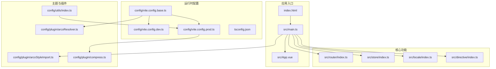
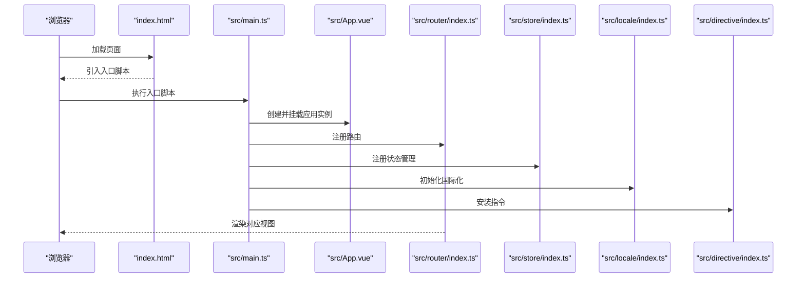
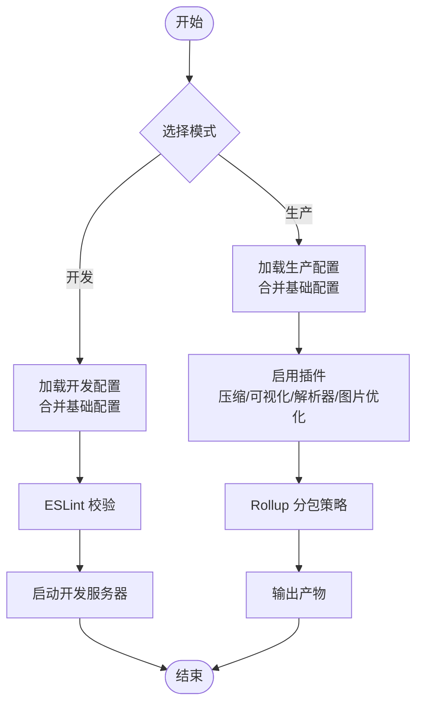
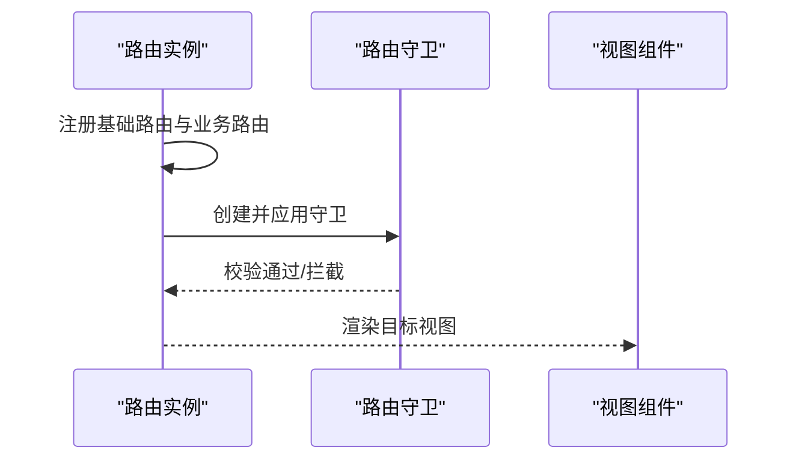
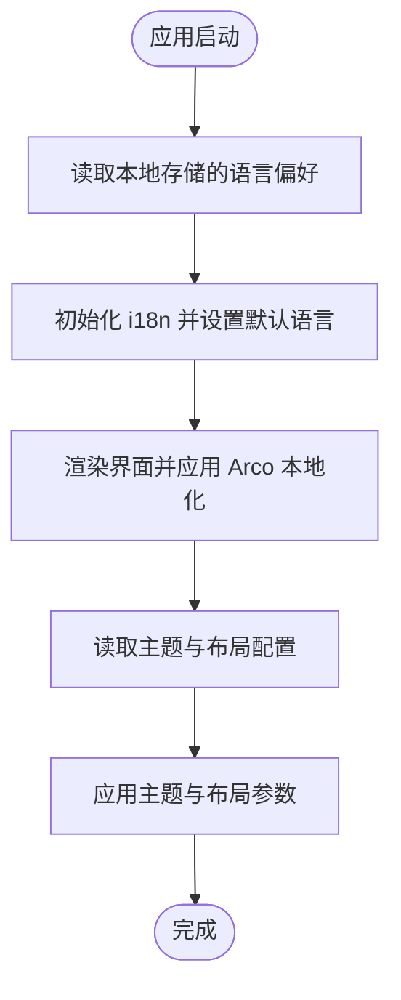
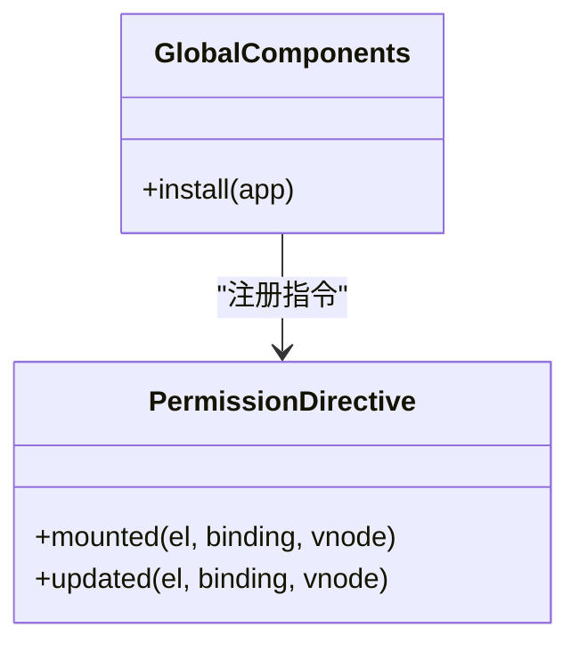
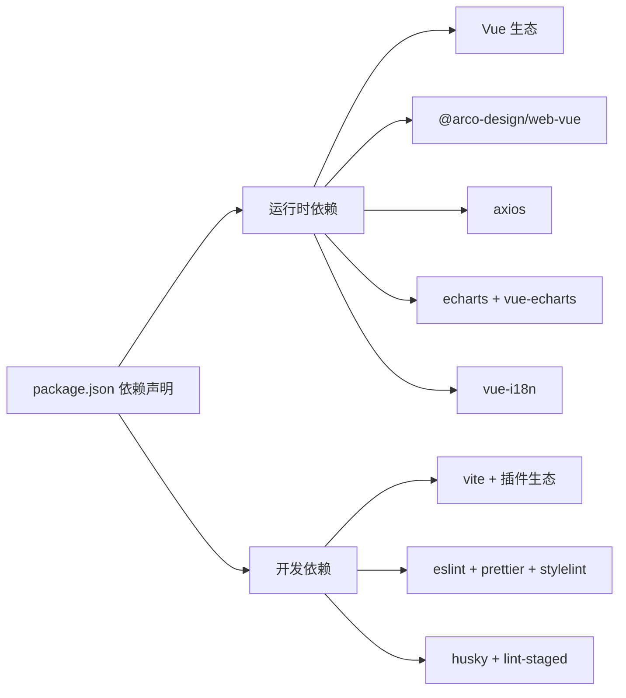

# 快速开始

<cite>
**本文引用的文件**
- [package.json](file://package.json)
- [index.html](file://index.html)
- [main.ts](file://src/main.ts)
- [vite.config.base.ts](file://config/vite.config.base.ts)
- [vite.config.dev.ts](file://config/vite.config.dev.ts)
- [vite.config.prod.ts](file://config/vite.config.prod.ts)
- [settings.json](file://src/config/settings.json)
- [App.vue](file://src/App.vue)
- [tsconfig.json](file://tsconfig.json)
- [router/index.ts](file://src/router/index.ts)
- [store/index.ts](file://src/store/index.ts)
- [locale/index.ts](file://src/locale/index.ts)
- [arcoStyleImport.ts](file://config/plugin/arcoStyleImport.ts)
- [arcoResolver.ts](file://config/plugin/arcoResolver.ts)
- [compress.ts](file://config/plugin/compress.ts)
- [utils/index.ts](file://config/utils/index.ts)
- [directive/index.ts](file://src/directive/index.ts)
</cite>

## 目录
1. [简介](#简介)
2. [项目结构](#项目结构)
3. [核心组件](#核心组件)
4. [架构总览](#架构总览)
5. [详细组件分析](#详细组件分析)
6. [依赖分析](#依赖分析)
7. [性能考虑](#性能考虑)
8. [故障排查指南](#故障排查指南)
9. [结论](#结论)
10. [附录](#附录)

## 简介
本指南面向首次接触 Arco Design Pro Vue 管理后台项目的开发者，帮助你在最短时间内完成环境准备、依赖安装、开发服务器启动与生产构建，并理解项目的整体结构与关键配置。项目基于 Vue 3 + TypeScript + Vite 3 + Arco Design Web 组件库搭建，采用 Pinia 进行状态管理、Vue Router 实现路由控制、国际化支持多语言切换。

## 项目结构
项目采用“功能域+层次化”的组织方式，核心模块包括：入口应用、路由与权限守卫、状态管理、国际化、Mock 数据、通用组件与指令、以及基于 Vite 的构建配置。下图给出与实际源码对应的高层结构关系：

图表来源
- [index.html:1-14](file://index.html#L1-L14)
- [main.ts:1-29](file://src/main.ts#L1-L29)
- [App.vue:1-27](file://src/App.vue#L1-L27)
- [vite.config.base.ts:1-52](file://config/vite.config.base.ts#L1-L52)
- [vite.config.dev.ts:1-24](file://config/vite.config.dev.ts#L1-L24)
- [vite.config.prod.ts:1-32](file://config/vite.config.prod.ts#L1-L32)
- [tsconfig.json:1-21](file://tsconfig.json#L1-L21)
- [router/index.ts:1-38](file://src/router/index.ts#L1-L38)
- [store/index.ts:1-10](file://src/store/index.ts#L1-L10)
- [locale/index.ts:1-23](file://src/locale/index.ts#L1-L23)
- [directive/index.ts:1-9](file://src/directive/index.ts#L1-L9)
- [arcoStyleImport.ts:1-13](file://config/plugin/arcoStyleImport.ts#L1-L13)
- [arcoResolver.ts:1-20](file://config/plugin/arcoResolver.ts#L1-L20)
- [compress.ts:1-35](file://config/plugin/compress.ts#L1-L35)
- [utils/index.ts:1-10](file://config/utils/index.ts#L1-L10)

章节来源
- [package.json:1-103](file://package.json#L1-L103)
- [index.html:1-14](file://index.html#L1-L14)
- [main.ts:1-29](file://src/main.ts#L1-L29)
- [vite.config.base.ts:1-52](file://config/vite.config.base.ts#L1-L52)
- [vite.config.dev.ts:1-24](file://config/vite.config.dev.ts#L1-L24)
- [vite.config.prod.ts:1-32](file://config/vite.config.prod.ts#L1-L32)
- [tsconfig.json:1-21](file://tsconfig.json#L1-L21)
- [router/index.ts:1-38](file://src/router/index.ts#L1-L38)
- [store/index.ts:1-10](file://src/store/index.ts#L1-L10)
- [locale/index.ts:1-23](file://src/locale/index.ts#L1-L23)
- [directive/index.ts:1-9](file://src/directive/index.ts#L1-L9)
- [arcoStyleImport.ts:1-13](file://config/plugin/arcoStyleImport.ts#L1-L13)
- [arcoResolver.ts:1-20](file://config/plugin/arcoResolver.ts#L1-L20)
- [compress.ts:1-35](file://config/plugin/compress.ts#L1-L35)
- [utils/index.ts:1-10](file://config/utils/index.ts#L1-L10)

## 核心组件
- 应用入口与挂载
  - 入口 HTML 中仅包含挂载点与应用入口脚本，实际逻辑在入口文件中完成全局注册（路由、状态、国际化、指令、Mock、全局样式等）。
- 路由系统
  - 基于 Vue Router 4，内置登录页与基础重定向/兜底路由，其余业务路由通过模块化组织并统一注入。
- 状态管理
  - 使用 Pinia，提供应用、用户、标签页等模块化 Store。
- 国际化
  - 基于 vue-i18n，支持中英文切换，默认从本地存储读取语言偏好。
- 主题与组件按需加载
  - Arco Design 样式通过插件按需导入；生产环境启用 Arco 解析器实现组件按需引入。
- 构建配置
  - 基于 Vite 3，开发模式集成 ESLint 校验；生产模式集成压缩、可视化、图片优化与分包策略。

章节来源
- [main.ts:1-29](file://src/main.ts#L1-L29)
- [router/index.ts:1-38](file://src/router/index.ts#L1-L38)
- [store/index.ts:1-10](file://src/store/index.ts#L1-L10)
- [locale/index.ts:1-23](file://src/locale/index.ts#L1-L23)
- [arcoStyleImport.ts:1-13](file://config/plugin/arcoStyleImport.ts#L1-L13)
- [arcoResolver.ts:1-20](file://config/plugin/arcoResolver.ts#L1-L20)
- [compress.ts:1-35](file://config/plugin/compress.ts#L1-L35)

## 架构总览
下图展示从浏览器访问到页面渲染的关键调用链路，映射到实际源码文件：

图表来源
- [index.html:1-14](file://index.html#L1-L14)
- [main.ts:1-29](file://src/main.ts#L1-L29)
- [App.vue:1-27](file://src/App.vue#L1-L27)
- [router/index.ts:1-38](file://src/router/index.ts#L1-L38)
- [store/index.ts:1-10](file://src/store/index.ts#L1-L10)
- [locale/index.ts:1-23](file://src/locale/index.ts#L1-L23)
- [directive/index.ts:1-9](file://src/directive/index.ts#L1-L9)

## 详细组件分析

### 构建与开发服务器
- 开发服务器
  - 通过开发配置合并基础配置，开启自动打开浏览器与严格文件系统校验，并在开发阶段启用 ESLint 校验。
- 生产构建
  - 合并基础配置后启用压缩、可视化、Arco 解析器与图片压缩插件；配置 Rollup 分包策略，提升缓存命中率。
- 类型检查
  - 提供独立的类型检查脚本，便于在构建前进行类型安全验证。

图表来源
- [vite.config.dev.ts:1-24](file://config/vite.config.dev.ts#L1-L24)
- [vite.config.prod.ts:1-32](file://config/vite.config.prod.ts#L1-L32)
- [vite.config.base.ts:1-52](file://config/vite.config.base.ts#L1-L52)
- [compress.ts:1-35](file://config/plugin/compress.ts#L1-L35)
- [utils/index.ts:1-10](file://config/utils/index.ts#L1-L10)

章节来源
- [vite.config.dev.ts:1-24](file://config/vite.config.dev.ts#L1-L24)
- [vite.config.prod.ts:1-32](file://config/vite.config.prod.ts#L1-L32)
- [vite.config.base.ts:1-52](file://config/vite.config.base.ts#L1-L52)
- [compress.ts:1-35](file://config/plugin/compress.ts#L1-L35)
- [utils/index.ts:1-10](file://config/utils/index.ts#L1-L10)

### 路由与权限守卫
- 路由初始化
  - 设置历史模式、根路径重定向至登录页、注册登录路由与其他业务路由，并统一注入重定向与兜底路由。
- 权限守卫
  - 在路由初始化时创建守卫，结合业务需求可扩展登录态与权限判断逻辑。

图表来源
- [router/index.ts:1-38](file://src/router/index.ts#L1-L38)

章节来源
- [router/index.ts:1-38](file://src/router/index.ts#L1-L38)

### 国际化与主题配置
- 国际化
  - 默认语言从本地存储读取，未设置则回退到英文；消息体包含中英文键值。
- 主题与布局
  - 全局主题色、菜单宽度、是否显示导航栏/页脚/标签页等配置集中于设置文件，便于统一管理。

图表来源
- [locale/index.ts:1-23](file://src/locale/index.ts#L1-L23)
- [App.vue:1-27](file://src/App.vue#L1-L27)
- [settings.json:1-18](file://src/config/settings.json#L1-L18)

章节来源
- [locale/index.ts:1-23](file://src/locale/index.ts#L1-L23)
- [App.vue:1-27](file://src/App.vue#L1-L27)
- [settings.json:1-18](file://src/config/settings.json#L1-L18)

### 组件与指令体系
- 全局组件注册
  - 在入口处统一注册全局组件，减少重复导入。
- 自定义指令
  - 提供指令安装入口，便于扩展如权限控制等指令能力。

图表来源
- [main.ts:1-29](file://src/main.ts#L1-L29)
- [directive/index.ts:1-9](file://src/directive/index.ts#L1-L9)

章节来源
- [main.ts:1-29](file://src/main.ts#L1-L29)
- [directive/index.ts:1-9](file://src/directive/index.ts#L1-L9)

## 依赖分析
- 运行时依赖
  - Vue 3、Vue Router、Pinia、Arco Design Web Vue、Axios、Day.js、ECharts、Vue i18n 等，构成应用核心能力。
- 开发依赖
  - Vite、TypeScript、ESLint、Prettier、Stylelint、husky、lint-staged、Arco 插件生态等，保障开发体验与代码质量。
- Node 版本要求
  - 最低 Node 版本要求满足现代前端工具链运行。

图表来源
- [package.json:1-103](file://package.json#L1-L103)

章节来源
- [package.json:1-103](file://package.json#L1-L103)

## 性能考虑
- 分包策略
  - 生产构建按框架、Arco 组件库、图表库与第三方库进行手动分包，降低首屏体积并提升缓存效率。
- 压缩与可视化
  - 启用 gzip 压缩与打包报告，便于评估体积与定位大体积模块。
- 图片优化
  - 生产环境启用图片压缩插件，减少静态资源体积。
- 代码分割与按需加载
  - Arco 解析器按需引入组件，避免全量引入导致的体积膨胀。

章节来源
- [vite.config.prod.ts:1-32](file://config/vite.config.prod.ts#L1-L32)
- [compress.ts:1-35](file://config/plugin/compress.ts#L1-L35)
- [arcoResolver.ts:1-20](file://config/plugin/arcoResolver.ts#L1-L20)

## 故障排查指南
- 启动失败或端口占用
  - 检查开发服务器配置与端口占用情况，确认已正确执行开发脚本。
- ESLint 报错
  - 开发模式下 ESLint 会实时校验，修复提示的语法与风格问题。
- 国际化不生效
  - 确认本地存储的语言键值存在且与配置一致，检查 i18n 初始化逻辑。
- Arco 组件样式异常
  - 确认 Arco 样式按需导入插件已启用，且 Less 变量引用正确。
- 构建体积过大
  - 查看打包报告，关注分包策略与第三方库体积，必要时调整分包或替换依赖。
- 路由跳转异常
  - 检查路由守卫逻辑与业务路由配置，确认重定向与兜底路由正常。

章节来源
- [vite.config.dev.ts:1-24](file://config/vite.config.dev.ts#L1-L24)
- [vite.config.prod.ts:1-32](file://config/vite.config.prod.ts#L1-L32)
- [locale/index.ts:1-23](file://src/locale/index.ts#L1-L23)
- [arcoStyleImport.ts:1-13](file://config/plugin/arcoStyleImport.ts#L1-L13)
- [router/index.ts:1-38](file://src/router/index.ts#L1-L38)

## 结论
本指南覆盖了从环境准备到开发调试再到生产构建的完整路径，配合项目内完善的配置与模块化结构，你可以快速上手并高效迭代。建议在开发初期遵循统一的代码规范与提交流程，持续优化构建产物与用户体验。

## 附录
- 快速命令参考
  - 启动开发服务器：参见脚本定义
  - 生产构建：参见脚本定义
  - 预览构建产物：参见脚本定义
  - 类型检查：参见脚本定义
- 关键配置一览
  - Vite 基础配置、开发配置、生产配置
  - TypeScript 编译选项
  - Arco 插件与解析器
  - 主题与布局设置

章节来源
- [package.json:1-103](file://package.json#L1-L103)
- [vite.config.base.ts:1-52](file://config/vite.config.base.ts#L1-L52)
- [vite.config.dev.ts:1-24](file://config/vite.config.dev.ts#L1-L24)
- [vite.config.prod.ts:1-32](file://config/vite.config.prod.ts#L1-L32)
- [tsconfig.json:1-21](file://tsconfig.json#L1-L21)
- [settings.json:1-18](file://src/config/settings.json#L1-L18)