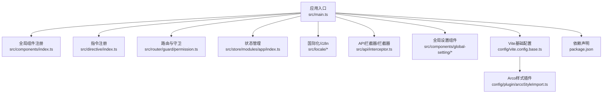
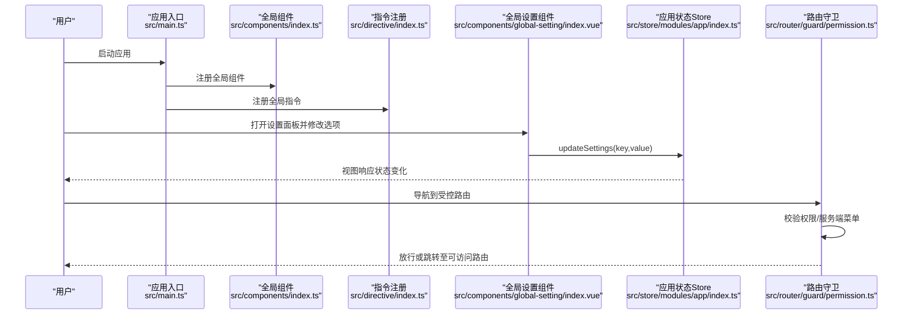
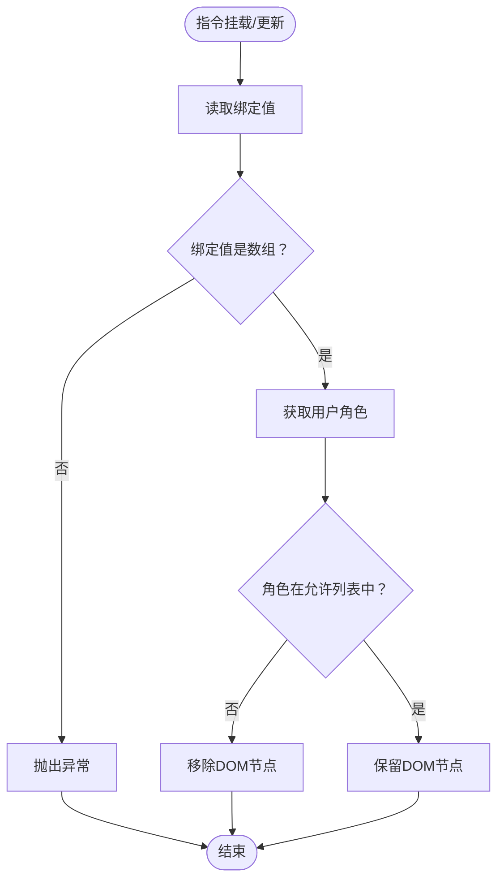
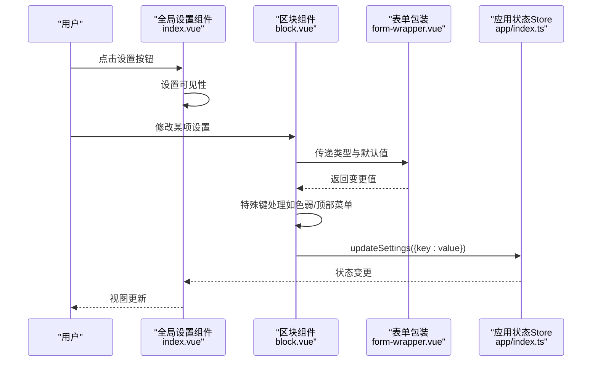
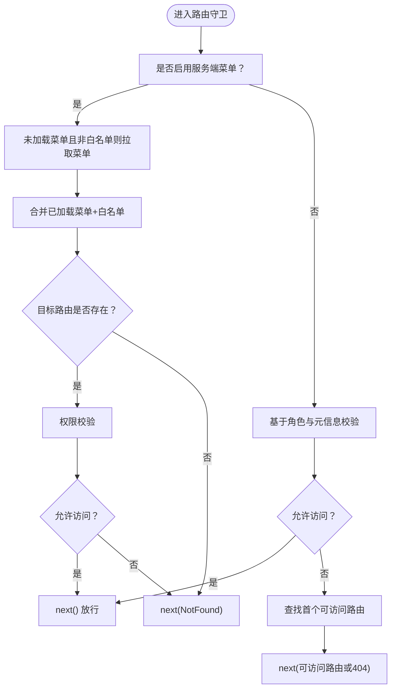
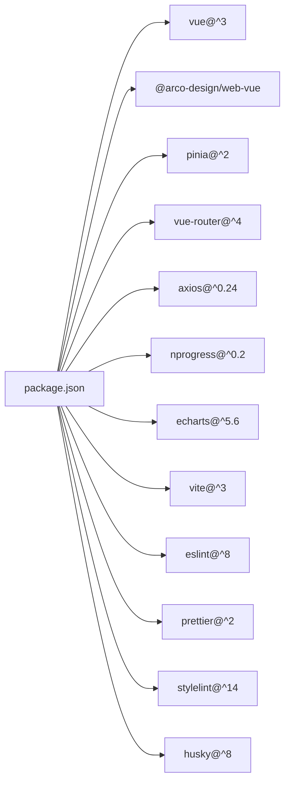

# 扩展开发

<cite>
**本文引用的文件**
- [src/main.ts](file://src/main.ts)
- [src/directive/index.ts](file://src/directive/index.ts)
- [src/directive/permission/index.ts](file://src/directive/permission/index.ts)
- [src/hooks/permission.ts](file://src/hooks/permission.ts)
- [src/router/guard/permission.ts](file://src/router/guard/permission.ts)
- [src/components/global-setting/index.vue](file://src/components/global-setting/index.vue)
- [src/components/global-setting/block.vue](file://src/components/global-setting/block.vue)
- [src/components/global-setting/form-wrapper.vue](file://src/components/global-setting/form-wrapper.vue)
- [src/components/index.ts](file://src/components/index.ts)
- [src/store/modules/app/index.ts](file://src/store/modules/app/index.ts)
- [src/store/modules/app/types.ts](file://src/store/modules/app/types.ts)
- [src/config/settings.json](file://src/config/settings.json)
- [src/utils/auth.ts](file://src/utils/auth.ts)
- [config/vite.config.base.ts](file://config/vite.config.base.ts)
- [config/plugin/arcoStyleImport.ts](file://config/plugin/arcoStyleImport.ts)
- [package.json](file://package.json)
</cite>

## 目录
1. [简介](#简介)
2. [项目结构](#项目结构)
3. [核心组件](#核心组件)
4. [架构总览](#架构总览)
5. [详细组件分析](#详细组件分析)
6. [依赖分析](#依赖分析)
7. [性能考量](#性能考量)
8. [故障排查指南](#故障排查指南)
9. [结论](#结论)
10. [附录](#附录)

## 简介
本指南面向希望在现有系统上进行扩展开发的工程师，涵盖新功能开发流程、组件扩展方法、插件开发与第三方集成、指令系统使用与自定义、全局设置组件扩展、权限指令定制、业务组件封装、扩展点识别、API 设计与向后兼容性最佳实践，以及安全与性能注意事项。文档以仓库中的实际实现为依据，提供可操作的步骤与图示。

## 项目结构
该工程采用基于功能域的组织方式：前端入口在 src/main.ts 中初始化应用，注册路由、状态管理、国际化、指令与全局组件；权限控制由路由守卫与权限 Hook 协同完成；全局设置组件提供运行时 UI 可配置项；指令系统提供 DOM 级别的权限控制能力；构建层通过 Vite 与 Arco 插件实现样式与组件按需加载。

图表来源
- [src/main.ts:1-29](file://src/main.ts#L1-L29)
- [src/components/index.ts:30-36](file://src/components/index.ts#L30-L36)
- [src/directive/index.ts:4-9](file://src/directive/index.ts#L4-L9)
- [src/router/guard/permission.ts:9-56](file://src/router/guard/permission.ts#L9-L56)
- [src/store/modules/app/index.ts:9-78](file://src/store/modules/app/index.ts#L9-L78)
- [config/vite.config.base.ts:8-52](file://config/vite.config.base.ts#L8-L52)
- [config/plugin/arcoStyleImport.ts:7-13](file://config/plugin/arcoStyleImport.ts#L7-L13)
- [package.json:32-48](file://package.json#L32-L48)

章节来源
- [src/main.ts:1-29](file://src/main.ts#L1-L29)
- [config/vite.config.base.ts:1-52](file://config/vite.config.base.ts#L1-L52)

## 核心组件
- 全局组件注册器：集中注册业务通用组件（如图表、面包屑等），便于在模板中直接使用。
- 指令注册器：集中注册全局指令（如权限指令），统一挂载到应用实例。
- 权限钩子：提供路由访问判断与首条可访问路由查找能力。
- 路由守卫：根据是否从服务端拉取菜单，动态校验路由权限并引导至可访问页面或错误页。
- 全局设置组件：提供抽屉式设置面板，支持主题、布局、菜单等开关与数值调整，并可复制当前配置。
- 应用状态 Store：集中管理主题、布局、菜单、设备、标签页等全局状态，并提供更新与异步菜单拉取能力。
- 构建与插件：Vite 基础配置与 Arco 主题样式插件，实现按需样式与组件解析。

章节来源
- [src/components/index.ts:30-36](file://src/components/index.ts#L30-L36)
- [src/directive/index.ts:4-9](file://src/directive/index.ts#L4-L9)
- [src/hooks/permission.ts:4-34](file://src/hooks/permission.ts#L4-L34)
- [src/router/guard/permission.ts:9-56](file://src/router/guard/permission.ts#L9-L56)
- [src/components/global-setting/index.vue:1-99](file://src/components/global-setting/index.vue#L1-L99)
- [src/store/modules/app/index.ts:9-78](file://src/store/modules/app/index.ts#L9-L78)
- [config/vite.config.base.ts:8-52](file://config/vite.config.base.ts#L8-L52)
- [config/plugin/arcoStyleImport.ts:7-13](file://config/plugin/arcoStyleImport.ts#L7-L13)

## 架构总览
下图展示扩展开发的关键交互路径：应用启动时注册全局组件与指令；用户在界面中通过全局设置组件修改配置；权限相关逻辑在路由守卫与指令中生效；状态变更通过 Store 同步到视图与持久化。

图表来源
- [src/main.ts:17-28](file://src/main.ts#L17-L28)
- [src/components/index.ts:30-36](file://src/components/index.ts#L30-L36)
- [src/directive/index.ts:4-9](file://src/directive/index.ts#L4-L9)
- [src/components/global-setting/index.vue:73-84](file://src/components/global-setting/index.vue#L73-L84)
- [src/store/modules/app/index.ts:24-29](file://src/store/modules/app/index.ts#L24-L29)
- [src/router/guard/permission.ts:9-56](file://src/router/guard/permission.ts#L9-L56)

## 详细组件分析

### 指令系统：权限指令与扩展方法
- 当前实现：权限指令在挂载与更新阶段检查绑定值是否包含当前角色，若不包含则移除对应 DOM 节点。
- 使用要点：绑定值必须为数组；未传入数组会抛出异常。
- 扩展建议：
  - 支持表达式与多级权限组合（如 AND/OR）。
  - 提供“默认隐藏”策略与“占位元素”渲染。
  - 将指令注册为可选模块，避免在无权限场景下强制依赖。
- 安全与性能：
  - 指令仅做前端可见性控制，不可替代后端鉴权。
  - 避免在指令中执行重计算；必要时缓存用户角色与权限集合。

图表来源
- [src/directive/permission/index.ts:4-31](file://src/directive/permission/index.ts#L4-L31)

章节来源
- [src/directive/index.ts:4-9](file://src/directive/index.ts#L4-L9)
- [src/directive/permission/index.ts:1-31](file://src/directive/permission/index.ts#L1-L31)

### 全局设置组件：扩展与定制
- 组件职责：提供抽屉式设置面板，列出内容设置与其他设置两类选项，支持复制当前配置。
- 可扩展点：
  - 在 Block 组件中新增选项项，通过 form-wrapper 渲染不同输入类型（开关/数字）。
  - 在 handleChange 中增加键值映射，实现联动行为（如切换顶部菜单时展开菜单）。
  - 在设置项中加入“服务端菜单开关”，首次开启时触发菜单拉取。
- 数据流：Block -> FormWrapper -> handleChange -> Store.updateSettings -> 视图响应。

图表来源
- [src/components/global-setting/index.vue:1-99](file://src/components/global-setting/index.vue#L1-L99)
- [src/components/global-setting/block.vue:40-59](file://src/components/global-setting/block.vue#L40-L59)
- [src/components/global-setting/form-wrapper.vue:17-39](file://src/components/global-setting/form-wrapper.vue#L17-L39)
- [src/store/modules/app/index.ts:24-29](file://src/store/modules/app/index.ts#L24-L29)

章节来源
- [src/components/global-setting/index.vue:1-99](file://src/components/global-setting/index.vue#L1-L99)
- [src/components/global-setting/block.vue:1-80](file://src/components/global-setting/block.vue#L1-L80)
- [src/components/global-setting/form-wrapper.vue:1-40](file://src/components/global-setting/form-wrapper.vue#L1-L40)
- [src/store/modules/app/index.ts:9-78](file://src/store/modules/app/index.ts#L9-L78)

### 权限体系：路由守卫与 Hook
- 路由守卫：
  - 若启用“服务端菜单”，在目标路由不在已加载菜单中且不在白名单时，先拉取菜单再判定放行。
  - 若未启用服务端菜单，则基于角色与路由元信息判断。
- 权限 Hook：
  - accessRouter：判断路由是否需要认证、是否包含通配符或匹配当前角色。
  - findFirstPermissionRoute：广度优先搜索首个可访问路由，用于无权限时的兜底跳转。

图表来源
- [src/router/guard/permission.ts:9-56](file://src/router/guard/permission.ts#L9-L56)
- [src/hooks/permission.ts:4-34](file://src/hooks/permission.ts#L4-L34)

章节来源
- [src/router/guard/permission.ts:1-56](file://src/router/guard/permission.ts#L1-L56)
- [src/hooks/permission.ts:1-34](file://src/hooks/permission.ts#L1-L34)

### 全局组件注册器：扩展新组件
- 当前注册：图表、面包屑等组件通过注册器集中注册。
- 扩展步骤：
  - 在 components 目录新增组件文件。
  - 在注册器中导出并注册组件。
  - 在模板中直接使用组件名。
- 注意事项：
  - 对于大型第三方库（如 ECharts），按需引入模块以减少打包体积。

章节来源
- [src/components/index.ts:1-36](file://src/components/index.ts#L1-L36)

### 应用状态 Store：扩展配置项
- 默认配置：主题、布局、菜单、设备、标签页等。
- 扩展点：
  - 在 AppState 接口中新增字段，确保类型安全。
  - 在 Store 的 actions 中添加对应的更新方法。
  - 在全局设置组件中添加对应选项项。
- 数据持久化：Store 状态可通过复制设置功能导出，便于迁移与备份。

章节来源
- [src/config/settings.json:1-18](file://src/config/settings.json#L1-L18)
- [src/store/modules/app/types.ts:3-21](file://src/store/modules/app/types.ts#L3-L21)
- [src/store/modules/app/index.ts:9-78](file://src/store/modules/app/index.ts#L9-L78)

### 插件与第三方集成：构建与主题
- Vite 基础配置：统一插件、别名、CSS 预处理器变量与环境定义。
- Arco 样式插件：通过 Arco 插件实现主题包与组件样式的按需导入。
- 第三方集成建议：
  - 保持插件粒度清晰，避免一次性引入过多资源。
  - 对大体量依赖采用懒加载或条件引入。

章节来源
- [config/vite.config.base.ts:1-52](file://config/vite.config.base.ts#L1-L52)
- [config/plugin/arcoStyleImport.ts:1-13](file://config/plugin/arcoStyleImport.ts#L1-L13)
- [package.json:32-48](file://package.json#L32-L48)

## 依赖分析
- 运行时依赖：Vue 3、Arco Design、Pinia、Vue Router、Axios、NProgress、ECharts 等。
- 开发时依赖：Vite、ESLint、Prettier、Stylelint、Husky、Arco 插件等。
- 依赖关系对扩展的影响：
  - 新增业务组件时，尽量复用现有工具链与插件。
  - 对第三方库采用按需引入与版本锁定策略，降低升级风险。

图表来源
- [package.json:32-101](file://package.json#L32-L101)

章节来源
- [package.json:1-103](file://package.json#L1-L103)

## 性能考量
- 指令层面：
  - 避免在指令中执行昂贵计算；对用户角色与权限集合进行缓存。
  - 对频繁更新的指令，考虑在 updated 生命周期中做最小化判断。
- 组件层面：
  - 全局组件按需注册，减少初始包体。
  - 图表组件采用 ECharts 按需引入，避免引入整库。
- 路由与权限：
  - 服务端菜单拉取应结合缓存与节流，避免重复请求。
  - 路由守卫中尽量使用轻量判断，复杂逻辑前置到后台或缓存。
- 构建与样式：
  - Arco 样式按需导入，减少无关样式体积。
  - CSS 变量与主题切换尽量使用原生属性，避免频繁重排。

## 故障排查指南
- 权限指令报错“缺少角色数组”：
  - 检查指令绑定值是否为数组；确保在模板中正确传入角色数组。
  - 参考路径：[src/directive/permission/index.ts:18-20](file://src/directive/permission/index.ts#L18-L20)
- 路由无法访问或跳转到 404：
  - 检查路由元信息 roles 是否包含当前角色或通配符；确认服务端菜单是否已拉取。
  - 参考路径：[src/router/guard/permission.ts:13-52](file://src/router/guard/permission.ts#L13-L52)
- 全局设置不生效：
  - 确认 handleChange 中是否正确处理了特殊键（如顶部菜单、色弱模式）；检查 Store.updateSettings 是否被调用。
  - 参考路径：[src/components/global-setting/block.vue:40-59](file://src/components/global-setting/block.vue#L40-L59)
- 登录态异常：
  - 检查本地存储的 token 键名与读写逻辑；确保登录成功后写入 token，退出登录时清理。
  - 参考路径：[src/utils/auth.ts:1-20](file://src/utils/auth.ts#L1-L20)

章节来源
- [src/directive/permission/index.ts:18-20](file://src/directive/permission/index.ts#L18-L20)
- [src/router/guard/permission.ts:13-52](file://src/router/guard/permission.ts#L13-L52)
- [src/components/global-setting/block.vue:40-59](file://src/components/global-setting/block.vue#L40-L59)
- [src/utils/auth.ts:1-20](file://src/utils/auth.ts#L1-L20)

## 结论
本指南提供了从入口注册、指令与权限控制、全局设置扩展到构建与第三方集成的完整扩展路径。遵循本文的最佳实践，可在保证安全与性能的前提下快速迭代新功能，并确保向后兼容与可维护性。

## 附录
- 新功能开发流程建议：
  - 明确扩展点与边界，优先使用现有注册器与 Hook。
  - 在 Store 中新增状态字段并提供类型约束；在全局设置中暴露对应选项。
  - 编写指令或路由守卫时，确保异常分支与默认分支清晰。
  - 构建阶段采用按需引入与缓存策略，避免不必要的体积增长。
- API 设计与向后兼容：
  - 保持接口稳定，新增字段时提供默认值；对旧字段标记弃用并在后续版本移除。
  - 对外暴露的配置项与事件命名规范统一，文档与类型定义同步更新。
- 安全与合规：
  - 前端可见性控制不能替代后端鉴权；敏感操作务必在服务端校验。
  - 对用户输入与外部数据进行严格校验与最小权限原则。