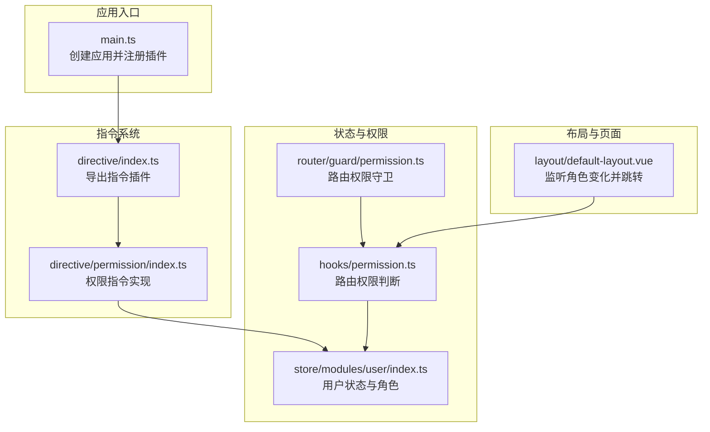
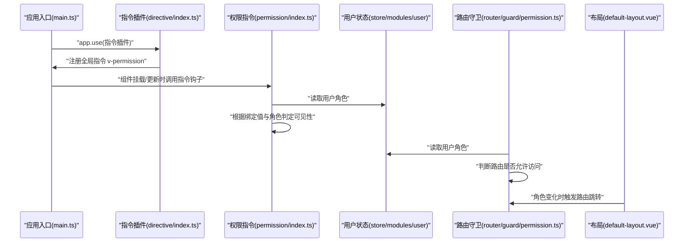
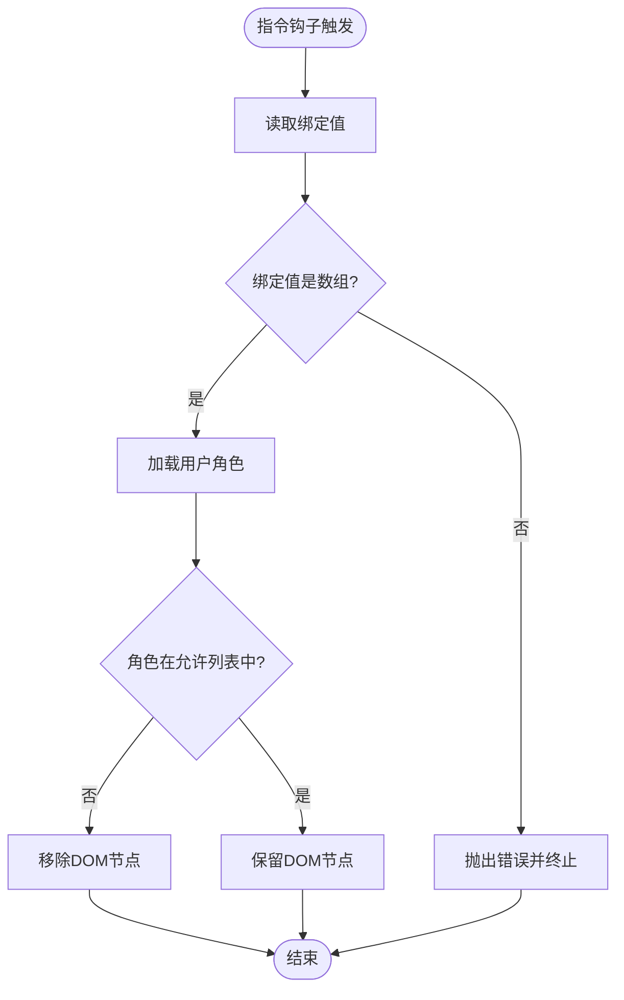
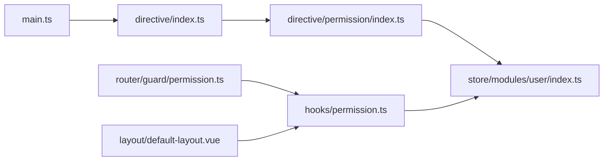

# 指令开发

<cite>
**本文引用的文件**
- [src/directive/index.ts](file://src/directive/index.ts)
- [src/directive/permission/index.ts](file://src/directive/permission/index.ts)
- [src/main.ts](file://src/main.ts)
- [src/store/modules/user/index.ts](file://src/store/modules/user/index.ts)
- [src/hooks/permission.ts](file://src/hooks/permission.ts)
- [src/router/guard/permission.ts](file://src/router/guard/permission.ts)
- [src/layout/default-layout.vue](file://src/layout/default-layout.vue)
- [src/utils/auth.ts](file://src/utils/auth.ts)
</cite>

## 目录
1. [引言](#引言)
2. [项目结构](#项目结构)
3. [核心组件](#核心组件)
4. [架构总览](#架构总览)
5. [详细组件分析](#详细组件分析)
6. [依赖关系分析](#依赖关系分析)
7. [性能考量](#性能考量)
8. [故障排查指南](#故障排查指南)
9. [结论](#结论)
10. [附录](#附录)

## 引言
本指南面向希望在Vue应用中系统化开发与扩展指令的工程师，围绕以下目标展开：深入讲解Vue指令的开发原理、自定义指令的实现方法、权限指令的扩展机制；详细说明指令注册流程、生命周期钩子的使用与指令参数的处理；给出权限指令的业务逻辑实现、指令与组件的集成方式以及性能优化策略；并提供调试技巧、测试方法与最佳实践，帮助实现指令的复用性设计与跨组件一致性保障。

## 项目结构
本项目采用按功能分层的组织方式，指令相关代码集中在 src/directive 目录下，并通过应用入口统一注册。权限相关的路由守卫与用户状态管理分别位于 src/router/guard 与 src/store 中，形成“指令控制可见性 + 路由守卫控制访问 + 状态管理驱动角色”的整体权限体系。

图表来源
- [src/main.ts:1-29](file://src/main.ts#L1-L29)
- [src/directive/index.ts:1-9](file://src/directive/index.ts#L1-L9)
- [src/directive/permission/index.ts:1-31](file://src/directive/permission/index.ts#L1-L31)
- [src/store/modules/user/index.ts:1-92](file://src/store/modules/user/index.ts#L1-L92)
- [src/hooks/permission.ts:1-34](file://src/hooks/permission.ts#L1-L34)
- [src/router/guard/permission.ts:1-56](file://src/router/guard/permission.ts#L1-L56)
- [src/layout/default-layout.vue:1-179](file://src/layout/default-layout.vue#L1-L179)

章节来源
- [src/main.ts:1-29](file://src/main.ts#L1-L29)
- [src/directive/index.ts:1-9](file://src/directive/index.ts#L1-L9)
- [src/directive/permission/index.ts:1-31](file://src/directive/permission/index.ts#L1-L31)
- [src/store/modules/user/index.ts:1-92](file://src/store/modules/user/index.ts#L1-L92)
- [src/hooks/permission.ts:1-34](file://src/hooks/permission.ts#L1-L34)
- [src/router/guard/permission.ts:1-56](file://src/router/guard/permission.ts#L1-L56)
- [src/layout/default-layout.vue:1-179](file://src/layout/default-layout.vue#L1-L179)

## 核心组件
- 指令插件：负责在应用启动时注册全局指令，当前已注册权限指令。
- 权限指令：基于绑定值与用户角色进行节点可见性控制，在挂载与更新阶段执行校验。
- 用户状态：集中管理用户角色等信息，为指令与守卫提供数据源。
- 路由权限钩子：提供路由级权限判断与首条可访问路由查找能力。
- 路由权限守卫：在导航前根据权限规则决定放行或重定向。
- 布局监听：在角色变更时触发路由跳转，确保界面一致性。

章节来源
- [src/directive/index.ts:1-9](file://src/directive/index.ts#L1-L9)
- [src/directive/permission/index.ts:1-31](file://src/directive/permission/index.ts#L1-L31)
- [src/store/modules/user/index.ts:1-92](file://src/store/modules/user/index.ts#L1-L92)
- [src/hooks/permission.ts:1-34](file://src/hooks/permission.ts#L1-L34)
- [src/router/guard/permission.ts:1-56](file://src/router/guard/permission.ts#L1-L56)
- [src/layout/default-layout.vue:1-179](file://src/layout/default-layout.vue#L1-L179)

## 架构总览
指令开发遵循“插件注册 → 生命周期钩子 → 绑定参数解析 → 状态驱动 → DOM变更”的标准流程。权限指令通过 Pinia 用户状态读取角色，结合指令生命周期在首次渲染与响应式更新时进行可见性判定；路由守卫与布局监听共同确保从“可访问”到“可见”的一致性。

图表来源
- [src/main.ts:1-29](file://src/main.ts#L1-L29)
- [src/directive/index.ts:1-9](file://src/directive/index.ts#L1-L9)
- [src/directive/permission/index.ts:1-31](file://src/directive/permission/index.ts#L1-L31)
- [src/store/modules/user/index.ts:1-92](file://src/store/modules/user/index.ts#L1-L92)
- [src/router/guard/permission.ts:1-56](file://src/router/guard/permission.ts#L1-L56)
- [src/layout/default-layout.vue:1-179](file://src/layout/default-layout.vue#L1-L179)

## 详细组件分析

### 权限指令（v-permission）
- 注册与安装
  - 在指令插件中注册名为 v-permission 的全局指令。
- 生命周期钩子
  - 在挂载与更新阶段均执行权限检查，确保响应式变更后仍保持一致。
- 参数与行为
  - 绑定值需为数组类型，表示允许的角色集合；若不满足则移除对应DOM节点。
  - 若绑定值非数组，抛出错误提示，避免误用。
- 数据来源
  - 通过用户状态模块读取当前角色，实现指令与状态的解耦。

图表来源
- [src/directive/permission/index.ts:1-31](file://src/directive/permission/index.ts#L1-L31)
- [src/store/modules/user/index.ts:1-92](file://src/store/modules/user/index.ts#L1-L92)

章节来源
- [src/directive/index.ts:1-9](file://src/directive/index.ts#L1-L9)
- [src/directive/permission/index.ts:1-31](file://src/directive/permission/index.ts#L1-L31)
- [src/store/modules/user/index.ts:1-92](file://src/store/modules/user/index.ts#L1-L92)

### 指令插件（directive/index.ts）
- 职责
  - 在应用安装阶段注册全局指令，简化使用方接入成本。
- 扩展建议
  - 可在此处继续注册其他指令，如防抖、节流、懒加载等，统一管理。

章节来源
- [src/directive/index.ts:1-9](file://src/directive/index.ts#L1-L9)

### 应用入口（main.ts）
- 职责
  - 创建应用实例并依次安装路由、状态、国际化、全局组件与指令插件。
- 关键点
  - 指令插件的安装顺序影响全局可用性，应置于组件之前以保证组件内可直接使用。

章节来源
- [src/main.ts:1-29](file://src/main.ts#L1-L29)

### 用户状态（store/modules/user/index.ts）
- 角色字段
  - 提供角色字段，作为指令与守卫的核心判断依据。
- 动态切换
  - 提供角色切换动作，用于演示与测试场景。

章节来源
- [src/store/modules/user/index.ts:1-92](file://src/store/modules/user/index.ts#L1-L92)

### 路由权限钩子（hooks/permission.ts）
- 访问判断
  - 判断路由是否需要认证、是否包含特定角色或通配符，决定是否放行。
- 首条可访问路由
  - 支持按角色查找首个可访问路由，便于权限受限时的自动跳转。

章节来源
- [src/hooks/permission.ts:1-34](file://src/hooks/permission.ts#L1-L34)

### 路由权限守卫（router/guard/permission.ts）
- 导航前置
  - 在每次导航前根据权限规则决定放行、白名单放行或重定向至未找到页面。
- 服务端菜单联动
  - 当菜单来自服务端时，先拉取菜单配置再进行匹配，增强灵活性。

章节来源
- [src/router/guard/permission.ts:1-56](file://src/router/guard/permission.ts#L1-L56)

### 布局监听（layout/default-layout.vue）
- 角色监听
  - 监听用户角色变化，若当前路由不再允许访问，则跳转至未找到页面，保证界面一致性。

章节来源
- [src/layout/default-layout.vue:1-179](file://src/layout/default-layout.vue#L1-L179)

## 依赖关系分析
- 指令依赖
  - 权限指令依赖用户状态模块以获取角色；在挂载与更新阶段执行可见性判定。
- 守卫与钩子
  - 路由守卫依赖权限钩子与用户状态；权限钩子同样依赖用户状态。
- 入口与插件
  - 应用入口负责安装指令插件，插件负责注册全局指令，形成“声明即用”的体验。

图表来源
- [src/main.ts:1-29](file://src/main.ts#L1-L29)
- [src/directive/index.ts:1-9](file://src/directive/index.ts#L1-L9)
- [src/directive/permission/index.ts:1-31](file://src/directive/permission/index.ts#L1-L31)
- [src/store/modules/user/index.ts:1-92](file://src/store/modules/user/index.ts#L1-L92)
- [src/router/guard/permission.ts:1-56](file://src/router/guard/permission.ts#L1-L56)
- [src/hooks/permission.ts:1-34](file://src/hooks/permission.ts#L1-L34)
- [src/layout/default-layout.vue:1-179](file://src/layout/default-layout.vue#L1-L179)

章节来源
- [src/main.ts:1-29](file://src/main.ts#L1-L29)
- [src/directive/index.ts:1-9](file://src/directive/index.ts#L1-L9)
- [src/directive/permission/index.ts:1-31](file://src/directive/permission/index.ts#L1-L31)
- [src/store/modules/user/index.ts:1-92](file://src/store/modules/user/index.ts#L1-L92)
- [src/router/guard/permission.ts:1-56](file://src/router/guard/permission.ts#L1-L56)
- [src/hooks/permission.ts:1-34](file://src/hooks/permission.ts#L1-L34)
- [src/layout/default-layout.vue:1-179](file://src/layout/default-layout.vue#L1-L179)

## 性能考量
- 指令生命周期选择
  - 仅在必要时在 updated 阶段执行检查，避免不必要的DOM操作；若指令参数稳定，可在 mounted 后缓存结果。
- 绑定值校验
  - 对绑定值进行严格校验，提前抛错减少无效计算与分支。
- 状态粒度
  - 将角色等高频判断字段置于轻量状态模块，降低依赖复杂度。
- 路由守卫
  - 使用广度优先遍历查找首条可访问路由时，注意克隆与入队策略，避免深层嵌套导致的性能问题。
- 布局监听
  - 在角色变化时仅在必要时触发跳转，避免重复导航。

[本节为通用指导，无需列出章节来源]

## 故障排查指南
- 指令未生效
  - 确认已在入口正确安装指令插件；确认组件中使用了正确的指令名称与绑定值格式。
- 绑定值错误
  - 绑定值必须为数组；若传入非数组会触发错误提示，修正为数组格式。
- 角色不匹配
  - 检查用户状态中的角色是否正确设置；确认指令绑定的角色集合包含当前角色。
- 路由无法访问
  - 检查路由元信息中的权限配置；确认服务端菜单拉取逻辑与白名单配置。
- 角色切换后界面未更新
  - 确认布局监听是否触发跳转；检查守卫逻辑与路由配置。

章节来源
- [src/directive/permission/index.ts:1-31](file://src/directive/permission/index.ts#L1-L31)
- [src/store/modules/user/index.ts:1-92](file://src/store/modules/user/index.ts#L1-L92)
- [src/router/guard/permission.ts:1-56](file://src/router/guard/permission.ts#L1-L56)
- [src/layout/default-layout.vue:1-179](file://src/layout/default-layout.vue#L1-L179)

## 结论
通过将“指令控制可见性、路由守卫控制访问、状态驱动角色”的机制有机结合，本项目实现了指令开发的标准化与可扩展性。权限指令以最小代价完成DOM可见性控制，配合路由守卫与布局监听，确保从“可访问”到“可见”的一致性。遵循本文的注册流程、生命周期使用、参数处理与性能优化策略，可高效构建高质量的指令体系。

[本节为总结性内容，无需列出章节来源]

## 附录

### 指令注册流程（步骤说明）
- 在指令插件中注册全局指令。
- 在应用入口安装指令插件。
- 在组件模板中使用指令并传入绑定值（数组）。

章节来源
- [src/directive/index.ts:1-9](file://src/directive/index.ts#L1-L9)
- [src/main.ts:1-29](file://src/main.ts#L1-L29)

### 权限指令参数与行为（要点）
- 绑定值：数组，表示允许的角色集合。
- 行为：角色不在允许列表时移除DOM节点；否则保留。
- 错误处理：绑定值非数组时抛出错误。

章节来源
- [src/directive/permission/index.ts:1-31](file://src/directive/permission/index.ts#L1-L31)

### 指令与组件集成（建议）
- 在需要按角色显示/隐藏的元素上使用指令。
- 对于复杂交互，可将指令与组件逻辑解耦，通过状态与事件通信。

[本节为通用指导，无需列出章节来源]