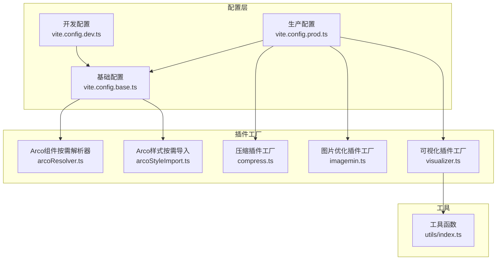
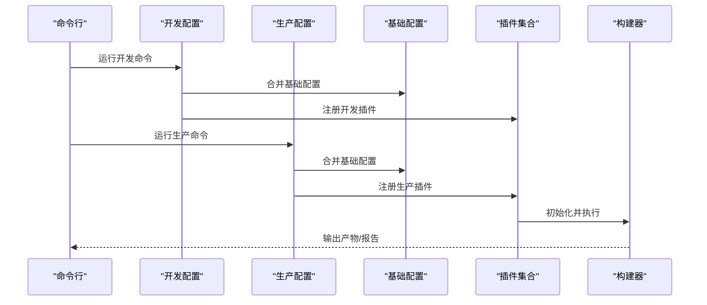
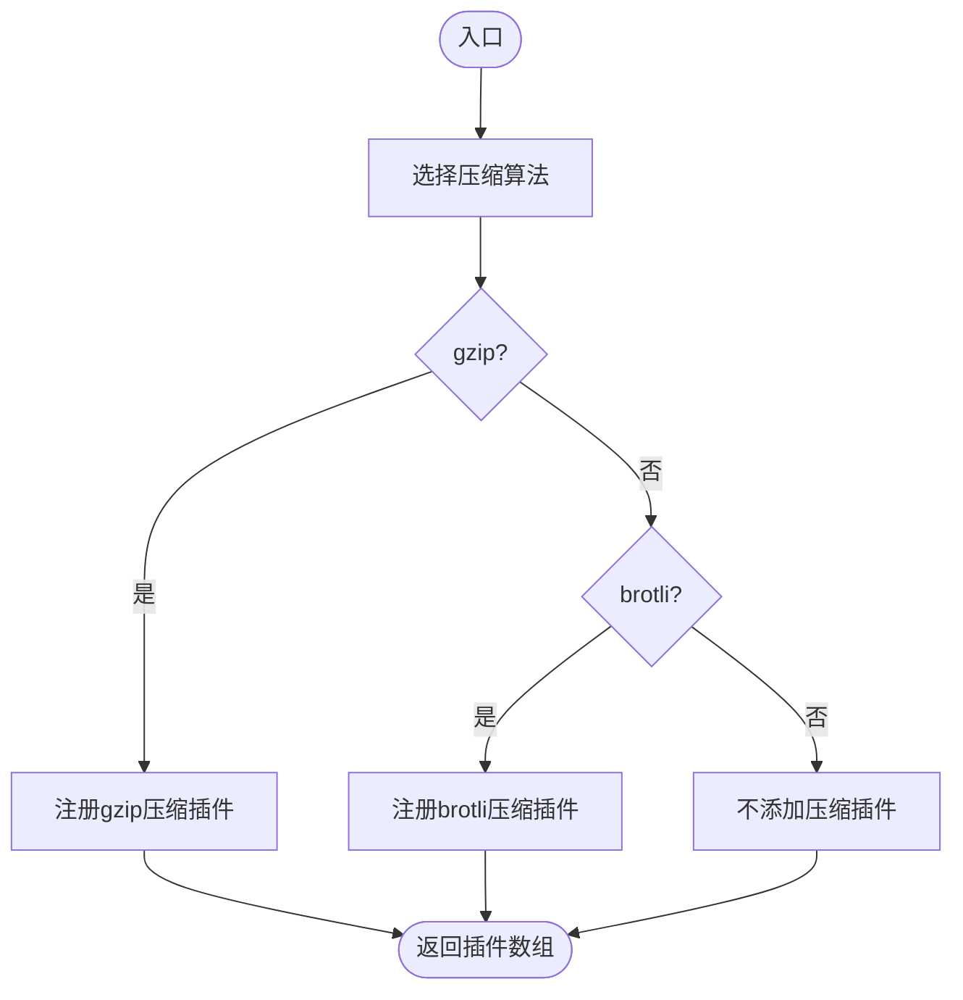
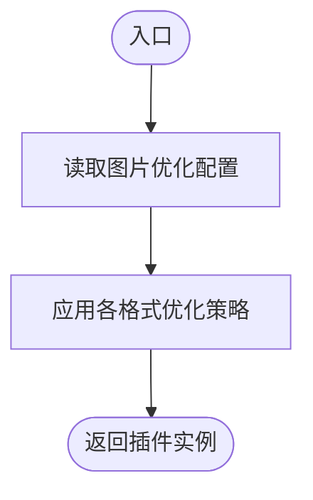
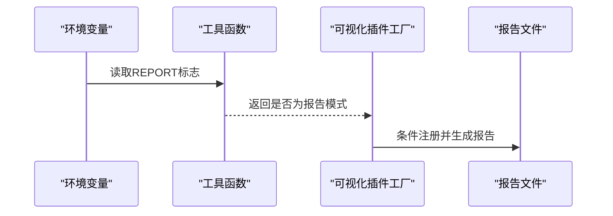
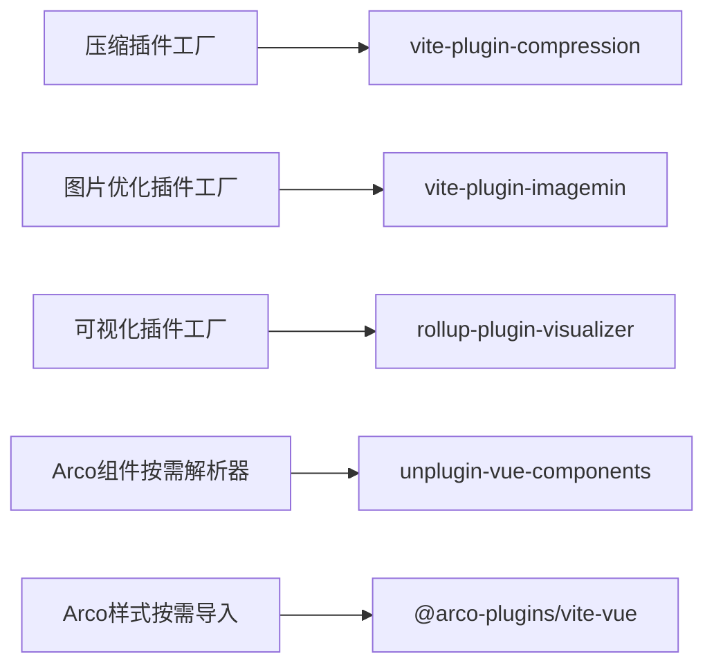

# 插件系统

<cite>
**本文引用的文件**
- [vite.config.base.ts](file://config/vite.config.base.ts)
- [vite.config.dev.ts](file://config/vite.config.dev.ts)
- [vite.config.prod.ts](file://config/vite.config.prod.ts)
- [compress.ts](file://config/plugin/compress.ts)
- [imagemin.ts](file://config/plugin/imagemin.ts)
- [visualizer.ts](file://config/plugin/visualizer.ts)
- [arcoResolver.ts](file://config/plugin/arcoResolver.ts)
- [arcoStyleImport.ts](file://config/plugin/arcoStyleImport.ts)
- [index.ts（工具）](file://config/utils/index.ts)
- [package.json](file://package.json)
</cite>

## 目录
1. [简介](#简介)
2. [项目结构](#项目结构)
3. [核心组件](#核心组件)
4. [架构总览](#架构总览)
5. [详细组件分析](#详细组件分析)
6. [依赖分析](#依赖分析)
7. [性能考量](#性能考量)
8. [故障排查指南](#故障排查指南)
9. [结论](#结论)
10. [附录](#附录)

## 简介
本指南围绕项目中的Vite插件体系展开，系统性阐述插件的开发原理、配置管理与插件间协作机制；重点解析压缩插件、图片优化插件与可视化插件的实现思路；并提供生命周期管理、配置选项设计、调试方法、最佳实践、性能优化与错误处理策略，以及发布流程、版本管理与社区贡献规范建议。

## 项目结构
项目采用“按环境拆分配置 + 插件工厂函数”的组织方式：
- 基础配置集中于基础构建配置文件，统一定义解析别名、CSS预处理、通用插件等。
- 开发与生产环境分别通过合并配置的方式叠加各自插件与构建参数。
- 插件以工厂函数形式封装，便于按模式启用、传参与复用。

图表来源
- [vite.config.base.ts:1-52](file://config/vite.config.base.ts#L1-L52)
- [vite.config.dev.ts:1-24](file://config/vite.config.dev.ts#L1-L24)
- [vite.config.prod.ts:1-32](file://config/vite.config.prod.ts#L1-L32)
- [compress.ts:1-35](file://config/plugin/compress.ts#L1-L35)
- [imagemin.ts:1-38](file://config/plugin/imagemin.ts#L1-L38)
- [visualizer.ts:1-19](file://config/plugin/visualizer.ts#L1-L19)
- [arcoResolver.ts:1-20](file://config/plugin/arcoResolver.ts#L1-L20)
- [arcoStyleImport.ts:1-13](file://config/plugin/arcoStyleImport.ts#L1-L13)
- [index.ts（工具）:1-10](file://config/utils/index.ts#L1-L10)

章节来源
- [vite.config.base.ts:1-52](file://config/vite.config.base.ts#L1-L52)
- [vite.config.dev.ts:1-24](file://config/vite.config.dev.ts#L1-L24)
- [vite.config.prod.ts:1-32](file://config/vite.config.prod.ts#L1-L32)

## 核心组件
- 基础配置：统一设置路径别名、CSS变量注入、Vue相关插件与通用解析规则，作为开发与生产的共同基座。
- 开发配置：在基础之上增加ESLint校验插件与本地服务参数，提升开发体验。
- 生产配置：在基础之上启用压缩、图片优化、可视化分析与Arco组件按需解析等插件，并配置手动分包策略与体积警告阈值。
- 工具函数：提供是否生成打包报告的判断逻辑，用于条件化启用可视化插件。

章节来源
- [vite.config.base.ts:1-52](file://config/vite.config.base.ts#L1-L52)
- [vite.config.dev.ts:1-24](file://config/vite.config.dev.ts#L1-L24)
- [vite.config.prod.ts:1-32](file://config/vite.config.prod.ts#L1-L32)
- [index.ts（工具）:7-10](file://config/utils/index.ts#L7-L10)

## 架构总览
下图展示从命令到插件执行的关键流程：命令触发 -> 合并配置 -> 初始化插件 -> 执行构建/预览 -> 输出产物与报告。

图表来源
- [vite.config.dev.ts:1-24](file://config/vite.config.dev.ts#L1-L24)
- [vite.config.prod.ts:1-32](file://config/vite.config.prod.ts#L1-L32)
- [vite.config.base.ts:1-52](file://config/vite.config.base.ts#L1-L52)

## 详细组件分析

### 压缩插件（gzip/brotli）
- 设计目标：在生产环境下对产物进行压缩输出，减小传输体积。
- 实现要点：
  - 工厂函数根据传入算法选择性注册对应压缩插件。
  - 支持删除原始文件的可选行为，便于控制产物体积与兼容性。
- 生命周期：
  - 在构建阶段对输出产物进行二次处理，通常在Rollup打包完成后执行。
- 配置选项：
  - 算法类型：gzip 或 brotli。
  - 输出扩展名：.gz 或 .br。
  - 是否删除源文件：可选。
- 调试建议：
  - 通过对比构建前后的产物大小与缓存命中情况验证效果。
  - 关注服务器端对不同压缩算法的支持度。

图表来源
- [compress.ts:9-35](file://config/plugin/compress.ts#L9-L35)

章节来源
- [compress.ts:1-35](file://config/plugin/compress.ts#L1-L35)
- [vite.config.prod.ts:11-16](file://config/vite.config.prod.ts#L11-L16)

### 图片优化插件
- 设计目标：在生产环境下对图片资源进行无损/有损压缩，降低包体。
- 实现要点：
  - 使用统一的图片优化插件工厂，集中配置各类图片编解码器参数。
  - 对GIF、PNG、JPEG、SVG等格式分别设定优化策略。
- 生命周期：
  - 在Rollup打包过程中对静态资源进行转换与压缩。
- 配置选项：
  - GIF：层级与隔行扫描。
  - PNG：量化质量与速度。
  - JPEG：质量与编码器。
  - SVG：插件列表（如移除视窗、空属性等）。
- 调试建议：
  - 对比优化前后图片质量与体积，关注关键页面首屏资源。
  - 结合浏览器网络面板观察加载时间变化。

图表来源
- [imagemin.ts:8-38](file://config/plugin/imagemin.ts#L8-L38)

章节来源
- [imagemin.ts:1-38](file://config/plugin/imagemin.ts#L1-L38)
- [vite.config.prod.ts:15](file://config/vite.config.prod.ts#L15)

### 可视化插件（打包分析）
- 设计目标：生成打包产物的可视化报告，辅助分析模块构成与体积分布。
- 实现要点：
  - 通过工具函数判断是否处于报告模式，仅在需要时注册插件。
  - 报告文件路径固定在缓存目录，支持打开浏览器自动查看。
  - 同时显示gzip与brotli体积，便于更贴近真实传输体积的评估。
- 生命周期：
  - 在构建完成阶段生成报告文件。
- 配置选项：
  - 输出文件路径。
  - 是否自动打开浏览器。
  - 是否计算gzip/brotli体积。
- 调试建议：
  - 使用独立脚本开启报告模式，定位大体积模块与重复依赖。
  - 将报告与分包策略联动，持续优化chunk划分。

图表来源
- [visualizer.ts:8-19](file://config/plugin/visualizer.ts#L8-L19)
- [index.ts（工具）:7-10](file://config/utils/index.ts#L7-L10)

章节来源
- [visualizer.ts:1-19](file://config/plugin/visualizer.ts#L1-L19)
- [index.ts（工具）:7-10](file://config/utils/index.ts#L7-L10)
- [vite.config.prod.ts:13-14](file://config/vite.config.prod.ts#L13-L14)

### Arco组件按需解析器
- 设计目标：在模板中按需引入组件，减少全量引入带来的包体膨胀。
- 实现要点：
  - 使用组件自动解析器，结合Arco解析器实现按需导入。
  - 通过禁用深度解析与排除特定目录，避免误解析自定义组件。
- 生命周期：
  - 在开发与生产均生效，影响组件解析与导入路径。
- 配置选项：
  - 解析器列表。
  - 目录过滤与深度控制。
- 调试建议：
  - 通过最小示例验证组件是否正确按需引入。
  - 结合打包报告确认未出现重复或冗余导入。

章节来源
- [arcoResolver.ts:1-20](file://config/plugin/arcoResolver.ts#L1-L20)
- [vite.config.base.ts:6](file://config/vite.config.base.ts#L6)

### Arco样式按需导入
- 设计目标：按需导入主题样式，避免全局样式污染与体积浪费。
- 实现要点：
  - 使用Arco提供的Vite插件，集中处理样式导入。
- 生命周期：
  - 在构建早期介入，确保样式解析顺序正确。
- 配置选项：
  - 插件初始化参数（当前为空对象）。
- 调试建议：
  - 切换主题变量后验证样式覆盖是否生效。
  - 关注样式打包顺序与运行时样式注入时机。

章节来源
- [arcoStyleImport.ts:1-13](file://config/plugin/arcoStyleImport.ts#L1-L13)
- [vite.config.base.ts:13](file://config/vite.config.base.ts#L13)

## 依赖分析
- 插件与配置的耦合关系：
  - 生产配置集中注册压缩、图片优化与可视化插件，形成明确的构建链路。
  - 基础配置统一注入Arco相关插件，保证开发与生产一致的主题与组件行为。
- 外部依赖与集成点：
  - 压缩插件依赖第三方压缩算法实现。
  - 图片优化插件依赖多种编解码器，需注意平台与二进制依赖。
  - 可视化插件依赖Rollup插件生态，生成HTML报告。
- 潜在循环依赖：
  - 当前结构清晰，插件工厂仅返回插件实例，未见循环调用。
- 接口契约：
  - 插件工厂遵循统一签名，便于替换与扩展。

图表来源
- [compress.ts:7](file://config/plugin/compress.ts#L7)
- [imagemin.ts:6](file://config/plugin/imagemin.ts#L6)
- [visualizer.ts:5](file://config/plugin/visualizer.ts#L5)
- [arcoResolver.ts:9](file://config/plugin/arcoResolver.ts#L9)
- [arcoStyleImport.ts:7](file://config/plugin/arcoStyleImport.ts#L7)

章节来源
- [package.json:49-92](file://package.json#L49-L92)

## 性能考量
- 分包与缓存命中：
  - 生产配置中通过手动分包策略将常用库拆分为独立chunk，提升缓存命中率。
- 压缩策略：
  - 在生产环境启用gzip/brotli压缩，结合可视化报告评估收益。
- 资源优化：
  - 图片优化针对多格式设定不同策略，兼顾体积与质量。
- 构建体积监控：
  - 设置体积警告阈值，及时发现异常增长。

章节来源
- [vite.config.prod.ts:17-28](file://config/vite.config.prod.ts#L17-L28)

## 故障排查指南
- 可视化报告未生成：
  - 确认报告模式开关已启用，且插件工厂返回了有效实例。
  - 检查报告文件路径是否存在写权限。
- 压缩插件未生效：
  - 确认传入的算法类型与期望一致，且未误删源文件导致回退。
  - 检查服务器端对相应压缩格式的支持。
- 图片优化失败：
  - 检查平台是否满足各编解码器的二进制依赖要求。
  - 逐步缩小到特定格式，定位问题插件。
- 组件按需导入异常：
  - 确认解析器配置未误排除目标组件目录。
  - 检查模板中组件使用方式是否符合按需导入约定。

章节来源
- [visualizer.ts:8-19](file://config/plugin/visualizer.ts#L8-L19)
- [index.ts（工具）:7-10](file://config/utils/index.ts#L7-L10)
- [compress.ts:9-35](file://config/plugin/compress.ts#L9-L35)
- [imagemin.ts:8-38](file://config/plugin/imagemin.ts#L8-L38)
- [arcoResolver.ts:12-19](file://config/plugin/arcoResolver.ts#L12-L19)

## 结论
本项目通过“基础配置 + 环境配置 + 插件工厂”的架构，实现了插件的模块化与可配置化。压缩、图片优化与可视化插件在生产环境协同工作，配合手动分包与按需解析策略，有效提升了构建效率与产物体积表现。建议在后续迭代中持续关注插件生态演进，完善测试与可观测性，确保插件链路稳定与可维护。

## 附录
- 发布流程与版本管理建议：
  - 使用语义化版本，变更日志记录重大插件更新。
  - 在CI中固定插件版本，避免意外升级破坏构建。
- 社区贡献规范：
  - 新增插件需提供最小可运行示例与配置说明。
  - 提交前确保与现有插件工厂风格一致，保持统一签名与命名。