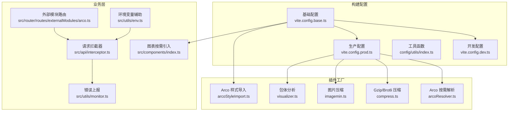
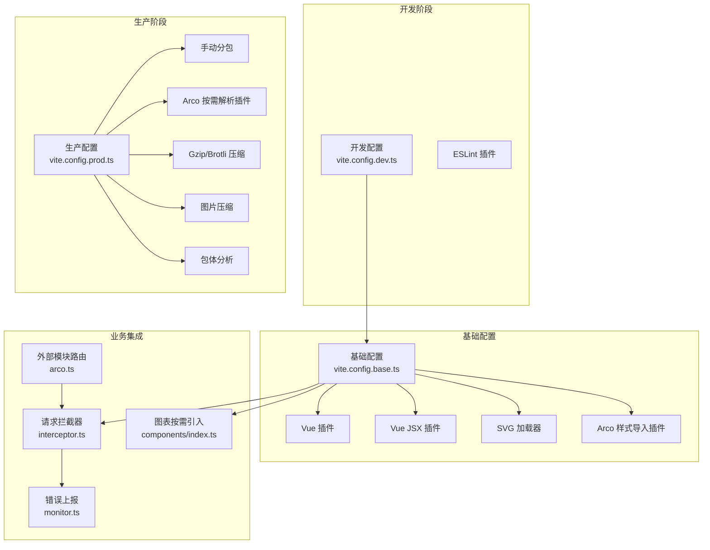
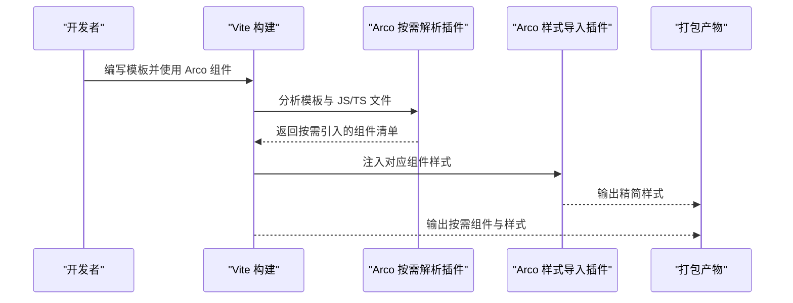
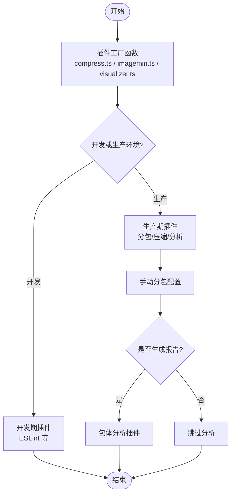
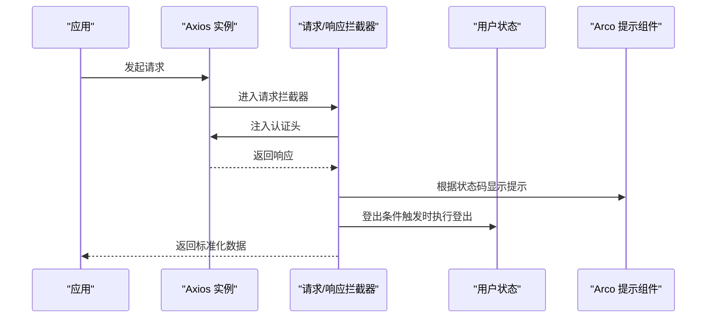
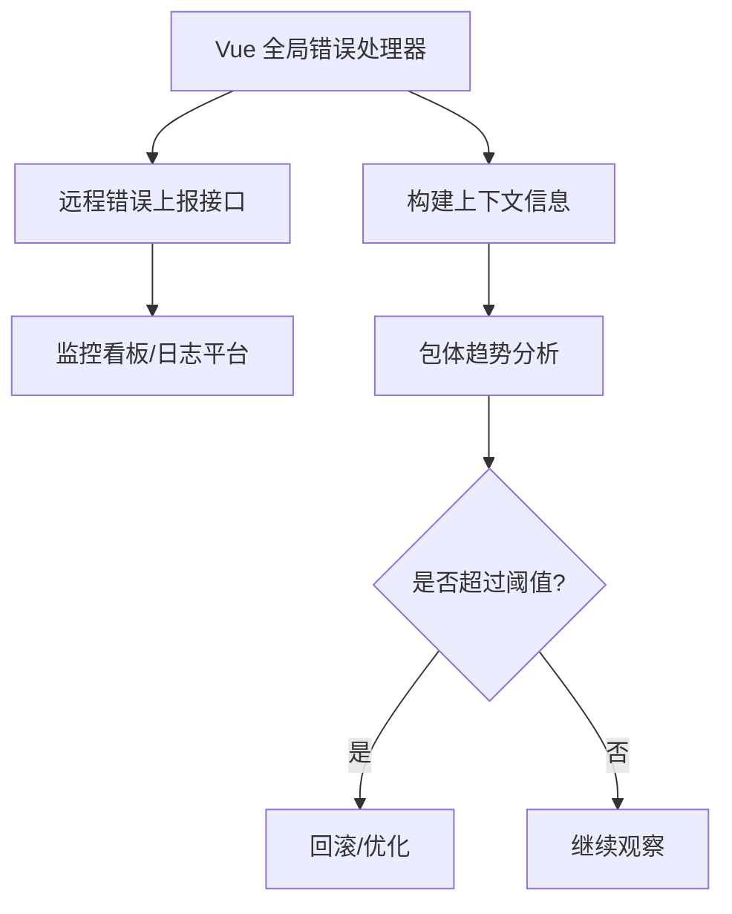
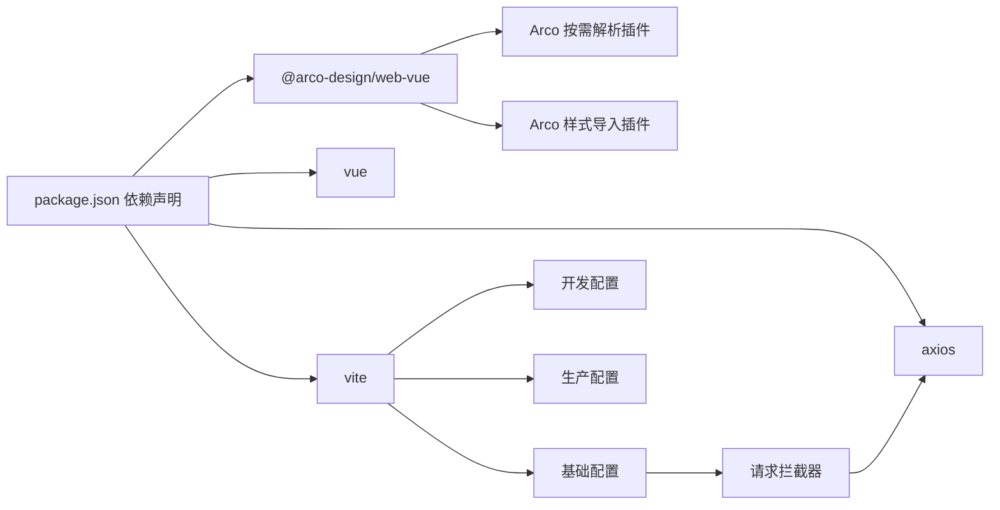

# 第三方集成

<cite>
**本文引用的文件**
- [package.json](file://package.json)
- [vite.config.base.ts](file://config/vite.config.base.ts)
- [vite.config.dev.ts](file://config/vite.config.dev.ts)
- [vite.config.prod.ts](file://config/vite.config.prod.ts)
- [arcoResolver.ts](file://config/plugin/arcoResolver.ts)
- [arcoStyleImport.ts](file://config/plugin/arcoStyleImport.ts)
- [compress.ts](file://config/plugin/compress.ts)
- [imagemin.ts](file://config/plugin/imagemin.ts)
- [visualizer.ts](file://config/plugin/visualizer.ts)
- [index.ts（工具函数）](file://config/utils/index.ts)
- [components/index.ts](file://src/components/index.ts)
- [interceptor.ts](file://src/api/interceptor.ts)
- [monitor.ts](file://src/utils/monitor.ts)
- [arco.ts（外部模块路由）](file://src/router/routes/externalModules/arco.ts)
- [env.ts](file://src/utils/env.ts)
</cite>

## 目录
1. [简介](#简介)
2. [项目结构](#项目结构)
3. [核心组件](#核心组件)
4. [架构总览](#架构总览)
5. [详细组件分析](#详细组件分析)
6. [依赖分析](#依赖分析)
7. [性能考量](#性能考量)
8. [故障排查指南](#故障排查指南)
9. [结论](#结论)
10. [附录](#附录)

## 简介
本指南聚焦于本项目的第三方集成实践，涵盖以下主题：
- 如何集成新的第三方库与插件系统扩展
- 构建工具（Vite）的配置与优化
- Arco Design 组件库的按需引入与样式自动导入
- 外部 API 的集成方法、SDK 封装与异步加载处理
- 版本管理、兼容性测试与性能监控策略
- 安全考虑与依赖冲突的解决方案

## 项目结构
项目采用 Vite + Vue 3 的前端工程化方案，通过分环境配置与插件体系实现按需引入、样式注入、资源压缩与可视化分析等能力。核心目录与职责如下：
- config：构建配置与插件工厂
  - plugin：各类 Vite 插件的封装与导出
  - vite.config.*：基础、开发、生产环境配置
- src：业务源码
  - api：HTTP 请求拦截器与外部接口封装
  - components：全局组件注册与图表模块按需引入
  - utils：错误上报、环境判断等工具
  - router/routes/externalModules：外部站点路由挂载

**图示来源**
- [vite.config.base.ts:1-52](file://config/vite.config.base.ts#L1-L52)
- [vite.config.dev.ts:1-24](file://config/vite.config.dev.ts#L1-L24)
- [vite.config.prod.ts:1-32](file://config/vite.config.prod.ts#L1-L32)
- [arcoResolver.ts:1-20](file://config/plugin/arcoResolver.ts#L1-L20)
- [arcoStyleImport.ts:1-13](file://config/plugin/arcoStyleImport.ts#L1-L13)
- [compress.ts:1-35](file://config/plugin/compress.ts#L1-L35)
- [imagemin.ts:1-38](file://config/plugin/imagemin.ts#L1-L38)
- [visualizer.ts:1-19](file://config/plugin/visualizer.ts#L1-L19)
- [components/index.ts:1-36](file://src/components/index.ts#L1-L36)
- [interceptor.ts:1-78](file://src/api/interceptor.ts#L1-L78)
- [monitor.ts:1-29](file://src/utils/monitor.ts#L1-L29)
- [arco.ts（外部模块路由）:1-11](file://src/router/routes/externalModules/arco.ts#L1-L11)
- [index.ts（工具函数）:1-10](file://config/utils/index.ts#L1-L10)

**章节来源**
- [vite.config.base.ts:1-52](file://config/vite.config.base.ts#L1-L52)
- [vite.config.dev.ts:1-24](file://config/vite.config.dev.ts#L1-L24)
- [vite.config.prod.ts:1-32](file://config/vite.config.prod.ts#L1-L32)

## 核心组件
- Arco 按需引入与样式自动导入
  - 使用 Arco 解析器插件在开发时进行组件按需解析；在生产环境启用 Arco 样式自动导入插件，减少全局样式体积。
- 构建期资源优化
  - Gzip/Brotli 压缩、图片压缩、包体可视化分析，配合手动分包策略提升首屏与二次加载体验。
- API 与 SDK 封装
  - 基于 Axios 的请求/响应拦截器统一处理鉴权、错误提示与登出逻辑；对外部站点以路由外链形式集成。
- 错误监控与上报
  - 全局错误处理器对接远程错误上报服务，便于问题追踪与性能监控。

**章节来源**
- [arcoResolver.ts:1-20](file://config/plugin/arcoResolver.ts#L1-L20)
- [arcoStyleImport.ts:1-13](file://config/plugin/arcoStyleImport.ts#L1-L13)
- [compress.ts:1-35](file://config/plugin/compress.ts#L1-L35)
- [imagemin.ts:1-38](file://config/plugin/imagemin.ts#L1-L38)
- [visualizer.ts:1-19](file://config/plugin/visualizer.ts#L1-L19)
- [interceptor.ts:1-78](file://src/api/interceptor.ts#L1-L78)
- [monitor.ts:1-29](file://src/utils/monitor.ts#L1-L29)

## 架构总览
下图展示从开发到生产的第三方集成路径，包括插件装配、按需引入与样式注入、资源优化与错误上报的关键节点。

**图示来源**
- [vite.config.dev.ts:1-24](file://config/vite.config.dev.ts#L1-L24)
- [vite.config.base.ts:1-52](file://config/vite.config.base.ts#L1-L52)
- [vite.config.prod.ts:1-32](file://config/vite.config.prod.ts#L1-L32)
- [interceptor.ts:1-78](file://src/api/interceptor.ts#L1-L78)
- [monitor.ts:1-29](file://src/utils/monitor.ts#L1-L29)
- [components/index.ts:1-36](file://src/components/index.ts#L1-L36)
- [arco.ts（外部模块路由）:1-11](file://src/router/routes/externalModules/arco.ts#L1-L11)

## 详细组件分析

### Arco Design 组件库的按需引入与样式自动导入
- 按需引入
  - 开发环境通过 Arco 解析器插件对模板中的组件进行识别与按需解析，避免全量引入导致的体积膨胀。
  - 生产环境启用 Arco 样式自动导入插件，仅注入实际使用的组件样式，降低 CSS 体积。
- 样式自动导入
  - 基础配置中已注册 Arco 样式导入插件，确保在开发与生产环境中均能正确注入样式。
- 与 ECharts 的协同
  - 业务侧对 ECharts 进行手动模块化引入，进一步减小打包体积，与 Arco 的按需策略形成互补。

**图示来源**
- [arcoResolver.ts:1-20](file://config/plugin/arcoResolver.ts#L1-L20)
- [arcoStyleImport.ts:1-13](file://config/plugin/arcoStyleImport.ts#L1-L13)
- [vite.config.base.ts:1-52](file://config/vite.config.base.ts#L1-L52)
- [vite.config.prod.ts:1-32](file://config/vite.config.prod.ts#L1-L32)

**章节来源**
- [arcoResolver.ts:1-20](file://config/plugin/arcoResolver.ts#L1-L20)
- [arcoStyleImport.ts:1-13](file://config/plugin/arcoStyleImport.ts#L1-L13)
- [vite.config.base.ts:1-52](file://config/vite.config.base.ts#L1-L52)
- [vite.config.prod.ts:1-32](file://config/vite.config.prod.ts#L1-L32)
- [components/index.ts:1-36](file://src/components/index.ts#L1-L36)

### Vite 插件的开发与扩展
- 插件工厂模式
  - 将常用插件封装为可复用的工厂函数，支持参数化配置（如压缩算法、删除原文件等），便于在不同环境灵活启用。
- 插件装配顺序
  - 基础配置集中注册通用插件；开发配置追加开发期插件；生产配置追加分包与优化插件。
- 可视化分析
  - 通过环境变量控制是否生成包体分析报告，辅助定位体积增长点。

**图示来源**
- [compress.ts:1-35](file://config/plugin/compress.ts#L1-L35)
- [imagemin.ts:1-38](file://config/plugin/imagemin.ts#L1-L38)
- [visualizer.ts:1-19](file://config/plugin/visualizer.ts#L1-L19)
- [index.ts（工具函数）:1-10](file://config/utils/index.ts#L1-L10)
- [vite.config.dev.ts:1-24](file://config/vite.config.dev.ts#L1-L24)
- [vite.config.prod.ts:1-32](file://config/vite.config.prod.ts#L1-L32)

**章节来源**
- [compress.ts:1-35](file://config/plugin/compress.ts#L1-L35)
- [imagemin.ts:1-38](file://config/plugin/imagemin.ts#L1-L38)
- [visualizer.ts:1-19](file://config/plugin/visualizer.ts#L1-L19)
- [index.ts（工具函数）:1-10](file://config/utils/index.ts#L1-L10)
- [vite.config.dev.ts:1-24](file://config/vite.config.dev.ts#L1-L24)
- [vite.config.prod.ts:1-32](file://config/vite.config.prod.ts#L1-L32)

### 外部 API 的集成方法、SDK 封装与异步加载
- 请求拦截器
  - 在请求阶段统一注入认证信息；在响应阶段根据业务状态码进行统一提示与登出处理，保证用户体验与安全性。
- SDK 封装
  - 建议将外部 API 的调用封装为独立模块，集中处理 baseURL、超时、重试与错误映射，便于替换与升级。
- 异步加载
  - 对非关键路径的外部资源（如外部站点）采用路由外链方式加载，避免阻塞主应用初始化。

**图示来源**
- [interceptor.ts:1-78](file://src/api/interceptor.ts#L1-L78)
- [arco.ts（外部模块路由）:1-11](file://src/router/routes/externalModules/arco.ts#L1-L11)

**章节来源**
- [interceptor.ts:1-78](file://src/api/interceptor.ts#L1-L78)
- [arco.ts（外部模块路由）:1-11](file://src/router/routes/externalModules/arco.ts#L1-L11)

### 错误监控与性能监控策略
- 全局错误上报
  - 通过 Vue 全局错误处理器捕获异常，并向指定后端上报错误上下文，便于问题定位与修复。
- 性能监控
  - 结合包体分析插件与手动分包策略，持续关注关键依赖体积变化；对第三方库的更新进行回归测试，确保性能不退化。

**图示来源**
- [monitor.ts:1-29](file://src/utils/monitor.ts#L1-L29)
- [visualizer.ts:1-19](file://config/plugin/visualizer.ts#L1-L19)
- [vite.config.prod.ts:1-32](file://config/vite.config.prod.ts#L1-L32)

**章节来源**
- [monitor.ts:1-29](file://src/utils/monitor.ts#L1-L29)
- [visualizer.ts:1-19](file://config/plugin/visualizer.ts#L1-L19)
- [vite.config.prod.ts:1-32](file://config/vite.config.prod.ts#L1-L32)

## 依赖分析
- 依赖关系概览
  - Arco Design 组件库与相关插件在开发与生产环境分别承担“按需解析”与“样式注入”的职责。
  - 构建期插件在生产环境组合使用，形成完整的体积优化链路。
  - 业务层通过 Axios 封装统一接入外部 API，错误处理与登出流程由拦截器集中管理。

**图示来源**
- [package.json:1-103](file://package.json#L1-L103)
- [vite.config.base.ts:1-52](file://config/vite.config.base.ts#L1-L52)
- [vite.config.dev.ts:1-24](file://config/vite.config.dev.ts#L1-L24)
- [vite.config.prod.ts:1-32](file://config/vite.config.prod.ts#L1-L32)
- [interceptor.ts:1-78](file://src/api/interceptor.ts#L1-L78)

**章节来源**
- [package.json:1-103](file://package.json#L1-L103)
- [vite.config.base.ts:1-52](file://config/vite.config.base.ts#L1-L52)
- [vite.config.prod.ts:1-32](file://config/vite.config.prod.ts#L1-L32)

## 性能考量
- 手动分包策略
  - 将 Arco、图表与 Vue 生态相关依赖拆分为独立 chunk，提升缓存命中率与并行加载效率。
- 资源压缩
  - 生产环境启用 Gzip/Brotli 压缩与图片压缩，显著降低传输体积。
- 包体分析
  - 通过可视化报告识别体积增长点，结合按需引入与模块化策略持续优化。
- 图表与组件按需
  - 对 ECharts 与 Arco 组件采用按需引入，避免不必要的依赖进入主包。

**章节来源**
- [vite.config.prod.ts:1-32](file://config/vite.config.prod.ts#L1-L32)
- [compress.ts:1-35](file://config/plugin/compress.ts#L1-L35)
- [imagemin.ts:1-38](file://config/plugin/imagemin.ts#L1-L38)
- [visualizer.ts:1-19](file://config/plugin/visualizer.ts#L1-L19)
- [components/index.ts:1-36](file://src/components/index.ts#L1-L36)

## 故障排查指南
- 开发期 ESLint 报错
  - 确认开发配置中 ESLint 插件已启用并正确匹配源码路径。
- Arco 样式未生效
  - 检查基础配置中 Arco 样式导入插件是否注册；确认生产环境未禁用按需解析。
- 请求失败或鉴权异常
  - 查看请求拦截器是否正确注入认证头；核对响应拦截器的状态码分支与登出逻辑。
- 包体异常增大
  - 生成可视化报告并对比历史数据；检查新增依赖与分包策略是否合理。
- 外部站点无法访问
  - 确认路由外链配置与网络策略；检查浏览器跨域与安全策略。

**章节来源**
- [vite.config.dev.ts:1-24](file://config/vite.config.dev.ts#L1-L24)
- [vite.config.base.ts:1-52](file://config/vite.config.base.ts#L1-L52)
- [interceptor.ts:1-78](file://src/api/interceptor.ts#L1-L78)
- [visualizer.ts:1-19](file://config/plugin/visualizer.ts#L1-L19)
- [arco.ts（外部模块路由）:1-11](file://src/router/routes/externalModules/arco.ts#L1-L11)

## 结论
本项目通过 Vite 插件工厂化与分环境配置，实现了 Arco Design 的按需引入与样式自动注入、构建期资源优化与包体分析、以及基于 Axios 的统一 API 封装与错误处理。建议在引入新第三方库时遵循“按需引入 + 工厂插件 + 分包策略 + 监控告警”的最佳实践，确保功能完整性与性能稳定性。

## 附录
- 版本管理与兼容性测试
  - 使用锁定文件与语义化版本；在 CI 中执行类型检查与单元测试；对关键第三方库更新进行灰度验证。
- 安全考虑
  - 严格管理认证头与敏感数据；对外部站点采用白名单与 HTTPS；对脚本与样式来源进行 CSP 策略约束。
- 依赖冲突解决
  - 利用包管理器的去重与解析能力；必要时使用别名与解析规则规避冲突；对存在破坏性变更的库制定迁移计划。