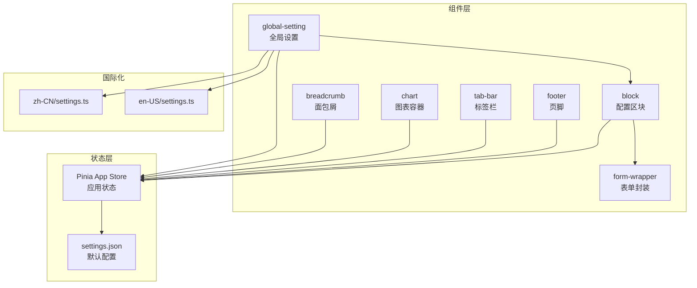
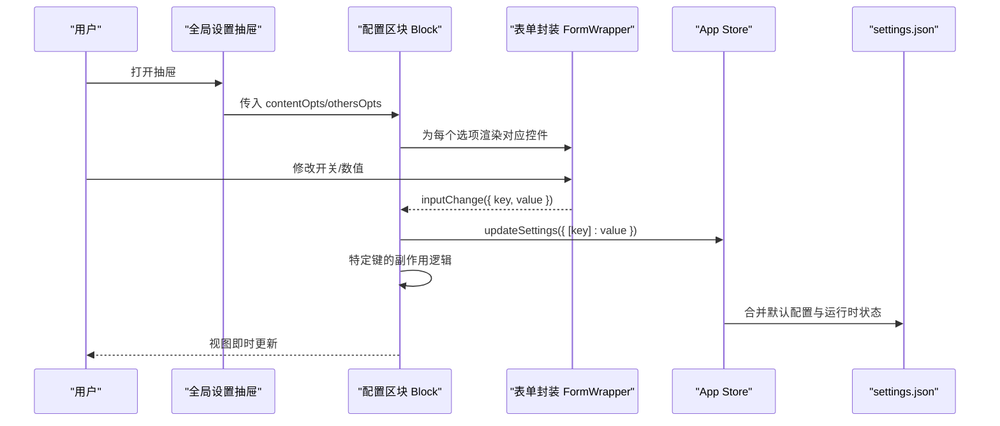
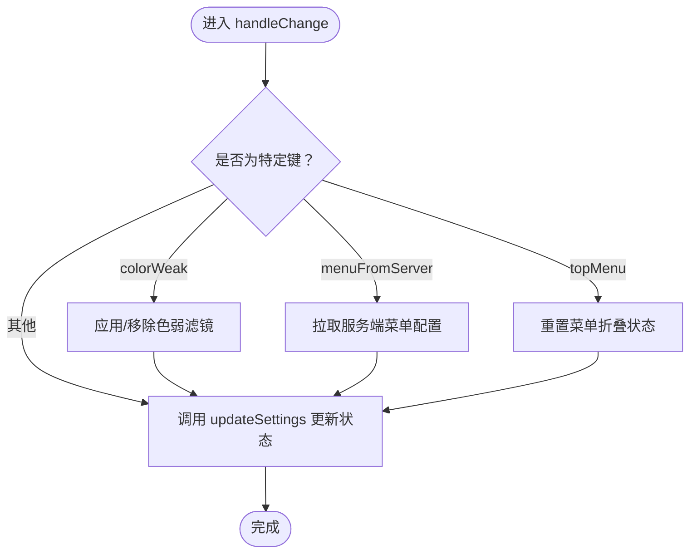
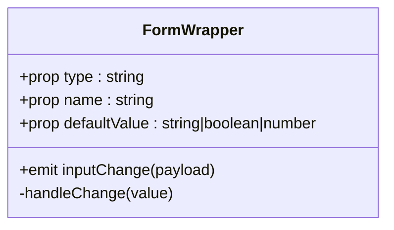
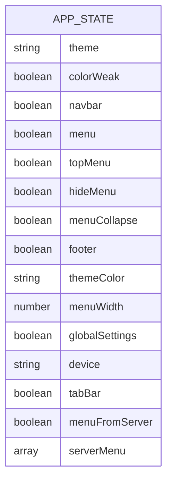
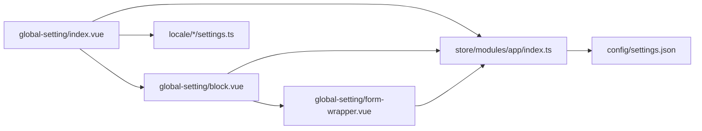

# 组件扩展

<cite>
**本文引用的文件**
- [src/components/global-setting/index.vue](file://src/components/global-setting/index.vue)
- [src/components/global-setting/block.vue](file://src/components/global-setting/block.vue)
- [src/components/global-setting/form-wrapper.vue](file://src/components/global-setting/form-wrapper.vue)
- [src/store/modules/app/index.ts](file://src/store/modules/app/index.ts)
- [src/store/modules/app/types.ts](file://src/store/modules/app/types.ts)
- [src/config/settings.json](file://src/config/settings.json)
- [src/locale/en-US/settings.ts](file://src/locale/en-US/settings.ts)
- [src/locale/zh-CN/settings.ts](file://src/locale/zh-CN/settings.ts)
- [src/components/index.ts](file://src/components/index.ts)
- [src/main.ts](file://src/main.ts)
- [src/components/breadcrumb/index.vue](file://src/components/breadcrumb/index.vue)
- [src/components/chart/index.vue](file://src/components/chart/index.vue)
- [src/components/tab-bar/index.vue](file://src/components/tab-bar/index.vue)
- [src/components/footer/index.vue](file://src/components/footer/index.vue)
</cite>

## 目录
1. [简介](#简介)
2. [项目结构](#项目结构)
3. [核心组件](#核心组件)
4. [架构总览](#架构总览)
5. [详细组件分析](#详细组件分析)
6. [依赖关系分析](#依赖关系分析)
7. [性能考量](#性能考量)
8. [故障排查指南](#故障排查指南)
9. [结论](#结论)
10. [附录](#附录)

## 简介
本指南围绕“组件扩展”的核心目标，系统解析以下关键能力：
- 全局设置组件的扩展机制：通过 Block 的配置化设计与 FormWrapper 的表单封装，实现设置项的声明式扩展与运行时联动。
- Block 组件的配置化设计：以选项数组驱动渲染，支持开关与数值两类输入类型，并在变更时触发应用状态更新与副作用逻辑。
- FormWrapper 的表单封装：统一抽象不同输入控件，向上游 Block 提供一致的事件接口，便于扩展新的输入类型。
- 组件属性扩展、事件处理增强与样式定制方法：通过 Props 接口、事件发射与样式作用域策略实现。
- 生命周期管理、状态传递与父子组件通信最佳实践：基于 Pinia Store 与 Vue 组合式 API 的响应式数据流。
- 可复用性设计与向后兼容性保证：通过统一的配置入口、类型约束与国际化文案，确保扩展过程稳定可靠。

## 项目结构
该工程采用按功能域组织的目录结构，组件集中在 src/components 下，全局设置相关组件位于 global-setting 子目录；应用状态由 Pinia Store 管理，配置项集中于 settings.json，国际化文案位于 locale 目录。

图示来源
- [src/components/global-setting/index.vue:1-99](file://src/components/global-setting/index.vue#L1-L99)
- [src/components/global-setting/block.vue:1-80](file://src/components/global-setting/block.vue#L1-L80)
- [src/components/global-setting/form-wrapper.vue:1-40](file://src/components/global-setting/form-wrapper.vue#L1-L40)
- [src/store/modules/app/index.ts:1-78](file://src/store/modules/app/index.ts#L1-L78)
- [src/config/settings.json:1-18](file://src/config/settings.json#L1-L18)
- [src/locale/en-US/settings.ts:1-30](file://src/locale/en-US/settings.ts#L1-L30)
- [src/locale/zh-CN/settings.ts:1-30](file://src/locale/zh-CN/settings.ts#L1-L30)

章节来源
- [src/main.ts:1-29](file://src/main.ts#L1-L29)
- [src/components/index.ts:1-36](file://src/components/index.ts#L1-L36)

## 核心组件
本节聚焦全局设置组件体系及其扩展点，包括：
- 全局设置抽屉：负责展示与交互，聚合多个配置区块。
- 配置区块 Block：以选项数组驱动渲染，统一处理变更事件与副作用。
- 表单封装 FormWrapper：抽象输入控件，提供统一的事件接口，便于扩展新类型。

章节来源
- [src/components/global-setting/index.vue:1-99](file://src/components/global-setting/index.vue#L1-L99)
- [src/components/global-setting/block.vue:1-80](file://src/components/global-setting/block.vue#L1-L80)
- [src/components/global-setting/form-wrapper.vue:1-40](file://src/components/global-setting/form-wrapper.vue#L1-L40)

## 架构总览
全局设置组件通过三层协作实现扩展：
- 声明式配置：settings.json 定义默认值，App Store 将其作为初始状态。
- 运行时联动：Block 根据 options 渲染 FormWrapper，FormWrapper 发出 inputChange 事件，Block 调整应用状态并执行副作用。
- 国际化与本地化：通过 i18n 文案映射，确保扩展项文案可翻译。

图示来源
- [src/components/global-setting/index.vue:39-71](file://src/components/global-setting/index.vue#L39-L71)
- [src/components/global-setting/block.vue:40-59](file://src/components/global-setting/block.vue#L40-L59)
- [src/components/global-setting/form-wrapper.vue:32-38](file://src/components/global-setting/form-wrapper.vue#L32-L38)
- [src/store/modules/app/index.ts:24-29](file://src/store/modules/app/index.ts#L24-L29)
- [src/config/settings.json:1-18](file://src/config/settings.json#L1-L18)

## 详细组件分析

### 全局设置抽屉（index.vue）
- 功能职责
  - 控制抽屉显示/隐藏，绑定应用状态中的 globalSettings 字段。
  - 聚合内容区与其它设置区的选项数组，分别渲染 Block。
  - 提供复制配置能力，将当前运行时状态序列化后写入剪贴板。
- 关键点
  - 通过计算属性将应用状态与视图绑定，实现双向联动。
  - 使用国际化文案提升可读性与可维护性。
  - 通过事件发射 cancel，便于上层组件监听抽屉关闭动作。

章节来源
- [src/components/global-setting/index.vue:1-99](file://src/components/global-setting/index.vue#L1-L99)

### 配置区块（block.vue）
- 功能职责
  - 以 options 数组驱动渲染，每个选项对应一个 FormWrapper。
  - 统一处理 inputChange 事件，调用 App Store 更新设置。
  - 在特定键发生变更时执行副作用逻辑（如色弱滤镜、菜单拉取、顶部菜单展开等）。
- 扩展机制
  - 新增选项：在父组件传入的 options 中添加对象项，包含 name、key、type、defaultVal 等字段。
  - 新增副作用：在 handleChange 中增加条件分支，处理新增键的业务逻辑。
- 类型与校验
  - 通过 Props 接口约束 options 的结构，确保扩展项具备必要字段。

图示来源
- [src/components/global-setting/block.vue:40-59](file://src/components/global-setting/block.vue#L40-L59)

章节来源
- [src/components/global-setting/block.vue:1-80](file://src/components/global-setting/block.vue#L1-L80)

### 表单封装（form-wrapper.vue）
- 功能职责
  - 根据 type 决定渲染 a-switch 或 a-input-number。
  - 将用户输入转换为统一事件 inputChange，携带 key 与 value。
- 扩展机制
  - 新增输入类型：在模板中添加新的 v-if 分支，或引入新的控件组件。
  - 新增事件：在 handleChange 中扩展 emit 的 payload 结构，确保上游 Block 能正确消费。
- 属性与事件
  - 支持 name、type、defaultValue 三个属性。
  - 发射 inputChange 事件，便于 Block 统一处理。

图示来源
- [src/components/global-setting/form-wrapper.vue:17-39](file://src/components/global-setting/form-wrapper.vue#L17-L39)

章节来源
- [src/components/global-setting/form-wrapper.vue:1-40](file://src/components/global-setting/form-wrapper.vue#L1-L40)

### 应用状态与配置（App Store 与 settings.json）
- App Store
  - 初始化：从 settings.json 合并默认配置到 state。
  - 更新：通过 updateSettings 动作进行局部状态更新。
  - 副作用：如菜单拉取、主题切换、设备切换等。
- 配置项
  - 包含主题、导航栏、菜单、顶部菜单、页脚、标签栏、色弱模式、菜单宽度、全局设置开关、设备类型、服务端菜单等。
- 扩展建议
  - 新增配置项：在 settings.json 添加默认值，在 AppState 接口中声明类型。
  - 新增动作：在 App Store actions 中实现对应逻辑，避免直接修改全局 DOM。

图示来源
- [src/store/modules/app/types.ts:3-20](file://src/store/modules/app/types.ts#L3-L20)
- [src/config/settings.json:1-18](file://src/config/settings.json#L1-L18)

章节来源
- [src/store/modules/app/index.ts:1-78](file://src/store/modules/app/index.ts#L1-L78)
- [src/store/modules/app/types.ts:1-21](file://src/store/modules/app/types.ts#L1-L21)
- [src/config/settings.json:1-18](file://src/config/settings.json#L1-L18)

### 国际化与文案（i18n）
- 文案映射
  - en-US/settings.ts 与 zh-CN/settings.ts 提供全局设置相关的文案。
- 扩展建议
  - 新增设置项时，同步在两个语言文件中添加对应的键值对，确保国际化覆盖完整。

章节来源
- [src/locale/en-US/settings.ts:1-30](file://src/locale/en-US/settings.ts#L1-L30)
- [src/locale/zh-CN/settings.ts:1-30](file://src/locale/zh-CN/settings.ts#L1-L30)

### 组件注册与全局可用性
- 组件注册
  - 通过 components/index.ts 将常用组件注册为全局组件，简化使用。
- 扩展建议
  - 新组件若需全局可用，可在该文件中注册，保持一致性。
  - 对于仅局部使用的组件，建议在具体页面内按需引入，减少打包体积。

章节来源
- [src/components/index.ts:1-36](file://src/components/index.ts#L1-L36)
- [src/main.ts:1-29](file://src/main.ts#L1-L29)

### 其他通用组件（参考）
- 面包屑（breadcrumb）：演示了简单的 Props 接收与样式作用域。
- 图表容器（chart）：演示了基于第三方库的封装与生命周期控制。
- 标签栏（tab-bar）：演示了路由监听与状态联动。
- 页脚（footer）：演示了基础布局组件的样式定制。

章节来源
- [src/components/breadcrumb/index.vue:1-36](file://src/components/breadcrumb/index.vue#L1-L36)
- [src/components/chart/index.vue:1-48](file://src/components/chart/index.vue#L1-L48)
- [src/components/tab-bar/index.vue:1-102](file://src/components/tab-bar/index.vue#L1-L102)
- [src/components/footer/index.vue:1-17](file://src/components/footer/index.vue#L1-L17)

## 依赖关系分析
- 组件依赖
  - global-setting/index.vue 依赖 block.vue。
  - block.vue 依赖 form-wrapper.vue。
  - 三者均依赖 App Store 以读取与更新状态。
- 状态依赖
  - App Store 依赖 settings.json 的默认配置。
- 国际化依赖
  - global-setting 组件依赖 i18n 文案。

图示来源
- [src/components/global-setting/index.vue:1-99](file://src/components/global-setting/index.vue#L1-L99)
- [src/components/global-setting/block.vue:1-80](file://src/components/global-setting/block.vue#L1-L80)
- [src/components/global-setting/form-wrapper.vue:1-40](file://src/components/global-setting/form-wrapper.vue#L1-L40)
- [src/store/modules/app/index.ts:1-78](file://src/store/modules/app/index.ts#L1-L78)
- [src/config/settings.json:1-18](file://src/config/settings.json#L1-L18)
- [src/locale/en-US/settings.ts:1-30](file://src/locale/en-US/settings.ts#L1-L30)
- [src/locale/zh-CN/settings.ts:1-30](file://src/locale/zh-CN/settings.ts#L1-L30)

## 性能考量
- 按需渲染与卸载
  - 抽屉使用 unmount-on-close，避免长期驻留 DOM。
- 状态更新粒度
  - 通过 updateSettings 进行局部更新，减少不必要的重渲染。
- 输入控件优化
  - FormWrapper 根据 type 渲染轻量控件，避免过度复杂化。
- 图表渲染
  - chart 组件在 nextTick 后才渲染，避免初次渲染时尺寸异常。

章节来源
- [src/components/global-setting/index.vue:11-12](file://src/components/global-setting/index.vue#L11-L12)
- [src/store/modules/app/index.ts:24-29](file://src/store/modules/app/index.ts#L24-L29)
- [src/components/chart/index.vue:40-44](file://src/components/chart/index.vue#L40-L44)

## 故障排查指南
- 设置项不生效
  - 检查 options 中的 key 是否与 AppState 接口一致，确保 updateSettings 能正确更新。
  - 确认 handleChange 中是否存在针对该 key 的副作用逻辑。
- 色弱模式无效
  - 确认 handleChange 中对 colorWeak 的处理是否执行，以及 body 上的滤镜样式是否被覆盖。
- 服务端菜单未加载
  - 检查 menuFromServer 的副作用逻辑是否触发 fetchServerMenuConfig。
- 复制配置失败
  - 确认剪贴板权限与浏览器支持，检查 copySettings 的消息提示是否正常。
- 国际化文案缺失
  - 确认 en-US/settings.ts 与 zh-CN/settings.ts 中是否包含对应键值。

章节来源
- [src/components/global-setting/block.vue:47-58](file://src/components/global-setting/block.vue#L47-L58)
- [src/store/modules/app/index.ts:47-70](file://src/store/modules/app/index.ts#L47-L70)
- [src/components/global-setting/index.vue:77-81](file://src/components/global-setting/index.vue#L77-L81)
- [src/locale/en-US/settings.ts:1-30](file://src/locale/en-US/settings.ts#L1-L30)
- [src/locale/zh-CN/settings.ts:1-30](file://src/locale/zh-CN/settings.ts#L1-L30)

## 结论
通过 Block 的配置化设计与 FormWrapper 的表单封装，全局设置组件实现了声明式扩展与运行时联动。配合 Pinia Store 的状态管理与 settings.json 的默认配置，既能快速扩展新设置项，又能保证向后兼容与国际化支持。遵循本文的最佳实践，可以在不破坏现有功能的前提下，安全地进行组件扩展与组件库维护。

## 附录
- 扩展清单
  - 新增设置项：在 settings.json 添加默认值，在 AppState 接口中声明类型。
  - 新增 Block 选项：在父组件 options 中添加对象项，包含 name、key、type、defaultVal。
  - 新增副作用：在 Block.handleChange 中增加条件分支处理新键。
  - 新增输入类型：在 FormWrapper 模板中添加新的 v-if 分支或引入新控件。
  - 新增国际化文案：在 en-US/settings.ts 与 zh-CN/settings.ts 中添加对应键值。
- 最佳实践
  - 保持 Props 接口与事件命名的一致性，便于上下游协作。
  - 将副作用逻辑集中在 Block.handleChange，避免分散在多处。
  - 使用作用域样式与深度选择器，确保组件样式隔离与可定制性。
  - 对于全局组件，统一在 components/index.ts 注册，保持一致性。