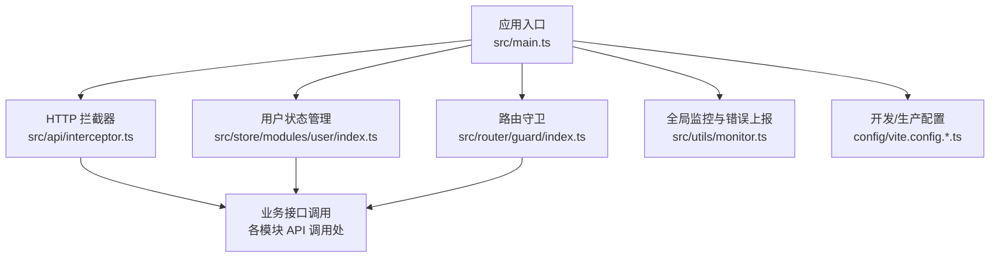
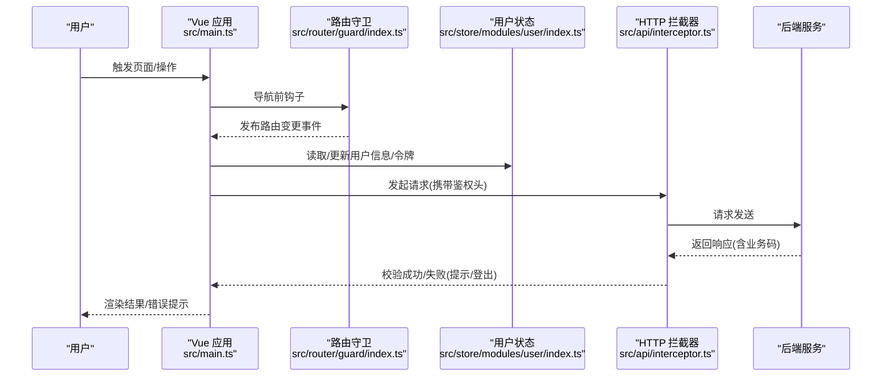
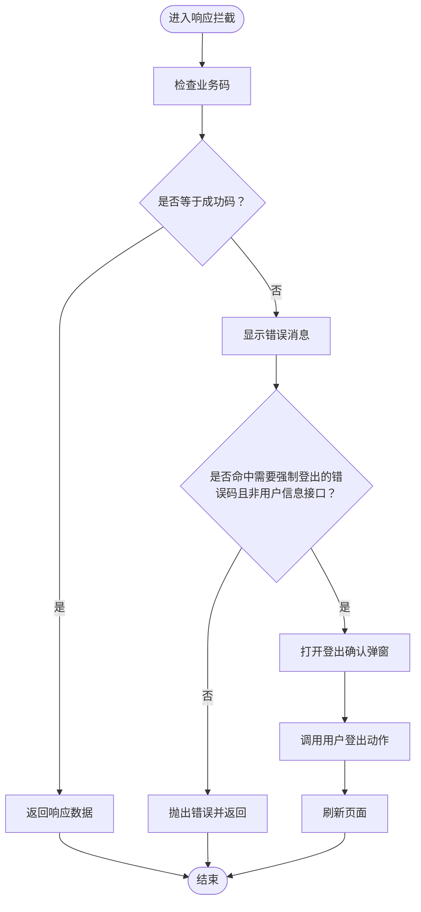
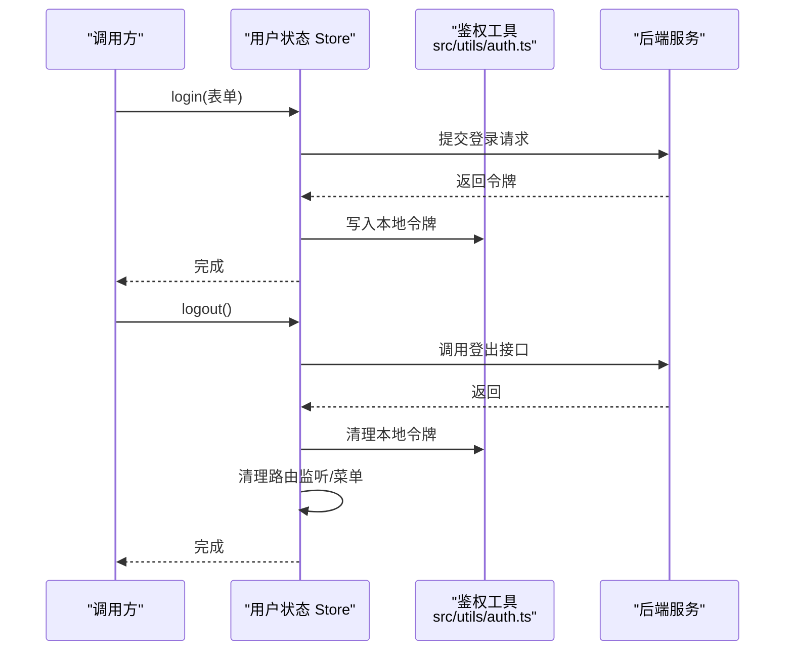
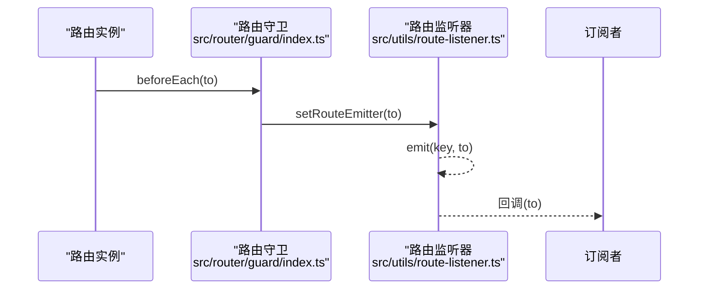
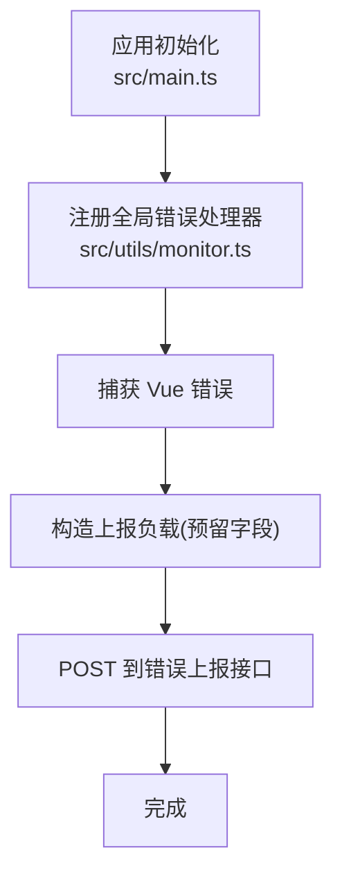
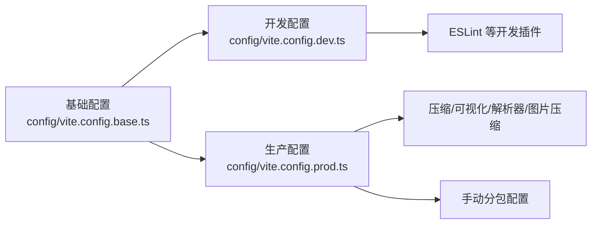
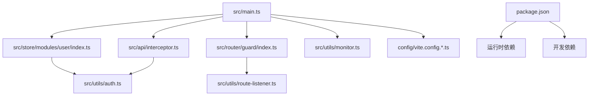
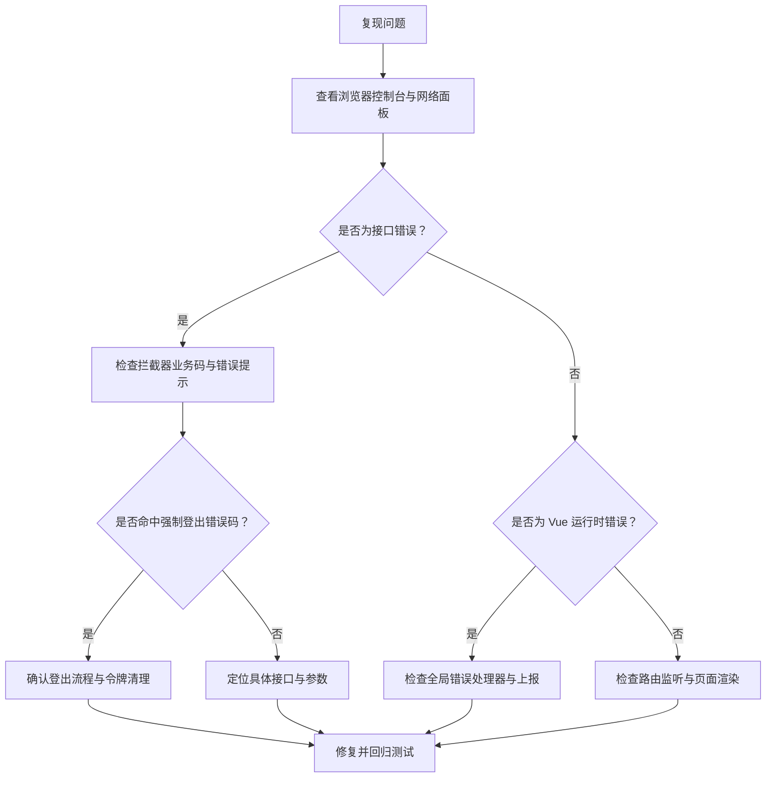

# 故障排除与调试

<cite>
**本文引用的文件**
- [src/main.ts](file://src/main.ts)
- [src/api/interceptor.ts](file://src/api/interceptor.ts)
- [src/utils/monitor.ts](file://src/utils/monitor.ts)
- [src/store/modules/user/index.ts](file://src/store/modules/user/index.ts)
- [src/router/guard/index.ts](file://src/router/guard/index.ts)
- [src/utils/env.ts](file://src/utils/env.ts)
- [src/utils/auth.ts](file://src/utils/auth.ts)
- [src/hooks/request.ts](file://src/hooks/request.ts)
- [src/utils/index.ts](file://src/utils/index.ts)
- [src/utils/event.ts](file://src/utils/event.ts)
- [src/utils/route-listener.ts](file://src/utils/route-listener.ts)
- [config/vite.config.base.ts](file://config/vite.config.base.ts)
- [config/vite.config.dev.ts](file://config/vite.config.dev.ts)
- [config/vite.config.prod.ts](file://config/vite.config.prod.ts)
- [package.json](file://package.json)
</cite>

## 目录
1. [简介](#简介)
2. [项目结构](#项目结构)
3. [核心组件](#核心组件)
4. [架构总览](#架构总览)
5. [详细组件分析](#详细组件分析)
6. [依赖分析](#依赖分析)
7. [性能考虑](#性能考虑)
8. [故障排除指南](#故障排除指南)
9. [结论](#结论)
10. [附录](#附录)

## 简介
本指南面向前端开发与运维工程师，围绕本项目的故障排除与调试实践，系统讲解常见问题的诊断方法、调试技巧、性能优化建议，以及错误日志分析、异常处理与监控告警机制。文档同时覆盖开发工具、浏览器调试技巧、性能分析方法，并提供问题排查的标准流程与解决方案模板，帮助快速定位与修复生产环境问题。

## 项目结构
本项目采用 Vite + Vue 3 + TypeScript 技术栈，模块化组织清晰：应用入口在 main.ts 中初始化全局插件、路由、状态管理与国际化；网络层通过 axios 拦截器统一处理请求与响应；用户态与权限通过 Pinia Store 与路由守卫协同；监控与错误上报通过全局错误处理器与上报工具集成。

图示来源
- [src/main.ts:1-29](file://src/main.ts#L1-L29)
- [src/api/interceptor.ts:1-78](file://src/api/interceptor.ts#L1-L78)
- [src/router/guard/index.ts:1-18](file://src/router/guard/index.ts#L1-L18)
- [src/store/modules/user/index.ts:1-92](file://src/store/modules/user/index.ts#L1-L92)
- [src/utils/monitor.ts:1-29](file://src/utils/monitor.ts#L1-L29)
- [config/vite.config.base.ts:1-52](file://config/vite.config.base.ts#L1-L52)
- [config/vite.config.dev.ts:1-24](file://config/vite.config.dev.ts#L1-L24)
- [config/vite.config.prod.ts:1-32](file://config/vite.config.prod.ts#L1-L32)

章节来源
- [src/main.ts:1-29](file://src/main.ts#L1-L29)
- [config/vite.config.base.ts:1-52](file://config/vite.config.base.ts#L1-L52)
- [config/vite.config.dev.ts:1-24](file://config/vite.config.dev.ts#L1-L24)
- [config/vite.config.prod.ts:1-32](file://config/vite.config.prod.ts#L1-L32)

## 核心组件
- 应用入口与初始化：负责注册 UI 组件库、路由、状态、指令、国际化与全局组件，挂载应用。
- HTTP 拦截器：统一封装请求头（如鉴权）、响应校验（业务码）、错误提示与登出逻辑。
- 用户状态管理：封装登录、登出、用户信息拉取与本地令牌存储。
- 路由守卫：页面级路由变更事件发布、登录态与权限守卫。
- 全局监控与错误上报：Vue 错误处理器与错误上报接口对接。
- 构建配置：开发服务器、ESLint 插件、生产环境代码分割与可视化分析。

章节来源
- [src/main.ts:1-29](file://src/main.ts#L1-L29)
- [src/api/interceptor.ts:1-78](file://src/api/interceptor.ts#L1-L78)
- [src/store/modules/user/index.ts:1-92](file://src/store/modules/user/index.ts#L1-L92)
- [src/router/guard/index.ts:1-18](file://src/router/guard/index.ts#L1-L18)
- [src/utils/monitor.ts:1-29](file://src/utils/monitor.ts#L1-L29)
- [config/vite.config.base.ts:1-52](file://config/vite.config.base.ts#L1-L52)
- [config/vite.config.dev.ts:1-24](file://config/vite.config.dev.ts#L1-L24)
- [config/vite.config.prod.ts:1-32](file://config/vite.config.prod.ts#L1-L32)

## 架构总览
下图展示从用户交互到后端接口的整体链路，包括鉴权、拦截、状态与监控等关键环节。

图示来源
- [src/main.ts:1-29](file://src/main.ts#L1-L29)
- [src/router/guard/index.ts:1-18](file://src/router/guard/index.ts#L1-L18)
- [src/store/modules/user/index.ts:1-92](file://src/store/modules/user/index.ts#L1-L92)
- [src/api/interceptor.ts:1-78](file://src/api/interceptor.ts#L1-L78)

## 详细组件分析

### HTTP 拦截器与错误处理
- 请求阶段：自动注入鉴权头；支持通过环境变量设置基础路径。
- 响应阶段：按业务码判断成功/失败；对特定错误码触发登出确认弹窗并清理会话；统一错误消息提示。
- 异常分支：网络错误统一提示并返回拒绝的 Promise，便于上层捕获。

图示来源
- [src/api/interceptor.ts:38-77](file://src/api/interceptor.ts#L38-L77)

章节来源
- [src/api/interceptor.ts:1-78](file://src/api/interceptor.ts#L1-L78)
- [src/utils/auth.ts:1-20](file://src/utils/auth.ts#L1-L20)

### 用户状态管理与鉴权
- 登录：调用登录接口，成功后写入本地令牌；失败清理令牌并向上抛错。
- 登出：调用登出接口，最终执行清理动作（重置用户信息、移除令牌、移除路由监听、清空服务端菜单）。
- 用户信息：拉取用户信息并合并到状态中。

图示来源
- [src/store/modules/user/index.ts:64-87](file://src/store/modules/user/index.ts#L64-L87)
- [src/utils/auth.ts:1-20](file://src/utils/auth.ts#L1-L20)

章节来源
- [src/store/modules/user/index.ts:1-92](file://src/store/modules/user/index.ts#L1-L92)
- [src/utils/auth.ts:1-20](file://src/utils/auth.ts#L1-L20)

### 路由守卫与页面事件
- 页面级守卫：导航前发布路由变更事件，供订阅者消费，避免逐个组件监听带来的性能损耗。
- 订阅模型：基于发布订阅模式，支持立即回放最新路由状态。

图示来源
- [src/router/guard/index.ts:6-11](file://src/router/guard/index.ts#L6-L11)
- [src/utils/route-listener.ts:14-27](file://src/utils/route-listener.ts#L14-L27)

章节来源
- [src/router/guard/index.ts:1-18](file://src/router/guard/index.ts#L1-L18)
- [src/utils/route-listener.ts:1-32](file://src/utils/route-listener.ts#L1-L32)

### 全局错误监控与上报
- 错误处理器：注册 Vue 全局错误处理器，收集错误对象、组件实例与信息字符串。
- 上报目标：可配置错误上报地址，当前实现预留字段以便扩展（如浏览器信息、用户信息、DOM 信息、URL 等）。

图示来源
- [src/main.ts:15](file://src/main.ts#L15)
- [src/utils/monitor.ts:4-28](file://src/utils/monitor.ts#L4-L28)

章节来源
- [src/utils/monitor.ts:1-29](file://src/utils/monitor.ts#L1-L29)
- [src/main.ts:1-29](file://src/main.ts#L1-L29)

### 开发与生产构建配置
- 基础配置：别名、插件、CSS 预处理、define 注入等。
- 开发配置：启用 ESLint 插件、自动打开浏览器、严格文件系统访问。
- 生产配置：开启压缩、可视化分析、Arco 解析器、图片压缩、手动分包与体积警告阈值。

图示来源
- [config/vite.config.base.ts:1-52](file://config/vite.config.base.ts#L1-L52)
- [config/vite.config.dev.ts:1-24](file://config/vite.config.dev.ts#L1-L24)
- [config/vite.config.prod.ts:1-32](file://config/vite.config.prod.ts#L1-L32)

章节来源
- [config/vite.config.base.ts:1-52](file://config/vite.config.base.ts#L1-L52)
- [config/vite.config.dev.ts:1-24](file://config/vite.config.dev.ts#L1-L24)
- [config/vite.config.prod.ts:1-32](file://config/vite.config.prod.ts#L1-L32)

## 依赖分析
- 运行时依赖：Vue 3、Vue Router、Pinia、Axios、Arco Design Web Vue、ECharts、Day.js、Lodash、mitt、NProgress、SortableJS、VueUse 等。
- 开发依赖：Vite、TypeScript、ESLint、Prettier、Stylelint、husky、lint-staged、可视化分析等。
- 关键耦合点：HTTP 拦截器依赖鉴权工具；用户状态依赖鉴权工具与路由监听；监控依赖全局错误处理器；路由守卫依赖路由监听器。

图示来源
- [src/main.ts:1-29](file://src/main.ts#L1-L29)
- [src/api/interceptor.ts:1-78](file://src/api/interceptor.ts#L1-L78)
- [src/store/modules/user/index.ts:1-92](file://src/store/modules/user/index.ts#L1-L92)
- [src/utils/auth.ts:1-20](file://src/utils/auth.ts#L1-L20)
- [src/router/guard/index.ts:1-18](file://src/router/guard/index.ts#L1-L18)
- [src/utils/route-listener.ts:1-32](file://src/utils/route-listener.ts#L1-L32)
- [config/vite.config.base.ts:1-52](file://config/vite.config.base.ts#L1-L52)
- [package.json:1-103](file://package.json#L1-L103)

章节来源
- [package.json:1-103](file://package.json#L1-L103)
- [src/main.ts:1-29](file://src/main.ts#L1-L29)

## 性能考虑
- 代码分割：生产配置中对 Arco、图表与 Vue 生态进行手动分包，降低首屏体积。
- 体积预警：提升体积警告阈值以适应大体量依赖组合。
- 图片与样式：生产配置启用图片压缩与样式导入插件，减少资源体积。
- 开发体验：开发配置启用 ESLint 实时检查，减少低级错误导致的反复调试。
- 路由监听：采用发布订阅模式替代多组件监听，降低渲染压力。

章节来源
- [config/vite.config.prod.ts:17-28](file://config/vite.config.prod.ts#L17-L28)
- [config/vite.config.dev.ts:14-20](file://config/vite.config.dev.ts#L14-L20)
- [src/utils/route-listener.ts:1-32](file://src/utils/route-listener.ts#L1-L32)

## 故障排除指南

### 一、常见问题与诊断步骤
- 登录后跳转异常或白屏
  - 检查登录接口返回与令牌写入；确认路由守卫已发布路由变更事件；查看用户信息拉取是否成功。
  - 参考路径：[src/store/modules/user/index.ts:64-87](file://src/store/modules/user/index.ts#L64-L87)，[src/utils/auth.ts:1-20](file://src/utils/auth.ts#L1-L20)，[src/router/guard/index.ts:6-11](file://src/router/guard/index.ts#L6-L11)
- 接口报错频繁或提示“请重新登录”
  - 查看响应拦截器对业务码的处理与登出逻辑；确认错误码是否命中强制登出条件；检查是否为用户信息接口。
  - 参考路径：[src/api/interceptor.ts:38-77](file://src/api/interceptor.ts#L38-L77)
- 页面切换无响应或卡顿
  - 检查是否存在大量组件监听路由；确认是否使用了路由监听器的发布订阅模式；观察分包与体积是否过大。
  - 参考路径：[src/utils/route-listener.ts:14-27](file://src/utils/route-listener.ts#L14-L27)，[config/vite.config.prod.ts:17-28](file://config/vite.config.prod.ts#L17-L28)
- 错误未上报或无法定位
  - 确认全局错误处理器已注册；检查错误上报地址配置；核对上报负载字段是否完整。
  - 参考路径：[src/main.ts:15](file://src/main.ts#L15)，[src/utils/monitor.ts:4-28](file://src/utils/monitor.ts#L4-L28)

### 二、调试技巧与工具
- 浏览器开发者工具
  - Network：观察请求头（鉴权）、响应体（业务码与消息）、错误类型；结合拦截器逻辑定位问题。
  - Console：查看错误堆栈与全局错误处理器输出；关注业务错误提示。
  - Sources：断点调试请求钩子与状态更新逻辑。
- 日志与监控
  - 在开发环境可通过环境变量控制调试开关；在生产环境确保错误上报接口可用。
  - 参考路径：[src/utils/env.ts:1-4](file://src/utils/env.ts#L1-L4)，[src/utils/monitor.ts:4-28](file://src/utils/monitor.ts#L4-L28)
- 性能分析
  - 使用可视化分析插件查看打包产物；根据分包策略调整依赖拆分；关注体积警告阈值。
  - 参考路径：[config/vite.config.prod.ts:11-16](file://config/vite.config.prod.ts#L11-L16)，[config/vite.config.prod.ts:27](file://config/vite.config.prod.ts#L27)

### 三、错误日志分析与异常处理
- HTTP 层异常
  - 统一在响应拦截器中处理业务错误与网络错误；对特定错误码触发登出流程，避免无效请求继续。
  - 参考路径：[src/api/interceptor.ts:38-77](file://src/api/interceptor.ts#L38-L77)
- Vue 层异常
  - 全局错误处理器收集错误对象、组件实例与信息字符串；结合上报接口定位问题。
  - 参考路径：[src/utils/monitor.ts:8-27](file://src/utils/monitor.ts#L8-L27)
- 用户态异常
  - 登录失败清理令牌；登出后清理路由监听与菜单；确保状态一致。
  - 参考路径：[src/store/modules/user/index.ts:64-87](file://src/store/modules/user/index.ts#L64-L87)，[src/utils/auth.ts:15-17](file://src/utils/auth.ts#L15-L17)

### 四、监控告警机制
- 建议扩展
  - 在错误上报接口中补充浏览器信息、用户信息、DOM 快照、URL 与时间戳等字段。
  - 对高频错误与特定业务错误建立阈值告警。
- 当前实现
  - 全局错误处理器已就绪，需在部署时配置上报地址。
  - 参考路径：[src/utils/monitor.ts:4-28](file://src/utils/monitor.ts#L4-L28)

### 五、开发工具与脚本
- 常用脚本
  - dev：启动开发服务器并自动打开浏览器。
  - build：类型检查后构建生产包。
  - report：生成打包可视化报告。
  - preview：预览生产包。
  - 参考路径：[package.json:8-15](file://package.json#L8-L15)
- ESLint 与格式化
  - lint-staged 配合 husky 在提交前自动格式化与检查。
  - 参考路径：[package.json:17-31](file://package.json#L17-L31)

### 六、问题排查标准流程

### 七、解决方案模板
- 登录态问题
  - 现象：登录后跳转异常或提示重新登录。
  - 处理：检查登录接口返回与令牌写入；确认路由守卫与用户信息拉取；必要时清理本地缓存后重试。
  - 参考路径：[src/store/modules/user/index.ts:64-87](file://src/store/modules/user/index.ts#L64-L87)，[src/utils/auth.ts:1-20](file://src/utils/auth.ts#L1-L20)，[src/router/guard/index.ts:6-11](file://src/router/guard/index.ts#L6-L11)
- 接口错误
  - 现象：业务码不为成功码，出现错误提示或强制登出。
  - 处理：根据错误码分支处理；检查接口参数与权限；必要时降级或重试。
  - 参考路径：[src/api/interceptor.ts:38-77](file://src/api/interceptor.ts#L38-L77)
- 性能问题
  - 现象：页面切换卡顿或首屏加载慢。
  - 处理：分析打包可视化报告；优化分包策略；减少不必要的监听与渲染。
  - 参考路径：[config/vite.config.prod.ts:17-28](file://config/vite.config.prod.ts#L17-L28)

## 结论
本指南基于项目现有实现，提供了从入口初始化、HTTP 拦截、用户态管理、路由守卫到全局监控与构建配置的全链路故障排除思路与调试方法。建议在生产环境中完善错误上报字段与告警策略，并持续通过可视化分析与体积阈值优化来保障性能与稳定性。

## 附录
- 关键工具与路径速查
  - 应用入口与初始化：[src/main.ts:1-29](file://src/main.ts#L1-L29)
  - HTTP 拦截器与错误处理：[src/api/interceptor.ts:1-78](file://src/api/interceptor.ts#L1-L78)
  - 用户状态与鉴权：[src/store/modules/user/index.ts:1-92](file://src/store/modules/user/index.ts#L1-L92)，[src/utils/auth.ts:1-20](file://src/utils/auth.ts#L1-L20)
  - 路由守卫与监听：[src/router/guard/index.ts:1-18](file://src/router/guard/index.ts#L1-L18)，[src/utils/route-listener.ts:1-32](file://src/utils/route-listener.ts#L1-L32)
  - 全局监控与上报：[src/utils/monitor.ts:1-29](file://src/utils/monitor.ts#L1-L29)
  - 构建配置：[config/vite.config.base.ts:1-52](file://config/vite.config.base.ts#L1-L52)，[config/vite.config.dev.ts:1-24](file://config/vite.config.dev.ts#L1-L24)，[config/vite.config.prod.ts:1-32](file://config/vite.config.prod.ts#L1-L32)
  - 开发脚本与工具：[package.json:1-103](file://package.json#L1-L103)