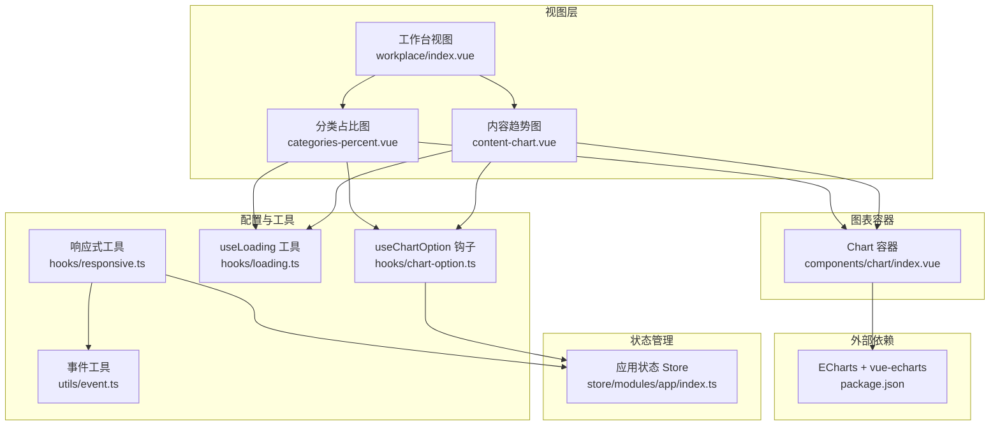
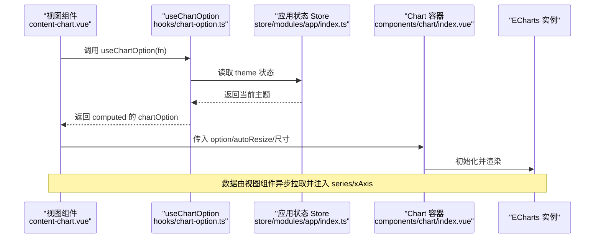
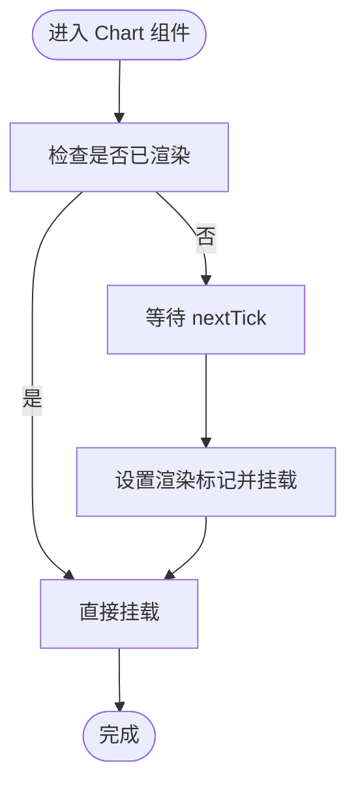
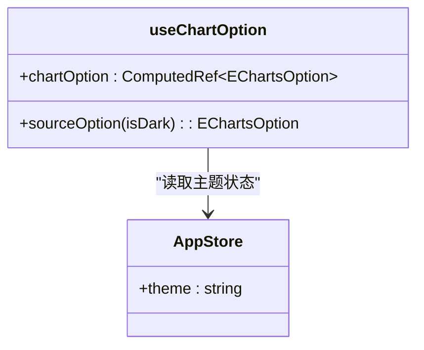
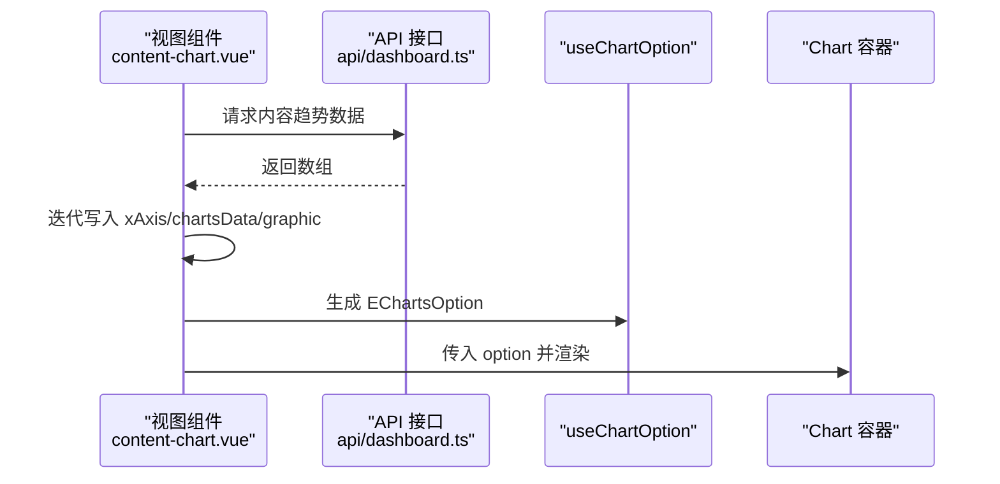
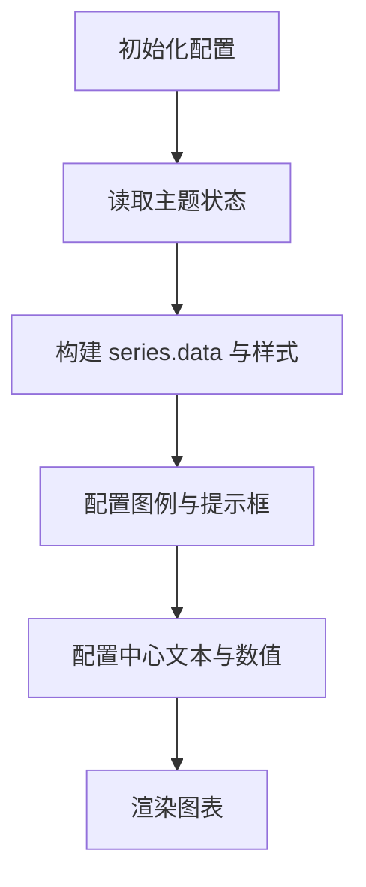
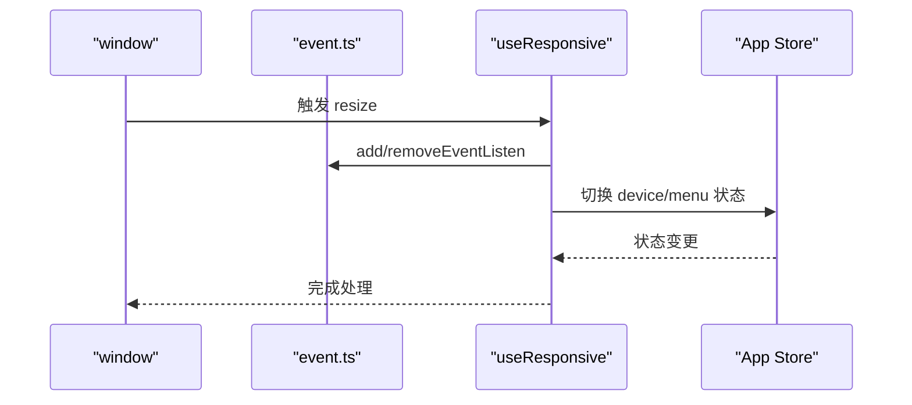
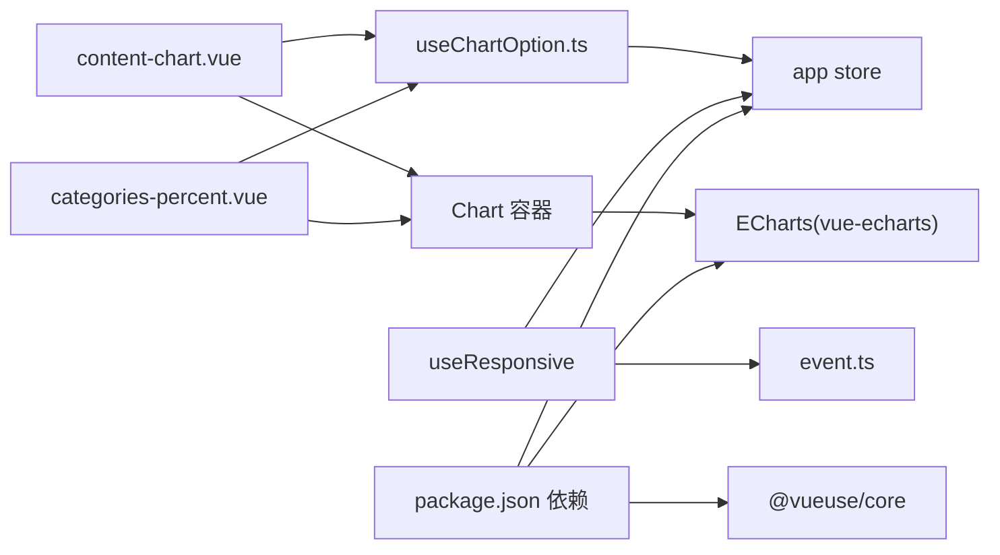

# 数据可视化

<cite>
**本文引用的文件**
- [src/components/chart/index.vue](file://src/components/chart/index.vue)
- [src/hooks/chart-option.ts](file://src/hooks/chart-option.ts)
- [src/tabs/echarts.ts](file://src/types/echarts.ts)
- [src/views/dashboard/workplace/components/content-chart.vue](file://src/views/dashboard/workplace/components/content-chart.vue)
- [src/hooks/responsive.ts](file://src/hooks/responsive.ts)
- [src/store/modules/app/index.ts](file://src/store/modules/app/index.ts)
- [src/utils/event.ts](file://src/utils/event.ts)
- [src/views/dashboard/workplace/components/categories-percent.vue](file://src/views/dashboard/workplace/components/categories-percent.vue)
- [src/api/dashboard.ts](file://src/api/dashboard.ts)
- [src/hooks/loading.ts](file://src/hooks/loading.ts)
- [src/views/dashboard/workplace/index.vue](file://src/views/dashboard/workplace/index.vue)
- [package.json](file://package.json)
</cite>

## 目录
1. [简介](#简介)
2. [项目结构](#项目结构)
3. [核心组件](#核心组件)
4. [架构总览](#架构总览)
5. [详细组件分析](#详细组件分析)
6. [依赖关系分析](#依赖关系分析)
7. [性能考虑](#性能考虑)
8. [故障排查指南](#故障排查指南)
9. [结论](#结论)
10. [附录](#附录)

## 简介
本文件面向数据可视化系统，围绕图表组件设计、ECharts 集成实现与图表配置管理展开，系统性阐述图表选项生成、数据处理逻辑、响应式图表实现与主题适配；同时给出常用图表类型（折线图、饼图）的使用范式、自定义配置与动画效果设置思路、性能优化与大数据量处理策略，以及图表与状态管理的集成方式与实时数据更新机制。

## 项目结构
该可视化子系统采用“组件封装 + 配置钩子 + 状态驱动”的分层组织方式：
- 图表容器组件：统一渲染 ECharts 实例，负责尺寸与自动重绘控制
- 配置钩子：集中生成响应式 ECharts 选项，基于应用主题状态动态切换
- 视图组件：业务图表页面，负责数据拉取、数据加工与配置注入
- 状态管理：主题、设备等全局状态，驱动图表样式与布局
- 响应式工具：监听窗口变化，触发菜单与布局切换，间接影响图表展示

**图表来源**
- [src/views/dashboard/workplace/index.vue:1-149](file://src/views/dashboard/workplace/index.vue#L1-L149)
- [src/views/dashboard/workplace/components/content-chart.vue:1-201](file://src/views/dashboard/workplace/components/content-chart.vue#L1-L201)
- [src/views/dashboard/workplace/components/categories-percent.vue:1-115](file://src/views/dashboard/workplace/components/categories-percent.vue#L1-L115)
- [src/hooks/chart-option.ts:1-28](file://src/hooks/chart-option.ts#L1-L28)
- [src/hooks/loading.ts:1-17](file://src/hooks/loading.ts#L1-L17)
- [src/hooks/responsive.ts:1-33](file://src/hooks/responsive.ts#L1-L33)
- [src/store/modules/app/index.ts:1-78](file://src/store/modules/app/index.ts#L1-L78)
- [src/utils/event.ts:1-28](file://src/utils/event.ts#L1-L28)
- [src/components/chart/index.vue:1-48](file://src/components/chart/index.vue#L1-L48)
- [package.json:32-47](file://package.json#L32-L47)

**章节来源**
- [src/views/dashboard/workplace/index.vue:1-149](file://src/views/dashboard/workplace/index.vue#L1-L149)
- [src/components/chart/index.vue:1-48](file://src/components/chart/index.vue#L1-L48)
- [src/hooks/chart-option.ts:1-28](file://src/hooks/chart-option.ts#L1-L28)
- [src/hooks/responsive.ts:1-33](file://src/hooks/responsive.ts#L1-L33)
- [src/store/modules/app/index.ts:1-78](file://src/store/modules/app/index.ts#L1-L78)
- [package.json:32-47](file://package.json#L32-L47)

## 核心组件
- Chart 容器组件：封装 vue-echarts，提供自动重绘、宽高与选项绑定，解决首次渲染时机问题
- useChartOption 钩子：以函数式方式生成 EChartsOption，基于 Pinia 应用状态中的主题进行动态切换
- useLoading 工具：简化视图组件加载态管理
- 响应式工具：监听窗口变化，切换移动端/桌面端布局，间接影响图表容器尺寸
- 视图图表组件：内容趋势图（折线图）、分类占比图（饼图），演示不同图表类型的配置与数据处理

**章节来源**
- [src/components/chart/index.vue:1-48](file://src/components/chart/index.vue#L1-L48)
- [src/hooks/chart-option.ts:1-28](file://src/hooks/chart-option.ts#L1-L28)
- [src/hooks/loading.ts:1-17](file://src/hooks/loading.ts#L1-L17)
- [src/hooks/responsive.ts:1-33](file://src/hooks/responsive.ts#L1-L33)
- [src/views/dashboard/workplace/components/content-chart.vue:1-201](file://src/views/dashboard/workplace/components/content-chart.vue#L1-L201)
- [src/views/dashboard/workplace/components/categories-percent.vue:1-115](file://src/views/dashboard/workplace/components/categories-percent.vue#L1-L115)

## 架构总览
系统通过“视图组件 → 配置钩子 → Chart 容器 → ECharts”单向数据流完成图表渲染；状态管理贯穿主题与设备信息，驱动配置与布局变化。

**图表来源**
- [src/views/dashboard/workplace/components/content-chart.vue:19-176](file://src/views/dashboard/workplace/components/content-chart.vue#L19-L176)
- [src/hooks/chart-option.ts:13-27](file://src/hooks/chart-option.ts#L13-L27)
- [src/store/modules/app/index.ts:32-40](file://src/store/modules/app/index.ts#L32-L40)
- [src/components/chart/index.vue:10-44](file://src/components/chart/index.vue#L10-L44)

## 详细组件分析

### Chart 容器组件（vue-echarts 封装）
- 职责：接收 ECharts 选项、自动重绘、尺寸控制；通过 nextTick 解决首次渲染容器未展开导致的尺寸异常
- 关键点：v-if 控制渲染时机；autoresize 与内联宽高样式传递给底层组件

**图表来源**
- [src/components/chart/index.vue:40-44](file://src/components/chart/index.vue#L40-L44)

**章节来源**
- [src/components/chart/index.vue:1-48](file://src/components/chart/index.vue#L1-L48)

### 配置钩子 useChartOption（ECharts 选项工厂）
- 职责：以函数式方式生成 EChartsOption，内部读取应用主题状态，返回 computed 的响应式选项
- 设计要点：将复杂配置拆分为可复用的工厂函数，便于在多处图表中共享与扩展

**图表来源**
- [src/hooks/chart-option.ts:13-27](file://src/hooks/chart-option.ts#L13-L27)
- [src/store/modules/app/index.ts:32-40](file://src/store/modules/app/index.ts#L32-L40)

**章节来源**
- [src/hooks/chart-option.ts:1-28](file://src/hooks/chart-option.ts#L1-L28)
- [src/store/modules/app/index.ts:1-78](file://src/store/modules/app/index.ts#L1-L78)

### 内容趋势图（折线图）组件
- 数据流程：异步请求 → 批量写入 xAxis/chartsData → 注入 series 与坐标轴配置 → 渲染
- 自定义元素：通过 graphic 元素在首尾标注 X 轴标签
- 交互与样式：强调态聚焦、渐变线条与面积填充、自定义 tooltip 格式化

**图表来源**
- [src/views/dashboard/workplace/components/content-chart.vue:177-197](file://src/views/dashboard/workplace/components/content-chart.vue#L177-L197)
- [src/api/dashboard.ts:9-11](file://src/api/dashboard.ts#L9-L11)
- [src/hooks/chart-option.ts:13-27](file://src/hooks/chart-option.ts#L13-L27)
- [src/components/chart/index.vue:10-44](file://src/components/chart/index.vue#L10-L44)

**章节来源**
- [src/views/dashboard/workplace/components/content-chart.vue:1-201](file://src/views/dashboard/workplace/components/content-chart.vue#L1-L201)
- [src/api/dashboard.ts:1-23](file://src/api/dashboard.ts#L1-L23)
- [src/tabs/echarts.ts:1-11](file://src/types/echarts.ts#L1-L11)

### 分类占比图（饼图）组件
- 数据流程：直接在配置中声明 series.data，结合 legend、graphic 中心文本实现“仪表盘式”展示
- 主题适配：根据 isDark 动态调整文字与边框颜色

**图表来源**
- [src/views/dashboard/workplace/components/categories-percent.vue:23-111](file://src/views/dashboard/workplace/components/categories-percent.vue#L23-L111)
- [src/hooks/chart-option.ts:13-27](file://src/hooks/chart-option.ts#L13-L27)

**章节来源**
- [src/views/dashboard/workplace/components/categories-percent.vue:1-115](file://src/views/dashboard/workplace/components/categories-percent.vue#L1-L115)

### 响应式与布局联动
- 响应式工具：监听窗口 resize，计算设备类型并切换菜单显示，从而影响图表容器所在区域的可用空间
- 事件绑定：通过通用事件工具添加/移除监听，避免内存泄漏

**图表来源**
- [src/hooks/responsive.ts:13-32](file://src/hooks/responsive.ts#L13-L32)
- [src/utils/event.ts:1-28](file://src/utils/event.ts#L1-28)
- [src/store/modules/app/index.ts:41-46](file://src/store/modules/app/index.ts#L41-L46)

**章节来源**
- [src/hooks/responsive.ts:1-33](file://src/hooks/responsive.ts#L1-L33)
- [src/utils/event.ts:1-28](file://src/utils/event.ts#L1-L28)
- [src/store/modules/app/index.ts:1-78](file://src/store/modules/app/index.ts#L1-L78)

## 依赖关系分析
- 外部依赖：ECharts 与 vue-echarts 提供图表渲染能力；Pinia 提供状态管理；@vueuse/core 提供防抖等工具
- 内部耦合：视图组件依赖配置钩子与 Chart 容器；配置钩子依赖应用状态；响应式工具与事件工具解耦于具体业务

**图表来源**
- [src/views/dashboard/workplace/components/content-chart.vue:23-24](file://src/views/dashboard/workplace/components/content-chart.vue#L23-L24)
- [src/views/dashboard/workplace/components/categories-percent.vue:20-21](file://src/views/dashboard/workplace/components/categories-percent.vue#L20-L21)
- [src/hooks/chart-option.ts:3](file://src/hooks/chart-option.ts#L3)
- [src/store/modules/app/index.ts:1-78](file://src/store/modules/app/index.ts#L1-L78)
- [src/components/chart/index.vue:12](file://src/components/chart/index.vue#L12)
- [src/hooks/responsive.ts:2](file://src/hooks/responsive.ts#L2)
- [src/utils/event.ts:1-28](file://src/utils/event.ts#L1-L28)
- [package.json:32-47](file://package.json#L32-L47)

**章节来源**
- [package.json:32-47](file://package.json#L32-L47)
- [src/components/chart/index.vue:12](file://src/components/chart/index.vue#L12)
- [src/hooks/chart-option.ts:3](file://src/hooks/chart-option.ts#L3)
- [src/hooks/responsive.ts:2](file://src/hooks/responsive.ts#L2)

## 性能考虑
- 渲染时机控制：Chart 容器通过 nextTick 后再渲染，避免容器未展开导致的尺寸异常与重排
- 配置生成：useChartOption 使用 computed 包裹，仅在依赖的主题状态变化时重新计算，降低重复开销
- 响应式监听：使用防抖函数减少频繁 resize 导致的状态更新与布局抖动
- 大数据量策略（建议实践）
  - 分页/分段加载：按时间或维度切片，逐步渲染
  - 采样与聚合：对原始序列进行降采样或聚合统计
  - 惰性渲染：可视区域外的数据延迟加载
  - 选项级优化：关闭不必要的动画与阴影，合理设置 series 的 symbol 显示
  - DOM 与内存：及时销毁不再使用的实例，避免内存泄漏

**章节来源**
- [src/components/chart/index.vue:40-44](file://src/components/chart/index.vue#L40-L44)
- [src/hooks/chart-option.ts:13-27](file://src/hooks/chart-option.ts#L13-L27)
- [src/hooks/responsive.ts:22](file://src/hooks/responsive.ts#L22)

## 故障排查指南
- 图表不显示或尺寸异常
  - 检查 Chart 容器是否在 nextTick 后渲染
  - 确认父容器具备明确宽高，autoresize 是否开启
- 主题切换后样式未更新
  - 确认 useChartOption 返回的 computed 选项被正确传入 Chart
  - 检查应用状态中的 theme 字段是否正确更新
- 响应式布局无效
  - 确认 window resize 事件已绑定且在组件卸载时移除
  - 检查设备判定逻辑与菜单切换逻辑是否触发
- 数据未更新
  - 确认视图组件在获取数据后更新了 series/xAxis 等引用响应式数据
  - 检查接口返回格式与类型定义是否一致

**章节来源**
- [src/components/chart/index.vue:40-44](file://src/components/chart/index.vue#L40-L44)
- [src/hooks/chart-option.ts:13-27](file://src/hooks/chart-option.ts#L13-L27)
- [src/store/modules/app/index.ts:32-40](file://src/store/modules/app/index.ts#L32-L40)
- [src/hooks/responsive.ts:26-31](file://src/hooks/responsive.ts#L26-L31)
- [src/api/dashboard.ts:9-11](file://src/api/dashboard.ts#L9-L11)

## 结论
该可视化系统通过“容器组件 + 配置钩子 + 状态驱动”的架构，实现了图表渲染的模块化与可维护性；结合响应式工具与主题状态，确保在不同设备与主题下的一致体验。对于复杂场景，建议进一步引入大数据量处理策略与更细粒度的动画控制，以获得更佳的性能与交互体验。

## 附录
- 常用图表类型与配置要点
  - 折线图：平滑曲线、强调态聚焦、渐变线条与面积填充；适合趋势类数据
  - 饼图：环形半径、图例与中心文本；适合占比类数据
- 自定义配置与动画
  - 通过 useChartOption 的工厂函数注入自定义样式与交互
  - 在 series 或全局配置中启用/禁用动画与阴影
- 实时数据更新机制
  - 通过定时轮询或 WebSocket 推送更新 series 数据源，触发响应式刷新
  - 对高频更新场景，建议节流/去抖与增量更新策略