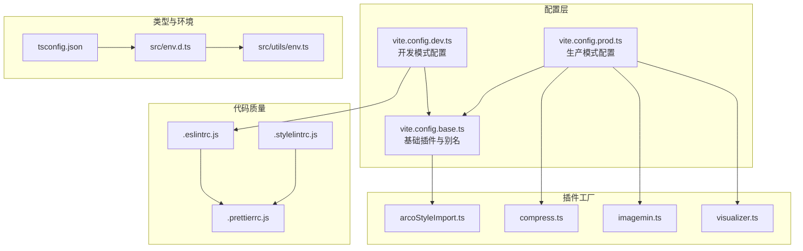
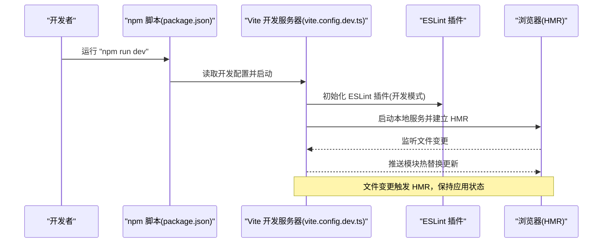
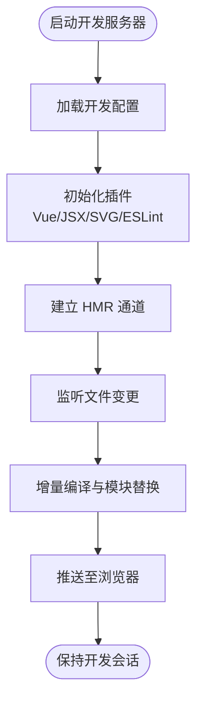
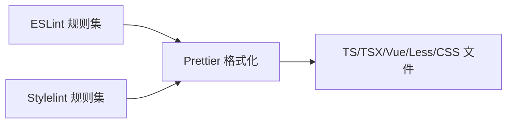
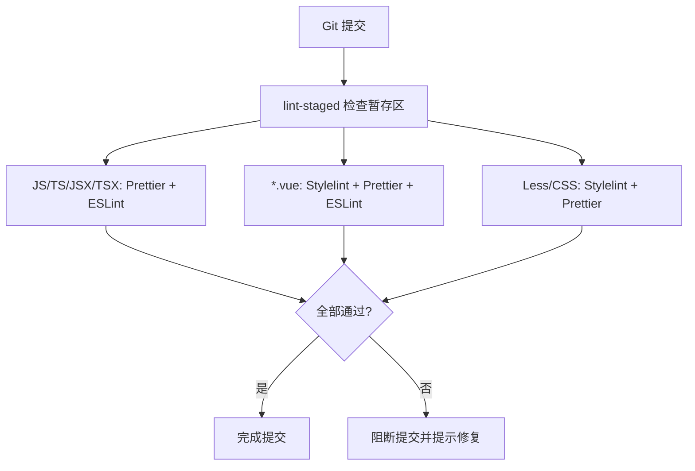
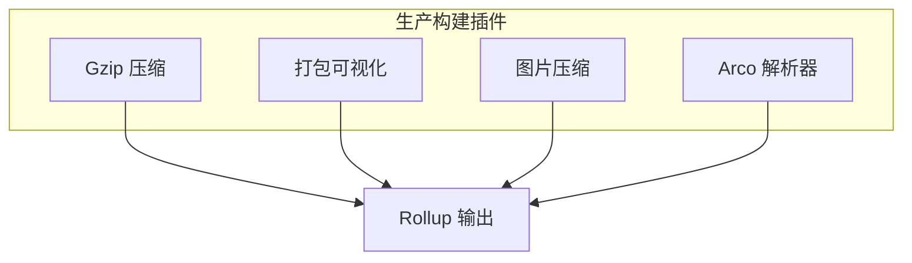
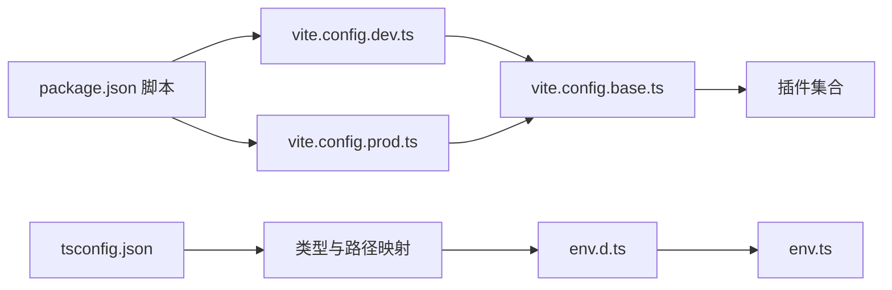

# 开发环境构建

<cite>
**本文档引用的文件**
- [package.json](file://package.json)
- [vite.config.base.ts](file://config/vite.config.base.ts)
- [vite.config.dev.ts](file://config/vite.config.dev.ts)
- [vite.config.prod.ts](file://config/vite.config.prod.ts)
- [.eslintrc.js](file://.eslintrc.js)
- [.prettierrc.js](file://.prettierrc.js)
- [.stylelintrc.js](file://.stylelintrc.js)
- [arcoStyleImport.ts](file://config/plugin/arcoStyleImport.ts)
- [compress.ts](file://config/plugin/compress.ts)
- [imagemin.ts](file://config/plugin/imagemin.ts)
- [visualizer.ts](file://config/plugin/visualizer.ts)
- [tsconfig.json](file://tsconfig.json)
- [env.d.ts](file://src/env.d.ts)
- [env.ts](file://src/utils/env.ts)
</cite>

## 目录
1. [简介](#简介)
2. [项目结构](#项目结构)
3. [核心组件](#核心组件)
4. [架构总览](#架构总览)
5. [详细组件分析](#详细组件分析)
6. [依赖关系分析](#依赖关系分析)
7. [性能考虑](#性能考虑)
8. [故障排除指南](#故障排除指南)
9. [结论](#结论)
10. [附录](#附录)

## 简介
本文件面向开发者，系统性阐述该 Vue 3 + Vite 项目的开发环境构建与配置，重点覆盖以下方面：
- Vite 开发服务器配置与热更新机制
- 开发工具链：ESLint、Prettier、Stylelint 的集成与规则
- Git 钩子与提交前自动检查（husky + lint-staged）
- 代理、端口与调试选项的设置方式
- 开发环境启动命令、常用技巧与常见问题排查

## 项目结构
该项目采用分层配置策略，通过基础配置与开发/生产配置合并的方式，实现可维护且可扩展的构建体系。关键目录与文件如下：
- config：存放 Vite 配置与插件工厂函数
- src：源码目录，包含组件、路由、状态管理、国际化等
- 根目录：代码质量工具配置文件（ESLint、Prettier、Stylelint）与脚本定义

图表来源
- [vite.config.base.ts:1-52](file://config/vite.config.base.ts#L1-L52)
- [vite.config.dev.ts:1-24](file://config/vite.config.dev.ts#L1-L24)
- [vite.config.prod.ts:1-32](file://config/vite.config.prod.ts#L1-L32)
- [arcoStyleImport.ts:1-13](file://config/plugin/arcoStyleImport.ts#L1-L13)
- [compress.ts:1-35](file://config/plugin/compress.ts#L1-L35)
- [imagemin.ts:1-38](file://config/plugin/imagemin.ts#L1-L38)
- [visualizer.ts:1-19](file://config/plugin/visualizer.ts#L1-L19)
- [.eslintrc.js:1-71](file://.eslintrc.js#L1-L71)
- [.prettierrc.js:1-10](file://.prettierrc.js#L1-L10)
- [.stylelintrc.js:1-31](file://.stylelintrc.js#L1-L31)
- [tsconfig.json:1-21](file://tsconfig.json#L1-L21)
- [env.d.ts:1-12](file://src/env.d.ts#L1-L12)
- [env.ts:1-4](file://src/utils/env.ts#L1-L4)

章节来源
- [package.json:1-103](file://package.json#L1-L103)
- [vite.config.base.ts:1-52](file://config/vite.config.base.ts#L1-L52)
- [vite.config.dev.ts:1-24](file://config/vite.config.dev.ts#L1-L24)
- [vite.config.prod.ts:1-32](file://config/vite.config.prod.ts#L1-L32)

## 核心组件
本节聚焦开发环境的关键配置与工具链，帮助快速理解启动流程与质量保障机制。

- Vite 基础配置（别名、插件、CSS 变量注入）
  - 插件：Vue、JSX、SVG 加载器、Arco 主题按需导入
  - 路径别名：@ 指向 src；assets 指向 src/assets
  - CSS：Less 全局变量注入，支持断点样式引用
- 开发配置（dev）
  - 模式：development
  - 自动打开浏览器、严格文件系统访问
  - 内置 ESLint 插件，启用实时语法与风格检查
- 生产配置（prod）
  - 模式：production
  - 插件：Gzip 压缩、打包可视化、Arco 解析器、图片压缩
  - Rollup 分包策略：Arco、图表库、Vue 生态独立分包
- 代码质量工具
  - ESLint：Airbnb 基础风格 + TypeScript + Vue3 推荐规则 + Prettier 集成
  - Prettier：统一缩进、分号、引号、换行敏感度等
  - Stylelint：标准 + 顺序 + Prettier + Vue 样式推荐
- 类型与环境
  - tsconfig：路径映射 @/* -> src/*
  - env.d.ts：声明 .vue 模块与 VITE_API_BASE_URL 环境变量
  - env.ts：基于 MODE 判断是否为开发模式

章节来源
- [vite.config.base.ts:1-52](file://config/vite.config.base.ts#L1-L52)
- [vite.config.dev.ts:1-24](file://config/vite.config.dev.ts#L1-L24)
- [vite.config.prod.ts:1-32](file://config/vite.config.prod.ts#L1-L32)
- [.eslintrc.js:1-71](file://.eslintrc.js#L1-L71)
- [.prettierrc.js:1-10](file://.prettierrc.js#L1-L10)
- [.stylelintrc.js:1-31](file://.stylelintrc.js#L1-L31)
- [tsconfig.json:1-21](file://tsconfig.json#L1-L21)
- [env.d.ts:1-12](file://src/env.d.ts#L1-L12)
- [env.ts:1-4](file://src/utils/env.ts#L1-L4)

## 架构总览
下图展示从开发命令到浏览器热更新的整体流程，以及代码质量工具在开发阶段的介入点。

图表来源
- [package.json:8-16](file://package.json#L8-L16)
- [vite.config.dev.ts:5-23](file://config/vite.config.dev.ts#L5-L23)

## 详细组件分析

### Vite 开发服务器与热更新
- 启动入口
  - 开发命令指向开发配置文件，确保仅在开发模式加载 ESLint 插件与严格文件系统限制
- 热更新机制
  - Vite 基于原生 ESM 的 HMR 协议，对 .vue、.ts、.tsx 文件变更进行增量编译与推送
  - JSX 与 SVG 加载器配合 Vue 插件，保证模板与资源的热替换一致性
- 端口与代理
  - 当前配置未显式指定端口，默认由 Vite 分配；如需固定端口或代理，请在开发配置中添加 server 字段
  - 如需代理后端接口，请在开发配置的 server.proxy 中添加对应规则
- 调试选项
  - sourcemap 已开启（tsconfig），便于断点调试
  - 可结合浏览器开发者工具与 Vite HMR 日志定位问题

图表来源
- [vite.config.dev.ts:5-23](file://config/vite.config.dev.ts#L5-L23)
- [vite.config.base.ts:8-14](file://config/vite.config.base.ts#L8-L14)

章节来源
- [package.json:8-16](file://package.json#L8-L16)
- [vite.config.dev.ts:1-24](file://config/vite.config.dev.ts#L1-L24)
- [vite.config.base.ts:1-52](file://config/vite.config.base.ts#L1-L52)

### 代码质量工具链（ESLint、Prettier、Stylelint）
- ESLint
  - 解析器：Vue 解析器 + TypeScript 解析器
  - 规则集：Airbnb 基础 + TypeScript 推荐 + 导入规则 + Vue3 推荐 + Prettier 集成
  - TypeScript 与导入解析：通过 settings.import.resolver 指向 tsconfig.json
  - 关键规则：禁用多单词组件名、允许 @ts-ignore 注释、空函数与未使用变量警告级别可控
- Prettier
  - 统一缩进宽度、分号、引号策略、HTML 空白敏感度、Vue 脚本与样式缩进
- Stylelint
  - 扩展：标准 + 顺序 + Prettier + Vue 样式推荐
  - 特殊规则：忽略特定 at-rule 与伪类，控制空行与注释格式

图表来源
- [.eslintrc.js:22-30](file://.eslintrc.js#L22-L30)
- [.prettierrc.js:1-10](file://.prettierrc.js#L1-L10)
- [.stylelintrc.js:2-7](file://.stylelintrc.js#L2-L7)

章节来源
- [.eslintrc.js:1-71](file://.eslintrc.js#L1-L71)
- [.prettierrc.js:1-10](file://.prettierrc.js#L1-L10)
- [.stylelintrc.js:1-31](file://.stylelintrc.js#L1-L31)

### Git 钩子与提交前检查（husky + lint-staged）
- 安装与准备
  - 通过 prepare 脚本安装 husky，确保 Git 钩子可用
- 提交前检查流程
  - lint-staged 对暂存区文件执行：
    - JS/TS/JSX/TSX：Prettier 写回 + ESLint 修复
    - *.vue：Stylelint 修复 + Prettier 写回 + ESLint 修复
    - Less/CSS：Stylelint 修复 + Prettier 写回
- 注意事项
  - 若 ESLint 或 Stylelint 报错，提交会被阻断；请先修复后再提交
  - 建议在 IDE 中启用保存时自动格式化，减少冲突

图表来源
- [package.json:14-31](file://package.json#L14-L31)

章节来源
- [package.json:14-31](file://package.json#L14-L31)

### 开发工具链插件与优化
- Arco 主题按需导入
  - 通过 @arco-plugins/vite-vue 实现组件样式按需引入，避免全局样式污染
- Gzip 压缩与打包可视化
  - 生产构建启用 gzip 压缩；当设置 REPORT=true 时，生成可视化报告并自动打开
- 图片压缩
  - 生产构建对多种图片格式进行有损/无损压缩，减小产物体积
- 路径别名与类型支持
  - tsconfig 与 Vite 别名一致，@/* 指向 src，提升导入体验与类型推断准确性

图表来源
- [vite.config.prod.ts:8-16](file://config/vite.config.prod.ts#L8-L16)
- [compress.ts:1-35](file://config/plugin/compress.ts#L1-L35)
- [visualizer.ts:8-18](file://config/plugin/visualizer.ts#L8-L18)
- [imagemin.ts:8-37](file://config/plugin/imagemin.ts#L8-L37)
- [arcoStyleImport.ts:9-12](file://config/plugin/arcoStyleImport.ts#L9-L12)

章节来源
- [vite.config.prod.ts:1-32](file://config/vite.config.prod.ts#L1-L32)
- [compress.ts:1-35](file://config/plugin/compress.ts#L1-L35)
- [visualizer.ts:1-19](file://config/plugin/visualizer.ts#L1-L19)
- [imagemin.ts:1-38](file://config/plugin/imagemin.ts#L1-L38)
- [arcoStyleImport.ts:1-13](file://config/plugin/arcoStyleImport.ts#L1-L13)

## 依赖关系分析
- 脚本与配置
  - dev/build/preview/report/type:check/lint-staged/prepare 由 package.json 统一管理
  - 开发配置合并基础配置，生产配置同样合并基础配置并叠加插件
- 类型与环境
  - tsconfig.json 提供路径映射与编译选项
  - env.d.ts 声明 Vite 环境变量与 .vue 模块类型
  - env.ts 基于 MODE 判断开发模式

图表来源
- [package.json:8-16](file://package.json#L8-L16)
- [vite.config.dev.ts:1-3](file://config/vite.config.dev.ts#L1-L3)
- [vite.config.prod.ts:1-6](file://config/vite.config.prod.ts#L1-L6)
- [vite.config.base.ts:1-7](file://config/vite.config.base.ts#L1-L7)
- [tsconfig.json:12-14](file://tsconfig.json#L12-L14)
- [env.d.ts:1-12](file://src/env.d.ts#L1-L12)
- [env.ts:1-4](file://src/utils/env.ts#L1-L4)

章节来源
- [package.json:1-103](file://package.json#L1-L103)
- [vite.config.base.ts:1-52](file://config/vite.config.base.ts#L1-L52)
- [vite.config.dev.ts:1-24](file://config/vite.config.dev.ts#L1-L24)
- [vite.config.prod.ts:1-32](file://config/vite.config.prod.ts#L1-L32)
- [tsconfig.json:1-21](file://tsconfig.json#L1-L21)
- [env.d.ts:1-12](file://src/env.d.ts#L1-L12)
- [env.ts:1-4](file://src/utils/env.ts#L1-L4)

## 性能考虑
- 分包策略
  - 将 Arco、图表库、Vue 生态分别拆分为独立 chunk，有利于缓存与并行加载
- 压缩与可视化
  - 生产构建启用 gzip 压缩；通过 REPORT=true 生成可视化报告，辅助识别大体积模块
- 图片优化
  - 多格式图片压缩，平衡体积与质量
- HMR 与开发体验
  - 严格文件系统访问与 ESLint 插件有助于早期发现问题，减少运行时错误

章节来源
- [vite.config.prod.ts:17-28](file://config/vite.config.prod.ts#L17-L28)
- [visualizer.ts:8-18](file://config/plugin/visualizer.ts#L8-L18)
- [imagemin.ts:8-37](file://config/plugin/imagemin.ts#L8-L37)

## 故障排除指南
- 开发服务器无法启动或端口占用
  - 检查是否已在其他进程占用默认端口；可在开发配置中显式指定端口
- ESLint 报错导致保存失败
  - 使用 IDE 的保存时自动格式化功能，或手动执行修复；必要时在 .eslintrc.js 中调整规则
- Stylelint 报错
  - 检查 Less/CSS 文件中的 at-rule 与选择器命名；遵循 Stylelint 扩展规则
- HMR 不生效或刷新整页
  - 确认修改的是受支持的模块类型（.vue/.ts/.tsx），并检查浏览器控制台是否有编译错误
- 环境变量未生效
  - 确保以 VITE_ 前缀声明并在 env.d.ts 中声明类型；在代码中通过 import.meta.env 访问
- 依赖安装或版本不兼容
  - 确认 Node 版本满足要求；如遇二进制依赖问题，参考 package.json 中的 resolutions 配置

章节来源
- [vite.config.dev.ts:8-13](file://config/vite.config.dev.ts#L8-L13)
- [.eslintrc.js:38-69](file://.eslintrc.js#L38-L69)
- [.stylelintrc.js:10-29](file://.stylelintrc.js#L10-L29)
- [env.d.ts:9-12](file://src/env.d.ts#L9-L12)

## 结论
本项目通过清晰的分层配置与完善的代码质量工具链，提供了稳定高效的开发体验。开发服务器基于 Vite 的 HMR 机制，结合 ESLint、Prettier、Stylelint 与 husky + lint-staged 的提交前检查，有效提升了代码一致性与可维护性。生产构建通过分包、压缩与可视化分析，兼顾性能与可观测性。建议在团队内统一 IDE 设置与提交规范，持续优化开发效率与质量。

## 附录
- 开发环境启动命令
  - 启动开发服务器：npm run dev
  - 预览生产构建：npm run preview
  - 生成打包报告：REPORT=true npm run build
  - 类型检查：npm run type:check
- 常用开发技巧
  - 在开发配置中添加 server.proxy 以代理后端接口
  - 使用 tsconfig.json 的路径映射与 @ 别名简化导入
  - 在 .prettierrc.js 中根据团队偏好调整格式化参数
- 常见问题
  - 端口被占用：在开发配置中设置自定义端口
  - ESLint/Stylelint 冲突：优先遵循 Prettier 集成规则，必要时在规则集中做折中
  - HMR 失效：确认文件类型与模块热替换支持范围

章节来源
- [package.json:8-16](file://package.json#L8-L16)
- [vite.config.dev.ts:8-13](file://config/vite.config.dev.ts#L8-L13)
- [.prettierrc.js:1-10](file://.prettierrc.js#L1-L10)
- [tsconfig.json:12-14](file://tsconfig.json#L12-L14)