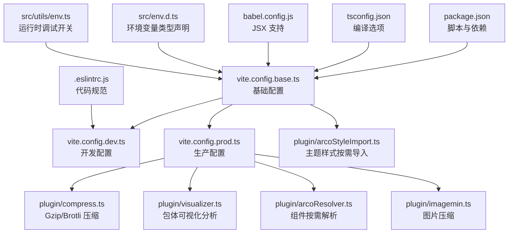
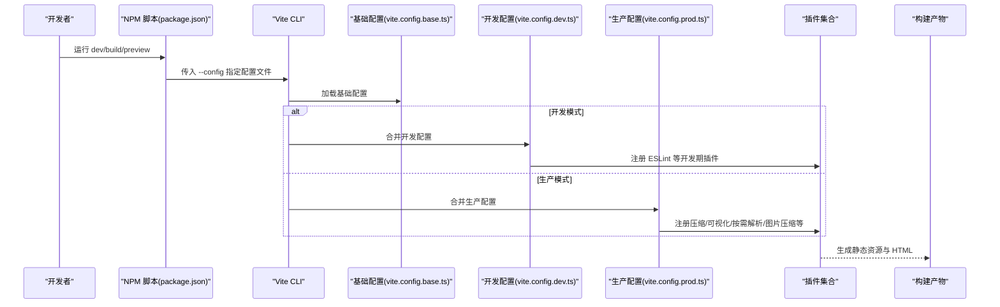
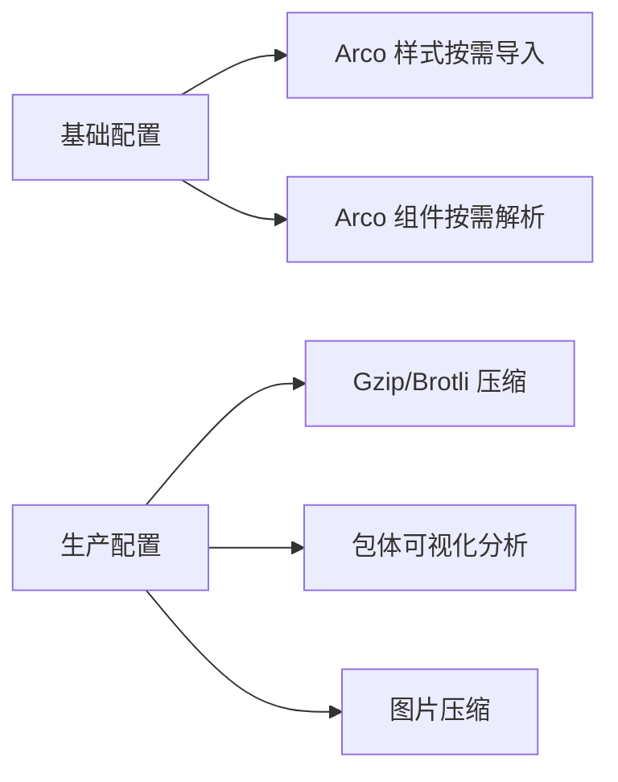
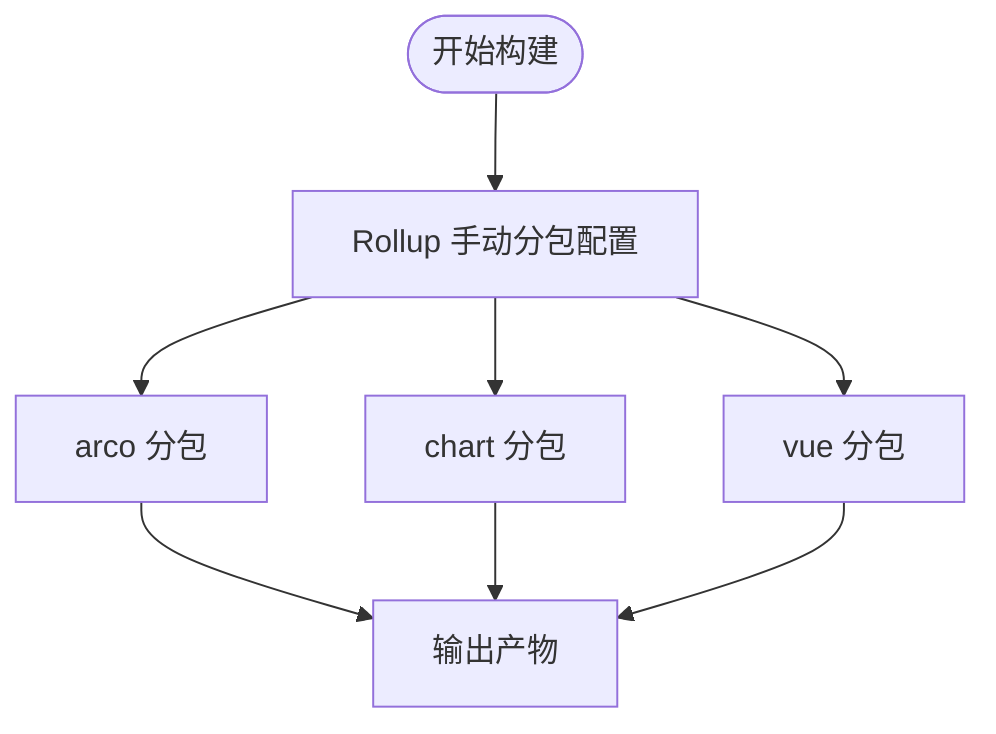
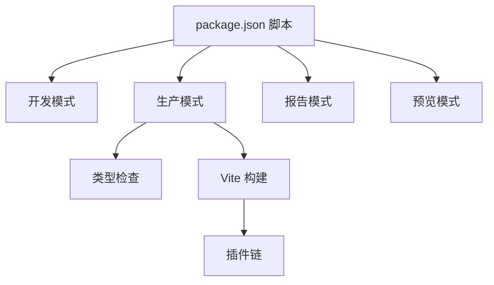

# 构建与部署

<cite>
**本文引用的文件**
- [package.json](file://package.json)
- [vite.config.base.ts](file://config/vite.config.base.ts)
- [vite.config.dev.ts](file://config/vite.config.dev.ts)
- [vite.config.prod.ts](file://config/vite.config.prod.ts)
- [arcoResolver.ts](file://config/plugin/arcoResolver.ts)
- [arcoStyleImport.ts](file://config/plugin/arcoStyleImport.ts)
- [compress.ts](file://config/plugin/compress.ts)
- [imagemin.ts](file://config/plugin/imagemin.ts)
- [visualizer.ts](file://config/plugin/visualizer.ts)
- [index.ts](file://config/utils/index.ts)
- [tsconfig.json](file://tsconfig.json)
- [babel.config.js](file://babel.config.js)
- [env.d.ts](file://src/env.d.ts)
- [env.ts](file://src/utils/env.ts)
- [.eslintrc.js](file://.eslintrc.js)
</cite>

## 目录
1. [简介](#简介)
2. [项目结构](#项目结构)
3. [核心组件](#核心组件)
4. [架构总览](#架构总览)
5. [详细组件分析](#详细组件分析)
6. [依赖分析](#依赖分析)
7. [性能考量](#性能考量)
8. [故障排查指南](#故障排查指南)
9. [结论](#结论)
10. [附录](#附录)

## 简介
本文件面向构建与部署场景，系统化阐述该 Vue 3 + Vite 项目在开发与生产阶段的构建配置、代码分割策略、性能优化方案、打包策略、Vite 插件体系、压缩与可视化分析工具的使用方式，并提供部署流程、环境变量配置与 CI/CD 集成建议。读者可据此完成从本地开发到生产发布的全流程优化与落地。

## 项目结构
该项目采用分层配置：基础配置集中于基础 Vite 配置文件，分别通过合并策略导出开发与生产两套配置；插件以独立模块形式组织，便于按需启用与维护；类型声明与 ESLint 规则保障开发体验与质量。

图表来源
- [package.json:1-103](file://package.json#L1-L103)
- [vite.config.base.ts:1-52](file://config/vite.config.base.ts#L1-L52)
- [vite.config.dev.ts:1-24](file://config/vite.config.dev.ts#L1-L24)
- [vite.config.prod.ts:1-32](file://config/vite.config.prod.ts#L1-L32)
- [compress.ts:1-35](file://config/plugin/compress.ts#L1-L35)
- [visualizer.ts:1-19](file://config/plugin/visualizer.ts#L1-L19)
- [arcoResolver.ts:1-20](file://config/plugin/arcoResolver.ts#L1-L20)
- [imagemin.ts:1-38](file://config/plugin/imagemin.ts#L1-L38)
- [arcoStyleImport.ts:1-13](file://config/plugin/arcoStyleImport.ts#L1-L13)
- [tsconfig.json:1-21](file://tsconfig.json#L1-L21)
- [babel.config.js:1-4](file://babel.config.js#L1-L4)
- [env.d.ts:1-12](file://src/env.d.ts#L1-L12)
- [env.ts:1-4](file://src/utils/env.ts#L1-L4)
- [.eslintrc.js:1-71](file://.eslintrc.js#L1-L71)

章节来源
- [package.json:1-103](file://package.json#L1-L103)
- [vite.config.base.ts:1-52](file://config/vite.config.base.ts#L1-L52)
- [vite.config.dev.ts:1-24](file://config/vite.config.dev.ts#L1-L24)
- [vite.config.prod.ts:1-32](file://config/vite.config.prod.ts#L1-L32)

## 核心组件
- 基础配置（vite.config.base.ts）
  - 插件：Vue、Vue JSX、SVG 加载器、Arco 主题样式按需导入
  - 路径别名：@ 指向 src，assets 指向 src/assets
  - CSS 预处理：Less 变量注入与断点样式引用
  - 定义：process.env 占位定义
- 开发配置（vite.config.dev.ts）
  - 合并基础配置，启用 ESLint 插件进行实时校验
  - 服务器：自动打开浏览器、严格文件系统访问
- 生产配置（vite.config.prod.ts）
  - 合并基础配置，启用压缩、可视化分析、Arco 组件按需解析、图片压缩
  - Rollup 手动分包：arco、chart、vue 三大块
  - 警告阈值提升，避免大体积警告干扰

章节来源
- [vite.config.base.ts:1-52](file://config/vite.config.base.ts#L1-L52)
- [vite.config.dev.ts:1-24](file://config/vite.config.dev.ts#L1-L24)
- [vite.config.prod.ts:1-32](file://config/vite.config.prod.ts#L1-L32)

## 架构总览
下图展示从脚本触发到最终产物产出的关键路径，以及各插件在不同模式下的参与情况。

图表来源
- [package.json:8-15](file://package.json#L8-L15)
- [vite.config.base.ts:8-14](file://config/vite.config.base.ts#L8-L14)
- [vite.config.dev.ts:5-23](file://config/vite.config.dev.ts#L5-L23)
- [vite.config.prod.ts:8-31](file://config/vite.config.prod.ts#L8-L31)

## 详细组件分析

### Vite 插件体系
- Arco 样式按需导入（arcoStyleImport.ts）
  - 作用：仅导入实际使用的 Arco 组件样式，减少全局样式体积
  - 使用：在基础配置中注册
- Arco 组件按需解析（arcoResolver.ts）
  - 作用：模板中使用组件时自动导入，避免全量引入
  - 使用：在生产配置中注册
- 压缩插件（compress.ts）
  - 作用：输出 .gz 或 .br 压缩文件，配合服务端启用
  - 使用：在生产配置中注册
- 图片压缩（imagemin.ts）
  - 作用：对 PNG/JPG/GIF/SVG 做无损或有损优化
  - 使用：在生产配置中注册
- 包体可视化（visualizer.ts）
  - 作用：生成可视化报告，辅助分析包体构成
  - 使用：通过 REPORT 环境变量控制是否启用

图表来源
- [vite.config.base.ts:9-14](file://config/vite.config.base.ts#L9-L14)
- [vite.config.prod.ts:11-16](file://config/vite.config.prod.ts#L11-L16)
- [arcoStyleImport.ts:9-12](file://config/plugin/arcoStyleImport.ts#L9-L12)
- [arcoResolver.ts:12-19](file://config/plugin/arcoResolver.ts#L12-L19)
- [compress.ts:9-34](file://config/plugin/compress.ts#L9-L34)
- [imagemin.ts:8-37](file://config/plugin/imagemin.ts#L8-L37)
- [visualizer.ts:8-18](file://config/plugin/visualizer.ts#L8-L18)

章节来源
- [arcoStyleImport.ts:1-13](file://config/plugin/arcoStyleImport.ts#L1-L13)
- [arcoResolver.ts:1-20](file://config/plugin/arcoResolver.ts#L1-L20)
- [compress.ts:1-35](file://config/plugin/compress.ts#L1-L35)
- [imagemin.ts:1-38](file://config/plugin/imagemin.ts#L1-L38)
- [visualizer.ts:1-19](file://config/plugin/visualizer.ts#L1-L19)

### 代码分割策略与手动分包
- 手动分包配置位于生产配置的 Rollup 输出规则中，将三方库按功能域拆分为独立 chunk：
  - arco：Arco Design 组件库
  - chart：图表相关（如 ECharts 及其 Vue 封装）
  - vue：核心框架与生态（Vue、路由、状态管理、工具库）
- 分包目标
  - 提升缓存命中率：稳定第三方库单独更新
  - 降低首屏 JS 体积：按需加载业务代码
  - 便于 CDN 缓存策略：版本号仅针对变更的 chunk 更新

图表来源
- [vite.config.prod.ts:17-28](file://config/vite.config.prod.ts#L17-L28)

章节来源
- [vite.config.prod.ts:17-28](file://config/vite.config.prod.ts#L17-L28)

### 性能优化方案
- 代码分割
  - 手动分包：见上节
  - 动态导入：对非首屏路由与组件使用动态导入
- 资源压缩
  - Gzip/Brotli：在生产配置中启用
  - 图片压缩：对多格式图片进行优化
- 样式与组件
  - 样式按需导入：减少全局样式体积
  - 组件按需解析：避免全量引入
- 构建体积监控
  - 可视化分析：通过报告定位体积热点

章节来源
- [vite.config.prod.ts:11-16](file://config/vite.config.prod.ts#L11-L16)
- [compress.ts:9-34](file://config/plugin/compress.ts#L9-L34)
- [imagemin.ts:8-37](file://config/plugin/imagemin.ts#L8-L37)
- [arcoStyleImport.ts:9-12](file://config/plugin/arcoStyleImport.ts#L9-L12)
- [arcoResolver.ts:12-19](file://config/plugin/arcoResolver.ts#L12-L19)
- [visualizer.ts:8-18](file://config/plugin/visualizer.ts#L8-L18)

### 开发环境配置
- 自动打开浏览器、严格文件系统访问
- 开发期 ESLint 实时校验，提升编码质量
- TypeScript 类型检查脚本，保证类型安全

章节来源
- [vite.config.dev.ts:5-23](file://config/vite.config.dev.ts#L5-L23)
- [.eslintrc.js:1-71](file://.eslintrc.js#L1-L71)
- [package.json:13](file://package.json#L13)

### 生产环境优化与打包策略
- 合并基础配置，启用压缩、可视化、按需解析、图片压缩
- 手动分包策略，提升缓存与加载效率
- 提升体积警告阈值，避免误报

章节来源
- [vite.config.prod.ts:8-31](file://config/vite.config.prod.ts#L8-L31)

### 环境变量与类型声明
- 类型声明：在类型文件中声明 VITE_API_BASE_URL 等变量
- 运行时判断：通过 MODE 判断是否为开发模式，用于调试开关
- 脚本支持：通过 cross-env 设置 REPORT 控制可视化报告生成

章节来源
- [env.d.ts:9-11](file://src/env.d.ts#L9-L11)
- [env.ts:1](file://src/utils/env.ts#L1)
- [package.json:11](file://package.json#L11)

### CI/CD 集成建议
- 构建步骤
  - 安装依赖：pnpm install
  - 类型检查：npm run type:check
  - 生产构建：npm run build
- 预览验证：npm run preview
- 产物上传：将 dist 目录上传至 CDN 或静态托管服务
- 可选：开启可视化报告，对比前后差异，持续优化

章节来源
- [package.json:8-15](file://package.json#L8-L15)

## 依赖分析
- 脚本与依赖
  - 开发：vite --config ./config/vite.config.dev.ts
  - 生产：先类型检查，再 vite build --config ./config/vite.config.prod.ts
  - 报告：cross-env REPORT=true npm run build
  - 预览：构建后 vite preview --host
- 关键依赖
  - Vite、@vitejs/plugin-vue、@vitejs/plugin-vue-jsx
  - Arco 插件、unplugin-vue-components、vite-plugin-imagemin、rollup-plugin-visualizer
  - TypeScript、ESLint、Prettier、Stylelint

图表来源
- [package.json:8-15](file://package.json#L8-L15)

章节来源
- [package.json:1-103](file://package.json#L1-L103)

## 性能考量
- 代码分割
  - 手动分包已覆盖主要三方库域，建议结合路由级懒加载进一步细化
- 压缩策略
  - 同时启用 Gzip 与 Brotli，服务端优先选择 Brotli
- 图片优化
  - 已启用多格式优化参数，建议结合 CDN 的自适应压缩策略
- 样式与组件
  - 按需导入与解析已启用，建议定期审查未使用组件与样式
- 可视化分析
  - 使用报告识别体积热点，持续迭代分包与依赖

## 故障排查指南
- 构建失败（类型错误）
  - 先执行类型检查脚本，修复类型问题后再构建
- ESLint 报错
  - 开发配置已启用 ESLint 插件，按提示修复或调整规则
- 包体过大
  - 启用可视化报告，定位大体积模块，评估是否可拆分或替换
- 压缩无效
  - 确认生产配置已启用压缩插件，且服务端正确配置了响应头与缓存

章节来源
- [package.json:13](file://package.json#L13)
- [vite.config.dev.ts:14-20](file://config/vite.config.dev.ts#L14-L20)
- [visualizer.ts:8-18](file://config/plugin/visualizer.ts#L8-L18)
- [compress.ts:9-34](file://config/plugin/compress.ts#L9-L34)

## 结论
本项目通过清晰的分层配置与完善的插件体系，在开发与生产阶段实现了良好的可维护性与性能表现。建议在后续迭代中持续关注包体可视化报告、路由级懒加载与服务端压缩策略，以进一步优化用户体验与资源利用效率。

## 附录
- TypeScript 编译选项与路径映射
  - 目标与模块：ES2020
  - 路径别名：@/* -> src/*
  - JSX：preserve
- Babel 配置
  - 启用 @vue/babel-plugin-jsx，适配 Vue JSX 场景

章节来源
- [tsconfig.json:1-21](file://tsconfig.json#L1-L21)
- [babel.config.js:1-4](file://babel.config.js#L1-L4)