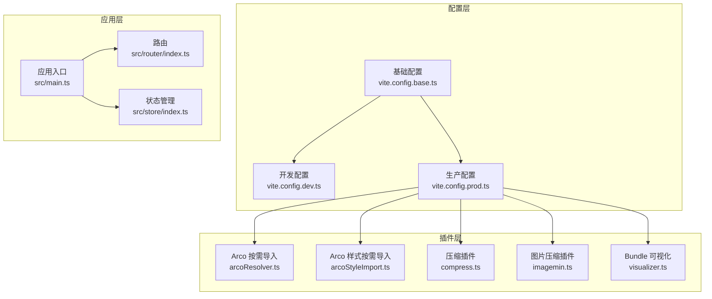
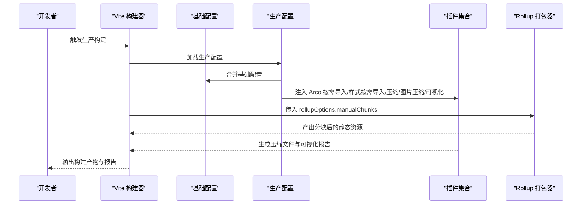
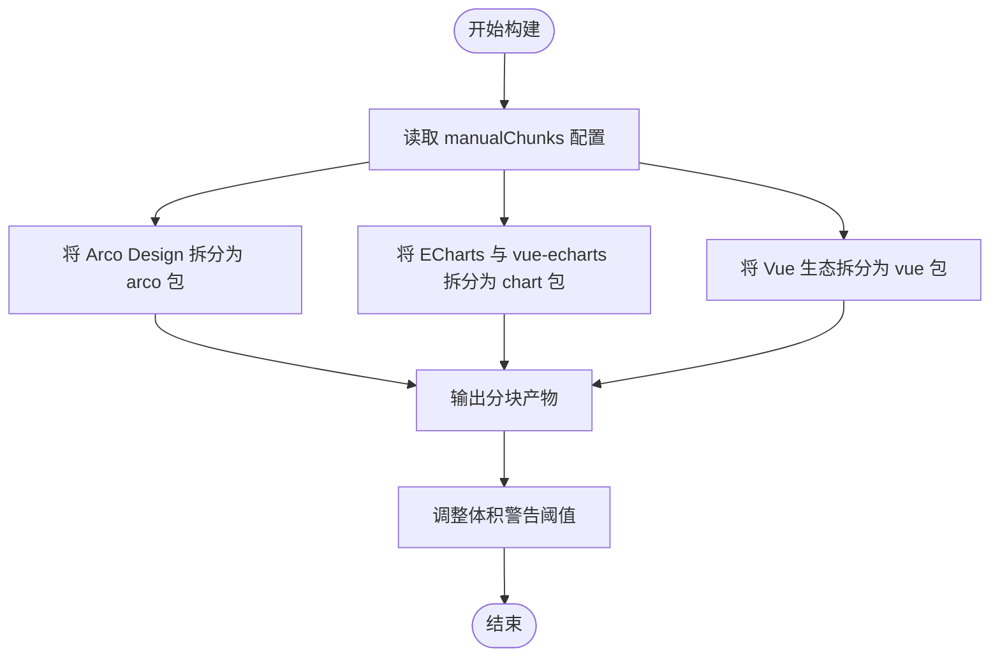
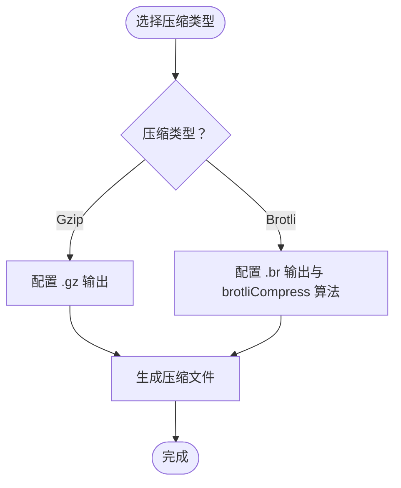
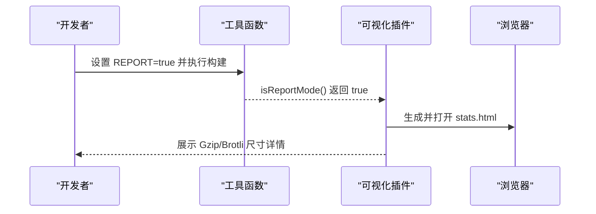
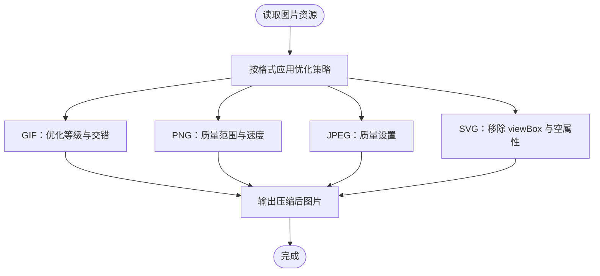
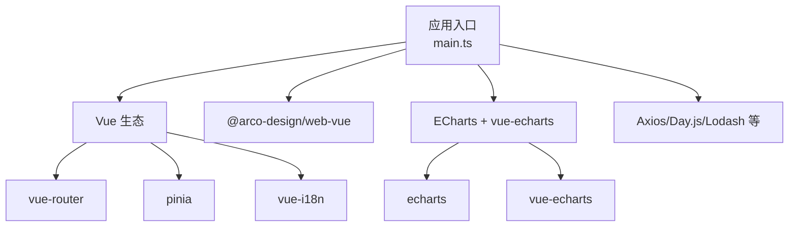

# 生产环境优化

<cite>
**本文引用的文件**
- [vite.config.base.ts](file://config/vite.config.base.ts)
- [vite.config.dev.ts](file://config/vite.config.dev.ts)
- [vite.config.prod.ts](file://config/vite.config.prod.ts)
- [arcoResolver.ts](file://config/plugin/arcoResolver.ts)
- [arcoStyleImport.ts](file://config/plugin/arcoStyleImport.ts)
- [compress.ts](file://config/plugin/compress.ts)
- [imagemin.ts](file://config/plugin/imagemin.ts)
- [visualizer.ts](file://config/plugin/visualizer.ts)
- [utils/index.ts](file://config/utils/index.ts)
- [package.json](file://package.json)
- [main.ts](file://src/main.ts)
- [router/index.ts](file://src/router/index.ts)
- [store/index.ts](file://src/store/index.ts)
</cite>

## 目录
1. [简介](#简介)
2. [项目结构](#项目结构)
3. [核心组件](#核心组件)
4. [架构总览](#架构总览)
5. [详细组件分析](#详细组件分析)
6. [依赖分析](#依赖分析)
7. [性能考量](#性能考量)
8. [故障排查指南](#故障排查指南)
9. [结论](#结论)
10. [附录](#附录)

## 简介
本文件面向生产环境优化，系统性梳理该仓库在构建与运行阶段的优化实践，包括：
- 代码分割策略与手动分块配置
- 包体积优化技术（按需导入、图片压缩）
- 压缩策略（Gzip、Brotli）的配置与效果
- Bundle 可视化分析工具的使用与解读
- 构建产物分析、性能监控与持续优化建议

目标是帮助读者快速理解并复用这些优化手段，确保在不同规模与场景下实现稳定、可维护且高性能的构建产物。

## 项目结构
该项目采用 Vite 作为构建工具，通过多份配置文件分离开发与生产环境，并以插件化方式扩展功能。核心结构如下：
- 基础配置：统一的插件、别名、CSS 预处理、别名与打包定义
- 开发配置：启用 ESLint、热更新与本地服务
- 生产配置：合并基础配置，注入压缩、可视化、按需导入与图片压缩插件，并配置手动分块与警告阈值
- 插件层：Arco Design 按需导入与样式导入、压缩、图片压缩、可视化
- 工具层：报告模式开关
- 应用入口：注册全局模块、国际化、指令、Mock、路由与状态管理

图表来源
- [vite.config.base.ts:1-52](file://config/vite.config.base.ts#L1-L52)
- [vite.config.dev.ts:1-24](file://config/vite.config.dev.ts#L1-L24)
- [vite.config.prod.ts:1-32](file://config/vite.config.prod.ts#L1-L32)
- [arcoResolver.ts:1-20](file://config/plugin/arcoResolver.ts#L1-L20)
- [arcoStyleImport.ts:1-13](file://config/plugin/arcoStyleImport.ts#L1-L13)
- [compress.ts:1-35](file://config/plugin/compress.ts#L1-L35)
- [imagemin.ts:1-38](file://config/plugin/imagemin.ts#L1-L38)
- [visualizer.ts:1-19](file://config/plugin/visualizer.ts#L1-L19)
- [main.ts:1-29](file://src/main.ts#L1-L29)
- [router/index.ts:1-38](file://src/router/index.ts#L1-L38)
- [store/index.ts:1-10](file://src/store/index.ts#L1-L10)

章节来源
- [vite.config.base.ts:1-52](file://config/vite.config.base.ts#L1-L52)
- [vite.config.dev.ts:1-24](file://config/vite.config.dev.ts#L1-L24)
- [vite.config.prod.ts:1-32](file://config/vite.config.prod.ts#L1-L32)
- [main.ts:1-29](file://src/main.ts#L1-L29)
- [router/index.ts:1-38](file://src/router/index.ts#L1-L38)
- [store/index.ts:1-10](file://src/store/index.ts#L1-L10)

## 核心组件
- 基础配置：统一插件栈（Vue、JSX、SVG Loader、Arco 样式按需导入）、路径别名、CSS 变量注入、Vue 编译器选择与环境变量定义
- 开发配置：启用 ESLint、本地服务与严格文件系统访问
- 生产配置：合并基础配置，注入压缩、可视化、Arco 按需导入与图片压缩；配置手动分块与较大的体积警告阈值
- 插件体系：Arco 按需导入（组件与样式）、压缩（Gzip/Brotli）、图片压缩（多格式优化）、Bundle 可视化（HTML 报告）

章节来源
- [vite.config.base.ts:1-52](file://config/vite.config.base.ts#L1-L52)
- [vite.config.dev.ts:1-24](file://config/vite.config.dev.ts#L1-L24)
- [vite.config.prod.ts:1-32](file://config/vite.config.prod.ts#L1-L32)
- [arcoResolver.ts:1-20](file://config/plugin/arcoResolver.ts#L1-L20)
- [arcoStyleImport.ts:1-13](file://config/plugin/arcoStyleImport.ts#L1-L13)
- [compress.ts:1-35](file://config/plugin/compress.ts#L1-L35)
- [imagemin.ts:1-38](file://config/plugin/imagemin.ts#L1-L38)
- [visualizer.ts:1-19](file://config/plugin/visualizer.ts#L1-L19)

## 架构总览
生产构建流程的关键节点如下：
- 合并配置：生产配置合并基础配置
- 插件注入：按需导入、压缩、图片压缩、可视化
- 手动分块：将 Arco 组件库、图表库、Vue 生态相关依赖拆分为独立包
- 可视化：在报告模式下生成 HTML 报告，支持 Gzip/Brotli 尺寸展示
- 输出：产物包含源文件与压缩文件（如启用），并带有可视化报告

图表来源
- [vite.config.prod.ts:1-32](file://config/vite.config.prod.ts#L1-L32)
- [arcoResolver.ts:1-20](file://config/plugin/arcoResolver.ts#L1-L20)
- [arcoStyleImport.ts:1-13](file://config/plugin/arcoStyleImport.ts#L1-L13)
- [compress.ts:1-35](file://config/plugin/compress.ts#L1-L35)
- [imagemin.ts:1-38](file://config/plugin/imagemin.ts#L1-L38)
- [visualizer.ts:1-19](file://config/plugin/visualizer.ts#L1-L19)

## 详细组件分析

### 代码分割策略与手动分块
- 手动分块配置位于生产配置的 rollupOptions.output.manualChunks 中，将大而稳定的第三方依赖拆分为独立包，提升缓存命中率与并行加载效率。
- 分块策略示例：
  - arco：将 Arco Design 组件库单独拆分
  - chart：将 ECharts 与 vue-echarts 单独拆分
  - vue：将 Vue 生态（Vue、Vue Router、Pinia、@vueuse/core、vue-i18n）单独拆分
- 体积警告阈值调高，避免因第三方库体量较大导致误报。

图表来源
- [vite.config.prod.ts:17-28](file://config/vite.config.prod.ts#L17-L28)

章节来源
- [vite.config.prod.ts:17-28](file://config/vite.config.prod.ts#L17-L28)

### 压缩策略：Gzip 与 Brotli
- 压缩插件支持两种算法：
  - Gzip：扩展名为 .gz
  - Brotli：扩展名为 .br，算法为 brotliCompress
- 插件通过工厂函数按参数动态返回对应配置，便于在不同环境下切换或组合使用。
- 注意：注释指出在 Vite 中直接启用压缩的行为存在限制，实际部署时应结合服务器配置或 CDN 支持。

图表来源
- [compress.ts:1-35](file://config/plugin/compress.ts#L1-L35)

章节来源
- [compress.ts:1-35](file://config/plugin/compress.ts#L1-L35)

### Bundle 可视化分析工具
- 可视化插件根据环境变量决定是否启用；当处于报告模式时，生成 HTML 报告并自动打开，同时显示 Gzip 与 Brotli 尺寸。
- 报告模式通过脚本触发，便于在需要时进行深度分析。

图表来源
- [visualizer.ts:1-19](file://config/plugin/visualizer.ts#L1-L19)
- [utils/index.ts:1-10](file://config/utils/index.ts#L1-L10)

章节来源
- [visualizer.ts:1-19](file://config/plugin/visualizer.ts#L1-L19)
- [utils/index.ts:1-10](file://config/utils/index.ts#L1-L10)

### Arco Design 按需导入与样式按需导入
- 组件按需导入：通过 unplugin-vue-components 与 ArcoResolver 实现，避免全量引入导致的包体膨胀。
- 样式按需导入：通过 @arco-plugins/vite-vue 提供的插件，仅导入实际使用的主题样式，减少冗余 CSS。
- 基础配置中已集成 Arco 样式按需导入插件，生产配置进一步注入组件按需导入。

图表来源
- [arcoResolver.ts:1-20](file://config/plugin/arcoResolver.ts#L1-L20)
- [arcoStyleImport.ts:1-13](file://config/plugin/arcoStyleImport.ts#L1-L13)
- [vite.config.base.ts:1-52](file://config/vite.config.base.ts#L1-L52)
- [vite.config.prod.ts:1-32](file://config/vite.config.prod.ts#L1-L32)

章节来源
- [arcoResolver.ts:1-20](file://config/plugin/arcoResolver.ts#L1-L20)
- [arcoStyleImport.ts:1-13](file://config/plugin/arcoStyleImport.ts#L1-L13)
- [vite.config.base.ts:1-52](file://config/vite.config.base.ts#L1-L52)
- [vite.config.prod.ts:1-32](file://config/vite.config.prod.ts#L1-L32)

### 图片压缩插件
- 使用 vite-plugin-imagemin 对多种图片格式进行压缩：
  - GIF：优化等级与交错控制
  - PNG：质量范围与速度控制
  - JPEG：质量设置
  - SVG：移除 viewBox 与空属性等插件
- 在生产环境启用，显著降低图片体积，提升首屏加载性能。

图表来源
- [imagemin.ts:1-38](file://config/plugin/imagemin.ts#L1-L38)

章节来源
- [imagemin.ts:1-38](file://config/plugin/imagemin.ts#L1-L38)

### 构建产物分析与性能监控
- 构建产物分析：通过可视化报告查看各包大小、依赖关系与压缩效果，定位体积瓶颈。
- 性能监控：结合路由与状态管理初始化逻辑，关注首屏渲染与交互延迟；在路由层面使用进度条库以提升用户感知。
- 优化建议：
  - 定期开启报告模式，对比版本间体积变化
  - 结合手动分块策略，持续评估第三方库拆分收益
  - 优先优化首屏关键包，减少阻塞渲染的资源

章节来源
- [visualizer.ts:1-19](file://config/plugin/visualizer.ts#L1-L19)
- [router/index.ts:1-38](file://src/router/index.ts#L1-L38)
- [store/index.ts:1-10](file://src/store/index.ts#L1-L10)

## 依赖分析
- 依赖分布：Arco Design、Vue 生态（Vue、Router、Pinia、@vueuse/core、vue-i18n）、ECharts 与 vue-echarts、Axios、Day.js、Lodash、mitt、NProgress、SortableJS、Query String 等。
- 优化点：
  - 通过按需导入与手动分块，降低首屏与公共依赖体积
  - 图片压缩减少静态资源体积
  - 压缩插件在服务器或 CDN 支持下进一步降低传输体积

图表来源
- [main.ts:1-29](file://src/main.ts#L1-L29)
- [package.json:32-48](file://package.json#L32-L48)

章节来源
- [package.json:32-48](file://package.json#L32-L48)
- [main.ts:1-29](file://src/main.ts#L1-L29)

## 性能考量
- 代码分割与缓存：合理的手动分块可提升浏览器缓存命中率，建议对稳定不变的第三方库单独拆分
- 压缩策略：在服务器或 CDN 支持的情况下启用 Gzip/Brotli，显著降低传输体积
- 图片优化：针对不同格式采用差异化压缩策略，平衡质量与体积
- 可视化与度量：定期生成报告，识别体积增长来源，制定针对性优化计划
- 首屏体验：结合路由懒加载与按需导入，减少首屏阻塞资源

## 故障排查指南
- 报告模式未生效
  - 确认是否通过脚本触发并设置报告模式开关
  - 参考：[utils/index.ts:7-9](file://config/utils/index.ts#L7-L9)，[visualizer.ts:9-16](file://config/plugin/visualizer.ts#L9-L16)
- 压缩插件未输出压缩文件
  - 确认当前环境是否满足插件要求，必要时检查服务器或 CDN 的压缩支持
  - 参考：[compress.ts:15-32](file://config/plugin/compress.ts#L15-L32)
- 手动分块未生效
  - 检查 rollupOptions.manualChunks 配置是否正确合并至生产配置
  - 参考：[vite.config.prod.ts:18-26](file://config/vite.config.prod.ts#L18-L26)
- 包体积异常增大
  - 使用可视化报告定位大体积模块，评估是否可通过按需导入或替换更小替代品优化
  - 参考：[visualizer.ts:10-15](file://config/plugin/visualizer.ts#L10-L15)

章节来源
- [utils/index.ts:7-9](file://config/utils/index.ts#L7-L9)
- [visualizer.ts:9-16](file://config/plugin/visualizer.ts#L9-L16)
- [compress.ts:15-32](file://config/plugin/compress.ts#L15-L32)
- [vite.config.prod.ts:18-26](file://config/vite.config.prod.ts#L18-L26)

## 结论
该仓库在生产环境优化方面形成了完善的配置体系：通过合理的代码分割与手动分块、Arco Design 按需导入与样式按需导入、图片压缩与压缩插件，以及可视化分析工具，实现了体积与性能的双重优化。建议在持续迭代中定期生成报告、评估第三方依赖与静态资源，结合业务特性不断微调分块策略与压缩参数，以获得最佳的用户体验与维护性。

## 附录
- 快速操作清单
  - 生成可视化报告：设置报告模式并执行构建脚本
  - 切换压缩算法：在压缩插件工厂函数中选择 Gzip 或 Brotli
  - 调整分块策略：在生产配置中修改 manualChunks，平衡缓存与并行加载
  - 优化图片资源：根据业务场景调整图片压缩参数
- 参考脚本与配置
  - 构建脚本与报告模式：[package.json:8-15](file://package.json#L8-L15)
  - 生产配置合并与插件注入：[vite.config.prod.ts:8-31](file://config/vite.config.prod.ts#L8-L31)
  - 基础配置与别名、CSS 预处理：[vite.config.base.ts:8-51](file://config/vite.config.base.ts#L8-L51)