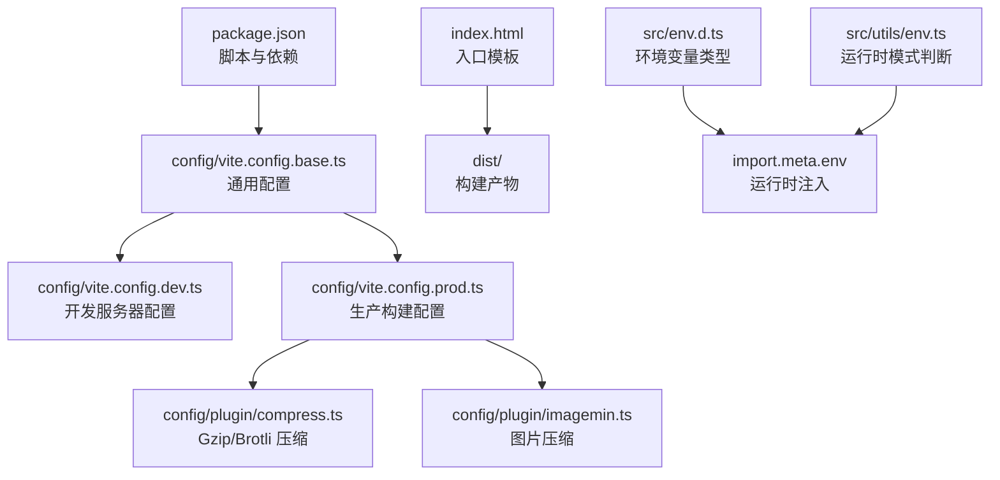
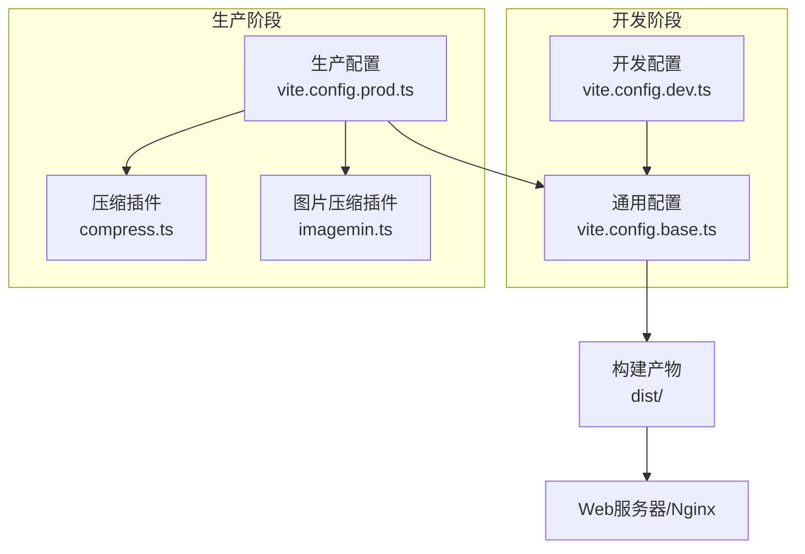
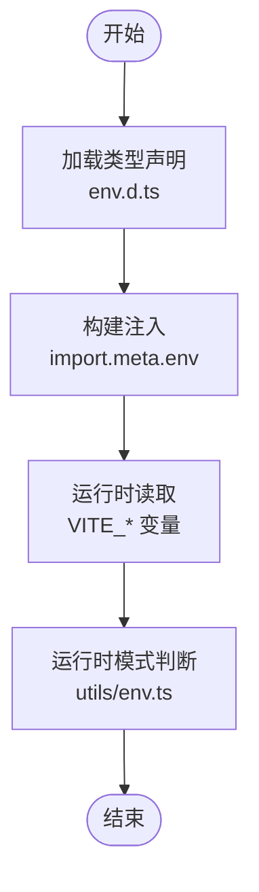
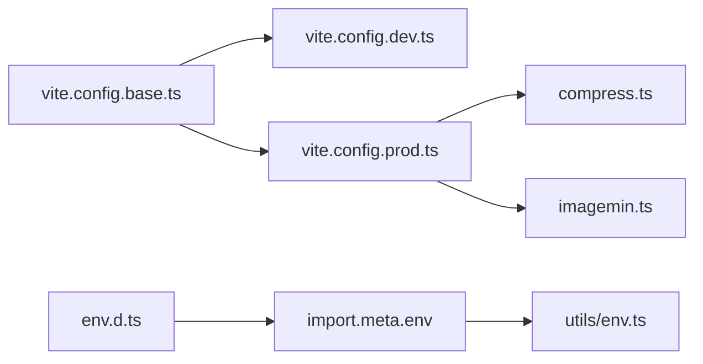

# 部署流程

<cite>
**本文引用的文件**
- [package.json](file://package.json)
- [index.html](file://index.html)
- [src/env.d.ts](file://src/env.d.ts)
- [src/utils/env.ts](file://src/utils/env.ts)
- [config/vite.config.base.ts](file://config/vite.config.base.ts)
- [config/vite.config.dev.ts](file://config/vite.config.dev.ts)
- [config/vite.config.prod.ts](file://config/vite.config.prod.ts)
- [config/plugin/compress.ts](file://config/plugin/compress.ts)
- [config/plugin/imagemin.ts](file://config/plugin/imagemin.ts)
</cite>

## 目录
1. [简介](#简介)
2. [项目结构](#项目结构)
3. [核心组件](#核心组件)
4. [架构总览](#架构总览)
5. [详细组件分析](#详细组件分析)
6. [依赖分析](#依赖分析)
7. [性能考虑](#性能考虑)
8. [故障排查指南](#故障排查指南)
9. [结论](#结论)
10. [附录](#附录)

## 简介
本文件面向前端工程部署与运维团队，系统性梳理该前端项目的静态资源构建、环境变量注入、域名与路径配置、CI/CD流水线与自动化发布策略、容器化与反向代理、缓存与CDN、HTTPS等关键主题。文档以仓库现有配置为依据，结合Vite生态与项目实际产物，给出可落地的部署建议与最佳实践。

## 项目结构
该前端项目采用Vite作为构建工具，通过多份配置文件区分开发与生产环境，并在生产配置中启用代码分包、图片压缩与可视化分析插件。入口HTML模板定义了应用挂载点与基础图标链接；类型声明文件约束了运行时环境变量接口；运行时工具用于判断当前是否处于生产模式。

**图示来源**
- [package.json:1-103](file://package.json#L1-L103)
- [config/vite.config.base.ts:1-52](file://config/vite.config.base.ts#L1-L52)
- [config/vite.config.dev.ts:1-24](file://config/vite.config.dev.ts#L1-L24)
- [config/vite.config.prod.ts:1-32](file://config/vite.config.prod.ts#L1-L32)
- [config/plugin/compress.ts:1-35](file://config/plugin/compress.ts#L1-L35)
- [config/plugin/imagemin.ts:1-38](file://config/plugin/imagemin.ts#L1-L38)
- [index.html:1-14](file://index.html#L1-L14)
- [src/env.d.ts:1-12](file://src/env.d.ts#L1-L12)
- [src/utils/env.ts:1-4](file://src/utils/env.ts#L1-L4)

**章节来源**
- [package.json:1-103](file://package.json#L1-L103)
- [config/vite.config.base.ts:1-52](file://config/vite.config.base.ts#L1-L52)
- [config/vite.config.dev.ts:1-24](file://config/vite.config.dev.ts#L1-L24)
- [config/vite.config.prod.ts:1-32](file://config/vite.config.prod.ts#L1-L32)
- [index.html:1-14](file://index.html#L1-L14)
- [src/env.d.ts:1-12](file://src/env.d.ts#L1-L12)
- [src/utils/env.ts:1-4](file://src/utils/env.ts#L1-L4)

## 核心组件
- 构建与打包
  - 生产构建通过Vite执行，启用分包策略与资源压缩插件，输出静态资源到dist目录。
  - 开发模式使用本地服务器，支持热更新与ESLint检查。
- 环境变量
  - 运行时通过import.meta.env访问Vite注入的变量，类型由env.d.ts约束。
  - 提供运行时模式判断工具，用于区分开发/生产行为。
- 入口模板
  - HTML模板定义应用挂载点与基础图标，确保页面渲染与加载体验。

**章节来源**
- [package.json:8-16](file://package.json#L8-L16)
- [config/vite.config.prod.ts:8-31](file://config/vite.config.prod.ts#L8-L31)
- [config/vite.config.dev.ts:5-23](file://config/vite.config.dev.ts#L5-L23)
- [src/env.d.ts:9-11](file://src/env.d.ts#L9-L11)
- [src/utils/env.ts:1-4](file://src/utils/env.ts#L1-L4)
- [index.html:1-14](file://index.html#L1-L14)

## 架构总览
下图展示从源码到静态产物的关键流程：开发与生产配置分别继承自通用配置；生产构建启用压缩与图片优化；最终产物由Nginx等Web服务器提供服务。

**图示来源**
- [config/vite.config.base.ts:1-52](file://config/vite.config.base.ts#L1-L52)
- [config/vite.config.dev.ts:1-24](file://config/vite.config.dev.ts#L1-L24)
- [config/vite.config.prod.ts:1-32](file://config/vite.config.prod.ts#L1-L32)
- [config/plugin/compress.ts:1-35](file://config/plugin/compress.ts#L1-L35)
- [config/plugin/imagemin.ts:1-38](file://config/plugin/imagemin.ts#L1-L38)

## 详细组件分析

### 静态资源部署
- 构建产物
  - 生产构建输出至dist目录，包含HTML、JS、CSS、媒体与静态资源。
  - 分包策略将第三方库与业务代码拆分，提升缓存命中率与加载性能。
- 资源访问路径
  - 入口模板通过模块化脚本加载应用，运行时通过import.meta.env读取API基础地址等配置。
- 部署建议
  - 将dist目录直接部署至Web服务器根目录或子路径。
  - 使用CDN分发静态资源，结合缓存头与版本化命名提升性能。

**章节来源**
- [config/vite.config.prod.ts:17-28](file://config/vite.config.prod.ts#L17-L28)
- [index.html:10-12](file://index.html#L10-L12)
- [src/env.d.ts:9-11](file://src/env.d.ts#L9-L11)

### 环境变量配置
- 类型约束
  - 通过env.d.ts声明VITE_API_BASE_URL等变量类型，避免拼写错误与类型不一致。
- 注入方式
  - Vite在构建时将import.meta.env中的变量注入到运行时，仅暴露以VITE_前缀的变量。
- 运行时判断
  - 工具函数根据MODE判断是否为生产模式，便于在代码中切换调试与生产逻辑。

**图示来源**
- [src/env.d.ts:9-11](file://src/env.d.ts#L9-L11)
- [src/utils/env.ts:1-4](file://src/utils/env.ts#L1-L4)

**章节来源**
- [src/env.d.ts:1-12](file://src/env.d.ts#L1-L12)
- [src/utils/env.ts:1-4](file://src/utils/env.ts#L1-L4)

### 域名设置与路由
- 入口模板
  - 模板定义应用挂载点与基础图标，确保页面渲染与加载体验。
- 路由与基础路径
  - 项目未显式提供基础路径配置文件，通常通过Web服务器或反向代理设置子路径部署。
  - 若需子路径部署，可在Nginx中配置location与重写规则，确保静态资源与API请求正确转发。

**章节来源**
- [index.html:1-14](file://index.html#L1-L14)

### CI/CD流水线与自动化部署
- 构建脚本
  - 通过package.json中的脚本触发类型检查与构建，随后可进行预览或部署。
- 自动化建议
  - 在CI中执行类型检查与构建，生成dist目录后上传为Artifacts。
  - 部署阶段将Artifacts下载并推送到目标服务器或CDN。
  - 版本发布策略建议采用语义化版本号与Git标签配合，结合发布说明与回滚策略。

**章节来源**
- [package.json:8-16](file://package.json#L8-L16)

### Docker容器化部署
- 容器镜像建议
  - 使用Nginx官方镜像作为运行时，将dist目录挂载到Nginx的静态目录。
  - 在容器内配置Nginx站点，指向静态资源目录，并开启Gzip/Brotli与缓存头。
- 启动与编排
  - 通过Dockerfile复制dist内容到Nginx目录，或使用卷挂载。
  - 使用docker-compose编排，结合反向代理与HTTPS终止。

[本节为概念性说明，不直接分析具体文件，故无“章节来源”]

### Nginx配置与反向代理
- 静态资源服务
  - 将dist目录映射为静态站点，设置合适的缓存头与压缩策略。
- 反向代理
  - 将API请求转发至后端服务，保持路径一致性与CORS处理。
- 子路径部署
  - 通过location与重写规则，使应用在子路径下正常运行。

[本节为概念性说明，不直接分析具体文件，故无“章节来源”]

### 缓存策略与CDN集成
- 缓存策略
  - 对静态资源设置长缓存，对HTML设置短缓存或no-cache。
  - 利用分包策略与内容哈希，实现资源级别的增量缓存。
- CDN集成
  - 将dist目录同步至CDN，结合全球节点加速用户访问。
  - 通过HTTP/2与HTTP/3、Brotli/Gzip压缩提升传输效率。

**章节来源**
- [config/vite.config.prod.ts:17-28](file://config/vite.config.prod.ts#L17-L28)

### HTTPS配置
- 终止TLS
  - 在Nginx层终止HTTPS，配置证书与私钥，启用现代加密套件与安全头。
- 强制跳转
  - 将HTTP请求重定向至HTTPS，确保全站安全。

[本节为概念性说明，不直接分析具体文件，故无“章节来源”]

### 不同部署环境的配置差异与最佳实践
- 测试环境
  - 使用开发配置启动本地服务，便于快速迭代与问题定位。
  - 环境变量指向测试后端API，便于联调。
- 预发布环境
  - 使用生产配置构建，模拟线上环境，验证缓存与CDN效果。
  - 配置灰度发布策略，逐步扩大流量。
- 生产环境
  - 启用压缩与图片优化，确保资源体积最小化。
  - 配置健康检查与自动扩缩容，保障高可用。

**章节来源**
- [config/vite.config.dev.ts:5-23](file://config/vite.config.dev.ts#L5-L23)
- [config/vite.config.prod.ts:8-31](file://config/vite.config.prod.ts#L8-L31)

## 依赖分析
- 构建链路
  - 开发与生产配置均继承自通用配置，生产配置额外引入压缩与图片优化插件。
- 插件关系
  - 压缩插件支持Gzip与Brotli两种算法，图片压缩插件提供多格式优化参数。
- 运行时依赖
  - 环境变量通过Vite注入，类型由env.d.ts约束，运行时工具用于判断模式。

**图示来源**
- [config/vite.config.base.ts:1-52](file://config/vite.config.base.ts#L1-L52)
- [config/vite.config.dev.ts:1-24](file://config/vite.config.dev.ts#L1-L24)
- [config/vite.config.prod.ts:1-32](file://config/vite.config.prod.ts#L1-L32)
- [config/plugin/compress.ts:1-35](file://config/plugin/compress.ts#L1-L35)
- [config/plugin/imagemin.ts:1-38](file://config/plugin/imagemin.ts#L1-L38)
- [src/env.d.ts:1-12](file://src/env.d.ts#L1-L12)
- [src/utils/env.ts:1-4](file://src/utils/env.ts#L1-L4)

**章节来源**
- [config/vite.config.base.ts:1-52](file://config/vite.config.base.ts#L1-L52)
- [config/vite.config.dev.ts:1-24](file://config/vite.config.dev.ts#L1-L24)
- [config/vite.config.prod.ts:1-32](file://config/vite.config.prod.ts#L1-L32)
- [config/plugin/compress.ts:1-35](file://config/plugin/compress.ts#L1-L35)
- [config/plugin/imagemin.ts:1-38](file://config/plugin/imagemin.ts#L1-L38)
- [src/env.d.ts:1-12](file://src/env.d.ts#L1-L12)
- [src/utils/env.ts:1-4](file://src/utils/env.ts#L1-L4)

## 性能考虑
- 代码分包
  - 通过manualChunks将常用第三方库独立成块，提升缓存复用率。
- 资源压缩
  - 生产构建启用Gzip/Brotli压缩与图片压缩，降低带宽占用。
- 缓存策略
  - 对静态资源设置长缓存，对HTML设置短缓存，结合版本化命名实现精准失效控制。

**章节来源**
- [config/vite.config.prod.ts:17-28](file://config/vite.config.prod.ts#L17-L28)
- [config/plugin/compress.ts:15-32](file://config/plugin/compress.ts#L15-L32)
- [config/plugin/imagemin.ts:9-37](file://config/plugin/imagemin.ts#L9-L37)

## 故障排查指南
- 构建失败
  - 检查类型检查脚本与构建脚本是否报错，优先修复类型与语法问题。
- 环境变量未生效
  - 确认变量名以VITE_前缀，且在env.d.ts中声明类型。
- 运行时模式判断异常
  - 检查MODE值与运行时工具逻辑，确保在生产模式下启用压缩与缓存策略。
- 静态资源404
  - 确认Nginx或服务器已正确映射dist目录，检查子路径与重写规则。

**章节来源**
- [package.json:8-16](file://package.json#L8-L16)
- [src/env.d.ts:9-11](file://src/env.d.ts#L9-L11)
- [src/utils/env.ts:1-4](file://src/utils/env.ts#L1-L4)

## 结论
本项目以Vite为核心构建工具，通过清晰的开发与生产配置分离、严格的类型约束与运行时模式判断，实现了可维护的前端部署体系。结合CDN、缓存与HTTPS等手段，可在不同环境中稳定交付高质量的静态资源。建议在CI/CD中固化构建与发布流程，并在生产环境实施监控与回滚策略，持续优化用户体验与稳定性。

## 附录
- 关键文件清单
  - 构建脚本与依赖：[package.json:1-103](file://package.json#L1-L103)
  - 通用配置：[config/vite.config.base.ts:1-52](file://config/vite.config.base.ts#L1-L52)
  - 开发配置：[config/vite.config.dev.ts:1-24](file://config/vite.config.dev.ts#L1-L24)
  - 生产配置：[config/vite.config.prod.ts:1-32](file://config/vite.config.prod.ts#L1-L32)
  - 压缩插件：[config/plugin/compress.ts:1-35](file://config/plugin/compress.ts#L1-L35)
  - 图片压缩插件：[config/plugin/imagemin.ts:1-38](file://config/plugin/imagemin.ts#L1-L38)
  - 入口模板：[index.html:1-14](file://index.html#L1-L14)
  - 环境变量类型：[src/env.d.ts:1-12](file://src/env.d.ts#L1-L12)
  - 运行时模式判断：[src/utils/env.ts:1-4](file://src/utils/env.ts#L1-L4)