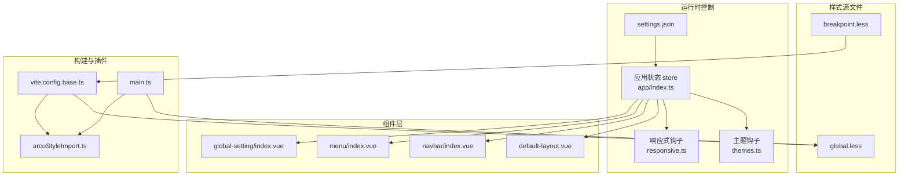
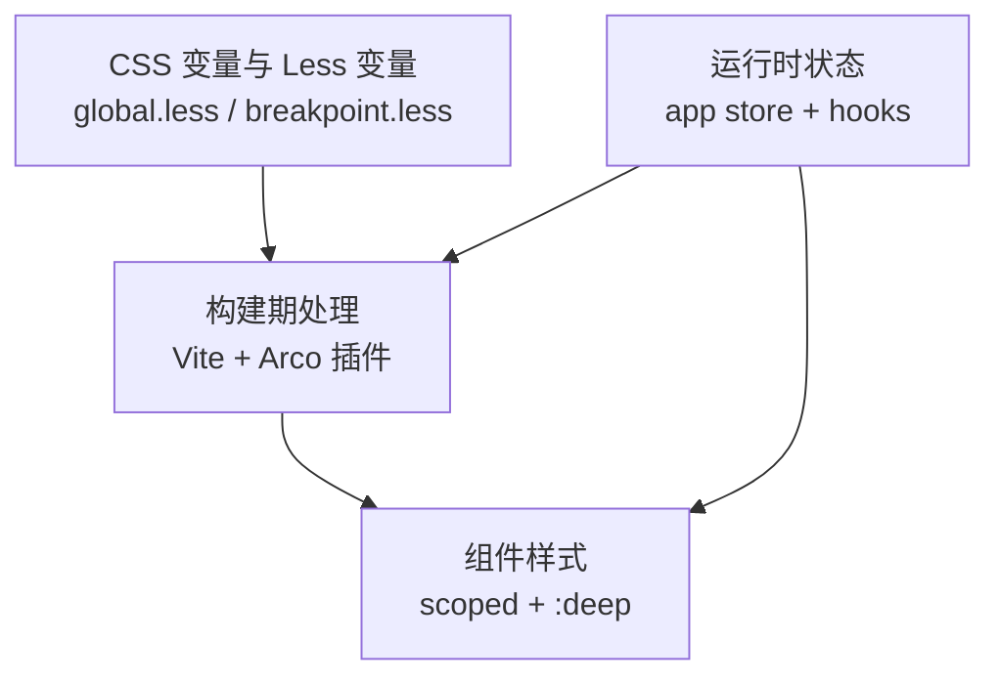
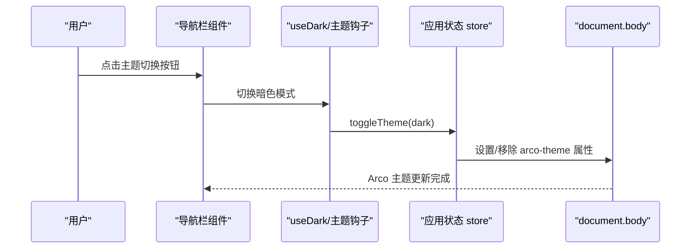
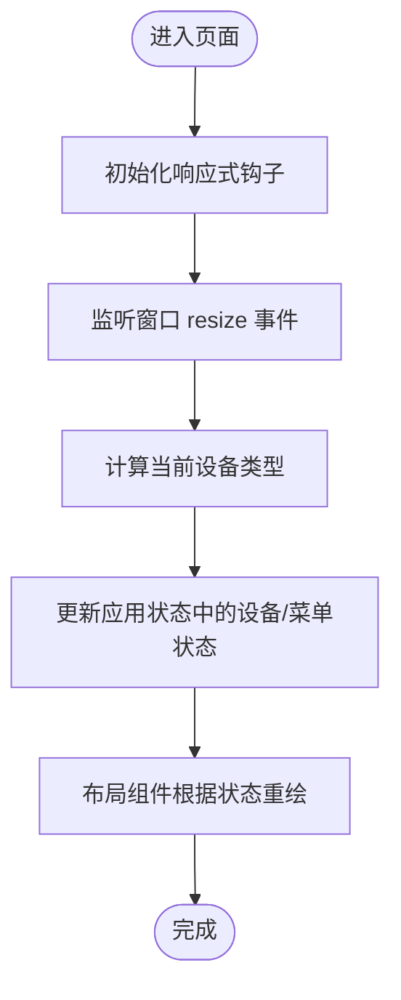
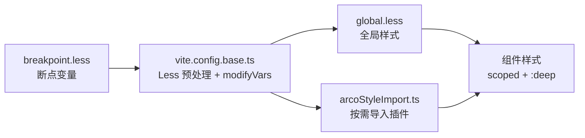
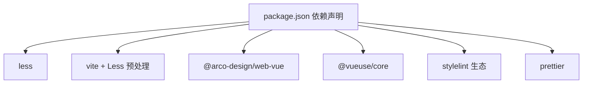

# 样式系统

<cite>
**本文引用的文件**
- [global.less](file://src/assets/style/global.less)
- [breakpoint.less](file://src/assets/style/breakpoint.less)
- [themes.ts](file://src/hooks/themes.ts)
- [responsive.ts](file://src/hooks/responsive.ts)
- [settings.json](file://src/config/settings.json)
- [index.ts（应用状态）](file://src/store/modules/app/index.ts)
- [index.vue（全局设置抽屉）](file://src/components/global-setting/index.vue)
- [default-layout.vue](file://src/layout/default-layout.vue)
- [vite.config.base.ts](file://config/vite.config.base.ts)
- [arcoStyleImport.ts](file://config/plugin/arcoStyleImport.ts)
- [main.ts](file://src/main.ts)
- [index.vue（导航栏）](file://src/components/navbar/index.vue)
- [index.vue（菜单）](file://src/components/menu/index.vue)
- [.stylelintrc.js](file://.stylelintrc.js)
- [package.json](file://package.json)
</cite>

## 目录
1. [引言](#引言)
2. [项目结构](#项目结构)
3. [核心组件](#核心组件)
4. [架构总览](#架构总览)
5. [详细组件分析](#详细组件分析)
6. [依赖分析](#依赖分析)
7. [性能考虑](#性能考虑)
8. [故障排查指南](#故障排查指南)
9. [结论](#结论)
10. [附录](#附录)

## 引言
本文件系统性梳理该前端工程的样式体系，覆盖样式架构设计、主题配置管理、响应式设计实现、全局样式规范、断点与CSS变量使用、Less预处理与模块化、组件样式隔离、主题定制与动态切换机制，并给出最佳实践与性能优化建议。

## 项目结构
样式系统围绕以下关键要素组织：
- 全局样式与变量：通过 Less 变量与全局样式文件统一入口，确保主题色、字体、背景等基础规范一致。
- 响应式与断点：以 Less 变量定义断点，结合运行时设备检测实现布局自适应。
- 主题系统：基于 Arco Design 的主题能力与自定义属性开关，实现明暗主题切换与持久化。
- 组件样式：采用 scoped 与深度选择器（:deep）实现组件级样式隔离与 Arco 组件风格定制。
- 构建集成：Vite 配置中启用 Less 预处理与 Arco 样式按需导入插件，提升构建效率与包体体积。

图表来源
- [global.less:1-95](file://src/assets/style/global.less#L1-L95)
- [breakpoint.less:1-20](file://src/assets/style/breakpoint.less#L1-L20)
- [settings.json:1-18](file://src/config/settings.json#L1-L18)
- [index.ts（应用状态）:1-78](file://src/store/modules/app/index.ts#L1-L78)
- [themes.ts:1-13](file://src/hooks/themes.ts#L1-L13)
- [responsive.ts:1-33](file://src/hooks/responsive.ts#L1-L33)
- [default-layout.vue:1-179](file://src/layout/default-layout.vue#L1-L179)
- [index.vue（导航栏）:1-324](file://src/components/navbar/index.vue#L1-L324)
- [index.vue（菜单）:1-161](file://src/components/menu/index.vue#L1-L161)
- [index.vue（全局设置抽屉）:1-99](file://src/components/global-setting/index.vue#L1-L99)
- [vite.config.base.ts:1-52](file://config/vite.config.base.ts#L1-L52)
- [arcoStyleImport.ts:1-13](file://config/plugin/arcoStyleImport.ts#L1-L13)
- [main.ts:1-29](file://src/main.ts#L1-L29)

章节来源
- [global.less:1-95](file://src/assets/style/global.less#L1-L95)
- [breakpoint.less:1-20](file://src/assets/style/breakpoint.less#L1-L20)
- [settings.json:1-18](file://src/config/settings.json#L1-L18)
- [index.ts（应用状态）:1-78](file://src/store/modules/app/index.ts#L1-L78)
- [themes.ts:1-13](file://src/hooks/themes.ts#L1-L13)
- [responsive.ts:1-33](file://src/hooks/responsive.ts#L1-L33)
- [default-layout.vue:1-179](file://src/layout/default-layout.vue#L1-L179)
- [index.vue（导航栏）:1-324](file://src/components/navbar/index.vue#L1-L324)
- [index.vue（菜单）:1-161](file://src/components/menu/index.vue#L1-L161)
- [index.vue（全局设置抽屉）:1-99](file://src/components/global-setting/index.vue#L1-L99)
- [vite.config.base.ts:1-52](file://config/vite.config.base.ts#L1-L52)
- [arcoStyleImport.ts:1-13](file://config/plugin/arcoStyleImport.ts#L1-L13)
- [main.ts:1-29](file://src/main.ts#L1-L29)

## 核心组件
- 全局样式与变量
  - 全局重置与基础排版、通用卡片与表格样式、echarts 提示框定制等在全局样式中集中管理，便于统一视觉与减少重复。
  - 断点变量集中于断点文件，供 Less 编译期与组件运行时逻辑共同使用。
- 应用状态与主题
  - 应用状态 store 管理主题模式、设备类型、菜单折叠等状态，并通过 DOM 属性切换 Arco 主题。
  - 主题钩子提供 isDark 计算属性，便于组件按需渲染。
- 响应式与布局
  - 响应式钩子监听窗口尺寸变化，计算设备类型并联动菜单显示策略。
  - 默认布局根据状态动态调整侧边栏宽度、内边距与抽屉菜单可见性。
- 组件样式隔离
  - 导航栏、菜单等组件均采用 scoped 作用域与 :deep 深度选择器，保证 Arco 组件内部样式的可控覆盖。
- 构建与插件
  - Vite 基础配置启用 Less 预处理与 Arco 样式按需导入插件；主入口引入全局样式，确保主题与变量生效。

章节来源
- [global.less:1-95](file://src/assets/style/global.less#L1-L95)
- [breakpoint.less:1-20](file://src/assets/style/breakpoint.less#L1-L20)
- [index.ts（应用状态）:1-78](file://src/store/modules/app/index.ts#L1-L78)
- [themes.ts:1-13](file://src/hooks/themes.ts#L1-L13)
- [responsive.ts:1-33](file://src/hooks/responsive.ts#L1-L33)
- [default-layout.vue:1-179](file://src/layout/default-layout.vue#L1-L179)
- [index.vue（导航栏）:1-324](file://src/components/navbar/index.vue#L1-L324)
- [index.vue（菜单）:1-161](file://src/components/menu/index.vue#L1-L161)
- [vite.config.base.ts:1-52](file://config/vite.config.base.ts#L1-L52)
- [arcoStyleImport.ts:1-13](file://config/plugin/arcoStyleImport.ts#L1-L13)
- [main.ts:1-29](file://src/main.ts#L1-L29)

## 架构总览
样式系统采用“变量与全局样式 + 运行时状态 + 组件样式隔离 + 构建期按需导入”的分层架构。变量与全局样式在编译期注入，运行时通过状态驱动主题与布局行为，组件层通过 scoped 与 :deep 实现样式隔离与覆盖。

图表来源
- [global.less:1-95](file://src/assets/style/global.less#L1-L95)
- [breakpoint.less:1-20](file://src/assets/style/breakpoint.less#L1-L20)
- [index.ts（应用状态）:1-78](file://src/store/modules/app/index.ts#L1-L78)
- [themes.ts:1-13](file://src/hooks/themes.ts#L1-L13)
- [responsive.ts:1-33](file://src/hooks/responsive.ts#L1-L33)
- [vite.config.base.ts:1-52](file://config/vite.config.base.ts#L1-L52)
- [arcoStyleImport.ts:1-13](file://config/plugin/arcoStyleImport.ts#L1-L13)

## 详细组件分析

### 全局样式与断点管理
- 全局样式
  - 重置盒模型、基础字体与背景色，使用 CSS 变量承载主题色值，确保明暗主题下颜色一致性。
  - 定义通用卡片与表格单元样式，以及 ECharts 自定义提示框的渐变、模糊与阴影效果。
- 断点管理
  - 以 Less 变量形式定义 xs 到 xxl 多级断点，供组件布局与媒体查询使用。
- 使用建议
  - 将所有主题色与语义色统一收敛至 CSS 变量，避免硬编码颜色值。
  - 在组件中优先使用变量而非具体数值，便于主题切换与维护。

章节来源
- [global.less:1-95](file://src/assets/style/global.less#L1-L95)
- [breakpoint.less:1-20](file://src/assets/style/breakpoint.less#L1-L20)

### 主题配置与动态切换
- 主题开关
  - 应用状态 store 提供切换主题的方法，通过在 body 上设置或移除 arco-theme 属性触发 Arco 组件主题切换。
  - 导航栏组件通过 useDark 与自定义切换函数，将 UI 操作映射到状态变更。
- 主题钩子
  - 提供 isDark 计算属性，便于组件条件渲染与样式分支。
- 最佳实践
  - 将主题切换与存储解耦：UI 触发 -> 状态更新 -> DOM 属性变更 -> Arco 主题生效。
  - 对外暴露统一的主题切换接口，避免直接操作 DOM。

图表来源
- [index.vue（导航栏）:195-233](file://src/components/navbar/index.vue#L195-L233)
- [index.ts（应用状态）:32-40](file://src/store/modules/app/index.ts#L32-L40)
- [themes.ts:1-13](file://src/hooks/themes.ts#L1-L13)

章节来源
- [index.ts（应用状态）:1-78](file://src/store/modules/app/index.ts#L1-L78)
- [themes.ts:1-13](file://src/hooks/themes.ts#L1-L13)
- [index.vue（导航栏）:195-233](file://src/components/navbar/index.vue#L195-L233)

### 响应式设计与布局适配
- 设备检测
  - 响应式钩子根据窗口宽度判断移动端或桌面端，联动菜单隐藏与展开策略。
- 布局联动
  - 默认布局根据状态动态计算侧边栏宽度、内边距与抽屉菜单可见性，确保在不同设备下的可用性。
- 断点使用
  - 组件侧使用断点常量进行布局判断，同时可结合 Less 变量进行媒体查询。

图表来源
- [responsive.ts:1-33](file://src/hooks/responsive.ts#L1-L33)
- [default-layout.vue:65-84](file://src/layout/default-layout.vue#L65-L84)

章节来源
- [responsive.ts:1-33](file://src/hooks/responsive.ts#L1-L33)
- [default-layout.vue:1-179](file://src/layout/default-layout.vue#L1-L179)

### Less 预处理与样式模块化
- 预处理配置
  - Vite 基础配置启用 Less，通过 modifyVars 注入断点变量，使组件可在 Less 中直接使用断点常量。
- 模块化与隔离
  - 组件样式采用 scoped 作用域，配合 :deep 选择器对 Arco 组件内部节点进行可控覆盖。
  - 全局样式集中于 global.less，避免样式污染与冲突。
- 插件集成
  - Arco 样式按需导入插件在构建期自动引入所需组件样式，减少冗余打包。

图表来源
- [vite.config.base.ts:39-50](file://config/vite.config.base.ts#L39-L50)
- [breakpoint.less:1-20](file://src/assets/style/breakpoint.less#L1-L20)
- [global.less:1-95](file://src/assets/style/global.less#L1-L95)
- [arcoStyleImport.ts:1-13](file://config/plugin/arcoStyleImport.ts#L1-L13)

章节来源
- [vite.config.base.ts:1-52](file://config/vite.config.base.ts#L1-L52)
- [arcoStyleImport.ts:1-13](file://config/plugin/arcoStyleImport.ts#L1-L13)
- [global.less:1-95](file://src/assets/style/global.less#L1-L95)
- [index.vue（导航栏）:265-323](file://src/components/navbar/index.vue#L265-L323)
- [index.vue（菜单）:148-161](file://src/components/menu/index.vue#L148-L161)

### 组件样式隔离与覆盖
- 导航栏
  - 使用 scoped 作用域包裹自身样式，通过 :deep 覆盖 Arco 下拉与弹窗内部节点的间距与边框。
- 菜单
  - 使用 :deep 调整 Arco 菜单图标尺寸与内联头部对齐，保持视觉一致性。
- 默认布局
  - 通过 :deep 调整滚动条样式与边框颜色，统一侧边栏滚动体验。

章节来源
- [index.vue（导航栏）:265-323](file://src/components/navbar/index.vue#L265-L323)
- [index.vue（菜单）:148-161](file://src/components/menu/index.vue#L148-L161)
- [default-layout.vue:144-170](file://src/layout/default-layout.vue#L144-L170)

### 主题定制指南
- 变量与颜色
  - 将主题色、文本色、边框色、填充色等统一收敛至 CSS 变量，避免硬编码。
- 动态切换
  - 通过应用状态 store 的主题切换方法与 DOM 属性开关，实现明暗主题无缝切换。
- 组件覆盖
  - 使用 :deep 对 Arco 组件内部节点进行局部覆盖，避免全局污染。
- 存储与持久化
  - 结合浏览器存储键位，实现主题偏好持久化，重启后恢复。

章节来源
- [index.ts（应用状态）:32-40](file://src/store/modules/app/index.ts#L32-L40)
- [index.vue（导航栏）:219-229](file://src/components/navbar/index.vue#L219-L229)

### 样式最佳实践
- 使用 CSS 变量承载语义化颜色，便于主题切换与品牌色统一。
- 组件样式采用 scoped 与 :deep，避免全局污染与意外覆盖。
- 在 Less 中统一引用断点变量，减少重复与不一致。
- 通过 Arco 插件按需导入样式，降低包体体积与加载时间。
- 使用 Stylelint 与 Prettier 规范样式代码风格，提升可维护性。

章节来源
- [.stylelintrc.js:1-30](file://.stylelintrc.js#L1-L30)
- [package.json:49-92](file://package.json#L49-L92)

## 依赖分析
- 构建期依赖
  - Less 与 Vite Less 预处理插件用于编译 Less 文件与变量注入。
  - Arco 样式按需导入插件在构建期自动引入所需组件样式。
- 运行时依赖
  - Arco Design Vue 组件库提供 UI 基础与主题能力。
  - VueUse 提供 useDark 等工具，简化主题与全屏等功能实现。
- 开发工具
  - Stylelint 与 Prettier 保障样式代码质量与一致性。

图表来源
- [package.json:32-92](file://package.json#L32-L92)

章节来源
- [package.json:1-103](file://package.json#L1-L103)

## 性能考虑
- 按需导入
  - 使用 Arco 样式按需导入插件，仅打包实际使用的组件样式，显著降低首屏体积。
- 变量复用
  - 将断点与颜色等变量集中管理，减少重复定义与编译开销。
- 组件样式隔离
  - 通过 scoped 与 :deep 控制样式范围，避免全局样式导致的重绘与回流。
- 构建优化
  - 合理拆分样式文件，避免单文件过大；利用缓存与压缩插件提升构建速度。

## 故障排查指南
- 主题切换无效
  - 检查应用状态 store 的主题切换方法是否被调用，确认 body 上是否存在 arco-theme 属性。
  - 确认 useDark 钩子的存储键位与 DOM 属性是否一致。
- 样式未生效
  - 检查组件是否正确使用 scoped 与 :deep，确认选择器优先级。
  - 确认全局样式是否在入口处正确引入。
- 响应式异常
  - 检查响应式钩子是否绑定 resize 事件，确认设备类型计算逻辑。
  - 确认布局组件是否根据状态正确重绘。

章节来源
- [index.ts（应用状态）:32-40](file://src/store/modules/app/index.ts#L32-L40)
- [index.vue（导航栏）:219-229](file://src/components/navbar/index.vue#L219-L229)
- [responsive.ts:1-33](file://src/hooks/responsive.ts#L1-L33)
- [main.ts:14-14](file://src/main.ts#L14-L14)

## 结论
该样式系统通过“变量与全局样式 + 运行时状态 + 组件样式隔离 + 构建期按需导入”的架构，实现了主题配置管理、响应式设计与组件样式隔离的统一。配合 Less 预处理与 Arco 插件，既保证了开发效率，也兼顾了运行时性能与可维护性。建议在后续迭代中持续完善主题变量体系、加强样式规范约束与自动化检查，以进一步提升团队协作效率与产品一致性。

## 附录
- 关键入口与配置
  - 入口文件引入全局样式与 Arco 插件，确保主题与变量生效。
  - Vite 基础配置启用 Less 并注入断点变量，为组件与全局样式提供统一断点支持。
- 组件清单
  - 导航栏、菜单、默认布局、全局设置抽屉等组件均采用 scoped 与 :deep 实现样式隔离与覆盖。

章节来源
- [main.ts:1-29](file://src/main.ts#L1-L29)
- [vite.config.base.ts:1-52](file://config/vite.config.base.ts#L1-L52)
- [index.vue（导航栏）:265-323](file://src/components/navbar/index.vue#L265-L323)
- [index.vue（菜单）:148-161](file://src/components/menu/index.vue#L148-L161)
- [default-layout.vue:108-178](file://src/layout/default-layout.vue#L108-L178)
- [index.vue（全局设置抽屉）:1-99](file://src/components/global-setting/index.vue#L1-L99)