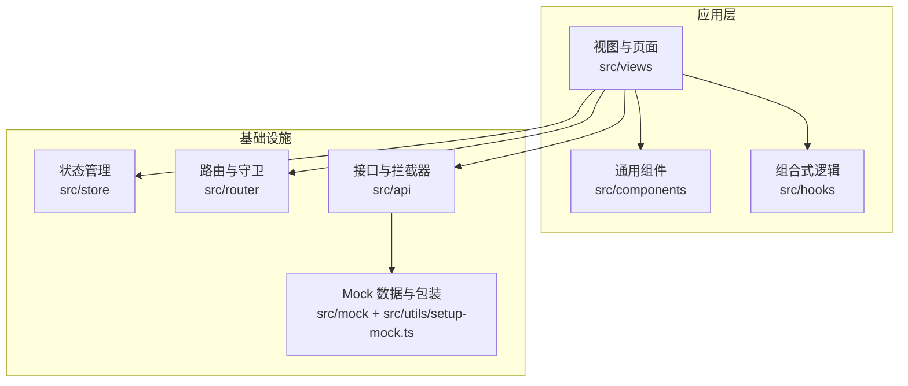
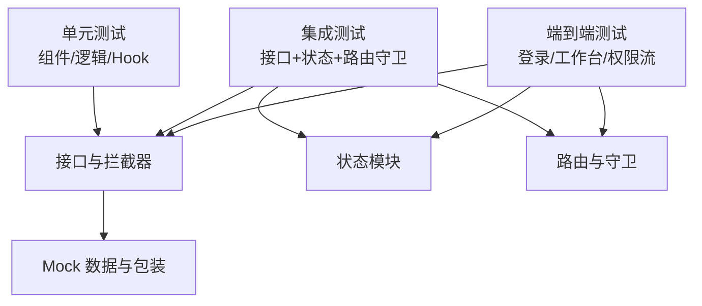
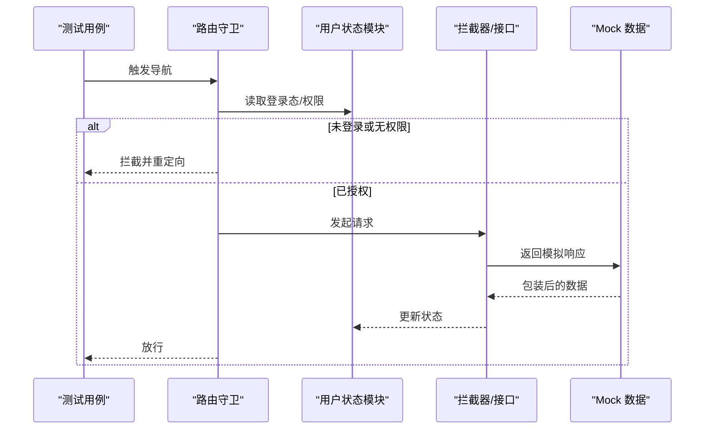
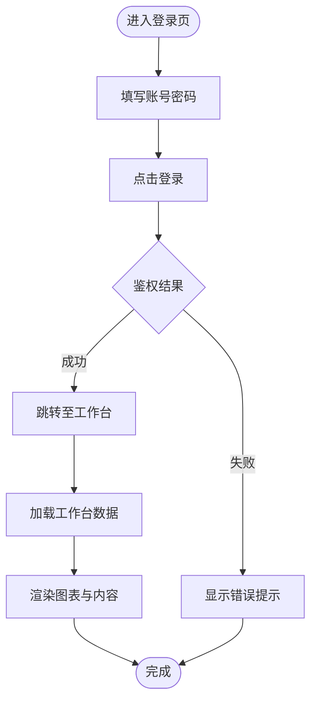
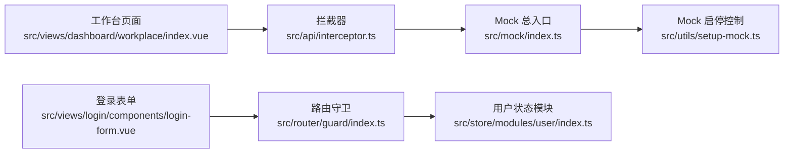

# 测试策略

<cite>
**本文引用的文件**
- [package.json](file://package.json)
- [tsconfig.json](file://tsconfig.json)
- [.eslintrc.js](file://.eslintrc.js)
- [.prettierrc.js](file://.prettierrc.js)
- [.stylelintrc.js](file://.stylelintrc.js)
- [src/utils/setup-mock.ts](file://src/utils/setup-mock.ts)
- [src/mock/index.ts](file://src/mock/index.ts)
- [src/api/interceptor.ts](file://src/api/interceptor.ts)
- [src/api/user.ts](file://src/api/user.ts)
- [src/api/message.ts](file://src/api/message.ts)
- [src/router/guard/index.ts](file://src/router/guard/index.ts)
- [src/router/guard/permission.ts](file://src/router/guard/permission.ts)
- [src/router/guard/userLoginInfo.ts](file://src/router/guard/userLoginInfo.ts)
- [src/hooks/request.ts](file://src/hooks/request.ts)
- [src/hooks/user.ts](file://src/hooks/user.ts)
- [src/store/modules/user/index.ts](file://src/store/modules/user/index.ts)
- [src/store/modules/app/index.ts](file://src/store/modules/app/index.ts)
- [src/components/menu/use-menu-tree.ts](file://src/components/menu/use-menu-tree.ts)
- [src/views/dashboard/workplace/mock.ts](file://src/views/dashboard/workplace/mock.ts)
- [src/views/login/components/login-form.vue](file://src/views/login/components/login-form.vue)
- [src/views/dashboard/workplace/index.vue](file://src/views/dashboard/workplace/index.vue)
- [src/main.ts](file://src/main.ts)
</cite>

## 目录
1. [引言](#引言)
2. [项目结构](#项目结构)
3. [核心组件](#核心组件)
4. [架构总览](#架构总览)
5. [详细组件分析](#详细组件分析)
6. [依赖分析](#依赖分析)
7. [性能考虑](#性能考虑)
8. [故障排查指南](#故障排查指南)
9. [结论](#结论)
10. [附录](#附录)

## 引言
本测试策略文档面向该前端工程，系统化阐述单元测试、集成测试与端到端测试的实施方法，明确测试工具配置、覆盖率要求与测试数据管理最佳实践，并给出组件测试、API测试与用户交互测试的落地建议。同时，结合现有仓库中的 Mock 机制与路由守卫等关键模块，提出测试友好的代码设计原则与测试驱动开发（TDD）建议，帮助在持续集成（CI）中稳定推进测试自动化。

## 项目结构
该工程采用 Vite + Vue3 + TypeScript 技术栈，使用 Pinia 状态管理、Vue Router 路由与 Axios 进行网络请求拦截。项目内已内置 MockJS 模块，用于在开发阶段模拟后端接口；同时通过环境变量与工具函数控制是否启用 Mock。

- 关键目录与职责概览
  - config：构建配置与插件配置（Vite）
  - src/api：接口定义与拦截器
  - src/mock：Mock 数据与响应包装
  - src/router：路由与权限守卫
  - src/store：状态模块
  - src/hooks：可复用逻辑钩子
  - src/components：通用组件与组合式逻辑
  - src/views：页面视图与业务场景
  - 工具与类型：src/utils、src/types

**图表来源**
- [src/main.ts](file://src/main.ts)
- [src/api/interceptor.ts](file://src/api/interceptor.ts)
- [src/mock/index.ts](file://src/mock/index.ts)
- [src/utils/setup-mock.ts](file://src/utils/setup-mock.ts)
- [src/router/guard/index.ts](file://src/router/guard/index.ts)
- [src/store/modules/user/index.ts](file://src/store/modules/user/index.ts)

**章节来源**
- [package.json](file://package.json)
- [tsconfig.json](file://tsconfig.json)

## 核心组件
围绕测试目标，以下核心模块与文件是测试策略的关键抓手：

- 接口与拦截器
  - 接口定义与拦截器：统一处理请求/响应、错误与鉴权
  - 参考路径：[src/api/interceptor.ts](file://src/api/interceptor.ts)，[src/api/user.ts](file://src/api/user.ts)，[src/api/message.ts](file://src/api/message.ts)

- Mock 与响应包装
  - Mock 总入口与延迟设置、响应包装（成功/失败）
  - 参考路径：[src/mock/index.ts](file://src/mock/index.ts)，[src/utils/setup-mock.ts](file://src/utils/setup-mock.ts)

- 路由与权限守卫
  - 登录态与权限校验、导航守卫
  - 参考路径：[src/router/guard/index.ts](file://src/router/guard/index.ts)，[src/router/guard/userLoginInfo.ts](file://src/router/guard/userLoginInfo.ts)，[src/router/guard/permission.ts](file://src/router/guard/permission.ts)

- 组合式逻辑与状态
  - 请求钩子、用户信息钩子、用户状态模块
  - 参考路径：[src/hooks/request.ts](file://src/hooks/request.ts)，[src/hooks/user.ts](file://src/hooks/user.ts)，[src/store/modules/user/index.ts](file://src/store/modules/user/index.ts)

- 组件与页面
  - 登录表单、工作台页面、菜单树逻辑
  - 参考路径：[src/views/login/components/login-form.vue](file://src/views/login/components/login-form.vue)，[src/views/dashboard/workplace/index.vue](file://src/views/dashboard/workplace/index.vue)，[src/components/menu/use-menu-tree.ts](file://src/components/menu/use-menu-tree.ts)

**章节来源**
- [src/api/interceptor.ts](file://src/api/interceptor.ts)
- [src/mock/index.ts](file://src/mock/index.ts)
- [src/utils/setup-mock.ts](file://src/utils/setup-mock.ts)
- [src/router/guard/index.ts](file://src/router/guard/index.ts)
- [src/hooks/request.ts](file://src/hooks/request.ts)
- [src/hooks/user.ts](file://src/hooks/user.ts)
- [src/store/modules/user/index.ts](file://src/store/modules/user/index.ts)
- [src/views/login/components/login-form.vue](file://src/views/login/components/login-form.vue)
- [src/views/dashboard/workplace/index.vue](file://src/views/dashboard/workplace/index.vue)
- [src/components/menu/use-menu-tree.ts](file://src/components/menu/use-menu-tree.ts)

## 架构总览
下图展示了测试策略在系统中的位置与交互关系：测试从组件与页面开始，贯穿到接口层与状态层，利用 Mock 提供稳定的离线数据源，配合路由守卫与鉴权逻辑进行端到端验证。

**图表来源**
- [src/api/interceptor.ts](file://src/api/interceptor.ts)
- [src/mock/index.ts](file://src/mock/index.ts)
- [src/utils/setup-mock.ts](file://src/utils/setup-mock.ts)
- [src/router/guard/index.ts](file://src/router/guard/index.ts)
- [src/store/modules/user/index.ts](file://src/store/modules/user/index.ts)

## 详细组件分析

### 单元测试方案
- 测试范围
  - 组合式逻辑：如请求钩子、用户钩子、菜单树逻辑
  - 工具函数：响应包装、Mock 启停控制
  - 纯函数与边界条件：参数校验、错误分支
- 建议实现
  - 使用测试运行器与断言库，针对上述模块编写独立用例
  - 对异步逻辑使用合理的等待与超时策略
  - 对纯函数进行边界值与异常输入覆盖
- 示例参考路径
  - [src/hooks/request.ts](file://src/hooks/request.ts)
  - [src/hooks/user.ts](file://src/hooks/user.ts)
  - [src/components/menu/use-menu-tree.ts](file://src/components/menu/use-menu-tree.ts)
  - [src/utils/setup-mock.ts](file://src/utils/setup-mock.ts)

**章节来源**
- [src/hooks/request.ts](file://src/hooks/request.ts)
- [src/hooks/user.ts](file://src/hooks/user.ts)
- [src/components/menu/use-menu-tree.ts](file://src/components/menu/use-menu-tree.ts)
- [src/utils/setup-mock.ts](file://src/utils/setup-mock.ts)

### 集成测试策略
- 测试范围
  - 接口层：拦截器、鉴权、错误处理
  - 状态层：用户状态模块与应用状态模块
  - 路由层：登录态守卫、权限守卫、导航流程
  - Mock 层：响应包装、延迟与稳定性
- 建议实现
  - 在集成测试中启用 Mock，确保接口行为可预测
  - 验证鉴权失败、权限不足、网络异常等分支
  - 覆盖登录成功/失败、跳转、缓存与状态更新
- 示例参考路径
  - [src/api/interceptor.ts](file://src/api/interceptor.ts)
  - [src/store/modules/user/index.ts](file://src/store/modules/user/index.ts)
  - [src/store/modules/app/index.ts](file://src/store/modules/app/index.ts)
  - [src/router/guard/userLoginInfo.ts](file://src/router/guard/userLoginInfo.ts)
  - [src/router/guard/permission.ts](file://src/router/guard/permission.ts)
  - [src/utils/setup-mock.ts](file://src/utils/setup-mock.ts)

**图表来源**
- [src/router/guard/index.ts](file://src/router/guard/index.ts)
- [src/router/guard/userLoginInfo.ts](file://src/router/guard/userLoginInfo.ts)
- [src/router/guard/permission.ts](file://src/router/guard/permission.ts)
- [src/store/modules/user/index.ts](file://src/store/modules/user/index.ts)
- [src/api/interceptor.ts](file://src/api/interceptor.ts)
- [src/utils/setup-mock.ts](file://src/utils/setup-mock.ts)

**章节来源**
- [src/api/interceptor.ts](file://src/api/interceptor.ts)
- [src/store/modules/user/index.ts](file://src/store/modules/user/index.ts)
- [src/store/modules/app/index.ts](file://src/store/modules/app/index.ts)
- [src/router/guard/index.ts](file://src/router/guard/index.ts)
- [src/router/guard/userLoginInfo.ts](file://src/router/guard/userLoginInfo.ts)
- [src/router/guard/permission.ts](file://src/router/guard/permission.ts)
- [src/utils/setup-mock.ts](file://src/utils/setup-mock.ts)

### 端到端测试实施
- 测试范围
  - 用户登录流程：输入、提交、鉴权、跳转
  - 工作台页面：数据加载、图表渲染、交互反馈
  - 权限链路：菜单可见性、路由访问控制
- 建议实现
  - 使用真实浏览器环境，启用 Mock 以保证稳定性
  - 覆盖成功路径与失败路径（验证码错误、网络异常）
  - 校验页面元素存在性、文案与交互状态
- 示例参考路径
  - [src/views/login/components/login-form.vue](file://src/views/login/components/login-form.vue)
  - [src/views/dashboard/workplace/index.vue](file://src/views/dashboard/workplace/index.vue)
  - [src/views/dashboard/workplace/mock.ts](file://src/views/dashboard/workplace/mock.ts)

**图表来源**
- [src/views/login/components/login-form.vue](file://src/views/login/components/login-form.vue)
- [src/views/dashboard/workplace/index.vue](file://src/views/dashboard/workplace/index.vue)
- [src/views/dashboard/workplace/mock.ts](file://src/views/dashboard/workplace/mock.ts)

**章节来源**
- [src/views/login/components/login-form.vue](file://src/views/login/components/login-form.vue)
- [src/views/dashboard/workplace/index.vue](file://src/views/dashboard/workplace/index.vue)
- [src/views/dashboard/workplace/mock.ts](file://src/views/dashboard/workplace/mock.ts)

### 测试工具配置与质量门禁
- 代码规范与格式化
  - ESLint：Airbnb 基础规则 + TypeScript + Vue3 推荐规则
  - Prettier：统一缩进、引号、换行等风格
  - Stylelint：CSS/Less 规范与顺序
  - 参考路径：[.eslintrc.js](file://.eslintrc.js)，[.prettierrc.js](file://.prettierrc.js)，[.stylelintrc.js](file://.stylelintrc.js)
- 类型检查
  - tsconfig：严格模式、路径别名、库版本
  - 参考路径：[tsconfig.json](file://tsconfig.json)
- 构建与脚本
  - package.json 中包含开发、构建、预览与类型检查脚本
  - 参考路径：[package.json](file://package.json)
- 建议补充
  - 在 CI 中增加测试脚本执行与覆盖率统计
  - 将 ESLint、Prettier、Stylelint 作为提交前钩子（Husky + lint-staged）强制执行

**章节来源**
- [.eslintrc.js](file://.eslintrc.js)
- [.prettierrc.js](file://.prettierrc.js)
- [.stylelintrc.js](file://.stylelintrc.js)
- [tsconfig.json](file://tsconfig.json)
- [package.json](file://package.json)

### 测试覆盖率要求
- 建议目标
  - 行覆盖率：≥80%
  - 分支覆盖率：≥70%
  - 函数覆盖率：≥85%
  - 语句覆盖率：≥80%
- 落地建议
  - 为关键模块（接口拦截器、状态模块、路由守卫、组合式逻辑）设置覆盖率阈值
  - 对 Mock 包装函数与错误分支进行专项覆盖
  - 在 CI 中开启覆盖率报告并设置失败阈值

[本节为通用指导，不直接分析具体文件，故无“章节来源”]

### 测试数据管理
- Mock 数据
  - Mock 总入口集中注册各模块 Mock，并设置随机延迟提升稳定性
  - 响应包装提供统一的成功/失败结构，便于断言
  - 参考路径：[src/mock/index.ts](file://src/mock/index.ts)，[src/utils/setup-mock.ts](file://src/utils/setup-mock.ts)
- 页面级 Mock
  - 工作台页面包含独立的 Mock 定义，便于端到端测试
  - 参考路径：[src/views/dashboard/workplace/mock.ts](file://src/views/dashboard/workplace/mock.ts)
- 环境控制
  - 通过工具函数与环境变量控制是否启用 Mock，避免在生产或特定环境下误触发
  - 参考路径：[src/utils/setup-mock.ts](file://src/utils/setup-mock.ts)

**章节来源**
- [src/mock/index.ts](file://src/mock/index.ts)
- [src/utils/setup-mock.ts](file://src/utils/setup-mock.ts)
- [src/views/dashboard/workplace/mock.ts](file://src/views/dashboard/workplace/mock.ts)

### 组件测试、API 测试与用户交互测试最佳实践
- 组件测试
  - 使用渲染器对组件进行快照与交互测试
  - 对受控属性、事件回调与副作用进行断言
  - 对菜单树等复杂逻辑拆分为可测试的组合式函数
- API 测试
  - 以拦截器为中心，验证请求头、鉴权、错误码与重试策略
  - 利用 Mock 包装统一响应结构，简化断言
- 用户交互测试
  - 以登录与工作台为主线，覆盖输入、提交、跳转、渲染与错误提示
  - 结合路由守卫与状态模块，验证权限链路

**章节来源**
- [src/api/interceptor.ts](file://src/api/interceptor.ts)
- [src/utils/setup-mock.ts](file://src/utils/setup-mock.ts)
- [src/router/guard/index.ts](file://src/router/guard/index.ts)
- [src/components/menu/use-menu-tree.ts](file://src/components/menu/use-menu-tree.ts)

### 测试自动化流程与持续集成
- 建议流程
  - 提交前：lint-staged 执行 ESLint、Stylelint、Prettier
  - CI：安装依赖 → 类型检查 → 单元测试（含覆盖率） → 集成测试 → 端到端测试 → 构建产物
- 脚本与工具
  - husky + lint-staged：提交前质量门禁
  - 参考路径：[package.json](file://package.json)
- 覆盖率与报告
  - 在 CI 中输出覆盖率报告并与阈值对比，失败则阻断合并

**章节来源**
- [package.json](file://package.json)

### 测试驱动开发与测试友好设计
- 设计原则
  - 将复杂逻辑抽离为纯函数与组合式逻辑，便于单元测试
  - 使用依赖注入与工厂模式，降低耦合度
  - 明确接口契约与错误码，便于断言与回归
- 实践建议
  - 先写测试再写实现，围绕边界与异常场景设计用例
  - 保持测试可读性与可维护性，命名清晰、分组合理

[本节为通用指导，不直接分析具体文件，故无“章节来源”]

## 依赖分析
- Mock 与环境控制
  - Mock 总入口集中注册，延迟设置提升稳定性
  - 响应包装统一结构，利于断言
- 接口与拦截器
  - 统一处理请求/响应与错误，减少重复逻辑
- 路由与权限
  - 导航守卫串联登录态与权限判断，保障访问安全
- 状态管理
  - 用户状态模块承载登录态与权限信息，供路由与组件消费

**图表来源**
- [src/mock/index.ts](file://src/mock/index.ts)
- [src/utils/setup-mock.ts](file://src/utils/setup-mock.ts)
- [src/api/interceptor.ts](file://src/api/interceptor.ts)
- [src/router/guard/index.ts](file://src/router/guard/index.ts)
- [src/store/modules/user/index.ts](file://src/store/modules/user/index.ts)
- [src/views/login/components/login-form.vue](file://src/views/login/components/login-form.vue)
- [src/views/dashboard/workplace/index.vue](file://src/views/dashboard/workplace/index.vue)

**章节来源**
- [src/mock/index.ts](file://src/mock/index.ts)
- [src/utils/setup-mock.ts](file://src/utils/setup-mock.ts)
- [src/api/interceptor.ts](file://src/api/interceptor.ts)
- [src/router/guard/index.ts](file://src/router/guard/index.ts)
- [src/store/modules/user/index.ts](file://src/store/modules/user/index.ts)
- [src/views/login/components/login-form.vue](file://src/views/login/components/login-form.vue)
- [src/views/dashboard/workplace/index.vue](file://src/views/dashboard/workplace/index.vue)

## 性能考虑
- Mock 延迟与并发
  - 合理设置 Mock 延迟，避免测试过快导致断言不稳定
- 覆盖率与执行时间
  - 控制测试粒度，优先覆盖关键路径，平衡覆盖率与执行效率
- 端到端测试优化
  - 复用浏览器上下文，减少启动成本；对静态资源进行缓存

[本节为通用指导，不直接分析具体文件，故无“章节来源”]

## 故障排查指南
- Mock 未生效
  - 检查环境变量与工具函数中的开关逻辑
  - 确认 Mock 总入口已注册对应模块
- 鉴权失败或权限异常
  - 核对路由守卫中的登录态与权限判断
  - 检查状态模块中用户信息的更新时机
- 接口返回结构不一致
  - 统一使用响应包装函数，确保字段一致性
- 端到端测试不稳定
  - 增加等待策略，避免 DOM 未就绪导致断言失败

**章节来源**
- [src/utils/setup-mock.ts](file://src/utils/setup-mock.ts)
- [src/mock/index.ts](file://src/mock/index.ts)
- [src/router/guard/userLoginInfo.ts](file://src/router/guard/userLoginInfo.ts)
- [src/router/guard/permission.ts](file://src/router/guard/permission.ts)
- [src/store/modules/user/index.ts](file://src/store/modules/user/index.ts)
- [src/utils/setup-mock.ts](file://src/utils/setup-mock.ts)

## 结论
本测试策略以 Mock 为核心，结合拦截器、状态与路由守卫，形成从单元到端到端的完整测试闭环。通过明确覆盖率目标、测试数据管理与质量门禁，可在 CI 中稳定推进测试自动化。建议在后续迭代中逐步完善测试用例，强化边界与异常场景覆盖，并将 TDD 思想融入日常开发，持续提升代码质量与交付效率。

## 附录
- 参考路径汇总
  - [package.json](file://package.json)
  - [tsconfig.json](file://tsconfig.json)
  - [.eslintrc.js](file://.eslintrc.js)
  - [.prettierrc.js](file://.prettierrc.js)
  - [.stylelintrc.js](file://.stylelintrc.js)
  - [src/utils/setup-mock.ts](file://src/utils/setup-mock.ts)
  - [src/mock/index.ts](file://src/mock/index.ts)
  - [src/api/interceptor.ts](file://src/api/interceptor.ts)
  - [src/api/user.ts](file://src/api/user.ts)
  - [src/api/message.ts](file://src/api/message.ts)
  - [src/router/guard/index.ts](file://src/router/guard/index.ts)
  - [src/router/guard/permission.ts](file://src/router/guard/permission.ts)
  - [src/router/guard/userLoginInfo.ts](file://src/router/guard/userLoginInfo.ts)
  - [src/hooks/request.ts](file://src/hooks/request.ts)
  - [src/hooks/user.ts](file://src/hooks/user.ts)
  - [src/store/modules/user/index.ts](file://src/store/modules/user/index.ts)
  - [src/store/modules/app/index.ts](file://src/store/modules/app/index.ts)
  - [src/components/menu/use-menu-tree.ts](file://src/components/menu/use-menu-tree.ts)
  - [src/views/dashboard/workplace/mock.ts](file://src/views/dashboard/workplace/mock.ts)
  - [src/views/login/components/login-form.vue](file://src/views/login/components/login-form.vue)
  - [src/views/dashboard/workplace/index.vue](file://src/views/dashboard/workplace/index.vue)
  - [src/main.ts](file://src/main.ts)