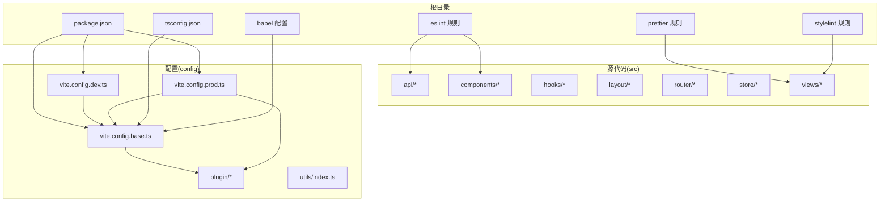
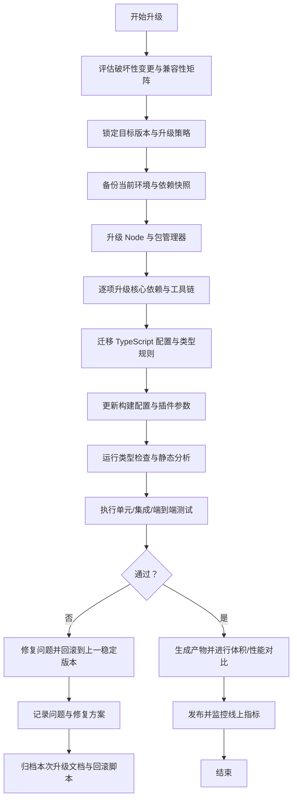
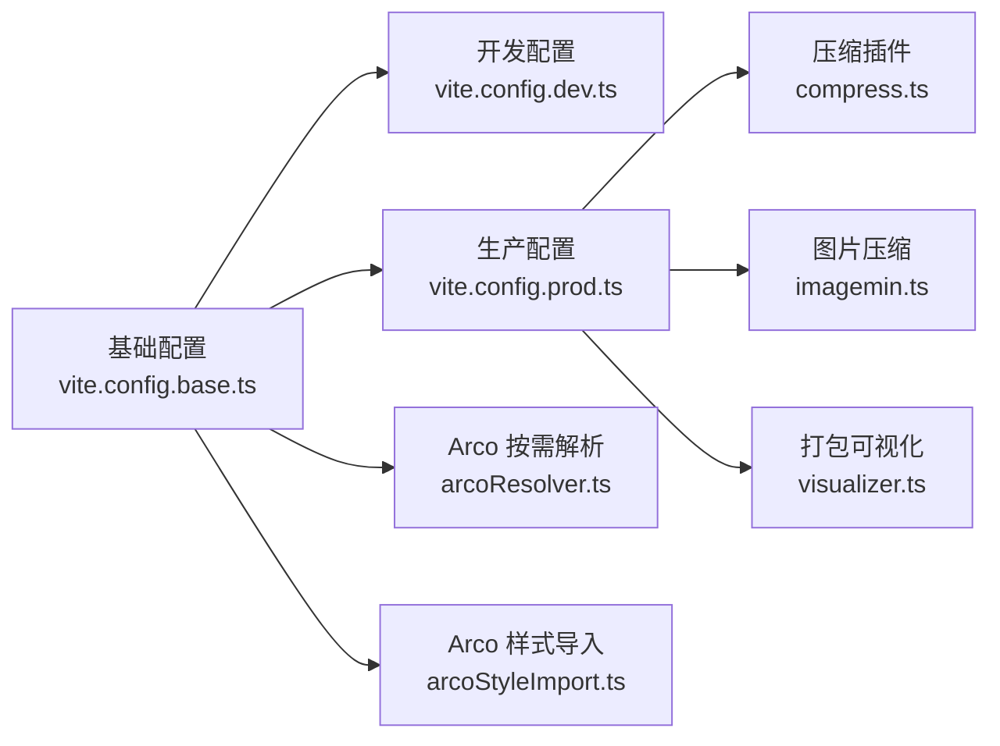
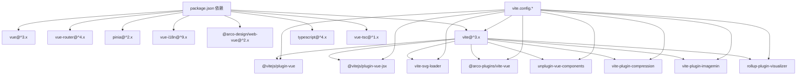

# 版本升级

<cite>
**本文引用的文件**
- [package.json](file://package.json)
- [tsconfig.json](file://tsconfig.json)
- [vite.config.base.ts](file://config/vite.config.base.ts)
- [vite.config.dev.ts](file://config/vite.config.dev.ts)
- [vite.config.prod.ts](file://config/vite.config.prod.ts)
- [arcoResolver.ts](file://config/plugin/arcoResolver.ts)
- [arcoStyleImport.ts](file://config/plugin/arcoStyleImport.ts)
- [compress.ts](file://config/plugin/compress.ts)
- [imagemin.ts](file://config/plugin/imagemin.ts)
- [visualizer.ts](file://config/plugin/visualizer.ts)
- [utils/index.ts](file://config/utils/index.ts)
- [.eslintrc.js](file://.eslintrc.js)
- [.prettierrc.js](file://.prettierrc.js)
- [.stylelintrc.js](file://.stylelintrc.js)
- [babel.config.js](file://babel.config.js)
</cite>

## 目录
1. [简介](#简介)
2. [项目结构](#项目结构)
3. [核心组件](#核心组件)
4. [架构总览](#架构总览)
5. [详细组件分析](#详细组件分析)
6. [依赖分析](#依赖分析)
7. [性能考虑](#性能考虑)
8. [故障排查指南](#故障排查指南)
9. [结论](#结论)
10. [附录](#附录)

## 简介
本指南面向在现有前端工程基础上进行“版本升级”的团队与个人，目标是提供一套可操作、可回溯、可验证的升级流程与最佳实践。该工程基于 Vue 3、Vite 3、TypeScript 4.x 与 Arco Design 生态，采用模块化构建配置与插件化扩展（按需组件、样式导入、压缩、图片优化、可视化等）。升级范围涵盖：依赖版本管理、TypeScript 配置升级、构建工具更新、迁移工具使用、配置文件更新、代码重构建议、风险评估与回滚策略、测试验证方法以及向后兼容性与破坏性变更处理。

## 项目结构
项目采用“功能分层 + 配置分层”组织方式：
- 功能层：src 下按领域划分（api、components、hooks、layout、router、store、views 等）
- 配置层：config 下拆分为基础配置、开发配置、生产配置及插件目录
- 工具与规范：根目录下包含 ESLint、Prettier、Stylelint、Babel、husky 等配置文件

图表来源
- [vite.config.base.ts:1-52](file://config/vite.config.base.ts#L1-L52)
- [vite.config.dev.ts:1-24](file://config/vite.config.dev.ts#L1-L24)
- [vite.config.prod.ts:1-32](file://config/vite.config.prod.ts#L1-L32)
- [package.json:1-103](file://package.json#L1-L103)

章节来源
- [package.json:1-103](file://package.json#L1-L103)
- [tsconfig.json:1-21](file://tsconfig.json#L1-L21)
- [vite.config.base.ts:1-52](file://config/vite.config.base.ts#L1-L52)
- [vite.config.dev.ts:1-24](file://config/vite.config.dev.ts#L1-L24)
- [vite.config.prod.ts:1-32](file://config/vite.config.prod.ts#L1-L32)

## 核心组件
- 构建配置体系：基础配置统一插件与别名、CSS 变量注入；开发配置启用 ESLint 实时检查；生产配置启用压缩、可视化、按需解析与图片优化。
- 插件生态：Arco 按需组件与样式导入、gzip/Brotli 压缩、图片压缩、打包可视化、SVG 加载器等。
- 开发体验：ESLint + Prettier + Stylelint 统一风格与质量；husky + lint-staged 提前拦截问题；TypeScript 类型检查与路径映射。
- 运行时依赖：Vue 3、Arco Web Vue、Pinia、Vue Router、Axios、DayJS、ECharts、Lodash 等。

章节来源
- [vite.config.base.ts:1-52](file://config/vite.config.base.ts#L1-L52)
- [vite.config.dev.ts:1-24](file://config/vite.config.dev.ts#L1-L24)
- [vite.config.prod.ts:1-32](file://config/vite.config.prod.ts#L1-L32)
- [arcoResolver.ts:1-20](file://config/plugin/arcoResolver.ts#L1-L20)
- [arcoStyleImport.ts:1-13](file://config/plugin/arcoStyleImport.ts#L1-L13)
- [compress.ts:1-35](file://config/plugin/compress.ts#L1-L35)
- [imagemin.ts:1-38](file://config/plugin/imagemin.ts#L1-L38)
- [visualizer.ts:1-19](file://config/plugin/visualizer.ts#L1-L19)
- [utils/index.ts:1-10](file://config/utils/index.ts#L1-L10)
- [package.json:1-103](file://package.json#L1-L103)
- [.eslintrc.js:1-71](file://.eslintrc.js#L1-L71)
- [.prettierrc.js:1-10](file://.prettierrc.js#L1-L10)
- [.stylelintrc.js:1-31](file://.stylelintrc.js#L1-L31)
- [babel.config.js:1-4](file://babel.config.js#L1-L4)

## 架构总览
下图展示从“升级准备”到“验证发布”的端到端流程，覆盖依赖升级、配置迁移、构建与测试、回滚策略等关键节点。

## 详细组件分析

### 依赖版本管理与升级策略
- 升级原则
  - 先升级构建工具链（Vite、TypeScript、Rollup）与核心框架（Vue），再升级业务依赖（Arco、Pinia、Router、Axios 等）。
  - 对齐 Node 版本要求，确保 CI/CD 与本地一致。
- 版本兼容性要点
  - Vue 3 与 Vue 生态（Router、Pinia、I18n）需保持主版本一致。
  - Vite 与 @vitejs/plugin-vue、@vitejs/plugin-vue-jsx 的版本需匹配。
  - TypeScript 与 vue-tsc、@typescript-eslint/* 需保持兼容。
- 回退策略
  - 使用 lock 文件与镜像源锁定版本，必要时回滚到上一版本提交与依赖快照。
  - 保留旧的构建配置与插件参数，便于快速切换。

章节来源
- [package.json:1-103](file://package.json#L1-L103)
- [tsconfig.json:1-21](file://tsconfig.json#L1-L21)

### TypeScript 配置升级
- 升级步骤
  - 更新 compilerOptions 中的 target/module/lib，确保与运行时一致。
  - 同步 vue-tsc 与 @typescript-eslint/* 版本，避免类型检查差异。
  - 调整 include/exclude 范围，确保 *.vue 文件被正确解析。
- 关键注意点
  - 保持 skipLibCheck 与 resolveJsonModule 等选项的一致性。
  - 若引入新的 TS 特性，需同步更新 ESLint 规则与 Prettier 配置。

章节来源
- [tsconfig.json:1-21](file://tsconfig.json#L1-L21)
- [package.json:1-103](file://package.json#L1-L103)

### 构建工具与配置更新（Vite 插件与别名）
- 基础配置
  - 插件统一注册：vue、vueJsx、svgLoader、arcoStyleImport。
  - 别名与解析：@ 指向 src，assets 指向 src/assets；对 vue-i18n 与 vue 进行特定打包入口修正以规避警告。
  - CSS 预处理器：Less 注入主题变量与引用断点样式。
- 开发配置
  - 启用 ESLint 插件，实时校验 src 下 TS/TSX/Vue 文件。
- 生产配置
  - 手动分包策略：arco、chart、vue 三大块，降低首屏依赖。
  - 压缩与可视化：按需启用 gzip/Brotli 与打包可视化。
  - 图片优化：针对 GIF/PNG/JPEG/SVG 设置不同优化策略。

图表来源
- [vite.config.base.ts:1-52](file://config/vite.config.base.ts#L1-L52)
- [vite.config.dev.ts:1-24](file://config/vite.config.dev.ts#L1-L24)
- [vite.config.prod.ts:1-32](file://config/vite.config.prod.ts#L1-L32)
- [compress.ts:1-35](file://config/plugin/compress.ts#L1-L35)
- [imagemin.ts:1-38](file://config/plugin/imagemin.ts#L1-L38)
- [visualizer.ts:1-19](file://config/plugin/visualizer.ts#L1-L19)
- [arcoResolver.ts:1-20](file://config/plugin/arcoResolver.ts#L1-L20)
- [arcoStyleImport.ts:1-13](file://config/plugin/arcoStyleImport.ts#L1-L13)

章节来源
- [vite.config.base.ts:1-52](file://config/vite.config.base.ts#L1-L52)
- [vite.config.dev.ts:1-24](file://config/vite.config.dev.ts#L1-L24)
- [vite.config.prod.ts:1-32](file://config/vite.config.prod.ts#L1-L32)
- [compress.ts:1-35](file://config/plugin/compress.ts#L1-L35)
- [imagemin.ts:1-38](file://config/plugin/imagemin.ts#L1-L38)
- [visualizer.ts:1-19](file://config/plugin/visualizer.ts#L1-L19)
- [arcoResolver.ts:1-20](file://config/plugin/arcoResolver.ts#L1-L20)
- [arcoStyleImport.ts:1-13](file://config/plugin/arcoStyleImport.ts#L1-L13)

### 迁移工具与配置文件更新
- 迁移工具
  - 使用 vue-tsc 进行类型迁移与兼容性检查。
  - 使用 @typescript-eslint/upgrade帮助迁移 ESLint 规则。
- 配置文件更新
  - ESLint：根据新版本调整 extends 与 rules，确保与 tsconfig 一致。
  - Prettier：保持缩进、引号、换行等风格一致。
  - Stylelint：关注新增或废弃规则，必要时添加 ignore 或禁用项。
  - Babel：保持 JSX 插件与 Vite 配置协同。

章节来源
- [package.json:1-103](file://package.json#L1-L103)
- [.eslintrc.js:1-71](file://.eslintrc.js#L1-L71)
- [.prettierrc.js:1-10](file://.prettierrc.js#L1-L10)
- [.stylelintrc.js:1-31](file://.stylelintrc.js#L1-L31)
- [babel.config.js:1-4](file://babel.config.js#L1-L4)

### 代码重构建议
- 组件按需加载
  - 使用 Arco Resolver 与 Arco Style Import 插件，避免全量引入导致包体膨胀。
- 路由与状态
  - 将路由守卫与权限逻辑收敛至独立模块，减少重复与耦合。
  - Pinia Store 模块化拆分，避免单文件过大。
- 工具函数与类型
  - 将通用工具函数抽取至 hooks 与 utils，统一导出入口。
  - 明确全局类型与模块声明，减少隐式 any。

章节来源
- [arcoResolver.ts:1-20](file://config/plugin/arcoResolver.ts#L1-L20)
- [arcoStyleImport.ts:1-13](file://config/plugin/arcoStyleImport.ts#L1-L13)

### 风险评估、回滚策略与测试验证
- 风险评估
  - 构建失败：检查 Vite 插件版本与配置兼容性。
  - 运行时错误：核对 Vue 生态主版本一致性与别名解析。
  - 性能回退：对比打包体积与分包策略，必要时调整手动分包。
- 回滚策略
  - 使用 Git 快照与依赖锁文件快速回退。
  - 保留旧版构建配置与插件参数，便于一键切换。
- 测试验证
  - 类型检查：vue-tsc --noEmit。
  - 静态分析：ESLint、Stylelint、Prettier。
  - 功能测试：单元/集成/端到端测试。
  - 产物验证：开启可视化报告与压缩开关，对比体积与缓存命中率。

章节来源
- [vite.config.prod.ts:1-32](file://config/vite.config.prod.ts#L1-L32)
- [visualizer.ts:1-19](file://config/plugin/visualizer.ts#L1-L19)
- [utils/index.ts:1-10](file://config/utils/index.ts#L1-L10)
- [package.json:1-103](file://package.json#L1-L103)

### 向后兼容性与破坏性变更处理
- 向后兼容性
  - 保持别名与路径映射稳定，避免破坏性变更影响构建。
  - 在插件层面通过配置兼容旧版本行为（如保留某些解析策略）。
- 破坏性变更
  - 当 Vite 或 TypeScript 发布破坏性变更时，优先更新相关插件与配置。
  - 通过 PR/CI 分阶段验证，逐步替换旧实现。

章节来源
- [vite.config.base.ts:1-52](file://config/vite.config.base.ts#L1-L52)
- [tsconfig.json:1-21](file://tsconfig.json#L1-L21)

## 依赖分析
以下图示化展示核心依赖与构建配置之间的耦合关系，便于定位升级影响面。

图表来源
- [package.json:1-103](file://package.json#L1-L103)
- [vite.config.base.ts:1-52](file://config/vite.config.base.ts#L1-L52)
- [vite.config.dev.ts:1-24](file://config/vite.config.dev.ts#L1-L24)
- [vite.config.prod.ts:1-32](file://config/vite.config.prod.ts#L1-L32)

章节来源
- [package.json:1-103](file://package.json#L1-L103)
- [vite.config.base.ts:1-52](file://config/vite.config.base.ts#L1-L52)
- [vite.config.dev.ts:1-24](file://config/vite.config.dev.ts#L1-L24)
- [vite.config.prod.ts:1-32](file://config/vite.config.prod.ts#L1-L32)

## 性能考虑
- 分包与缓存
  - 通过手动分包将大依赖拆分，提升浏览器缓存命中率。
  - 合理设置 chunkSizeWarningLimit，避免体积异常告警。
- 压缩与资源优化
  - 生产环境启用 gzip/Brotli 压缩，结合可视化报告评估收益。
  - 图片压缩策略按格式调优，平衡体积与质量。
- 构建速度
  - 在开发模式关闭 ESLint 缓存或减少扫描范围，缩短等待时间。
  - 使用缓存与并行任务，减少重复计算。

章节来源
- [vite.config.prod.ts:1-32](file://config/vite.config.prod.ts#L1-L32)
- [compress.ts:1-35](file://config/plugin/compress.ts#L1-L35)
- [imagemin.ts:1-38](file://config/plugin/imagemin.ts#L1-L38)
- [vite.config.dev.ts:1-24](file://config/vite.config.dev.ts#L1-L24)

## 故障排查指南
- 构建失败
  - 检查 Vite 插件版本与配置是否匹配。
  - 确认别名与解析扩展是否正确。
- 类型错误
  - 使用 vue-tsc --noEmit 进行全量检查，定位具体文件与规则。
- 样式问题
  - 确认 Less 变量注入与断点样式引用路径有效。
- 插件冲突
  - 临时禁用可疑插件，逐步定位冲突来源。

章节来源
- [vite.config.base.ts:1-52](file://config/vite.config.base.ts#L1-L52)
- [tsconfig.json:1-21](file://tsconfig.json#L1-L21)
- [.eslintrc.js:1-71](file://.eslintrc.js#L1-L71)

## 结论
版本升级是一项系统工程，需要在“依赖兼容、配置迁移、工具链升级、测试验证、回滚策略”五个维度协同推进。通过模块化的构建配置与插件化扩展，可以将升级过程分解为可追踪、可回滚的小步迭代；借助类型检查、静态分析与可视化报告，能够有效降低破坏性变更带来的风险。建议在升级过程中持续记录变更与验证结果，形成可复用的升级模板与回滚脚本。

## 附录
- 升级清单
  - 锁定 Node 与包管理器版本
  - 逐项升级核心依赖与工具链
  - 迁移 TypeScript 配置与类型规则
  - 更新构建配置与插件参数
  - 运行类型检查与静态分析
  - 执行测试并对比产物体积
  - 发布与监控
- 回滚清单
  - 备份当前提交与依赖快照
  - 恢复旧版构建配置与插件参数
  - 使用 Git 与 lock 文件回退
  - 记录问题与修复方案