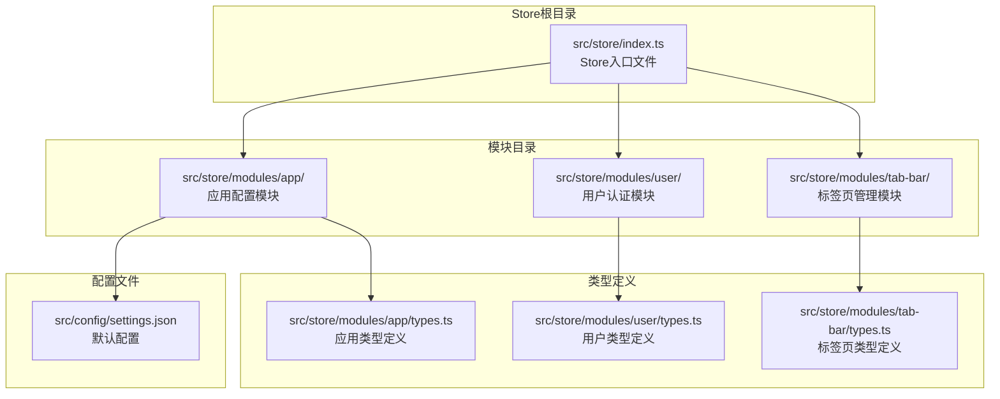
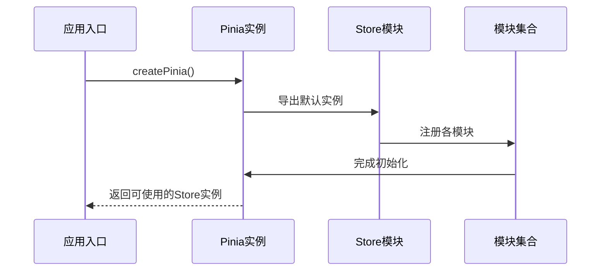
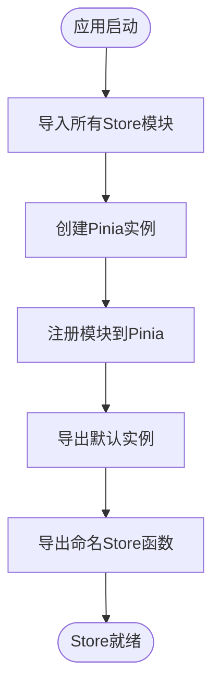
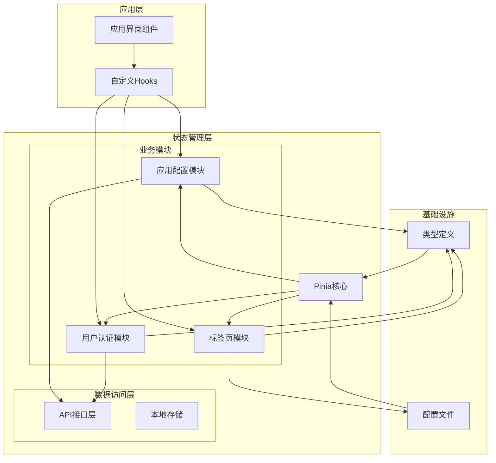
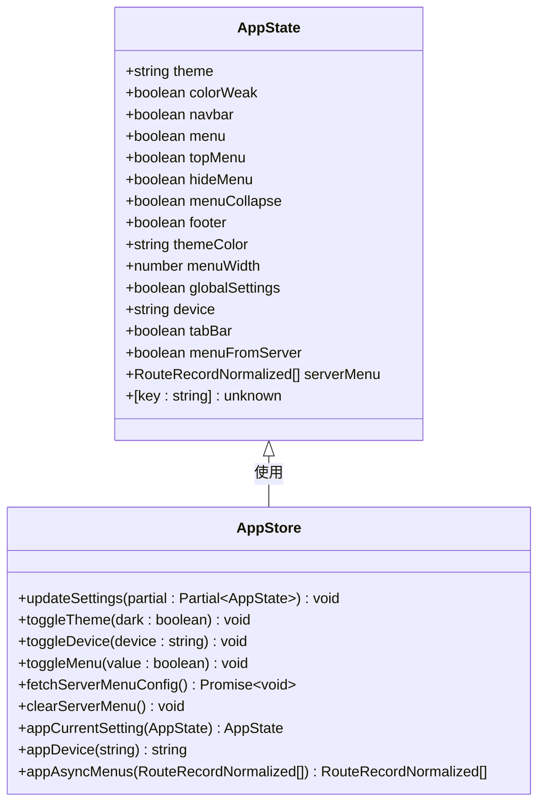
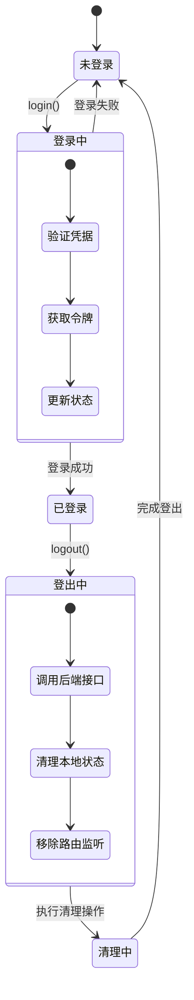
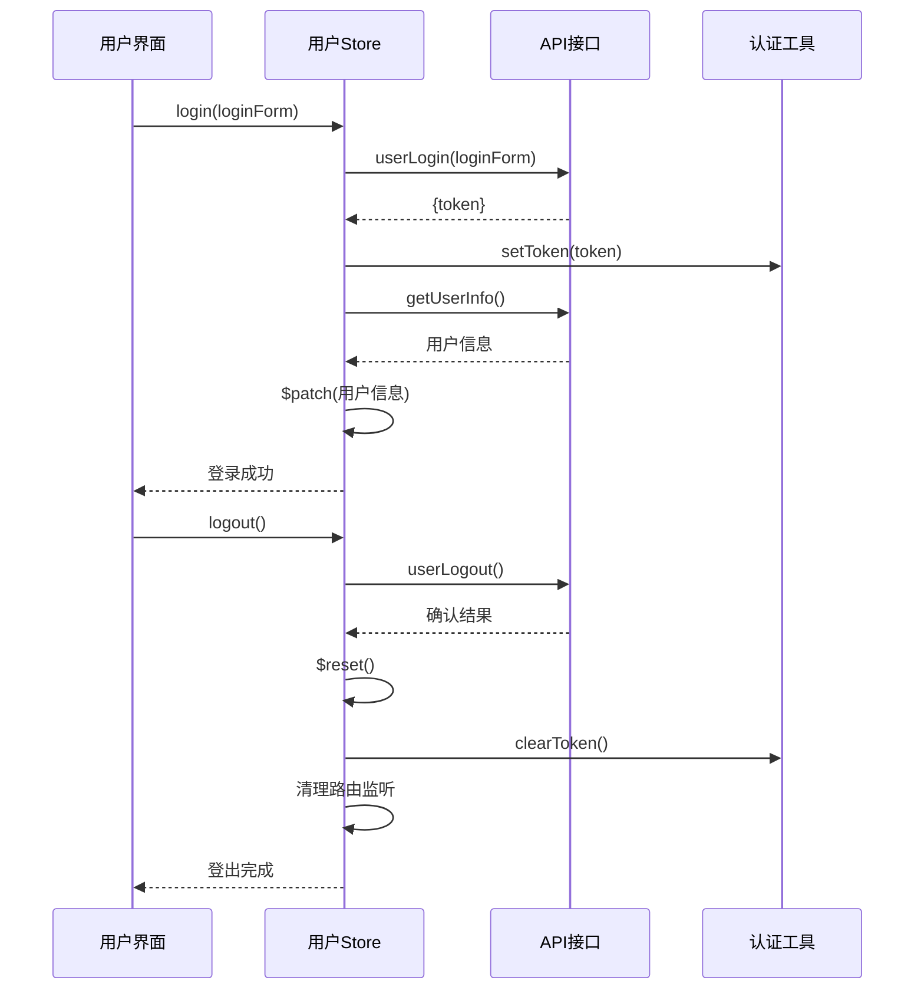
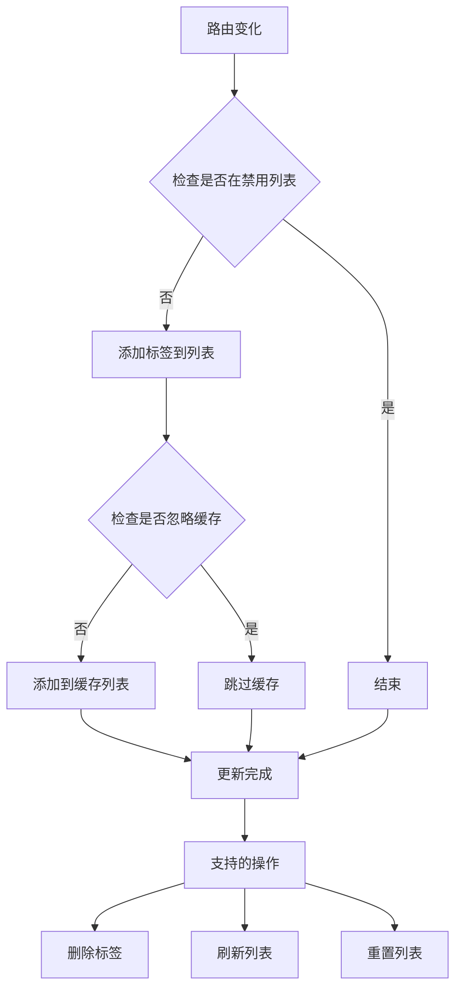
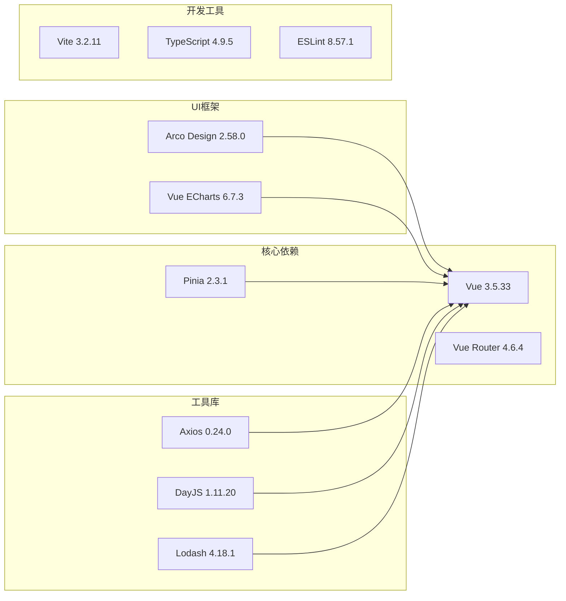

# Store架构设计

<cite>
**本文档引用的文件**
- [src/store/index.ts](file://src/store/index.ts)
- [src/main.ts](file://src/main.ts)
- [src/store/modules/app/index.ts](file://src/store/modules/app/index.ts)
- [src/store/modules/user/index.ts](file://src/store/modules/user/index.ts)
- [src/store/modules/tab-bar/index.ts](file://src/store/modules/tab-bar/index.ts)
- [src/store/modules/app/types.ts](file://src/store/modules/app/types.ts)
- [src/store/modules/user/types.ts](file://src/store/modules/user/types.ts)
- [src/store/modules/tab-bar/types.ts](file://src/store/modules/tab-bar/types.ts)
- [src/config/settings.json](file://src/config/settings.json)
- [src/api/user.ts](file://src/api/user.ts)
- [src/hooks/user.ts](file://src/hooks/user.ts)
- [package.json](file://package.json)
</cite>

## 目录
1. [简介](#简介)
2. [项目结构](#项目结构)
3. [核心组件](#核心组件)
4. [架构概览](#架构概览)
5. [详细组件分析](#详细组件分析)
6. [依赖关系分析](#依赖关系分析)
7. [性能考虑](#性能考虑)
8. [故障排除指南](#故障排除指南)
9. [结论](#结论)

## 简介

本项目采用Pinia作为状态管理库，实现了模块化的Store架构设计。该架构遵循Vue 3 Composition API的设计理念，提供了类型安全的状态管理、模块化的状态组织以及良好的开发体验。系统包含应用配置、用户认证和标签页管理三个核心Store模块，每个模块都实现了完整的CRUD操作和业务逻辑处理。

## 项目结构

项目采用基于功能的模块化组织方式，Store相关文件结构如下：



**图表来源**
- [src/store/index.ts:1-10](file://src/store/index.ts#L1-L10)
- [src/store/modules/app/index.ts:1-78](file://src/store/modules/app/index.ts#L1-L78)
- [src/store/modules/user/index.ts:1-92](file://src/store/modules/user/index.ts#L1-L92)
- [src/store/modules/tab-bar/index.ts:1-75](file://src/store/modules/tab-bar/index.ts#L1-L75)

**章节来源**
- [src/store/index.ts:1-10](file://src/store/index.ts#L1-L10)
- [src/store/modules/app/index.ts:1-78](file://src/store/modules/app/index.ts#L1-L78)
- [src/store/modules/user/index.ts:1-92](file://src/store/modules/user/index.ts#L1-L92)
- [src/store/modules/tab-bar/index.ts:1-75](file://src/store/modules/tab-bar/index.ts#L1-L75)

## 核心组件

### Pinia初始化流程

系统通过createPinia()函数创建全局状态管理实例，并在应用启动时进行初始化：



**图表来源**
- [src/main.ts:6](file://src/main.ts#L6)
- [src/store/index.ts:6](file://src/store/index.ts#L6)

### Store注册机制

系统采用集中式注册方式，所有Store模块在统一入口文件中进行导入和导出：



**图表来源**
- [src/store/index.ts:1-10](file://src/store/index.ts#L1-L10)

**章节来源**
- [src/store/index.ts:1-10](file://src/store/index.ts#L1-L10)
- [src/main.ts:6](file://src/main.ts#L6)

## 架构概览

系统采用分层架构设计，将状态管理分为多个独立但相互关联的模块：



**图表来源**
- [src/store/modules/app/index.ts:9-78](file://src/store/modules/app/index.ts#L9-L78)
- [src/store/modules/user/index.ts:13-92](file://src/store/modules/user/index.ts#L13-L92)
- [src/store/modules/tab-bar/index.ts:24-75](file://src/store/modules/tab-bar/index.ts#L24-L75)

## 详细组件分析

### 应用配置模块 (App Store)

应用配置模块负责管理应用的整体配置和主题设置：

#### 数据结构设计



**图表来源**
- [src/store/modules/app/types.ts:3-20](file://src/store/modules/app/types.ts#L3-L20)
- [src/store/modules/app/index.ts:9-78](file://src/store/modules/app/index.ts#L9-L78)

#### 核心功能实现

应用配置模块实现了以下核心功能：

1. **主题切换**: 支持明暗主题切换，动态更新DOM属性
2. **菜单管理**: 支持服务端菜单配置的获取和清理
3. **设备适配**: 管理桌面、移动端等不同设备的显示状态
4. **配置持久化**: 基于默认配置文件的配置管理

**章节来源**
- [src/store/modules/app/index.ts:1-78](file://src/store/modules/app/index.ts#L1-L78)
- [src/store/modules/app/types.ts:1-21](file://src/store/modules/app/types.ts#L1-L21)
- [src/config/settings.json:1-18](file://src/config/settings.json#L1-L18)

### 用户认证模块 (User Store)

用户认证模块处理用户登录、登出和信息管理：

#### 状态管理模式



**图表来源**
- [src/store/modules/user/index.ts:13-92](file://src/store/modules/user/index.ts#L13-L92)

#### 认证流程

用户认证模块实现了完整的认证生命周期管理：



**图表来源**
- [src/store/modules/user/index.ts:64-87](file://src/store/modules/user/index.ts#L64-L87)
- [src/api/user.ts:13-27](file://src/api/user.ts#L13-L27)

**章节来源**
- [src/store/modules/user/index.ts:1-92](file://src/store/modules/user/index.ts#L1-L92)
- [src/store/modules/user/types.ts:1-20](file://src/store/modules/user/types.ts#L1-L20)
- [src/api/user.ts:1-28](file://src/api/user.ts#L1-L28)

### 标签页管理模块 (Tab Bar Store)

标签页管理模块负责多页面标签的管理和缓存控制：

#### 缓存策略设计



**图表来源**
- [src/store/modules/tab-bar/index.ts:40-71](file://src/store/modules/tab-bar/index.ts#L40-L71)

#### 标签页操作

标签页模块提供了完整的标签页生命周期管理：

1. **标签创建**: 自动格式化路由信息为标签对象
2. **缓存控制**: 基于ignoreCache标志的智能缓存管理
3. **列表维护**: 支持增删改查和批量操作
4. **状态同步**: 与路由系统保持同步

**章节来源**
- [src/store/modules/tab-bar/index.ts:1-75](file://src/store/modules/tab-bar/index.ts#L1-L75)
- [src/store/modules/tab-bar/types.ts:1-13](file://src/store/modules/tab-bar/types.ts#L1-L13)

## 依赖关系分析

### 外部依赖

系统对外部依赖的管理体现了清晰的架构分离：



**图表来源**
- [package.json:32-47](file://package.json#L32-L47)
- [package.json:48-92](file://package.json#L48-L92)

### 内部模块依赖

模块间的依赖关系体现了松耦合的设计原则：

```mermaid
graph TB
subgraph "Store模块"
AppStore[应用配置模块]
UserStore[用户认证模块]
TabStore[标签页模块]
end
subgraph "共享依赖"
Types[类型定义]
API[API接口]
Utils[工具函数]
end
subgraph "外部依赖"
Router[Vue Router]
ArcoDesign[Arco Design]
Notification[通知组件]
end
AppStore --> Types
AppStore --> API
AppStore --> Router
AppStore --> ArcoDesign
AppStore --> Notification
UserStore --> Types
UserStore --> API
UserStore --> Router
UserStore --> Utils
TabStore --> Types
TabStore --> Router
TabStore --> Utils
UserStore -.-> AppStore : 间接依赖
```

**图表来源**
- [src/store/modules/app/index.ts:1-78](file://src/store/modules/app/index.ts#L1-L78)
- [src/store/modules/user/index.ts:1-92](file://src/store/modules/user/index.ts#L1-L92)
- [src/store/modules/tab-bar/index.ts:1-75](file://src/store/modules/tab-bar/index.ts#L1-L75)

**章节来源**
- [package.json:1-103](file://package.json#L1-L103)

## 性能考虑

### 状态更新优化

系统采用了多种性能优化策略：

1. **局部状态更新**: 使用$patch进行细粒度状态更新，避免不必要的重新渲染
2. **计算属性缓存**: Getter自动缓存计算结果，只有依赖变化时才重新计算
3. **条件渲染**: 基于ignoreCache标志的智能缓存控制
4. **异步操作**: 合理的异步处理避免阻塞主线程

### 内存管理

- **垃圾回收**: 及时清理不再使用的标签和缓存
- **事件监听**: 在登出时移除路由监听器防止内存泄漏
- **资源释放**: 清理通知组件和临时状态

## 故障排除指南

### 常见问题及解决方案

#### Store初始化失败

**问题症状**: 应用启动时报错，提示Store无法初始化

**可能原因**:
1. Pinia依赖未正确安装
2. Store模块导入路径错误
3. 类型定义不匹配

**解决步骤**:
1. 检查package.json中的Pinia版本
2. 验证store/index.ts中的导入路径
3. 确认类型定义文件的完整性

#### 状态更新异常

**问题症状**: 界面状态不更新或更新延迟

**可能原因**:
1. 使用了非响应式的数据结构
2. 未正确使用$patch方法
3. 异步操作时机不当

**解决步骤**:
1. 检查状态对象的响应式特性
2. 确保使用$patch进行状态更新
3. 验证异步操作的Promise链

#### 模块间通信问题

**问题症状**: Store模块间数据不同步

**可能原因**:
1. 循环依赖
2. 状态隔离不当
3. 共享状态管理混乱

**解决步骤**:
1. 检查模块导入关系
2. 验证状态边界划分
3. 使用适当的通信模式

**章节来源**
- [src/store/index.ts:1-10](file://src/store/index.ts#L1-L10)
- [src/main.ts:17-29](file://src/main.ts#L17-L29)

## 结论

本项目的Pinia Store架构设计体现了现代前端状态管理的最佳实践：

### 设计优势

1. **模块化设计**: 清晰的功能模块划分，便于维护和扩展
2. **类型安全**: 完整的TypeScript类型定义，提供编译时检查
3. **响应式更新**: 基于Vue 3响应式的高效状态管理
4. **开发友好**: 良好的开发工具支持和调试体验

### 架构特色

1. **松耦合设计**: 模块间依赖关系清晰，降低耦合度
2. **状态隔离**: 各模块拥有独立的状态空间，避免冲突
3. **生命周期管理**: 完整的Store生命周期控制
4. **插件集成**: 支持Pinia插件系统和开发工具

### 最佳实践建议

1. **模块划分**: 按业务领域划分Store模块，保持单一职责
2. **类型定义**: 为所有状态和操作提供完整的类型定义
3. **错误处理**: 实现完善的错误处理和恢复机制
4. **性能监控**: 建立状态变更的性能监控和优化机制

该架构为大型Vue应用提供了稳定可靠的状态管理基础，支持复杂业务场景下的状态一致性保证和性能优化需求。