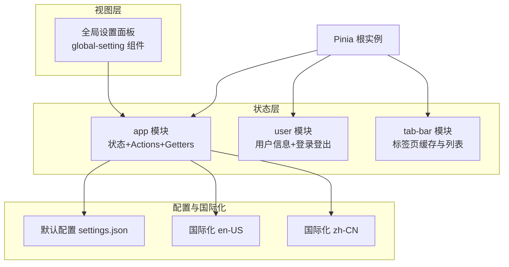
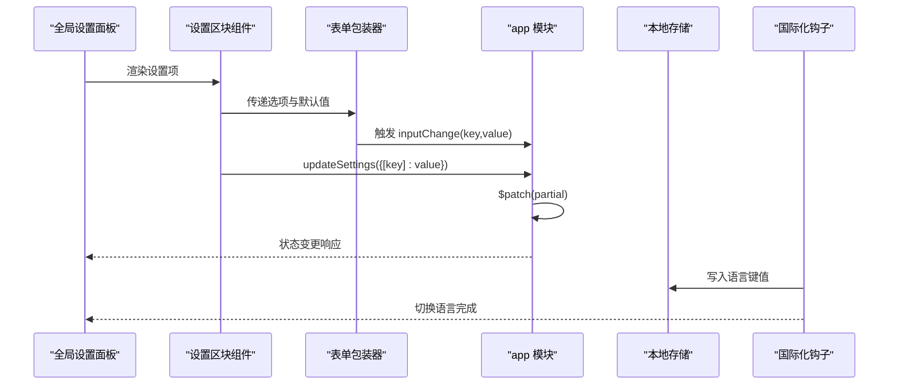
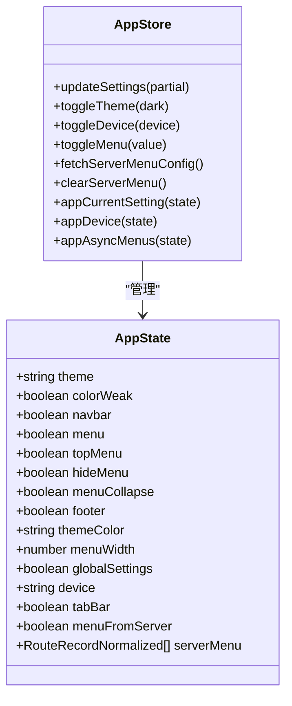
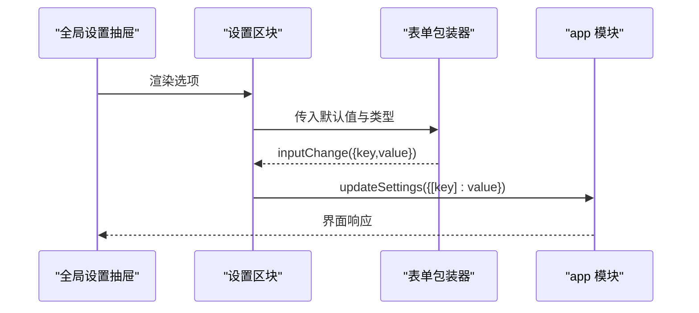
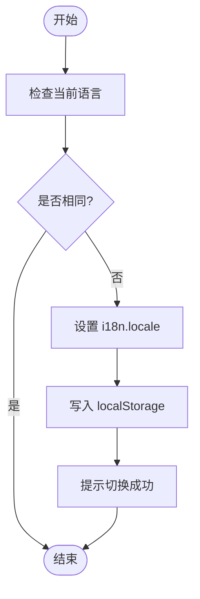
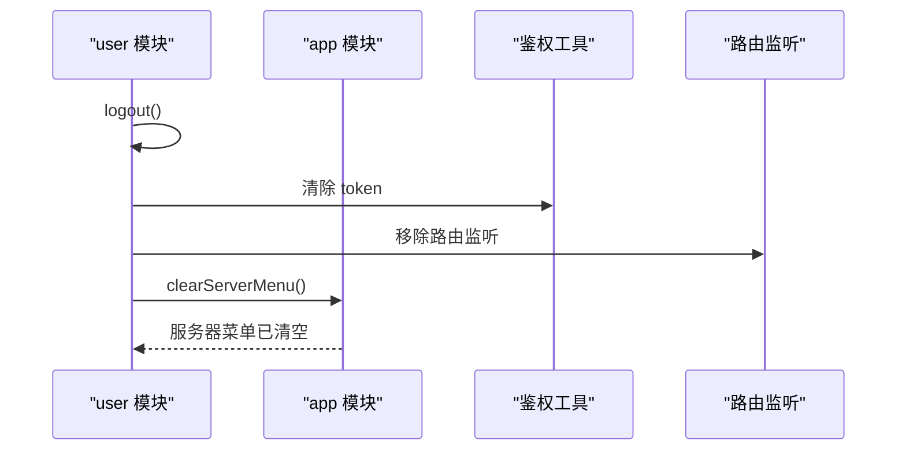
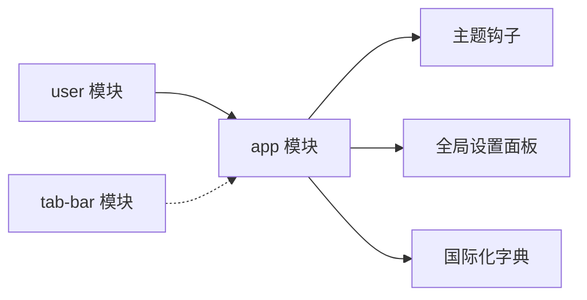

# 应用状态管理

<cite>
**本文引用的文件**
- [src/store/index.ts](file://src/store/index.ts)
- [src/store/modules/app/index.ts](file://src/store/modules/app/index.ts)
- [src/store/modules/app/types.ts](file://src/store/modules/app/types.ts)
- [src/config/settings.json](file://src/config/settings.json)
- [src/components/global-setting/index.vue](file://src/components/global-setting/index.vue)
- [src/components/global-setting/block.vue](file://src/components/global-setting/block.vue)
- [src/components/global-setting/form-wrapper.vue](file://src/components/global-setting/form-wrapper.vue)
- [src/hooks/themes.ts](file://src/hooks/themes.ts)
- [src/hooks/locale.ts](file://src/hooks/locale.ts)
- [src/locale/en-US.ts](file://src/locale/en-US.ts)
- [src/locale/zh-CN.ts](file://src/locale/zh-CN.ts)
- [src/locale/en-US/settings.ts](file://src/locale/en-US/settings.ts)
- [src/locale/zh-CN/settings.ts](file://src/locale/zh-CN/settings.ts)
- [src/store/modules/user/index.ts](file://src/store/modules/user/index.ts)
- [src/store/modules/tab-bar/index.ts](file://src/store/modules/tab-bar/index.ts)
- [src/utils/auth.ts](file://src/utils/auth.ts)
- [src/utils/route-listener.ts](file://src/utils/route-listener.ts)
</cite>

## 目录
1. [简介](#简介)
2. [项目结构](#项目结构)
3. [核心组件](#核心组件)
4. [架构总览](#架构总览)
5. [详细组件分析](#详细组件分析)
6. [依赖关系分析](#依赖关系分析)
7. [性能考量](#性能考量)
8. [故障排查指南](#故障排查指南)
9. [结论](#结论)
10. [附录](#附录)

## 简介
本文件聚焦于应用状态管理模块，系统性阐述应用配置状态的管理机制与实现细节，覆盖主题配置、布局设置、国际化状态与系统参数等维度。文档从状态定义、Actions操作、Getters计算属性入手，结合状态持久化策略、默认值管理与状态同步机制，提供配置项说明与使用示例，帮助开发者快速理解与扩展状态管理能力。

## 项目结构
应用状态管理采用 Pinia 进行集中式状态管理，核心位于 src/store 下，按功能拆分为 app、user、tab-bar 三个模块；全局设置面板通过组件化方式提供交互入口，并与国际化体系协同工作。

**图表来源**
- [src/store/index.ts:1-10](file://src/store/index.ts#L1-L10)
- [src/store/modules/app/index.ts:1-78](file://src/store/modules/app/index.ts#L1-L78)
- [src/store/modules/user/index.ts:1-92](file://src/store/modules/user/index.ts#L1-L92)
- [src/store/modules/tab-bar/index.ts:1-75](file://src/store/modules/tab-bar/index.ts#L1-L75)
- [src/config/settings.json:1-18](file://src/config/settings.json#L1-L18)
- [src/components/global-setting/index.vue:1-99](file://src/components/global-setting/index.vue#L1-L99)
- [src/locale/en-US.ts:1-29](file://src/locale/en-US.ts#L1-L29)
- [src/locale/zh-CN.ts:1-29](file://src/locale/zh-CN.ts#L1-L29)

**章节来源**
- [src/store/index.ts:1-10](file://src/store/index.ts#L1-L10)
- [src/store/modules/app/index.ts:1-78](file://src/store/modules/app/index.ts#L1-L78)
- [src/store/modules/user/index.ts:1-92](file://src/store/modules/user/index.ts#L1-L92)
- [src/store/modules/tab-bar/index.ts:1-75](file://src/store/modules/tab-bar/index.ts#L1-L75)
- [src/config/settings.json:1-18](file://src/config/settings.json#L1-L18)
- [src/components/global-setting/index.vue:1-99](file://src/components/global-setting/index.vue#L1-L99)
- [src/locale/en-US.ts:1-29](file://src/locale/en-US.ts#L1-L29)
- [src/locale/zh-CN.ts:1-29](file://src/locale/zh-CN.ts#L1-L29)

## 核心组件
- app 模块：负责主题、布局、设备、菜单、标签页、服务器菜单等配置状态的集中管理，提供更新、切换、拉取服务器菜单等 Actions，以及当前设置、设备类型、异步菜单等 Getters。
- user 模块：负责用户信息、角色、登录登出流程，与 app 模块协作清理服务器菜单。
- tab-bar 模块：负责标签页列表与缓存集合的维护，支持增删改与重置。
- 全局设置面板：提供可视化开关与输入控件，联动 app 模块更新状态，并可一键复制当前状态到剪贴板。
- 国际化钩子：提供语言切换与本地存储能力，配合国际化字典实现多语言。

**章节来源**
- [src/store/modules/app/index.ts:1-78](file://src/store/modules/app/index.ts#L1-L78)
- [src/store/modules/app/types.ts:1-21](file://src/store/modules/app/types.ts#L1-L21)
- [src/store/modules/user/index.ts:1-92](file://src/store/modules/user/index.ts#L1-L92)
- [src/store/modules/tab-bar/index.ts:1-75](file://src/store/modules/tab-bar/index.ts#L1-L75)
- [src/components/global-setting/index.vue:1-99](file://src/components/global-setting/index.vue#L1-L99)
- [src/hooks/locale.ts:1-23](file://src/hooks/locale.ts#L1-L23)

## 架构总览
应用状态管理围绕 Pinia 的 Store 设计，以模块化方式组织业务域状态；默认配置来自 settings.json，在初始化时注入到 app 模块状态中；全局设置面板通过表单包装器与开关组件驱动 Actions 更新状态；国际化通过 vue-i18n 与本地存储实现语言切换与持久化。

**图表来源**
- [src/components/global-setting/index.vue:1-99](file://src/components/global-setting/index.vue#L1-L99)
- [src/components/global-setting/block.vue:1-80](file://src/components/global-setting/block.vue#L1-L80)
- [src/components/global-setting/form-wrapper.vue:1-40](file://src/components/global-setting/form-wrapper.vue#L1-L40)
- [src/store/modules/app/index.ts:24-29](file://src/store/modules/app/index.ts#L24-L29)
- [src/hooks/locale.ts:1-23](file://src/hooks/locale.ts#L1-L23)

## 详细组件分析

### app 模块：状态定义、Actions 与 Getters
- 状态定义：基于 AppState 接口，涵盖主题、色弱模式、导航栏、菜单、顶部菜单、隐藏菜单、菜单折叠、页脚、主题色、菜单宽度、全局设置抽屉、设备类型、标签页、菜单来源服务器、服务器菜单等字段。
- 默认值管理：在初始化时将 settings.json 的键值合并到 state，确保首次加载具备完整默认配置。
- Actions：
  - updateSettings：通过 $patch 合并部分状态，实现细粒度更新。
  - toggleTheme：切换明暗主题并在 DOM 上设置/移除属性，影响 Arco 主题。
  - toggleDevice/toggleMenu：切换设备类型与菜单显示状态。
  - fetchServerMenuConfig：异步拉取服务器菜单，带通知提示与错误处理。
  - clearServerMenu：清空服务器菜单。
- Getters：
  - appCurrentSetting：返回当前完整设置快照。
  - appDevice：返回设备类型。
  - appAsyncMenus：返回服务器菜单数组。

**图表来源**
- [src/store/modules/app/types.ts:1-21](file://src/store/modules/app/types.ts#L1-L21)
- [src/store/modules/app/index.ts:9-75](file://src/store/modules/app/index.ts#L9-L75)

**章节来源**
- [src/store/modules/app/types.ts:1-21](file://src/store/modules/app/types.ts#L1-L21)
- [src/store/modules/app/index.ts:1-78](file://src/store/modules/app/index.ts#L1-L78)
- [src/config/settings.json:1-18](file://src/config/settings.json#L1-L18)

### 全局设置面板：交互与状态联动
- 面板入口：当导航栏关闭时显示固定按钮，点击打开抽屉。
- 设置项：内容区与其它设置区，分别映射到导航栏、菜单、顶部菜单、页脚、标签页、菜单来源服务器、菜单宽度、色弱模式等。
- 表单联动：
  - 开关/数字输入触发 inputChange，回调中根据 key 执行对应逻辑（如色弱滤镜、服务器菜单拉取、顶部菜单时取消折叠）。
  - 最终调用 app.updateSettings 合并更新。
- 复制配置：将当前 $state JSON 化后复制到剪贴板，并提示成功信息。

**图表来源**
- [src/components/global-setting/index.vue:1-99](file://src/components/global-setting/index.vue#L1-L99)
- [src/components/global-setting/block.vue:1-80](file://src/components/global-setting/block.vue#L1-L80)
- [src/components/global-setting/form-wrapper.vue:1-40](file://src/components/global-setting/form-wrapper.vue#L1-L40)
- [src/store/modules/app/index.ts:24-29](file://src/store/modules/app/index.ts#L24-L29)

**章节来源**
- [src/components/global-setting/index.vue:1-99](file://src/components/global-setting/index.vue#L1-L99)
- [src/components/global-setting/block.vue:1-80](file://src/components/global-setting/block.vue#L1-L80)
- [src/components/global-setting/form-wrapper.vue:1-40](file://src/components/global-setting/form-wrapper.vue#L1-L40)

### 国际化状态与系统参数
- 语言切换：通过 useLocale 钩子设置 i18n.locale，并持久化到 localStorage；切换后给出成功提示。
- 字典整合：en-US 与 zh-CN 将各模块的 settings 字典合并到主字典，保证“全局设置”文案在两种语言下可用。
- 系统参数：语言键值作为系统参数之一，用于控制界面语言，与 app 模块的主题、布局等参数共同构成系统配置。

**图表来源**
- [src/hooks/locale.ts:1-23](file://src/hooks/locale.ts#L1-L23)
- [src/locale/en-US.ts:1-29](file://src/locale/en-US.ts#L1-L29)
- [src/locale/zh-CN.ts:1-29](file://src/locale/zh-CN.ts#L1-L29)
- [src/locale/en-US/settings.ts:1-30](file://src/locale/en-US/settings.ts#L1-L30)
- [src/locale/zh-CN/settings.ts:1-30](file://src/locale/zh-CN/settings.ts#L1-L30)

**章节来源**
- [src/hooks/locale.ts:1-23](file://src/hooks/locale.ts#L1-L23)
- [src/locale/en-US.ts:1-29](file://src/locale/en-US.ts#L1-L29)
- [src/locale/zh-CN.ts:1-29](file://src/locale/zh-CN.ts#L1-L29)
- [src/locale/en-US/settings.ts:1-30](file://src/locale/en-US/settings.ts#L1-L30)
- [src/locale/zh-CN/settings.ts:1-30](file://src/locale/zh-CN/settings.ts#L1-L30)

### 用户与菜单同步：登出时清理服务器菜单
- 登出流程：调用 user 模块 logout，最终执行 logoutCallBack，其中重置用户信息、清除 token、移除路由监听，并调用 app.clearServerMenu 清空服务器菜单。
- 同步机制：通过模块间依赖（user 依赖 app），确保用户登出后服务器菜单状态与用户态一致。

**图表来源**
- [src/store/modules/user/index.ts:73-87](file://src/store/modules/user/index.ts#L73-L87)
- [src/store/modules/app/index.ts:71-73](file://src/store/modules/app/index.ts#L71-L73)
- [src/utils/auth.ts:1-20](file://src/utils/auth.ts#L1-L20)
- [src/utils/route-listener.ts:1-31](file://src/utils/route-listener.ts#L1-L31)

**章节来源**
- [src/store/modules/user/index.ts:1-92](file://src/store/modules/user/index.ts#L1-L92)
- [src/store/modules/app/index.ts:1-78](file://src/store/modules/app/index.ts#L1-L78)
- [src/utils/auth.ts:1-20](file://src/utils/auth.ts#L1-L20)
- [src/utils/route-listener.ts:1-31](file://src/utils/route-listener.ts#L1-L31)

### 主题钩子：基于 app 状态的派生状态
- useThemes 返回 isDark 计算属性，基于 appStore.theme 判断当前是否为暗色模式，便于组件按需渲染。

**章节来源**
- [src/hooks/themes.ts:1-13](file://src/hooks/themes.ts#L1-L13)
- [src/store/modules/app/index.ts:32-40](file://src/store/modules/app/index.ts#L32-L40)

## 依赖关系分析
- 模块耦合：
  - app 模块为配置中心，被全局设置面板、主题钩子、国际化字典等消费。
  - user 模块依赖 app 模块以清理服务器菜单，形成单向依赖。
  - tab-bar 模块独立管理标签页，不直接依赖 app 的配置项。
- 外部依赖：
  - Pinia 提供状态容器与响应式更新。
  - Arco Design 的通知与组件库用于交互反馈与 UI 呈现。
  - vue-i18n 提供国际化能力，localStorage 用于语言持久化。

**图表来源**
- [src/store/modules/app/index.ts:1-78](file://src/store/modules/app/index.ts#L1-L78)
- [src/hooks/themes.ts:1-13](file://src/hooks/themes.ts#L1-L13)
- [src/components/global-setting/index.vue:1-99](file://src/components/global-setting/index.vue#L1-L99)
- [src/locale/en-US.ts:1-29](file://src/locale/en-US.ts#L1-L29)
- [src/locale/zh-CN.ts:1-29](file://src/locale/zh-CN.ts#L1-L29)
- [src/store/modules/user/index.ts:1-92](file://src/store/modules/user/index.ts#L1-L92)
- [src/store/modules/tab-bar/index.ts:1-75](file://src/store/modules/tab-bar/index.ts#L1-L75)

**章节来源**
- [src/store/modules/app/index.ts:1-78](file://src/store/modules/app/index.ts#L1-L78)
- [src/store/modules/user/index.ts:1-92](file://src/store/modules/user/index.ts#L1-L92)
- [src/store/modules/tab-bar/index.ts:1-75](file://src/store/modules/tab-bar/index.ts#L1-L75)
- [src/hooks/themes.ts:1-13](file://src/hooks/themes.ts#L1-L13)
- [src/components/global-setting/index.vue:1-99](file://src/components/global-setting/index.vue#L1-L99)
- [src/locale/en-US.ts:1-29](file://src/locale/en-US.ts#L1-L29)
- [src/locale/zh-CN.ts:1-29](file://src/locale/zh-CN.ts#L1-L29)

## 性能考量
- 状态粒度：通过 updateSettings 使用 $patch 合并更新，避免不必要的整包替换，降低渲染开销。
- 异步菜单：fetchServerMenuConfig 在请求期间显示通知，避免阻塞 UI；成功/失败均更新同一通知实例，减少 DOM 变更。
- 路由监听：使用发布订阅模型分发路由变化，避免组件各自监听导致的重复渲染。
- 标签页缓存：tab-bar 模块基于 Set 维护缓存集合，增删查改均为 O(1) 平均复杂度。

[本节为通用性能建议，无需特定文件引用]

## 故障排查指南
- 主题切换无效：
  - 检查 toggleTheme 是否正确设置/移除 DOM 属性。
  - 确认外部样式库是否支持该主题属性。
- 服务器菜单未更新：
  - 确认 fetchServerMenuConfig 请求成功且 serverMenu 已赋值。
  - 登出后菜单未清空：检查 user 模块 logoutCallBack 是否调用 app.clearServerMenu。
- 国际化切换未持久化：
  - 检查 useLocale.changeLocale 是否写入 localStorage。
  - 页面刷新后确认 i18n.locale 初始化逻辑读取了存储值。
- 全局设置抽屉不显示：
  - 检查 app.globalSettings 状态与面板可见性绑定。
  - 确认 Block 组件的 inputChange 是否正确调用 updateSettings。

**章节来源**
- [src/store/modules/app/index.ts:32-73](file://src/store/modules/app/index.ts#L32-L73)
- [src/store/modules/user/index.ts:73-87](file://src/store/modules/user/index.ts#L73-L87)
- [src/hooks/locale.ts:1-23](file://src/hooks/locale.ts#L1-L23)
- [src/components/global-setting/index.vue:1-99](file://src/components/global-setting/index.vue#L1-L99)
- [src/components/global-setting/block.vue:1-80](file://src/components/global-setting/block.vue#L1-L80)

## 结论
本状态管理方案以 Pinia 为核心，将应用配置、用户态与标签页管理解耦为独立模块，通过默认配置注入、Actions 更新与 Getters 派生，实现了主题、布局、国际化与系统参数的统一管理。全局设置面板提供直观的交互入口，配合国际化字典与持久化策略，满足多场景下的配置需求。模块间的协作清晰，具备良好的扩展性与可维护性。

[本节为总结性内容，无需特定文件引用]

## 附录

### 配置项说明（摘自 settings.json）
- theme：主题模式（light/dark）
- colorWeak：色弱模式开关
- navbar：导航栏显示
- menu：左侧菜单显示
- topMenu：顶部菜单显示
- hideMenu：隐藏菜单
- menuCollapse：菜单折叠
- footer：页脚显示
- themeColor：主题色
- menuWidth：菜单宽度（px）
- globalSettings：全局设置抽屉显示
- device：设备类型（desktop/mobile）
- tabBar：标签页显示
- menuFromServer：菜单来源于服务器
- serverMenu：服务器动态菜单

**章节来源**
- [src/config/settings.json:1-18](file://src/config/settings.json#L1-L18)

### 使用示例（路径指引）
- 切换主题：调用 app.toggleTheme(dark: boolean)
  - [src/store/modules/app/index.ts:32-40](file://src/store/modules/app/index.ts#L32-L40)
- 更新多项配置：调用 app.updateSettings(partial)
  - [src/store/modules/app/index.ts:26-29](file://src/store/modules/app/index.ts#L26-L29)
- 拉取服务器菜单：调用 app.fetchServerMenuConfig()
  - [src/store/modules/app/index.ts:47-70](file://src/store/modules/app/index.ts#L47-L70)
- 登出并清理菜单：调用 user.logout()
  - [src/store/modules/user/index.ts:81-87](file://src/store/modules/user/index.ts#L81-L87)
- 切换语言：调用 useLocale.changeLocale(lang)
  - [src/hooks/locale.ts:10-17](file://src/hooks/locale.ts#L10-L17)
- 打开全局设置抽屉：设置 app.globalSettings 为 true
  - [src/components/global-setting/index.vue:82-84](file://src/components/global-setting/index.vue#L82-L84)