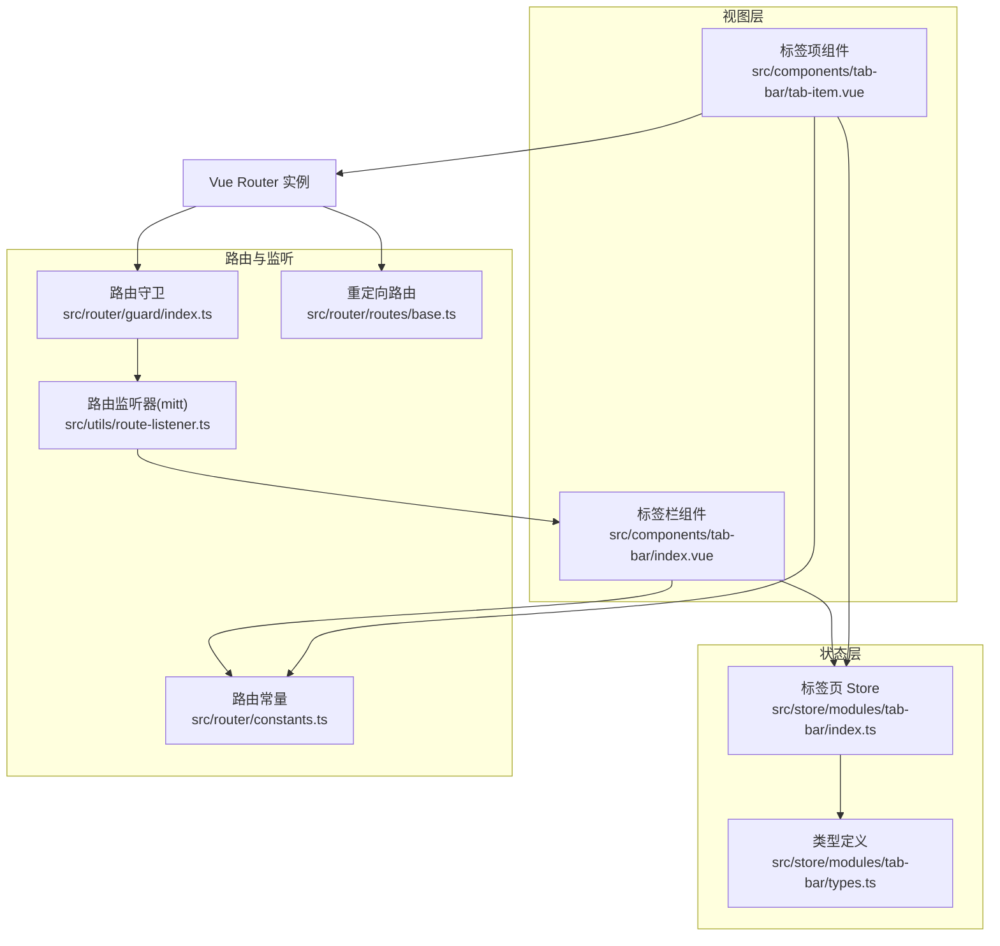
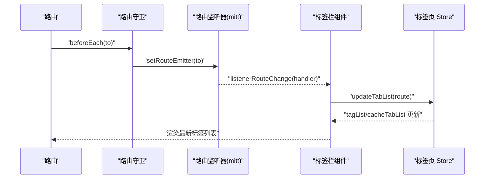
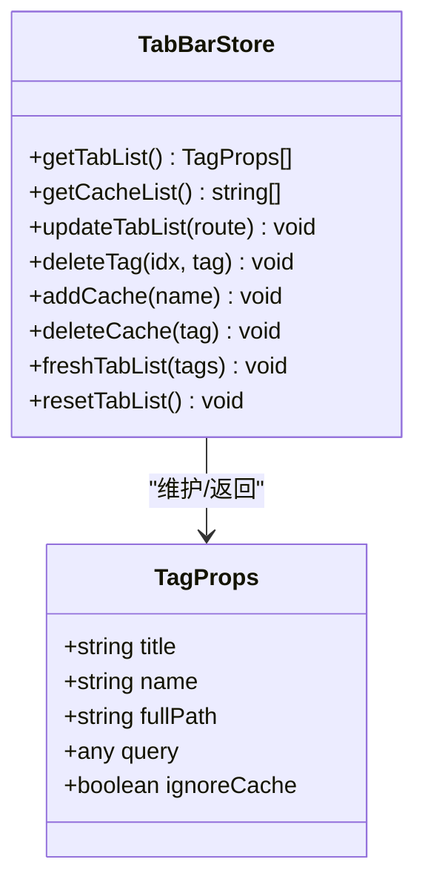
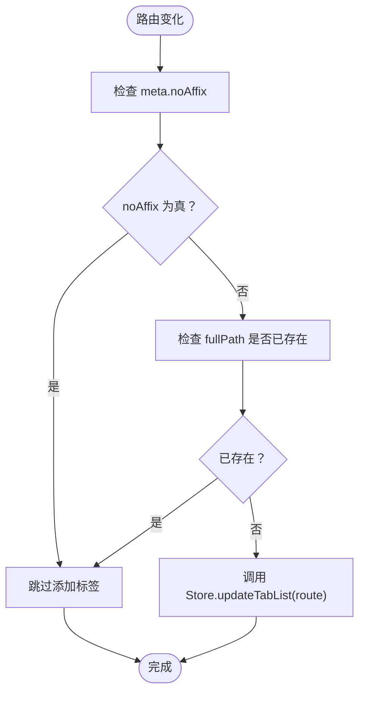
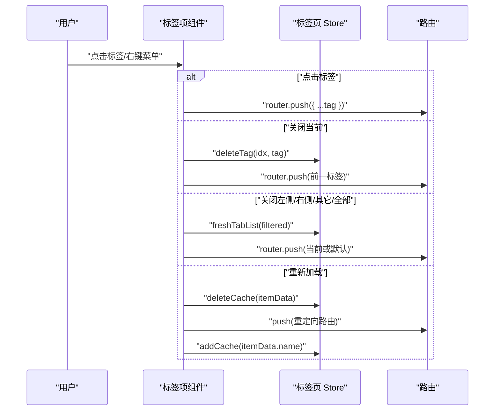
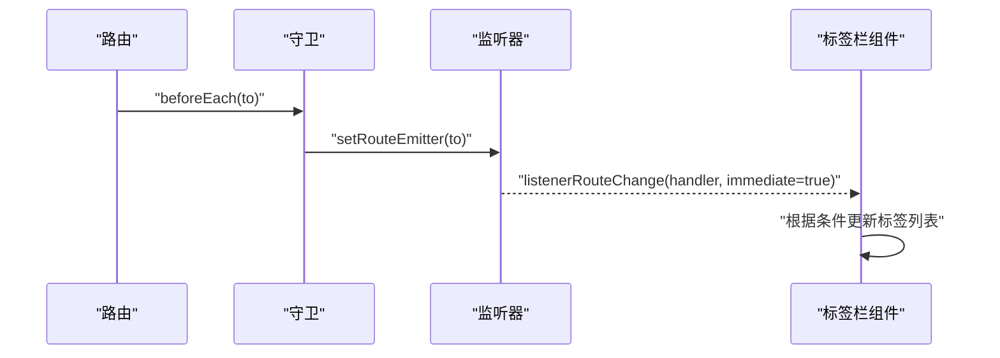
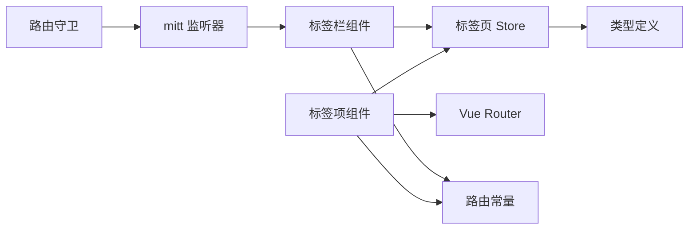

# 标签页状态管理

<cite>
**本文档引用的文件**
- [src/store/modules/tab-bar/index.ts](file://src/store/modules/tab-bar/index.ts)
- [src/store/modules/tab-bar/types.ts](file://src/store/modules/tab-bar/types.ts)
- [src/components/tab-bar/index.vue](file://src/components/tab-bar/index.vue)
- [src/components/tab-bar/tab-item.vue](file://src/components/tab-bar/tab-item.vue)
- [src/utils/route-listener.ts](file://src/utils/route-listener.ts)
- [src/router/guard/index.ts](file://src/router/guard/index.ts)
- [src/router/constants.ts](file://src/router/constants.ts)
- [src/router/routes/base.ts](file://src/router/routes/base.ts)
- [src/store/index.ts](file://src/store/index.ts)
- [src/utils/is.ts](file://src/utils/is.ts)
- [src/components/tab-bar/readme.md](file://src/components/tab-bar/readme.md)
</cite>

## 目录
1. [简介](#简介)
2. [项目结构](#项目结构)
3. [核心组件](#核心组件)
4. [架构总览](#架构总览)
5. [详细组件分析](#详细组件分析)
6. [依赖关系分析](#依赖关系分析)
7. [性能考虑](#性能考虑)
8. [故障排除指南](#故障排除指南)
9. [结论](#结论)
10. [附录](#附录)

## 简介
本文件系统性阐述标签页状态管理模块的设计与实现，覆盖标签页列表维护、激活状态控制、缓存策略与路由同步机制；详述增删改查操作、状态持久化与关闭保护机制；并提供导航逻辑、历史记录管理与性能优化策略，以及使用示例与交互模式。

## 项目结构
标签页状态管理由“状态层（Pinia Store）+ 视图层（组件）+ 路由监听（mitt 发布订阅）”三层协作构成：
- 状态层：负责标签页列表与缓存集合的维护，提供增删改查与重置能力
- 视图层：负责渲染标签项、处理点击与右键菜单、触发路由跳转与刷新
- 路由监听：通过发布订阅在路由变化时通知视图层更新标签列表

图表来源
- [src/store/modules/tab-bar/index.ts:1-75](file://src/store/modules/tab-bar/index.ts#L1-L75)
- [src/store/modules/tab-bar/types.ts:1-13](file://src/store/modules/tab-bar/types.ts#L1-L13)
- [src/components/tab-bar/index.vue:1-102](file://src/components/tab-bar/index.vue#L1-L102)
- [src/components/tab-bar/tab-item.vue:1-201](file://src/components/tab-bar/tab-item.vue#L1-L201)
- [src/router/guard/index.ts:1-18](file://src/router/guard/index.ts#L1-L18)
- [src/utils/route-listener.ts:1-32](file://src/utils/route-listener.ts#L1-L32)
- [src/router/constants.ts:1-19](file://src/router/constants.ts#L1-L19)
- [src/router/routes/base.ts:1-32](file://src/router/routes/base.ts#L1-L32)

章节来源
- [src/store/modules/tab-bar/index.ts:1-75](file://src/store/modules/tab-bar/index.ts#L1-L75)
- [src/components/tab-bar/index.vue:1-102](file://src/components/tab-bar/index.vue#L1-L102)
- [src/utils/route-listener.ts:1-32](file://src/utils/route-listener.ts#L1-L32)
- [src/router/guard/index.ts:1-18](file://src/router/guard/index.ts#L1-L18)

## 核心组件
- 标签页 Store：维护 tagList 与 cacheTabList，提供更新、删除、新增缓存、批量刷新、重置等动作
- 标签栏组件：订阅路由变化，按需添加标签，计算吸顶偏移
- 标签项组件：渲染单个标签，支持点击跳转、右键菜单、关闭当前/左右侧/其他/全部、重新加载
- 路由监听器：mitt 发布订阅，避免逐个组件监听导致的性能问题
- 路由守卫：在每次路由切换前发出事件，驱动标签栏更新
- 常量与重定向：默认路由、重定向路由名、白名单等

章节来源
- [src/store/modules/tab-bar/index.ts:24-72](file://src/store/modules/tab-bar/index.ts#L24-L72)
- [src/components/tab-bar/index.vue:21-60](file://src/components/tab-bar/index.vue#L21-L60)
- [src/components/tab-bar/tab-item.vue:59-168](file://src/components/tab-bar/tab-item.vue#L59-L168)
- [src/utils/route-listener.ts:1-32](file://src/utils/route-listener.ts#L1-L32)
- [src/router/guard/index.ts:6-11](file://src/router/guard/index.ts#L6-L11)
- [src/router/constants.ts:10-18](file://src/router/constants.ts#L10-L18)
- [src/router/routes/base.ts:6-25](file://src/router/routes/base.ts#L6-L25)

## 架构总览
标签页状态管理遵循“路由事件驱动 + Pinia 状态集中管理”的架构模式：
- 路由切换时，守卫通过监听器发布事件
- 标签栏组件订阅事件，在满足条件时调用 Store 更新标签列表
- 标签项组件负责用户交互，直接调用 Store 或触发路由跳转
- 缓存集合与标签列表保持一致，支持忽略缓存的页面不进入缓存

图表来源
- [src/router/guard/index.ts:6-11](file://src/router/guard/index.ts#L6-L11)
- [src/utils/route-listener.ts:14-27](file://src/utils/route-listener.ts#L14-L27)
- [src/components/tab-bar/index.vue:48-55](file://src/components/tab-bar/index.vue#L48-L55)
- [src/store/modules/tab-bar/index.ts:40-46](file://src/store/modules/tab-bar/index.ts#L40-L46)

## 详细组件分析

### 标签页 Store（状态与动作）
- 数据结构
  - tagList：标签数组，包含标题、名称、完整路径、查询参数、是否忽略缓存
  - cacheTabList：缓存集合，存储需要缓存的路由名称
- 关键动作
  - 更新标签列表：过滤禁止列表，格式化标签，按 ignoreCache 决定是否加入缓存集合
  - 删除标签：从列表与缓存集合中移除
  - 新增缓存：字符串校验后加入缓存集合
  - 刷新标签列表：清空缓存集合，遍历新列表，仅对未忽略缓存的条目加入缓存
  - 重置标签列表：保留默认标签，清空缓存并加入默认路由名
- 复杂度
  - 更新/删除/新增/删除缓存为 O(1)
  - 刷新列表为 O(n)，其中 n 为标签数量

图表来源
- [src/store/modules/tab-bar/index.ts:9-20](file://src/store/modules/tab-bar/index.ts#L9-L20)
- [src/store/modules/tab-bar/types.ts:1-13](file://src/store/modules/tab-bar/types.ts#L1-L13)

章节来源
- [src/store/modules/tab-bar/index.ts:24-72](file://src/store/modules/tab-bar/index.ts#L24-L72)
- [src/store/modules/tab-bar/types.ts:1-13](file://src/store/modules/tab-bar/types.ts#L1-L13)
- [src/utils/is.ts:11-13](file://src/utils/is.ts#L11-L13)

### 标签栏组件（订阅与渲染）
- 订阅路由变化：仅当标签未固定且不存在于当前列表时才添加
- 吸顶偏移：根据导航栏显示状态动态调整
- 生命周期：组件卸载时移除监听器，避免内存泄漏

图表来源
- [src/components/tab-bar/index.vue:48-55](file://src/components/tab-bar/index.vue#L48-L55)
- [src/store/modules/tab-bar/index.ts:40-46](file://src/store/modules/tab-bar/index.ts#L40-L46)

章节来源
- [src/components/tab-bar/index.vue:21-60](file://src/components/tab-bar/index.vue#L21-L60)

### 标签项组件（交互与导航）
- 点击跳转：直接使用标签的完整路径信息进行路由跳转
- 右键菜单：支持重新加载、关闭当前、关闭左侧、关闭右侧、关闭其它、关闭全部
- 关闭保护：默认首页不可关闭；关闭当前标签后自动回退到前一个标签
- 重新加载：通过重定向路由实现强制刷新，同时更新缓存集合

图表来源
- [src/components/tab-bar/tab-item.vue:93-167](file://src/components/tab-bar/tab-item.vue#L93-L167)
- [src/router/routes/base.ts:6-25](file://src/router/routes/base.ts#L6-L25)
- [src/router/constants.ts:10-18](file://src/router/constants.ts#L10-L18)

章节来源
- [src/components/tab-bar/tab-item.vue:59-168](file://src/components/tab-bar/tab-item.vue#L59-L168)

### 路由监听与守卫
- 守卫：在 beforeEach 中发布路由变更事件，携带标准化路由对象
- 监听器：mitt 发布订阅，支持立即回调最近一次路由，避免首屏空白
- 常量：默认路由名、重定向路由名、默认路由对象

图表来源
- [src/router/guard/index.ts:6-11](file://src/router/guard/index.ts#L6-L11)
- [src/utils/route-listener.ts:14-27](file://src/utils/route-listener.ts#L14-L27)
- [src/router/constants.ts:12-18](file://src/router/constants.ts#L12-L18)

章节来源
- [src/router/guard/index.ts:1-18](file://src/router/guard/index.ts#L1-L18)
- [src/utils/route-listener.ts:1-32](file://src/utils/route-listener.ts#L1-L32)
- [src/router/constants.ts:1-19](file://src/router/constants.ts#L1-L19)

## 依赖关系分析
- 组件耦合
  - 标签栏组件依赖 Store 的 getter 与监听器；与应用状态（导航栏显示）联动
  - 标签项组件依赖 Store 动作与路由实例；与常量配合实现关闭保护与重定向
- 外部依赖
  - mitt：轻量发布订阅库，用于路由事件分发
  - Vue Router：提供路由对象标准化、导航与重定向
  - Pinia：集中式状态管理，提供响应式数据与动作
- 潜在循环依赖
  - 当前结构无循环依赖：Store 不依赖组件，组件只依赖 Store 与路由

图表来源
- [src/components/tab-bar/index.vue:28-37](file://src/components/tab-bar/index.vue#L28-L37)
- [src/components/tab-bar/tab-item.vue:62-91](file://src/components/tab-bar/tab-item.vue#L62-L91)
- [src/router/guard/index.ts:2-10](file://src/router/guard/index.ts#L2-L10)
- [src/utils/route-listener.ts:5-17](file://src/utils/route-listener.ts#L5-L17)
- [src/store/modules/tab-bar/index.ts:9-20](file://src/store/modules/tab-bar/index.ts#L9-L20)
- [src/router/constants.ts:10-18](file://src/router/constants.ts#L10-L18)

章节来源
- [src/store/index.ts:1-10](file://src/store/index.ts#L1-L10)
- [src/store/modules/tab-bar/index.ts:1-9](file://src/store/modules/tab-bar/index.ts#L1-L9)

## 性能考虑
- 渲染性能
  - 使用 mitt 发布订阅替代多处路由监听，降低重复渲染成本
  - 标签栏采用吸顶与滚动容器，避免频繁布局抖动
- 计算复杂度
  - 标签列表更新与缓存集合操作均为 O(1)，刷新列表为 O(n)
- 缓存策略
  - 仅对未标记忽略缓存的路由加入缓存集合，减少无效缓存
  - 重新加载通过重定向路由实现，确保清理缓存后重建
- 资源释放
  - 组件卸载时移除监听器，防止内存泄漏

章节来源
- [src/utils/route-listener.ts:1-32](file://src/utils/route-listener.ts#L1-L32)
- [src/components/tab-bar/index.vue:57-59](file://src/components/tab-bar/index.vue#L57-L59)
- [src/store/modules/tab-bar/index.ts:40-65](file://src/store/modules/tab-bar/index.ts#L40-L65)

## 故障排除指南
- 标签未出现
  - 检查路由 meta.noAffix 是否为真；检查 fullPath 是否已存在于列表
  - 确认守卫已发布事件且监听器正常工作
- 无法关闭标签
  - 默认首页不可关闭；确认索引与禁用逻辑
- 关闭后未跳转
  - 确认关闭后是否正确选择前一标签并执行路由跳转
- 重新加载无效
  - 确认重定向路由已注册且 push 参数正确

章节来源
- [src/components/tab-bar/index.vue:48-55](file://src/components/tab-bar/index.vue#L48-L55)
- [src/components/tab-bar/tab-item.vue:104-122](file://src/components/tab-bar/tab-item.vue#L104-L122)
- [src/router/routes/base.ts:6-25](file://src/router/routes/base.ts#L6-L25)

## 结论
标签页状态管理模块通过“路由事件驱动 + Pinia 集中式状态 + 组件交互”的方式，实现了标签列表的动态维护、缓存策略与路由同步。其设计具备良好的可扩展性与性能表现，适合在中大型前端应用中复用与演进。

## 附录

### 使用示例与交互模式
- 新增标签
  - 用户访问新路由，若未固定且不在列表中，则自动添加
- 关闭标签
  - 点击关闭按钮或右键菜单“关闭当前”，默认首页不可关闭
- 批量关闭
  - 右键菜单支持关闭左侧、右侧、其它、全部，注意默认首页保护
- 重新加载
  - 右键菜单“重新加载”，通过重定向路由实现强制刷新
- 导航
  - 点击标签项直接跳转至对应路由

章节来源
- [src/components/tab-bar/index.vue:48-55](file://src/components/tab-bar/index.vue#L48-L55)
- [src/components/tab-bar/tab-item.vue:93-167](file://src/components/tab-bar/tab-item.vue#L93-L167)
- [src/router/routes/base.ts:6-25](file://src/router/routes/base.ts#L6-L25)

### 状态持久化与关闭保护
- 状态持久化
  - 当前实现为内存态，未集成本地存储；如需持久化可在应用启动时从本地恢复默认标签与缓存集合
- 关闭保护
  - 默认首页不可关闭；关闭当前标签后自动回退到前一标签

章节来源
- [src/store/modules/tab-bar/index.ts:66-71](file://src/store/modules/tab-bar/index.ts#L66-L71)
- [src/components/tab-bar/tab-item.vue:104-122](file://src/components/tab-bar/tab-item.vue#L104-L122)

### 历史记录管理
- 历史记录由路由自身管理；标签页仅作为路由的可视化表示，不额外维护历史栈
- 通过路由跳转与重定向实现刷新与前进后退行为

章节来源
- [src/router/index.ts:1-38](file://src/router/index.ts#L1-L38)
- [src/router/routes/base.ts:6-25](file://src/router/routes/base.ts#L6-L25)