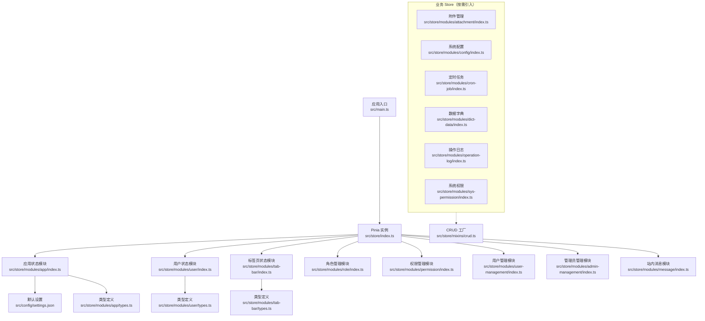
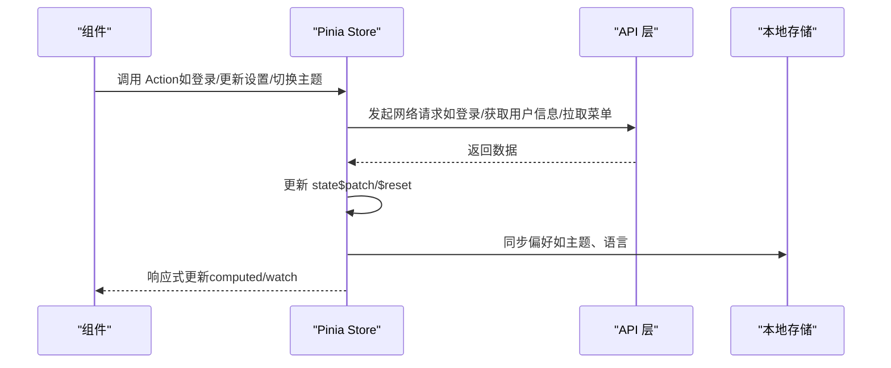
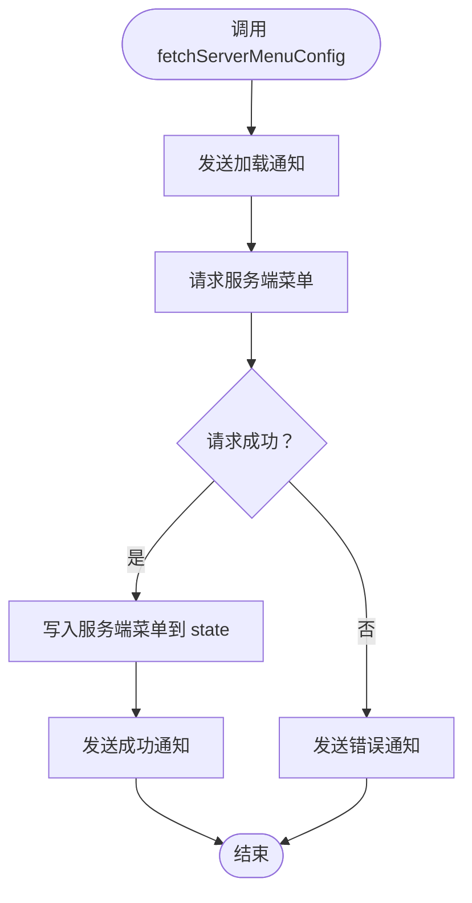
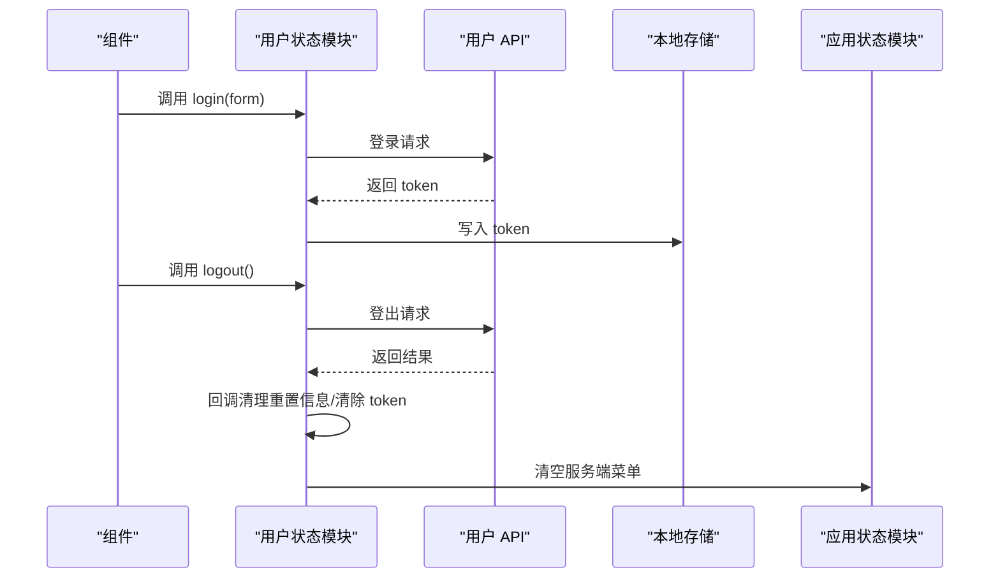
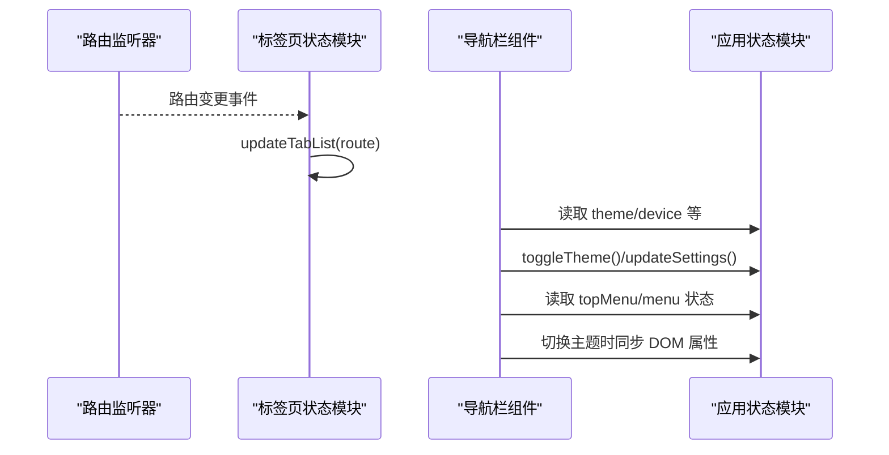
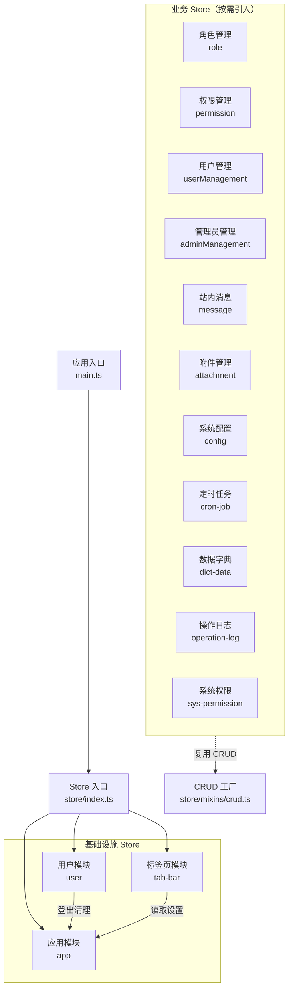

# 状态管理

<cite>
**本文引用的文件**
- [src/store/index.ts](file://src/store/index.ts)
- [src/store/mixins/crud.ts](file://src/store/mixins/crud.ts)
- [src/store/modules/app/index.ts](file://src/store/modules/app/index.ts)
- [src/store/modules/app/types.ts](file://src/store/modules/app/types.ts)
- [src/store/modules/user/index.ts](file://src/store/modules/user/index.ts)
- [src/store/modules/user/types.ts](file://src/store/modules/user/types.ts)
- [src/store/modules/tab-bar/index.ts](file://src/store/modules/tab-bar/index.ts)
- [src/store/modules/tab-bar/types.ts](file://src/store/modules/tab-bar/types.ts)
- [src/store/modules/attachment/index.ts](file://src/store/modules/attachment/index.ts)
- [src/store/modules/config/index.ts](file://src/store/modules/config/index.ts)
- [src/store/modules/cron-job/index.ts](file://src/store/modules/cron-job/index.ts)
- [src/store/modules/dict-data/index.ts](file://src/store/modules/dict-data/index.ts)
- [src/store/modules/message/index.ts](file://src/store/modules/message/index.ts)
- [src/store/modules/operation-log/index.ts](file://src/store/modules/operation-log/index.ts)
- [src/store/modules/permission/index.ts](file://src/store/modules/permission/index.ts)
- [src/store/modules/role/index.ts](file://src/store/modules/role/index.ts)
- [src/store/modules/sys-permission/index.ts](file://src/store/modules/sys-permission/index.ts)
- [src/store/modules/user-management/index.ts](file://src/store/modules/user-management/index.ts)
- [src/store/modules/admin-management/index.ts](file://src/store/modules/admin-management/index.ts)
- [src/main.ts](file://src/main.ts)
- [src/config/settings.json](file://src/config/settings.json)
- [src/components/navbar/index.vue](file://src/components/navbar/index.vue)
- [src/components/tab-bar/index.vue](file://src/components/tab-bar/index.vue)
</cite>

## 目录
1. [简介](#简介)
2. [项目结构](#项目结构)
3. [核心组件](#核心组件)
4. [架构总览](#架构总览)
5. [详细组件分析](#详细组件分析)
6. [依赖关系分析](#依赖关系分析)
7. [性能考量](#性能考量)
8. [故障排查指南](#故障排查指南)
9. [结论](#结论)
10. [附录](#附录)

## 简介
本文件系统性梳理基于 Vue 3 + Pinia 的状态管理方案，覆盖 Store 架构设计、模块化状态管理实现、状态持久化策略以及与组件的绑定与响应式更新机制。重点解析应用状态管理（app）、用户状态管理（user）、标签页状态管理（tab-bar）等核心 Store，以及后新增的附件管理（attachment）、系统配置（config）、定时任务（cron-job）、数据字典（dict-data）、站内消息（message）、操作日志（operation-log）、权限管理（permission）、角色管理（role）、系统权限（sys-permission）、用户管理（user-management）、管理员管理（admin-management）等业务 Store 的数据模型、Actions 与 Getters 设计模式，并给出最佳实践与性能优化建议。

## 项目结构
- 入口在应用根部注册 Pinia 并注入路由、国际化等插件。
- Store 采用模块化组织，分为基础设施 Store 和业务 Store 两大类。
- 基础设施 Store（app、user、tab-bar）负责应用全局设置、用户信息与登录态、标签页列表与缓存集合。
- 业务 Store（role、permission、message 等）负责各自业务领域的数据管理与 API 交互，部分模块通过 `createCrudActions` 工厂函数复用标准 CRUD 逻辑。
- 配置文件 settings.json 提供默认应用设置，作为初始 state 的来源之一。

图表来源
- [src/main.ts:1-29](file://src/main.ts#L1-L29)
- [src/store/index.ts:1-24](file://src/store/index.ts#L1-L24)
- [src/store/mixins/crud.ts:1-160](file://src/store/mixins/crud.ts#L1-L160)
- [src/store/modules/app/index.ts:1-78](file://src/store/modules/app/index.ts#L1-L78)
- [src/store/modules/user/index.ts:1-92](file://src/store/modules/user/index.ts#L1-L92)
- [src/store/modules/tab-bar/index.ts:1-75](file://src/store/modules/tab-bar/index.ts#L1-L75)
- [src/store/modules/role/index.ts:1-109](file://src/store/modules/role/index.ts#L1-L109)
- [src/store/modules/permission/index.ts:1-314](file://src/store/modules/permission/index.ts#L1-L314)
- [src/store/modules/user-management/index.ts:1-163](file://src/store/modules/user-management/index.ts#L1-L163)
- [src/store/modules/admin-management/index.ts:1-120](file://src/store/modules/admin-management/index.ts#L1-L120)
- [src/store/modules/message/index.ts:1-279](file://src/store/modules/message/index.ts#L1-L279)
- [src/store/modules/attachment/index.ts:1-106](file://src/store/modules/attachment/index.ts#L1-L106)
- [src/store/modules/config/index.ts:1-119](file://src/store/modules/config/index.ts#L1-L119)
- [src/store/modules/cron-job/index.ts:1-132](file://src/store/modules/cron-job/index.ts#L1-L132)
- [src/store/modules/dict-data/index.ts:1-99](file://src/store/modules/dict-data/index.ts#L1-L99)
- [src/store/modules/operation-log/index.ts:1-49](file://src/store/modules/operation-log/index.ts#L1-L49)
- [src/store/modules/sys-permission/index.ts:1-190](file://src/store/modules/sys-permission/index.ts#L1-L190)
- [src/config/settings.json:1-18](file://src/config/settings.json#L1-L18)

章节来源
- [src/main.ts:1-29](file://src/main.ts#L1-L29)
- [src/store/index.ts:1-24](file://src/store/index.ts#L1-L24)

## 核心组件
- 应用状态模块（app）
  - 负责主题、布局、菜单、设备类型、服务端菜单等全局配置。
  - 提供更新设置、切换主题、切换设备、切换菜单显示、拉取服务端菜单、清空服务端菜单等 Actions。
  - 提供当前设置快照、设备类型、服务端菜单映射等 Getters。
- 用户状态模块（user）
  - 负责用户资料、角色等信息；提供登录、登出、切换角色、获取用户信息、重置信息等 Actions。
  - 提供 userInfo Getters。
- 标签页状态模块（tab-bar）
  - 维护标签页列表与缓存集合；提供新增标签、删除标签、刷新列表、重置列表、增删缓存等 Actions。
  - 提供标签列表与缓存列表的 Getters。
- 角色管理模块（role）
  - 负责角色 CRUD 及状态管理；提供创建、更新、删除、查询、启用/禁用角色等 Actions。
  - 支持保存角色权限关联。
- 权限管理模块（permission）
  - 负责权限数据的查询与管理；提供拉取全部/用户权限、构建权限树、权限校验等 Actions。
  - 提供按 Key/对象/类型查询权限，以及权限统计等 Getters。
- 用户管理模块（user-management）
  - 负责系统用户的完整管理；提供用户 CRUD、激活/停用、黑名单管理、第三方账号管理、角色分配等 Actions。
- 管理员管理模块（admin-management）
  - 负责管理员的增删改查与状态管理；提供管理员 CRUD、激活/停用、角色分配等 Actions。
- 站内消息模块（message）
  - 负责消息列表、未读数、消息偏好管理；提供列表查询、标记已读/未读、批量删除、SSE 实时推送处理等 Actions。
  - 提供未读总数、按类型筛选消息等 Getters。
- 附件管理模块（attachment）
  - 负责附件列表与分组管理；提供附件查询、详情、删除、批量删除、移动分组等 Actions。
- 系统配置模块（config）
  - 负责系统配置的 CRUD 与分组查询；提供按 Key/按分组获取配置、缓存管理等 Actions。
- 定时任务模块（cron-job）
  - 负责定时任务的 CRUD 与执行管理；提供启停任务、手动执行、日志查看等 Actions。
- 数据字典模块（dict-data）
  - 负责字典数据的 CRUD 与按类型查询；提供按字典类型批量获取、类型缓存管理等 Actions。
- 操作日志模块（operation-log）
  - 负责操作日志的查询与详情查看；仅提供只读查询能力。
- 系统权限模块（sys-permission）
  - 负责系统权限树的管理；提供权限 CRUD、树结构获取、权限节点状态管理等 Actions。

章节来源
- [src/store/modules/app/index.ts:9-78](file://src/store/modules/app/index.ts#L9-L78)
- [src/store/modules/user/index.ts:13-92](file://src/store/modules/user/index.ts#L13-L92)
- [src/store/modules/tab-bar/index.ts:24-75](file://src/store/modules/tab-bar/index.ts#L24-L75)
- [src/store/modules/role/index.ts:29-109](file://src/store/modules/role/index.ts#L29-L109)
- [src/store/modules/permission/index.ts:41-314](file://src/store/modules/permission/index.ts#L41-L314)
- [src/store/modules/user-management/index.ts:46-163](file://src/store/modules/user-management/index.ts#L46-L163)
- [src/store/modules/admin-management/index.ts:30-120](file://src/store/modules/admin-management/index.ts#L30-L120)
- [src/store/modules/message/index.ts:69-279](file://src/store/modules/message/index.ts#L69-L279)
- [src/store/modules/attachment/index.ts:34-106](file://src/store/modules/attachment/index.ts#L34-L106)
- [src/store/modules/config/index.ts:30-119](file://src/store/modules/config/index.ts#L30-L119)
- [src/store/modules/cron-job/index.ts:33-132](file://src/store/modules/cron-job/index.ts#L33-L132)
- [src/store/modules/dict-data/index.ts:26-99](file://src/store/modules/dict-data/index.ts#L26-L99)
- [src/store/modules/operation-log/index.ts:16-49](file://src/store/modules/operation-log/index.ts#L16-L49)
- [src/store/modules/sys-permission/index.ts:25-190](file://src/store/modules/sys-permission/index.ts#L25-L190)

## 架构总览
- 模块化设计：每个 Store 定义独立的 state、getters、actions，职责清晰，便于维护与扩展。
- 响应式绑定：组件通过组合式 API 使用 Store，自动响应 state 变更。
- 数据持久化：主题、语言、全屏等偏好通过浏览器存储键位同步到 Store；应用设置可通过 Actions 更新并持久化至本地存储或后端（视业务而定）。
- 事件驱动：路由变化监听器触发标签页状态更新；用户操作触发用户状态变更；全局设置变更影响 UI 主题与布局。

图表来源
- [src/store/modules/user/index.ts:64-87](file://src/store/modules/user/index.ts#L64-L87)
- [src/store/modules/app/index.ts:26-70](file://src/store/modules/app/index.ts#L26-L70)
- [src/components/navbar/index.vue:215-236](file://src/components/navbar/index.vue#L215-L236)

## 详细组件分析

### 应用状态模块（app）
- 数据模型
  - 包含主题、弱视模式、导航栏、菜单、顶部菜单、隐藏菜单、菜单折叠、页脚、主题色、菜单宽度、全局设置、设备类型、标签栏开关、从服务端加载菜单、服务端菜单等字段。
- Getters
  - 当前设置快照：返回当前完整设置对象。
  - 设备类型：返回当前设备标识。
  - 服务端菜单映射：将服务端菜单转换为路由记录类型。
- Actions
  - 更新设置：合并部分设置到当前状态。
  - 切换主题：根据传入布尔值设置主题并同步到 DOM 属性。
  - 切换设备：更新设备类型。
  - 切换菜单显示：控制菜单是否隐藏。
  - 拉取服务端菜单：异步请求菜单并更新状态，同时通过通知反馈加载状态。
  - 清空服务端菜单：重置服务端菜单为空数组。

图表来源
- [src/store/modules/app/index.ts:47-70](file://src/store/modules/app/index.ts#L47-L70)

章节来源
- [src/store/modules/app/index.ts:9-78](file://src/store/modules/app/index.ts#L9-L78)
- [src/store/modules/app/types.ts:3-20](file://src/store/modules/app/types.ts#L3-L20)
- [src/config/settings.json:1-18](file://src/config/settings.json#L1-L18)

### 用户状态模块（user）
- 数据模型
  - 包含姓名、头像、职位、组织、地点、邮箱、个人介绍、个人网站、职位名称、组织名称、地点名称、电话、注册日期、账户 ID、认证状态、角色等字段。
- Getters
  - userInfo：返回当前用户信息快照。
- Actions
  - 切换角色：在 admin 与 user 之间切换，返回新角色。
  - 设置信息：使用 $patch 合并部分用户信息。
  - 重置信息：使用 $reset 恢复初始状态。
  - 获取用户信息：调用接口获取用户详情并写入 state。
  - 登录：调用登录接口并写入 token。
  - 登出：调用登出接口，最终执行回调清理用户信息、token、路由监听器与服务端菜单。

图表来源
- [src/store/modules/user/index.ts:64-87](file://src/store/modules/user/index.ts#L64-L87)
- [src/store/modules/app/index.ts:71-73](file://src/store/modules/app/index.ts#L71-L73)

章节来源
- [src/store/modules/user/index.ts:13-92](file://src/store/modules/user/index.ts#L13-L92)
- [src/store/modules/user/types.ts:1-19](file://src/store/modules/user/types.ts#L1-L19)

### 标签页状态模块（tab-bar）
- 数据模型
  - tagList：标签页数组，包含标题、名称、完整路径、查询参数、是否忽略缓存等属性。
  - cacheTabList：需要缓存的标签页名称集合。
- Getters
  - 标签列表：返回当前标签页列表。
  - 缓存列表：返回当前缓存集合的字符串数组。
- Actions
  - 更新标签列表：根据路由生成标签并加入列表，若未忽略缓存则加入缓存集合。
  - 删除标签：移除指定标签并同步删除缓存。
  - 新增缓存：向缓存集合添加名称。
  - 删除缓存：从缓存集合移除指定标签。
  - 刷新标签列表：根据传入标签数组重置列表并重建缓存集合。
  - 重置标签列表：恢复默认标签与缓存集合。

图表来源
- [src/store/modules/tab-bar/index.ts:40-46](file://src/store/modules/tab-bar/index.ts#L40-L46)

章节来源
- [src/store/modules/tab-bar/index.ts:24-75](file://src/store/modules/tab-bar/index.ts#L24-L75)
- [src/store/modules/tab-bar/types.ts:1-13](file://src/store/modules/tab-bar/types.ts#L1-L13)

### 角色管理模块（role）
- 数据模型
  - items：角色列表数组；total：总数；currentItem：当前选中角色；loading：加载状态。
- Actions
  - 标准 CRUD：通过 `createCrudActions` 混入 create、update、delete、查询列表与详情等操作。
  - 业务方法：`toggleRoleStatus` 启禁用角色；`fetchAllRoles` 获取全量角色（供选择器使用）；`saveRolePermissions` 保存角色权限关联。

章节来源
- [src/store/modules/role/index.ts:29-109](file://src/store/modules/role/index.ts#L29-L109)

### 权限管理模块（permission）
- 数据模型
  - permissions：分页权限列表；allPermissions：全量权限；userPermissions：当前用户权限（menu / button / api / all 四类）。
  - cache：5 分钟 TTL 的 Map 缓存；permissionTree：构建好的权限树。
- Getters
  - 按 Key / 对象 / 类型查询权限：`getPermissionByKey`、`getPermissionsByObject`、`getPermissionsByType`。
  - 权限校验：`hasPermission(object, action)` 判断用户是否拥有特定权限。
  - 权限统计：`permissionStatistics` 返回各类权限数量。
- Actions
  - 拉取分页 / 全量权限：`fetchPermissions`、`fetchAllPermissions`（带缓存）。
  - 拉取用户权限：`fetchUserPermissions`、`fetchUserMenuPermissions`、`fetchUserButtonPermissions`、`fetchUserApiPermissions`。
  - 权限 CRUD：`createPermission`、`updatePermission`、`deletePermission`，操作后自动清缓存。
  - 权限树：`buildPermissionTree` 构建分组权限树、`updateTreeCheckState` 更新勾选状态、`getFlatKeysFromTree` 提取已选 Key。
  - 缓存管理：`clearCache`、`clearUserPermissions`。
- 使用场景
  - 角色权限配置页用于构建权限树和保存选择结果；按钮级权限校验通过 `hasPermission` 控制 UI 元素显隐。

章节来源
- [src/store/modules/permission/index.ts:41-314](file://src/store/modules/permission/index.ts#L41-L314)

### 用户管理模块（user-management）
- 数据模型
  - items：用户列表；total：总数；currentItem：用户详情（含扩展信息）；loading：加载状态。
  - blacklist / blacklistTotal：黑名单数据；thirdPartyUsers / thirdPartyTotal：第三方账号数据；userRoles：用户角色列表。
- Getters
  - users、currentUser、blacklistItems、thirdPartyUserItems。
- Actions
  - 标准 CRUD：通过 `createCrudActions` 混入创建、更新、删除、查询等。
  - 状态管理：`activateUser`、`deactivateUser` 启用/停用用户。
  - 黑名单：`addToBlacklist`、`removeFromBlacklist`、`fetchBlacklist`。
  - 角色分配：`fetchUserRoles`、`assignUserRoles`。
  - 第三方账号：`fetchThirdPartyUsers`、`unbindThirdPartyUser`。
  - 数据导出：`exportUsers`。
- 使用场景
  - 系统用户管理页：用户列表与搜索、状态切换、黑名单管理、角色分配；第三方账号管理弹窗。

章节来源
- [src/store/modules/user-management/index.ts:46-163](file://src/store/modules/user-management/index.ts#L46-L163)

### 管理员管理模块（admin-management）
- 数据模型
  - items：管理员列表；total：总数；currentItem：管理员详情；loading：加载状态。
- Getters
  - admins、currentAdmin。
- Actions
  - CRUD 操作：`fetchList`、`fetchDetail`、`create`、`updateAdmin`、`deleteAdmin`（无 Mixin，手动实现）。
  - 状态管理：`activateAdmin`、`deactivateAdmin`。
  - 角色分配：`fetchAdminRoles`、`assignAdminRoles`。
- 使用场景
  - 后台管理员管理页，独立于普通用户管理，聚焦运维权限分配。

章节来源
- [src/store/modules/admin-management/index.ts:30-120](file://src/store/modules/admin-management/index.ts#L30-L120)

### 站内消息模块（message）
- 数据模型
  - list：消息列表（按时间倒序）；page / pageSize / total：分页信息。
  - unread：未读统计（total / system / business / task 四维度）。
  - preference：消息偏好（桌面通知、声音通知、订阅类型、免打扰时段等）；preferenceLoading：偏好加载状态。
- Getters
  - unreadTotal：未读总数；listByType(type)：按业务类型筛选消息。
- Actions
  - 列表与未读：`fetchList`（支持驼峰/下划线字段）、`fetchUnreadCount`（静默失败）。
  - 读状态：`markRead`（扣减未读）、`markUnread`（恢复未读）、`markAllRead`（一键已读）。
  - 删除与清空：`remove`、`removeBatch`、`clear`（条件清空后刷新列表与未读数）。
  - SSE 实时推送：`pushIncoming` 将新消息插入列表头部并累加未读（含防重）。
  - 偏好管理：`fetchPreference`、`updatePreference`。
  - 重置：`reset`（登出时调用）。
- 使用场景
  - 站内消息中心：消息列表分页浏览、多选标记已读/未读、批量删除、实时 SSE 推送新消息、个人偏好设置。

章节来源
- [src/store/modules/message/index.ts:69-279](file://src/store/modules/message/index.ts#L69-L279)

### 附件管理模块（attachment）
- 数据模型
  - items：附件列表；total：总数；currentItem：当前附件详情；loading：加载状态；groups：附件分组列表。
- Actions
  - 标准查删：通过 `createFetchListAction`、`createFetchDetailAction`、`createDeleteAction` 混入。
  - 附件操作：`batchDelete` 批量删除、`moveAttachment` 移动附件到分组。
  - 分组管理：`fetchGroups`、`createGroup`、`updateGroup`、`deleteGroup`。
- 使用场景
  - 附件管理页：附件列表查询、删除、分组移动；分组 CRUD 弹窗。

章节来源
- [src/store/modules/attachment/index.ts:34-106](file://src/store/modules/attachment/index.ts#L34-L106)

### 系统配置模块（config）
- 数据模型
  - items：配置列表；total：总数；currentItem：当前配置详情；loading：加载状态。
  - groups：配置分组列表；groupData：按分组名称索引的配置数据缓存。
- Actions
  - 标准 CRUD：通过 `createCrudActions` 混入。
  - 业务方法：`fetchByKey` 按 Key 获取值、`fetchByGroup` 按分组获取（带缓存）、`fetchGroups` 获取分组列表（带缓存）、`clearCache` 清理缓存。
- 使用场景
  - 系统配置管理页：配置项增删改查；前端可通过 `fetchByGroup` 加载特定分组的配置项供组件消费。

章节来源
- [src/store/modules/config/index.ts:30-119](file://src/store/modules/config/index.ts#L30-L119)

### 定时任务模块（cron-job）
- 数据模型
  - items：任务列表；total：总数；currentItem：当前任务详情；loading：加载状态。
  - logs：日志文件列表；logContent：日志文件内容/尾部内容。
- Actions
  - 标准 CRUD：通过 `createCrudActions` 混入。
  - 任务控制：`enableCronJob`、`disableCronJob`、`toggleCronJobStatus` 启停任务、`runCronJob` 手动执行。
  - 日志查看：`fetchCronJobLogs` 获取日志列表、`fetchCronJobLogContent` 获取完整日志、`fetchCronJobLogTail` 获取尾部日志（支持行数参数）。
- 使用场景
  - 定时任务管理页：任务 CRUD、启停控制、手动触发执行；日志查看弹窗支持实时 Tail 追踪。

章节来源
- [src/store/modules/cron-job/index.ts:33-132](file://src/store/modules/cron-job/index.ts#L33-L132)

### 数据字典模块（dict-data）
- 数据模型
  - items：字典数据列表；total：总数；currentItem：当前字典详情；loading：加载状态。
  - typeMap：按字典类型分类的缓存数据（Record<string, DictDataResponse[]>）。
- Actions
  - 标准 CRUD：通过 `createCrudActions` 混入。
  - 业务方法：`fetchByType(type, forceRefresh)` 按字典类型查询（带缓存），`clearTypeCache` 清理类型缓存。
- 使用场景
  - 数据字典管理页：字典项增删改查；表单下拉选择器通过 `fetchByType` 获取特定类型的字典选项。

章节来源
- [src/store/modules/dict-data/index.ts:26-99](file://src/store/modules/dict-data/index.ts#L26-L99)

### 操作日志模块（operation-log）
- 数据模型
  - items：日志列表；total：总数；currentItem：当前日志详情；loading：加载状态。
- Actions
  - 查询操作：通过 `createFetchListAction`、`createFetchDetailAction` 混入（仅查询，无增删改）。
  - 别名：`fetchLogs`、`fetchLogDetail`。
- 使用场景
  - 操作日志查看页：分页浏览与条件搜索、详情查看（只读）。

章节来源
- [src/store/modules/operation-log/index.ts:16-49](file://src/store/modules/operation-log/index.ts#L16-L49)

### 系统权限模块（sys-permission）
- 数据模型
  - items：权限列表；permissionTree：权限树结构；total：总数；loading：加载状态。
- Actions
  - 标准 CRUD：通过 `createCrudActions` 混入（create / update / delete，详情接口暂缺）。
  - 权限树：`fetchSysPermissionTree` 获取权限树、`getPermissionNodeKey` 生成节点唯一 Key、`setTreeCheckedState` 设置勾选状态、`getSelectedPermissionsFromTree` 提取已选权限。
- 使用场景
  - 系统权限管理页：权限树展示与编辑、角色权限分配时通过 `setTreeCheckedState` 回显已有权限、通过 `getSelectedPermissionsFromTree` 提取保存结果。

章节来源
- [src/store/modules/sys-permission/index.ts:25-190](file://src/store/modules/sys-permission/index.ts#L25-L190)

### 组件绑定与响应式更新
- 组件通过组合式 API 引入对应 Store 实例，读取 computed 响应式值，调用 Actions 触发状态变更。
- 导航栏组件绑定应用与用户状态：读取主题、头像、菜单状态等，调用切换主题、打开设置面板、切换角色、登出等动作。
- 标签栏组件绑定标签页状态：监听路由变化，动态更新标签列表与缓存集合；根据应用设置调整固定偏移。

图表来源
- [src/components/tab-bar/index.vue:42-55](file://src/components/tab-bar/index.vue#L42-L55)
- [src/components/navbar/index.vue:206-236](file://src/components/navbar/index.vue#L206-L236)
- [src/store/modules/app/index.ts:32-40](file://src/store/modules/app/index.ts#L32-L40)

章节来源
- [src/components/navbar/index.vue:199-236](file://src/components/navbar/index.vue#L199-L236)
- [src/components/tab-bar/index.vue:21-60](file://src/components/tab-bar/index.vue#L21-L60)

## 依赖关系分析
- Store 注册：应用入口统一注册 Pinia，并导出各模块 Store 以供组件使用。
- 基础设施 Store 依赖：用户模块登出时调用应用模块清空服务端菜单；标签页模块读取应用模块的设置控制固定偏移量。
- 业务 Store 独立性：角色、权限、用户管理、管理员管理、消息、附件、配置、定时任务、数据字典、操作日志、系统权限等业务 Store 各自独立运行，彼此无直接依赖，仅通过 `createCrudActions` 等工厂函数复用 CRUD Mixin。
- 类型定义：各模块均提供 TypeScript 类型定义，确保 state 结构与 API 返回一致。

图表来源
- [src/main.ts:1-29](file://src/main.ts#L1-L29)
- [src/store/index.ts:1-10](file://src/store/index.ts#L1-L10)
- [src/store/modules/user/index.ts:11](file://src/store/modules/user/index.ts#L11)
- [src/store/modules/tab-bar/index.ts:1-9](file://src/store/modules/tab-bar/index.ts#L1-L9)
- [src/store/mixins/crud.ts:1-160](file://src/store/mixins/crud.ts#L1-L160)

章节来源
- [src/store/index.ts:1-10](file://src/store/index.ts#L1-L10)
- [src/store/modules/user/index.ts:11](file://src/store/modules/user/index.ts#L11)
- [src/store/modules/tab-bar/index.ts:1-9](file://src/store/modules/tab-bar/index.ts#L1-L9)

## 性能考量
- 模块拆分与按需访问：将应用设置、用户信息、标签页分离为独立模块，避免无关状态变更触发不必要的渲染。
- 批量更新与局部更新：优先使用 $patch 进行局部更新，减少大对象替换带来的重渲染。
- 缓存策略：标签页缓存集合仅包含需要缓存的路由名称，避免无谓的组件实例保留。
- 路由监听去抖：在标签页更新逻辑中避免重复添加相同标签，减少列表增长与渲染压力。
- 主题切换与 DOM 属性：主题切换通过设置 DOM 属性实现，避免频繁重绘复杂样式树。
- 异步请求与通知：服务端菜单拉取使用通知反馈，避免阻塞 UI；异常处理及时收尾，防止状态悬挂。

## 故障排查指南
- 登录失败
  - 现象：登录接口报错，token 未写入。
  - 排查：确认登录 Action 是否捕获异常并清理 token；检查接口拦截器与错误提示。
  - 参考路径
    - [src/store/modules/user/index.ts:64-72](file://src/store/modules/user/index.ts#L64-L72)
- 登出后状态未清理
  - 现象：用户信息仍存在，菜单未清空。
  - 排查：确认登出 Action 的回调是否执行；检查回调中对用户信息、token、路由监听器与服务端菜单的清理顺序。
  - 参考路径
    - [src/store/modules/user/index.ts:73-87](file://src/store/modules/user/index.ts#L73-L87)
- 标签页重复添加
  - 现象：同一路由多次出现在标签列表。
  - 排查：确认路由监听器中对 noAffix 与 fullPath 去重逻辑；检查 updateTabList 的调用时机。
  - 参考路径
    - [src/components/tab-bar/index.vue:42-55](file://src/components/tab-bar/index.vue#L42-L55)
    - [src/store/modules/tab-bar/index.ts:40-46](file://src/store/modules/tab-bar/index.ts#L40-L46)
- 主题切换无效
  - 现象：点击切换主题按钮后 UI 未变化。
  - 排查：确认主题切换 Action 是否正确设置 state 与 DOM 属性；检查全局主题监听器是否生效。
  - 参考路径
    - [src/store/modules/app/index.ts:32-40](file://src/store/modules/app/index.ts#L32-L40)
    - [src/components/navbar/index.vue:219-233](file://src/components/navbar/index.vue#L219-L233)

章节来源
- [src/store/modules/user/index.ts:64-87](file://src/store/modules/user/index.ts#L64-L87)
- [src/store/modules/tab-bar/index.ts:40-46](file://src/store/modules/tab-bar/index.ts#L40-L46)
- [src/components/tab-bar/index.vue:42-55](file://src/components/tab-bar/index.vue#L42-L55)
- [src/components/navbar/index.vue:219-233](file://src/components/navbar/index.vue#L219-L233)

## 结论
该状态管理方案以模块化为核心，结合 Pinia 的响应式与类型安全特性，构建了覆盖基础设施与业务领域的完整 Store 体系。基础设施层（app、user、tab-bar）负责应用全局设置、用户会话与标签页管理；业务层涵盖角色、权限、用户管理、管理员管理、站内消息、附件、系统配置、定时任务、数据字典、操作日志、系统权限等 11 个模块，通过 `createCrudActions` 等工厂函数大量复用标准 CRUD 逻辑，极大减少了重复代码。各模块职责清晰、独立运作，通过合理的 Actions 与 Getters 设计、路由事件驱动与本地存储同步，既保证了开发体验，也兼顾了运行时性能。建议在后续迭代中持续关注状态粒度与缓存策略，配合严格的类型约束与单元测试，进一步提升可维护性与稳定性。

## 附录
- 默认设置来源：应用初始状态来源于配置文件，确保首次渲染一致性。
- 类型定义：各模块均提供强类型定义，便于 IDE 提示与编译期校验。
- 组件使用：导航栏与标签栏组件展示了典型的 Store 绑定与响应式更新模式，可作为其他组件的参考模板。

章节来源
- [src/config/settings.json:1-18](file://src/config/settings.json#L1-L18)
- [src/store/modules/app/types.ts:3-20](file://src/store/modules/app/types.ts#L3-L20)
- [src/store/modules/user/types.ts:1-19](file://src/store/modules/user/types.ts#L1-L19)
- [src/store/modules/tab-bar/types.ts:1-13](file://src/store/modules/tab-bar/types.ts#L1-L13)