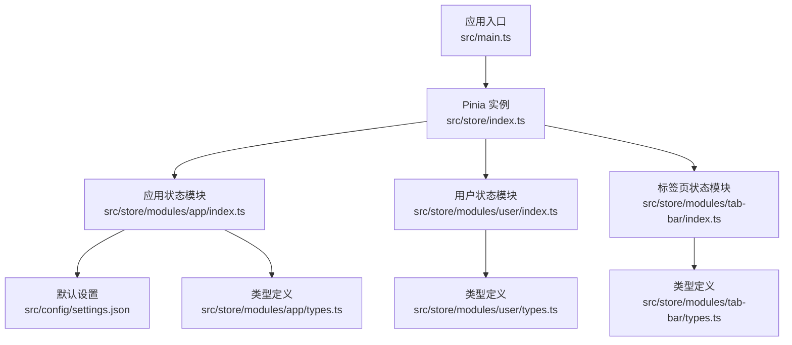
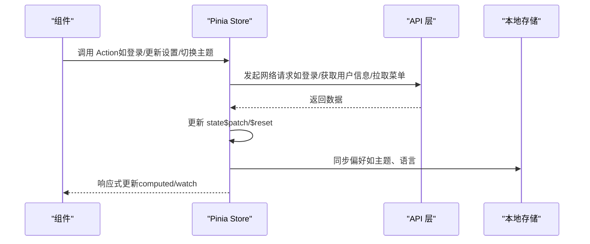
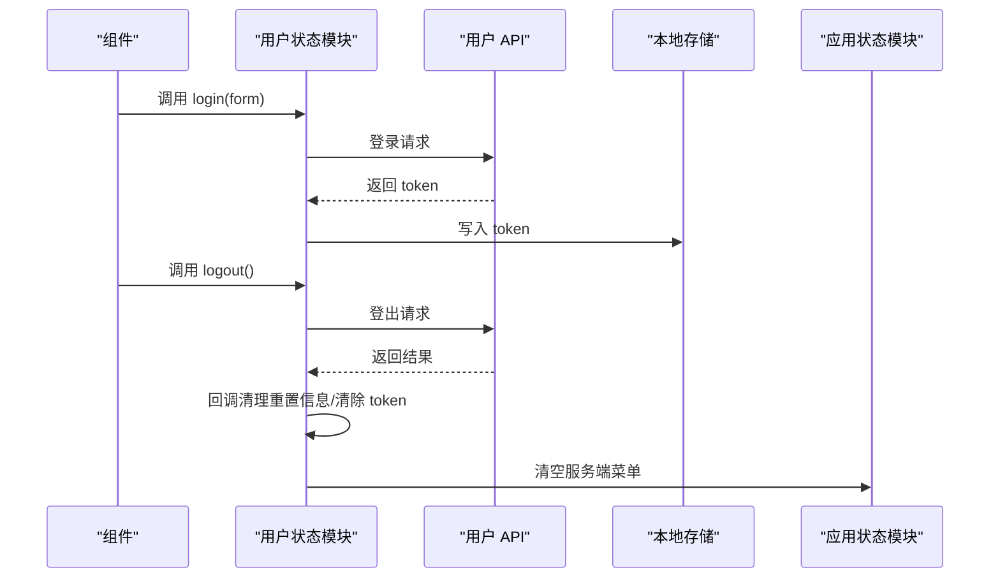
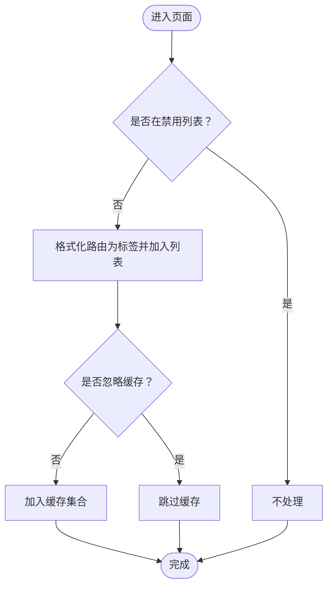
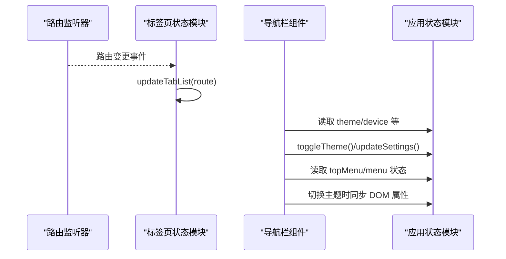
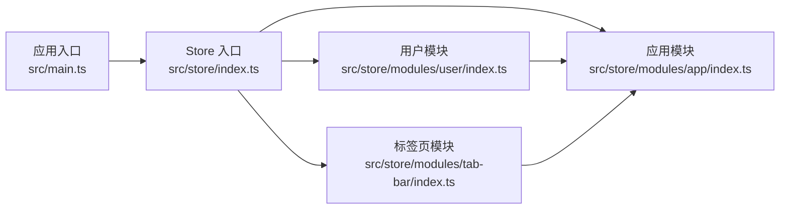

# 状态管理

<cite>
**本文引用的文件**
- [src/store/index.ts](file://src/store/index.ts)
- [src/store/modules/app/index.ts](file://src/store/modules/app/index.ts)
- [src/store/modules/app/types.ts](file://src/store/modules/app/types.ts)
- [src/store/modules/user/index.ts](file://src/store/modules/user/index.ts)
- [src/store/modules/user/types.ts](file://src/store/modules/user/types.ts)
- [src/store/modules/tab-bar/index.ts](file://src/store/modules/tab-bar/index.ts)
- [src/store/modules/tab-bar/types.ts](file://src/store/modules/tab-bar/types.ts)
- [src/main.ts](file://src/main.ts)
- [src/config/settings.json](file://src/config/settings.json)
- [src/components/navbar/index.vue](file://src/components/navbar/index.vue)
- [src/components/tab-bar/index.vue](file://src/components/tab-bar/index.vue)
</cite>

## 目录
1. [简介](#简介)
2. [项目结构](#项目结构)
3. [核心组件](#核心组件)
4. [架构总览](#架构总览)
5. [详细组件分析](#详细组件分析)
6. [依赖关系分析](#依赖关系分析)
7. [性能考量](#性能考量)
8. [故障排查指南](#故障排查指南)
9. [结论](#结论)
10. [附录](#附录)

## 简介
本文件系统性梳理基于 Vue 3 + Pinia 的状态管理方案，覆盖 Store 架构设计、模块化状态管理实现、状态持久化策略以及与组件的绑定与响应式更新机制。重点解析应用状态管理（app）、用户状态管理（user）与标签页状态管理（tab-bar）三类 Store 的数据模型、Actions 与 Getters 设计模式，并给出最佳实践与性能优化建议。

## 项目结构
- 入口在应用根部注册 Pinia 并注入路由、国际化等插件。
- Store 采用模块化组织：app、user、tab-bar 三个模块分别负责应用全局设置、用户信息与登录态、标签页列表与缓存集合。
- 配置文件 settings.json 提供默认应用设置，作为初始 state 的来源之一。

图表来源
- [src/main.ts:1-29](file://src/main.ts#L1-L29)
- [src/store/index.ts:1-10](file://src/store/index.ts#L1-L10)
- [src/store/modules/app/index.ts:1-78](file://src/store/modules/app/index.ts#L1-L78)
- [src/store/modules/user/index.ts:1-92](file://src/store/modules/user/index.ts#L1-L92)
- [src/store/modules/tab-bar/index.ts:1-75](file://src/store/modules/tab-bar/index.ts#L1-L75)
- [src/config/settings.json:1-18](file://src/config/settings.json#L1-L18)

章节来源
- [src/main.ts:1-29](file://src/main.ts#L1-L29)
- [src/store/index.ts:1-10](file://src/store/index.ts#L1-L10)

## 核心组件
- 应用状态模块（app）
  - 负责主题、布局、菜单、设备类型、服务端菜单等全局配置。
  - 提供更新设置、切换主题、切换设备、切换菜单显示、拉取服务端菜单、清空服务端菜单等 Actions。
  - 提供当前设置快照、设备类型、服务端菜单映射等 Getters。
- 用户状态模块（user）
  - 负责用户资料、角色等信息；提供登录、登出、切换角色、获取用户信息、重置信息等 Actions。
  - 提供 userInfo Getters。
- 标签页状态模块（tab-bar）
  - 维护标签页列表与缓存集合；提供新增标签、删除标签、刷新列表、重置列表、增删缓存等 Actions。
  - 提供标签列表与缓存列表的 Getters。

章节来源
- [src/store/modules/app/index.ts:9-78](file://src/store/modules/app/index.ts#L9-L78)
- [src/store/modules/user/index.ts:13-92](file://src/store/modules/user/index.ts#L13-L92)
- [src/store/modules/tab-bar/index.ts:24-75](file://src/store/modules/tab-bar/index.ts#L24-L75)

## 架构总览
- 模块化设计：每个 Store 定义独立的 state、getters、actions，职责清晰，便于维护与扩展。
- 响应式绑定：组件通过组合式 API 使用 Store，自动响应 state 变更。
- 数据持久化：主题、语言、全屏等偏好通过浏览器存储键位同步到 Store；应用设置可通过 Actions 更新并持久化至本地存储或后端（视业务而定）。
- 事件驱动：路由变化监听器触发标签页状态更新；用户操作触发用户状态变更；全局设置变更影响 UI 主题与布局。

图表来源
- [src/store/modules/user/index.ts:64-87](file://src/store/modules/user/index.ts#L64-L87)
- [src/store/modules/app/index.ts:26-70](file://src/store/modules/app/index.ts#L26-L70)
- [src/components/navbar/index.vue:215-236](file://src/components/navbar/index.vue#L215-L236)

## 详细组件分析

### 应用状态模块（app）
- 数据模型
  - 包含主题、弱视模式、导航栏、菜单、顶部菜单、隐藏菜单、菜单折叠、页脚、主题色、菜单宽度、全局设置、设备类型、标签栏开关、从服务端加载菜单、服务端菜单等字段。
- Getters
  - 当前设置快照：返回当前完整设置对象。
  - 设备类型：返回当前设备标识。
  - 服务端菜单映射：将服务端菜单转换为路由记录类型。
- Actions
  - 更新设置：合并部分设置到当前状态。
  - 切换主题：根据传入布尔值设置主题并同步到 DOM 属性。
  - 切换设备：更新设备类型。
  - 切换菜单显示：控制菜单是否隐藏。
  - 拉取服务端菜单：异步请求菜单并更新状态，同时通过通知反馈加载状态。
  - 清空服务端菜单：重置服务端菜单为空数组。

图表来源
- [src/store/modules/app/index.ts:47-70](file://src/store/modules/app/index.ts#L47-L70)

章节来源
- [src/store/modules/app/index.ts:9-78](file://src/store/modules/app/index.ts#L9-L78)
- [src/store/modules/app/types.ts:3-20](file://src/store/modules/app/types.ts#L3-L20)
- [src/config/settings.json:1-18](file://src/config/settings.json#L1-L18)

### 用户状态模块（user）
- 数据模型
  - 包含姓名、头像、职位、组织、地点、邮箱、个人介绍、个人网站、职位名称、组织名称、地点名称、电话、注册日期、账户 ID、认证状态、角色等字段。
- Getters
  - userInfo：返回当前用户信息快照。
- Actions
  - 切换角色：在 admin 与 user 之间切换，返回新角色。
  - 设置信息：使用 $patch 合并部分用户信息。
  - 重置信息：使用 $reset 恢复初始状态。
  - 获取用户信息：调用接口获取用户详情并写入 state。
  - 登录：调用登录接口并写入 token。
  - 登出：调用登出接口，最终执行回调清理用户信息、token、路由监听器与服务端菜单。

图表来源
- [src/store/modules/user/index.ts:64-87](file://src/store/modules/user/index.ts#L64-L87)
- [src/store/modules/app/index.ts:71-73](file://src/store/modules/app/index.ts#L71-L73)

章节来源
- [src/store/modules/user/index.ts:13-92](file://src/store/modules/user/index.ts#L13-L92)
- [src/store/modules/user/types.ts:1-19](file://src/store/modules/user/types.ts#L1-L19)

### 标签页状态模块（tab-bar）
- 数据模型
  - tagList：标签页数组，包含标题、名称、完整路径、查询参数、是否忽略缓存等属性。
  - cacheTabList：需要缓存的标签页名称集合。
- Getters
  - 标签列表：返回当前标签页列表。
  - 缓存列表：返回当前缓存集合的字符串数组。
- Actions
  - 更新标签列表：根据路由生成标签并加入列表，若未忽略缓存则加入缓存集合。
  - 删除标签：移除指定标签并同步删除缓存。
  - 新增缓存：向缓存集合添加名称。
  - 删除缓存：从缓存集合移除指定标签。
  - 刷新标签列表：根据传入标签数组重置列表并重建缓存集合。
  - 重置标签列表：恢复默认标签与缓存集合。

图表来源
- [src/store/modules/tab-bar/index.ts:40-46](file://src/store/modules/tab-bar/index.ts#L40-L46)

章节来源
- [src/store/modules/tab-bar/index.ts:24-75](file://src/store/modules/tab-bar/index.ts#L24-L75)
- [src/store/modules/tab-bar/types.ts:1-13](file://src/store/modules/tab-bar/types.ts#L1-L13)

### 组件绑定与响应式更新
- 组件通过组合式 API 引入对应 Store 实例，读取 computed 响应式值，调用 Actions 触发状态变更。
- 导航栏组件绑定应用与用户状态：读取主题、头像、菜单状态等，调用切换主题、打开设置面板、切换角色、登出等动作。
- 标签栏组件绑定标签页状态：监听路由变化，动态更新标签列表与缓存集合；根据应用设置调整固定偏移。

图表来源
- [src/components/tab-bar/index.vue:42-55](file://src/components/tab-bar/index.vue#L42-L55)
- [src/components/navbar/index.vue:206-236](file://src/components/navbar/index.vue#L206-L236)
- [src/store/modules/app/index.ts:32-40](file://src/store/modules/app/index.ts#L32-L40)

章节来源
- [src/components/navbar/index.vue:199-236](file://src/components/navbar/index.vue#L199-L236)
- [src/components/tab-bar/index.vue:21-60](file://src/components/tab-bar/index.vue#L21-L60)

## 依赖关系分析
- Store 注册：应用入口统一注册 Pinia，并导出各模块 Store 以供组件使用。
- 模块内依赖：用户模块依赖应用模块（登出时清空服务端菜单），标签页模块依赖路由常量与工具函数。
- 类型定义：各模块均提供 TypeScript 类型定义，确保 state 结构与 API 返回一致。

图表来源
- [src/main.ts:1-29](file://src/main.ts#L1-L29)
- [src/store/index.ts:1-10](file://src/store/index.ts#L1-L10)
- [src/store/modules/user/index.ts:11](file://src/store/modules/user/index.ts#L11)
- [src/store/modules/tab-bar/index.ts:1-9](file://src/store/modules/tab-bar/index.ts#L1-L9)

章节来源
- [src/store/index.ts:1-10](file://src/store/index.ts#L1-L10)
- [src/store/modules/user/index.ts:11](file://src/store/modules/user/index.ts#L11)
- [src/store/modules/tab-bar/index.ts:1-9](file://src/store/modules/tab-bar/index.ts#L1-L9)

## 性能考量
- 模块拆分与按需访问：将应用设置、用户信息、标签页分离为独立模块，避免无关状态变更触发不必要的渲染。
- 批量更新与局部更新：优先使用 $patch 进行局部更新，减少大对象替换带来的重渲染。
- 缓存策略：标签页缓存集合仅包含需要缓存的路由名称，避免无谓的组件实例保留。
- 路由监听去抖：在标签页更新逻辑中避免重复添加相同标签，减少列表增长与渲染压力。
- 主题切换与 DOM 属性：主题切换通过设置 DOM 属性实现，避免频繁重绘复杂样式树。
- 异步请求与通知：服务端菜单拉取使用通知反馈，避免阻塞 UI；异常处理及时收尾，防止状态悬挂。

## 故障排查指南
- 登录失败
  - 现象：登录接口报错，token 未写入。
  - 排查：确认登录 Action 是否捕获异常并清理 token；检查接口拦截器与错误提示。
  - 参考路径
    - [src/store/modules/user/index.ts:64-72](file://src/store/modules/user/index.ts#L64-L72)
- 登出后状态未清理
  - 现象：用户信息仍存在，菜单未清空。
  - 排查：确认登出 Action 的回调是否执行；检查回调中对用户信息、token、路由监听器与服务端菜单的清理顺序。
  - 参考路径
    - [src/store/modules/user/index.ts:73-87](file://src/store/modules/user/index.ts#L73-L87)
- 标签页重复添加
  - 现象：同一路由多次出现在标签列表。
  - 排查：确认路由监听器中对 noAffix 与 fullPath 去重逻辑；检查 updateTabList 的调用时机。
  - 参考路径
    - [src/components/tab-bar/index.vue:42-55](file://src/components/tab-bar/index.vue#L42-L55)
    - [src/store/modules/tab-bar/index.ts:40-46](file://src/store/modules/tab-bar/index.ts#L40-L46)
- 主题切换无效
  - 现象：点击切换主题按钮后 UI 未变化。
  - 排查：确认主题切换 Action 是否正确设置 state 与 DOM 属性；检查全局主题监听器是否生效。
  - 参考路径
    - [src/store/modules/app/index.ts:32-40](file://src/store/modules/app/index.ts#L32-L40)
    - [src/components/navbar/index.vue:219-233](file://src/components/navbar/index.vue#L219-L233)

章节来源
- [src/store/modules/user/index.ts:64-87](file://src/store/modules/user/index.ts#L64-L87)
- [src/store/modules/tab-bar/index.ts:40-46](file://src/store/modules/tab-bar/index.ts#L40-L46)
- [src/components/tab-bar/index.vue:42-55](file://src/components/tab-bar/index.vue#L42-L55)
- [src/components/navbar/index.vue:219-233](file://src/components/navbar/index.vue#L219-L233)

## 结论
该状态管理方案以模块化为核心，结合 Pinia 的响应式与类型安全特性，实现了应用设置、用户信息与标签页的清晰分离与高效协作。通过合理的 Actions 与 Getters 设计、路由事件驱动与本地存储同步，既保证了开发体验，也兼顾了运行时性能。建议在后续迭代中持续关注状态粒度与缓存策略，配合严格的类型约束与单元测试，进一步提升可维护性与稳定性。

## 附录
- 默认设置来源：应用初始状态来源于配置文件，确保首次渲染一致性。
- 类型定义：各模块均提供强类型定义，便于 IDE 提示与编译期校验。
- 组件使用：导航栏与标签栏组件展示了典型的 Store 绑定与响应式更新模式，可作为其他组件的参考模板。

章节来源
- [src/config/settings.json:1-18](file://src/config/settings.json#L1-L18)
- [src/store/modules/app/types.ts:3-20](file://src/store/modules/app/types.ts#L3-L20)
- [src/store/modules/user/types.ts:1-19](file://src/store/modules/user/types.ts#L1-L19)
- [src/store/modules/tab-bar/types.ts:1-13](file://src/store/modules/tab-bar/types.ts#L1-L13)