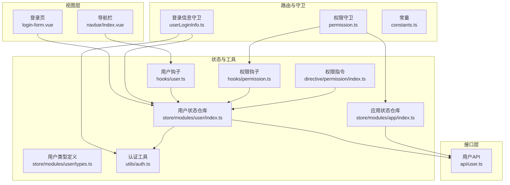
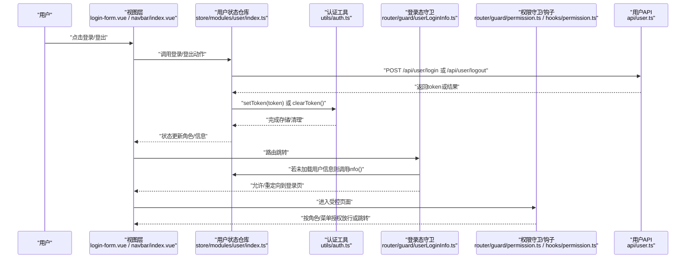
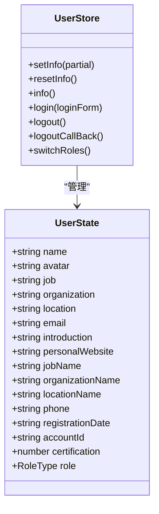
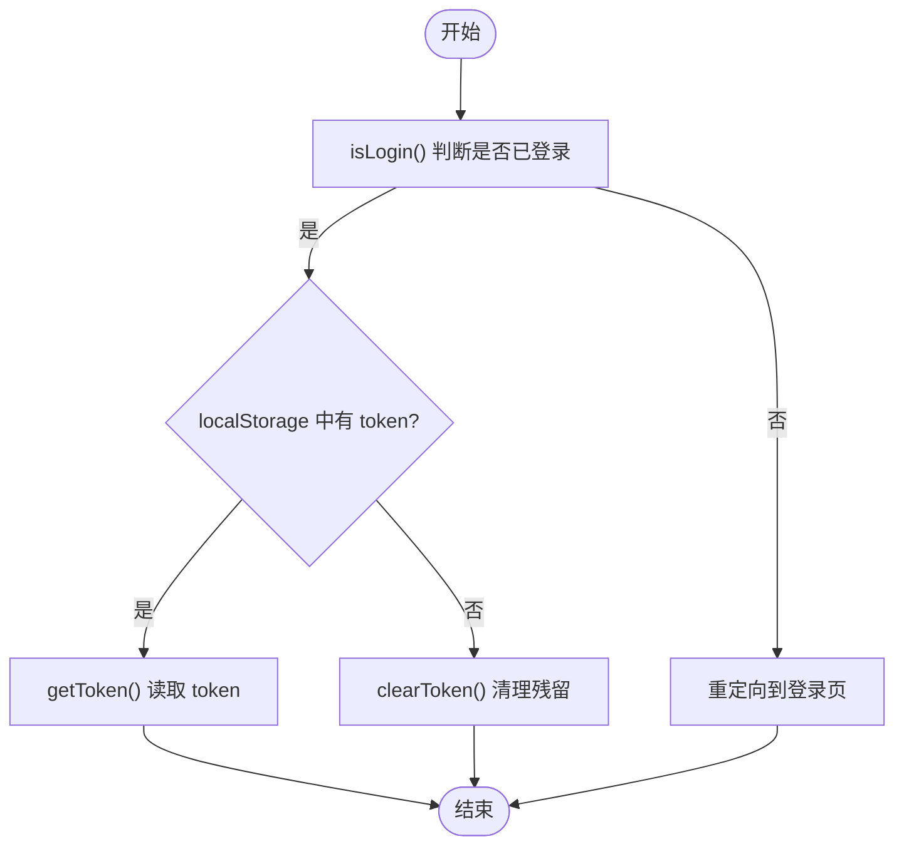
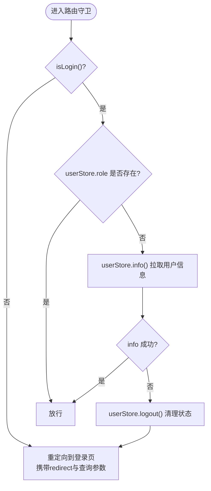
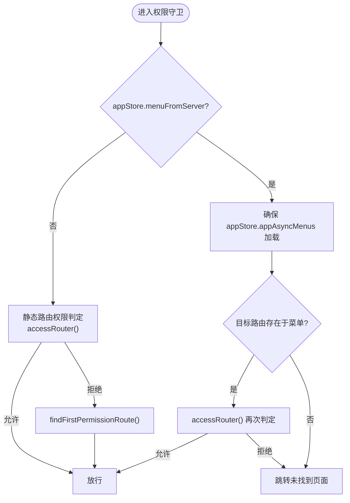
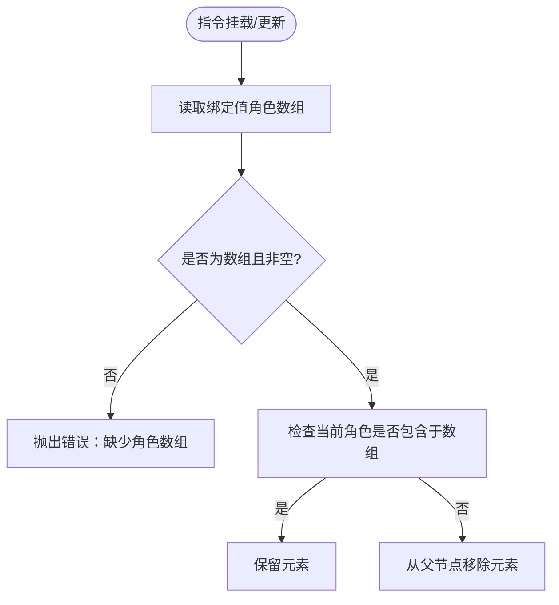
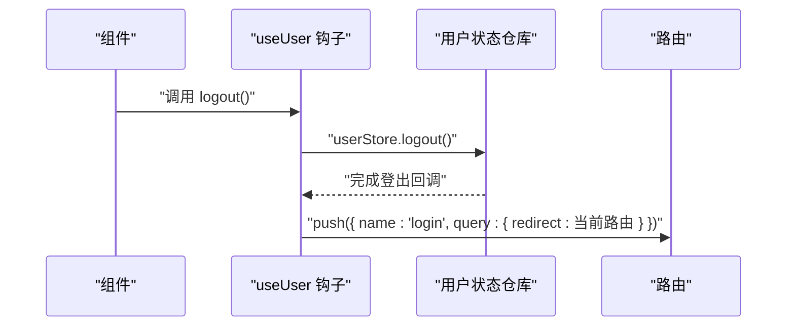
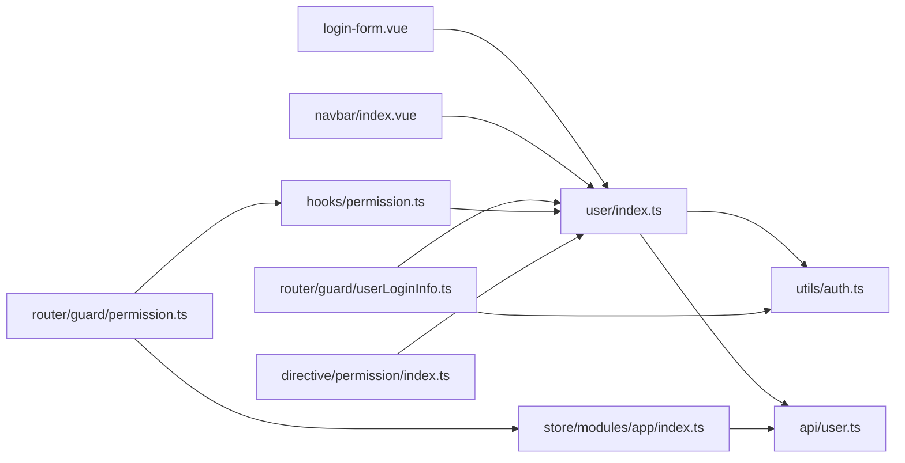

# 用户状态管理

<cite>
**本文引用的文件**
- [src/store/modules/user/index.ts](file://src/store/modules/user/index.ts)
- [src/store/modules/user/types.ts](file://src/store/modules/user/types.ts)
- [src/utils/auth.ts](file://src/utils/auth.ts)
- [src/router/guard/userLoginInfo.ts](file://src/router/guard/userLoginInfo.ts)
- [src/router/guard/permission.ts](file://src/router/guard/permission.ts)
- [src/directive/permission/index.ts](file://src/directive/permission/index.ts)
- [src/hooks/permission.ts](file://src/hooks/permission.ts)
- [src/hooks/user.ts](file://src/hooks/user.ts)
- [src/api/user.ts](file://src/api/user.ts)
- [src/store/index.ts](file://src/store/index.ts)
- [src/views/login/components/login-form.vue](file://src/views/login/components/login-form.vue)
- [src/components/navbar/index.vue](file://src/components/navbar/index.vue)
- [src/router/constants.ts](file://src/router/constants.ts)
- [src/store/modules/app/index.ts](file://src/store/modules/app/index.ts)
</cite>

## 目录
1. [简介](#简介)
2. [项目结构](#项目结构)
3. [核心组件](#核心组件)
4. [架构总览](#架构总览)
5. [详细组件分析](#详细组件分析)
6. [依赖关系分析](#依赖关系分析)
7. [性能考量](#性能考量)
8. [故障排查指南](#故障排查指南)
9. [结论](#结论)
10. [附录：API与最佳实践](#附录api与最佳实践)

## 简介
本文件系统性阐述用户状态管理模块的设计与实现，覆盖用户认证状态的存储、登录状态维护、权限数据缓存与会话管理。重点说明用户状态的数据结构、状态转换逻辑与安全机制，并给出 token 管理、权限验证与状态恢复策略。最后提供用户状态操作的 API 使用示例与最佳实践。

## 项目结构
用户状态管理涉及以下关键模块与文件：
- Pinia 用户状态仓库：集中管理用户信息与角色等状态
- 路由守卫：登录态校验与权限控制
- 权限钩子与指令：运行时路由与 DOM 层面的权限过滤
- 工具层：token 的本地持久化与读取
- API 层：登录、登出、获取用户信息与菜单列表
- 视图层：登录页与导航栏中的用户操作入口

图表来源
- [src/views/login/components/login-form.vue:1-166](file://src/views/login/components/login-form.vue#L1-L166)
- [src/components/navbar/index.vue:1-324](file://src/components/navbar/index.vue#L1-L324)
- [src/router/guard/userLoginInfo.ts:1-44](file://src/router/guard/userLoginInfo.ts#L1-L44)
- [src/router/guard/permission.ts:1-56](file://src/router/guard/permission.ts#L1-L56)
- [src/store/modules/user/index.ts:1-92](file://src/store/modules/user/index.ts#L1-L92)
- [src/store/modules/user/types.ts:1-20](file://src/store/modules/user/types.ts#L1-L20)
- [src/store/modules/app/index.ts:1-78](file://src/store/modules/app/index.ts#L1-L78)
- [src/utils/auth.ts:1-20](file://src/utils/auth.ts#L1-L20)
- [src/hooks/user.ts:1-25](file://src/hooks/user.ts#L1-L25)
- [src/hooks/permission.ts:1-34](file://src/hooks/permission.ts#L1-L34)
- [src/directive/permission/index.ts:1-31](file://src/directive/permission/index.ts#L1-L31)
- [src/api/user.ts:1-28](file://src/api/user.ts#L1-L28)
- [src/router/constants.ts:1-19](file://src/router/constants.ts#L1-L19)

章节来源
- [src/store/modules/user/index.ts:1-92](file://src/store/modules/user/index.ts#L1-L92)
- [src/store/modules/user/types.ts:1-20](file://src/store/modules/user/types.ts#L1-L20)
- [src/utils/auth.ts:1-20](file://src/utils/auth.ts#L1-L20)
- [src/router/guard/userLoginInfo.ts:1-44](file://src/router/guard/userLoginInfo.ts#L1-L44)
- [src/router/guard/permission.ts:1-56](file://src/router/guard/permission.ts#L1-L56)
- [src/directive/permission/index.ts:1-31](file://src/directive/permission/index.ts#L1-L31)
- [src/hooks/permission.ts:1-34](file://src/hooks/permission.ts#L1-L34)
- [src/hooks/user.ts:1-25](file://src/hooks/user.ts#L1-L25)
- [src/api/user.ts:1-28](file://src/api/user.ts#L1-L28)
- [src/router/constants.ts:1-19](file://src/router/constants.ts#L1-L19)
- [src/store/modules/app/index.ts:1-78](file://src/store/modules/app/index.ts#L1-L78)
- [src/views/login/components/login-form.vue:1-166](file://src/views/login/components/login-form.vue#L1-L166)
- [src/components/navbar/index.vue:1-324](file://src/components/navbar/index.vue#L1-L324)

## 核心组件
- 用户状态仓库（Pinia）
  - 状态字段：包含用户基础信息与角色标识
  - 动作：设置/重置用户信息、拉取用户信息、登录、登出、切换角色
  - 依赖：API 用户接口、认证工具、路由监听移除器、应用状态仓库
- 认证工具
  - 提供 token 的存在性判断、读取、写入与清除
  - 采用 localStorage 存储 token
- 登录态守卫
  - 在每次路由跳转前检查登录态
  - 若已登录但未加载用户信息，则拉取用户信息
  - 异常时触发登出并重定向至登录页
- 权限守卫与钩子
  - 基于路由 meta.roles 与用户角色进行访问控制
  - 支持服务端动态菜单场景下的权限判定
- 权限指令
  - 在 DOM 层面根据用户角色隐藏/显示元素
- 用户钩子
  - 封装登出流程：调用用户状态仓库登出、消息提示、路由跳转与参数传递
- API 层
  - 提供登录、登出、获取用户信息、获取菜单列表等接口
- 应用状态仓库
  - 维护服务端菜单配置与主题等应用级状态
  - 提供菜单拉取与清理能力

章节来源
- [src/store/modules/user/index.ts:1-92](file://src/store/modules/user/index.ts#L1-L92)
- [src/store/modules/user/types.ts:1-20](file://src/store/modules/user/types.ts#L1-L20)
- [src/utils/auth.ts:1-20](file://src/utils/auth.ts#L1-L20)
- [src/router/guard/userLoginInfo.ts:1-44](file://src/router/guard/userLoginInfo.ts#L1-L44)
- [src/router/guard/permission.ts:1-56](file://src/router/guard/permission.ts#L1-L56)
- [src/directive/permission/index.ts:1-31](file://src/directive/permission/index.ts#L1-L31)
- [src/hooks/permission.ts:1-34](file://src/hooks/permission.ts#L1-L34)
- [src/hooks/user.ts:1-25](file://src/hooks/user.ts#L1-L25)
- [src/api/user.ts:1-28](file://src/api/user.ts#L1-L28)
- [src/store/modules/app/index.ts:1-78](file://src/store/modules/app/index.ts#L1-L78)

## 架构总览
下图展示从用户操作到状态更新与权限控制的整体流程：

图表来源
- [src/views/login/components/login-form.vue:93-125](file://src/views/login/components/login-form.vue#L93-L125)
- [src/components/navbar/index.vue:247-249](file://src/components/navbar/index.vue#L247-L249)
- [src/store/modules/user/index.ts:64-87](file://src/store/modules/user/index.ts#L64-L87)
- [src/utils/auth.ts:11-17](file://src/utils/auth.ts#L11-L17)
- [src/router/guard/userLoginInfo.ts:8-42](file://src/router/guard/userLoginInfo.ts#L8-L42)
- [src/router/guard/permission.ts:9-55](file://src/router/guard/permission.ts#L9-L55)
- [src/hooks/permission.ts:7-14](file://src/hooks/permission.ts#L7-L14)
- [src/api/user.ts:13-27](file://src/api/user.ts#L13-L27)

## 详细组件分析

### 用户状态仓库（Pinia）
- 数据结构
  - 用户信息字段：姓名、头像、职位、组织、地点、邮箱、个人网站、电话、注册时间、账号ID、认证状态、角色等
  - 角色类型：支持空串、通配符与 admin/user
- 关键动作
  - setInfo：局部更新用户信息
  - resetInfo：重置为初始状态
  - info：拉取用户信息并写入状态
  - login：提交登录请求，成功后写入 token，失败清理 token
  - logout：调用登出接口，最终执行登出回调（清理状态、token、路由监听、清空服务端菜单）
  - switchRoles：在 admin/user 间切换角色
- 复杂度与性能
  - 状态更新为 O(1)，info 为一次网络请求
  - 登出回调中清理路由监听与服务端菜单，避免内存泄漏
- 安全与错误处理
  - 登录失败时清理 token，防止残留
  - 登录态守卫在 info 失败时触发 logout 并重定向

图表来源
- [src/store/modules/user/types.ts:2-19](file://src/store/modules/user/types.ts#L2-L19)
- [src/store/modules/user/index.ts:13-89](file://src/store/modules/user/index.ts#L13-L89)

章节来源
- [src/store/modules/user/index.ts:1-92](file://src/store/modules/user/index.ts#L1-L92)
- [src/store/modules/user/types.ts:1-20](file://src/store/modules/user/types.ts#L1-L20)

### 认证工具（token 管理）
- 接口
  - isLogin：判断是否存在 token
  - getToken/setToken/clearToken：读取/写入/删除 token
- 存储介质
  - 使用 localStorage 持久化 token
- 安全建议
  - 生产环境建议使用 HttpOnly Cookie 或更安全的令牌存储方案

图表来源
- [src/utils/auth.ts:3-17](file://src/utils/auth.ts#L3-L17)
- [src/router/guard/userLoginInfo.ts:11-29](file://src/router/guard/userLoginInfo.ts#L11-L29)

章节来源
- [src/utils/auth.ts:1-20](file://src/utils/auth.ts#L1-L20)
- [src/router/guard/userLoginInfo.ts:1-44](file://src/router/guard/userLoginInfo.ts#L1-L44)

### 登录态守卫（userLoginInfo）
- 行为
  - 若已登录且已加载用户信息则放行
  - 若已登录但未加载用户信息，则拉取用户信息后放行；失败则登出并重定向
  - 未登录时重定向到登录页，携带目标路由与查询参数
- 与状态仓库协作
  - 调用 userStore.info() 拉取用户信息
  - 调用 userStore.logout() 进行清理
- 安全与用户体验
  - 通过 NProgress 显示加载进度
  - 重定向时保留原目标路由，提升体验

图表来源
- [src/router/guard/userLoginInfo.ts:8-42](file://src/router/guard/userLoginInfo.ts#L8-L42)
- [src/utils/auth.ts:3-5](file://src/utils/auth.ts#L3-L5)

章节来源
- [src/router/guard/userLoginInfo.ts:1-44](file://src/router/guard/userLoginInfo.ts#L1-L44)

### 权限守卫与钩子（permission）
- 权限判定
  - accessRouter：基于路由 meta.roles 与当前用户角色判断
  - findFirstPermissionRoute：在静态路由中查找首个满足权限的路由
- 服务端菜单场景
  - 当启用服务端菜单时，先确保异步菜单已加载，再进行权限匹配
  - 若目标路由不在菜单树中，跳转到未找到页面
- 与应用状态仓库协作
  - 通过 appStore.appAsyncMenus 与 fetchServerMenuConfig 管理服务端菜单

图表来源
- [src/router/guard/permission.ts:9-55](file://src/router/guard/permission.ts#L9-L55)
- [src/hooks/permission.ts:7-30](file://src/hooks/permission.ts#L7-L30)
- [src/store/modules/app/index.ts:47-73](file://src/store/modules/app/index.ts#L47-L73)

章节来源
- [src/router/guard/permission.ts:1-56](file://src/router/guard/permission.ts#L1-L56)
- [src/hooks/permission.ts:1-34](file://src/hooks/permission.ts#L1-L34)
- [src/store/modules/app/index.ts:1-78](file://src/store/modules/app/index.ts#L1-L78)

### 权限指令（v-permission）
- 作用
  - 在组件挂载/更新时，根据绑定的角色数组与当前用户角色决定是否渲染元素
- 错误处理
  - 未传入角色数组时抛出异常，避免误用

图表来源
- [src/directive/permission/index.ts:4-30](file://src/directive/permission/index.ts#L4-L30)

章节来源
- [src/directive/permission/index.ts:1-31](file://src/directive/permission/index.ts#L1-L31)

### 用户钩子（useUser）
- 作用
  - 封装登出流程：调用用户状态仓库登出、提示成功消息、跳转到登录页并携带当前路由作为重定向参数
- 与路由交互
  - 读取当前路由，构造重定向 query 参数

图表来源
- [src/hooks/user.ts:9-20](file://src/hooks/user.ts#L9-L20)
- [src/store/modules/user/index.ts:73-87](file://src/store/modules/user/index.ts#L73-L87)

章节来源
- [src/hooks/user.ts:1-25](file://src/hooks/user.ts#L1-L25)

### API 层（用户相关）
- 接口
  - POST /api/user/login：登录，返回 token
  - POST /api/user/logout：登出
  - POST /api/user/info：获取用户信息
  - POST /api/user/menu：获取菜单列表
- 与状态仓库协作
  - 用户状态仓库在登录成功后写入 token，在登出后清理 token
  - 应用状态仓库在需要时拉取菜单并缓存

章节来源
- [src/api/user.ts:1-28](file://src/api/user.ts#L1-L28)
- [src/store/modules/user/index.ts:64-87](file://src/store/modules/user/index.ts#L64-L87)
- [src/store/modules/app/index.ts:47-73](file://src/store/modules/app/index.ts#L47-L73)

### 视图层交互
- 登录页
  - 表单收集用户名/密码，调用用户状态仓库登录
  - 登录成功后根据 redirect 参数或默认 Workplace 跳转
- 导航栏
  - 提供登出入口，调用 useUser 钩子完成登出与跳转
  - 提供角色切换入口，调用用户状态仓库 switchRoles

章节来源
- [src/views/login/components/login-form.vue:93-125](file://src/views/login/components/login-form.vue#L93-L125)
- [src/components/navbar/index.vue:247-261](file://src/components/navbar/index.vue#L247-L261)

## 依赖关系分析
- 组件耦合
  - 用户状态仓库依赖 API 层与认证工具
  - 路由守卫依赖用户状态仓库与认证工具
  - 权限指令与钩子依赖用户状态仓库
  - 应用状态仓库与菜单 API 协作
- 可能的循环依赖
  - 未发现直接循环依赖；各模块职责清晰
- 外部依赖
  - Pinia 状态管理
  - Vue Router 路由与守卫
  - Arco Design UI 组件库

图表来源
- [src/views/login/components/login-form.vue:73-104](file://src/views/login/components/login-form.vue#L73-L104)
- [src/components/navbar/index.vue:199-261](file://src/components/navbar/index.vue#L199-L261)
- [src/store/modules/user/index.ts:1-12](file://src/store/modules/user/index.ts#L1-L12)
- [src/router/guard/userLoginInfo.ts:4-5](file://src/router/guard/userLoginInfo.ts#L4-L5)
- [src/router/guard/permission.ts:4-7](file://src/router/guard/permission.ts#L4-L7)
- [src/directive/permission/index.ts:2](file://src/directive/permission/index.ts#L2)
- [src/store/modules/app/index.ts:6](file://src/store/modules/app/index.ts#L6)

章节来源
- [src/store/index.ts:1-10](file://src/store/index.ts#L1-L10)

## 性能考量
- 状态更新
  - setInfo 使用局部更新，避免不必要的响应式开销
- 网络请求
  - info 仅在首次登录或角色变化时调用，避免重复请求
- 菜单加载
  - 服务端菜单仅在需要时拉取，成功后缓存，减少重复请求
- UI 交互
  - 登录/登出使用加载状态与进度条，提升用户体验

## 故障排查指南
- 登录后无法进入受控页面
  - 检查登录态守卫是否正确拉取用户信息
  - 确认用户角色是否正确写入状态
- 页面空白或无限重定向
  - 检查权限守卫是否正确识别服务端菜单
  - 确认目标路由是否存在于菜单树
- 登出后仍可访问受控页面
  - 检查登出回调是否执行（清理 token、状态、路由监听、服务端菜单）
- 权限指令不生效
  - 确认 v-permission 绑定的是角色数组
  - 检查当前用户角色是否与期望一致

章节来源
- [src/router/guard/userLoginInfo.ts:14-28](file://src/router/guard/userLoginInfo.ts#L14-L28)
- [src/router/guard/permission.ts:19-42](file://src/router/guard/permission.ts#L19-L42)
- [src/store/modules/user/index.ts:73-87](file://src/store/modules/user/index.ts#L73-L87)
- [src/directive/permission/index.ts:9-20](file://src/directive/permission/index.ts#L9-L20)

## 结论
该用户状态管理模块以 Pinia 为核心，结合路由守卫与权限体系，实现了从登录态维护、用户信息拉取、权限控制到菜单缓存的完整闭环。通过 localStorage 持久化 token，配合登出回调清理，保证了状态的一致性与安全性。建议在生产环境中进一步强化 token 存储与传输安全，并完善菜单与权限的细粒度控制。

## 附录：API与最佳实践
- API 使用示例
  - 登录
    - 请求：POST /api/user/login
    - 成功：写入 token 至 localStorage
    - 失败：清理 token 并提示错误
  - 登出
    - 请求：POST /api/user/logout
    - 后续：清理用户状态、token、路由监听、服务端菜单
  - 获取用户信息
    - 请求：POST /api/user/info
    - 成功：写入用户状态
  - 获取菜单列表
    - 请求：POST /api/user/menu
    - 成功：缓存至应用状态仓库
- 最佳实践
  - 登录成功后立即拉取用户信息，避免页面渲染时出现空角色
  - 登出时统一调用登出回调，确保状态与存储一致性
  - 权限控制应同时覆盖路由守卫与 DOM 层指令
  - 服务端菜单场景下，确保菜单加载后再进行权限判定
  - 生产环境建议使用 HttpOnly Cookie 存储 token，避免 XSS 风险

章节来源
- [src/api/user.ts:13-27](file://src/api/user.ts#L13-L27)
- [src/store/modules/user/index.ts:64-87](file://src/store/modules/user/index.ts#L64-L87)
- [src/store/modules/app/index.ts:47-73](file://src/store/modules/app/index.ts#L47-L73)
- [src/utils/auth.ts:11-17](file://src/utils/auth.ts#L11-L17)