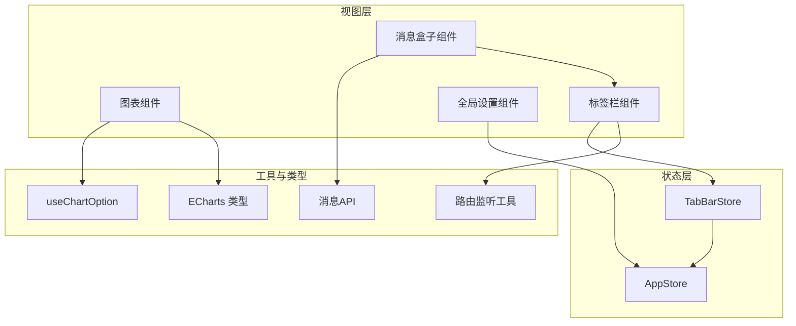
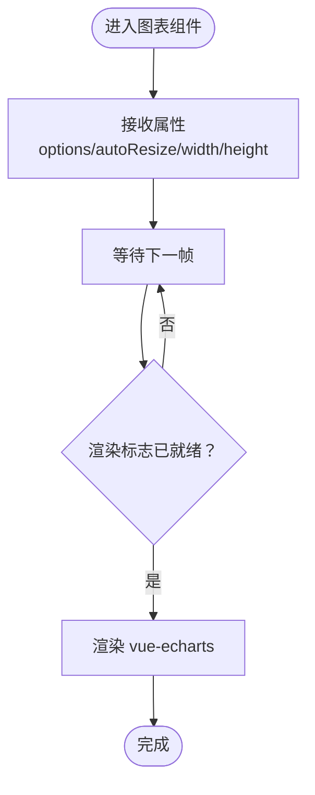
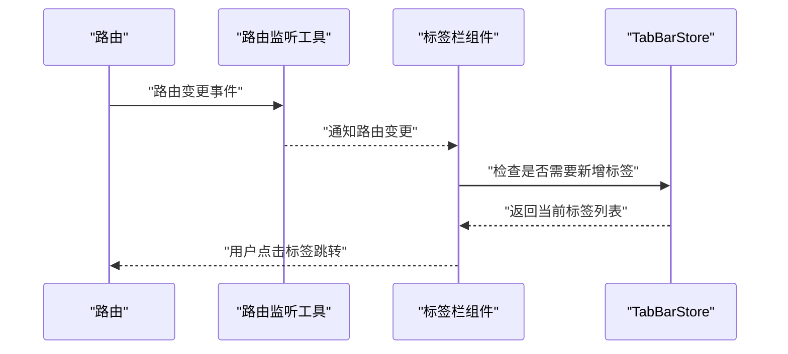
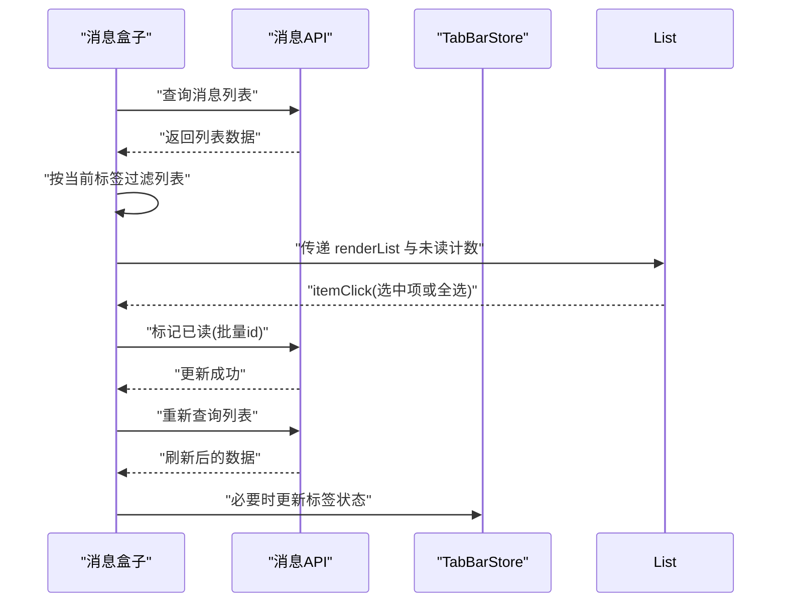
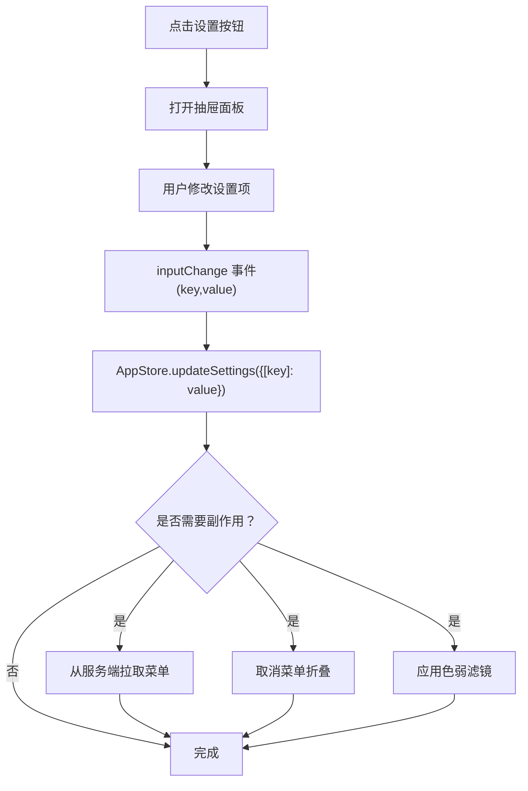
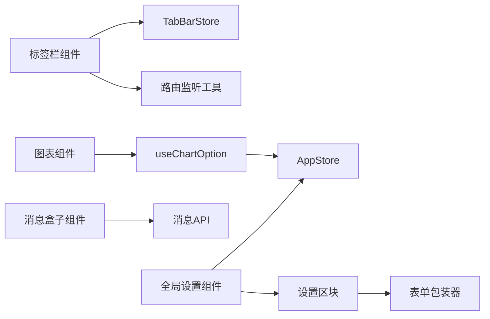

# 业务组件

<cite>
**本文引用的文件**
- [src/components/chart/index.vue](file://src/components/chart/index.vue)
- [src/hooks/chart-option.ts](file://src/hooks/chart-option.ts)
- [src/types/echarts.ts](file://src/types/echarts.ts)
- [src/components/tab-bar/index.vue](file://src/components/tab-bar/index.vue)
- [src/components/tab-bar/tab-item.vue](file://src/components/tab-bar/tab-item.vue)
- [src/store/modules/tab-bar/index.ts](file://src/store/modules/tab-bar/index.ts)
- [src/store/modules/tab-bar/types.ts](file://src/store/modules/tab-bar/types.ts)
- [src/utils/route-listener.ts](file://src/utils/route-listener.ts)
- [src/components/message-box/index.vue](file://src/components/message-box/index.vue)
- [src/components/message-box/list.vue](file://src/components/message-box/list.vue)
- [src/api/message.ts](file://src/api/message.ts)
- [src/components/global-setting/index.vue](file://src/components/global-setting/index.vue)
- [src/components/global-setting/block.vue](file://src/components/global-setting/block.vue)
- [src/components/global-setting/form-wrapper.vue](file://src/components/global-setting/form-wrapper.vue)
- [src/store/modules/app/index.ts](file://src/store/modules/app/index.ts)
- [src/components/breadcrumb/index.vue](file://src/components/breadcrumb/index.vue)
- [src/components/menu/index.vue](file://src/components/menu/index.vue)
</cite>

## 目录
1. [引言](#引言)
2. [项目结构](#项目结构)
3. [核心组件](#核心组件)
4. [架构总览](#架构总览)
5. [详细组件分析](#详细组件分析)
6. [依赖分析](#依赖分析)
7. [性能考虑](#性能考虑)
8. [故障排查指南](#故障排查指南)
9. [结论](#结论)
10. [附录](#附录)

## 引言
本文件聚焦于业务组件的全面文档，围绕以下四个主题展开：图表组件的数据可视化实现、标签栏组件的页面导航管理、消息盒子组件的信息展示与交互、全局设置组件的系统配置能力。文档将从架构、数据流、API 接口、配置参数、事件回调、使用示例、数据绑定与状态管理策略、定制化与扩展方法，以及组件间协作关系等方面进行深入说明。

## 项目结构
业务组件主要位于 src/components 下，配合 Pinia 状态管理（src/store）、路由监听工具（src/utils/route-listener.ts）与 API 层（src/api）。图表组件通过 ECharts 集成，标签栏组件与路由联动，消息盒子组件负责信息列表与状态更新，全局设置组件提供运行时配置面板。

```mermaid
graph TB
subgraph "组件层"
Chart["图表组件<br/>src/components/chart/index.vue"]
TabBar["标签栏组件<br/>src/components/tab-bar/index.vue"]
TabItem["标签项组件<br/>src/components/tab-bar/tab-item.vue"]
MsgBox["消息盒子组件<br/>src/components/message-box/index.vue"]
MsgList["消息列表子组件<br/>src/components/message-box/list.vue"]
GlobalSetting["全局设置组件<br/>src/components/global-setting/index.vue"]
SettingBlock["设置区块<br/>src/components/global-setting/block.vue"]
SettingForm["设置表单包装<br/>src/components/global-setting/form-wrapper.vue"]
BreadCrumb["面包屑组件<br/>src/components/breadcrumb/index.vue"]
MenuComp["菜单组件<br/>src/components/menu/index.vue"]
end
subgraph "状态管理层"
AppStore["应用状态(App)<br/>src/store/modules/app/index.ts"]
TabBarStore["标签栏状态(TabBar)<br/>src/store/modules/tab-bar/index.ts"]
end
subgraph "工具与类型"
RouteListener["路由监听工具<br/>src/utils/route-listener.ts"]
ChartHook["图表选项钩子<br/>src/hooks/chart-option.ts"]
EChartsTypes["ECharts 类型<br/>src/types/echarts.ts"]
ApiMsg["消息API<br/>src/api/message.ts"]
end
Chart --> ChartHook
Chart --> EChartsTypes
TabBar --> TabBarStore
TabBar --> RouteListener
TabItem --> TabBarStore
MsgBox --> ApiMsg
MsgBox --> MsgList
GlobalSetting --> AppStore
GlobalSetting --> SettingBlock
SettingBlock --> SettingForm
MenuComp --> RouteListener
BreadCrumb --> AppStore
```

**图示来源**
- [src/components/chart/index.vue:1-48](file://src/components/chart/index.vue#L1-L48)
- [src/hooks/chart-option.ts:1-28](file://src/hooks/chart-option.ts#L1-L28)
- [src/types/echarts.ts:1-11](file://src/types/echarts.ts#L1-L11)
- [src/components/tab-bar/index.vue:1-102](file://src/components/tab-bar/index.vue#L1-L102)
- [src/components/tab-bar/tab-item.vue:1-201](file://src/components/tab-bar/tab-item.vue#L1-L201)
- [src/store/modules/tab-bar/index.ts:1-75](file://src/store/modules/tab-bar/index.ts#L1-L75)
- [src/utils/route-listener.ts:1-32](file://src/utils/route-listener.ts#L1-L32)
- [src/components/message-box/index.vue:1-130](file://src/components/message-box/index.vue#L1-L130)
- [src/components/message-box/list.vue:1-150](file://src/components/message-box/list.vue#L1-L150)
- [src/api/message.ts:1-39](file://src/api/message.ts#L1-L39)
- [src/components/global-setting/index.vue:1-99](file://src/components/global-setting/index.vue#L1-L99)
- [src/components/global-setting/block.vue:1-80](file://src/components/global-setting/block.vue#L1-L80)
- [src/components/global-setting/form-wrapper.vue:1-40](file://src/components/global-setting/form-wrapper.vue#L1-L40)
- [src/store/modules/app/index.ts:1-78](file://src/store/modules/app/index.ts#L1-L78)
- [src/components/breadcrumb/index.vue:1-36](file://src/components/breadcrumb/index.vue#L1-L36)
- [src/components/menu/index.vue:1-161](file://src/components/menu/index.vue#L1-L161)

**章节来源**
- [src/components/chart/index.vue:1-48](file://src/components/chart/index.vue#L1-L48)
- [src/components/tab-bar/index.vue:1-102](file://src/components/tab-bar/index.vue#L1-L102)
- [src/components/message-box/index.vue:1-130](file://src/components/message-box/index.vue#L1-L130)
- [src/components/global-setting/index.vue:1-99](file://src/components/global-setting/index.vue#L1-L99)
- [src/store/modules/app/index.ts:1-78](file://src/store/modules/app/index.ts#L1-L78)
- [src/store/modules/tab-bar/index.ts:1-75](file://src/store/modules/tab-bar/index.ts#L1-L75)
- [src/utils/route-listener.ts:1-32](file://src/utils/route-listener.ts#L1-L32)
- [src/api/message.ts:1-39](file://src/api/message.ts#L1-L39)

## 核心组件
本节对四个业务组件进行要点梳理，包括职责边界、关键属性/事件、数据来源与状态管理策略。

- 图表组件
  - 职责：基于 vue-echarts 渲染 ECharts 图表，支持自动布局与尺寸控制。
  - 关键属性：options（图表配置对象）、autoResize（是否自适应）、width/height（容器尺寸）。
  - 数据绑定：通过 props 接收 ECharts 配置；内部以延迟渲染避免初始容器未展开导致的渲染问题。
  - 状态管理：可结合 useChartOption 钩子生成响应式图表配置（如深色主题切换）。
  - 使用示例路径：[图表组件模板与属性定义:1-48](file://src/components/chart/index.vue#L1-L48)、[图表选项钩子:1-28](file://src/hooks/chart-option.ts#L1-L28)。

- 标签栏组件
  - 职责：展示当前已打开的页面标签，支持固定、滚动与右键菜单操作。
  - 关键属性：无（通过 store 计算属性驱动渲染）。
  - 事件与行为：点击跳转、右键菜单执行“刷新/关闭当前/关闭左右/关闭其它/关闭全部”等。
  - 数据来源：从 TabBarStore 获取标签列表；与路由变化联动，动态添加新标签。
  - 状态管理：TabBarStore 维护 tagList 与缓存集合，支持增删改与重置。
  - 使用示例路径：[标签栏容器与 affix 固定:1-102](file://src/components/tab-bar/index.vue#L1-L102)、[标签项交互与菜单:1-201](file://src/components/tab-bar/tab-item.vue#L1-L201)、[标签栏状态存储:1-75](file://src/store/modules/tab-bar/index.ts#L1-L75)。

- 消息盒子组件
  - 职责：展示消息、公告、待办三类信息，支持标记已读、清空列表、查看未读数。
  - 关键属性：无（内部通过 reactive 管理列表与状态）。
  - 事件回调：itemClick（列表项点击或“全部已读”触发）。
  - 数据来源：调用消息 API 获取列表，按 type 过滤当前标签页数据。
  - 状态管理：本地 reactive 管理 messageList/renderList/unreadCount；通过 API 更新状态后刷新数据。
  - 使用示例路径：[消息盒子主组件:1-130](file://src/components/message-box/index.vue#L1-L130)、[消息列表子组件:1-150](file://src/components/message-box/list.vue#L1-L150)、[消息 API 定义:1-39](file://src/api/message.ts#L1-L39)。

- 全局设置组件
  - 职责：提供抽屉式设置面板，支持内容区与其它设置区的多项开关与数值输入，并可复制当前设置。
  - 关键属性：无（通过 AppStore 的全局设置可见性与配置项驱动）。
  - 事件回调：cancel（关闭抽屉）、inputChange（设置项变更）。
  - 数据来源：AppStore 提供默认配置与更新方法；部分设置项变更会触发副作用（如菜单从服务端拉取、顶部菜单时折叠状态调整）。
  - 状态管理：AppStore 维护主题、设备、菜单、页脚、标签栏、服务器菜单等配置。
  - 使用示例路径：[全局设置抽屉与按钮:1-99](file://src/components/global-setting/index.vue#L1-L99)、[设置区块与表单项:1-80](file://src/components/global-setting/block.vue#L1-L80)、[表单包装器:1-40](file://src/components/global-setting/form-wrapper.vue#L1-L40)、[应用状态存储:1-78](file://src/store/modules/app/index.ts#L1-L78)。

**章节来源**
- [src/components/chart/index.vue:1-48](file://src/components/chart/index.vue#L1-L48)
- [src/hooks/chart-option.ts:1-28](file://src/hooks/chart-option.ts#L1-L28)
- [src/components/tab-bar/index.vue:1-102](file://src/components/tab-bar/index.vue#L1-L102)
- [src/components/tab-bar/tab-item.vue:1-201](file://src/components/tab-bar/tab-item.vue#L1-L201)
- [src/store/modules/tab-bar/index.ts:1-75](file://src/store/modules/tab-bar/index.ts#L1-L75)
- [src/store/modules/tab-bar/types.ts:1-13](file://src/store/modules/tab-bar/types.ts#L1-L13)
- [src/components/message-box/index.vue:1-130](file://src/components/message-box/index.vue#L1-L130)
- [src/components/message-box/list.vue:1-150](file://src/components/message-box/list.vue#L1-L150)
- [src/api/message.ts:1-39](file://src/api/message.ts#L1-L39)
- [src/components/global-setting/index.vue:1-99](file://src/components/global-setting/index.vue#L1-L99)
- [src/components/global-setting/block.vue:1-80](file://src/components/global-setting/block.vue#L1-L80)
- [src/components/global-setting/form-wrapper.vue:1-40](file://src/components/global-setting/form-wrapper.vue#L1-L40)
- [src/store/modules/app/index.ts:1-78](file://src/store/modules/app/index.ts#L1-L78)

## 架构总览
下图展示了业务组件在系统中的位置与交互关系，强调数据流与控制流：

**图示来源**
- [src/components/chart/index.vue:1-48](file://src/components/chart/index.vue#L1-L48)
- [src/hooks/chart-option.ts:1-28](file://src/hooks/chart-option.ts#L1-L28)
- [src/types/echarts.ts:1-11](file://src/types/echarts.ts#L1-L11)
- [src/components/tab-bar/index.vue:1-102](file://src/components/tab-bar/index.vue#L1-L102)
- [src/store/modules/tab-bar/index.ts:1-75](file://src/store/modules/tab-bar/index.ts#L1-L75)
- [src/utils/route-listener.ts:1-32](file://src/utils/route-listener.ts#L1-L32)
- [src/components/message-box/index.vue:1-130](file://src/components/message-box/index.vue#L1-L130)
- [src/api/message.ts:1-39](file://src/api/message.ts#L1-L39)
- [src/components/global-setting/index.vue:1-99](file://src/components/global-setting/index.vue#L1-L99)
- [src/store/modules/app/index.ts:1-78](file://src/store/modules/app/index.ts#L1-L78)

## 详细组件分析

### 图表组件（数据可视化）
- 实现要点
  - 基于 vue-echarts 渲染，通过 props 接收 ECharts 配置对象与尺寸控制。
  - 使用延迟渲染（nextTick 后设置渲染标志）避免容器未展开导致的渲染异常。
  - 可选自动布局（autoResize），适配窗口变化。
  - 结合 useChartOption 钩子生成响应式配置，例如根据主题切换深色样式。
- API 与配置
  - 属性
    - options：ECharts 配置对象（默认空对象）
    - autoResize：是否启用自动布局（默认 true）
    - width/height：容器宽度与高度（默认 100%）
  - 复杂度与性能
    - 配置对象应尽量保持稳定，避免频繁重建导致重绘开销。
    - 在大数据量场景建议采用分页/采样与懒加载策略。
- 使用示例
  - 在业务页面中传入 ECharts 配置对象，即可完成渲染。
  - 示例路径：[图表组件属性与渲染逻辑:10-45](file://src/components/chart/index.vue#L10-L45)、[useChartOption 钩子:13-27](file://src/hooks/chart-option.ts#L13-L27)、[ECharts 类型定义:1-11](file://src/types/echarts.ts#L1-L11)

**图示来源**
- [src/components/chart/index.vue:10-45](file://src/components/chart/index.vue#L10-L45)

**章节来源**
- [src/components/chart/index.vue:1-48](file://src/components/chart/index.vue#L1-L48)
- [src/hooks/chart-option.ts:1-28](file://src/hooks/chart-option.ts#L1-L28)
- [src/types/echarts.ts:1-11](file://src/types/echarts.ts#L1-L11)

### 标签栏组件（页面导航管理）
- 实现要点
  - 通过 Affix 固定在顶部，随 Navbar 显示/隐藏调整偏移。
  - 监听路由变化，非固定且不在列表中的路由自动加入标签。
  - 标签项支持右键菜单：刷新、关闭当前、关闭左右侧、关闭其它、关闭全部。
  - 支持标签项点击跳转与激活态高亮。
- 状态与数据流
  - 标签列表来自 TabBarStore 的计算属性；Affix 的偏移由 AppStore 的 navbar 决定。
  - 路由变化通过发布订阅工具分发，避免多处重复监听。
- 使用示例
  - 在布局中引入标签栏组件，即可获得自动化的标签管理能力。
  - 示例路径：[标签栏容器与 affix:1-102](file://src/components/tab-bar/index.vue#L1-L102)、[标签项菜单与动作:59-167](file://src/components/tab-bar/tab-item.vue#L59-L167)、[路由监听工具:1-32](file://src/utils/route-listener.ts#L1-L32)、[标签栏状态存储:1-75](file://src/store/modules/tab-bar/index.ts#L1-L75)

**图示来源**
- [src/utils/route-listener.ts:14-27](file://src/utils/route-listener.ts#L14-L27)
- [src/components/tab-bar/index.vue:42-59](file://src/components/tab-bar/index.vue#L42-L59)
- [src/store/modules/tab-bar/index.ts:40-46](file://src/store/modules/tab-bar/index.ts#L40-L46)

**章节来源**
- [src/components/tab-bar/index.vue:1-102](file://src/components/tab-bar/index.vue#L1-L102)
- [src/components/tab-bar/tab-item.vue:1-201](file://src/components/tab-bar/tab-item.vue#L1-L201)
- [src/store/modules/tab-bar/index.ts:1-75](file://src/store/modules/tab-bar/index.ts#L1-L75)
- [src/store/modules/tab-bar/types.ts:1-13](file://src/store/modules/tab-bar/types.ts#L1-L13)
- [src/utils/route-listener.ts:1-32](file://src/utils/route-listener.ts#L1-L32)

### 消息盒子组件（信息展示）
- 实现要点
  - 三类标签页：消息、公告、待办；每页显示对应 type 的列表。
  - 未读计数按 type 动态计算；支持“全部已读”与单项点击标记。
  - 列表项带状态样式与时间字段；空状态友好提示。
- API 与事件
  - 查询接口：queryMessageList 返回消息列表。
  - 标记已读：setMessageStatus 接收 id 数组，批量更新状态。
  - 事件：List 子组件向外派发 itemClick，父组件统一处理标记逻辑。
- 使用示例
  - 在页面中直接引入消息盒子组件，即可获得完整的消息展示与交互能力。
  - 示例路径：[消息盒子主组件:1-130](file://src/components/message-box/index.vue#L1-L130)、[消息列表子组件:1-150](file://src/components/message-box/list.vue#L1-L150)、[消息 API:16-26](file://src/api/message.ts#L16-L26)

**图示来源**
- [src/components/message-box/index.vue:68-108](file://src/components/message-box/index.vue#L68-L108)
- [src/components/message-box/list.vue:87-96](file://src/components/message-box/list.vue#L87-L96)
- [src/api/message.ts:16-26](file://src/api/message.ts#L16-L26)
- [src/store/modules/tab-bar/index.ts:39-71](file://src/store/modules/tab-bar/index.ts#L39-L71)

**章节来源**
- [src/components/message-box/index.vue:1-130](file://src/components/message-box/index.vue#L1-L130)
- [src/components/message-box/list.vue:1-150](file://src/components/message-box/list.vue#L1-L150)
- [src/api/message.ts:1-39](file://src/api/message.ts#L1-L39)

### 全局设置组件（系统配置）
- 实现要点
  - 抽屉式设置面板，支持内容区与其它设置区两类配置项。
  - 表单项支持开关与数值输入；变更通过 inputChange 事件回传 key/value。
  - 部分设置项变更触发副作用：如“从服务端拉取菜单”、“顶部菜单时取消折叠”、“色弱模式滤镜”。
  - 支持复制当前设置到剪贴板，便于导出与分享。
- 状态与数据流
  - 设置面板可见性由 AppStore 控制；所有设置项最终通过 AppStore.updateSettings 合并更新。
- 使用示例
  - 在布局中引入全局设置组件，点击浮动按钮打开抽屉，即可实时修改系统配置。
  - 示例路径：[全局设置抽屉与按钮:1-99](file://src/components/global-setting/index.vue#L1-L99)、[设置区块与表单项:1-80](file://src/components/global-setting/block.vue#L1-L80)、[表单包装器:1-40](file://src/components/global-setting/form-wrapper.vue#L1-L40)、[应用状态存储:24-74](file://src/store/modules/app/index.ts#L24-L74)

**图示来源**
- [src/components/global-setting/index.vue:73-84](file://src/components/global-setting/index.vue#L73-L84)
- [src/components/global-setting/block.vue:40-59](file://src/components/global-setting/block.vue#L40-L59)
- [src/store/modules/app/index.ts:24-74](file://src/store/modules/app/index.ts#L24-L74)

**章节来源**
- [src/components/global-setting/index.vue:1-99](file://src/components/global-setting/index.vue#L1-L99)
- [src/components/global-setting/block.vue:1-80](file://src/components/global-setting/block.vue#L1-L80)
- [src/components/global-setting/form-wrapper.vue:1-40](file://src/components/global-setting/form-wrapper.vue#L1-L40)
- [src/store/modules/app/index.ts:1-78](file://src/store/modules/app/index.ts#L1-L78)

## 依赖分析
- 组件耦合
  - 标签栏组件与路由监听工具存在松耦合：通过发布订阅模式解耦监听与渲染。
  - 图表组件与 ECharts 类型存在弱耦合：通过类型定义确保配置正确性。
  - 消息盒子组件与 API 层强耦合：依赖具体接口签名与返回结构。
  - 全局设置组件与 AppStore 强耦合：集中管理所有可配置项。
- 状态管理
  - TabBarStore 负责标签列表与缓存集合，提供增删改与重置能力。
  - AppStore 负责主题、菜单、设备、服务器菜单等全局配置。
- 外部依赖
  - vue-echarts：用于图表渲染。
  - @arco-design/web-vue：UI 组件库，提供 Tabs、List、Drawer、Switch、InputNumber 等。
  - axios：消息 API 请求封装。

**图示来源**
- [src/components/tab-bar/index.vue:24-59](file://src/components/tab-bar/index.vue#L24-L59)
- [src/store/modules/tab-bar/index.ts:1-75](file://src/store/modules/tab-bar/index.ts#L1-L75)
- [src/utils/route-listener.ts:1-32](file://src/utils/route-listener.ts#L1-L32)
- [src/components/chart/index.vue:10-45](file://src/components/chart/index.vue#L10-L45)
- [src/hooks/chart-option.ts:1-28](file://src/hooks/chart-option.ts#L1-L28)
- [src/store/modules/app/index.ts:1-78](file://src/store/modules/app/index.ts#L1-L78)
- [src/components/message-box/index.vue:29-36](file://src/components/message-box/index.vue#L29-L36)
- [src/api/message.ts:1-39](file://src/api/message.ts#L1-L39)
- [src/components/global-setting/index.vue:25-84](file://src/components/global-setting/index.vue#L25-L84)
- [src/components/global-setting/block.vue:16-59](file://src/components/global-setting/block.vue#L16-L59)
- [src/components/global-setting/form-wrapper.vue:17-39](file://src/components/global-setting/form-wrapper.vue#L17-L39)

**章节来源**
- [src/store/modules/tab-bar/index.ts:1-75](file://src/store/modules/tab-bar/index.ts#L1-L75)
- [src/store/modules/app/index.ts:1-78](file://src/store/modules/app/index.ts#L1-L78)
- [src/utils/route-listener.ts:1-32](file://src/utils/route-listener.ts#L1-L32)
- [src/api/message.ts:1-39](file://src/api/message.ts#L1-L39)

## 性能考虑
- 图表组件
  - 避免频繁重建 options 对象，尽量复用配置或使用响应式组合。
  - 大数据量时采用分页、采样或懒加载策略，减少一次性渲染压力。
- 标签栏组件
  - 路由监听使用发布订阅，避免多处重复监听造成性能损耗。
  - 标签数量增长时，注意 DOM 节点数量与滚动性能。
- 消息盒子组件
  - 列表项点击标记已读后，优先局部更新，减少不必要的请求与重渲染。
- 全局设置组件
  - 设置项变更时仅更新相关配置，避免全量刷新。
  - 复制设置为一次性操作，避免频繁触发。

## 故障排查指南
- 图表不显示或尺寸异常
  - 检查容器是否已展开（延迟渲染依赖容器尺寸）。
  - 确认传入的 options 是否有效，autoResize 是否开启。
  - 参考路径：[图表组件渲染逻辑:42-44](file://src/components/chart/index.vue#L42-L44)
- 标签栏不更新
  - 确认路由监听是否正常工作，最新路由是否被记录。
  - 检查路由 meta.noAffix 与标签列表去重逻辑。
  - 参考路径：[路由监听工具:14-27](file://src/utils/route-listener.ts#L14-L27)、[标签栏监听与更新:48-55](file://src/components/tab-bar/index.vue#L48-L55)
- 消息未读计数不准确
  - 检查当前标签页 type 与列表过滤逻辑。
  - 确认标记已读后是否重新拉取数据。
  - 参考路径：[消息列表过滤与未读统计:84-91](file://src/components/message-box/index.vue#L84-L91)、[标记已读流程:79-83](file://src/components/message-box/index.vue#L79-L83)
- 全局设置不生效
  - 检查 inputChange 事件是否正确回传 key/value。
  - 确认 AppStore.updateSettings 是否被调用及副作用逻辑。
  - 参考路径：[设置项变更处理:40-59](file://src/components/global-setting/block.vue#L40-L59)、[AppStore 更新方法:26-29](file://src/store/modules/app/index.ts#L26-L29)

**章节来源**
- [src/components/chart/index.vue:42-44](file://src/components/chart/index.vue#L42-L44)
- [src/utils/route-listener.ts:14-27](file://src/utils/route-listener.ts#L14-L27)
- [src/components/tab-bar/index.vue:48-55](file://src/components/tab-bar/index.vue#L48-L55)
- [src/components/message-box/index.vue:84-91](file://src/components/message-box/index.vue#L84-L91)
- [src/components/global-setting/block.vue:40-59](file://src/components/global-setting/block.vue#L40-L59)
- [src/store/modules/app/index.ts:26-29](file://src/store/modules/app/index.ts#L26-L29)

## 结论
本文档系统梳理了图表、标签栏、消息盒子与全局设置四大业务组件的实现方式、API 接口、配置参数、事件回调、数据绑定与状态管理策略，并提供了定制化与扩展方法以及组件间协作关系。通过 Pinia 状态管理与发布订阅模式，组件实现了低耦合、高内聚的设计，具备良好的可维护性与可扩展性。

## 附录
- 组件使用示例路径汇总
  - 图表组件：[图表组件模板与属性:1-48](file://src/components/chart/index.vue#L1-L48)、[useChartOption 钩子:1-28](file://src/hooks/chart-option.ts#L1-L28)
  - 标签栏组件：[标签栏容器:1-102](file://src/components/tab-bar/index.vue#L1-L102)、[标签项菜单:59-167](file://src/components/tab-bar/tab-item.vue#L59-L167)
  - 消息盒子组件：[消息盒子主组件:1-130](file://src/components/message-box/index.vue#L1-L130)、[消息列表子组件:1-150](file://src/components/message-box/list.vue#L1-L150)
  - 全局设置组件：[全局设置抽屉:1-99](file://src/components/global-setting/index.vue#L1-L99)、[设置区块:1-80](file://src/components/global-setting/block.vue#L1-L80)、[表单包装器:1-40](file://src/components/global-setting/form-wrapper.vue#L1-L40)
- 状态与工具
  - 应用状态存储：[AppStore:1-78](file://src/store/modules/app/index.ts#L1-L78)
  - 标签栏状态存储：[TabBarStore:1-75](file://src/store/modules/tab-bar/index.ts#L1-L75)
  - 路由监听工具：[路由监听工具:1-32](file://src/utils/route-listener.ts#L1-L32)
  - 消息 API：[消息 API:1-39](file://src/api/message.ts#L1-L39)
  - ECharts 类型：[ECharts 类型:1-11](file://src/types/echarts.ts#L1-L11)