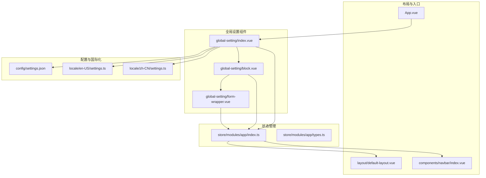
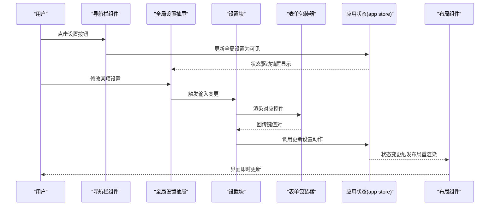
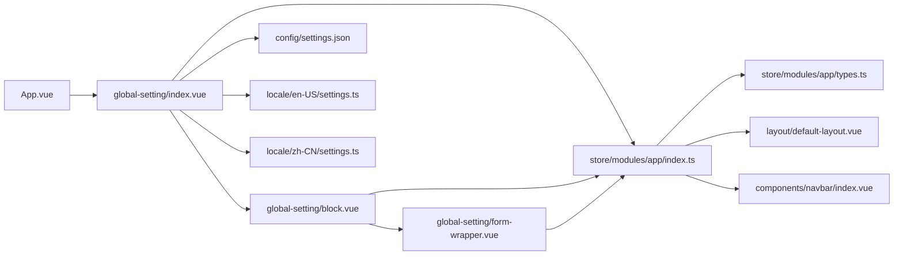

# 全局设置组件

<cite>
**本文引用的文件**
- [src/components/global-setting/index.vue](file://src/components/global-setting/index.vue)
- [src/components/global-setting/block.vue](file://src/components/global-setting/block.vue)
- [src/components/global-setting/form-wrapper.vue](file://src/components/global-setting/form-wrapper.vue)
- [src/config/settings.json](file://src/config/settings.json)
- [src/store/modules/app/index.ts](file://src/store/modules/app/index.ts)
- [src/store/modules/app/types.ts](file://src/store/modules/app/types.ts)
- [src/layout/default-layout.vue](file://src/layout/default-layout.vue)
- [src/components/navbar/index.vue](file://src/components/navbar/index.vue)
- [src/App.vue](file://src/App.vue)
- [src/locale/en-US/settings.ts](file://src/locale/en-US/settings.ts)
- [src/locale/zh-CN/settings.ts](file://src/locale/zh-CN/settings.ts)
- [src/locale/en-US.ts](file://src/locale/en-US.ts)
- [src/locale/zh-CN.ts](file://src/locale/zh-CN.ts)
- [src/hooks/themes.ts](file://src/hooks/themes.ts)
- [src/hooks/locale.ts](file://src/hooks/locale.ts)
- [src/main.ts](file://src/main.ts)
</cite>

## 目录
1. [简介](#简介)
2. [项目结构](#项目结构)
3. [核心组件](#核心组件)
4. [架构总览](#架构总览)
5. [详细组件分析](#详细组件分析)
6. [依赖关系分析](#依赖关系分析)
7. [性能考量](#性能考量)
8. [故障排查指南](#故障排查指南)
9. [结论](#结论)
10. [附录](#附录)

## 简介
本文件为全局设置组件的系统性文档，覆盖以下方面：
- 系统配置功能：主题切换、布局设置、语言选择、个性化定制等
- 设置块组件（block）的设计模式：配置项分组展示与模块化管理
- 表单包装器组件（form-wrapper）的表单处理机制：验证、数据绑定与提交流程
- 全局设置的配置 API 文档：设置项数据结构、默认值管理与持久化策略
- 使用示例：在侧边栏集成全局设置面板、动态更新与即时生效
- 集成方式：全局设置与应用状态管理（Pinia）的联动与配置同步机制

## 项目结构
全局设置组件位于 src/components/global-setting 下，围绕三个核心文件组织：
- index.vue：全局设置抽屉面板入口，负责渲染设置块与提示信息
- block.vue：设置块容器，负责分组展示与事件转发
- form-wrapper.vue：表单包装器，负责不同输入类型的渲染与变更回调

此外，应用状态由 Pinia 的 app store 统一管理，布局组件根据状态进行渲染控制，国际化文案由 locale 文件提供。

图表来源
- [src/components/global-setting/index.vue:1-99](file://src/components/global-setting/index.vue#L1-L99)
- [src/components/global-setting/block.vue:1-80](file://src/components/global-setting/block.vue#L1-L80)
- [src/components/global-setting/form-wrapper.vue:1-40](file://src/components/global-setting/form-wrapper.vue#L1-L40)
- [src/store/modules/app/index.ts:1-78](file://src/store/modules/app/index.ts#L1-L78)
- [src/store/modules/app/types.ts:1-21](file://src/store/modules/app/types.ts#L1-L21)
- [src/layout/default-layout.vue:1-179](file://src/layout/default-layout.vue#L1-L179)
- [src/components/navbar/index.vue:1-324](file://src/components/navbar/index.vue#L1-L324)
- [src/App.vue:1-27](file://src/App.vue#L1-L27)
- [src/config/settings.json:1-18](file://src/config/settings.json#L1-L18)
- [src/locale/en-US/settings.ts:1-30](file://src/locale/en-US/settings.ts#L1-L30)
- [src/locale/zh-CN/settings.ts:1-30](file://src/locale/zh-CN/settings.ts#L1-L30)

章节来源
- [src/components/global-setting/index.vue:1-99](file://src/components/global-setting/index.vue#L1-L99)
- [src/components/global-setting/block.vue:1-80](file://src/components/global-setting/block.vue#L1-L80)
- [src/components/global-setting/form-wrapper.vue:1-40](file://src/components/global-setting/form-wrapper.vue#L1-L40)
- [src/config/settings.json:1-18](file://src/config/settings.json#L1-L18)
- [src/store/modules/app/index.ts:1-78](file://src/store/modules/app/index.ts#L1-L78)
- [src/store/modules/app/types.ts:1-21](file://src/store/modules/app/types.ts#L1-L21)
- [src/layout/default-layout.vue:1-179](file://src/layout/default-layout.vue#L1-L179)
- [src/components/navbar/index.vue:1-324](file://src/components/navbar/index.vue#L1-L324)
- [src/App.vue:1-27](file://src/App.vue#L1-L27)
- [src/locale/en-US/settings.ts:1-30](file://src/locale/en-US/settings.ts#L1-L30)
- [src/locale/zh-CN/settings.ts:1-30](file://src/locale/zh-CN/settings.ts#L1-L30)

## 核心组件
- 全局设置抽屉（index.vue）
  - 渲染固定按钮与抽屉面板，标题与操作文案来自国际化
  - 内部包含两个设置块：内容设置与其它设置
  - 提供“复制设置”能力，将当前状态序列化后写入剪贴板
  - 关闭时通过状态管理重置全局设置开关
- 设置块（block.vue）
  - 接收一组配置项数组，每个项包含名称、键名、默认值与可选类型
  - 将每个配置项交由 form-wrapper 渲染，并在输入变化时统一回调
  - 特殊逻辑：色弱模式样式注入、从服务器拉取菜单、顶部菜单开启时取消折叠
- 表单包装器（form-wrapper.vue）
  - 根据类型渲染开关或数字输入框
  - 将变更事件向上抛出，携带键名与新值
- 应用状态（store/modules/app）
  - 默认值来源于 settings.json
  - 提供更新设置、主题切换、菜单拉取等动作
  - 布局组件根据状态决定渲染行为（如菜单宽度、是否显示导航栏等）

章节来源
- [src/components/global-setting/index.vue:1-99](file://src/components/global-setting/index.vue#L1-L99)
- [src/components/global-setting/block.vue:1-80](file://src/components/global-setting/block.vue#L1-L80)
- [src/components/global-setting/form-wrapper.vue:1-40](file://src/components/global-setting/form-wrapper.vue#L1-L40)
- [src/config/settings.json:1-18](file://src/config/settings.json#L1-L18)
- [src/store/modules/app/index.ts:1-78](file://src/store/modules/app/index.ts#L1-L78)
- [src/store/modules/app/types.ts:1-21](file://src/store/modules/app/types.ts#L1-L21)

## 架构总览
全局设置与布局、状态管理之间的交互如下：

图表来源
- [src/components/navbar/index.vue:234-236](file://src/components/navbar/index.vue#L234-L236)
- [src/components/global-setting/index.vue:73-84](file://src/components/global-setting/index.vue#L73-L84)
- [src/components/global-setting/block.vue:40-59](file://src/components/global-setting/block.vue#L40-L59)
- [src/components/global-setting/form-wrapper.vue:33-38](file://src/components/global-setting/form-wrapper.vue#L33-L38)
- [src/store/modules/app/index.ts:26-29](file://src/store/modules/app/index.ts#L26-L29)
- [src/layout/default-layout.vue:67-84](file://src/layout/default-layout.vue#L67-L84)

## 详细组件分析

### 全局设置抽屉（index.vue）
- 功能要点
  - 固定悬浮按钮：仅在导航栏隐藏时显示，避免遮挡
  - 抽屉尺寸与文案国际化
  - 两个设置块：内容设置与其它设置
  - 复制设置：将当前状态序列化后复制到剪贴板
  - 关闭：重置全局设置开关并触发外部取消事件
- 数据来源
  - 通过计算属性从 app store 获取各配置项的默认值
  - 国际化文案来自 en-US/zh-CN 的 settings.ts
- 与布局的关系
  - 抽屉可见性受 app store 的 globalSettings 控制
  - 关闭时重置该开关，确保抽屉不再影响布局

章节来源
- [src/components/global-setting/index.vue:1-99](file://src/components/global-setting/index.vue#L1-L99)
- [src/locale/en-US/settings.ts:1-30](file://src/locale/en-US/settings.ts#L1-L30)
- [src/locale/zh-CN/settings.ts:1-30](file://src/locale/zh-CN/settings.ts#L1-L30)

### 设置块（block.vue）
- 设计模式
  - 分组展示：每个块包含标题与若干配置项
  - 模块化管理：将具体输入控件委托给 form-wrapper
  - 事件聚合：统一接收输入变更并调用 app store 的更新方法
- 特殊处理
  - 色弱模式：根据开关值动态注入/移除 body 的滤镜样式
  - 服务器菜单：当启用“菜单来源于后台”时，自动拉取菜单并提示加载状态
  - 顶部菜单：开启时强制取消菜单折叠
- 输入类型
  - 默认开关类型；支持数字类型（如菜单宽度）

章节来源
- [src/components/global-setting/block.vue:1-80](file://src/components/global-setting/block.vue#L1-L80)
- [src/store/modules/app/index.ts:47-70](file://src/store/modules/app/index.ts#L47-L70)

### 表单包装器（form-wrapper.vue）
- 表单处理机制
  - 类型判断：数字类型渲染数字输入框，否则渲染开关
  - 双向绑定：以默认值初始化控件
  - 变更回调：将键名与新值回传给父组件
- 适用范围
  - 支持布尔与数值两类配置项
  - 通过父组件统一处理副作用（如色弱模式样式、菜单拉取）

章节来源
- [src/components/global-setting/form-wrapper.vue:1-40](file://src/components/global-setting/form-wrapper.vue#L1-L40)

### 应用状态（store/modules/app）
- 默认值来源
  - settings.json 定义了所有可用的配置项及其默认值
- 动作与副作用
  - updateSettings：使用 $patch 合并部分状态
  - toggleTheme：切换明暗主题并在 body 上设置/移除属性
  - fetchServerMenuConfig：异步拉取菜单并反馈通知
- 布局联动
  - 布局组件根据 navbar、menu、topMenu、footer、tabBar、menuWidth、menuCollapse 等字段决定渲染与样式

章节来源
- [src/config/settings.json:1-18](file://src/config/settings.json#L1-L18)
- [src/store/modules/app/index.ts:1-78](file://src/store/modules/app/index.ts#L1-L78)
- [src/store/modules/app/types.ts:1-21](file://src/store/modules/app/types.ts#L1-L21)
- [src/layout/default-layout.vue:67-84](file://src/layout/default-layout.vue#L67-L84)

### 布局与侧边栏集成
- 侧边栏入口
  - 导航栏组件提供设置按钮，点击后通过 app store 打开全局设置抽屉
- 布局渲染
  - 布局组件根据 app store 的多项配置决定是否显示导航栏、菜单、页脚、标签页等
  - 菜单宽度与折叠状态由 app store 控制，布局组件响应式更新

章节来源
- [src/components/navbar/index.vue:134-146](file://src/components/navbar/index.vue#L134-L146)
- [src/layout/default-layout.vue:67-84](file://src/layout/default-layout.vue#L67-L84)

## 依赖关系分析
全局设置组件与应用状态、布局、国际化之间的依赖关系如下：

图表来源
- [src/components/global-setting/index.vue:1-99](file://src/components/global-setting/index.vue#L1-L99)
- [src/components/global-setting/block.vue:1-80](file://src/components/global-setting/block.vue#L1-L80)
- [src/components/global-setting/form-wrapper.vue:1-40](file://src/components/global-setting/form-wrapper.vue#L1-L40)
- [src/store/modules/app/index.ts:1-78](file://src/store/modules/app/index.ts#L1-L78)
- [src/store/modules/app/types.ts:1-21](file://src/store/modules/app/types.ts#L1-L21)
- [src/layout/default-layout.vue:1-179](file://src/layout/default-layout.vue#L1-L179)
- [src/components/navbar/index.vue:1-324](file://src/components/navbar/index.vue#L1-L324)
- [src/App.vue:1-27](file://src/App.vue#L1-L27)
- [src/config/settings.json:1-18](file://src/config/settings.json#L1-L18)
- [src/locale/en-US/settings.ts:1-30](file://src/locale/en-US/settings.ts#L1-L30)
- [src/locale/zh-CN/settings.ts:1-30](file://src/locale/zh-CN/settings.ts#L1-L30)

章节来源
- [src/components/global-setting/index.vue:1-99](file://src/components/global-setting/index.vue#L1-L99)
- [src/store/modules/app/index.ts:1-78](file://src/store/modules/app/index.ts#L1-L78)
- [src/layout/default-layout.vue:1-179](file://src/layout/default-layout.vue#L1-L179)
- [src/App.vue:1-27](file://src/App.vue#L1-L27)

## 性能考量
- 渲染优化
  - 抽屉面板按需挂载（unmount-on-close），减少不必要渲染
  - 设置块内部使用 v-for 渲染配置项，key 基于 name，保证列表更新稳定性
- 异步操作
  - 服务器菜单拉取采用通知提示，避免阻塞 UI
- 计算属性
  - 抽屉可见性与配置项默认值均通过计算属性缓存，降低重复计算

[本节为通用建议，无需特定文件分析]

## 故障排查指南
- 设置无效或未生效
  - 检查 app store 的 updateSettings 是否被正确调用
  - 确认布局组件是否订阅了相关状态字段
- 色弱模式不生效
  - 确认开关值变化后是否执行了 body 样式注入/移除
- 服务器菜单未更新
  - 确认 fetchServerMenuConfig 是否被触发且返回了预期数据
- 国际化文案缺失
  - 检查 locale 文件中是否存在对应键值
- 抽屉无法打开
  - 确认导航栏按钮是否正确设置了全局设置为可见

章节来源
- [src/components/global-setting/block.vue:47-52](file://src/components/global-setting/block.vue#L47-L52)
- [src/store/modules/app/index.ts:47-70](file://src/store/modules/app/index.ts#L47-L70)
- [src/locale/en-US/settings.ts:1-30](file://src/locale/en-US/settings.ts#L1-L30)
- [src/locale/zh-CN/settings.ts:1-30](file://src/locale/zh-CN/settings.ts#L1-L30)

## 结论
全局设置组件通过“抽屉 + 设置块 + 表单包装器”的分层设计，实现了配置项的模块化管理与统一处理。配合 Pinia 状态管理与布局组件的联动，实现了配置的即时生效与跨模块同步。结合国际化与默认配置文件，整体具备良好的扩展性与可维护性。

[本节为总结，无需特定文件分析]

## 附录

### 配置 API 文档
- 设置项数据结构
  - 字段类型参考：AppState 接口
  - 关键字段：theme、colorWeak、navbar、menu、topMenu、hideMenu、menuCollapse、footer、themeColor、menuWidth、globalSettings、device、tabBar、menuFromServer、serverMenu
- 默认值管理
  - 默认值来源于 settings.json，应用启动时注入到 app store
- 持久化存储
  - 当前实现为内存态；复制设置功能用于将当前状态写入剪贴板，便于手动替换配置文件
- 常用动作
  - updateSettings：合并部分状态
  - toggleTheme：切换明暗主题
  - fetchServerMenuConfig：从服务器拉取菜单并更新状态

章节来源
- [src/store/modules/app/types.ts:3-20](file://src/store/modules/app/types.ts#L3-L20)
- [src/config/settings.json:1-18](file://src/config/settings.json#L1-L18)
- [src/store/modules/app/index.ts:26-29](file://src/store/modules/app/index.ts#L26-L29)
- [src/store/modules/app/index.ts:32-40](file://src/store/modules/app/index.ts#L32-L40)
- [src/store/modules/app/index.ts:47-70](file://src/store/modules/app/index.ts#L47-L70)

### 使用示例

- 在侧边栏集成全局设置面板
  - 导航栏组件提供设置按钮，点击后通过 app store 打开全局设置抽屉
  - App.vue 中引入全局设置组件并包裹路由视图
- 实现设置项的动态更新与即时生效
  - 设置块中的 form-wrapper 根据类型渲染控件
  - 输入变更后统一通过 block.vue 调用 app store 的更新动作
  - 布局组件订阅相关状态字段，实现界面即时更新
- 主题切换与语言选择
  - 主题切换：通过导航栏按钮触发 toggleTheme，同时在 body 上设置/移除属性
  - 语言选择：通过 hooks/locale.ts 切换语言并持久化到本地存储

章节来源
- [src/components/navbar/index.vue:234-236](file://src/components/navbar/index.vue#L234-L236)
- [src/App.vue:12-25](file://src/App.vue#L12-L25)
- [src/hooks/themes.ts:4-12](file://src/hooks/themes.ts#L4-L12)
- [src/hooks/locale.ts:10-17](file://src/hooks/locale.ts#L10-L17)
- [src/layout/default-layout.vue:67-84](file://src/layout/default-layout.vue#L67-L84)