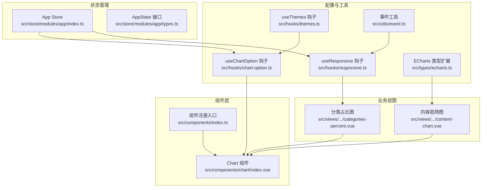
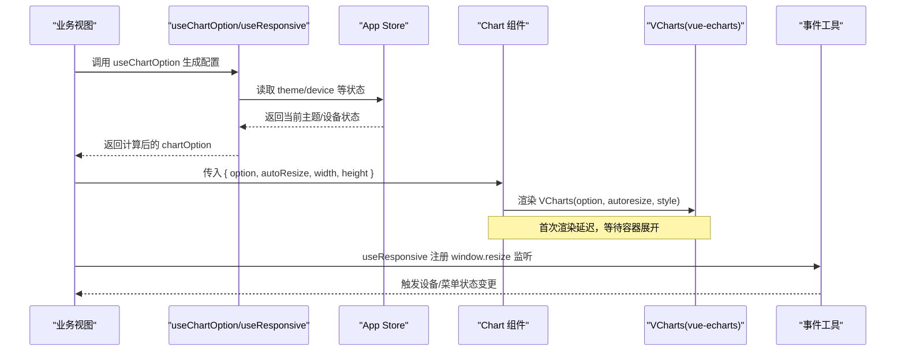
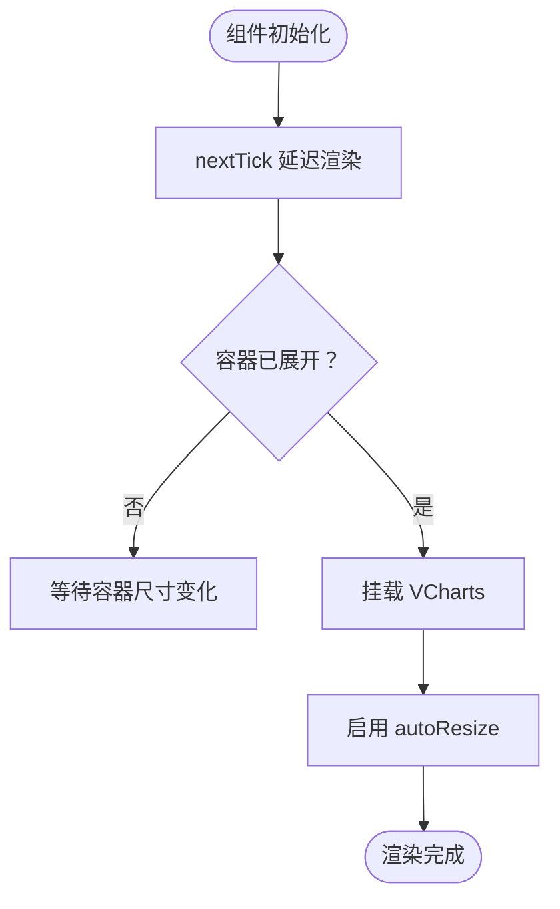
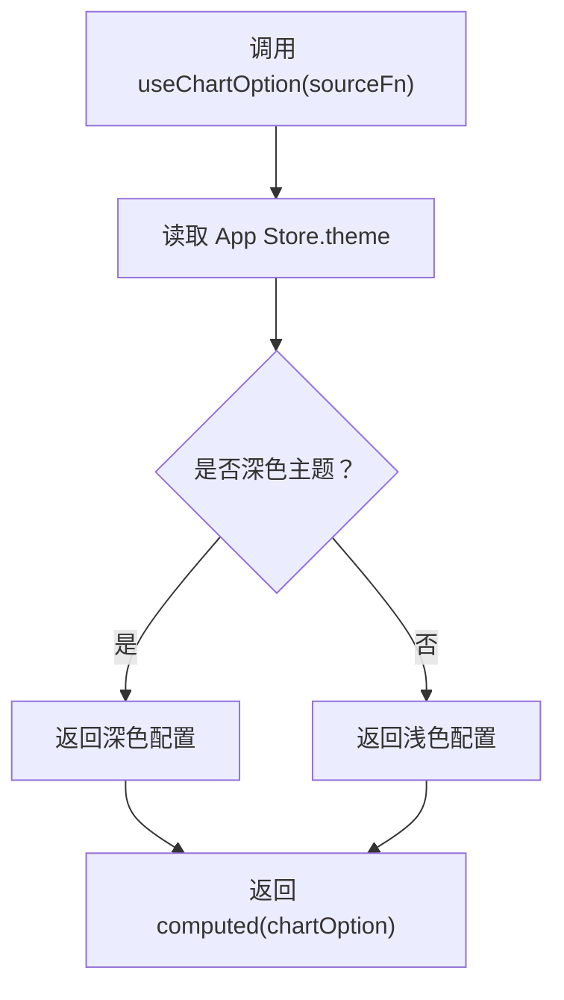
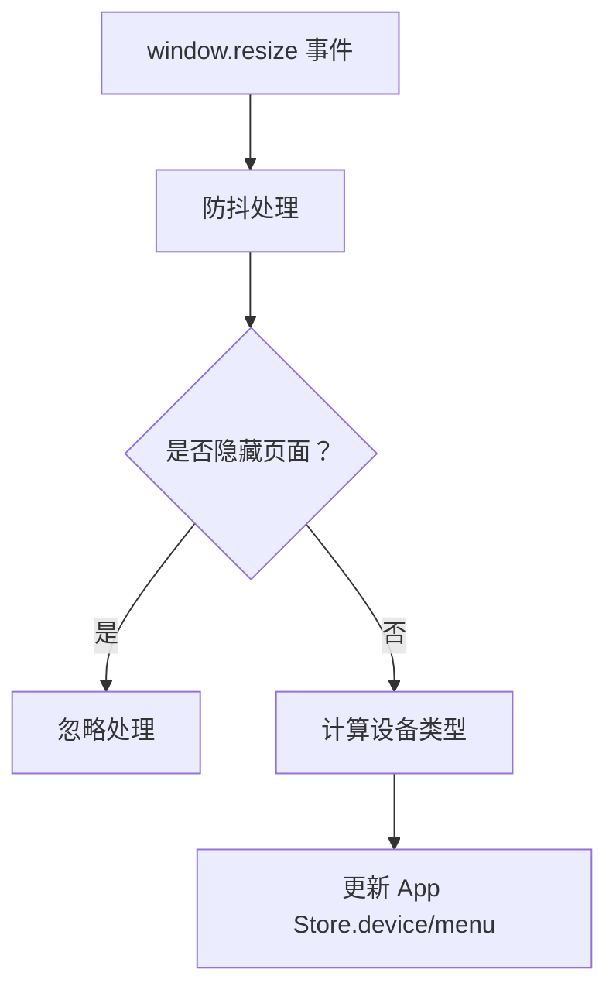
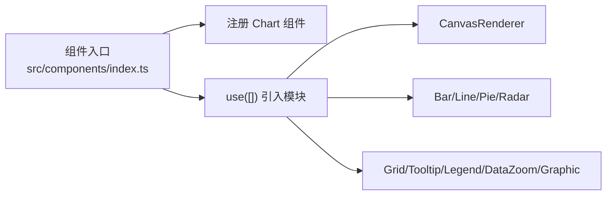
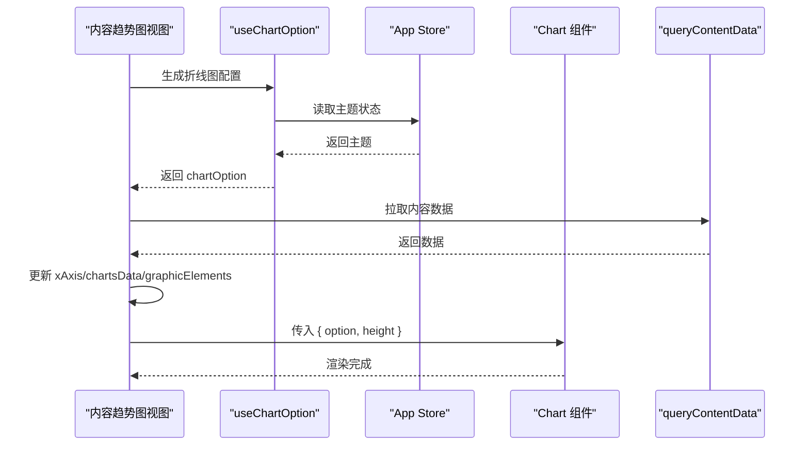
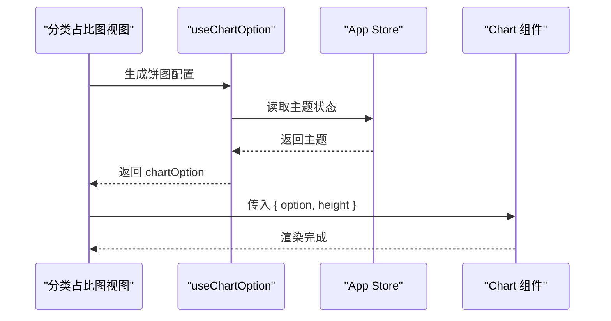
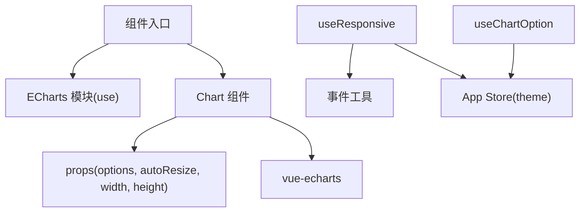

# 图表组件

<cite>
**本文引用的文件列表**
- [src/components/chart/index.vue](file://src/components/chart/index.vue)
- [src/components/index.ts](file://src/components/index.ts)
- [src/hooks/chart-option.ts](file://src/hooks/chart-option.ts)
- [src/hooks/responsive.ts](file://src/hooks/responsive.ts)
- [src/hooks/themes.ts](file://src/hooks/themes.ts)
- [src/utils/event.ts](file://src/utils/event.ts)
- [src/store/modules/app/index.ts](file://src/store/modules/app/index.ts)
- [src/store/modules/app/types.ts](file://src/store/modules/app/types.ts)
- [src/views/dashboard/workplace/components/content-chart.vue](file://src/views/dashboard/workplace/components/content-chart.vue)
- [src/views/dashboard/workplace/components/categories-percent.vue](file://src/views/dashboard/workplace/components/categories-percent.vue)
- [src/types/echarts.ts](file://src/types/echarts.ts)
- [src/assets/style/global.less](file://src/assets/style/global.less)
</cite>

## 目录
1. [简介](#简介)
2. [项目结构](#项目结构)
3. [核心组件](#核心组件)
4. [架构总览](#架构总览)
5. [详细组件分析](#详细组件分析)
6. [依赖关系分析](#依赖关系分析)
7. [性能考量](#性能考量)
8. [故障排查指南](#故障排查指南)
9. [结论](#结论)
10. [附录](#附录)

## 简介
本文件面向“图表组件”的实现与使用，系统性阐述以下方面：
- vue-echarts 集成方式与模块按需引入策略
- 图表选项配置与主题适配机制
- 自动适配与渲染优化策略
- 组件 props 参数（options、autoResize、width、height）的用法与最佳实践
- 数据格式转换、主题适配与响应式布局的实战建议
- 在业务页面中的集成示例与数据更新、性能优化方案
- 图表组件与状态管理的数据流转机制

## 项目结构
图表组件位于组件层，通过全局注册的方式在应用中统一使用；配套的钩子用于生成图表配置、响应式设备判断与主题感知；业务视图通过组合这些能力完成数据拉取、配置生成与渲染。

**图表来源**
- [src/components/index.ts:15-35](file://src/components/index.ts#L15-L35)
- [src/components/chart/index.vue:10-45](file://src/components/chart/index.vue#L10-L45)
- [src/hooks/chart-option.ts:13-27](file://src/hooks/chart-option.ts#L13-L27)
- [src/hooks/responsive.ts:13-32](file://src/hooks/responsive.ts#L13-L32)
- [src/hooks/themes.ts:4-12](file://src/hooks/themes.ts#L4-L12)
- [src/store/modules/app/index.ts:9-78](file://src/store/modules/app/index.ts#L9-L78)
- [src/store/modules/app/types.ts:3-21](file://src/store/modules/app/types.ts#L3-L21)
- [src/views/dashboard/workplace/components/content-chart.vue:19-197](file://src/views/dashboard/workplace/components/content-chart.vue#L19-L197)
- [src/views/dashboard/workplace/components/categories-percent.vue:18-112](file://src/views/dashboard/workplace/components/categories-percent.vue#L18-L112)
- [src/types/echarts.ts:1-11](file://src/types/echarts.ts#L1-L11)
- [src/utils/event.ts:1-28](file://src/utils/event.ts#L1-L28)

**章节来源**
- [src/components/index.ts:15-35](file://src/components/index.ts#L15-L35)
- [src/components/chart/index.vue:10-45](file://src/components/chart/index.vue#L10-L45)

## 核心组件
- Chart 组件：封装 vue-echarts 的 VCharts 渲染器，提供可选的自动适配与尺寸控制，内部通过 nextTick 延迟渲染以确保容器已展开，避免首次渲染尺寸异常。
- useChartOption 钩子：基于 Pinia 应用状态中的主题信息，返回一个计算属性，用于生成适配深浅色的主题化 ECharts 配置。
- useResponsive 钩子：监听窗口 resize，结合防抖策略，动态切换设备类型与菜单显示状态，便于图表在移动端自适应。
- useThemes 钩子：简化主题状态读取，供需要直接感知主题的场景使用。
- 组件注册入口：在应用启动时按需引入 ECharts 渲染器与所需图表/组件模块，并全局注册 Chart 组件，减少打包体积。

关键点
- props 说明
  - options: 图表配置对象，支持任意 ECharts 配置项
  - autoResize: 是否启用自动适配，默认开启
  - width/height: 容器尺寸，默认 100%，可按需覆盖
- 渲染优化
  - 使用 v-if 控制渲染时机，配合 nextTick 延迟渲染，避免容器未展开导致的尺寸异常
  - 按需引入 ECharts 模块，降低首屏包体

**章节来源**
- [src/components/chart/index.vue:15-44](file://src/components/chart/index.vue#L15-L44)
- [src/hooks/chart-option.ts:13-27](file://src/hooks/chart-option.ts#L13-L27)
- [src/hooks/responsive.ts:13-32](file://src/hooks/responsive.ts#L13-L32)
- [src/hooks/themes.ts:4-12](file://src/hooks/themes.ts#L4-L12)
- [src/components/index.ts:15-35](file://src/components/index.ts#L15-L35)

## 架构总览
下图展示了从业务视图到图表渲染的整体流程，以及与状态管理、事件监听和类型定义的交互。

**图表来源**
- [src/views/dashboard/workplace/components/content-chart.vue:19-197](file://src/views/dashboard/workplace/components/content-chart.vue#L19-L197)
- [src/views/dashboard/workplace/components/categories-percent.vue:18-112](file://src/views/dashboard/workplace/components/categories-percent.vue#L18-L112)
- [src/hooks/chart-option.ts:13-27](file://src/hooks/chart-option.ts#L13-L27)
- [src/hooks/responsive.ts:13-32](file://src/hooks/responsive.ts#L13-L32)
- [src/store/modules/app/index.ts:9-78](file://src/store/modules/app/index.ts#L9-L78)
- [src/utils/event.ts:1-28](file://src/utils/event.ts#L1-L28)

## 详细组件分析

### Chart 组件
- 功能职责
  - 封装 VCharts 渲染器，暴露 options/autoResize/width/height 三个 props
  - 通过 v-if + nextTick 延迟渲染，确保容器尺寸已生效
  - 默认开启 autoResize，提升容器变化时的自适应能力
- 设计要点
  - 使用 v-if 避免初次渲染时容器尺寸未知导致的异常
  - autoResize 由 vue-echarts 提供，无需手动监听 resize
  - 宽高默认 100%，可在业务卡片中按需设置固定高度

**图表来源**
- [src/components/chart/index.vue:10-45](file://src/components/chart/index.vue#L10-L45)

**章节来源**
- [src/components/chart/index.vue:10-45](file://src/components/chart/index.vue#L10-L45)

### useChartOption 钩子
- 功能职责
  - 基于 App Store 中的 theme 状态，生成适配深浅色的主题化 ECharts 配置
  - 返回计算属性 chartOption，供业务视图直接使用
- 设计要点
  - 通过 computed 监听主题变化，自动重新计算配置
  - 支持传入函数式配置源，便于在不同主题下返回差异化配置
  - 可扩展为外部主题包或自定义主题映射

**图表来源**
- [src/hooks/chart-option.ts:13-27](file://src/hooks/chart-option.ts#L13-L27)
- [src/store/modules/app/index.ts:32-40](file://src/store/modules/app/index.ts#L32-L40)

**章节来源**
- [src/hooks/chart-option.ts:13-27](file://src/hooks/chart-option.ts#L13-L27)
- [src/store/modules/app/index.ts:32-40](file://src/store/modules/app/index.ts#L32-L40)

### useResponsive 钩子
- 功能职责
  - 监听窗口 resize，根据宽度阈值切换设备类型与菜单显示状态
  - 使用防抖函数降低频繁触发带来的性能压力
- 设计要点
  - 使用 addEventListen/removeEventListen 管理事件绑定与解绑
  - 结合业务视图的图表布局，实现移动端自适应

**图表来源**
- [src/hooks/responsive.ts:13-32](file://src/hooks/responsive.ts#L13-L32)
- [src/utils/event.ts:1-28](file://src/utils/event.ts#L1-L28)
- [src/store/modules/app/index.ts:41-46](file://src/store/modules/app/index.ts#L41-L46)

**章节来源**
- [src/hooks/responsive.ts:13-32](file://src/hooks/responsive.ts#L13-L32)
- [src/utils/event.ts:1-28](file://src/utils/event.ts#L1-L28)
- [src/store/modules/app/index.ts:41-46](file://src/store/modules/app/index.ts#L41-L46)

### 组件注册与模块按需引入
- 全局注册
  - 在组件入口中注册 Chart 组件，业务视图可直接使用
- 模块按需引入
  - 仅引入实际使用的渲染器与图表/组件模块，减小包体
  - 通过 use([...]) 显式声明所需模块，避免全量引入

**图表来源**
- [src/components/index.ts:15-35](file://src/components/index.ts#L15-L35)

**章节来源**
- [src/components/index.ts:15-35](file://src/components/index.ts#L15-L35)

### 业务视图集成示例

#### 内容趋势折线图
- 关键点
  - 使用 useChartOption 生成配置，包含坐标轴、网格、提示框、图形元素与系列
  - 通过 ref 维护 x 轴数据与系列数据，动态填充
  - 使用自定义 tooltip 格式化函数与自定义样式类名
  - 在卡片中嵌入 Chart 组件，设置固定高度

**图表来源**
- [src/views/dashboard/workplace/components/content-chart.vue:19-197](file://src/views/dashboard/workplace/components/content-chart.vue#L19-L197)
- [src/hooks/chart-option.ts:13-27](file://src/hooks/chart-option.ts#L13-L27)
- [src/store/modules/app/index.ts:32-40](file://src/store/modules/app/index.ts#L32-L40)
- [src/types/echarts.ts:1-11](file://src/types/echarts.ts#L1-L11)

**章节来源**
- [src/views/dashboard/workplace/components/content-chart.vue:19-197](file://src/views/dashboard/workplace/components/content-chart.vue#L19-L197)
- [src/types/echarts.ts:1-11](file://src/types/echarts.ts#L1-L11)

#### 分类占比饼图
- 关键点
  - 使用 useChartOption 生成配置，包含图例、提示框、图形元素与系列
  - 根据主题动态设置图例、标签与系列颜色
  - 在卡片中嵌入 Chart 组件，设置固定高度

**图表来源**
- [src/views/dashboard/workplace/components/categories-percent.vue:18-112](file://src/views/dashboard/workplace/components/categories-percent.vue#L18-L112)
- [src/hooks/chart-option.ts:13-27](file://src/hooks/chart-option.ts#L13-L27)
- [src/store/modules/app/index.ts:32-40](file://src/store/modules/app/index.ts#L32-L40)

**章节来源**
- [src/views/dashboard/workplace/components/categories-percent.vue:18-112](file://src/views/dashboard/workplace/components/categories-percent.vue#L18-L112)

## 依赖关系分析
- 组件耦合
  - Chart 组件对 vue-echarts 的依赖明确，通过 props 传递配置，低耦合
  - useChartOption 与 App Store 强关联，但通过 computed 解耦了配置生成逻辑
- 外部依赖
  - ECharts 模块按需引入，避免全量引入导致包体膨胀
  - 事件工具封装 window 事件监听，便于统一管理
- 状态依赖
  - 主题状态来自 App Store，useChartOption 与 useResponsive 均依赖该状态

**图表来源**
- [src/components/chart/index.vue:10-45](file://src/components/chart/index.vue#L10-L45)
- [src/hooks/chart-option.ts:13-27](file://src/hooks/chart-option.ts#L13-L27)
- [src/hooks/responsive.ts:13-32](file://src/hooks/responsive.ts#L13-L32)
- [src/utils/event.ts:1-28](file://src/utils/event.ts#L1-L28)
- [src/components/index.ts:15-35](file://src/components/index.ts#L15-L35)

**章节来源**
- [src/components/chart/index.vue:10-45](file://src/components/chart/index.vue#L10-L45)
- [src/hooks/chart-option.ts:13-27](file://src/hooks/chart-option.ts#L13-L27)
- [src/hooks/responsive.ts:13-32](file://src/hooks/responsive.ts#L13-L32)
- [src/utils/event.ts:1-28](file://src/utils/event.ts#L1-L28)
- [src/components/index.ts:15-35](file://src/components/index.ts#L15-L35)

## 性能考量
- 包体优化
  - 仅引入实际使用的渲染器与图表/组件模块，减少初始加载体积
- 渲染优化
  - Chart 组件通过 v-if + nextTick 延迟渲染，避免容器未展开导致的尺寸异常
  - 合理设置 autoResize，避免在容器频繁变化时造成重复重绘
- 事件优化
  - useResponsive 使用防抖函数，降低 resize 事件触发频率
  - 事件监听在组件生命周期内注册与清理，避免内存泄漏
- 数据更新
  - 使用 ref 维护图表数据，尽量采用批量更新策略，减少不必要的响应式开销
  - 对于大数据量场景，考虑分页或采样策略，或使用 ECharts 的大数据优化特性

[本节为通用性能建议，不直接分析具体文件]

## 故障排查指南
- 图表不显示或尺寸异常
  - 检查容器是否已展开，确认 Chart 组件的 v-if 条件满足
  - 确认 width/height 设置合理，必要时在父级容器中设置固定高度
- 主题切换后样式未更新
  - 确认 App Store 的 theme 已正确切换，useChartOption 的 computed 是否被触发
  - 检查业务配置中是否正确读取 isDark 并返回对应主题配置
- 移动端布局错乱
  - 检查 useResponsive 是否正确注册 window.resize 监听
  - 确认设备类型切换逻辑与菜单显示状态一致
- 提示框样式异常
  - 检查全局样式类名是否正确应用，确保样式优先级与主题一致

**章节来源**
- [src/components/chart/index.vue:10-45](file://src/components/chart/index.vue#L10-L45)
- [src/hooks/chart-option.ts:13-27](file://src/hooks/chart-option.ts#L13-L27)
- [src/hooks/responsive.ts:13-32](file://src/hooks/responsive.ts#L13-L32)
- [src/store/modules/app/index.ts:32-40](file://src/store/modules/app/index.ts#L32-L40)
- [src/assets/style/global.less:17-63](file://src/assets/style/global.less#L17-L63)

## 结论
本图表组件体系通过“组件 + 钩子 + 状态管理 + 模块按需引入”的方式，实现了：
- 简洁易用的 props 接口与自动适配能力
- 主题感知与响应式布局的无缝衔接
- 可维护的配置生成与数据驱动渲染
- 良好的性能表现与可扩展性

在业务实践中，建议：
- 使用 useChartOption 生成主题化配置，保持视觉一致性
- 在大数据场景下采用分页/采样与防抖策略
- 通过组件注册与模块按需引入，持续优化包体与加载性能

[本节为总结性内容，不直接分析具体文件]

## 附录

### Props 参数说明
- options
  - 类型：对象
  - 作用：传入完整的 ECharts 配置对象
  - 建议：通过 useChartOption 生成，确保主题与响应式配置一致
- autoResize
  - 类型：布尔
  - 默认：true
  - 作用：启用容器尺寸变化时的自动重绘
- width/height
  - 类型：字符串
  - 默认：'100%'
  - 建议：在卡片或容器中设置固定高度，避免首次渲染尺寸异常

**章节来源**
- [src/components/chart/index.vue:15-34](file://src/components/chart/index.vue#L15-L34)

### 最佳实践清单
- 数据格式转换
  - 将后端返回的原始数据转换为 ECharts 所需的数组结构
  - 对时间序列数据使用日期格式化，确保坐标轴正确解析
- 主题适配
  - 使用 useChartOption 读取 App Store 的 theme，分别返回深浅色配置
  - 对颜色、字体、边框等关键样式进行主题化映射
- 响应式布局
  - 在移动端适当缩小图表尺寸与字号，保证可读性
  - 使用 useResponsive 切换设备类型，调整布局与交互行为
- 性能优化
  - 合理设置 autoResize 与防抖策略
  - 对大数据量场景采用分页/采样或大数据优化特性
  - 保持模块按需引入，避免全量引入

[本节为通用实践建议，不直接分析具体文件]