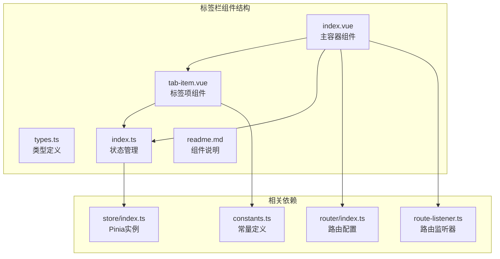
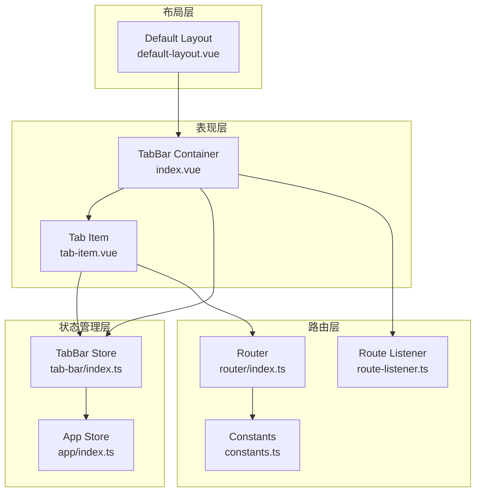
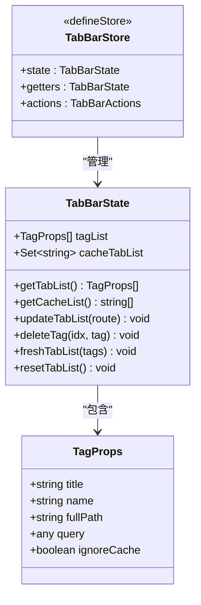
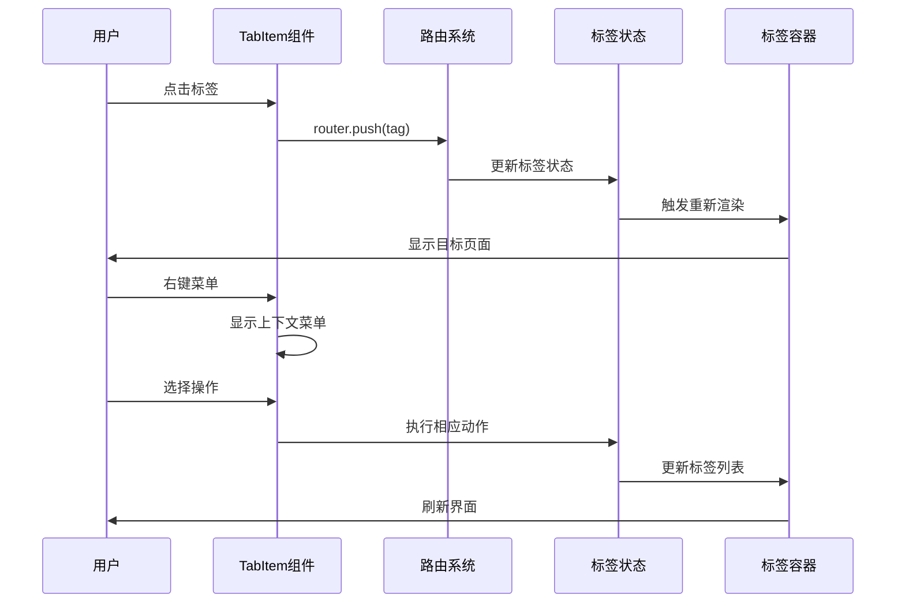
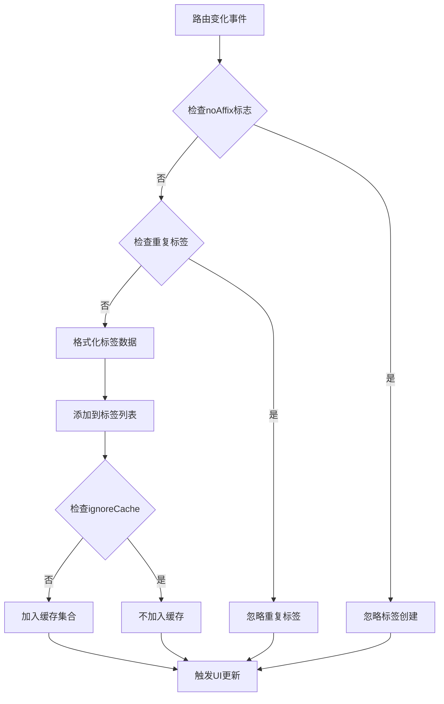
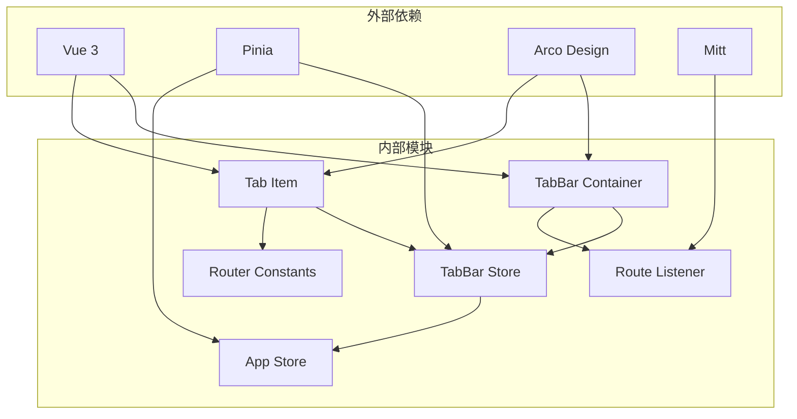

# 标签栏组件

<cite>
**本文档引用的文件**
- [index.vue](file://src/components/tab-bar/index.vue)
- [tab-item.vue](file://src/components/tab-bar/tab-item.vue)
- [index.ts](file://src/store/modules/tab-bar/index.ts)
- [types.ts](file://src/store/modules/tab-bar/types.ts)
- [index.ts](file://src/store/index.ts)
- [default-layout.vue](file://src/layout/default-layout.vue)
- [route-listener.ts](file://src/utils/route-listener.ts)
- [constants.ts](file://src/router/constants.ts)
- [index.ts](file://src/router/index.ts)
- [base.ts](file://src/router/routes/base.ts)
- [index.ts](file://src/store/modules/app/index.ts)
- [readme.md](file://src/components/tab-bar/readme.md)
</cite>

## 目录
1. [简介](#简介)
2. [项目结构](#项目结构)
3. [核心组件](#核心组件)
4. [架构概览](#架构概览)
5. [详细组件分析](#详细组件分析)
6. [依赖关系分析](#依赖关系分析)
7. [性能考虑](#性能考虑)
8. [故障排除指南](#故障排除指南)
9. [结论](#结论)
10. [附录](#附录)

## 简介

标签栏组件是前端管理系统中的重要导航组件，负责管理用户在应用中的页面导航状态。该组件提供了完整的页面标签管理功能，包括标签页的创建、切换、关闭和缓存机制，为用户提供直观的多页面浏览体验。

标签栏组件采用现代化的Vue 3 Composition API和Pinia状态管理，结合Arco Design组件库，实现了高性能、可扩展的标签导航功能。组件支持丰富的交互操作，包括点击切换、右键菜单、拖拽排序等，满足不同用户的操作习惯。

## 项目结构

标签栏组件位于`src/components/tab-bar/`目录下，采用模块化的文件组织方式：



**图表来源**
- [index.vue:1-102](file://src/components/tab-bar/index.vue#L1-L102)
- [tab-item.vue:1-201](file://src/components/tab-bar/tab-item.vue#L1-L201)
- [index.ts:1-75](file://src/store/modules/tab-bar/index.ts#L1-L75)

**章节来源**
- [index.vue:1-102](file://src/components/tab-bar/index.vue#L1-L102)
- [tab-item.vue:1-201](file://src/components/tab-bar/tab-item.vue#L1-L201)
- [index.ts:1-75](file://src/store/modules/tab-bar/index.ts#L1-L75)

## 核心组件

### 主容器组件（index.vue）

主容器组件负责标签栏的整体布局和状态管理，主要功能包括：

- **标签列表渲染**：通过计算属性获取标签列表并动态渲染
- **路由监听**：监听路由变化，自动添加新标签
- **固定定位**：根据导航栏状态调整位置偏移
- **响应式更新**：监听应用状态变化，实时更新组件位置

### 标签项组件（tab-item.vue）

标签项组件是标签栏的核心交互单元，提供完整的标签操作功能：

- **点击切换**：点击标签项进行页面跳转
- **右键菜单**：提供丰富的上下文操作选项
- **关闭功能**：支持单个标签关闭和批量关闭
- **状态指示**：显示当前激活的标签项

**章节来源**
- [index.vue:21-60](file://src/components/tab-bar/index.vue#L21-L60)
- [tab-item.vue:59-168](file://src/components/tab-bar/tab-item.vue#L59-L168)

## 架构概览

标签栏组件采用分层架构设计，各层职责明确，耦合度低：



**图表来源**
- [index.vue:28-32](file://src/components/tab-bar/index.vue#L28-L32)
- [tab-item.vue:62-91](file://src/components/tab-bar/tab-item.vue#L62-L91)
- [index.ts:24-28](file://src/store/modules/tab-bar/index.ts#L24-L28)

## 详细组件分析

### 状态管理机制

标签栏组件采用Pinia进行状态管理，实现了完整的标签状态控制：

#### 状态结构



**图表来源**
- [types.ts:9-12](file://src/store/modules/tab-bar/types.ts#L9-L12)
- [types.ts:1-7](file://src/store/modules/tab-bar/types.ts#L1-L7)

#### 缓存机制

标签栏组件实现了智能的缓存管理策略：

- **默认缓存**：首页标签默认加入缓存集合
- **条件缓存**：根据路由元信息决定是否缓存
- **动态更新**：标签关闭时同步更新缓存集合
- **持久化支持**：缓存状态可与其他存储方案集成

**章节来源**
- [index.ts:24-75](file://src/store/modules/tab-bar/index.ts#L24-L75)
- [types.ts:1-13](file://src/store/modules/tab-bar/types.ts#L1-L13)

### 交互逻辑分析

#### 标签项交互流程



**图表来源**
- [tab-item.vue:93-167](file://src/components/tab-bar/tab-item.vue#L93-L167)
- [index.vue:48-55](file://src/components/tab-bar/index.vue#L48-L55)

#### 标签创建流程



**图表来源**
- [index.ts:40-46](file://src/store/modules/tab-bar/index.ts#L40-L46)
- [route-listener.ts:14-17](file://src/utils/route-listener.ts#L14-L17)

**章节来源**
- [tab-item.vue:116-167](file://src/components/tab-bar/tab-item.vue#L116-L167)
- [index.ts:11-20](file://src/store/modules/tab-bar/index.ts#L11-L20)

### 生命周期管理

标签栏组件实现了完整的生命周期管理：

#### 初始化阶段
- 设置默认标签（首页）
- 初始化缓存集合
- 配置路由监听器

#### 运行阶段
- 监听路由变化
- 动态更新标签列表
- 处理用户交互

#### 销毁阶段
- 清理路由监听器
- 释放内存资源

**章节来源**
- [index.ts:24-28](file://src/store/modules/tab-bar/index.ts#L24-L28)
- [index.vue:57-59](file://src/components/tab-bar/index.vue#L57-L59)

## 依赖关系分析

### 组件依赖图



**图表来源**
- [index.vue:28-29](file://src/components/tab-bar/index.vue#L28-L29)
- [tab-item.vue:62-64](file://src/components/tab-bar/tab-item.vue#L62-L64)

### 数据流分析

标签栏组件的数据流遵循单向数据流原则：

1. **路由驱动**：路由变化触发标签创建
2. **状态驱动**：标签状态变化驱动UI更新
3. **用户驱动**：用户操作触发状态变更

**章节来源**
- [route-listener.ts:14-27](file://src/utils/route-listener.ts#L14-L27)
- [index.ts:30-37](file://src/store/modules/tab-bar/index.ts#L30-L37)

## 性能考虑

### 渲染优化

标签栏组件采用了多项性能优化措施：

- **虚拟滚动**：对于大量标签的情况，可考虑实现虚拟滚动
- **懒加载**：标签内容按需加载
- **防抖处理**：路由变化事件的防抖处理
- **内存管理**：及时清理不再使用的标签

### 缓存策略

- **智能缓存**：只缓存必要的组件实例
- **LRU淘汰**：可实现最近最少使用算法
- **内存监控**：监控缓存大小，避免内存泄漏

## 故障排除指南

### 常见问题及解决方案

#### 标签不显示问题
- 检查路由配置中的`noAffix`标志
- 确认路由元信息中的`title`配置
- 验证标签列表状态是否正确更新

#### 标签关闭异常
- 检查标签索引计算逻辑
- 确认路由跳转逻辑
- 验证缓存集合同步

#### 性能问题
- 检查路由监听器是否正确清理
- 优化标签渲染逻辑
- 监控内存使用情况

**章节来源**
- [index.ts:47-50](file://src/store/modules/tab-bar/index.ts#L47-L50)
- [tab-item.vue:116-122](file://src/components/tab-bar/tab-item.vue#L116-L122)

## 结论

标签栏组件是一个功能完整、架构清晰的导航组件。它成功地实现了以下核心功能：

- **完整的标签管理**：创建、切换、关闭、缓存
- **丰富的交互体验**：点击、右键菜单、状态指示
- **良好的性能表现**：基于Vue 3和Pinia的高效实现
- **可扩展的设计**：模块化架构便于功能扩展

组件目前处于基础版本，但仍具备生产环境使用的稳定性。建议在未来版本中增加更多高级功能，如拖拽排序、快捷键支持、标签分组等。

## 附录

### 使用示例

#### 在布局中集成标签栏

```javascript
// 在布局组件中启用标签栏
const layout = {
  template: `
    <div>
      <TabBar v-if="appStore.tabBar" />
      <router-view />
    </div>
  `,
  setup() {
    const appStore = useAppStore();
    return { appStore };
  }
};
```

#### 路由配置示例

```javascript
// 在路由配置中设置标签属性
const routes = [
  {
    path: '/dashboard',
    name: 'dashboard',
    component: Dashboard,
    meta: {
      locale: 'dashboard',
      ignoreCache: false,
      noAffix: false
    }
  }
];
```

### 自定义配置选项

#### 标签样式定制
- 通过CSS变量自定义颜色主题
- 支持不同的标签尺寸
- 可配置标签图标和关闭按钮

#### 功能配置
- 最大标签数限制
- 自动缓存策略
- 标签历史记录
- 快捷键支持

**章节来源**
- [default-layout.vue:36](file://src/layout/default-layout.vue#L36)
- [constants.ts:14-18](file://src/router/constants.ts#L14-L18)