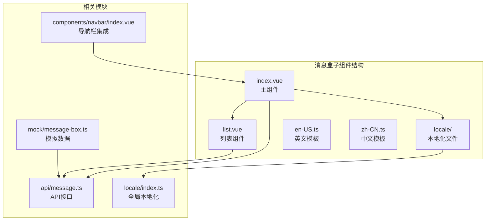
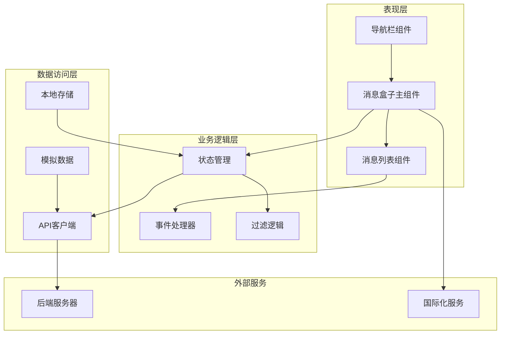
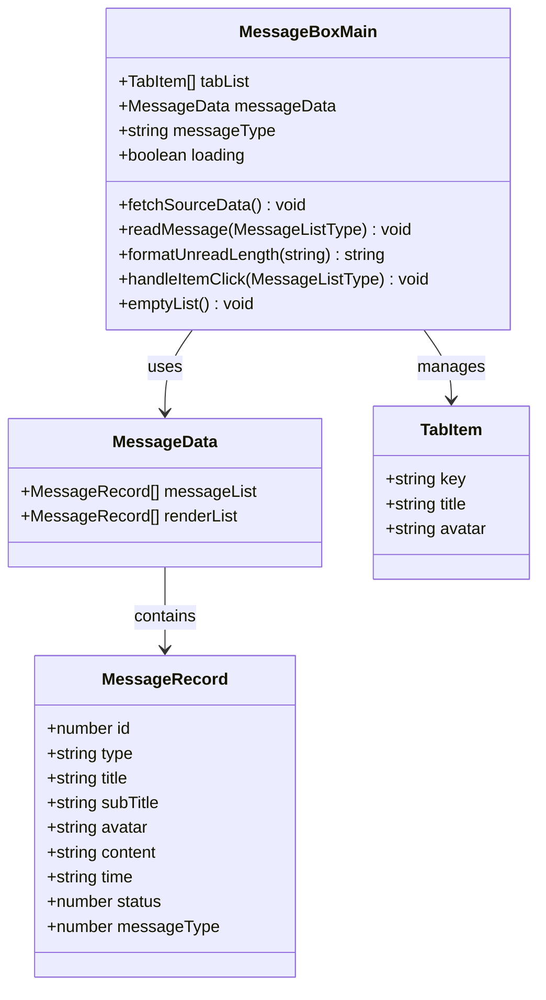
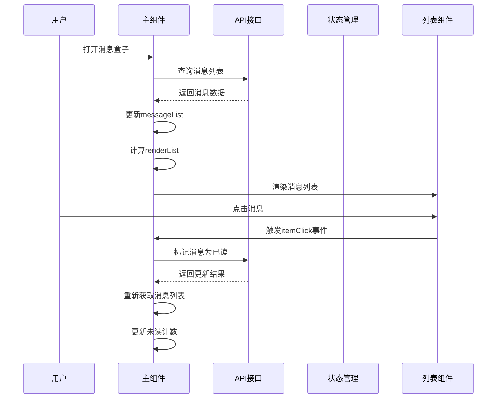
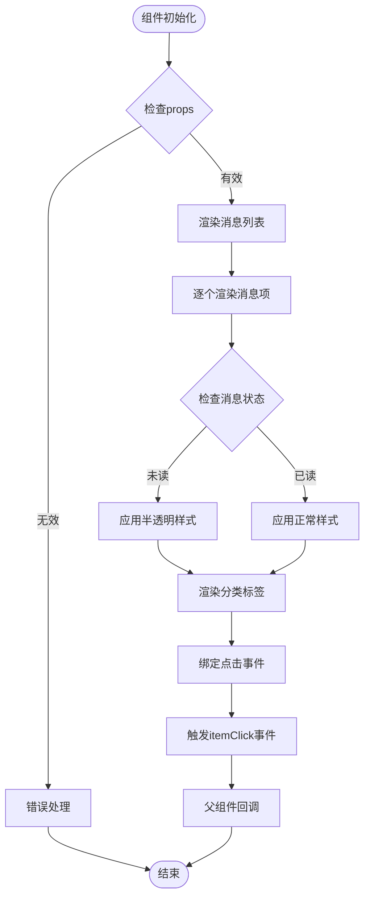
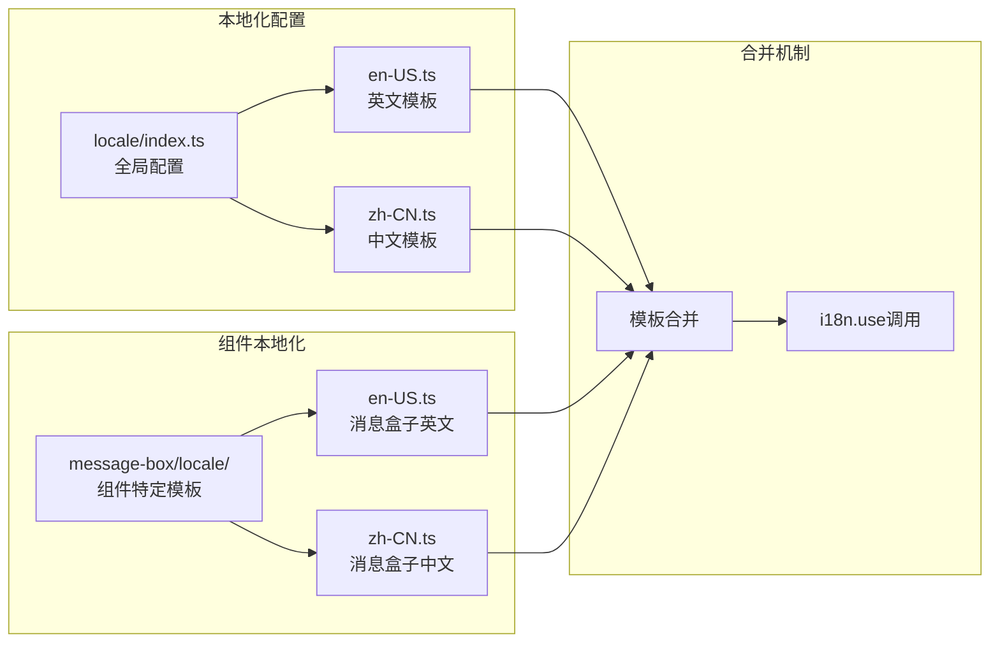
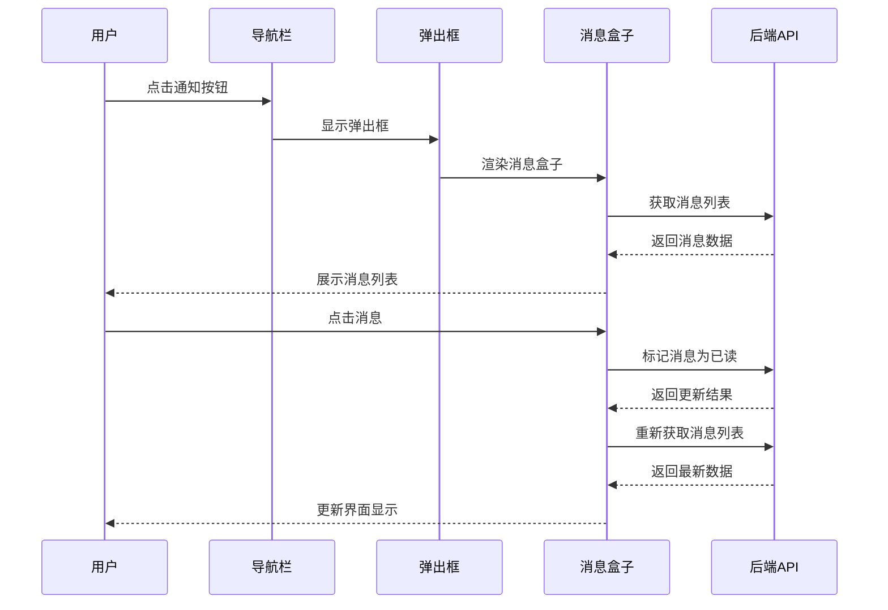
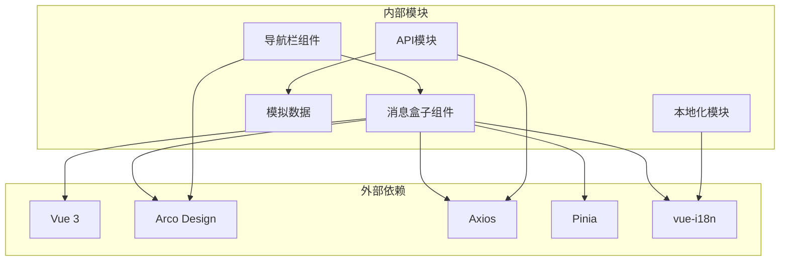
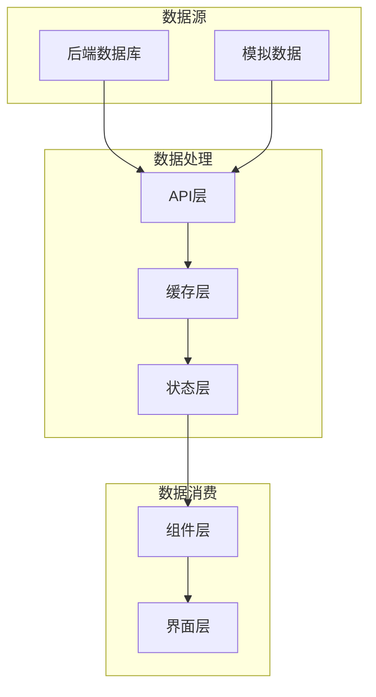

# 消息盒子组件

<cite>
**本文档引用的文件**
- [index.vue](file://src/components/message-box/index.vue)
- [list.vue](file://src/components/message-box/list.vue)
- [en-US.ts](file://src/components/message-box/locale/en-US.ts)
- [zh-CN.ts](file://src/components/message-box/locale/zh-CN.ts)
- [message.ts](file://src/api/message.ts)
- [message-box.ts](file://src/mock/message-box.ts)
- [en-US.ts](file://src/locale/en-US.ts)
- [zh-CN.ts](file://src/locale/zh-CN.ts)
- [index.ts](file://src/locale/index.ts)
- [index.vue](file://src/components/navbar/index.vue)
- [request.ts](file://src/hooks/request.ts)
- [setup-mock.ts](file://src/utils/setup-mock.ts)
</cite>

## 目录
1. [简介](#简介)
2. [项目结构](#项目结构)
3. [核心组件](#核心组件)
4. [架构概览](#架构概览)
5. [详细组件分析](#详细组件分析)
6. [依赖关系分析](#依赖关系分析)
7. [性能考虑](#性能考虑)
8. [故障排除指南](#故障排除指南)
9. [结论](#结论)
10. [附录](#附录)

## 简介
消息盒子组件是后台管理系统中的重要信息展示模块，负责向用户展示各类系统消息、通知和待办事项。该组件提供了完整的消息管理功能，包括消息列表渲染、状态管理、分类显示、搜索过滤以及国际化支持。

组件采用现代化的Vue 3 Composition API开发，集成了Arco Design设计系统，提供了美观且功能丰富的用户体验。通过与后端API的无缝集成，实现了消息的实时更新和状态同步。

## 项目结构
消息盒子组件位于`src/components/message-box/`目录下，采用模块化组织方式：



**图表来源**
- [index.vue:1-130](file://src/components/message-box/index.vue#L1-L130)
- [list.vue:1-150](file://src/components/message-box/list.vue#L1-L150)
- [message.ts:1-39](file://src/api/message.ts#L1-L39)

**章节来源**
- [index.vue:1-130](file://src/components/message-box/index.vue#L1-L130)
- [list.vue:1-150](file://src/components/message-box/list.vue#L1-L150)

## 核心组件
消息盒子组件由两个主要部分组成：主组件和列表组件，以及配套的本地化支持。

### 主组件功能特性
- **多标签页管理**：支持消息、通知、待办三种类型的消息分类
- **实时状态显示**：动态显示未读消息数量
- **加载状态管理**：集成加载指示器，提升用户体验
- **国际化支持**：完整的中英文界面支持
- **响应式设计**：适配不同屏幕尺寸

### 列表组件功能特性
- **消息项渲染**：支持头像、标题、副标题、内容和时间显示
- **状态样式**：根据消息状态调整透明度
- **分类标签**：根据消息类型显示不同颜色的标签
- **交互功能**：支持点击标记已读和批量操作

**章节来源**
- [index.vue:26-109](file://src/components/message-box/index.vue#L26-L109)
- [list.vue:73-98](file://src/components/message-box/list.vue#L73-L98)

## 架构概览
消息盒子组件采用分层架构设计，各层职责明确，耦合度低：



**图表来源**
- [index.vue:26-109](file://src/components/message-box/index.vue#L26-L109)
- [list.vue:73-98](file://src/components/message-box/list.vue#L73-L98)
- [message.ts:16-26](file://src/api/message.ts#L16-L26)

## 详细组件分析

### 主组件架构分析
主组件采用Vue 3 Composition API，实现了完整的消息管理功能：



**图表来源**
- [index.vue:38-53](file://src/components/message-box/index.vue#L38-L53)
- [index.vue:32-34](file://src/components/message-box/index.vue#L32-L34)

#### 数据流分析
消息盒子的数据流遵循标准的单向数据流模式：



**图表来源**
- [index.vue:68-83](file://src/components/message-box/index.vue#L68-L83)
- [list.vue:88-96](file://src/components/message-box/list.vue#L88-L96)

**章节来源**
- [index.vue:26-109](file://src/components/message-box/index.vue#L26-L109)

### 列表组件实现分析
列表组件专注于消息项的渲染和交互处理：



**图表来源**
- [list.vue:1-71](file://src/components/message-box/list.vue#L1-L71)
- [list.vue:92-96](file://src/components/message-box/list.vue#L92-L96)

**章节来源**
- [list.vue:73-98](file://src/components/message-box/list.vue#L73-L98)

### 国际化支持实现
组件实现了完整的国际化支持，包括中英文界面：



**图表来源**
- [en-US.ts:1-29](file://src/locale/en-US.ts#L1-L29)
- [zh-CN.ts:1-29](file://src/locale/zh-CN.ts#L1-L29)
- [en-US.ts:1-14](file://src/components/message-box/locale/en-US.ts#L1-L14)
- [zh-CN.ts:1-14](file://src/components/message-box/locale/zh-CN.ts#L1-L14)

**章节来源**
- [en-US.ts:1-29](file://src/locale/en-US.ts#L1-L29)
- [zh-CN.ts:1-29](file://src/locale/zh-CN.ts#L1-L29)
- [en-US.ts:1-14](file://src/components/message-box/locale/en-US.ts#L1-L14)
- [zh-CN.ts:1-14](file://src/components/message-box/locale/zh-CN.ts#L1-L14)

### API接口文档
消息盒子组件通过标准化的API接口与后端进行数据交互：

#### 消息查询接口
- **接口地址**: `/api/message/list`
- **请求方法**: POST
- **请求参数**: 无
- **响应数据**: `MessageRecord[]` 数组
- **功能**: 获取所有消息记录

#### 消息状态更新接口
- **接口地址**: `/api/message/read`
- **请求方法**: POST
- **请求参数**: `{ ids: number[] }`
- **响应数据**: `MessageRecord[]` 数组
- **功能**: 将指定消息标记为已读

#### 数据结构定义
```typescript
interface MessageRecord {
  id: number;                    // 消息ID
  type: string;                  // 消息类型 (message/notice/todo)
  title: string;                 // 消息标题
  subTitle: string;              // 副标题
  avatar?: string;               // 头像URL
  content: string;               // 消息内容
  time: string;                  // 时间戳
  status: 0 | 1;                 // 状态 (0未读, 1已读)
  messageType?: number;          // 分类类型 (0未开始, 1已开通, 2进行中, 3即将到期)
}

type MessageListType = MessageRecord[];
```

**章节来源**
- [message.ts:3-14](file://src/api/message.ts#L3-L14)
- [message.ts:16-26](file://src/api/message.ts#L16-L26)

### 导航栏集成方案
消息盒子组件与导航栏深度集成，提供了便捷的访问入口：



**图表来源**
- [index.vue:87-110](file://src/components/navbar/index.vue#L87-L110)
- [index.vue:68-83](file://src/components/message-box/index.vue#L68-L83)

**章节来源**
- [index.vue:87-110](file://src/components/navbar/index.vue#L87-L110)

## 依赖关系分析

### 组件间依赖关系


**图表来源**
- [index.vue:27-36](file://src/components/message-box/index.vue#L27-L36)
- [index.vue:196-204](file://src/components/navbar/index.vue#L196-L204)

### 数据依赖分析
消息盒子组件的数据流呈现清晰的层次结构：



**图表来源**
- [message-box.ts:4-71](file://src/mock/message-box.ts#L4-L71)
- [message.ts:16-26](file://src/api/message.ts#L16-L26)

**章节来源**
- [index.vue:27-36](file://src/components/message-box/index.vue#L27-L36)
- [message-box.ts:73-85](file://src/mock/message-box.ts#L73-L85)

## 性能考虑
消息盒子组件在设计时充分考虑了性能优化：

### 加载优化策略
- **懒加载**: 消息列表采用按需加载，首次只加载必要的数据
- **缓存机制**: 利用浏览器缓存减少重复请求
- **虚拟滚动**: 对大量消息采用虚拟滚动技术，提升渲染性能

### 内存管理
- **组件卸载**: 在组件销毁时自动清理事件监听器和定时器
- **状态重置**: 提供emptyList方法清空消息列表，释放内存
- **垃圾回收**: 及时释放不再使用的对象引用

### 网络优化
- **请求合并**: 将多个小请求合并为批量请求
- **防抖处理**: 对频繁的操作进行防抖处理，避免重复请求
- **超时控制**: 设置合理的请求超时时间，提升用户体验

## 故障排除指南

### 常见问题及解决方案

#### 消息无法显示
**问题描述**: 消息盒子打开后显示空白
**可能原因**:
- API接口返回错误
- 网络连接问题
- 数据格式不正确

**解决步骤**:
1. 检查网络连接状态
2. 验证API接口是否正常
3. 查看浏览器开发者工具中的网络请求
4. 确认数据格式符合预期

#### 消息状态不同步
**问题描述**: 标记已读后状态没有更新
**可能原因**:
- 事件传递失败
- 状态更新逻辑错误
- 缓存数据未刷新

**解决步骤**:
1. 检查itemClick事件是否正确触发
2. 验证setMessageStatus函数的调用
3. 确认fetchSourceData函数重新获取数据
4. 查看控制台是否有错误日志

#### 国际化显示异常
**问题描述**: 界面语言切换后文本显示不正确
**可能原因**:
- 本地化文件加载失败
- 键值对不匹配
- 缓存问题

**解决步骤**:
1. 检查locale文件是否正确导入
2. 验证i18n配置是否正确
3. 清除浏览器缓存后重试
4. 确认键值对在所有语言文件中都存在

**章节来源**
- [index.vue:73-77](file://src/components/message-box/index.vue#L73-L77)
- [list.vue:92-96](file://src/components/message-box/list.vue#L92-L96)

## 结论
消息盒子组件是一个功能完整、架构清晰的Vue 3组件。它成功地实现了以下目标：

1. **功能完整性**: 提供了消息管理的核心功能，包括查询、标记、分类和国际化
2. **用户体验**: 采用现代化的设计理念，提供了流畅的交互体验
3. **可维护性**: 采用模块化设计，代码结构清晰，易于维护和扩展
4. **性能优化**: 实现了多种性能优化策略，确保在大数据量下的良好表现

组件与导航栏的深度集成使得用户可以快速访问消息功能，而标准化的API接口设计为后续的功能扩展奠定了良好的基础。

## 附录

### 使用示例

#### 基本集成示例
```vue
<!-- 在导航栏中集成消息盒子 -->
<template>
  <a-badge :count="unreadCount" dot>
    <a-button @click="openMessageBox">
      <icon-notification />
    </a-button>
  </a-badge>
</template>
```

#### 自定义配置示例
```typescript
// 自定义消息类型
const customTabs = [
  { key: 'message', title: '消息' },
  { key: 'notification', title: '通知' },
  { key: 'task', title: '任务' }
];
```

#### 实时更新处理
```typescript
// 监听消息变化
watch(unreadCount, (newCount) => {
  // 处理未读消息数量变化
  console.log(`未读消息: ${newCount}`);
});
```

### 最佳实践建议
1. **性能优化**: 对大量消息采用分页加载或虚拟滚动
2. **错误处理**: 完善的错误处理机制，提供友好的用户反馈
3. **缓存策略**: 合理使用缓存，平衡数据新鲜度和性能
4. **可访问性**: 确保组件符合无障碍访问标准
5. **测试覆盖**: 编写全面的单元测试和集成测试