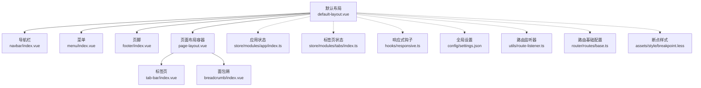
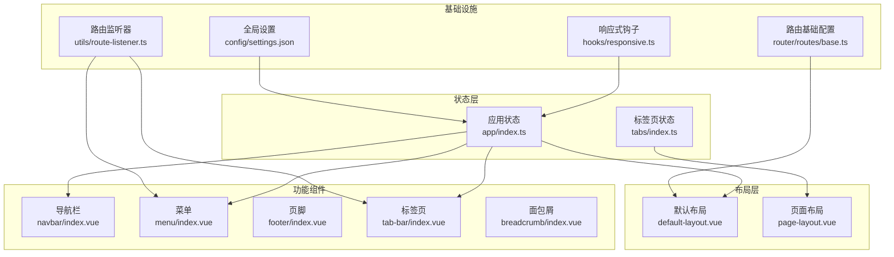
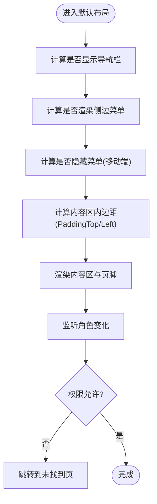
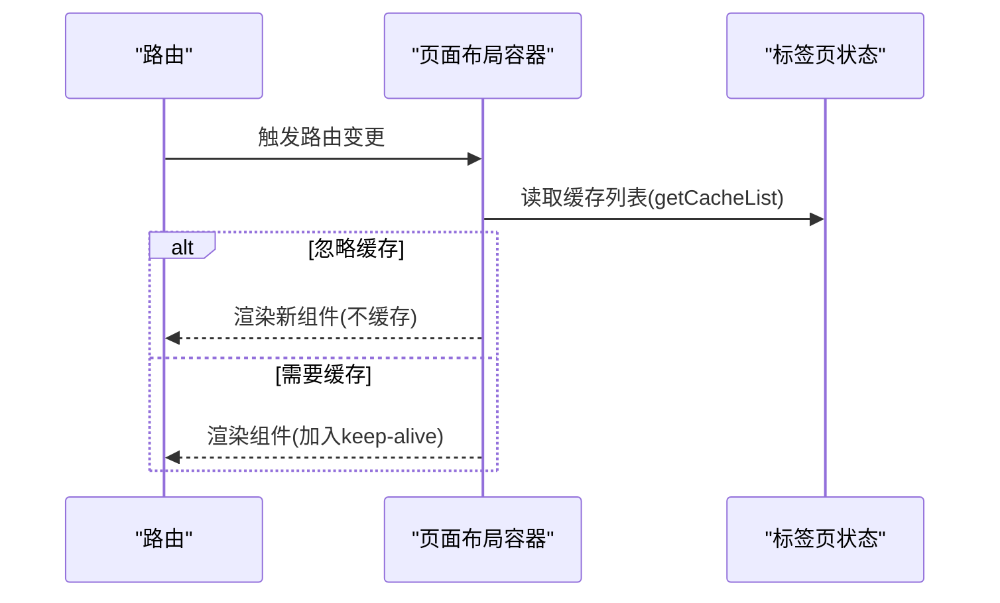
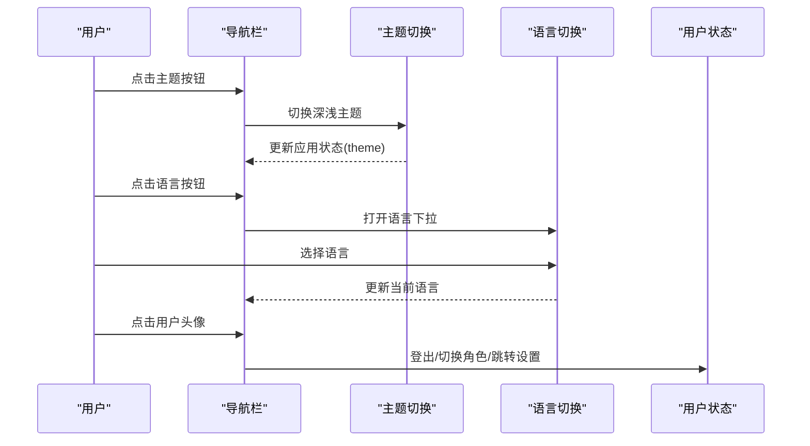
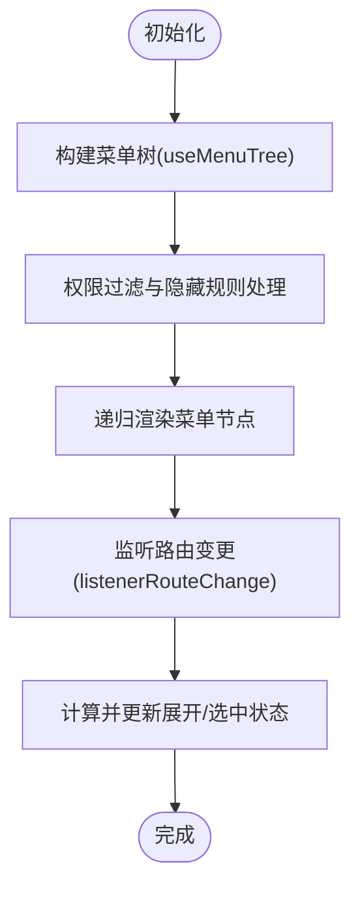
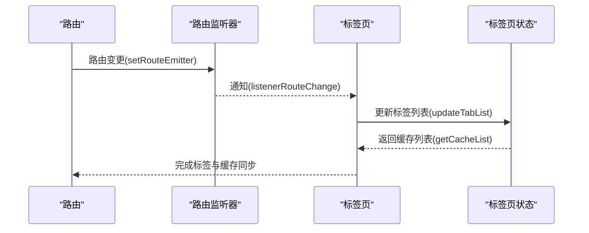
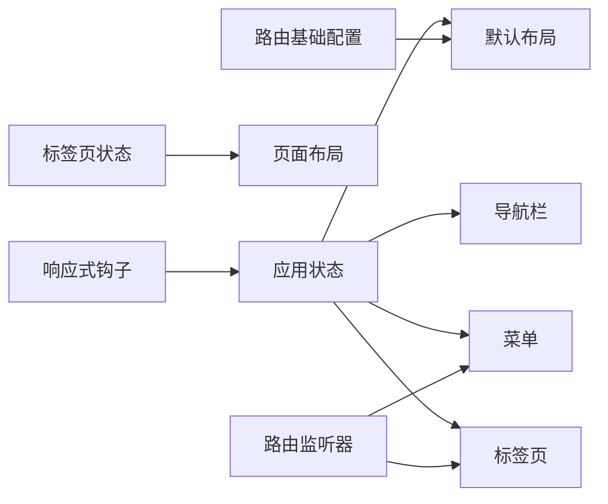

# 布局组件

<cite>
**本文引用的文件**
- [default-layout.vue](file://src/layout/default-layout.vue)
- [page-layout.vue](file://src/layout/page-layout.vue)
- [index.vue](file://src/components/navbar/index.vue)
- [index.vue](file://src/components/footer/index.vue)
- [index.vue](file://src/components/menu/index.vue)
- [index.vue](file://src/components/breadcrumb/index.vue)
- [index.vue](file://src/components/tab-bar/index.vue)
- [use-menu-tree.ts](file://src/components/menu/use-menu-tree.ts)
- [index.ts](file://src/store/modules/app/index.ts)
- [index.ts](file://src/store/modules/tabs/index.ts)
- [responsive.ts](file://src/hooks/responsive.ts)
- [settings.json](file://src/config/settings.json)
- [route-listener.ts](file://src/utils/route-listener.ts)
- [base.ts](file://src/router/routes/base.ts)
- [breakpoint.less](file://src/assets/style/breakpoint.less)
</cite>

## 目录
1. [简介](#简介)
2. [项目结构](#项目结构)
3. [核心组件](#核心组件)
4. [架构总览](#架构总览)
5. [组件详解](#组件详解)
6. [依赖关系分析](#依赖关系分析)
7. [性能考量](#性能考量)
8. [故障排查指南](#故障排查指南)
9. [结论](#结论)
10. [附录](#附录)

## 简介
本文件系统性梳理默认布局组件的设计架构与实现原理，覆盖页面布局容器、导航栏、菜单、页脚、标签页与面包屑等核心布局元素；阐述响应式设计、主题适配与布局切换机制；给出配置项、自定义属性与事件处理说明，并提供多场景使用示例与最佳实践，以及与路由系统的集成与状态同步机制。

## 项目结构
布局相关代码主要分布在以下位置：
- 布局容器：src/layout/default-layout.vue、src/layout/page-layout.vue
- 导航栏：src/components/navbar/index.vue
- 菜单：src/components/menu/index.vue 及其菜单树构建工具 src/components/menu/use-menu-tree.ts
- 页脚：src/components/footer/index.vue
- 标签页：src/components/tab-bar/index.vue
- 面包屑：src/components/breadcrumb/index.vue
- 应用状态（Pinia）：src/store/modules/app/index.ts、src/store/modules/tabs/index.ts
- 响应式钩子：src/hooks/responsive.ts
- 全局设置：src/config/settings.json
- 路由监听器：src/utils/route-listener.ts
- 路由基础配置：src/router/routes/base.ts
- 断点样式：src/assets/style/breakpoint.less

图表来源
- [default-layout.vue:1-179](file://src/layout/default-layout.vue#L1-L179)
- [index.vue:1-324](file://src/components/navbar/index.vue#L1-L324)
- [index.vue:1-161](file://src/components/menu/index.vue#L1-L161)
- [index.vue:1-17](file://src/components/footer/index.vue#L1-L17)
- [page-layout.vue:1-26](file://src/layout/page-layout.vue#L1-L26)
- [index.vue:1-102](file://src/components/tab-bar/index.vue#L1-L102)
- [index.vue:1-36](file://src/components/breadcrumb/index.vue#L1-L36)
- [index.ts:1-78](file://src/store/modules/app/index.ts#L1-L78)
- [index.ts:1-75](file://src/store/modules/tabs/index.ts#L1-L75)
- [responsive.ts:1-33](file://src/hooks/responsive.ts#L1-L33)
- [settings.json:1-18](file://src/config/settings.json#L1-L18)
- [route-listener.ts:1-32](file://src/utils/route-listener.ts#L1-L32)
- [base.ts:1-32](file://src/router/routes/base.ts#L1-L32)
- [breakpoint.less:1-20](file://src/assets/style/breakpoint.less#L1-L20)

章节来源
- [default-layout.vue:1-179](file://src/layout/default-layout.vue#L1-L179)
- [page-layout.vue:1-26](file://src/layout/page-layout.vue#L1-L26)
- [index.vue:1-324](file://src/components/navbar/index.vue#L1-L324)
- [index.vue:1-161](file://src/components/menu/index.vue#L1-L161)
- [index.vue:1-17](file://src/components/footer/index.vue#L1-L17)
- [index.vue:1-102](file://src/components/tab-bar/index.vue#L1-L102)
- [index.vue:1-36](file://src/components/breadcrumb/index.vue#L1-L36)
- [index.ts:1-78](file://src/store/modules/app/index.ts#L1-L78)
- [index.ts:1-75](file://src/store/modules/tabs/index.ts#L1-L75)
- [responsive.ts:1-33](file://src/hooks/responsive.ts#L1-L33)
- [settings.json:1-18](file://src/config/settings.json#L1-L18)
- [route-listener.ts:1-32](file://src/utils/route-listener.ts#L1-L32)
- [base.ts:1-32](file://src/router/routes/base.ts#L1-L32)
- [breakpoint.less:1-20](file://src/assets/style/breakpoint.less#L1-L20)

## 核心组件
- 默认布局容器：负责整体布局骨架、侧边菜单、抽屉菜单、内容区、页脚、标签页与面包屑的组合与控制。
- 页面布局容器：封装路由视图与缓存策略，配合标签页状态决定 keep-alive 缓存列表。
- 导航栏：提供 Logo、菜单开关、语言切换、主题切换、消息提醒、全屏、用户下拉菜单等功能。
- 菜单：根据权限与路由生成菜单树，支持横向/纵向模式、折叠、选中与展开状态同步。
- 页脚：固定底部展示版权信息。
- 标签页：记录访问历史、固定标签、滚动浏览、与缓存列表联动。
- 面包屑：基于路由元信息生成层级路径。
- 响应式钩子：监听窗口尺寸变化，自动切换移动端/桌面端模式与菜单显示策略。
- 应用状态：集中管理主题、菜单宽度、是否折叠、设备类型、是否显示导航栏/菜单/页脚等全局设置。
- 路由监听器：以发布订阅模式通知各组件路由变更，避免重复监听导致的性能问题。

章节来源
- [default-layout.vue:1-179](file://src/layout/default-layout.vue#L1-L179)
- [page-layout.vue:1-26](file://src/layout/page-layout.vue#L1-L26)
- [index.vue:1-324](file://src/components/navbar/index.vue#L1-L324)
- [index.vue:1-161](file://src/components/menu/index.vue#L1-L161)
- [index.vue:1-17](file://src/components/footer/index.vue#L1-L17)
- [index.vue:1-102](file://src/components/tab-bar/index.vue#L1-L102)
- [index.vue:1-36](file://src/components/breadcrumb/index.vue#L1-L36)
- [responsive.ts:1-33](file://src/hooks/responsive.ts#L1-L33)
- [index.ts:1-78](file://src/store/modules/app/index.ts#L1-L78)
- [route-listener.ts:1-32](file://src/utils/route-listener.ts#L1-L32)

## 架构总览
默认布局通过 Pinia 状态驱动布局行为，结合响应式钩子与路由监听器实现“状态-视图”一致的布局体验。页面布局容器负责按需缓存与过渡动画，菜单与导航栏分别承担交互入口与功能入口，标签页与面包屑提供导航辅助。

图表来源
- [index.ts:1-78](file://src/store/modules/app/index.ts#L1-L78)
- [index.ts:1-75](file://src/store/modules/tabs/index.ts#L1-L75)
- [default-layout.vue:1-179](file://src/layout/default-layout.vue#L1-L179)
- [page-layout.vue:1-26](file://src/layout/page-layout.vue#L1-L26)
- [index.vue:1-324](file://src/components/navbar/index.vue#L1-L324)
- [index.vue:1-161](file://src/components/menu/index.vue#L1-L161)
- [index.vue:1-17](file://src/components/footer/index.vue#L1-L17)
- [index.vue:1-102](file://src/components/tab-bar/index.vue#L1-L102)
- [index.vue:1-36](file://src/components/breadcrumb/index.vue#L1-L36)
- [responsive.ts:1-33](file://src/hooks/responsive.ts#L1-L33)
- [route-listener.ts:1-32](file://src/utils/route-listener.ts#L1-L32)
- [settings.json:1-18](file://src/config/settings.json#L1-L18)
- [base.ts:1-32](file://src/router/routes/base.ts#L1-L32)

## 组件详解

### 默认布局容器（default-layout.vue）
- 结构职责
  - 外层容器：根据设备类型动态添加类名，控制移动端菜单隐藏策略。
  - 导航栏区域：可选显示，固定定位，高度由全局设置控制。
  - 侧边菜单区域：支持折叠、宽度、触发断点（xl），与内容区 padding 同步。
  - 抽屉菜单：在移动端且菜单隐藏时启用，通过 provide/inject 控制开关。
  - 内容区：包裹标签页与页面布局容器，支持顶部 padding 与左侧 padding。
  - 页脚区域：可选显示。
- 关键逻辑
  - 计算属性：导航栏、菜单渲染条件、是否隐藏菜单、页脚显示、菜单宽度、折叠状态、内容区内边距。
  - 事件处理：侧边栏折叠回调更新全局设置；抽屉取消回调关闭抽屉。
  - 响应式初始化：挂载后标记初始化完成，避免首次加载菜单状态异常。
  - 权限守卫：角色变更时校验当前路由访问权限，无权限跳转到“未找到”。

图表来源
- [default-layout.vue:67-105](file://src/layout/default-layout.vue#L67-L105)

章节来源
- [default-layout.vue:1-179](file://src/layout/default-layout.vue#L1-L179)

### 页面布局容器（page-layout.vue）
- 结构职责：基于路由视图插槽渲染当前组件，支持忽略缓存与 keep-alive 缓存列表联动。
- 关键逻辑：从标签页状态读取缓存白名单，动态决定是否缓存当前路由组件，提升性能与用户体验。

图表来源
- [page-layout.vue:16-23](file://src/layout/page-layout.vue#L16-L23)
- [index.ts:30-37](file://src/store/modules/tabs/index.ts#L30-L37)

章节来源
- [page-layout.vue:1-26](file://src/layout/page-layout.vue#L1-L26)
- [index.ts:1-75](file://src/store/modules/tabs/index.ts#L1-L75)

### 导航栏（navbar/index.vue）
- 功能特性
  - 左侧：Logo、标题、移动端菜单开关按钮。
  - 中部：当启用顶部菜单时显示菜单组件。
  - 右侧：搜索、语言切换、主题切换、消息提醒、全屏、设置、用户头像下拉菜单。
- 主题与语言
  - 使用 VueUse 的 useDark/useToggle 实现深浅主题切换，并通过应用状态同步。
  - 语言切换通过本地化钩子与下拉选择联动。
- 用户交互
  - 消息弹窗、语言下拉、设置弹窗通过手动派发点击事件触发。
  - 登出、切换角色、跳转个人中心/设置等路由操作。

图表来源
- [index.vue:195-263](file://src/components/navbar/index.vue#L195-L263)
- [index.ts:32-40](file://src/store/modules/app/index.ts#L32-L40)

章节来源
- [index.vue:1-324](file://src/components/navbar/index.vue#L1-L324)
- [index.ts:1-78](file://src/store/modules/app/index.ts#L1-L78)

### 菜单（menu/index.vue）
- 菜单树构建
  - 使用菜单树工具根据权限过滤路由，生成可渲染的菜单树。
  - 支持服务端/客户端菜单源切换。
- 交互与状态
  - 折叠状态：桌面端受全局设置控制，移动端始终展开。
  - 展开与选中：根据当前路由自动计算 open-keys 与 selected-keys。
  - 外链处理：正则匹配外部链接，直接新开窗口打开。
  - 路由跳转：统一通过路由 push，支持 activeMenu/ hideInMenu 等元信息。
- 渲染逻辑
  - 递归遍历菜单树，动态生成子菜单与菜单项，支持图标与国际化标题。

图表来源
- [index.vue:11-145](file://src/components/menu/index.vue#L11-L145)
- [use-menu-tree.ts:8-69](file://src/components/menu/use-menu-tree.ts#L8-L69)
- [route-listener.ts:19-31](file://src/utils/route-listener.ts#L19-L31)

章节来源
- [index.vue:1-161](file://src/components/menu/index.vue#L1-L161)
- [use-menu-tree.ts:1-70](file://src/components/menu/use-menu-tree.ts#L1-L70)
- [route-listener.ts:1-32](file://src/utils/route-listener.ts#L1-L32)

### 页脚（footer/index.vue）
- 简洁固定底部，居中展示版权信息，支持通过全局设置控制显示。

章节来源
- [index.vue:1-17](file://src/components/footer/index.vue#L1-L17)

### 标签页（tab-bar/index.vue）
- 功能特性
  - 固定吸附：根据导航栏显示与否调整吸附偏移。
  - 标签管理：新增标签、删除标签、缓存列表联动。
  - 路由监听：监听路由变更，自动添加需要固定的标签。
- 状态同步
  - 与页面布局容器的缓存列表保持一致，避免重复渲染与内存占用。

图表来源
- [index.vue:42-59](file://src/components/tab-bar/index.vue#L42-L59)
- [index.ts:30-37](file://src/store/modules/tabs/index.ts#L30-L37)
- [route-listener.ts:14-27](file://src/utils/route-listener.ts#L14-L27)

章节来源
- [index.vue:1-102](file://src/components/tab-bar/index.vue#L1-L102)
- [index.ts:1-75](file://src/store/modules/tabs/index.ts#L1-L75)
- [route-listener.ts:1-32](file://src/utils/route-listener.ts#L1-L32)

### 面包屑（breadcrumb/index.vue）
- 功能特性：基于传入的字符串数组生成面包屑，支持国际化文本。
- 使用建议：在页面级组件中根据路由元信息动态生成层级路径数组传入。

章节来源
- [index.vue:1-36](file://src/components/breadcrumb/index.vue#L1-L36)

## 依赖关系分析
- 状态依赖
  - 默认布局依赖应用状态控制主题、菜单宽度、折叠、设备类型、导航栏/页脚显示等。
  - 页面布局依赖标签页状态决定缓存列表。
- 响应式依赖
  - 响应式钩子监听窗口尺寸变化，自动设置设备类型与菜单隐藏策略。
- 路由依赖
  - 菜单与标签页通过路由监听器接收路由变更，自动更新选中与展开状态。
  - 路由基础配置指定默认布局组件与兜底页面。

图表来源
- [responsive.ts:1-33](file://src/hooks/responsive.ts#L1-L33)
- [index.ts:1-78](file://src/store/modules/app/index.ts#L1-L78)
- [default-layout.vue:1-179](file://src/layout/default-layout.vue#L1-L179)
- [index.vue:1-324](file://src/components/navbar/index.vue#L1-L324)
- [index.vue:1-161](file://src/components/menu/index.vue#L1-L161)
- [index.vue:1-102](file://src/components/tab-bar/index.vue#L1-L102)
- [index.ts:1-75](file://src/store/modules/tabs/index.ts#L1-L75)
- [route-listener.ts:1-32](file://src/utils/route-listener.ts#L1-L32)
- [base.ts:1-32](file://src/router/routes/base.ts#L1-L32)

章节来源
- [responsive.ts:1-33](file://src/hooks/responsive.ts#L1-L33)
- [index.ts:1-78](file://src/store/modules/app/index.ts#L1-L78)
- [default-layout.vue:1-179](file://src/layout/default-layout.vue#L1-L179)
- [index.ts:1-75](file://src/store/modules/tabs/index.ts#L1-L75)
- [route-listener.ts:1-32](file://src/utils/route-listener.ts#L1-L32)
- [base.ts:1-32](file://src/router/routes/base.ts#L1-L32)

## 性能考量
- 路由监听优化：采用发布订阅模式集中分发路由变更，避免多处重复监听带来的性能损耗。
- 缓存策略：页面布局容器仅对非忽略缓存的路由进行 keep-alive 缓存，减少内存占用。
- 菜单渲染：菜单树构建时提前过滤不可见/无权限节点，降低渲染复杂度。
- 响应式节流：窗口尺寸变化通过防抖处理，降低频繁重排与状态更新成本。

章节来源
- [route-listener.ts:1-32](file://src/utils/route-listener.ts#L1-L32)
- [page-layout.vue:16-23](file://src/layout/page-layout.vue#L16-L23)
- [use-menu-tree.ts:22-64](file://src/components/menu/use-menu-tree.ts#L22-L64)
- [responsive.ts:22-31](file://src/hooks/responsive.ts#L22-L31)

## 故障排查指南
- 菜单不显示或显示异常
  - 检查全局设置中的菜单开关与顶部菜单模式。
  - 确认权限钩子是否正确过滤路由。
  - 移动端菜单隐藏策略是否符合预期。
- 路由跳转后菜单未高亮
  - 检查路由元信息 activeMenu/ hideInMenu 是否正确设置。
  - 确认路由监听器是否正常工作。
- 标签页未出现或缓存异常
  - 检查标签页状态的 ignoreCache 与缓存集合。
  - 确认页面布局容器的缓存列表是否与标签页状态一致。
- 主题切换无效
  - 检查应用状态的主题字段与 DOM 属性同步逻辑。
  - 确认导航栏主题切换按钮事件绑定。
- 响应式布局异常
  - 检查响应式钩子的断点阈值与设备类型设置。
  - 确认 Less 断点变量与 Arco 组件断点一致。

章节来源
- [index.ts:32-40](file://src/store/modules/app/index.ts#L32-L40)
- [use-menu-tree.ts:26-29](file://src/components/menu/use-menu-tree.ts#L26-L29)
- [route-listener.ts:14-27](file://src/utils/route-listener.ts#L14-L27)
- [index.ts:39-71](file://src/store/modules/tabs/index.ts#L39-L71)
- [responsive.ts:6-21](file://src/hooks/responsive.ts#L6-L21)
- [breakpoint.less:1-20](file://src/assets/style/breakpoint.less#L1-L20)

## 结论
该布局体系以状态驱动为核心，结合响应式与路由监听机制，实现了灵活、可扩展且高性能的后台布局方案。通过模块化的组件拆分与清晰的职责边界，既满足了多场景需求，又便于维护与二次开发。

## 附录

### 配置选项与自定义属性
- 全局设置（settings.json）
  - 主题：light/dark
  - 弱视模式：布尔值
  - 导航栏：布尔值
  - 菜单：布尔值
  - 顶部菜单：布尔值
  - 隐藏菜单（移动端）：布尔值
  - 菜单折叠：布尔值
  - 页脚：布尔值
  - 主题色：颜色值
  - 菜单宽度：数值
  - 全局设置面板：布尔值
  - 设备类型：desktop/mobile
  - 菜单来源：客户端/服务端
  - 服务端菜单数据：数组

- 应用状态（Pinia）
  - updateSettings：部分更新应用设置
  - toggleTheme：切换主题并同步 DOM 属性
  - toggleDevice：切换设备类型
  - toggleMenu：切换菜单隐藏状态
  - fetchServerMenuConfig：异步获取服务端菜单

- 页面布局容器
  - 缓存列表：来自标签页状态的缓存白名单

章节来源
- [settings.json:1-18](file://src/config/settings.json#L1-L18)
- [index.ts:24-74](file://src/store/modules/app/index.ts#L24-L74)
- [index.ts:30-37](file://src/store/modules/tabs/index.ts#L30-L37)
- [page-layout.vue:16-23](file://src/layout/page-layout.vue#L16-L23)

### 事件与状态同步
- 导航栏事件
  - 主题切换：调用应用状态切换主题
  - 语言切换：通过本地化钩子更新当前语言
  - 用户操作：登出、切换角色、跳转设置等路由操作
- 菜单事件
  - 折叠回调：更新全局设置中的菜单折叠状态
  - 路由跳转：push 到目标路由，支持外链与激活菜单
  - 路由监听：根据当前路由自动更新展开/选中状态
- 标签页事件
  - 路由监听：新增固定标签
  - 缓存联动：与页面布局容器缓存列表保持一致

章节来源
- [index.vue:215-263](file://src/components/navbar/index.vue#L215-L263)
- [index.vue:87-90](file://src/components/menu/index.vue#L87-L90)
- [route-listener.ts:14-27](file://src/utils/route-listener.ts#L14-L27)
- [index.ts:39-71](file://src/store/modules/tabs/index.ts#L39-L71)

### 响应式设计与断点
- 断点阈值：以 992px 作为移动端/桌面端分界。
- 行为差异：移动端默认隐藏菜单，桌面端支持折叠与宽度调整。
- 样式断点：Less 变量提供 xs/sm/md/lg/xl/xxl 等断点，供组件样式参考。

章节来源
- [responsive.ts:6-21](file://src/hooks/responsive.ts#L6-L21)
- [breakpoint.less:1-20](file://src/assets/style/breakpoint.less#L1-L20)

### 与路由系统的集成
- 默认布局作为路由基础配置中的默认布局组件。
- 页面布局容器通过路由视图插槽渲染当前页面。
- 路由监听器集中分发路由变更，菜单与标签页组件订阅更新。

章节来源
- [base.ts:4-25](file://src/router/routes/base.ts#L4-L25)
- [page-layout.vue:2-13](file://src/layout/page-layout.vue#L2-L13)
- [route-listener.ts:14-27](file://src/utils/route-listener.ts#L14-L27)

### 使用示例与最佳实践
- 场景一：移动端优先
  - 设置 hideMenu 为 true，启用移动端抽屉菜单。
  - 在导航栏中提供菜单开关按钮，通过 provide/inject 控制抽屉显隐。
- 场景二：顶部菜单
  - 启用 topMenu 与 menu，菜单组件切换为横向模式。
  - 导航栏中部渲染菜单，右侧保留功能按钮。
- 场景三：带标签页与缓存
  - 开启 tabBar，页面布局容器自动缓存非忽略缓存的路由。
  - 标签页吸附在导航栏下方，支持滚动与关闭。
- 场景四：主题与语言
  - 导航栏提供主题切换与语言选择，应用状态同步至 DOM 属性与全局设置。
- 最佳实践
  - 路由元信息规范：requiresAuth、hideInMenu、activeMenu、locale、order、ignoreCache 等。
  - 菜单权限：在菜单树构建阶段即过滤无权限路由，减少渲染负担。
  - 缓存策略：仅对需要复用的页面开启缓存，避免内存泄漏。
  - 响应式：统一断点与设备类型，确保布局一致性。

章节来源
- [default-layout.vue:24-102](file://src/layout/default-layout.vue#L24-L102)
- [index.vue:15-263](file://src/components/navbar/index.vue#L15-L263)
- [index.vue:11-145](file://src/components/menu/index.vue#L11-L145)
- [index.ts:39-71](file://src/store/modules/tabs/index.ts#L39-L71)
- [settings.json:1-18](file://src/config/settings.json#L1-L18)