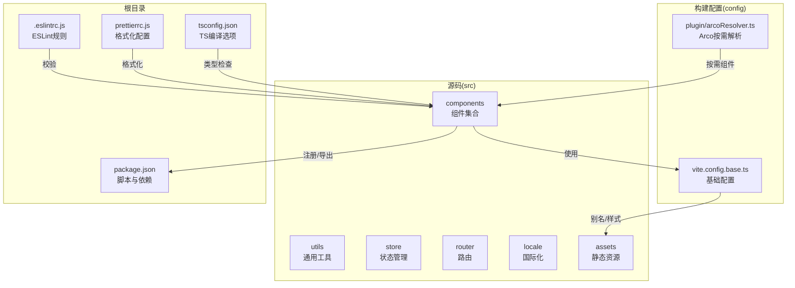
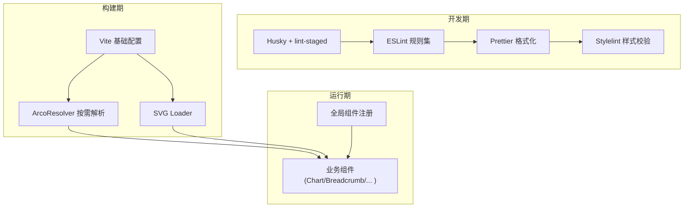
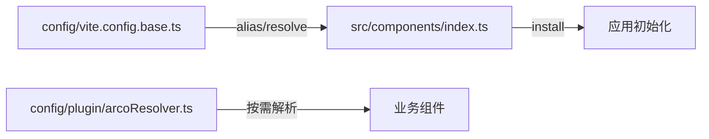

# 组件开发规范

<cite>
**本文引用的文件**
- [package.json](file://package.json)
- [.eslintrc.js](file://.eslintrc.js)
- [.prettierrc.js](file://.prettierrc.js)
- [tsconfig.json](file://tsconfig.json)
- [config/vite.config.base.ts](file://config/vite.config.base.ts)
- [config/plugin/arcoResolver.ts](file://config/plugin/arcoResolver.ts)
- [src/components/index.ts](file://src/components/index.ts)
- [src/components/chart/index.vue](file://src/components/chart/index.vue)
- [src/components/breadcrumb/index.vue](file://src/components/breadcrumb/index.vue)
- [src/components/tab-bar/index.vue](file://src/components/tab-bar/index.vue)
- [src/components/message-box/index.vue](file://src/components/message-box/index.vue)
- [src/components/global-setting/index.vue](file://src/components/global-setting/index.vue)
- [src/utils/index.ts](file://src/utils/index.ts)
</cite>

## 目录
1. [引言](#引言)
2. [项目结构](#项目结构)
3. [核心组件](#核心组件)
4. [架构总览](#架构总览)
5. [详细组件分析](#详细组件分析)
6. [依赖分析](#依赖分析)
7. [性能考虑](#性能考虑)
8. [故障排查指南](#故障排查指南)
9. [结论](#结论)
10. [附录](#附录)

## 引言
本规范面向在该 Vue 3 + TypeScript 前端工程中进行组件开发的团队与个人，目标是统一组件命名、文件组织、代码风格与接口设计，确保组件具备良好的可维护性、可扩展性与可复用性。同时，结合项目现有的工具链（Vite、ESLint、Prettier、Stylelint、Husky、lint-staged 等），明确开发流程、测试策略、文档与版本管理要求，并提供最佳实践、常见问题与性能优化建议。

## 项目结构
该工程采用按功能域分层的组织方式：组件集中在 src/components 下，每个组件以目录形式独立，内部包含 index.vue 作为入口；全局组件注册通过 src/components/index.ts 完成；构建与样式由 Vite 及插件体系支撑；代码质量由 ESLint、Prettier、Stylelint 与 Husky/lint-staged 保障。

图表来源
- [config/vite.config.base.ts:1-52](file://config/vite.config.base.ts#L1-L52)
- [config/plugin/arcoResolver.ts:1-20](file://config/plugin/arcoResolver.ts#L1-L20)
- [src/components/index.ts:1-36](file://src/components/index.ts#L1-L36)
- [package.json:1-103](file://package.json#L1-L103)
- [.eslintrc.js:1-71](file://.eslintrc.js#L1-L71)
- [.prettierrc.js:1-10](file://.prettierrc.js#L1-L10)
- [tsconfig.json:1-21](file://tsconfig.json#L1-L21)

章节来源
- [config/vite.config.base.ts:1-52](file://config/vite.config.base.ts#L1-L52)
- [config/plugin/arcoResolver.ts:1-20](file://config/plugin/arcoResolver.ts#L1-L20)
- [src/components/index.ts:1-36](file://src/components/index.ts#L1-L36)
- [package.json:1-103](file://package.json#L1-L103)
- [.eslintrc.js:1-71](file://.eslintrc.js#L1-L71)
- [.prettierrc.js:1-10](file://.prettierrc.js#L1-L10)
- [tsconfig.json:1-21](file://tsconfig.json#L1-L21)

## 核心组件
- 全局组件注册：通过 src/components/index.ts 将常用组件注册为全局可用，减少重复导入与样板代码。
- 图表组件：src/components/chart/index.vue 提供基于 vue-echarts 的封装，支持动态渲染与尺寸控制。
- 面包屑组件：src/components/breadcrumb/index.vue 展示页面路径，支持国际化文本与样式定制。
- 标签页组件：src/components/tab-bar/index.vue 结合路由监听与 Pinia 状态，实现标签页增删与固定定位。
- 消息框组件：src/components/message-box/index.vue 支持多标签页消息展示、未读计数与状态更新。
- 全局设置抽屉：src/components/global-setting/index.vue 提供主题与布局开关、设置复制等能力。

章节来源
- [src/components/index.ts:1-36](file://src/components/index.ts#L1-L36)
- [src/components/chart/index.vue:1-48](file://src/components/chart/index.vue#L1-L48)
- [src/components/breadcrumb/index.vue:1-36](file://src/components/breadcrumb/index.vue#L1-L36)
- [src/components/tab-bar/index.vue:1-102](file://src/components/tab-bar/index.vue#L1-L102)
- [src/components/message-box/index.vue:1-130](file://src/components/message-box/index.vue#L1-L130)
- [src/components/global-setting/index.vue:1-99](file://src/components/global-setting/index.vue#L1-L99)

## 架构总览
组件开发遵循“按需加载 + 全局注册 + 工具链约束”的架构模式。构建阶段通过 Vite 插件链完成模板编译、JSX 支持、SVG 加载与 Arco 组件按需解析；代码质量通过 ESLint、Prettier、Stylelint 与 Husky/lint-staged 在提交前强制执行；类型系统由 TypeScript 严格模式与路径别名共同保障。

图表来源
- [config/vite.config.base.ts:1-52](file://config/vite.config.base.ts#L1-L52)
- [config/plugin/arcoResolver.ts:1-20](file://config/plugin/arcoResolver.ts#L1-L20)
- [src/components/index.ts:1-36](file://src/components/index.ts#L1-L36)
- [.eslintrc.js:1-71](file://.eslintrc.js#L1-L71)
- [.prettierrc.js:1-10](file://.prettierrc.js#L1-L10)

## 详细组件分析

### 组件命名约定
- 目录与组件名称：采用帕斯卡命名，目录名与组件名一致，便于 import 时保持语义清晰。
- 文件命名：组件入口统一使用 index.vue；国际化资源按语言子目录存放，如 src/components/message-box/locale/zh-CN.ts。
- 导出与注册：全局组件通过 src/components/index.ts 注册，避免重复 import。

章节来源
- [src/components/breadcrumb/index.vue:1-36](file://src/components/breadcrumb/index.vue#L1-L36)
- [src/components/message-box/index.vue:1-130](file://src/components/message-box/index.vue#L1-L130)
- [src/components/index.ts:1-36](file://src/components/index.ts#L1-L36)

### 文件组织结构
- 单文件组件：每个组件目录下包含 index.vue、必要时包含 locale 子目录与子组件（如 tab-item.vue）。
- 类型与常量：与组件相关的类型定义尽量内聚在组件目录或 src/types 中；通用工具函数放置于 src/utils。
- 国际化：组件内的文案通过 vue-i18n 使用，资源文件按语言拆分，避免硬编码。

章节来源
- [src/components/tab-bar/index.vue:1-102](file://src/components/tab-bar/index.vue#L1-L102)
- [src/components/message-box/index.vue:1-130](file://src/components/message-box/index.vue#L1-L130)
- [src/utils/index.ts:1-26](file://src/utils/index.ts#L1-L26)

### 代码风格标准
- 缩进与长度：统一使用 2 空格缩进，单行最大宽度 80 字符。
- 分号与引号：始终使用分号，字符串使用单引号，属性键名一致性处理。
- Vue 与 TS：使用 <script lang="ts" setup> 语法；props 使用 defineProps 并显式声明类型；事件使用 defineEmits；计算属性与响应式数据优先使用组合式 API。
- 导入顺序：遵循 ESLint 的 import 规则，忽略包外扩展名，允许 .ts/.js/.vue 扩展名自动推断。

章节来源
- [.prettierrc.js:1-10](file://.prettierrc.js#L1-L10)
- [.eslintrc.js:1-71](file://.eslintrc.js#L1-L71)
- [src/components/chart/index.vue:1-48](file://src/components/chart/index.vue#L1-L48)
- [src/components/breadcrumb/index.vue:1-36](file://src/components/breadcrumb/index.vue#L1-L36)

### 接口设计规范
- Props 设计：所有 props 明确类型与默认值；对复杂对象使用 PropType 进行约束；避免使用 any。
- Emits 设计：事件命名采用驼峰，避免 DOM 原生事件冲突；事件参数尽量简洁。
- 计算属性：优先使用 computed，避免在模板中直接调用方法；避免在计算属性中产生副作用。
- 生命周期：在 onMounted/onUnmounted 中进行副作用绑定/解绑；对需要等待 DOM 渲染的场景使用 nextTick。

章节来源
- [src/components/breadcrumb/index.vue:1-36](file://src/components/breadcrumb/index.vue#L1-L36)
- [src/components/chart/index.vue:1-48](file://src/components/chart/index.vue#L1-L48)
- [src/components/tab-bar/index.vue:1-102](file://src/components/tab-bar/index.vue#L1-L102)

### 类型定义标准
- 路径别名：通过 tsconfig.json 的 paths 将 @/* 映射到 src/*，保证 import 一致性。
- 严格模式：启用 strict，提升类型安全；跳过库检查 skipLibCheck 仅用于加速。
- 组件类型：组件内部接口尽量局部化；对外暴露的类型通过模块导出并在需要处引入。

章节来源
- [tsconfig.json:1-21](file://tsconfig.json#L1-L21)
- [src/components/message-box/index.vue:1-130](file://src/components/message-box/index.vue#L1-L130)

### 组件设计原则
- 单一职责：每个组件聚焦一个功能点，避免过度耦合。
- 可复用性：通过 props 与 emits 抽象行为与数据，降低对上层业务的侵入。
- 可测试性：将副作用隔离在生命周期钩子中，逻辑尽量纯函数化，便于单元测试。
- 可访问性：使用语义化标签与无障碍属性，确保键盘导航与屏幕阅读器友好。

### 测试策略
- 单元测试：针对组合式函数与纯逻辑进行测试；对组件交互使用快照或渲染断言。
- 集成测试：模拟路由与状态管理，验证组件在真实上下文中的表现。
- 端到端测试：对关键流程（登录、消息查看、标签页切换）进行 E2E 验证。
- 自动化：结合 lint-staged 与 CI，确保每次提交前通过 ESLint、Prettier、TypeScript 检查与测试。

### 文档编写规范
- 组件文档：README 或同级文档说明用途、Props/Emits/Slots、使用示例与注意事项。
- 国际化：文案统一从 locale 文件读取，避免硬编码；提供 zh-CN 与 en-US。
- 变更日志：记录破坏性变更、新增特性与修复项，便于升级参考。

### 版本管理要求
- 语义化版本：遵循 MAJOR.MINOR.PATCH，破坏性变更提升主版本。
- 提交信息：使用约定式提交（如 feat/fix/docs/chore），配合 commitlint。
- 分支策略：主分支保护，发布通过标签与合并请求。

### 开发工具链与自动化流程
- 本地开发：npm run dev 启动热更新；npm run build 进行类型检查与打包。
- 代码质量：ESLint、Prettier、Stylelint 三套工具协同；husky + lint-staged 在提交前拦截。
- 构建优化：ArcoResolver 实现组件按需解析；SVG Loader 处理矢量图标；Less 变量注入统一主题。

章节来源
- [package.json:1-103](file://package.json#L1-L103)
- [.eslintrc.js:1-71](file://.eslintrc.js#L1-L71)
- [.prettierrc.js:1-10](file://.prettierrc.js#L1-L10)
- [config/vite.config.base.ts:1-52](file://config/vite.config.base.ts#L1-L52)
- [config/plugin/arcoResolver.ts:1-20](file://config/plugin/arcoResolver.ts#L1-L20)

## 依赖分析
- 组件注册：src/components/index.ts 对外导出 install 方法，供应用初始化时注册全局组件。
- 构建别名：Vite 配置将 @ 指向 src，简化 import；同时修正 vue-i18n 与 vue 的解析路径。
- Arco 按需：ArcoResolver 避免扫描 src/components，防止与手动注册冲突。

图表来源
- [src/components/index.ts:1-36](file://src/components/index.ts#L1-L36)
- [config/vite.config.base.ts:1-52](file://config/vite.config.base.ts#L1-L52)
- [config/plugin/arcoResolver.ts:1-20](file://config/plugin/arcoResolver.ts#L1-L20)

章节来源
- [src/components/index.ts:1-36](file://src/components/index.ts#L1-L36)
- [config/vite.config.base.ts:1-52](file://config/vite.config.base.ts#L1-L52)
- [config/plugin/arcoResolver.ts:1-20](file://config/plugin/arcoResolver.ts#L1-L20)

## 性能考虑
- 懒渲染：图表组件在 nextTick 后再渲染，避免 SSR 或首屏阻塞。
- 按需加载：ArcoResolver 与手动引入 ECharts 模块减少打包体积。
- 样式作用域：使用 scoped 与 :deep 限定样式范围，避免全局污染。
- 资源优化：SVG Loader 与图片压缩插件在构建期处理静态资源。

章节来源
- [src/components/chart/index.vue:1-48](file://src/components/chart/index.vue#L1-L48)
- [src/components/index.ts:1-36](file://src/components/index.ts#L1-L36)
- [config/vite.config.base.ts:1-52](file://config/vite.config.base.ts#L1-L52)

## 故障排查指南
- ESLint 报错：检查 import/extensions 规则与类型注解是否完整；确认 tsconfig 路径映射正确。
- Prettier 冲突：在提交前执行 lint-staged，确保格式化与修复同步进行。
- 样式不生效：确认 scoped 与 :deep 使用是否正确；检查 Less 变量注入与主题变量名。
- 组件未注册：核对 src/components/index.ts 的 install 逻辑与应用初始化流程。
- 路由联动异常：检查路由监听与状态管理的订阅/取消逻辑，避免内存泄漏。

章节来源
- [.eslintrc.js:1-71](file://.eslintrc.js#L1-L71)
- [.prettierrc.js:1-10](file://.prettierrc.js#L1-L10)
- [src/components/index.ts:1-36](file://src/components/index.ts#L1-L36)
- [src/components/tab-bar/index.vue:1-102](file://src/components/tab-bar/index.vue#L1-L102)

## 结论
本规范以项目现有工具链为基础，围绕组件命名、文件组织、接口与类型设计、测试与文档、版本管理以及性能优化等方面形成统一标准。建议在新组件开发中严格遵循上述规范，并在团队内定期回顾与演进，确保长期可维护性与协作效率。

## 附录

### 组件开发最佳实践清单
- 命名：目录与组件名一致，使用帕斯卡命名；props 使用驼峰，事件使用驼峰。
- 结构：index.vue 为主入口，国际化文案集中管理，子组件按需拆分。
- 类型：明确 props 默认值与类型；避免 any；合理使用 PropType。
- 样式：优先 scoped，必要时使用 :deep；统一使用 Less 变量。
- 性能：懒渲染、按需加载、避免大计算在模板中执行。
- 测试：为组合式函数与关键逻辑编写单元测试；对交互流程进行集成测试。
- 文档：提供使用说明、变更日志与注意事项。
- 工具：提交前通过 lint-staged；构建前通过类型检查与 ESLint。

### 常见问题与解决方案
- 组件无法全局使用：检查 src/components/index.ts 是否正确注册，应用初始化是否调用 install。
- 样式覆盖困难：使用 :deep 选择器；避免在父组件中重复覆盖。
- 国际化文案未生效：确认 locale 文件存在且键名一致，i18n 初始化正确。
- 构建体积过大：启用 ArcoResolver 与按需引入 ECharts 模块；移除未使用的依赖。