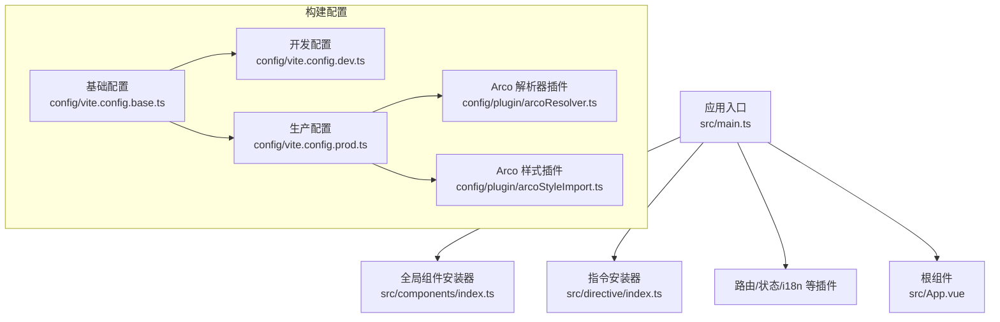
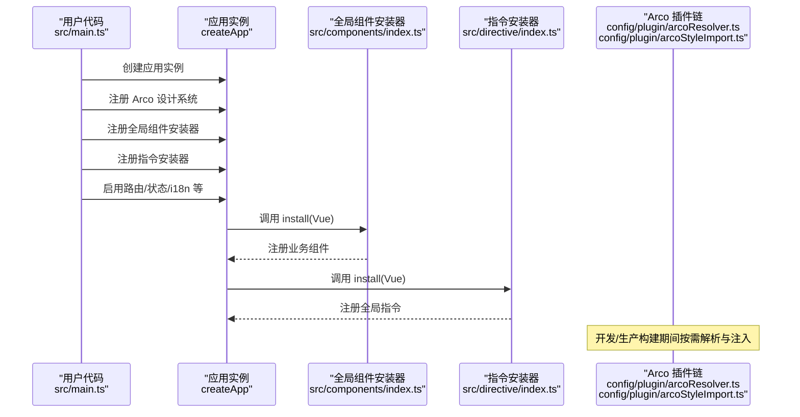
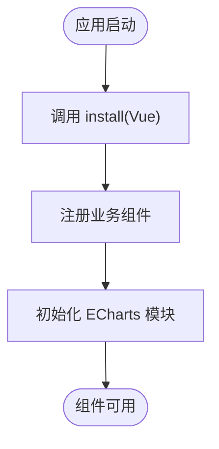
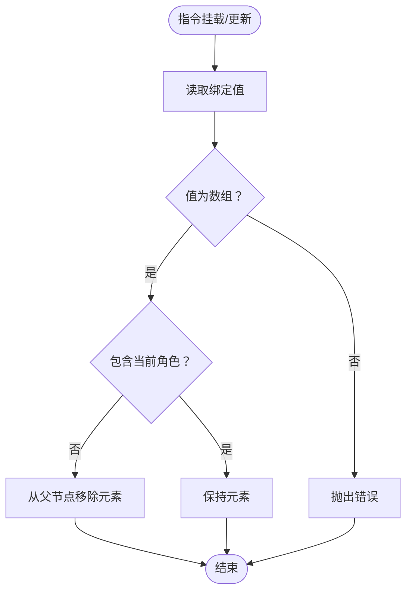
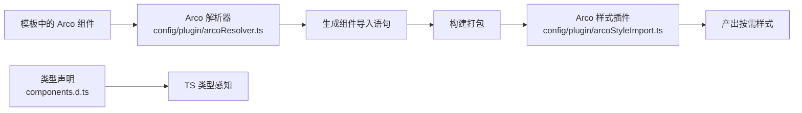
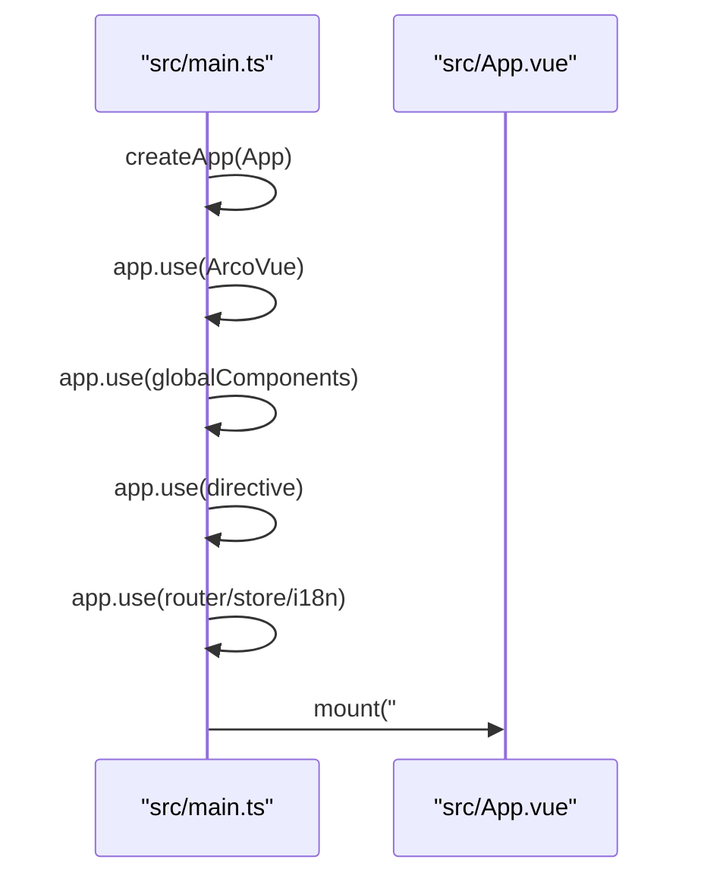
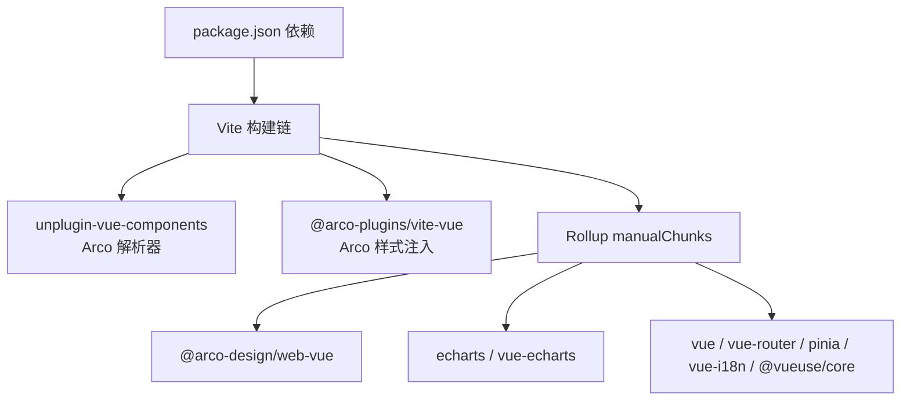

# 组件注册与导入

<cite>
**本文引用的文件**
- [src/components/index.ts](file://src/components/index.ts)
- [src/main.ts](file://src/main.ts)
- [src/directive/index.ts](file://src/directive/index.ts)
- [src/directive/permission/index.ts](file://src/directive/permission/index.ts)
- [src/App.vue](file://src/App.vue)
- [config/vite.config.base.ts](file://config/vite.config.base.ts)
- [config/vite.config.dev.ts](file://config/vite.config.dev.ts)
- [config/vite.config.prod.ts](file://config/vite.config.prod.ts)
- [config/plugin/arcoResolver.ts](file://config/plugin/arcoResolver.ts)
- [config/plugin/arcoStyleImport.ts](file://config/plugin/arcoStyleImport.ts)
- [config/plugin/compress.ts](file://config/plugin/compress.ts)
- [config/plugin/visualizer.ts](file://config/plugin/visualizer.ts)
- [config/plugin/imagemin.ts](file://config/plugin/imagemin.ts)
- [components.d.ts](file://components.d.ts)
- [package.json](file://package.json)
</cite>

## 目录
1. [简介](#简介)
2. [项目结构](#项目结构)
3. [核心组件](#核心组件)
4. [架构总览](#架构总览)
5. [详细组件分析](#详细组件分析)
6. [依赖关系分析](#依赖关系分析)
7. [性能考量](#性能考量)
8. [故障排查指南](#故障排查指南)
9. [结论](#结论)
10. [附录](#附录)

## 简介
本文件系统性阐述该 Vue 3 项目的“组件注册与导入”机制，覆盖以下主题：
- 全局组件注册的实现原理与生命周期
- 组件自动导入（按需）的配置方式与组件库集成策略
- 命名规范与冲突处理机制
- 最佳实践、性能优化与按需加载策略
- 扩展方法与自定义注册器开发指南
- 与构建工具的集成与打包优化配置

## 项目结构
该项目采用“功能域+分层”的组织方式：组件统一在 src/components 下管理，并通过一个集中导出的安装器进行全局注册；指令同样以安装器形式注册；构建侧通过 Vite 插件链路实现按需样式与组件解析。

**图表来源**
- [src/main.ts:1-29](file://src/main.ts#L1-L29)
- [src/components/index.ts:1-36](file://src/components/index.ts#L1-L36)
- [src/directive/index.ts:1-9](file://src/directive/index.ts#L1-L9)
- [config/vite.config.base.ts:1-52](file://config/vite.config.base.ts#L1-L52)
- [config/vite.config.dev.ts:1-24](file://config/vite.config.dev.ts#L1-L24)
- [config/vite.config.prod.ts:1-32](file://config/vite.config.prod.ts#L1-L32)
- [config/plugin/arcoResolver.ts:1-20](file://config/plugin/arcoResolver.ts#L1-L20)
- [config/plugin/arcoStyleImport.ts:1-13](file://config/plugin/arcoStyleImport.ts#L1-L13)

**章节来源**
- [src/main.ts:1-29](file://src/main.ts#L1-L29)
- [config/vite.config.base.ts:1-52](file://config/vite.config.base.ts#L1-L52)

## 核心组件
- 全局组件安装器：负责注册业务通用组件（如图表、面包屑等），并初始化第三方可视化库模块。
- 指令安装器：集中注册权限指令等全局指令。
- 构建期自动导入：通过 unplugin-vue-components 在模板中按需解析 Arco 组件，避免手动引入；Arco 样式通过专用插件按需注入。

关键要点：
- 安装器遵循 Vue 插件规范，提供 install 方法并在应用启动时调用。
- 自动导入由 Vite 插件链在开发与生产环境分别启用不同策略。
- 类型声明文件确保 TS 对自动导入组件的类型感知。

**章节来源**
- [src/components/index.ts:1-36](file://src/components/index.ts#L1-L36)
- [src/directive/index.ts:1-9](file://src/directive/index.ts#L1-L9)
- [config/plugin/arcoResolver.ts:1-20](file://config/plugin/arcoResolver.ts#L1-L20)
- [config/plugin/arcoStyleImport.ts:1-13](file://config/plugin/arcoStyleImport.ts#L1-L13)
- [components.d.ts:1-16](file://components.d.ts#L1-L16)

## 架构总览
下图展示从应用启动到组件可用的关键流程，以及构建期自动导入与样式注入的协作关系：

**图表来源**
- [src/main.ts:1-29](file://src/main.ts#L1-L29)
- [src/components/index.ts:30-36](file://src/components/index.ts#L30-L36)
- [src/directive/index.ts:4-9](file://src/directive/index.ts#L4-L9)
- [config/plugin/arcoResolver.ts:12-19](file://config/plugin/arcoResolver.ts#L12-L19)
- [config/plugin/arcoStyleImport.ts:9-12](file://config/plugin/arcoStyleImport.ts#L9-L12)

## 详细组件分析

### 全局组件安装器
- 注册对象：业务通用组件（例如图表、面包屑等）。
- 第三方库初始化：在安装器内预注册 ECharts 的渲染器与图表/组件模块，减少打包体积。
- 生命周期：install 在应用启动阶段执行一次，随后这些组件可在任意模板中直接使用。

**图表来源**
- [src/components/index.ts:30-36](file://src/components/index.ts#L30-L36)
- [src/components/index.ts:15-28](file://src/components/index.ts#L15-L28)

**章节来源**
- [src/components/index.ts:1-36](file://src/components/index.ts#L1-L36)

### 权限指令安装器
- 功能：根据用户角色动态控制元素是否渲染或移除。
- 生命周期钩子：mounted 与 updated 阶段均校验权限，保证响应式更新。
- 冲突处理：当绑定值格式不正确时抛出错误，避免静默失败。

**图表来源**
- [src/directive/permission/index.ts:4-31](file://src/directive/permission/index.ts#L4-L31)

**章节来源**
- [src/directive/index.ts:1-9](file://src/directive/index.ts#L1-L9)
- [src/directive/permission/index.ts:1-31](file://src/directive/permission/index.ts#L1-L31)

### 构建期自动导入与样式注入
- Arco 组件按需解析：通过 unplugin-vue-components 的 ArcoResolver，在模板中自动识别并引入所需组件，避免手动 import。
- 样式按需注入：Arco 样式插件在构建时仅注入实际使用的组件样式，降低包体体积。
- 类型声明：自动生成的类型声明文件确保 TS 对自动导入组件的类型感知。

**图表来源**
- [config/plugin/arcoResolver.ts:9-19](file://config/plugin/arcoResolver.ts#L9-L19)
- [config/plugin/arcoStyleImport.ts:7-12](file://config/plugin/arcoStyleImport.ts#L7-L12)
- [components.d.ts:10-16](file://components.d.ts#L10-L16)

**章节来源**
- [config/plugin/arcoResolver.ts:1-20](file://config/plugin/arcoResolver.ts#L1-L20)
- [config/plugin/arcoStyleImport.ts:1-13](file://config/plugin/arcoStyleImport.ts#L1-L13)
- [components.d.ts:1-16](file://components.d.ts#L1-L16)

### 应用入口与根组件
- 应用入口：创建应用实例后依次注册 Arco、全局组件、指令、路由、状态、国际化等插件。
- 根组件：作为 Arco 国际化上下文容器，承载页面视图与全局设置面板。

**图表来源**
- [src/main.ts:17-29](file://src/main.ts#L17-L29)
- [src/App.vue:1-27](file://src/App.vue#L1-L27)

**章节来源**
- [src/main.ts:1-29](file://src/main.ts#L1-L29)
- [src/App.vue:1-27](file://src/App.vue#L1-L27)

## 依赖关系分析
- 运行时依赖：Vue 生态、Arco 设计系统、ECharts 及其 Vue 封装、Pinia、Vue Router、VueI18n 等。
- 构建期依赖：Vite、unplugin-vue-components、@arco-plugins/vite-vue、rollup 插件生态等。
- 包体拆分：生产构建通过 Rollup 的 manualChunks 将 Arco、图表与 Vue 生态分别打包，提升缓存命中率与加载效率。

**图表来源**
- [package.json:32-47](file://package.json#L32-L47)
- [package.json:49-92](file://package.json#L49-L92)
- [config/vite.config.prod.ts:17-26](file://config/vite.config.prod.ts#L17-L26)
- [config/plugin/arcoResolver.ts:9-19](file://config/plugin/arcoResolver.ts#L9-L19)
- [config/plugin/arcoStyleImport.ts:7-12](file://config/plugin/arcoStyleImport.ts#L7-L12)

**章节来源**
- [package.json:1-103](file://package.json#L1-L103)
- [config/vite.config.prod.ts:1-32](file://config/vite.config.prod.ts#L1-L32)

## 性能考量
- 按需加载策略
  - Arco 组件：通过 ArcoResolver 在模板中自动按需引入，避免全量引入导致的包体膨胀。
  - Arco 样式：Arco 样式插件仅注入实际使用的组件样式，减少无关样式的打包。
  - 图表库：在安装器中仅注册实际使用的 ECharts 模块，避免引入未使用的图表/组件。
- 打包优化
  - 使用 manualChunks 将大体量依赖拆分为独立 chunk，提升浏览器缓存复用率。
  - 生产构建开启图片压缩与可选的 gzip/Brotli 压缩，进一步降低传输体积。
- 开发体验
  - 开发模式启用 ESLint 插件，保证代码质量与一致性。
  - 可选的打包可视化分析，便于定位体积热点。

最佳实践建议：
- 优先使用模板中的 Arco 组件而非手动 import，确保按需生效。
- 对于业务组件，统一在全局安装器中集中注册，避免重复注册与命名冲突。
- 对大型第三方库（如 ECharts）在安装器中按需初始化模块，减少首屏体积。
- 利用 manualChunks 合理拆分公共依赖，避免单个 chunk 过大。

**章节来源**
- [config/plugin/arcoResolver.ts:1-20](file://config/plugin/arcoResolver.ts#L1-L20)
- [config/plugin/arcoStyleImport.ts:1-13](file://config/plugin/arcoStyleImport.ts#L1-L13)
- [src/components/index.ts:15-28](file://src/components/index.ts#L15-L28)
- [config/vite.config.prod.ts:17-26](file://config/vite.config.prod.ts#L17-L26)
- [config/plugin/compress.ts:1-35](file://config/plugin/compress.ts#L1-L35)
- [config/plugin/imagemin.ts:1-38](file://config/plugin/imagemin.ts#L1-L38)

## 故障排查指南
- 模板中找不到已注册组件
  - 确认已在全局安装器中注册该组件，并在应用启动时调用了安装器。
  - 若使用 Arco 组件，请确认模板中使用的是自动导入的写法，且未被解析器排除。
- 权限指令不生效
  - 检查 v-permission 的绑定值是否为数组格式；非数组将触发错误。
  - 确保指令在应用启动时已注册。
- 样式缺失或主题异常
  - 确认 Arco 样式插件已启用；检查构建配置中是否启用了对应插件。
  - 如需自定义主题变量，检查基础配置中的 Less 变量注入。
- 包体过大或缓存命中率低
  - 检查 manualChunks 配置是否合理；确认第三方库是否被拆分为独立 chunk。
  - 使用打包可视化分析定位体积热点，针对性优化。

**章节来源**
- [src/components/index.ts:30-36](file://src/components/index.ts#L30-L36)
- [src/directive/permission/index.ts:4-31](file://src/directive/permission/index.ts#L4-L31)
- [config/plugin/arcoStyleImport.ts:9-12](file://config/plugin/arcoStyleImport.ts#L9-L12)
- [config/vite.config.base.ts:39-50](file://config/vite.config.base.ts#L39-L50)
- [config/vite.config.prod.ts:17-26](file://config/vite.config.prod.ts#L17-L26)
- [config/plugin/visualizer.ts:8-18](file://config/plugin/visualizer.ts#L8-L18)

## 结论
该工程通过“安装器 + 构建期自动导入 + 按需样式注入”的组合，实现了高内聚、低耦合的组件注册与导入体系。安装器集中管理业务组件与第三方库初始化，构建期插件链保障按需与体积优化，配合合理的打包拆分策略，兼顾了开发体验与运行性能。遵循本文的命名规范、冲突处理与最佳实践，可进一步提升系统的可维护性与扩展性。

## 附录

### 命名规范与冲突处理
- 组件命名
  - 使用 PascalCase，避免与内置 HTML 标签冲突。
  - 业务组件统一放置于 src/components 下，通过安装器集中注册。
- 指令命名
  - 使用 v- 前缀，避免与原生属性冲突。
- 冲突处理
  - 安装器内注册前检查是否已存在同名组件/指令，必要时给出警告或抛错。
  - 对第三方库模块（如 ECharts）在安装器内统一初始化，避免重复引入。

### 扩展方法与自定义注册器开发指南
- 新增全局组件
  - 在 src/components 下新增目录与组件文件，修改安装器导出对象，添加注册逻辑。
  - 如涉及第三方库模块，参考现有安装器在安装阶段初始化。
- 新增全局指令
  - 在 src/directive 下新增目录与指令文件，修改安装器导出对象，添加注册逻辑。
  - 注意生命周期钩子的使用，确保在合适时机进行 DOM 操作。
- 自定义解析器
  - 可基于 unplugin-vue-components 开发自定义解析器，结合项目约定实现特定组件的自动导入规则。
  - 在构建配置中启用自定义解析器，确保不影响现有解析器行为。

### 与构建工具的集成与打包优化配置
- Vite 插件链
  - 基础配置：别名、解析扩展、CSS 变量注入、Less 预处理器配置。
  - 开发配置：ESLint 插件、自动打开浏览器、严格文件系统访问。
  - 生产配置：Gzip/Brotli 压缩、打包可视化、Arco 解析器与样式插件、图片压缩、manualChunks 拆分。
- 打包优化
  - 将 Arco、图表与 Vue 生态分别拆分为独立 chunk，提升缓存命中率。
  - 对图片资源进行多算法压缩，平衡体积与质量。
  - 使用可视化分析工具持续监控体积变化，及时调整拆分策略。

**章节来源**
- [config/vite.config.base.ts:1-52](file://config/vite.config.base.ts#L1-L52)
- [config/vite.config.dev.ts:1-24](file://config/vite.config.dev.ts#L1-L24)
- [config/vite.config.prod.ts:1-32](file://config/vite.config.prod.ts#L1-L32)
- [config/plugin/compress.ts:1-35](file://config/plugin/compress.ts#L1-L35)
- [config/plugin/visualizer.ts:1-19](file://config/plugin/visualizer.ts#L1-L19)
- [config/plugin/imagemin.ts:1-38](file://config/plugin/imagemin.ts#L1-L38)